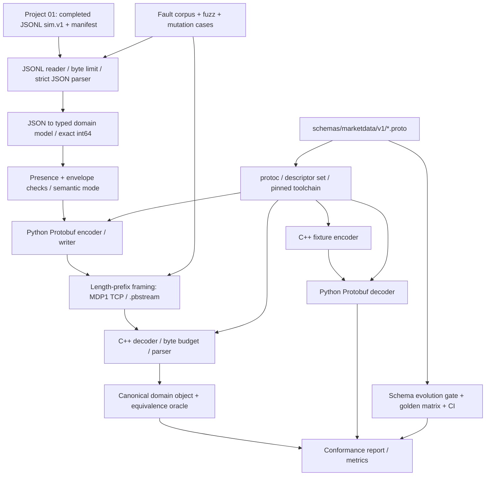
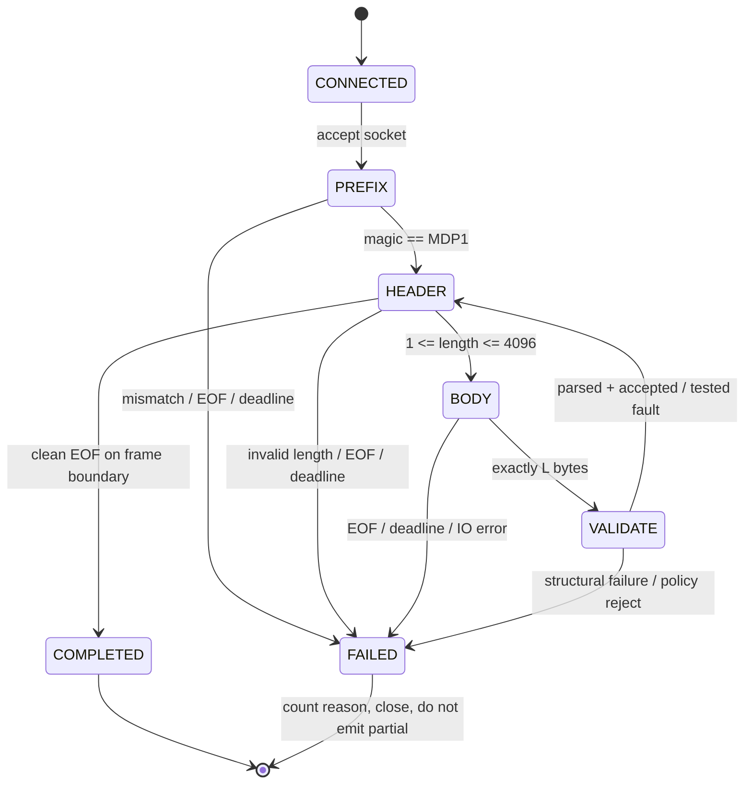

# PROJECT 02 — Market Data Protobuf Schema & Cross-Language Contracts

> **System Design + Contract Evolution + Threat/Failure Modeling + Test Plan**  
> Ngôn ngữ: **Tiếng Việt** · Công nghệ: **Protocol Buffers (`proto3`), C++20, Python 3.12, Linux**  
> Phiên bản tài liệu: **1.0** · Ngày: **2026-10-30**  
> Trạng thái: **DESIGN_ONLY / NOT_IMPLEMENTED / NOT_BENCHMARKED**. Tất cả ngưỡng hiệu năng là *mục tiêu đề xuất*, không phải số liệu đã đo.

## 0. Bối cảnh, ranh giới và nguyên tắc thiết kế

Đây là **Project 02/09** trong kế hoạch tái tạo **Market Data Streaming and Analytics Platform**. CV gốc xác nhận dự án lớn có công nghệ **C++20, Python 3.12, Kafka, Protobuf, ClickHouse, PostgreSQL**, bao gồm **versioned Protobuf schemas**; CV **không mô tả** sơ đồ message, số tag, framing, limits, công cụ CI hay quy trình tương thích cụ thể. **Mọi phần thiết kế chi tiết trong tài liệu này là đề xuất để xây dựng lại**, không gán thành triển khai lịch sử trong CV.

**Liên kết với Project 01:** `01-market-data-simulator` sinh **canonical JSONL `sim.v1`**, mỗi dòng là `tick` hoặc `quote`, có `dataset_id`, `symbol`, `sequence`, `event_time_ns`, `price_scale` và integer price fields. Project 01 vẫn phát TCP **JSONL + `\n`** trên cổng riêng. Project 02 là **schema, codec, bridge và conformance suite** nhận nguồn JSONL đó để chuyển qua **Protobuf binary**, kiểm tra C++ ↔ Python rồi bàn giao contract cho Project 03/04. Không thay đổi âm thầm format TCP của Project 01.

### Câu hỏi then chốt: “Chịu nổi” được hiểu thế nào?

Một codec **chịu nổi** không có nghĩa luôn deserialize mọi chuỗi byte hoặc luôn đạt 120.000 events/s. Hệ thống được chấp nhận khi:

1. Dữ liệu hợp lệ có thể **round-trip mà không biến đổi giá, thời gian, sequence, event type** giữa Python và C++.
2. Input không hợp lệ bị **reject có lý do** hoặc đưa vào **luồng fault-test có đánh dấu**, tuyệt đối không tự sửa thành giá/sequence bình thường rồi báo thành công.
3. Mọi message và luồng đều có **giới hạn byte, thời gian, CPU/RAM**; gặp tải ngoài năng lực thì backpressure hoặc fail closed, không tăng bộ nhớ vô hạn.
4. V1 và V2 có **ma trận tương thích**; thay schema không âm thầm đổi nghĩa trường dữ liệu.
5. Không khẳng định **byte-identical khi C++/Python serialize**: Protobuf binary **không canonical**; kiểm tra **semantic equality** theo contract, không dựa vào SHA-256 của bytes để quyết định hai message có cùng nghĩa.
6. Benchmark có môi trường đo, SLO, số liệu và bằng chứng; **không** mượn mốc 120k ticks/s của cả platform làm throughput đã đạt của codec.

> Không thể liệt kê mọi tình huống có thể xảy ra. Ma trận **170 “what if”** dưới đây là tập kịch bản có hệ thống, có thể mở rộng và gắn oracle PASS/FAIL. Mọi giả định chưa kiểm thử phải ở trạng thái `NOT_RUN`.

### Trong phạm vi

- Định nghĩa `marketdata.v1` cho `MarketDataEvent`, `Quote`, `Tick`; giữ số nguyên fixed-point và `event_time_ns` kiểu `int64`.
- Bridge **Project 01 JSONL → Protobuf**, cùng decoder **Protobuf → canonical domain object/JSONL**.
- Build code từ cùng một schema cho **C++20** và **Python 3.12**; cross-language conformance cả hai chiều.
- Framing binary theo length-prefix cho TCP/file; phiên bản protocol/handshake và quy tắc Kafka value cho Project 04.
- CI bảo vệ schema evolution, golden fixtures, mutation tests, property/fuzz, load, soak, version-skew tests.
- Thiết kế giới hạn tài nguyên, quan sát lỗi và quy trình release/rollback.

### Ngoài phạm vi

- Không xây market data simulator thực tế (Project 01), market-data adapter về thứ tự/staleness (Project 03), Kafka broker/producer (Project 04), ingestion/ClickHouse (Project 05–06).
- Không kết nối giá thật hay xây trading execution. Không tự nhận Protobuf có encryption, authentication, delivery ACK, exactly-once hoặc durable storage.
- Không có dynamic schema registry bắt buộc ở MVP. Không áp dụng nén payload, tự phục hồi TCP stream sau frame sai hoặc auto-upcast event type chưa biết trong v1.

---

## 1. Yêu cầu và điều kiện nghiệm thu

### 1.1. Functional requirements (FR)

| ID | Yêu cầu | Điều kiện nghiệm thu |
|---|---|---|
| FR-01 | Có `.proto` công khai, tag cố định | `protoc` generate được cả C++/Python; descriptor được lưu thành artifact |
| FR-02 | Map đủ trường `sim.v1` | `event_type` ↔ `oneof`, mọi integer 64-bit bảo toàn giá trị |
| FR-03 | Presence rõ ràng | Phân biệt `missing` và `explicit 0`, kể cả `sequence`, `bid_ticks` |
| FR-04 | Cross-language hai chiều | Python encode → C++ decode; C++ encode → Python decode có semantic equality |
| FR-05 | Versioned schema | V1 ↔ V1.1 theo ma trận; thay đổi không tương thích bị CI chặn |
| FR-06 | Envelope validation tách domain validation | Không che mất fault cố ý của Project 01; malformed bytes không được coi là fault hợp lệ |
| FR-07 | TCP binary framing | Xử lý header/payload bị chia nhỏ, coalescing; reject chiều dài bất thường trước cấp phát |
| FR-08 | Bounded memory/time | Giới hạn payload, queue, deadline, event size và byte budgets |
| FR-09 | Golden test corpus | Normal, edge, fault, malformed, v1/v1.1; có expected outputs và error classes |
| FR-10 | Artifact tái lập | Log toolchain version, SHA-256 `.proto`, descriptor, phiên bản runtime/codegen |
| FR-11 | Streaming file utility | Có `encode-jsonl`, `decode-pbstream`, `verify`, `benchmark` (CLI dự kiến) |
| FR-12 | Protocol handoff Project 03/04 | Spec rõ TCP framing khác Kafka raw payload, không đoán định dạng theo byte |
| FR-13 | Không tạo ACK giả | Tách `parsed`, `validated`, `encoded`, `enqueued`, `written`, `peer_accepted=unknown` |
| FR-14 | Safety test cho schema mutation | Test wire-safe, conditionally safe, wire-unsafe, unknown fields, oneof và rollback |

### 1.2. NFR / SLO **đề xuất, chưa đo**

| ID | Chỉ tiêu | Acceptance gate đề xuất |
|---|---|---|
| NFR-01 | Dữ liệu normal round-trip | 100% core fields giữ nguyên trên golden corpus và property tests; không silent mutation |
| NFR-02 | Fault-test passthrough | 100% anomaly được phép đều giữ đúng giá trị + manifest liên kết; không bị auto-fix |
| NFR-03 | Input budget | `max_payload_bytes=4096`, `max_frame_bytes=4100`, `max_json_line_bytes=4096` (sau xử lý `\n`); đều đo theo **bytes**, không theo chars |
| NFR-04 | Queue budget | Mỗi streaming connection có giới hạn **cả count lẫn bytes**; default 2.048 frames / 8 MiB tổng payload+framing, chọn ngưỡng nào đến trước |
| NFR-05 | Cross-language stability | Không khác biệt về semantic fields qua C++/Python ở cùng release contract |
| NFR-06 | Corruption resistance | Payload lỗi / truncated / oversize không gây crash, OOM, deadlock, hoặc forward im lặng |
| NFR-07 | Version rollout | Old/new reader-writer combinations tuân bảng cam kết trước khi merge/release |
| NFR-08 | Performance ladder | Thử 1k → 10k → 50k → 120k events/s **nếu máy đủ**; report rate thực, CPU, RSS, p50/p95/p99 encode/decode |
| NFR-09 | Soak & burst | Burst ≥ 30s, soak đề xuất ≥ 60 phút ở tải dưới ngưỡng năng lực, queue/RSS không tăng không giới hạn |
| NFR-10 | Build hermetic | Pin phiên bản compiler/plugin/runtime; một source `.proto`, C++ gencode + runtime **cùng phiên bản release** |
| NFR-11 | Reproducibility | Golden **semantic fields** giống nhau giữa môi trường; binary hash chỉ so sánh trong môi trường build đã pin |
| NFR-12 | Failure visibility | Rejected/unsupported/parse failure có error class, counter, sample an toàn; exit code nonzero với batch lỗi |

**Nguyên tắc P0:** Không silent data corruption, không overflow/UB, không unbounded memory, không biến malformed bytes thành event hợp lệ không có audit. Nếu vượt năng lực, **thành công có giới hạn** hoặc **thất bại rõ ràng** đều chấp nhận; “thành công giả” thì không.

---

## 2. Kiến trúc logic và ranh giới trách nhiệm

### 2.1. Component diagram



**Không gọi hình trên là hệ thống Kafka hoàn chỉnh.** Cổng/bridge nhị phân là công cụ kiểm chứng và chuẩn bị handoff. Project 03 sẽ đọc `MarketDataEvent` từ transport phù hợp; Project 04 đưa **raw Protobuf payload** vào Kafka value (không kèm TCP length-prefix).

### 2.2. Module responsibilities

| Thành phần | Chịu trách nhiệm | Không làm |
|---|---|---|
| `schema/market_data.proto` | Message types, numbers, presence, oneof | Không thể biểu đạt spread/sequence business invariant |
| `schema_lint` | Parse descriptors, check compatibility/tag reuse | Không chứng minh tương thích ứng dụng nếu chỉ so wire |
| `json_reader` | Giới hạn bytes, UTF-8, duplicate JSON keys, exact integers | Không coi `json.loads` mặc định là validation đầy đủ |
| `mapper` | `sim.v1` → typed domain → Protobuf; oneof | Không tự thêm một event mới khi source thiếu field |
| `validator` | Envelope, type/size/presence + strict/fault-test semantics | Không xóa bất thường có chủ ý |
| `python_codec` | Serialize/parse Protobuf bằng Python | Không bảo đảm bytes giống C++ |
| `cpp_codec` | Serialize/parse Protobuf bằng C++20 | Không dùng gencode/runtime lệch version |
| `framing` | 4-byte length BE; TCP/file magic, exact read, timeout | Không cung cấp application-level ACK |
| `conformance` | Differential testing/golden comparison | Không so SHA(binary) làm semantic truth |
| `fuzz` | Mutation corpus, kiểm thử parser, memory, timeout | Không được chạy payload chưa tin cậy trong service sản xuất |
| `metrics` | Counter, histogram, limits, test metadata | Không log mỗi tick/quote ở throughput cao |

### 2.3. Data flow chuẩn và các điểm không được trộn

```mermaid
sequenceDiagram
  participant S as P01 JSONL/Simulator
  participant J as Python Bridge
  participant P as Protobuf Encoder
  participant W as Frame Writer
  participant R as C++ Frame Reader
  participant D as C++ Decoder
  participant T as Test Oracle
  S->>J: One JSON line (sim.v1)
  J->>J: Strict byte/JSON/type check
  J->>P: Typed event + policy context
  P->>W: SerializeToString() = binary payload
  W->>R: MDP1 once, then uint32 len + payload
  R->>R: Check len / bounded exact-read
  R->>D: ParseFrom... + presence check
  D->>T: Domain object + schema/version metadata
  T->>T: Compare typed core fields to source fixture
  Note over W,R: TCP send/drain != app accepted; no ACK in MVP
```

- **Offline M0/M1:** chưa cần TCP; có thể so `fixture.jsonl` ↔ `.pbstream` và Python/C++ binaries bằng subprocess trong test.
- **TCP M3:** chọn cổng riêng, ví dụ `127.0.0.1:9010` cho `MDP1`. Không chuyển Project 01 cổng `9009` từ JSONL sang Protobuf mà không có explicit protocol version change.
- **Kafka M4:** `record.value` chỉ là raw Protobuf `MarketDataEvent`, `record.key` là `symbol` (theo Project 04); không tự chèn 4-byte length-prefix hay `MDP1` vào Kafka value.
- **Không hỗ trợ fallback parser JSON nếu Protobuf thất bại**, vì sẽ gây protocol confusion và mở đường cho data corruption.

---

## 3. Schema đề xuất — source of truth

### 3.1. `schemas/marketdata/v1/market_data.proto`

```proto
syntax = "proto3";
package marketdata.v1;

// Quote là báo giá synthetic; giá là số nguyên fixed-point.
message Quote {
  optional int64 bid_ticks = 1;
  optional int64 ask_ticks = 2;
}

// Tick là synthetic price update, KHÔNG đồng nghĩa real exchange trade.
message Tick {
  optional int64 price_ticks = 1;
}

message MarketDataEvent {
  optional string dataset_id = 1;
  optional string symbol = 2;
  optional int64 sequence = 3;
  optional int64 event_time_ns = 4;
  optional int64 price_scale = 5;
  optional string source_schema_version = 6; // "sim.v1" từ Project 01

  oneof payload {
    Quote quote = 10;
    Tick tick = 11;
  }
}
```

**Lựa chọn chủ ý:**

- `proto3` + `optional` để phân biệt **không tồn tại** với **được cung cấp bằng 0/chuỗi rỗng**; `optional` không biến field thành `required` trong wire format. Business validator phải kiểm tra sự hiện diện.
- Dùng `int64` **có dấu** cho giá, time, sequence, scale. Normal events đều dương, nhưng signed fields cho phép chuyển tiếp giá âm/sequence âm có chủ ý trong chế độ **fault-test** mà không wrap sang `uint64`. Không phải mọi anomaly đều được cho phép: cú pháp JSON/payload hỏng phải reject.
- `oneof` là nguồn xác định event type (`quote` hoặc `tick`), **không lưu thêm chuỗi `event_type`** để tránh thông tin mâu thuẫn. Message với `oneof` không được set ⇒ lỗi về contract.
- `dataset_id` deterministic từ Project 01, `run_instance_id` vẫn nằm ngoài payload. `event_id` logic = `(dataset_id, symbol, sequence)`; duplicate có chủ ý giữ nguyên tuple.
- `source_schema_version="sim.v1"` mô tả format JSONL đầu vào; package `marketdata.v1` và descriptor release mô tả **Protobuf contract**. Hai loại version không được đánh đồng.
- Không có `double`, `float`, map, `Any`, generic `Struct` hay timestamp chuyển đổi từ nano sang millisecond trong core schema. Tránh mất độ chính xác và tăng diện tích tấn công.
- Khi cần thêm event type v2, phải giải quyết old reader không hiểu oneof variant mới; thêm message **không tự động đảm bảo application compatibility**.

### 3.2. Mapping đúng 1:1 từ `sim.v1`

| Project 01 JSON key | Protobuf v1 | Chính sách |
|---|---|---|
| `schema_version` | `source_schema_version` | Bằng `sim.v1`; thiếu => error trong normal mode |
| `dataset_id` | `dataset_id` | Giữ nguyên UTF-8/ASCII; max 128 bytes |
| `symbol` | `symbol` | Giữ nguyên mã symbol; max 32 bytes |
| `sequence` | `int64 sequence` | Giữ **đúng** integer; không truncate/round |
| `event_time_ns` | `int64 event_time_ns` | Nanoseconds epoch UTC; không đổi sang float/timezone local |
| `price_scale` | `int64 price_scale` | Giữ nguyên per-symbol scale; không tự đoán từ decimal digits |
| `event_type=quote` | `oneof quote` | Phải có cả `bid_ticks` và `ask_ticks` theo presence |
| `bid_ticks`, `ask_ticks` | `Quote` fields | Giữ dấu, giá trị và presence để test lỗi semantic |
| `event_type=tick` | `oneof tick` | Phải có `price_ticks` theo presence |
| `price_ticks` | `Tick.price_ticks` | Giữ dấu, không đổi thành giá trade |
| `run_instance_id`, fault manifest | **Metadata ngoài event** | Không thêm timestamp/PID không deterministic vào Protobuf payload |

**Ví dụ JSONL thuộc Project 01:**

```json
{"schema_version":"sim.v1","dataset_id":"demo-a1b2c3","event_type":"quote","symbol":"EURUSD","sequence":42,"event_time_ns":1793322000008200000,"price_scale":100000,"bid_ticks":108346,"ask_ticks":108348}
```

**Kết quả domain object sau decode:** `dataset_id=demo-a1b2c3`, `symbol=EURUSD`, `sequence=42`, `event_time_ns=1793322000008200000`, `price_scale=100000`, `source_schema_version=sim.v1`, `payload_case=quote`, `bid_ticks=108346`, `ask_ticks=108348`. Đây là **giá giả lập, không phải market quote thực**.

### 3.3. Các bất biến ở hai lớp khác nhau

**Lớp A — structural/wire (không được tắt, kể cả test):**

1. Đúng framing/version; payload dài từ 1 đến 4096 bytes; không alloc trước khi kiểm tra chiều dài.
2. Protobuf binary parse được (nếu parser trả lỗi ⇒ reject); `payload_case` là `quote`/`tick`, không bỏ trống.
3. Các scalar bắt buộc về mặt nghiệp vụ có `HasField`/`has_...`: `dataset_id`, `symbol`, `sequence`, `event_time_ns`, `price_scale`, `source_schema_version`, và giá của loại event tương ứng.
4. Chuỗi UTF-8 hợp lệ; sau parse, giới hạn byte-length và character policy; nếu có invalid encoding hoặc không thể chuẩn hóa losslessly thì reject.
5. JSONL đầu vào không có duplicate keys/NaN/Infinity, object lạ, missing field, decimal/exponent cho integer hay bool giả làm int.
6. Không wrap, clamp hay chuyển đổi số ngoài miền signed int64; giới hạn trước khi gọi API protobuf; `event_id` không dựa vào bytes.

**Lớp B — business semantics (cấu hình theo mode):**

| Mode | Giá âm / bid > ask / sequence <= 0 / timestamp stale | Kết quả |
|---|---|---|
| `strict_normal` | Vi phạm bất biến business | **Reject** với mã lỗi; tuyệt đối không tự sửa |
| `fault_passthrough` | Chỉ anomaly được manifest Project 01 cho phép, có case ID | **Giữ nguyên giá trị**, đánh nhãn `FAULT_TEST_ONLY` ngoài payload, cho decoder/adapters thử phát hiện |
| `fault_passthrough` | Không có fault manifest, anomaly ngoài allowlist | **Reject**, không coi lỗi thật thành lỗi cố ý |
| cả hai mode | Lỗi frame, protobuf, presence, size, type, UTF-8 | **Reject**; không bypass structural safety |

**Phân quyền:** Project 02 chỉ validate và preserve dữ liệu. Logic phát hiện **sequence gap**, duplicate/out-of-order và **stale quote** trong luồng là nhiệm vụ Project 03. Codec không được sắp lại event để “làm đẹp”.

### 3.4. Integer precision, boundaries, và key identity

- Signed 64-bit: `[-9_223_372_036_854_775_808, 9_223_372_036_854_775_807]`. Kiểm tra `int` đúng kiểu (không phải `bool`) và giới hạn trước chuyển sang `int64`.
- `event_time_ns` là **UTC Unix epoch nanoseconds**. Normal MVP dùng `0 <= event_time_ns <= INT64_MAX`; business policy time window do use-case/test quyết định. Không lưu `datetime` làm field wire; không dùng timezone local ở mapper.
- Giá fixed-point: phép hiển thị `Decimal(price_ticks) / Decimal(price_scale)` là tách khỏi codec; không ép `float` rồi convert ngược.
- Không sinh `dataset_id` mới trong bridge; JSONL record nguồn và encoded event phải trùng `dataset_id`, sequence và symbol.
- **Không hash Protobuf bytes làm `event_id`**, không dùng `SerializeToString(deterministic=true)` làm canonical global. So sánh identity theo typed tuple có quy tắc và giá trị cơ bản.
- Để kiểm tra payload cả v1/v1.1, dùng `core_projection_v1(event)`: một tuple có thứ tự gồm các trường thuộc v1, presence flags và payload values. Nếu việc thêm schema thay đổi business interpretation, test phải nêu rõ.

---

## 4. Framing & transport: Protobuf tự nó không phân tách message trên stream

### 4.1. Protocol `MDP1` cho TCP và `.pbstream` (đề xuất)

```text
    ONE-TIME PREFIX (4 bytes)    REPEATED FRAMES
    +----------------------+     +----------------------+---------------------+
    | ASCII "MDP1"         |     | uint32 BE length L   | L bytes Protobuf v1 |
    +----------------------+     +----------------------+---------------------+
    offset 0..3                 4-byte per frame        1 <= L <= 4096
```

- Prefix 4 bytes `MDP1` chỉ có **một lần ở đầu TCP connection/file**; mỗi record tiếp theo có `[uint32 length BE][L bytes payload]`.
- Header length luôn 4 byte, **big-endian**; không dùng endian của máy hoặc biến thể varint không thống nhất.
- `L=0`, `L>4096`, `EOF` giữa prefix/header/body hoặc sai magic => lỗi có mã; TCP close connection. **Không** tự scan tìm `MDP1` giữa stream và coi như reconnect: làm vậy có thể che sự mất dữ liệu.
- Trước read payload: check giới hạn; khi read chậm dùng deadline/budget, không cấp phát theo advertised length nếu chưa validate.
- `MDP1` là version **framing protocol** chứ không thay thế version của `.proto`; nếu đổi wire-framing không tương thích, dùng `MDP2`/cổng khác và migration explicit.
- TCP socket write thành công không chứng minh receiver đã parse/consume. Nếu cần application-level ACK hoặc replay cursor, đó là **mở rộng riêng**, không được giả định trong MVP.
- File `.pbstream.part` → fsync/rename/`COMPLETED` marker theo chính sách durability của Project 01 nếu file stream trở thành artifact được coi là complete; không dùng `close()` như commit proof.

### 4.2. Định nghĩa error status và offset

| Class | Ví dụ | Hành vi an toàn |
|---|---|---|
| `BAD_MAGIC` | Nhận JSONL vào cổng MDP1 | Reject ngay, đóng connection |
| `TRUNCATED_PREFIX` | Chỉ nhận `MD` | Timeout/EOF, lỗi rõ, không parse tiếp |
| `TRUNCATED_HEADER` | Header length có 1–3 byte | Không đọc payload, đóng hoặc incomplete file |
| `INVALID_LENGTH` | 0 hoặc >4096 | Reject trước cấp phát |
| `TRUNCATED_BODY` | Header L=100 mà chỉ còn 99 byte | Không emit event, đánh dấu incomplete |
| `DECODE_ERROR` | Varint lỗi/wire type lỗi | Không emit event |
| `MISSING_REQUIRED_SEMANTIC_FIELD` | Không có sequence `optional` | Không thay bằng zero rồi accept |
| `UNSUPPORTED_EVENT_KIND` | Không có known oneof payload | Fail closed / dead-letter rõ khi rollout |
| `BUSINESS_VIOLATION` | `bid_ticks=-1` strict | Reject normal; test-only passthrough theo manifest |
| `VERSION_POLICY_REJECT` | Runtime/gencode/toolchain không được phép | Fail tại build/deploy, không chờ production incident |

### 4.3. Quy tắc Kafka và file khác với TCP

| Kênh | Payload | Tại sao |
|---|---|---|
| JSONL P01/TCP 9009 | UTF-8 canonical JSON + newline | Giữ nguyên Project 01 |
| TCP Project 02/9010 | `MDP1` + nhiều `[BE32 len][protobuf]` | Stream cần framing |
| `.pbstream` | Cùng định dạng MDP1 + frame | Dùng file test/replay; có marker/manifest riêng |
| Kafka Project 04 | **1 raw protobuf bytes** trong một record value | Kafka record đã có boundary, không thêm TCP frame |
| Golden fixtures | Domain JSON + expected core projection; thêm file binary được pin build | Semantic oracle bền hơn binary hash |

**Phân biệt quan trọng:** Không nhầm `(TCP delivered bytes)` với `(C++ parsed)` hay `(Kafka consumer committed)`. Project 02 không bảo đảm delivery semantics ở transport.

---

## 5. Schema evolution, compatibility và rollback

### 5.1. Bốn lớp version khác nhau

| Version | Ví dụ | Điều khiển |
|---|---|---|
| **Source JSONL** | `sim.v1` | Format của Project 01 |
| **Proto contract** | `marketdata.v1`, release `md.pb.v1.0.0` | Schema/tag/presence/semantic rules |
| **Frame protocol** | `MDP1` | Prefix, endian, header, byte limits |
| **Runtime/toolchain** | `protoc`, C++ protobuf library, Python protobuf package | Build compatibility và security fixes |

Cần pin chính xác artifact hashes và versions trong lock manifest trước khi build. **Với C++**, official Protobuf yêu cầu generated code và runtime **khớp đúng phiên bản**, không có cam kết ABI ổn định giữa các bản phát hành. Với Python, vẫn phải xác nhận codegen/runtime nằm trong phạm vi compatibility được hỗ trợ; **new gencode + older runtime** không được chấp nhận.

### 5.2. Ví dụ V1 → V1.1 an toàn có điều kiện

```proto
// marketdata.v1.MarketDataEvent phiên bản release v1.1, giữ tag 1..6, 10..11.
// Thêm trường không thiết yếu, optional; old reader có thể bỏ qua.
optional string feed_label = 20;
```

**Điều kiện:** Old reader parse V1.1 mà **core v1 projection** không đổi; new reader parse V1 với `feed_label` absent; release document mặc định. Nếu old reader cần chuyển tiếp nguyên vẹn trường mới, **không convert qua JSON** hoặc tái tạo message chỉ bằng fields biết; giữ binary/raw hoặc sử dụng `CopyFrom`/`MergeFrom` với kiểm thử unknown fields. Old reader vẫn phải biết cách xử lý một variant oneof mới (thường là fail closed); việc “add field wire-safe” không đồng nghĩa “mọi workflow v1 hiểu event v2”.

### 5.3. Quy tắc thay đổi schema: allow/conditional/forbidden

| Thay đổi | Wire | Quy tắc release của dự án |
|---|---|---|
| Thêm `optional` scalar độc lập, số tag mới | Thường wire-safe | ALLOW nếu old/new semantic tests pass |
| Xóa field | Có thể wire-safe nếu reserve | CONDITIONAL: reserve tag **và tên**; không xoá field quan trọng với business v1 |
| Thêm enum value | Wire-safe về mặt encoding | CONDITIONAL: exhaustiveness / unknown enum tests bắt buộc |
| Đổi field number hoặc tái dùng tag | Wire-unsafe | **FORBID** trong major v1 |
| Đổi type `int64` thành `string`, `double`, `uint64`, `sint64`... | Có thể phá wire/semantics | **FORBID** trong v1, kể cả một số thay đổi wire-compatible |
| Thay scalar presence / zero semantics | Có thể đổi nghĩa | **FORBID** nếu chưa có migration + semantic contract test |
| Move nhiều fields vào oneof đang tồn tại | Wire-unsafe | **FORBID** |
| Thêm `oneof` variant/event type | Có thể old parser không biết | **CONDITIONAL**: chỉ cho phép khi old reader có unsupported-kind policy; không tự coi là hỗ trợ |
| Rename proto field (số tag giữ nguyên) | Binary thường tương thích | CONDITIONAL: có nguy cơ phá API codegen/ProtoJSON; không tự làm |
| Đổi fixed-point scale/nghĩa của price | Wire bytes vẫn parse được | **FORBID** nếu không có semantic version + migration |
| Chuyển binary sang ProtoJSON ở giữa | Có thể mất unknown fields | **FORBID** cho lossless forwarding |

### 5.4. Compatibility matrix — phải chạy bằng *binaries khác nhau*

| Producer | Consumer | Expected | Oracle |
|---|---|---|---|
| Python v1 | C++ v1 | ACCEPT | core projection equality |
| C++ v1 | Python v1 | ACCEPT | core projection equality |
| Python v1.1 (chỉ field 20 mới) | C++ v1 | ACCEPT core; new field unknown | core projection v1 không đổi; nếu cần forward thì test unknown retention riêng |
| C++ v1 | Python v1.1 | ACCEPT | `feed_label` absent, không sinh giá trị bịa |
| C++ v1.1 | Python v1 | ACCEPT core | core projection equality |
| Python v1 | C++ v1.1 | ACCEPT | core projection equality |
| Producer thêm *new event type* | Reader v1 | FAIL CLOSED hoặc route unsupported | Không xử lý như `tick`/`quote` mặc định |
| Producer đổi field tag/type trái quy định | Reader v1 | **CI FAIL BEFORE RELEASE** | Schema diff gate + negative test |
| C++ gencode/runtime không khớp | Build/deploy | **REJECT BUILD/DEPLOY** | Lockfile/toolchain check |

**Rollback ordering:** deploy consumers capable of optional v1.1 fields trước → producer viết v1.1 sau → quan sát rejected/unknown metrics → rollback producer trước nếu vấn đề → giữ consumer cũ/mới đủ lâu để đọc lịch sử. Nếu mở rộng phá nghĩa hoặc event type, tạo `marketdata.v2`, migration riêng và có chiến lược routing/dual publish *có idempotency*, không gọi là thay đổi nhỏ.

### 5.5. Unknown fields, oneof, duplicate wire tags — cạm bẫy cần biết

- Binary proto3 **có thể giữ unknown fields** khi parse và serialize lại message, nhưng **ProtoJSON không hỗ trợ unknown fields**; các thao tác lấy fields đã biết rồi dựng message mới cũng có thể làm mất unknown. Vì vậy: **core semantic equality** khác **lossless forwarding**.
- Một Protobuf message có thể có nhiều biểu diễn binary hợp lệ. Với `oneof`, wire có thể chứa nhiều member và parser sẽ theo quy tắc xử lý của nó (thường member cuối cùng được chọn): **`WhichOneof()` sau parse không phải bằng chứng wire chỉ chứa đúng một member**. Nếu hệ thống cần *cấm duplicate/competing tags*, thêm **raw-wire audit** có budget và test riêng, không chỉ dựa post-parse validator. Với MVP trusted fixture, document hạn chế; trước khi xử lý untrusted network phải quyết định policy stricter.
- Thay đổi field có wire type tương thích chưa chắc tương thích về nghĩa (ví dụ signedness, map order, enums). **CI gate của schema + integration oracle** đều bắt buộc.
- Unknown field preservation không bảo đảm giữ **byte-for-byte** sau parse/serialize (field order hoặc encoding có thể đổi). Muốn replay byte-identical, lưu **raw frame**; muốn kiểm tra nghiệp vụ thì so **typed projection**.

---

## 6. Resource budget, backpressure và lifecycle

### 6.1. Giới hạn mặc định **đề xuất**

| Giới hạn | Default MVP | Hệ quả |
|---|---:|---|
| Maximum JSONL bytes/line | 4.096 B | Reject trước parse; newline không tính vào payload bytes |
| Maximum Protobuf payload | 4.096 B | Reject frame header `L > max` trước allocation |
| Frame overhead | 4 B/frame | `L` không bao gồm prefix/header |
| Max queue events/connection | 2.048 | Không queue vô hạn |
| Max queue bytes/connection | 8 MiB | Actual measured serialized bytes + 4-byte header, kiểm tra cả hai limit |
| Max in-progress frame | 1 frame/connection | Không allocate batch theo advertised sequence |
| Prefix/header read timeout | 2 s | Slowloris không giữ kết nối mãi |
| Body read timeout | 2 s (có thể cấu hình deadline tổng) | Không đổi thành deadline vô hạn theo từng byte |
| Max dataset-id length | 128 bytes UTF-8 | Reject overlong |
| Max symbol length | 32 bytes UTF-8 | Reject overlong; normal symbol ASCII allowlist |
| Max source schema label | 32 bytes UTF-8 | Reject overlong/unsupported |
| Max active TCP clients | 1 (MVP) | Kết nối thứ hai bị từ chối rõ |

**Lưu ý:** 8 MiB là budget của payload+framing trong hàng đợi, **không phải toàn bộ RSS**. Cần đo object overhead Python, memory của protobuf parser, allocator, socket buffers, allocator fragmentation và metrics. Mọi hiện thực phải có **mức trần RSS/OS memory test** dựa trên máy chạy thực tế; không thể tính peak RSS chỉ bằng `queue.maxsize`.

### 6.2. State machine per connection



- Với **strict stream**, một frame lỗi làm đóng kết nối, không đoán offset kế tiếp. Với offline corpus runner có thể chạy **mỗi frame độc lập** trong isolated testcase để thu nhiều lỗi mà không resync stream đang hỏng.
- Khi queue đầy: block có timeout để tạo **backpressure** hoặc fail/close có mã `QUEUE_BUDGET_EXCEEDED`; không silently drop event và vẫn ghi “all accepted”.
- `SIGTERM`: ngừng nhận frame mới, drain trong deadline, report in-flight; nếu còn pending thì report `INCOMPLETE`, không tự báo verified.
- `SIGKILL`: không thể graceful; `.pbstream` cần marker/hash/manifest hoàn tất nếu file được dùng như source of truth.
- `DecodeError`/`ParseFromArray=false`: lỗi, không emit bất kỳ partial domain object từ frame đó; không dùng object có state cũ khi parse thất bại.

### 6.3. Reconciliation và semantic success

```text
input_json_lines = rejected_json + mapped_input
mapped_input = rejected_mapping_or_policy + encoded_messages
encoded_messages = rejected_frame_size + frames_enqueued_or_written
frames_received = rejected_framing + payloads_submitted_to_decoder
payloads_submitted_to_decoder = decode_errors + parsed_proto_messages
parsed_proto_messages = rejected_envelope_or_policy + semantic_events_accepted
```

Cần định nghĩa chính xác các counter theo từng stage, không cộng nhầm số liệu từ hai process/hai phương thức. `frames_written` chỉ là write vào socket/file ở mức định nghĩa cụ thể; không suy ra `frames_consumed_by_peer`. Trong fault injection, `logical_slots` có thể khác số output messages vì drop/duplicate ở Project 01; codec chỉ kiểm tra **mỗi input line/frame thực nhận**, không tự bịa event bị thiếu.

### 6.4. Ước lượng capacity ban đầu, không phải benchmark

Ở **120.000 events/s**, nếu giả sử kích thước *trung bình* payload là **100 bytes** (chỉ là giả định!), raw payload ≈ **12 MB/s** trước framing, buffering, copy, metrics, OS/network overhead; 4 bytes/frame tăng thêm ≈ **0,48 MB/s**. Nếu message trung bình 4 KiB thì bandwidth/CPU/memory khác hẳn. Phải đo **distribution p50/p95/p99 size** từ fixture thực tế, không thiết kế trên một con số trung bình tưởng tượng.

**Benchmark bắt buộc:** encode-only, decode-only, Python→C++ round-trip offline và streaming end-to-end tách riêng. Dừng tăng tải khi xuất hiện corruption, crash, RSS không kiểm soát, timeout vượt policy hoặc dữ liệu bị loại bỏ không giải thích; trong báo cáo ghi **max sustainable throughput** tại SLO thực đo trên phần cứng cụ thể.

---

## 7. Security, adversarial input và threat model

| Actor / Failure | Khả năng | Biện pháp MVP | Giới hạn của biện pháp |
|---|---|---|---|
| Malformed JSON từ fixture/bridge | Duplicate keys, số ngoài int64, invalid UTF-8 | Exact input parser + byte cap + strict field whitelist | Không biến JSON thành protobuf bằng cách ép số qua float |
| Malformed Protobuf sender | Length giả, wrong wire type, invalid varint, nested garbage | Frame cap + parser return check + timeout | Protobuf parser không chứng minh business correctness |
| Client chậm/giữ socket | Slowloris, giữ giữa header/body | Absolute read deadlines, queue limits | DoS vật lý/network ngoài resource budget không thể “kháng tuyệt đối” |
| Byte stream bị lẫn protocol | JSON vào PB port, endian sai, truncated file | `MDP1` magic, fail closed | Magic không phải authentication |
| Malicious valid proto | Semantically absurd / unknown fields lớn | Presence, size, strict business policy, rate limit | Một message hợp lệ vẫn có thể là input độc hại về nghiệp vụ |
| Malicious schema commit | Reuse tag, đổi type/scale, generated code conflict | Schema diff + manual ADR/review + pinned compiler | CI không thể chứng minh mọi thay đổi semantics |
| Dependency compromise | `protoc`/runtime không tin cậy, CVE | Pin digest, scan dependencies, isolated CI | Cần cập nhật và test, không “pin mãi không cập nhật” |
| Untrusted public TCP | Injection/sniffing/unauthenticated feed | **Loopback only** mặc định | Dùng ngoài loopback cần TLS/auth/isolation; chưa thuộc MVP |

**Bốn tầng phòng thủ:** (1) giới hạn IO/frame, (2) parse protobuf, (3) explicit presence/contract, (4) business policy. Không một tầng nào thay thế ba tầng còn lại.

---

## 8. WHAT-IF MATRIX — kịch bản lỗi và cách chứng minh hệ thống chịu nổi

### Cách đọc và ưu tiên

- **P0:** nguy cơ silent corruption, unsafe parse, OOM/deadlock, false success → release blocker.
- **P1:** compatibility, reliability hoặc bảo vệ nghiệp vụ quan trọng → cần pass trước production-like handoff.
- **P2:** observability, performance tuning, tooling hoặc cải tiến không chặn MVP ngay.
- **PASS** phải có **input/fault trigger, expected class/semantic oracle, actual output, log/counter, tài nguyên và exit status**; chỉ “process không crash” là chưa đủ.
- Các case bên dưới là **planned tests**, không phải test đã chạy. Test ID ổn định để nối CI report/issue.

### A. Thay đổi schema, tag number và semantics (14 cases)

| ID | What if / cách gây lỗi | Phản ứng đúng | Kiểm tra PASS/FAIL | Ưu tiên |
|---|---|---|---|---|
| A01 | Đổi tag `sequence=3` thành số khác | CI chặn do breaking binary identity; không phát hành v1 mới | Mutation `.proto` + descriptor diff + binary old/new | P0 |
| A02 | Tái sử dụng tag của field đã xóa | CI chặn tag reuse kể cả sau nhiều release | Chạy linter với released baseline và reserved set | P0 |
| A03 | Thêm optional `feed_label=20` | Cho phép nếu old/new core v1 projection không đổi | Ma trận v1↔v1.1 của 4 chiều C++/Python | P1 |
| A04 | Xóa optional field nhưng không `reserved` tag/name | Chặn release theo policy | Schema diff gate chờ reserve declaration | P1 |
| A05 | Xóa `price_scale` dù reserve tag | Chặn do core v1 bắt buộc về business | Migration design review + negative compat fixture | P0 |
| A06 | Đổi `bid_ticks` từ int64 sang double | Chặn, tránh sai wire/numeric precision | Schema mutation test + compile gate | P0 |
| A07 | Đổi `sequence` thành uint64 | Chặn do fault negative và signed semantics | -1 fixture + linter forbidden-type policy | P0 |
| A08 | Đổi `event_time_ns` thành string | Chặn; old reader không còn hiểu thời gian | Old/new binary parse matrix + schema diff | P0 |
| A09 | Rename field giữ nguyên tag | Yêu cầu review: binary có thể ổn nhưng API/ProtoJSON có thể vỡ | Compile old/new client và kiểm tra JSON tooling | P1 |
| A10 | Chuyển quote/tick scalar vào oneof đã tồn tại | Chặn nếu vi phạm wire-safe migration | Descriptor diff + previously serialized fixtures | P0 |
| A11 | Thêm payload `depth_update=12` | Old reader báo unsupported kind, không biến thành tick | v2 writer → v1 reader negative fixture | P0 |
| A12 | Thay giá trị mặc định semantic scale từ 100000 sang 1000 | Chặn nếu không version/migration business | So sánh decoded price Decimal old vs new | P0 |
| A13 | Đổi kiểu giá từ ticks sang decimal string nhưng giữ tag | Chặn tuyệt đối trong v1 | Semantic compatibility test giá biên | P0 |
| A14 | Schema field numbering trùng hoặc dùng reserved 19000–19999 | protoc hoặc lint fail trước codegen | Negative compile schema fixture | P1 |

### B. Presence, oneof và default values (12 cases)

| ID | What if / cách gây lỗi | Phản ứng đúng | Kiểm tra PASS/FAIL | Ưu tiên |
|---|---|---|---|---|
| B01 | `sequence` missing trong binary | Reject missing presence, không lấy default 0 làm hợp lệ | `HasField`/`has_sequence` unit test | P0 |
| B02 | `sequence=0` được set rõ | Đọc được presence nhưng strict business reject | Set 0 vs unset, so state + error class | P0 |
| B03 | `event_time_ns=0` explicit | Không tự đánh đồng absent; xử lý theo business time policy | Zero/missing pair fixture | P1 |
| B04 | `price_scale=0` explicit | Strict reject, fault-test cho phép chỉ có manifest hợp lệ | Mode matrix strict/fault | P0 |
| B05 | `dataset_id=""` explicit | Present nhưng bị policy reject empty | Empty vs absent C++/Python | P1 |
| B06 | `oneof` không set | Reject unsupported/empty payload | Empty `MarketDataEvent` binary | P0 |
| B07 | `Quote{}` được set nhưng thiếu bid/ask | Reject thiếu giá, không dùng 0 giả | `WhichOneof=quote` + missing subfields | P0 |
| B08 | `Tick{}` thiếu price_ticks | Reject missing price; không emit | Zero field vs missing property test | P0 |
| B09 | Wire chứa cả quote và tick trong oneof | Không nhận vơ chỉ có một on-wire; document last-wins; hardened wire audit nếu yêu cầu | Raw-wire crafted fixture + policy test | P1 |
| B10 | Wire lặp field `sequence` với 2 giá trị | Parser có thể last-wins; audit nếu cần reject duplicate tag | Crafted duplicate-tag raw fixture | P1 |
| B11 | Phiên bản tương lai thêm enum unknown | Unknown value không được ép về trạng thái hợp lệ mặc định | Future enum/proto synthetic fixture | P1 |
| B12 | CopyFrom/MergeFrom một event quote | Không để stale tick oneof từ object trước bị giữ lại | C++/Python object reuse test | P0 |

### C. JSONL → domain → Protobuf mapping (18 cases)

| ID | What if / cách gây lỗi | Phản ứng đúng | Kiểm tra PASS/FAIL | Ưu tiên |
|---|---|---|---|---|
| C01 | JSON có duplicate key `sequence` | Strict JSON parser reject; không last-key-wins | `object_pairs_hook` hoặc parser tương đương | P0 |
| C02 | JSON `sequence=true` | Reject bool, không ép thành 1 | Python `isinstance(bool,int)` regression | P0 |
| C03 | JSON `sequence=1.0` | Reject không nguyên kiểu lexical; không round float | Decimal/exponent/float parsing fixture | P0 |
| C04 | JSON `sequence=1e3` | Reject do input contract integer literal | Strict numeric token parser | P1 |
| C05 | Số > INT64_MAX | Reject trước gọi gencode, không wrap | ±2^63 boundaries test | P0 |
| C06 | Số < INT64_MIN | Reject trước gọi gencode, không clamp | Lower-bound JSON literal fixture | P0 |
| C07 | Integer rất lớn có hàng nghìn chữ số | Byte cap/lexer limit trước int conversion | Huge numeric token + memory budget | P0 |
| C08 | `event_time_ns` nanosecond lẻ | Roundtrip giữ nguyên từng nanosecond | Time 1ns delta equality C++ ↔ Python | P0 |
| C09 | Mapper ép `price_ticks` qua float | Bị unit/property test phát hiện precision loss | Lớn hơn 2^53 fixture, compare int64 exact | P0 |
| C10 | JSON `null` tại price | Reject thiếu số; không thay bằng 0 | Quote price null fixture | P0 |
| C11 | JSON thiếu `event_type` | Reject, không mặc định quote/tick | Minimal missing-field fixture | P0 |
| C12 | JSON `event_type=trade` | Reject unsupported event type; không đoán tick | Event-type whitelist fixture | P1 |
| C13 | JSON quote có thêm `price_ticks` | Reject cấu trúc mâu thuẫn; không bỏ field âm thầm | Strict extra/wrong field fixture | P1 |
| C14 | JSON tick có bid/ask | Reject mâu thuẫn payload type | Type-specific field whitelist test | P1 |
| C15 | Symbol chứa UTF-8 malformed | Reject tại byte decode, không sửa replacement chars | Invalid UTF-8 byte fixture | P0 |
| C16 | Symbol có Unicode nhìn giống ASCII | Normal reject ngoài symbol charset; không normalize âm thầm | Confusable/NFKC example fixture | P1 |
| C17 | `source_schema_version` khác `sim.v1` | Reject nếu chưa có mapper version tương ứng | Unknown-source-version fixture | P1 |
| C18 | Anomaly `bid=-1` có manifest fault đúng ID | Fault-test giữ nguyên -1; strict reject | So input vs output projection + manifest | P0 |

### D. Binary framing và corrupted Protobuf bytes (20 cases)

| ID | What if / cách gây lỗi | Phản ứng đúng | Kiểm tra PASS/FAIL | Ưu tiên |
|---|---|---|---|---|
| D01 | Gửi prefix sai `XXXX` | BAD_MAGIC; close, không parse payload | Raw socket negative test | P0 |
| D02 | Gửi JSONL vào Protobuf port | BAD_MAGIC, không fallback sang JSON | Port confusion fixture | P0 |
| D03 | EOF sau `MD` (prefix 2/4 bytes) | TRUNCATED_PREFIX, no emit | Byte-by-byte EOF sweep | P0 |
| D04 | Header length chỉ có 1 byte | TRUNCATED_HEADER, no emit | Fragmentation/EOF sweep | P0 |
| D05 | Header length chỉ có 2 byte | TRUNCATED_HEADER, no emit | Fragmentation/EOF sweep | P0 |
| D06 | Header length chỉ có 3 byte | TRUNCATED_HEADER, no emit | Fragmentation/EOF sweep | P0 |
| D07 | Length = 0 | INVALID_LENGTH, no empty-event default | Header `0x00000000` fixture | P0 |
| D08 | Length = 4097 | INVALID_LENGTH trước allocation | Header boundary 4096/4097 | P0 |
| D09 | Length = 0xffffffff | INVALID_LENGTH trước allocation, RSS bounded | Crafted 4-byte header + RSS monitor | P0 |
| D10 | Little endian sender đảo header | Fail closed nếu len vô lý; không tự đoán endian | BE/LE swapped fixture | P0 |
| D11 | Body thiếu 1 byte cuối | TRUNCATED_BODY, không emit partial | Declare L=N, send N-1, EOF | P0 |
| D12 | Body đến cực chậm nhưng chưa EOF | Absolute deadline và đóng kết nối | Send 1 byte mỗi deadline-ε, wall clock cap | P0 |
| D13 | Truncated varint / invalid wire tag | DECODE_ERROR, frame rejected | Protobuf malformed corpus | P0 |
| D14 | Unknown protobuf wire-type không hợp lệ | DECODE_ERROR, không crash | Random mutation targeted wire type | P0 |
| D15 | Random bit flip vào Protobuf | Decode error hoặc khác semantic => fixture/hash mismatch; không tuyên bố có CRC | Mutate bytes + compare to expected oracle | P0 |
| D16 | Nhiều frames liền nhau trong một recv | Đọc chính xác từng frame, không trộn | Coalesced write test | P1 |
| D17 | Một frame trải qua nhiều lần recv | Reassemble đủ bytes, không đọc hụt | 1-byte chunks socket test | P1 |
| D18 | Unknown-field padding làm payload vượt 4096 | Reject trước parser | Unknown-field 4097 bytes | P0 |
| D19 | Wire có extra invalid trailing bytes trong declared L | Reject nếu Protobuf parser fail; không bỏ qua tail tùy ý | Append invalid tag/raw suffix | P0 |
| D20 | Payload valid nhưng schema oneof unknown | UNSUPPORTED_EVENT_KIND; không phát event giả | Craft v2 variant-only payload | P0 |

### E. C++/Python interop, compiler và runtime (14 cases)

| ID | What if / cách gây lỗi | Phản ứng đúng | Kiểm tra PASS/FAIL | Ưu tiên |
|---|---|---|---|---|
| E01 | Python v1 encode → C++ v1 decode quote | 100% core projection equality | Cross-process golden quote suite | P0 |
| E02 | C++ v1 encode → Python v1 decode tick | 100% core projection equality | Cross-process golden tick suite | P0 |
| E03 | Giá trị max/min int64 hai chiều | Không overflow, exception/semantic match | Boundary fuzz both directions | P0 |
| E04 | Python/C++ tạo bytes khác nhau từ cùng event | Không fail nếu fields bằng nhau; không dựa byte hash | Compare typed projection not bytes | P1 |
| E05 | C++ gencode và runtime khác patch version | Chặn build/deploy theo official guarantee | Toolchain lock verification | P0 |
| E06 | Python gencode mới hơn protobuf runtime | Chặn hoặc fail startup rõ | Supported-version matrix unit CI | P0 |
| E07 | C++ runtime link trúng libprotobuf khác trong process | Chặn link/deploy; kiểm tra version/ABI | ldd/readelf/version check CI | P0 |
| E08 | CMake dùng stale `.pb.cc` sau sửa `.proto` | Fail freshness/schema digest gate | Touch proto, ensure regeneration | P0 |
| E09 | Python import nhầm `market_data_pb2.py` bản cũ | Fail descriptor digest/runtime test | Wrong PYTHONPATH fixture | P0 |
| E10 | 32-bit platform hoặc struct packing khác | Frame BE32 độc lập host; explicit int64 logic | Cross-platform framing golden test | P1 |
| E11 | Compiler debug/optimized thay thứ tự bytes | Semantic equality giữ nguyên; hash bytes không làm oracle | O0/O2/O3 comparative regression | P1 |
| E12 | C++ race dùng message object chung nhiều thread | Không concurrent mutation cùng object; race sanitizer pass | TSan test ownership pattern | P0 |
| E13 | Python decoder reuse object không Clear() | Không rò field cũ sang event mới | Reuse-vs-new object regression | P0 |
| E14 | C++/Python khác nhau về unknown enum/proto variant | Fail closed hoặc explicit forward, không default thành event hợp lệ | Interop future-schema fixture | P1 |

### F. Sequence, price, time và fault preservation (12 cases)

| ID | What if / cách gây lỗi | Phản ứng đúng | Kiểm tra PASS/FAIL | Ưu tiên |
|---|---|---|---|---|
| F01 | Project 01 tạo sequence gap có chủ ý | Codec giữ nguyên gap, không chèn bù | Input vs decoded per-symbol sequence | P0 |
| F02 | Project 01 tạo duplicate record | Codec giữ cả bản trùng, không tự dedup | Input/output counts + duplicate event_id | P0 |
| F03 | Project 01 phát event out-of-order | Codec giữ thứ tự nhận/file, không sort | Ordered sequence fixture | P0 |
| F04 | Sequence theo EURUSD và USDJPY trùng nhau | Identity gồm symbol nên không gộp nhầm | Multi-symbol parallel fixture | P0 |
| F05 | `event_time_ns` lùi có fault manifest | Fault-test giữ timestamp gốc; không sửa về now | Stale timestamp fixture | P0 |
| F06 | Replay historical t0 so với real clock | Không tự đánh dấu stale trong codec | Replay t0 từ quá khứ fixture | P1 |
| F07 | Giá bid/ask đảo nhau | Strict reject, fault-test pass nếu manifest đúng | Policy matrix for crossed quote | P0 |
| F08 | Price=0 có fault manifest | Giữ số 0 với explicit presence | 0 vs absent + fault metadata | P0 |
| F09 | Price negative signed int64 | Fault pass chính xác, không wrap unsigned | -1/-INT64 fixture both directions | P0 |
| F10 | Scale thay đổi cùng symbol giữa 2 events | Strict business policy báo bất thường; codec không auto-scale | Per-symbol scale consistency fixture | P1 |
| F11 | Dataset ID khác giữa 2 records | Không nối nhầm logical datasets; report segmentation | Mixed dataset fixture | P1 |
| F12 | Event lớn nhất có sequence=INT64_MAX | Không +1 trong codec, không overflow | High sequence boundary check | P0 |

### G. Unknown fields, forward/backward compatibility (12 cases)

| ID | What if / cách gây lỗi | Phản ứng đúng | Kiểm tra PASS/FAIL | Ưu tiên |
|---|---|---|---|---|
| G01 | V1.1 thêm optional field 20 | V1 reader đọc core đúng, không giả biết field 20 | Version matrix C++/Python | P1 |
| G02 | V1 record vào V1.1 reader | New field absent, không bịa default là sourced | Presence assertion on added field | P1 |
| G03 | V1 reader parse v1.1 rồi `CopyFrom` | Kiểm tra unknown field retention trong toolchain pin | Parse-copy-reserialize-parse v1.1 | P1 |
| G04 | V1 reader tái tạo message field-by-field | Chỉ được coi là core projection; không claim lossless forward | Verify v1.1 unknown field mất có kiểm soát | P1 |
| G05 | V1 binary qua ProtoJSON rồi binary | Chặn lossless mode do unknown fields có thể mất | JSON bridge negative test | P0 |
| G06 | New oneof variant tới old reader | Unsupported kind, không set quote/tick mặc định | V1.1 variant-only crafted fixture | P0 |
| G07 | Added unknown field cực lớn nhưng frame <=4096 | Memory/CPU bounded; core unchanged hoặc reject policy | Fuzz unknown field padding | P1 |
| G08 | Thêm repeated field future lớn | Validate frame size/rate, không cấp phát vô hạn | Repeated unknown-item corpus | P1 |
| G09 | Đổi field order trên wire | Semantic equality vẫn pass | Permute valid wire tags fixture | P1 |
| G10 | Đổi byte serialization do runtime upgrade | Semantic oracle pass; binary hash không làm gate cross runtime | Upgrade CI matrix | P1 |
| G11 | Known-field protobuf value thay đổi âm thầm | Core projection phát hiện mismatch ngay | One-field mutation per field oracle | P0 |
| G12 | Unknown fields chứa tags đã reserved ở new schema | Không tái sử dụng tag; raw binary cũ vẫn được thử compatibility | Descriptor baseline + history fixture | P1 |

### H. Throughput, memory, CPU và stress (18 cases)

| ID | What if / cách gây lỗi | Phản ứng đúng | Kiểm tra PASS/FAIL | Ưu tiên |
|---|---|---|---|---|
| H01 | Tải 1.000 events/s trong 60 giây | 0 data mismatch; đo p95/p99 và CPU/RSS | Rate-limited benchmark 60s | P1 |
| H02 | Tải 10.000 events/s trong 5 phút | Throughput đo thực; queue không tăng vô hạn | Steady-load test | P1 |
| H03 | Tải 50.000 events/s | Nếu vượt SLO: degraded/fail rõ, không mất dữ liệu im lặng | Staged throughput test | P1 |
| H04 | Tải 120.000 events/s | Chỉ ghi PASS nếu rate thật và correctness đạt SLO; không suy từ CV | High-rate benchmark+report | P1 |
| H05 | Burst 3× normal rate trong 30 giây | Queue bounded và phục hồi/drain hoặc báo over-budget | Burst test with occupancy series | P0 |
| H06 | Tất cả message gần 4096 bytes | Vẫn bounded; throughput có thể giảm | Worst-size frames load test | P0 |
| H07 | 80% malformed inputs | Reject rẻ, không CPU amplification vô hạn | Negative mix 80% / profiling | P0 |
| H08 | Chạy soak 60 phút ở 30% capacity | RSS/FD/queue không có upward trend vô hạn | Soak chart + leak tooling | P1 |
| H09 | CPU quota giảm 50% | Tốc độ giảm hoặc backpressure theo policy, không silent drop | cgroup CPU throttle test | P0 |
| H10 | Memory limit thấp hơn peak working set | Fail controlled/container OOM recorded, không report success | cgroup memory limit run | P0 |
| H11 | Queue chạm count=2048 | Block/fail có mã; không enqueue phần tử 2049 | Queue boundary assertion | P0 |
| H12 | Queue byte budget chạm 8MiB trước count | Backpressure theo bytes; không vượt budget | Mixed message sizes test | P0 |
| H13 | Writer nhanh nhưng reader decode chậm | Bounded queue, expose lag và processed counts | Slow decoder artificial delay | P0 |
| H14 | Telemetry/log mỗi event làm CPU bottleneck | Sampling/aggregation, không debug log hot path | Logging on/off benchmark | P2 |
| H15 | Python GC pause khi burst | Hệ thống đo p99 tails, bounded queue | GC-stress latency histogram | P1 |
| H16 | C++ allocator thrash với nhiều message object | Không leak/unbounded fragmentation; có profile | ASan/heap profiling & throughput | P1 |
| H17 | Clock hệ thống nhảy về trước/sau | Perf dùng monotonic; payload event_time giữ nguyên | Clock-shift test | P1 |
| H18 | Một core nóng dù nhiều core rảnh | Báo CPU hotspot; scale plan chỉ sau profile | perf top/flamegraph + core stats | P2 |

### I. TCP stream, failure, shutdown và file (14 cases)

| ID | What if / cách gây lỗi | Phản ứng đúng | Kiểm tra PASS/FAIL | Ưu tiên |
|---|---|---|---|---|
| I01 | TCP mất kết nối trước một frame | Không báo receiver đã chấp nhận frame | Write/drain vs receiver counters | P0 |
| I02 | TCP ngắt giữa header | Mark partial, không emit event | RST after 2 header bytes | P0 |
| I03 | TCP ngắt giữa payload | Mark partial, không emit event | RST after half payload | P0 |
| I04 | TCP backpressure writer blocked | Deadline/queue budget, close hoặc backpressure | Receiver stops read test | P0 |
| I05 | Không có TCP client | Công bố no consumer, không report delivered | No-client run + counters | P1 |
| I06 | Kết nối TCP thứ hai | Reject connection theo MVP policy | 2 concurrent socket test | P1 |
| I07 | Client reconnect sau mất mạng | Session mới cần MDP1; không tự nhận exactly-once | Reconnect + replay cursor absent assertion | P1 |
| I08 | Client gửi dữ liệu trên wrong port | Phát hiện protocol mismatch bằng magic | 9009 JSON vs 9010 PB test | P0 |
| I09 | SIGTERM giữa batch encode | Drain trong deadline; pending => incomplete rõ | Signal injection and counts | P0 |
| I10 | SIGKILL lúc ghi `.pbstream.part` | No COMPLETED marker; verify FAIL/INCOMPLETE | Kill -9 + verify artifact | P0 |
| I11 | Disk full trong export file | Nonzero/incomplete, không claim successful export | ENOSPC injected filesystem | P0 |
| I12 | fsync/rename/report write lỗi | Không tạo final success marker | IO syscall fault injection | P0 |
| I13 | Replay `.pbstream` hỏng ở frame thứ N | Strict reader dừng đúng offset N, không resync bừa | Byte corruption at frame index N | P0 |
| I14 | Timeout được reset mãi bởi từng byte chậm | Dùng absolute deadline, stream không treo | Slowloris continuous trickle test | P0 |

### J. Security, hostile inputs và supply chain (12 cases)

| ID | What if / cách gây lỗi | Phản ứng đúng | Kiểm tra PASS/FAIL | Ưu tiên |
|---|---|---|---|---|
| J01 | Fuzzer tạo hàng triệu random bytes | Không crash/UB/OOM; report coverage | libFuzzer/AFL++/Hypothesis corpus | P0 |
| J02 | Rất nhiều unknown small fields trong một frame | Bounded CPU do payload cap; monitor parse cost | Unknown tag spray benchmark | P0 |
| J03 | Wire khai báo length rất lớn | Reject trước alloc, không reserve 4GB | Header 0xffffffff + RSS check | P0 |
| J04 | Dataset ID dài chứa newline/control chars | Reject theo character policy, không log injection | Control-char and CRLF tests | P1 |
| J05 | Symbol dùng Unicode bidi/control characters | Reject/escape, không display spoof | Bidi and control fixtures | P1 |
| J06 | Input `/../../` trong field symbol/id | Không dùng content làm filesystem path; reject invalid charset | Path traversal fixture | P0 |
| J07 | Client flood kết nối liên tục | Max clients, rate/FD limits; service không leak FD | 1000 connect/disconnect loopback | P0 |
| J08 | Payload hợp lệ nhưng semantically toxic | Strict reject/quarantine; test-only cần manifest | Adversarial business field corpus | P0 |
| J09 | Untrusted public TCP không TLS/auth | Không bind public mặc định; config deny nếu thiếu explicit security design | Bind address policy test | P0 |
| J10 | Dependency Protobuf chứa advisory bảo mật | Release gate: scan và patch/test theo plan | Dependency scan + tracked CVE action | P1 |
| J11 | Build tool/protoc bị thay binary | Digest mismatch; fail before generated code release | Tamper pinned executable artifact | P0 |
| J12 | Log chứa dữ liệu raw binary lớn hoặc escape sequence | Log bounded/sanitized, không leak secrets vào output | Fuzz logging + file-size cap | P1 |

### K. CI, artifacts, operation và rollback (12 cases)

| ID | What if / cách gây lỗi | Phản ứng đúng | Kiểm tra PASS/FAIL | Ưu tiên |
|---|---|---|---|---|
| K01 | Schema đổi nhưng quên regenerate generated code | CI phát hiện stale gencode | Clean generate + git diff/digest | P0 |
| K02 | Máy CI khác compiler/runtime local | Lock toolchain + reproducible build record | Compare build metadata CI/local | P1 |
| K03 | Generated Python module dùng package path sai | Import test fail rõ | Fresh venv import and decode | P1 |
| K04 | C++ module link thiếu protobuf library | Build fail trước test | Clean CMake build link test | P1 |
| K05 | Tag bị reuse sau nhiều commit release | Registry/baseline phát hiện cả historical reserved | Multi-release descriptor history | P0 |
| K06 | V1.1 rollout khi V1 consumer còn sống | Chạy matrix và staged rollout, rollback producer trước | Deployment rehearsal two versions | P0 |
| K07 | CI chỉ so binary hashes | Chặn như oracle sai; dùng semantic field assertions | Mutate serializer outputs while fields same | P1 |
| K08 | Golden fixtures chỉnh tay không update expected fields | Review/CI phát hiện drift từ source of truth | Fixture manifest digest + review gate | P1 |
| K09 | Test report thiếu runtime/protoc version | Report invalid/incomplete, không public PASS | Report JSON schema validation | P1 |
| K10 | Fuzz/crash corpus không lưu repro seed | Test invalid, buộc dump seed/minimized input | Fuzz failure artifact inspection | P1 |
| K11 | Rollback khi schema đã đổi semantic | Không rollback tự động nếu consumer mất khả năng đọc; require migration ADR | Rollback simulation with old binary | P0 |
| K12 | CI xanh nhưng performance regress 3× | Benchmark regression alert/hold theo agreed baseline | Before/after pinned machine benchmark | P1 |

### L. Integration P01 → P03/P04 và replay (12 cases)

| ID | What if / cách gây lỗi | Phản ứng đúng | Kiểm tra PASS/FAIL | Ưu tiên |
|---|---|---|---|---|
| L01 | P01 JSONL normal → PB → C++ P03 | Exact projection; no silent cast | Golden feed 3 symbols 100k events | P0 |
| L02 | P01 source JSONL incomplete/no COMPLETED | Converter mặc định từ chối làm nguồn verified | Source manifest/marker verification | P0 |
| L03 | P01 fault manifest missing nhưng cần fault pass | Fail fault_passthrough; không bỏ nhãn anomaly | Fault-mode negative fixture | P0 |
| L04 | P01 duplicate + gap + reorder trong một dataset | Codec preserve ordering/count, không normalize | Joint anomaly corpus | P0 |
| L05 | Replay `pbstream` tốc độ 0.5×/10× | Payload giữ nguyên; chỉ pacing đổi | Compare decoded event list across speed | P1 |
| L06 | P03 adapter reject stale quote từ replay lịch sử | Không dùng wall clock của codec; adapter dùng logical reference policy | Historical replay integration check | P1 |
| L07 | P04 Kafka value chứa MDP1 length header | Project04 consumer reject/flag packaging violation | Producer/consumer raw value fixture | P0 |
| L08 | P04 Kafka partition key symbol không khớp payload | Flag contract/integration mismatch | Kafka mock record key vs decoded symbol | P0 |
| L09 | Kafka retry tạo duplicate record | Codec không dedup; downstream dùng event_id | Duplicate Kafka fixture vs ingestion | P1 |
| L10 | Mixed schema version trong một test topic | Reader chọn allowed descriptor policy; unsupported => reject | Mixed v1/v1.1 corpus | P1 |
| L11 | Dead-letter giữ raw payload lỗi | Lưu byte/count/hash có size/redaction cap và reason; không claim decoded event | Error artifact verifier | P1 |
| L12 | Project01 data fix nhưng `.proto` semantics chưa cập nhật | Contract mapping gate fail và require ADR | Change-simulator-schema negative test | P0 |

**Tổng:** **170 test cases** (A14 + B12 + C18 + D20 + E14 + F12 + G12 + H18 + I14 + J12 + K12 + L12). Test case nào chưa chạy thì không được đánh dấu `PASS`.

---

## 9. Test strategy: từ unit đến stress/chaos

### 9.1. Test pyramid và nguồn oracle

| Cấp | Công cụ gợi ý | Bắt buộc chứng minh |
|---|---|---|
| Schema static | `protoc`, descriptor-set diff, lint script | Tag không bị đổi/reuse, source schema nhất quán, codegen thành công |
| Unit | C++ test framework, Python `pytest` | Presence, mapping, type/byte boundary, oneof, enum/unknown handling |
| Property-based | Python `hypothesis` và generators C++ tương đương | Integer exact, round-trip mọi field, parser không bịa giá trị |
| Differential | Hai chương trình C++/Python độc lập | Cả 2 chiều encode/decode; semantic equality |
| Compatibility | Build 2–3 artifact versions thật | V1/V1.1 readers/writers; rollout/rollback và unknown fields |
| Integration | JSONL P01 → PB bridge → C++/Python probe | Input source count, decoded count, anomaly preserve, exact ordering |
| Negative/chaos | Script socket/disk/fault injection | Fail closed, resource bounded, state incomplete đúng |
| Fuzz | libFuzzer/AFL++ cho C++, Hypothesis/byte mutations cho Python | No crash/hang/OOM/undefined behavior trong budget |
| Load & soak | Benchmark workers + OS metrics | Sustainable rate, tail latency, RSS/CPU/queue và error rates |

**Oracle ưu tiên:** `typed core projection` của *source JSONL được verify*, không dùng `.pbstream` bytes làm truth độc lập khi chính encoder đó là đối tượng đang được test. Cần có cả **independent decoder** và **expected fixtures** để tránh hai implementation mắc chung một lỗi nhưng cùng “pass” do test vòng tròn.

### 9.2. Golden corpus — bộ mẫu bắt buộc

| Fixture | Nội dung | Expected outcome |
|---|---|---|
| `normal_quotes_3_symbols.jsonl` | EURUSD/GBPUSD/USDJPY, values bình thường | strict PASS |
| `normal_ticks_3_symbols.jsonl` | Giá fixed-point và nanoseconds lẻ | strict PASS |
| `int64_boundaries.jsonl` | INT64_MIN, INT64_MAX, zero, giá signed | Kết quả có phân biệt structural vs business; không wrap |
| `missing_vs_zero.pbstream` | Các optional absent so với explicitly 0 | Detect đúng presence; reject theo policy |
| `quote_tick_oneof.pbstream` | quote, tick, no payload, crafted duplicate oneof tags | Đúng class, không default sai |
| `source_faults.jsonl` + `fault-manifest.jsonl` | gap/duplicate/reorder/stale/bid âm | strict reject tương ứng; fault_passthrough preserve khi được phép |
| `malformed_json/` | Bad UTF-8, duplicate keys, invalid numeric token | REJECT |
| `malformed_proto/` | Bad magic/header/varint/truncation/unknown oversized | REJECT và no crash |
| `evolution/v1_to_v1_1/` | Thêm field 20 với 2 bộ generated code | Old/new core equality, unknown retention test nếu forward |
| `semantic_equal_binary_diff/` | Hai wire encodings biểu diễn cùng core event | Semantic PASS; binary equality **không** là điều kiện |
| `corruption_valid_wire/` | Bit flip vẫn tạo message parseable nhưng giá bị đổi | Semantic oracle phát hiện trong test; ghi rõ không được bảo vệ bởi protobuf tự thân |

**Bắt buộc lưu** `dataset_id`, `source_sha256`, `schema_descriptor_sha256`, fixture version, expected accepted/rejected counts, expected event ordering và expected error classes. Không merge fixture do test harness tự động “cập nhật golden” mà không có human review.

### 9.3. Các bài test end-to-end (điều kiện PASS/FAIL thực thi được)

#### E2E-01 — Normal JSONL → Python encode → C++ decode

1. Tạo một **completed, verified** Project 01 dataset có ba symbol và cả `quote/tick`, 100.000 input records; pin seed/time/config/fault-plan (tắt fault).
2. Python đọc từng dòng trong budget, parse strict, map sang `MarketDataEvent`, serialize, ghi `.pbstream` có MDP1 framing.
3. C++ đọc `.pbstream`, parse từng message, xuất **typed core projection** ra file test oracle (không dùng float).
4. Oracle so sánh **đúng 100.000 event** và **từng field**, gồm event type, bid/ask/price, presence, event_time_ns, sequence, symbol và order.
5. **PASS:** match 100%, không rejected, không out-of-bounds, completed marker/report hợp lệ. **FAIL:** chỉ một field đổi, source incomplete, hoặc receiver không đủ count.

#### E2E-02 — Reverse C++ encode → Python decode

Dùng chính fixture/domain model làm input C++ encode, Python decode và đối chiếu cùng oracle. Không coi việc E2E-01 pass là đủ để xác nhận chiều ngược lại.

#### E2E-03 — Fault preservation vs strict rejection

- Dùng dataset P01 với **intentional skip, duplicate, reordering, stale timestamp, negative bid**, có fault manifest đã verify.
- `strict_normal`: những business anomaly vượt policy bị reject, **có counter và reason**. Gap/duplicate/reorder là đặc tính *chuỗi* nên có thể được codec chuyển tiếp mà không reject từng event; việc gắn nhãn/phát hiện chúng ở Project 03.
- `fault_passthrough`: các giá trị anomalous được phép và có manifest **không đổi byte giá trị/int64 hoặc thứ tự**; các lỗi structural luôn bị reject.
- **PASS:** số normal/fault events và accepted/rejected đúng expected; không suppress lỗi P01 bằng cách “bù gap”.

#### E2E-04 — Binary evolution V1 ↔ V1.1

- Compile/bundle **hai bộ code độc lập**: v1 và v1.1 (thêm field 20), theo lock toolchain.
- Thử `old_writer→new_reader`, `new_writer→old_reader` bằng cả Python và C++.
- Verify `core_projection_v1`, optional presence và unknown retention **riêng biệt** (không đòi raw bytes identical).
- Thử một thay đổi **cố ý breaking** (tag reuse/type change) và buộc CI chặn.

#### E2E-05 — Framing fragmentation / coalescing / slow receiver

- Socket bridge chạy loopback. Gửi MDP1 + frames với mọi cách chia 1–N bytes; một `recv` có thể chứa nhiều frames hoặc nửa frame.
- Receiver tạm dừng đọc; writer phải backpressure/timeout theo budget, ghi `partial`, `rejected`, `unknown_delivery` có phân biệt.
- **PASS:** Không có event sinh từ partial frame, không giải mã trùng vì buffer reuse, không memory growth không giới hạn.

#### E2E-06 — Valid-wire corruption (giới hạn không thể bỏ qua)

- Thay một số byte được chọn sao cho Protobuf **vẫn parse hợp lệ** nhưng `bid_ticks`/`sequence` đổi.
- Test oracle **phải** phát hiện mismatch so với source; nếu chạy qua mạng thực và không có oracle/checksum/authentication, codec **không thể bảo đảm tự phát hiện mọi corrupted-but-valid payload**.
- Trước khi đưa ra ngoài môi trường tin cậy, cân nhắc **transport-integrity ở protocol phiên bản khác** (ví dụ authenticated transport hoặc frame checksum đối với accidental corruption) và phải kiểm thử riêng; **checksum không thay authentication**.

#### E2E-07 — Resource under load

- 1k/s, 10k/s, 50k/s, 120k/s theo bước, cùng dataset distribution.
- Dùng cgroup hoặc môi trường kiểm soát tài nguyên. Đo `events_encoded`, `events_decoded`, `events_rejected`, `CPU`, `peak RSS`, `queue byte depth`, p50/p95/p99 encode/decode time, end-to-end latency.
- **PASS khi under capacity**: count match 100%, queue bounded, không leak, latency/throughput đáp ứng SLO được chốt trước benchmark. **Ở overload**: backpressure/fail rõ ràng, không silent drop, không tuyên bố đạt target nếu chưa đo.

### 9.4. Property tests (mô tả bất biến, chưa phải code đã chạy)

```text
For each valid typed event E within normal domain:
  E2 = cpp_decode(python_encode(E))
  E3 = python_decode(cpp_encode(E))
  assert core_projection_v1(E2) == core_projection_v1(E)
  assert core_projection_v1(E3) == core_projection_v1(E)

For each intentional fault F with verified manifest and structural-valid data:
  E2 = cpp_decode(python_encode(F, mode=fault_passthrough))
  assert core_projection_v1(E2) == core_projection_v1(F)
  assert fault_id_from_manifest(E2) == expected_fault_id  # metadata outside payload

For each invalid frame B:
  outcome = bounded_parse(B, max_payload_bytes=4096, timeout=2s)
  assert outcome in {REJECT, INCOMPLETE, UNSUPPORTED}
  assert no_partial_event_emitted
  assert memory_and_time_budgets_respected

For each schema candidate S_new:
  assert no_tag_reuse_or_forbidden_mutation(S_released, S_new)
  assert required_version_matrix_passes(S_released, S_new)
```

**Cần kiểm thử thêm: parser disagreement.** Với crafted wire như duplicate singular fields, duplicate oneof variants, invalid UTF-8 hoặc unknown enum, assert **hành vi đã được tài liệu hóa của từng protobuf runtime cụ thể**. Nếu hai runtime khác nhau ở hành vi mà contract không cho phép, **NO-GO**; không lờ đi do trường hợp hiếm.

### 9.5. Fuzzing: phân vùng để dễ triage

1. **Fuzz JSON lexical:** invalid UTF-8, Unicode control, duplicate keys, huge integer token, deep JSON object, whitespace/number variants, unknown property, JSON null.
2. **Fuzz binary payload:** random varints, tag 0, wire type lạ, truncated length-delimited, duplicate known fields, oneof collisions, unknown field spray, max-size boundaries.
3. **Fuzz framing:** magic/header/body riêng, advertised length, partial reads, RST, timeout trickle, frame interleaving.
4. **Fuzz schema mutation:** field number, type, optional/repeated, oneof, reserved, enum rename/new variant, unknown fields.
5. **Fuzz integration:** random mixes of quote/tick, 3 symbols, duplicate/gap/out-of-order/stale, source manifest variance.

**Chạy fuzz trong môi trường cô lập** với giới hạn memory/CPU/time và sanitizer C++ (ASan/UBSan; TSan ở test concurrency riêng). Khi có crash: lưu seed, minimized input, gencode/runtime version, stack trace, error class và expected policy; không ghi raw payload vô hạn vào log.

---

## 10. Capacity test kế hoạch và cách đọc kết quả

### 10.1. Benchmark lanes

| Lane | Source → Sink | Phân lập bottleneck |
|---|---|---|
| B1 | Python typed objects → Python encode (memory) | Python Protobuf encode cost |
| B2 | Prebuilt PB bytes → Python decode (memory) | Python Protobuf decode cost |
| B3 | C++ typed objects → C++ encode (memory) | C++ Protobuf encode cost |
| B4 | Prebuilt PB bytes → C++ decode (memory) | C++ Protobuf decode cost |
| B5 | Python encode → framed file → C++ decode | File IO, framing, cross-language |
| B6 | C++ encode → framed TCP → Python decode | TCP queue/backpressure, tail latency |
| B7 | P01 JSONL → strict bridge → Protobuf → C++ probe | JSON and mapping overhead; true integration |
| B8 | Malformed/mixed corpus, safe reject | Worst-case decoder/validation work |

### 10.2. Tải và số liệu cần ghi

| Bậc | Tốc độ mục tiêu | Thời lượng gợi ý | Điều kiện lên bậc |
|---|---:|---:|---|
| L0 | 1.000 events/s | 60 s | 0 mismatch, 0 unexpected reject, bounded resource |
| L1 | 10.000 events/s | 300 s | Các chỉ số ổn định, không queue tăng kéo dài |
| L2 | 50.000 events/s | 180 s | Có số đo p99, RSS, rate thực, CPU, lỗi |
| L3 | 120.000 events/s | 180 s | Chỉ thử khi L2 ổn; không đánh đồng target với pass |
| Burst | 3× tốc độ đã đo bền vững | 30 s | Backpressure/fail-mode đúng budget |
| Soak | 30–50% tốc độ bền vững thực | 60+ phút | Không có memory/FD drift không kiểm soát |

**Trước khi chạy:** Khóa CPU/RAM, OS/kernel, `protoc`/C++/Python runtime version, build flags, dataset size distribution, symbol mix, payload percentages, debug/logging flags, concurrency và queue limits. Nêu rõ `events/s` là **completed decode + validate**, không dùng generated/input counter làm throughput thành công.

### 10.3. Các lỗi benchmark thường gặp (phải phòng)

- Benchmark loop chỉ đo thời gian `SerializeToString()` trong cache nhưng quảng cáo là end-to-end TCP throughput.
- So sánh Python với C++ trên payload/CPU khác nhau rồi suy luận tốc độ hệ thống.
- Đếm request được enqueue thay cho completed decode; không đo rejected/incomplete frames.
- Đo average mà bỏ p95/p99; không phát hiện tail spikes khi GC, allocator, CPU throttle.
- Đưa raw/protobuf encode bytes vào memory vô hạn trước khi bắt đầu benchmark, làm che I/O/bounded queue cost.
- Test payload nhỏ 50 bytes nhưng sản xuất payload 4KiB; không lưu histogram message size.
- Đo “120k/s” từ config `target_rate` thay cho `actual_accepted_rate`.
- Thất bại parser bị `except Exception: pass`, làm tăng throughput giả nhưng mất event.

**Định nghĩa max sustainable throughput:** tốc độ lớn nhất duy trì liên tục trong cửa sổ định trước, **không có P0**, tỉ lệ expected-success matches 100%, resource ổn định, p99 trong ngưỡng đã chốt và không có pending queue tăng mãi. Nếu không tìm được ngưỡng, báo **NOT_ESTABLISHED**.

---

## 11. Observability, trạng thái test và báo cáo

### 11.1. Metrics đề xuất

| Metric | Type | Ý nghĩa |
|---|---|---|
| `json_lines_read_total` | counter | Số dòng input JSONL đã được đọc đầy đủ |
| `json_lines_rejected_total{reason}` | counter | Lỗi syntax/type/size/manifest |
| `protobuf_encode_total{result}` | counter | Lần serialize thành công/thất bại |
| `protobuf_decode_total{result}` | counter | Lần parse byte thành công/thất bại |
| `frame_rejected_total{reason}` | counter | Bad magic/header/length/truncated/body |
| `schema_unsupported_total{kind,source}` | counter | Event/version không được reader hỗ trợ |
| `fault_passthrough_total{case}` | counter | Anomaly có manifest được preserve |
| `semantic_mismatch_total{field}` | counter | Oracle mismatch, release blocker |
| `payload_bytes_histogram` | histogram | p50/p95/p99 serialized byte sizes |
| `encode_duration_us`, `decode_duration_us` | histogram | p50/p95/p99 latency từng stage |
| `end_to_end_duration_us` | histogram | Tổng latency theo định nghĩa đồng hồ monotonic |
| `queue_depth_events`, `queue_depth_bytes` | gauge | Hàng đợi, backpressure |
| `input_events_s`, `validated_events_s` | gauge | Requested vs completed acceptance throughput |
| `process_rss_bytes`, `process_cpu_seconds_total` | gauge/counter | Resource budget/soak |
| `tcp_disconnects_total{reason}` | counter | Abort, timeout, slow receiver, RST |
| `peer_accepted_total` | **không có trong MVP** | Không invent application ACK counter |

Nên giới hạn cardinality labels (không dùng `dataset_id`, `symbol` tùy ý hay fault string không kiểm soát làm label). Thay bằng sample log bounded/redacted nếu cần chẩn đoán.

### 11.2. Quy ước verdict

| Verdict | Dùng khi |
|---|---|
| `PASS` | Expected/actual match, có artifact, metrics và môi trường |
| `FAIL` | Có sai lệch xác định hoặc P0 |
| `INCOMPLETE` | Test bị cắt giữa chừng, missing marker, timeout |
| `NOT_RUN` | Chưa thực thi test |
| `SKIPPED_WITH_REASON` | Không có phần cứng/phụ thuộc; phải ghi lý do và ảnh hưởng |
| `INCONCLUSIVE` | Oracle/đo đạc không đủ tin cậy |

**Không gộp** `NOT_RUN/SKIPPED` thành `PASS`. Không công bố “chịu nổi 120k/s” chỉ vì codec có thể build hoặc unit test xanh.

---

## 12. Cấu hình, CLI và layout source code đề xuất

### 12.1. Cấu hình mẫu (MVP; chỉ là spec)

```toml
[contract]
proto_package = "marketdata.v1"
source_schema_version = "sim.v1"
frame_protocol = "MDP1"
max_json_line_bytes = 4096
max_payload_bytes = 4096
max_symbol_bytes = 32
max_dataset_id_bytes = 128
max_source_version_bytes = 32

[validation]
mode = "strict_normal" # strict_normal | fault_passthrough
fail_on_unknown_json_keys = true
require_all_core_fields = true
allow_only_manifest_faults = true

[stream]
host = "127.0.0.1"
port = 9010
max_clients = 1
max_queue_events = 2048
max_queue_bytes = 8388608
prefix_header_deadline_ms = 2000
payload_deadline_ms = 2000
on_queue_budget_exceeded = "fail_connection" # hoặc block-with-timeout

[artifacts]
require_completed_source_manifest = true
strict_pbstream_verification = true
hash_algorithm = "sha256"

[benchmark]
target_events_per_sec = [1000, 10000, 50000, 120000]
snapshot_interval_s = 1
record_payload_size_histogram = true
```

**Config validation:** reject unknown keys, bytes limit ≤0, queue capacity không hợp lý, `fault_passthrough` thiếu verified manifest, host khác loopback chưa có approval bảo mật, schema label sai, replay input thiếu marker, deadline vô hạn và toolchain version không trong lock manifest.

### 12.2. CLI **dự kiến** sau khi triển khai (chưa chạy được từ tài liệu này)

```bash
# Generate cả C++ và Python từ cùng schema source of truth
protoc -I=schemas \
  --cpp_out=build/generated/cpp \
  --python_out=build/generated/python \
  --descriptor_set_out=build/marketdata-v1.desc \
  --include_imports \
  marketdata/v1/market_data.proto

# Spec CLI dự kiến, chưa có implementation:
python -m md_contract encode-jsonl \
  --source ../01-market-data-simulator/runs/demo/events.jsonl \
  --output ./out/events.pbstream --config config/example.toml

python -m md_contract verify-pbstream \
  --input ./out/events.pbstream \
  --expected-jsonl ./fixtures/normal_quotes_3_symbols.jsonl

./build/bin/md_cpp_decode --input ./out/events.pbstream --output ./out/core_fields.jsonl
./build/bin/md_cpp_encode --input ./fixtures/normal_ticks_3_symbols.jsonl --output ./out/cpp.pbstream
python -m md_contract cross-lang-conformance --suite all --report ./reports/interop.json
python -m md_contract benchmark --config config/benchmark.toml --report ./reports/benchmark.json
python -m md_contract fuzz-smoke --corpus ./fixtures/malformed_proto --report ./reports/fuzz.json
```

### 12.3. Thư mục nên tạo

```text
02-market-data-protobuf-contracts/
├── README.md
├── SYSTEM_DESIGN.md                     # Tài liệu này
├── schemas/
│   └── marketdata/v1/market_data.proto
├── config/
│   ├── example.toml
│   └── benchmark.toml
├── toolchain/
│   ├── versions.lock                    # protoc, libprotobuf C++, python runtime
│   └── descriptor-baselines/
├── python/
│   ├── pyproject.toml
│   └── src/md_contract/
│       ├── cli.py
│       ├── strict_json.py
│       ├── mapping.py
│       ├── validation.py
│       ├── framing.py
│       ├── codec.py
│       ├── conformance.py
│       └── metrics.py
├── cpp/
│   ├── CMakeLists.txt
│   ├── src/codec_main.cpp
│   ├── src/framed_reader.cpp
│   ├── src/mapper.cpp
│   └── tests/
├── fixtures/
│   ├── normal/
│   ├── malformed_json/
│   ├── malformed_proto/
│   ├── evolution/
│   └── expected/
├── tests/
│   ├── unit/
│   ├── property/
│   ├── integration/
│   ├── compatibility/
│   ├── fuzz/
│   └── performance/
├── scripts/
│   ├── generate_proto.sh
│   ├── compare_descriptor.py
│   └── run_matrix.sh
└── reports/
```

---

## 13. Architecture Decision Records (ADR) và trade-offs

### ADR-001 — `proto3` + explicit `optional` thay vì implicit scalar presence

**Chọn:** `proto3` vì dễ dùng trong hệ sinh thái C++/Python và phù hợp MVP; bật explicit presence cho core scalar để tránh missing bị hiểu thành zero. **Trade-off:** nhiều `has_...` checks hơn; nâng cấp lên Protobuf Editions sau khi có compatibility matrix và toolchain support, không đổi ngay giữa quá trình rebuild.

### ADR-002 — Signed int64 cho các số nguyên nguồn

**Chọn:** `int64` trên wire để giữ nguyên các deliberate negative fault values của Project 01. **Trade-off:** signed negative numbers có thể tốn wire bytes hơn `sint64`, nhưng chuyển type sau khi release không tùy tiện; với thị trường normal, chủ yếu số dương. Không đổi scale/nghĩa vì tối ưu encoding.

### ADR-003 — `oneof` cho Quote/Tick, không dùng event_type thứ hai

**Chọn:** chỉ một nguồn truth cho type. **Trade-off:** future event type cần upgrade policy, old reader không tự hiểu kind mới; raw-wire duplicate oneof tags cần lưu ý và hardening riêng.

### ADR-004 — Length BE32 + `MDP1` cho TCP/file; Kafka raw bytes

**Chọn:** simple predictable framing, dễ test fragmentation, có envelope boundary tối thiểu. **Trade-off:** prefix 4 byte/kết nối và header 4 byte/event, không có version negotiation hay ACK; version incompatible phải explicit transition, không sniff.

### ADR-005 — Semantic equality, không byte-equality cross runtime

**Chọn:** typed projections, field presence, numerical exactness và order là oracle. **Trade-off:** unknown fields không nằm trong core projection phải test bảo tồn **riêng** nếu workflow đòi lossless forwarding; không được bỏ qua mức bảo đảm này.

### ADR-006 — Fault passthrough kiểm soát bởi manifest

**Chọn:** không auto-fix anomaly có chủ ý từ P01; parse/size safety luôn enforced. **Trade-off:** một giá trị business-invalid có thể lưu ở test stream; không bật mode này cho nguồn giá thật hoặc môi trường ngoài test.

### ADR-007 — Tập trung vào fast failure, không tự resync corrupted TCP stream

**Chọn:** sai magic/length/body/parse => close/incomplete; tránh coi byte ngẫu nhiên là message mới. **Trade-off:** không khôi phục in-band tại offset bất kỳ; muốn recovery phải có replay protocol và identity/cursor, thuộc mở rộng có ADR riêng.

### ADR-008 — Pinned and upgraded toolchain có chủ đích

**Chọn:** pin gencode/runtime/protoc, descriptor SHA để build tái lập; cập nhật theo kiểm thử compatibility/security. **Trade-off:** chi phí bảo trì, phải test nhiều artifact versions khi nâng cấp.

### ADR-009 — Không khẳng định integrity tuyệt đối từ Protobuf

**Chọn:** Protobuf chịu trách nhiệm serialization, không tự bảo đảm chống byte corruption có nghĩa. **Trade-off:** cần thêm authenticated transport, checksum hoặc end-to-end data reconciliation nếu threat model/production đòi; checksum chỉ phát hiện lỗi ngẫu nhiên, không thay TLS/HMAC/authentication.

---

## 14. Các milestone triển khai và Definition of Done

### M0 — Freeze contract + source fixtures

- [ ] Đọc Project 01 `sim.v1` và xác nhận từng field/type/timestamp/sequence/fault manifest.
- [ ] Duyệt `.proto` v1, field numbers, signedness, oneof, presence và size budgets; review từ cả C++ và Python.
- [ ] Xây `core_projection_v1` / logical event_id specification bằng văn bản.
- [ ] Tạo fixtures normal/edge/fault và schema baseline descriptor.
- [ ] Test trọng yếu: A01–A08, B01–B08, C01–C08.

### M1 — Protobuf codegen, mapper và unit tests

- [ ] Một source `.proto`, generate `.pb.cc/.pb.h` và `_pb2.py` bằng toolchain pin version.
- [ ] Strict JSONL parser (bytes cap/duplicate keys/UTF-8/type/unknown keys).
- [ ] Mapper `sim.v1` ↔ typed domain ↔ Protobuf; không float/truncation.
- [ ] Unit tests C++/Python cho presence/oneof/semantic fault policies.
- [ ] Test trọng yếu: B09–B12, C09–C18, E01–E04, F01–F12.

### M2 — Cross-language + compatibility matrix

- [ ] Python encode → C++ decode; C++ encode → Python decode với golden corpus.
- [ ] v1/v1.1 binaries riêng; schema diff gate và test unknown fields/rollback.
- [ ] Khác bytes nhưng tương đương core fields không bị xem nhầm là fail.
- [ ] C++ gencode/runtime exact release check; Python support window check.
- [ ] Test trọng yếu: A09–A14, E05–E14, G01–G12, K01–K07.

### M3 — TCP/file framing và adversarial tests

- [ ] Implement MDP1 prefix, BE32 length, `read_exact`, timeout, complete/incomplete state.
- [ ] Strict max 4096 payload; queue bounded by count and bytes.
- [ ] No app ACK giả; track enqueue/write/receiver decode riêng.
- [ ] Boundary, fragmentation, malformed proto and socket failure tests.
- [ ] Test trọng yếu: D01–D20, I01–I14, J01–J09.

### M4 — Fuzz, chaos, version rollout rehearsal

- [ ] ASan/UBSan (TSan ở runs riêng), Python fuzz negative corpus, memory/CPU caps.
- [ ] Mock/staged rollback v1.1 → v1; dependency/toolchain tamper tests.
- [ ] Triage/minimize fuzz crash, lưu bằng chứng; zero untriaged P0.
- [ ] Test trọng yếu: J10–J12, K08–K12, targeted mutations.

### M5 — Performance, P01→P03/P04 handoff

- [ ] Bench B1–B8, 1k/10k/50k/120k khi đủ phần cứng, burst, soak.
- [ ] End-to-end từ **completed** Project 01 datasets; normal and fault manifests.
- [ ] Viết README/handoff: `.proto` release, descriptor hash, MDP1, raw Kafka value, source version.
- [ ] Test trọng yếu: H01–H18, L01–L12; publish benchmark với `PASS/FAIL/NOT_RUN`.

### 14.1. GO / NO-GO

**GO cho Project 03/04** chỉ khi đồng thời:

1. `.proto` v1 đã freeze/review và codegen từ **một** source schema; reproducible artifact versions.
2. Full v1 C++↔Python **semantic matrix PASS** với golden normal và negative edge cases.
3. Không có P0 còn mở; structural parse corrupt/malformed/oversized không crash hay forward im lặng.
4. Strict/fault passthrough phân biệt rõ; bình thường không biến giá lỗi thành valid quote, fault-test giữ nguyên anomaly **có verified manifest**.
5. Schema evolution gate chặn tag reuse, semantic breaking, unsupported runtime; thử v1/v1.1 và rollback tối thiểu.
6. Framing TCP/file và Kafka value contract được khóa, có test phân biệt input bytes.
7. Load test **được chạy** tối thiểu 1k/s + 10k/s ở môi trường công bố, có p99/RSS/error rates; 50k/120k chưa đạt thì ghi `NOT_ESTABLISHED`, không che.
8. Evidence: report, fixture hashes, descriptors, gencode/runtime versions, source run manifest, failed case log.

**NO-GO:** bất kỳ silent mutation of price/sequence/time, integer precision loss, false ACK/completed marker, OOM/deadlock bởi input được cho phép, schema-breaking không bị phát hiện, corrupt frame được emit thành valid event, benchmark không có decoded-count reconciliation, hoặc mixed-version behavior không được xác định.

---

## 15. Mẫu test report — phải điền sau khi triển khai

```yaml
project: market-data-protobuf-contracts
contract: marketdata.v1
source_schema_version: sim.v1
frame_protocol: MDP1
document_version: "1.0"
status: NOT_RUN                  # PASS | FAIL | NOT_RUN | INCOMPLETE | INCONCLUSIVE
run_id: ""
source_dataset_id: ""
source_manifest_verified: null
source_jsonl_sha256: ""
proto_schema_sha256: ""
descriptor_set_sha256: ""
protoc_version: "NOT_SET"
cpp_protobuf_runtime_version: "NOT_SET"
python_protobuf_runtime_version: "NOT_SET"
cpp_compiler_and_flags: ""
python_version: "3.12.x"
os_kernel: ""
cpu_cores: null
ram_limit_mb: null
validation_mode: strict_normal
max_payload_bytes: 4096
max_queue_bytes: 8388608
target_events_per_sec: 10000
observed_decoded_validated_events_per_sec: null
encode_p95_us: null
encode_p99_us: null
decode_p95_us: null
decode_p99_us: null
peak_rss_mb: null
peak_queue_bytes: null
json_lines_input: null
json_lines_rejected: null
protobuf_encoded: null
protobuf_decoded: null
semantic_mismatches: null
intentional_faults_preserved: null
frame_errors_by_reason: {}
compatibility_matrix_results: []
what_if_case_results: []        # mỗi A01..L12 có PASS/FAIL/NOT_RUN, evidence
fuzz_seeds_and_crashes: []
resource_budget_violations: []
known_limitations: []
release_verdict: NOT_EVALUATED   # GO | NO_GO | NOT_EVALUATED
```

---

## 16. Danh sách công việc ưu tiên làm ngay (gợi ý thứ tự code)

1. Đặt `market_data.proto` ở `schemas/marketdata/v1/`, lưu descriptor v1 baseline, pin `protoc`/runtime.
2. Viết `strict_json.py`: byte length, JSON duplicate keys, exact signed int64, UTF-8, allowed fields và source manifest verifier.
3. Viết mapper/validator v1 bằng Python; tách structural và business `strict_normal`/`fault_passthrough`.
4. Generate Python/C++ classes; viết C++ echo decoder và Python fixture encoder.
5. Viết **semantic oracle** và 20–30 golden/edge fixtures, test cả 2 chiều.
6. Thêm frame MDP1/BE32 và `read_exact`, queue byte budget, negative boundary tests.
7. Thêm version v1.1 synthetic + descriptor-breaking gate; kiểm chứng unknown fields và rollback.
8. Bật fuzz/sanitizers, lưu crash corpus và replay scripts.
9. Benchmark cô lập encode/decode, sau đó benchmark cross-language stream, giữ metrics đầy đủ.
10. Viết handoff doc cho P03/P04, chỉ ghi `GO` khi có evidence hoàn chỉnh.

---

## 17. Reference sources và các giới hạn cần ghi nhớ

Đã đối chiếu các hướng dẫn chính thức của **Protocol Buffers** trước khi viết thiết kế:

1. Proto3 Language Guide — field numbers, explicit presence, wire-safe/unsafe changes, unknown fields, oneof: https://protobuf.dev/programming-guides/proto3/
2. Proto Serialization Is Not Canonical — deterministic serialization **không** phải canonical, byte hash không làm semantic identity: https://protobuf.dev/programming-guides/serialization-not-canonical/
3. Cross-Version Runtime Guarantee — gencode/runtime, chính sách nghiêm ngặt của C++ và sự khác biệt với Python: https://protobuf.dev/support/cross-version-runtime-guarantee/
4. Field Presence — khác biệt giữa absent/default/explicit presence: https://protobuf.dev/programming-guides/field_presence/
5. ProtoJSON Format — không mang tính lossless unknown fields như binary wire; mapping JSON khác JSONL `sim.v1`: https://protobuf.dev/programming-guides/json/
6. Proto Best Practices — không reuse tags, reserve deleted tags, tránh đổi type và dựa vào byte stability: https://protobuf.dev/best-practices/dos-donts/
7. Proto Limits — giới hạn Protobuf là upper bound của runtime, **không thay thế** application limit 4096 bytes: https://protobuf.dev/programming-guides/proto-limits/
8. C++ Generated Code Guide: https://protobuf.dev/reference/cpp/cpp-generated/
9. Python Generated Code Guide: https://protobuf.dev/reference/python/python-generated/
10. Source context: CV gốc, mục **Market Data Streaming and Analytics Platform** (chỉ xác nhận công nghệ và việc dùng versioned Protobuf schemas); tài liệu **Project 01 — FX/CFD Market Data Simulator** (cung cấp **hợp đồng JSONL giả lập và fault manifest**, bản thiết kế chứ không chứng minh có code đã chạy).

### Những điều tài liệu này *không* thể bảo đảm trước khi chạy code

- `marketdata.v1` chưa được biên dịch và kiểm chứng bởi `protoc` phiên bản pin trong repo; ví dụ schema phải được validate bằng M0/M1.
- Chưa có code C++/Python thực thi, không có benchmark throughput/latency/RSS, không có soak/fuzz evidence.
- Không tồn tại cơ chế làm Protobuf có **canonical bytes** cho mọi runtime. Không có bảo đảm tự động bắt được mọi bit flip tạo thành Protobuf hợp lệ.
- Chưa có cơ chế encryption/authentication, ACK cấp ứng dụng hoặc exactly-once. `MDP1` là framing đơn giản và không tự cung cấp các tính chất đó.
- Bảng what-if là một **threat model có giới hạn**; khi thay transport, thêm event type, nén, registry, nhiều consumer hoặc đi từ loopback ra network thật, phải làm lại threat model và capacity test.

**Trạng thái cuối:** `DESIGN_ONLY / TESTS_NOT_RUN / CAPACITY_NOT_ESTABLISHED`. Mọi tuyên bố `PASS` hoặc “chịu nổi” phải kèm báo cáo đo thực tế theo §15.
