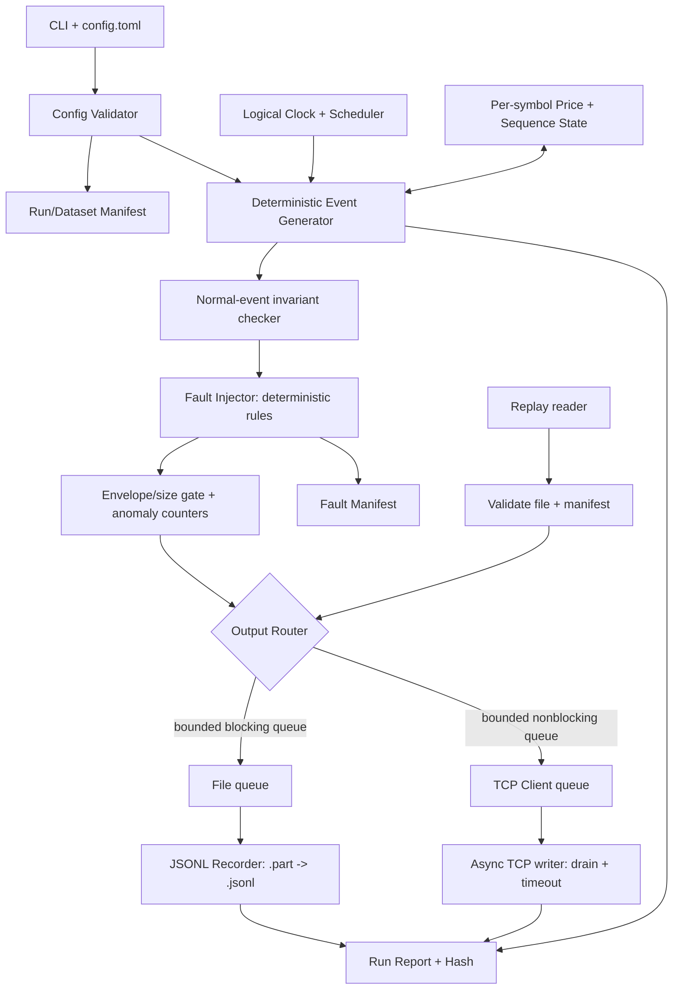
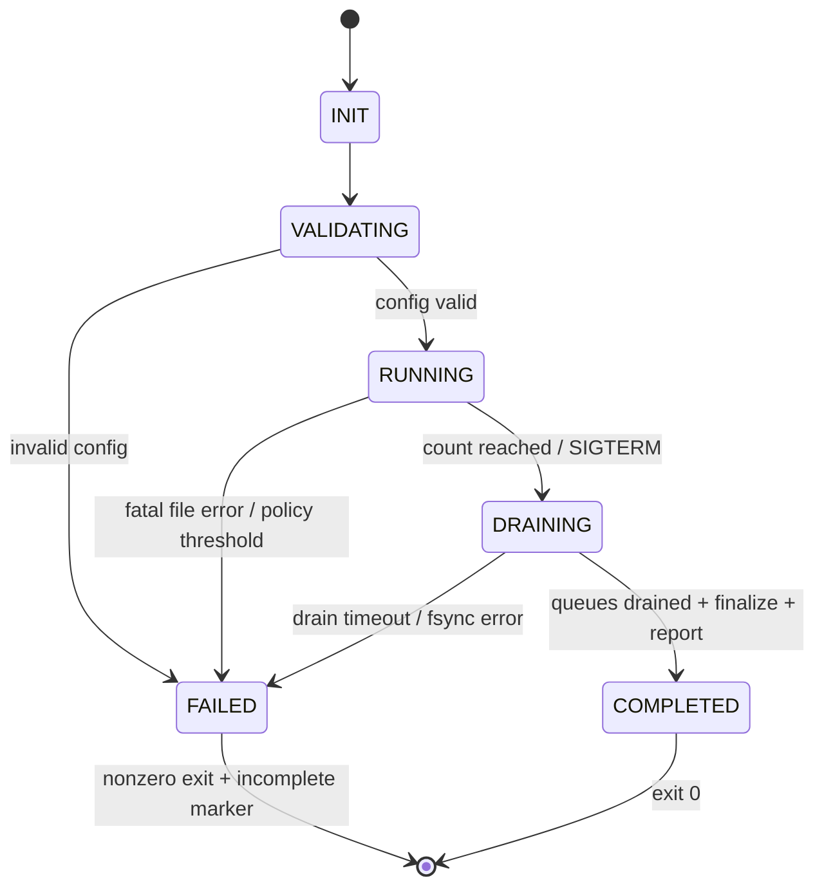

# PROJECT 01 — FX/CFD Market Data Simulator

> **System Design + Threat/Failure Modeling + Test Plan**  
> Ngôn ngữ: Tiếng Việt · Runtime mục tiêu: Python 3.12 · Nền tảng: Linux · Trạng thái: **bản thiết kế để triển khai, chưa phải hệ thống đã được kiểm chứng**  
> Phiên bản tài liệu: 1.0 · Ngày: 2026-10-30

## 0. Đọc trước: phạm vi và nguyên tắc

**Đây là dự án nhỏ số 01 trong kế hoạch 9 dự án để tái tạo Market Data Streaming and Analytics Platform.** Trong CV gốc, phần dự án lớn đề cập đến *C++ FX/CFD tick/quote adapters*, *feed validation*, *sequence-gap detection*, *stale-quote handling*, *deterministic replay*, Kafka/Protobuf và ClickHouse. **CV không nói rằng trước đây đã xây dựng một market data simulator bằng Python.** Simulator trong tài liệu này là thành phần **đề xuất bổ sung** nhằm tạo nguồn đầu vào có thể kiểm soát và kiểm thử cho Project 03–08.

**Câu hỏi thiết kế cốt lõi:** Nếu tốc độ tăng, dữ liệu bất thường, mạng chậm/ngắt, đĩa đầy, tiến trình chết hoặc đồng hồ hệ thống đổi, ta có biết điều gì xảy ra không? Hệ thống phải **không báo thành công giả, không âm thầm làm mất dữ liệu**, và có cách tái tạo lỗi. Không có thiết kế nào bảo đảm bao phủ *mọi* khả năng; tài liệu dùng phân loại rủi ro và một ma trận kiểm thử có thể mở rộng.

### Mục tiêu đầu ra

- Tạo dữ liệu tick/quote **giả lập** cho `EURUSD`, `GBPUSD`, `USDJPY`, có bid/ask, timestamp và sequence.
- Điều chỉnh tổng tốc độ phát (`events/s`), seed, số event/thời lượng, tỷ lệ event và phân bổ symbol.
- Có 2 đầu ra: **JSONL record** để tái lập chính xác; **TCP stream** để C++ Adapter ở Project 03 tiêu thụ; có thể chạy song song.
- Có **fault injection** có thể lặp lại: missing sequence, duplicate, out-of-order, stale timestamp, invalid price, network disconnect/slow consumer...
- Công bố rõ chỉ số **generated / intentionally omitted / recorded / enqueued / observed** và giới hạn độ tin cậy của từng con số.
- Kèm test unit, integration, property, chaos, load/soak và *go/no-go* để trả lời có chịu nổi hay không.

### Không thuộc Project 01

- Không kết nối sàn/broker thực; không phát giá thị trường thực và **không sử dụng để giao dịch**.
- Không xây Kafka producer, Protobuf schema chính thức, ClickHouse hay trading strategy (chúng nằm ở các Project tiếp theo).
- Không cam kết exactly-once trên TCP hoặc tự phục hồi mọi dữ liệu trong trường hợp máy mất điện.
- Không cam kết đạt `120k ticks/s`: đó là **mốc tham chiếu của hệ thống lớn trong CV**, không phải benchmark đã đo cho Python simulator này.

---

## 1. Yêu cầu hệ thống

### 1.1. Functional requirements (FR)

| ID | Yêu cầu | Điều kiện nghiệm thu |
|---|---|---|
| FR-01 | Sinh quote/tick cho nhiều symbol | Sinh hợp lệ 3 symbol, có thể cấu hình thêm |
| FR-02 | Giá biểu diễn bằng **integer ticks** | Không dùng `float` để làm căn cứ tính giá, `bid_ticks <= ask_ticks` bình thường |
| FR-03 | Dãy sequence **theo từng symbol** | Mỗi symbol khởi đầu tại 1, tăng 1 cho mỗi *logical slot* mới; duplicate cố ý được ghi nhận |
| FR-04 | Seed + logical clock tái lập | Cùng phiên bản runtime, cùng config/seed/t0/fault-plan → cùng byte JSONL hoàn thành |
| FR-05 | Modes `record`, `serve`, `both`, `replay` | Các mode có hợp đồng lỗi rõ ràng |
| FR-06 | Điều khiển tốc độ/tổng event | Giới hạn chính xác theo định nghĩa ở §3 và §5 |
| FR-07 | Inject lỗi có điều kiện | Mọi lỗi tiêm được ghi trong `fault-manifest.jsonl` tách khỏi payload |
| FR-08 | Bounded queue | Không có queue vô hạn hoặc buffer tăng vô hạn khi downstream chậm |
| FR-09 | Xử lý stop/failure | Hoàn thành sạch hoặc exit nonzero, không coi `.part` là file hoàn chỉnh |
| FR-10 | Metrics và report | Có throughput, lag, queue, dropped/disconnect, file errors |
| FR-11 | Cấu hình và CLI được validate | Invalid config → fail-fast trước khi bind socket/ghi dữ liệu |
| FR-12 | Đọc dữ liệu file để replay | Replay dữ liệu nguyên bản, tùy chọn real-time/accelerated, không sửa sequence/payload |

### 1.2. Non-functional requirements (NFR) — mục tiêu **đề xuất**, phải đo

| ID | Yêu cầu/giới hạn | Tiêu chí tạm thời |
|---|---|---|
| NFR-01 | Determinism | `sha256` đầu ra record giống nhau qua 2 lần chạy tương đương |
| NFR-02 | Bounded memory | RSS ổn định trong soak test; queue có giới hạn số phần tử **và** byte |
| NFR-03 | Data correctness | Không có event sai invariant trong chế độ không inject; mọi ngoại lệ mong đợi có manifest |
| NFR-04 | Rate accuracy | Ở mức tải dưới ngưỡng năng lực: sai số tổng event/s ≤ 2% trên cửa sổ 60 giây; ghi cả cửa sổ 1s để thấy jitter |
| NFR-05 | Shutdown | `SIGTERM`: ngừng tạo mới, drain trong deadline cấu hình, báo số chưa hoàn tất |
| NFR-06 | Resource protection | Đĩa đầy, queue đầy, khách chậm → có tín hiệu rõ; không âm thầm drop |
| NFR-07 | Load progression | Benchmark tuần tự 1k → 10k → 50k → 120k event/s **nếu** phần cứng cho phép |
| NFR-08 | No false durability | `write()/drain()` TCP không được báo là client đã lưu được dữ liệu |
| NFR-09 | Security | TCP chỉ bind `127.0.0.1` mặc định, không có unauthenticated Internet listener |
| NFR-10 | Reproducible tests | Ghi Python version, OS, CPU, RAM, disk, config hash, seed và command line trong run manifest |

*Ghi chú:* Các SLO nêu trên là tiêu chí kiểm thử đặt ra cho dự án học tập, **không phải kết quả đo thực tế**. Với mục tiêu 120k event/s, có thể buộc thay đổi kiến trúc hoặc chuyển generation hot path sang C++ ở một dự án sau.

---

## 2. Kiến trúc logic



### 2.1. Trách nhiệm từng thành phần

| Module | Trách nhiệm | Không làm |
|---|---|---|
| `config.py` | Đọc TOML, validate giá trị, tính config hash | Không tạo event |
| `model.py` | Kiểu dữ liệu bất biến, integer ticks, serializing canonical JSON | Không IO |
| `clock.py` | Logical event time, monotonic scheduler, rate control | Không dùng wall-clock cho pacing |
| `generator.py` | PRNG seed cố định, symbol selection, giá hợp lệ, sequence | Không gửi socket |
| `faults.py` | Biến đổi/thiếu/lặp/đảo event theo rule xác định | Không inject ngầm |
| `router.py` | Điều phối sink, budget queue, thống kê | Không hứa network ACK |
| `recorder.py` | Batching JSONL, `.part`, flush/fsync, finalize | Không âm thầm nuốt `ENOSPC` |
| `tcp_server.py` | Listen 127.0.0.1, single active client (MVP), per-client queue | Không lưu lịch sử phía client |
| `replay.py` | Read/verify JSONL và phát đúng payload đã ghi | Không tự thay event time |
| `metrics.py` | Counter, gauge, histogram, summary | Không ghi log mỗi tick ở tốc độ cao |
| `cli.py` | Modes `record/serve/both/replay/verify` | Không giấu fatal error |

### 2.2. Vì sao chọn **single writer / single active TCP client** ở MVP?

- Một luồng tạo event giúp thứ tự phát và seed dễ kiểm chứng; không chịu race condition thay đổi trình tự PRNG.
- Đường ghi file là nguồn đối chiếu *đầy đủ trong giới hạn durability của file*; TCP là kênh live **best-effort**.
- Nếu thêm nhiều client từ đầu, phải giải quyết isolation, fairness, fan-out, replay cursor và memory theo từng client. Để tránh tăng phạm vi, MVP từ chối kết nối thứ hai (`busy/rejected`), rồi kiểm thử multi-client như một mở rộng.
- Một client không có nghĩa không có backpressure: client đó vẫn có thể đọc chậm, dừng đọc, mất kết nối hay làm đầy socket buffer.

### 2.3. Các mode hoạt động và mức bảo đảm

| Mode | Đường dữ liệu | Bảo đảm | Khi lỗi |
|---|---|---|---|
| `record` | Generator → file | Đủ logical slots theo manifest **khi hoàn thành thành công**, trừ fault có chủ ý | Disk IO error → fail nonzero; file `.part` là *incomplete* |
| `serve` | Generator → TCP | Live best-effort; không có durable backlog, không có client ACK | Slow client → disconnect khi queue/timeout quá ngưỡng; có thể mất event trên đường live |
| `both` | Generator → file + TCP | File là nguồn đối chiếu; TCP không thể làm queue file tăng vô hạn | TCP lỗi không chặn recorder; file lỗi làm dừng run (fail closed) |
| `replay` | Verified JSONL → file/TCP | Byte payload và thứ tự theo file, với speed khác nhau; replay không sửa dữ liệu | File hỏng → fail-fast, trừ khi bật explicit salvage offline |

> **Không nhầm lẫn:** `writer.drain()` chỉ điều tiết buffer ghi TCP của phía gửi; không chứng minh ứng dụng phía nhận đã parse, xử lý hoặc lưu dữ liệu. Nếu cần at-least-once application-level phải bổ sung ACK + replay cursor/protocol ở phiên bản sau.

---

## 3. Hợp đồng dữ liệu và bất biến

### 3.1. Giá trị bản tin chuẩn

Dùng **fixed-point integer**, không dùng giá `float` làm nguồn sự thật. Giá hiển thị = `price_ticks / price_scale` (chỉ để người đọc hiểu). Định nghĩa chuẩn hoá thời gian bằng `event_time_ns` (epoch UTC nanoseconds).

**Ví dụ quote bình thường** (số liệu tổng hợp, không phải dữ liệu thị trường):

```json
{
  "schema_version": "sim.v1",
  "dataset_id": "demo-a1b2c3",
  "event_type": "quote",
  "symbol": "EURUSD",
  "sequence": 42,
  "event_time_ns": 1793322000008200000,
  "price_scale": 100000,
  "bid_ticks": 108346,
  "ask_ticks": 108348
}
```

**Ví dụ price tick giả lập** (không diễn giải là khớp lệnh/trade thực):

```json
{
  "schema_version": "sim.v1",
  "dataset_id": "demo-a1b2c3",
  "event_type": "tick",
  "symbol": "EURUSD",
  "sequence": 43,
  "event_time_ns": 1793322000010000000,
  "price_scale": 100000,
  "price_ticks": 108347
}
```

- `dataset_id`: ID **deterministic** từ config có ảnh hưởng dữ liệu (bao gồm seed, symbol, logical start time, fault plan); `run_instance_id` nằm ở metadata riêng để cùng dataset có thể tái sinh đúng byte.
- `event_id` logic = `(dataset_id, symbol, sequence)`. **Duplicate cố ý** phát lại chính payload/sequence cũ nên có cùng `event_id` logic.
- `schema_version`: cố định `sim.v1` trong Project 01; Project 02 sẽ chuyển sang Protobuf với quy tắc tương thích riêng.
- `price_scale`: theo symbol, ví dụ EURUSD/GBPUSD `100000`, USDJPY `1000` (là **cấu hình mô phỏng**, không áp đặt quy cách từ một broker cụ thể).
- `event_time_ns`: thời gian *logic/market event*, không phải thời điểm socket gửi. Thời gian gửi đo ở metrics riêng để không phá determinism.
- `sequence`: tăng theo *logical new event slot* trên **mỗi symbol**. `skip` có chủ ý sẽ tạo gap quan sát được; duplicate giữ sequence cũ; reordering làm sequence đến lệch thứ tự.
- JSON serialization: `sort_keys=True`, `separators=(',', ':')`, UTF-8, newline `\n`, không có NaN/Infinity; giới hạn `max_record_bytes` và trường được phép.
- **JSONL là contract v1** để dễ debug; TCP cũng gửi **mỗi record là một dòng JSON kết thúc bằng newline**, client phải xử lý partial read và nhiều record trong một read. Project 02 có thể thay bằng length-prefix + Protobuf qua một protocol version mới.

### 3.2. Invariants chế độ bình thường (không inject)

1. Chỉ `symbol` thuộc allowlist cấu hình; mỗi event có `schema_version`, `dataset_id`, `event_type`, `sequence`, `event_time_ns`.
2. `bid_ticks > 0`, `ask_ticks >= bid_ticks`, `spread_ticks` nằm trong `[min_spread_ticks, max_spread_ticks]` của symbol; `price_ticks > 0`.
3. Với cùng symbol, `sequence` là dãy `1, 2, 3, ...`; không gap/duplicate/reorder.
4. Với cùng symbol, `event_time_ns` không giảm; có thể bằng nhau nếu `events/s` rất cao và clock resolution cho phép, nhưng phép tính logical time vẫn ổn định.
5. Giá của một event nằm trong `[min_price_ticks, max_price_ticks]` được cấu hình; bước thay đổi có ngưỡng trong normal mode.
6. Tổng **logical slots** bằng `--count`; tổng *emitted records* có thể khác nếu có fault drop/duplicate.
7. Cùng `(config, seed, t0, Python/runtime version, fault plan)` → cùng thứ tự event và byte JSONL sau khi hoàn thành.
8. Bản ghi nào bị fault khiến phá một invariant phải xuất hiện trong fault manifest; **không auto-sửa** trước khi chuyển cho adapter, vì mục đích là thử khả năng phát hiện lỗi của adapter. Bộ kiểm tra **normal invariants** chạy *trước* fault injector; sau injector chỉ kiểm tra envelope/size và thống kê anomaly có chủ ý. Các lỗi raw malformed JSON/chopped line chỉ được inject trên kênh TCP test, không trộn vào golden JSONL.
9. Không đưa run timestamp không-deterministic, hostname, PID hay latency thực vào payload canonical.
10. Mọi counter là số không âm; `recorded_count` chỉ tăng khi recorder thực sự hoàn tất mức write được định nghĩa (khác `fsynced_count`). `COMPLETED` cần marker commit + hash/count, không phải chỉ có file tên `.jsonl`.

### 3.3. Số lượng event và semantics riêng của tick/quote

- `--count N` là **N logical slots** trước fault injection, không phải số dòng có thể thấy. Ví dụ `N=1000`, drop 1, duplicate 1 → output có thể vẫn 1000 dòng, nhưng có 1 gap và 1 duplicate.
- `--rate` là **tổng slots/giây** trên các symbol, không phải rate mỗi symbol. `symbol_weights` quyết định phân bổ; version đầu triển khai round-robin có trọng số theo quy tắc cố định.
- `event_type`: `quote` có bid/ask; `tick` là *cập nhật giá synthetic* theo giá giữa/giá tham chiếu (không gắn khối lượng trade). Đặt tên rõ để không suy diễn FX spot có consolidated trade feed.
- **Không trộn** lỗi do generator cố ý tạo với lỗi do socket/disk/drop ngoài ý muốn; lưu counter và manifest theo nguồn.

---

## 4. Clock, mô hình giá và tính tái lập

### 4.1. Hai loại thời gian

| Loại | Nguồn | Mục đích |
|---|---|---|
| `logical_event_time_ns` | `start_time_ns + floor(global_slot_index * 1e9 / rate)` cho fixed-rate | Timestamp trong event, độc lập tốc độ CPU |
| `monotonic_elapsed_ns` | `time.monotonic_ns()` | Điều tiết rate, timeout, lag, latency instrumentation |
| Wall-clock `time.time_ns()` | Chỉ dùng metadata `run_started_at` hoặc chọn `start_time_ns` khi user yêu cầu | **Không** dùng để tính sleep/delay hoặc quyết định fault |

- Với replay file, giữ nguyên `event_time_ns`; thay tốc độ đọc không làm thay payload.
- NTP rollback/clock leap/DST không được làm lùi sequence hoặc đảo sự kiện: scheduler luôn dựa trên monotonic clock.
- Có thể inject `stale_event` bằng cách sửa timestamp của bản tin theo rule, không sửa đồng hồ hệ thống thật.

**Cảnh báo quan trọng khi tích hợp Project 03 — định nghĩa "stale":**

- **Event-time stale:** `logical_reference_time_ns - event_time_ns > stale_threshold_ns`. Khi replay dataset lịch sử hoặc chọn `start_time_ns` cố định, reference clock của test **phải là logical clock của feed**, không phải `time.time_ns()` hiện tại; nếu không mọi quote đều có thể bị đánh dấu stale sai.
- **Feed-inactivity stale:** `current_monotonic_ns - last_valid_quote_received_monotonic_ns > inactivity_threshold_ns`. Cơ chế này kiểm tra feed im lặng/mất cập nhật ngoài đời, khác với event timestamp bị lùi.
- **Transport age / publish delay:** `receive_wall_time_ns - event_time_ns` chỉ có nghĩa khi nguồn phát được cấu hình theo thời gian thực với clock được đồng bộ; không đem số này áp dụng bừa cho accelerated replay.
- Test bắt buộc: stale timestamp cố ý, feed đứng im, replay nhanh/chậm và `t0` trong quá khứ phải cho kết quả phân biệt được, không tạo false positive hàng loạt.

### 4.2. PRNG và trạng thái giá

- MVP: `random.Random` **riêng cho từng symbol** với seed được dẫn xuất ổn định bằng `SHA-256(seed || symbol)`, tuyệt đối không dùng `hash(symbol)` của Python. **Pin Python 3.12** và phiên bản generator; verify bằng golden files.
- Giá khởi tạo bằng integer ticks; mỗi event áp dụng thay đổi nhỏ có giới hạn (`max_step_ticks`); áp dụng `clamp` hoặc `reflect` tại biên theo quy tắc xác định.
- Spread lấy từ miền integer ticks hợp lệ của symbol; ask = bid + spread; ưu tiên đảm bảo invariant sau mọi bước.
- Symbol selection cũng deterministic: cùng config/thứ tự symbol/weights → cùng chuỗi. Khi thêm symbol hoặc đổi weight, **toàn bộ dataset có thể đổi** và phải có `dataset_id` khác.
- Nếu cần tái lập chéo ngôn ngữ hoặc runtime về sau, **thay PRNG bằng thuật toán tự định nghĩa và test vectors** (ADR tương lai); không tuyên bố byte-identical giữa các phiên bản Python ngay từ đầu.

### 4.3. Rate scheduler và quá tải

Không gọi `asyncio.sleep()` cho từng event khi rate rất lớn. Scheduler chia thành **batch theo thời gian** (ví dụ 5–20 ms, cấu hình), tính số slots mục tiêu theo **integer arithmetic**:

```text
scheduled_slots = floor(elapsed_monotonic_ns * total_rate / 1_000_000_000)
slots_to_produce = max(0, scheduled_slots - produced_slots)
slots_this_iteration = min(slots_to_produce, max_burst_slots)
```

**Chính sách mặc định `slowdown-no-silent-drop`:** nếu CPU/disk không theo kịp, batch bị trễ, *effective throughput* giảm; **không** âm thầm bỏ logical slot để “giữ kịp đồng hồ”. Ghi `scheduler_lag_ms`, `rate_shortfall`, `file_queue_depth`. Ở tải vượt ngưỡng có thể xuất hiện backlog thời gian logic; khi vượt `max_scheduler_lag_ms` có chính sách `fail-fast` hoặc `continue-degraded` **do cấu hình**, không tự tăng bộ nhớ vô hạn.

`catch_up`: chỉ tối đa `max_burst_slots` mỗi chu kỳ để tránh burst khiến TCP/file bị nghẽn. `skip_slots` **không có mặc định**; nếu chủ động bật mode thử nghiệm, phải xuất `fault_manifest` về sequence bị skip. Không khẳng định đạt rate chỉ vì đã tính đủ `scheduled_slots`.

---

## 5. Output, backpressure, file durability và lifecycle

### 5.1. JSONL recorder — nguồn đối chiếu để kiểm thử

1. Tạo `run-dir/manifest.json` chứa config hash, `dataset_id`, seed, logical t0, schema, Python/platform version, mode và run instance metadata.
2. Ghi vào `events.jsonl.part` (một writer), dùng block/batch write; giới hạn queue theo **count và bytes**.
3. Không coi `flush()` là durable sau power loss: chính sách `fsync_every_events` / `fsync_every_seconds` cấu hình; trade-off giữa throughput và mất dữ liệu khi mất điện được công bố.
4. Khi hoàn thành sạch: drain file queue → flush → `fsync(file)` → close → atomic rename `.part` thành `events.jsonl` → `fsync(directory)` trên Linux; tính SHA-256, ghi `report.json.tmp` rồi atomic rename thành `report.json` và fsync thư mục. **Bước commit cuối cùng** là tạo `COMPLETED` marker (atomic + fsync directory). Verifier chỉ trả `COMPLETE` khi có marker + report + hash/count hợp lệ. Nếu crash giữa các bước, trạng thái là `INCOMPLETE` dù `events.jsonl` đã tồn tại.
5. Khi chết giữa chừng: file `.part` **không** được consumer coi là hoàn chỉnh. File `events.jsonl` thiếu `COMPLETED` marker cũng **không được** coi là hoàn chỉnh. `verify` đọc các dòng kết thúc đầy đủ, phát hiện dòng cuối bị xé, hash mismatch và trạng thái incomplete.
6. **MVP recovery:** rerun từ seed/config ban đầu thành dataset mới hoặc toàn bộ file mới; **chưa có** resume append exactly-once sau crash. Nâng cấp tương lai: checkpoint PRNG/sequence + offset và phân biệt fsynced cursor.
7. Disk full / permission denied / IO error: **record/both fail closed**, exit nonzero và report lỗi, không silently chuyển sang live-only.

**Bảo đảm cần hiểu đúng:** Một run ghi file **thành công** có thể kiểm chứng bằng count, hash và parser. Nếu máy mất điện đột ngột, có thể mất block chưa fsync; Không có lời hứa *zero data loss* cho `.part`.

### 5.2. TCP sender — live best-effort

- Mặc định bind `127.0.0.1:9009`; `max_clients=1` (MVP); `SO_REUSEADDR`/keepalive chỉ khi được cấu hình phù hợp.
- Tách **network queue** khỏi **file queue**; cả hai có giới hạn số event và bytes. Tránh queue `maxsize=0` vô hạn.
- Sử dụng `StreamWriter.write()` + `await asyncio.wait_for(writer.drain(), send_timeout)`; cần kiểm soát cả kích thước buffer cấp ứng dụng và transport. Một lần `drain()` không phải ACK của C++ adapter.
- **Slow-client policy:** nếu queue đầy hoặc `drain()` timeout, đóng kết nối, tăng `client_disconnect_slow`, ghi rõ khoảng sequence bị ảnh hưởng (nếu có thể suy từ cursor). Trên mode `both`, **file vẫn ghi đầy đủ**; ở `serve` sự kiện có thể mất ở phía client.
- Đóng kết nối không chứng minh event nào đã được nhận: dùng các khái niệm `queued_for_socket`, `write_attempted`, `transport_drained`, `client_acknowledged=unknown`.
- TCP có thể chia hoặc gom packet tùy ý: client parse theo delimiter `\n`, không được coi 1 `read()` = 1 event.
- Khi không có client: `serve` mặc định tiếp tục phát theo clock và đếm `not_delivered_no_client`; `both` vẫn record. Tùy chọn `wait-for-client` phải có `startup_timeout`, không chờ vô hạn.
- Nếu cần nhiều client/recovery cursor/TLS ngoài loopback, đưa vào milestone mở rộng kèm load/security tests, không lén mở public interface.

### 5.3. Shutdown, signal, exception



- `SIGINT`: graceful stop cố gắng drain; lần `SIGINT` thứ hai có thể force exit, đánh dấu incomplete.
- `SIGTERM`: stop generation, drain file queue với deadline; network có thể đóng sau timeout, báo số pending/uncertain.
- Crash/`SIGKILL`/mất điện không có graceful shutdown; chỉ khôi phục qua file `.part` hoặc regeneration.
- Tất cả background asyncio tasks được quản lý, exception không bị “Task exception was never retrieved” và không để trạng thái run report sai.

### 5.4. “Chịu nổi” nghĩa là **an toàn** chứ không phải luôn tiếp tục phục vụ

| Sự cố | Trạng thái chấp nhận được | Trạng thái **không** chấp nhận |
|---|---|---|
| TCP client chậm/ngắt | `both` vẫn record đầy đủ; TCP bị degraded/disconnected, có counters | File bị mất event vì client chậm; RAM tăng vô hạn |
| Không có client | `both` record; `serve` báo không delivered; không treo | Tuyên bố TCP received all |
| Disk ghi chậm kéo dài | Bounded backpressure; throughput giảm, lag hiển thị; theo ngưỡng thì fail | Buffer vô hạn, rate report giả |
| Disk full/permission error | `record/both` dừng có kiểm soát, nonzero, file incomplete | Giấu lỗi và tạo `COMPLETED` marker |
| CPU thiếu năng lực | Ghi nhận `rate_shortfall`, `scheduler_lag`, slowdown/abort đúng policy | Tự drop slot rồi vẫn tuyên bố đạt rate |
| SIGTERM | Drain theo deadline; thành công hoặc incomplete rõ ràng | Deadlock, mất dấu event pending |
| SIGKILL/power loss | Không thể graceful; verify incomplete, rerun from seed | Tự nối và tuyên bố exactly-once mà thiếu durable checkpoint |

**Failure containment:** mức độ phục hồi đo bằng *tính đúng, tính quan sát được và bounded resource*. Một hệ thống fail-fast trung thực khi đĩa hỏng thường **đúng thiết kế hơn** hệ thống tiếp tục chạy rồi phát báo cáo sai.

---

## 6. Cấu hình đề xuất và CLI (API sẽ triển khai, **chưa có mã chạy**)

```toml
# config/example.toml — đề xuất cho implementation
[run]
mode = "both"                  # record | serve | both | replay
seed = 20261030
start_time_ns = 1793322000000000000  # fixed UTC logical time for deterministic output
count = 100000                 # số logical slots; dùng duration_s thay cho count nếu muốn
rate_per_sec = 1000            # tổng trên mọi symbol
quote_ratio_pct = 80
scheduler_batch_ms = 10
max_burst_slots = 5000
max_scheduler_lag_ms = 2000
on_scheduler_lag = "continue-degraded"  # hoặc fail-fast

[symbols]
order = ["EURUSD", "GBPUSD", "USDJPY"]
# Chi tiết initial_price_ticks/spread/scale/step nằm trong cấu hình mỗi symbol.

[output.file]
enabled = true
root_dir = "./runs"
max_queue_events = 20000
max_queue_bytes = 16777216
fsync_every_events = 100000
max_record_bytes = 4096

[output.tcp]
enabled = true
host = "127.0.0.1"
port = 9009
max_clients = 1
max_queue_events = 10000
max_queue_bytes = 8388608
send_timeout_ms = 2000
slow_client_policy = "disconnect"

[faults]
enabled = false
plan_path = "./configs/fault-plan.toml"
```

**Thiết kế cấu hình:** `config.toml` là template có thể mở rộng; parser phải reject các key không biết, cấu hình mâu thuẫn (`mode=record` nhưng file disabled), seed sai kiểu, rate âm, `start_time_ns` không hợp lệ, port ngoài 1–65535, queue ≤0, `max_record_bytes` nhỏ hơn record tối thiểu, đường dẫn ngoài output root, và tổ hợp fault không được hỗ trợ. `duration_s` và `count` được định nghĩa là mutually exclusive trong MVP.

```bash
# LỆNH DỰ KIẾN sau khi code xong; chưa chạy được từ tài liệu này
python -m market_sim record --config config/example.toml --count 10000
python -m market_sim serve  --config config/example.toml --rate 1000
python -m market_sim both   --config config/example.toml --count 100000
python -m market_sim verify --run-dir runs/<run-id>
python -m market_sim replay --input runs/<run-id>/events.jsonl --speed 1.0
python -m market_sim benchmark --config config/bench.toml --duration 60
```

### 6.1. Cây thư mục mã nguồn đề xuất

```text
01-market-data-simulator/
├── README.md
├── SYSTEM_DESIGN.md             # nội dung tài liệu này
├── pyproject.toml
├── config/
│   ├── example.toml
│   ├── symbols.toml
│   └── fault-plan.toml
├── src/market_sim/
│   ├── __main__.py
│   ├── cli.py
│   ├── config.py
│   ├── model.py
│   ├── clock.py
│   ├── generator.py
│   ├── faults.py
│   ├── router.py
│   ├── recorder.py
│   ├── tcp_server.py
│   ├── replay.py
│   └── metrics.py
├── tests/
│   ├── unit/
│   ├── property/
│   ├── integration/
│   ├── chaos/
│   ├── perf/
│   └── fixtures/golden/
├── scripts/
│   ├── slow_client.py
│   ├── verify_dataset.py
│   └── benchmark_report.py
└── runs/                      # gitignored
```

---

## 7. Fault injection: định nghĩa có thể kiểm chứng

### 7.1. Các lớp lỗi

| Nhóm | Tên ví dụ | Quy tắc | Manifest / expected consequence |
|---|---|---|---|
| Semantic | `missing_sequence` | Bỏ **phát** event slot k, counter vẫn tăng | Receiver thấy gap; `intentional_omission=1` |
| Semantic | `duplicate_exact` | Phát lại event trước với same payload/seq | Có duplicate key `dataset_id,symbol,seq` |
| Semantic | `reorder_adjacent` | Đổi chỗ hai event **cùng symbol** qua buffer nhỏ | Receiver thấy out-of-order |
| Semantic | `stale_timestamp` | Giảm `event_time_ns` một offset cấu hình | Receiver phát hiện stale theo threshold; không đổi monotonic pacing |
| Semantic | `invalid_spread` | Tạo `ask_ticks < bid_ticks` hoặc spread quá lớn | Receiver reject/flag bản tin |
| Semantic | `invalid_price` | Price = 0/âm hoặc vượt max | Receiver reject/flag bản tin |
| Semantic | `timestamp_future` | Event time vượt logical now một khoảng | Receiver flag future clock skew |
| Protocol | `truncated_line` | Cố ý chỉ phát một phần line ở socket, sau đó close | Receiver xử lý partial frame an toàn |
| Protocol | `malformed_json` | Phát raw bytes JSON không hợp lệ ở **TCP fault test** | Receiver bắt lỗi parser; **không làm hỏng golden recorder** |
| Network | `close_connection` | Đóng socket tại sequence k | Adapter reconnect, biết có thể mất dữ liệu |
| Transport | `throttle_client` | Test client đọc chậm / ngừng đọc | Queue bounded, timeout và disconnect |

**Cơ chế ưu tiên:** fault plan dựa trên `(symbol, sequence)` hoặc `global_slot_index`, *không* dựa trên thời gian chạy thực. Dùng `priority` hoặc reject hai lỗi không tương thích tại cùng target. `fault-manifest.jsonl` tách khỏi event payload để C++ Adapter ở Project 03 **phải tự phát hiện**, không được nhìn thấy đáp án. Với socket corruption, manifest có thể báo điều kiện mong đợi mà file record chuẩn vẫn nguyên vẹn.

### 7.2. Ví dụ fault plan đề xuất

```toml
[[fault]]
kind = "missing_sequence"
symbol = "EURUSD"
sequence = 100

[[fault]]
kind = "duplicate_exact"
symbol = "GBPUSD"
sequence = 200

[[fault]]
kind = "stale_timestamp"
symbol = "USDJPY"
sequence = 300
offset_ms = 2000

[[fault]]
kind = "reorder_adjacent"
symbol = "EURUSD"
sequence = 401
```

**Dòng audit cho mỗi fault** (không đẩy vào socket): `fault_id`, `kind`, `target`, `planned`, `applied`, `affected_sequences`, `output_impact`, `reason_if_not_applied`.

---

## 8. WHAT-IF MATRIX — phân loại sự cố, phản ứng, kiểm chứng

**Cách đọc:** `P0` = phải đúng trước khi demo; `P1` = trước khi ghép C++ Adapter; `P2` = nâng cao/load hardening. “Pass” chỉ khi test tự động chứng minh cả **hành vi chức năng** và **resource budget** khi có liên quan. Các case nguy hiểm cần chạy trong môi trường **cách ly**, không dùng hệ thống dữ liệu thực.

### A. Giá, schema, chất lượng dữ liệu

| ID | Mức | What if... | Hành vi thiết kế / Oracle kiểm thử |
|---|---|---|---|
| D01 | P0 | `bid > ask` trong normal mode? | Generator tự kiểm invariant; test 1M event không có spread âm; injected case phải có manifest |
| D02 | P0 | Giá = 0 hoặc âm? | Config invalid → reject; trong fault test payload được flag, không crash |
| D03 | P0 | Bước giá tạo overflow/underflow? | Integer bound check, clamp/reflect; property test trên biên `min/max_price_ticks` |
| D04 | P0 | Nhập symbol lạ/trống/quá dài? | Startup fail-fast hoặc unknown symbol bị reject, tuyệt đối không tự tạo scale mặc định |
| D05 | P0 | Spread = 0 khi cấu hình không cho? | Reject config hoặc fault có manifest; normal mode không vi phạm |
| D06 | P1 | Tick/quote fields thiếu hoặc type sai? | Schema validator reject và báo dòng lỗi; TCP malformed chỉ qua deliberate fault path |
| D07 | P1 | `NaN`, `Infinity`, giá float lẫn integer? | Parser strict không nhận NaN/Infinity và float ở các trường integer |
| D08 | P1 | Event JSON quá lớn? | Chặn tại `max_record_bytes`, không chiếm bộ nhớ vô hạn |
| D09 | P1 | Tỷ lệ quote/tick = 0%, 100%? | Hợp lệ và đúng loại event; không chia cho 0 |
| D10 | P1 | Giá đi đến biên hàng triệu tick? | Không vượt max, không giữ nguyên quá mức do lỗi clamp ngoài dự kiến; test run dài |
| D11 | P2 | Symbol có scale khác (`USDJPY`)? | Round-trip đúng integer ticks/scale từng symbol |
| D12 | P1 | Tick bị hiểu nhầm là trade? | Contract nêu synthetic price update; consumer không có field trade volume/ID giả |

### B. Sequence, duplicate, ordering, determinism

| ID | Mức | What if... | Hành vi thiết kế / Oracle kiểm thử |
|---|---|---|---|
| S01 | P0 | Cùng symbol mất một sequence? | Manifest ghi k; downstream phát hiện gap `k-1 → k+1` |
| S02 | P0 | Duplicate cùng sequence, payload giống? | Phát 2 bản đúng byte; consumer có thể deduplicate bằng logical event ID |
| S03 | P0 | Duplicate cùng sequence nhưng payload khác? | Fault `duplicate_conflict` **tách loại**; phải flag conflict, không coi duplicate harmless |
| S04 | P0 | Hai event đến sai thứ tự? | Reorder có bounded buffer và drain trên shutdown; validator phát hiện |
| S05 | P0 | Trùng số sequence giữa EURUSD và GBPUSD? | Được phép: scope `(dataset_id,symbol,sequence)`, không dùng global sequence để dedup |
| S06 | P0 | Chạy lại cùng seed/config/t0? | So sánh SHA-256 2 file hoàn chỉnh; identical bytes và fault manifest |
| S07 | P1 | Đổi seed chỉ 1 đơn vị? | Dataset ID khác; dữ liệu dự kiến khác, cả hai vẫn hợp lệ |
| S08 | P1 | Đổi thứ tự danh sách symbol? | Tạo dataset ID khác; không âm thầm tuyên bố identical output |
| S09 | P1 | Run restart sau crash? | Run cũ incomplete; run mới tái sinh từ đầu, không nối file mù gây duplicate ngoài ý muốn |
| S10 | P1 | Sequence sắp vượt giới hạn chính sách? | Fail-fast cấu hình/count quá lớn hoặc giới hạn rõ; không wrap về 0 |
| S11 | P1 | Fault đặt trúng slot không tồn tại? | `planned_not_applied` trong manifest; test không báo applied giả |
| S12 | P2 | Hai fault tranh cùng event? | Conflict validation fail hoặc thứ tự áp dụng được đặc tả và test |
| S13 | P1 | Retry ghi TCP làm lặp event? | Không giả định exactly-once; quan sát và phân biệt intentional duplicate vs reconnect uncertainty |
| S14 | P1 | Replay thay đổi tốc độ? | Sequence/payload/hash không đổi; chỉ thời gian phát thay đổi |

### C. Clock, scheduling và rate

| ID | Mức | What if... | Hành vi thiết kế / Oracle kiểm thử |
|---|---|---|---|
| T01 | P0 | NTP nhảy lùi/tiến wall-clock? | Event time logic + `monotonic_ns` không bị đảo; test mock wall clock jump |
| T02 | P0 | `--rate=0`, âm hoặc quá lớn? | Reject config, không vòng lặp vô hạn/hang |
| T03 | P0 | `--count=0` hoặc âm? | `count=0` tạo empty dataset hoàn chỉnh (0 dòng), `count<0` reject; không treo |
| T04 | P0 | CPU không kịp rate mục tiêu? | Throughput thực giảm, lag tăng; không silent skip; threshold policy được thi hành |
| T05 | P0 | Scheduler chậm 500ms do GC/CPU pause? | Bounded catch-up, ghi lag/jitter, không phát burst vô hạn |
| T06 | P1 | `event_time` già hơn lúc phát? | Tách logical time và emitted wall/monotonic; báo publish delay thay vì sửa event |
| T07 | P1 | Timestamp tương lai bị inject? | Receiver xác định skew; manifest nêu offset |
| T08 | P1 | Stale timestamp tại đúng ngưỡng timeout? | Test `<`, `==`, `>` threshold; xác định inclusive/exclusive |
| T09 | P1 | Đi qua DST / timezone khác / giao thừa? | Epoch UTC integer; không dùng local timezone cho event ordering |
| T10 | P1 | Rate cực thấp (1 event/phút) và shutdown giữa chừng? | Không busy-loop, dừng đúng hạn, exit rõ |
| T11 | P2 | Rate rất cao khiến nhiều event cùng ns theo lượng tử? | Cho phép timestamp bằng nhau, order dựa trên sequence; test không chia 0 |
| T12 | P2 | Sleep overshoot do OS scheduling? | Đo 1s jitter và 60s rolling rate; không khẳng định hard real-time |
| T13 | P2 | Hệ thống sleep/resume laptop? | Monotonic source behaviour ghi trong environment; phát hiện lag lớn và áp policy |
| T14 | P1 | `--count` và `--duration` cùng khai báo? | Fail-fast rõ ràng; không ngầm chọn một |

### D. TCP, client và giao thức

| ID | Mức | What if... | Hành vi thiết kế / Oracle kiểm thử |
|---|---|---|---|
| N01 | P0 | Không client nào kết nối? | `serve`: đếm not-delivered; `both`: file không mất; optional wait có timeout |
| N02 | P0 | Client connect rồi ngắt ngay? | Không crash server, giải phóng tài nguyên, log disconnect |
| N03 | P0 | Client không đọc (slowloris-like)? | Queue/transport bounded, `drain` timeout → disconnect, RSS ổn định |
| N04 | P0 | Client đọc 1 byte/lần? | TCP parser line buffering ở consumer; sender không nhân bộ nhớ vô hạn |
| N05 | P0 | Một TCP read chứa 2–100 dòng? | Parser integration tách đúng JSONL records; số lượng không đổi |
| N06 | P0 | Một JSON line bị chia nhiều TCP read? | Parser ghép lại đúng, không parse premature |
| N07 | P0 | Connection reset giữa dòng? | Adapter loại incomplete frame cuối, recorder file (both) vẫn nguyên |
| N08 | P0 | Output queue TCP đầy? | Theo policy disconnect và tăng `network_queue_overflow`, không block file channel |
| N09 | P1 | `drain()` trả về nhưng client crash? | Không nói delivered/ACK; metrics phân biệt bytes drained vs client persisted |
| N10 | P1 | Client reconnect sau mất kết nối? | Không tự giả định replay; có gap tiềm tàng; replay-from-file là bước vận hành riêng |
| N11 | P1 | Hai client kết nối cùng lúc? | MVP từ chối client thứ hai, không tạo unbounded queue per client |
| N12 | P1 | Port đã bị process khác chiếm? | Startup fail nonzero, không ghi success manifest |
| N13 | P1 | TCP receive/send buffer bị thu nhỏ? | Slow-client test có `SO_RCVBUF` thấp; verify bounded memory |
| N14 | P1 | Malformed JSON/unknown schema phát qua TCP fault mode? | Chỉ raw fault test; adapter reject, recorder golden không bị hỏng |
| N15 | P1 | Record quá dài, không có newline? | Max line size/timeout ở consumer test; đóng/flag thay vì tăng RAM vô hạn |
| N16 | P2 | Server bind `0.0.0.0` ngoài ý muốn? | Default loopback; explicit opt-in + cảnh báo, test config policy |
| N17 | P2 | Kết nối/đóng liên tục hàng nghìn lần? | Không leak FD/tasks; rate-limit accept hoặc reject excess |
| N18 | P2 | Network bị delay/loss/packet reorder? | TCP vẫn stream đúng thứ tự byte hoặc lỗi kết nối; đo throughput/timeout, không nhầm với sequence fault |

### E. Disk, filesystem và durability

| ID | Mức | What if... | Hành vi thiết kế / Oracle kiểm thử |
|---|---|---|---|
| F01 | P0 | Disk full (`ENOSPC`)? | File error → nonzero, `.part`, `COMPLETED` marker không được tạo, không im lặng tiếp tục both như thành công |
| F02 | P0 | Không đủ quyền ghi thư mục? | Fail-fast trước khi chạy lâu, không tạo dataset hoàn chỉnh giả |
| F03 | P0 | Kill `SIGKILL` giữa file write? | `.part` còn lại; verify báo incomplete/partial final line; không dùng như golden |
| F04 | P0 | I/O trả về partial write hoặc lỗi? | Writer retry/handle theo API; không đếm `recorded` sai và không finalize |
| F05 | P0 | Tắt máy trước fsync? | Công bố RPO theo flush/fsync, chỉ tin dữ liệu đã có durability guarantee theo điều kiện FS |
| F06 | P1 | Hash file khác manifest? | Verify fail, phân biệt corrupt/tampered/incomplete |
| F07 | P1 | File bị sửa một dòng giữa chừng? | SHA-256 mismatch + parser/invariant fail nếu cấu trúc hỏng |
| F08 | P1 | Dòng cuối không có newline? | Incomplete hoặc strict policy reject; không lặng lẽ bỏ record |
| F09 | P1 | Output directory/file đã tồn tại? | Không overwrite mặc định; `run_instance_id` unique, explicit `--force` nếu thiết kế sau |
| F10 | P1 | Rename atomic báo lỗi / fsync directory fail? | Mark FAILED, không báo completed; kiểm tra lại file/artifact |
| F11 | P1 | File phình hết dung lượng theo thời gian? | `max_total_bytes`, ước tính trước, abort trước ngưỡng; cảnh báo disk remaining |
| F12 | P1 | Log per-event làm đầy disk? | Không log mỗi event ở normal mode; metrics aggregate và rotate |
| F13 | P2 | Filesystem chậm đột biến / NFS? | Queue file bounded; producer slowdown, lag metric và failure policy |
| F14 | P2 | Hết inode / quota? | Xử lý giống write failure, nonzero; không giả định chỉ có ENOSPC |
| F15 | P2 | Read replay file bị cắt/đổi trong lúc đang đọc? | Verify size/hash trước và sau; reject changed file |
| F16 | P2 | Restart sau crash mà muốn nối đúng vị trí? | **Out of MVP**; chỉ tái sinh từ đầu, future resume cần checkpoint/durable cursor |
| F17 | P0 | Crash sau rename `events.jsonl` nhưng trước report/commit marker? | Verify trả INCOMPLETE do thiếu `COMPLETED`; không nhận nhầm file đủ tên là run thành công |
| F18 | P1 | File hoàn chỉnh bị bit-flip mà vẫn đúng kích thước? | Recompute SHA-256, reject; không chỉ dựa trên filesize hay count |

### F. Resource, concurrency và operational safety

| ID | Mức | What if... | Hành vi thiết kế / Oracle kiểm thử |
|---|---|---|---|
| R01 | P0 | Queue mặc định vô hạn do `maxsize=0`? | Config rejects zero; test stress RSS/queue budget |
| R02 | P0 | TCP client giữ socket gây memory bloat? | Queue count+bytes budget và buffer watermark; slow-client soak |
| R03 | P0 | Event JSON cực lớn gây memory spike? | Bound record bytes trước enqueue; reject/manifest |
| R04 | P0 | SIGTERM khi queue còn 20k event? | DRAINING có deadline, file hoàn tất hoặc FAILED có pending count |
| R05 | P0 | Exception trong background async task? | Supervisor bắt lỗi, shutdown, exit nonzero, không mất traceback |
| R06 | P1 | 100 lần start/stop gây leak FD/tasks? | Test /proc/PID/fd, thread/task count stable |
| R07 | P1 | Ghi metrics/log làm chậm hot path? | Aggregate counters, sampled histograms; benchmark with/without observability |
| R08 | P1 | GC pause và allocator pressure? | Đo p99 lag/RSS, batch size bound; profile và ghi bottleneck |
| R09 | P1 | CPU throttling/container cgroup? | Rate shortfall & scheduler lag lộ rõ; không báo SLO pass khi thiếu capacity |
| R10 | P1 | OOM killer kết thúc tiến trình? | Run incomplete, verify xác nhận; không hứa recovery in-memory |
| R11 | P1 | Disk và TCP cùng nghẽn? | Bounded queues; file fail/lag policy ưu tiên tính đúng, không deadlock |
| R12 | P1 | Máy có ít core/RAM? | `baseline environment` bắt buộc trong benchmark; giảm rate thay vì nêu thành tích ảo |
| R13 | P2 | Thread/coroutine scheduling race làm đảo thứ tự? | Một source order; queue FIFO; property test; không share mutable PRNG bừa bãi |
| R14 | P2 | Throughput 120k/s nhưng bắn burst gây p99 lag xấu? | Báo cả avg 60s, 1s buckets, p95/p99 schedule lag và queue high-water |
| R15 | P2 | Long soak 6–24h tăng RSS / FD? | Soak test có ngưỡng growth, log histogram và crash evidence |

### G. Configuration, replay, security, integration

| ID | Mức | What if... | Hành vi thiết kế / Oracle kiểm thử |
|---|---|---|---|
| C01 | P0 | Config TOML sai cú pháp/unknown key? | Fail-fast với path/key và mã lỗi; không bind port |
| C02 | P0 | User đặt `seed` không lưu trong manifest? | Bắt buộc manifest chứa seed/config hash; verify không được bỏ qua |
| C03 | P0 | Replay input không đúng schema version? | Reject rõ unsupported version, không đoán field |
| C04 | P0 | Fault manifest báo applied nhưng event không đổi? | Cross-check target/observed diff, test fail nếu inconsistency |
| C05 | P1 | Environment variable thay config sau startup? | Frozen resolved config, run immutable; đổi config cần run mới |
| C06 | P1 | File path traversal (`../`) hoặc symlink ngoài root? | Normalize/resolve path + allowlist; không ghi ra ngoài sandbox/output dir |
| C07 | P1 | Input file hỏng/đầu vào quá dài? | Replay strict parser với max size, line number và fail-safe |
| C08 | P1 | Output cũ bị lẫn với run mới? | Isolate mỗi run dir; immutable `dataset_id`, unique `run_instance_id` |
| C09 | P1 | Client từ Internet kết nối vào? | Default bind loopback; public bind yêu cầu explicit opt-in và security plan |
| C10 | P1 | Đổi Python version làm output khác? | Pin Python 3.12, golden vectors; mỗi thay đổi gây khác phải version dataset generator |
| C11 | P1 | C++ Adapter mong byte framing/scale khác? | Contract test: JSONL delimiter, schema version và scale; freeze before Project 03 |
| C12 | P2 | Người kiểm thử bật fault mode nhầm khi benchmark normal? | Manifest `faults.enabled`, benchmark tool reject invalid experiment config |
| C13 | P2 | Đọc file 200GB để verify ăn RAM? | Streaming hash/parser, memory O(max_line_bytes) |
| C14 | P2 | Có input trực tiếp từ Internet? | Không thuộc MVP; nếu mở phải threat-model auth/TLS/rate limit riêng |

**Tổng hợp:** Ma trận gồm **105 tình huống** (12 + 14 + 14 + 18 + 18 + 15 + 14). Đây là một tập trường hợp rủi ro diện rộng, không phải chứng minh hình thức rằng mọi sự cố trên mọi hệ điều hành/phần cứng đều đã được bao phủ. Mỗi case được gán test ID và trạng thái khi triển khai.

---

## 9. Kịch bản thử nghiệm end-to-end và tiêu chí PASS/FAIL

### 9.1. Các bài test quan trọng nhất (ưu tiên thực thi)

| Test | Setup / hành động | Assertion bắt buộc |
|---|---|---|
| E2E-01: Golden dataset | 3 symbol, seed cố định, 10k slots, không inject; chạy 2 lần | Event đúng schema; số slot 10k; cùng SHA-256; không anomaly |
| E2E-02: Gap detector fixture | `EURUSD seq=100` missing | Recorder thiếu seq 100, seq 99→101; `fault_manifest` đúng 1 omission |
| E2E-03: Duplicate/reorder | Inject duplicate `GBPUSD#200`, reorder `EURUSD#401` | Receiver flags duplicate và out-of-order; không mất event ngoài kế hoạch |
| E2E-04: Slow consumer | TCP client đọc rất chậm/không đọc, `mode=both`, 10k/s | TCP disconnect/overflow theo policy; file hoàn tất; RSS/queue không vượt budget |
| E2E-05: No client | `mode=both`, không kết nối trong 60s | File đủ events; network not-delivered counter >0; process sống |
| E2E-06: Kill + verify | `record`, kill -9 giữa write | Không có completed dataset; verify `incomplete`; rerun deterministic cho SHA như clean run |
| E2E-07: Disk full | Chạy trong filesystem/container có quota nhỏ | Exit nonzero, có file error, không finalize `.jsonl`; không freeze vô hạn |
| E2E-08: Clock jump | Mock/change wall-clock trong test có kiểm soát | Event logical timestamp, sequence vẫn xác định; monotonic scheduler không lùi |
| E2E-09: Exact count | `count=1001`, có intentional skip/dup | `logical_slots=1001`; emitted bằng 1001 - omitted + duplicates (kể cả reorder không đổi count) |
| E2E-10: Replay fast | Replay fixture ở `speed=1` và `speed=10` | Dãy byte records cùng nội dung, cùng order; duration thay đổi, không biến đổi event time |
| E2E-11: Invalid config | rate -1, queue=0, port=0, unknown symbol | Tất cả fail trước khi tạo socket và output hoàn chỉnh |
| E2E-12: Protocol fragmentation | Client chủ động đọc 1 byte/nhóm byte ngẫu nhiên | Không thêm/bớt records do TCP segmentation |
| E2E-13: Large run | 1M records record only | Stream verify O(1) per-line memory; hash/metrics không thiếu dòng |
| E2E-14: TCP reconnect | Client disconnect/reconnect 100 lần | Không tăng FD/task lâu dài; metric rõ số close; không claim no-loss |
| E2E-15: Backpressure race | Disk chậm + client slow + SIGTERM | Không deadlock, deadline được tôn trọng, data/report trạng thái trung thực |

### 9.2. Property-based testing (ví dụ invariants)

- **Giá:** Với seed, scale, spread, range, step ngẫu nhiên hợp lệ, mọi event normal luôn thỏa bounds; kiểm thử hàng chục nghìn tổ hợp.
- **Sequence:** Với nhiều symbol và length tùy ý, sequence riêng mỗi symbol chính xác; khi inject x events, số bất thường quan sát được khớp manifest.
- **Serialization:** Encode → decode giữ nguyên integer/Unicode allowlist/epoch ns; không có NaN hay silent coercion.
- **Fault algebra:** `skip` giảm emitted 1, `duplicate` tăng emitted 1, `reorder` giữ count; mọi cạnh `first/last event`, 0/1/2 events phải được xử lý.
- **Determinism:** Lặp lại cùng case ngay cả khi thay `scheduler_batch_ms`, tốc độ đọc client, điều kiện CPU (đối với **record output**); không đưa wall time vào canonical payload.
- **Memory:** Gửi event lớn gần ngưỡng, slow sink kéo dài, config queue giới hạn; RSS có thể dao động do runtime allocator, phải đặt ngưỡng có margin và so xu hướng, không chỉ snapshot.

### 9.3. Load test và stress test theo từng bậc

| Level | Target | Duration | Điều kiện dừng/đánh giá |
|---|---:|---:|---|
| L0 | 100 events/s | 60s | Correctness/golden, không lỗi |
| L1 | 1,000 events/s | 5 phút | Sai số 60s ≤2%, normal no data violation |
| L2 | 10,000 events/s | 10 phút | Không overflow ngoài kế hoạch; đo RSS, CPU, disk throughput |
| L3 | 50,000 events/s | 5 phút | **Exploratory**; ghi rate thực + scheduler lag, không ép pass nếu máy thiếu capacity |
| L4 | 120,000 events/s | 60–300s | **Stretch**; chỉ tuyên bố đạt nếu bằng chứng ở benchmark report |
| SOAK | 30–50% rate bền vững đã đo | 6–24 giờ | RSS/FD không có xu hướng tăng không giới hạn, không deadlock, complete data |

- **Chạy riêng** record-only, serve-only (client đọc nhanh), và both; nếu gộp sẽ không biết bottleneck ở đâu.
- Report `target_rate`, `actual_generated_rate`, `recorded_rate`, `tcp_write_rate`, `queue_high_water`, `file_bytes/s`, CPU %, RSS peak, `p50/p95/p99 scheduler lag`, packet/client disconnect.
- Không so tốc độ producer với tốc độ client persisted khi chưa có application ACK.
- Với `count` nhỏ hơn thời lượng test, đánh dấu test invalid, không lấy số đẹp từ burst đầu tiên.
- Chạy ít nhất 3 lần/level (warm-up bỏ riêng), công bố median và worst run; ghi thông số máy đầy đủ.

### 9.4. Ước lượng tài nguyên trước khi load test

Công thức gần đúng (GB thập phân):

```text
bytes_per_second ≈ events_per_second × avg_serialized_record_bytes
GB_per_hour ≈ bytes_per_second × 3600 / 1e9
queue_memory ≈ min(event_limit × avg_object_bytes, byte_limit) + runtime_overhead
```

Ví dụ nếu trung bình **250 bytes/record** (giả định minh họa, phải đo):

| Rate | Dung lượng/giây | Dung lượng/giờ |
|---|---:|---:|
| 1k/s | 0.25 MB/s | 0.9 GB/h |
| 10k/s | 2.5 MB/s | 9 GB/h |
| 50k/s | 12.5 MB/s | 45 GB/h |
| 120k/s | 30 MB/s | 108 GB/h |

Đó là **raw JSONL** chưa tính fault manifest, metadata, file-system overhead và bản sao. Không chạy 120k/s hàng giờ nếu chưa đặt quota/dung lượng dự phòng. Giới hạn queue theo byte phải dựa trên **kích thước object thực và bytes encoded**, không chỉ lấy số lượng `list` elements.

**Tại sao queue lớn không cứu được downstream chậm mãi?** Nếu đầu vào có tốc độ `λ`, đầu ra xử lý `μ` và `λ > μ`, backlog tăng khoảng `λ - μ` events/s. Với ngân sách queue còn trống `Q`, thời gian trước khi đầy xấp xỉ:

```text
time_to_queue_full_seconds ≈ Q / (arrival_rate - service_rate)
```

Ví dụ minh họa: `λ=120,000`, `μ=80,000` events/s, `Q=10,000` events → **0.25 giây** là đầy nếu tốc độ giữ nguyên. Biện pháp đúng là **điều tiết producer / giảm rate / tăng service capacity / ngắt slow consumer**, không chỉ tăng queue. Thử một chuỗi slow-consumer dài hơn nhiều lần `time_to_queue_full` để chứng minh hệ thống không sập do backlog tích tụ.

---

## 10. Observability và định nghĩa metrics

| Metrics | Loại | Định nghĩa |
|---|---|---|
| `logical_slots_total` | counter | Số slot đã tạo trước fault |
| `events_emitted_total` | counter | Số event sau fault injector được gửi vào router |
| `faults_planned/applied/not_applied` | counters | Phân biệt cấu hình vs thực thi |
| `file_events_written_total` | counter | Số event writer xử lý thành công ở mức file write API |
| `file_events_fsynced_total` | counter | Số event thuộc các batch đã fsync thành công |
| `file_write_errors_total` | counter | Lỗi write/flush/fsync/rename |
| `tcp_events_enqueued_total` | counter | Vào network queue, **chưa phải consumer received** |
| `tcp_bytes_drained_total` | counter | Bytes writer đã drain (transport-level only) |
| `tcp_no_client_events_total` | counter | Không có client trong chế độ live |
| `tcp_slow_disconnect_total` | counter | Slow clients bị đóng theo policy |
| `tcp_queue_overflow_total` | counter | Queue overflow có quan sát được |
| `file_queue_depth/bytes` | gauges | Độ sâu/số byte hiện tại |
| `tcp_queue_depth/bytes` | gauges | Độ sâu/số byte hiện tại |
| `scheduler_lag_ms` | histogram | Khoảng lệch so với lịch phát lý thuyết |
| `generated_rate_1s`, `recorded_rate_60s` | gauges | Cửa sổ thời gian có phương pháp rõ |
| `runtime_rss_bytes`, `open_fds` | gauges | Resource consumption |
| `run_state` | enum | INIT/VALIDATING/RUNNING/DRAINING/COMPLETED/FAILED |

**Cảnh báo khởi đầu (đề xuất):** file queue vượt 80% budget liên tục 10s; scheduler lag >2s; lỗi fsync bất kỳ; tcp queue overflow; không đủ disk free cho lượng data ước tính; FD tăng liên tục; fault applied không khớp fault plan.

**Report cuối cùng** phải có `run_instance_id`, `dataset_id`, status, exit_reason, logical slots, emitted, omitted, duplicates, recorded, fsynced, TCP queue/drop stats, hash, config hash, runtime versions, machine spec và test profile. Kết quả `COMPLETED` không có nghĩa **TCP client received all**.

---

## 11. Chọn trade-off và ADR (Architecture Decision Records)

| ADR | Quyết định | Vì sao | Đánh đổi / trigger xem lại |
|---|---|---|---|
| ADR-001 | Integer ticks, không float | Tránh nhiễu làm tròn, invariant kiểm được | Cần quản lý scale theo symbol |
| ADR-002 | One deterministic generator | Dễ replay, sequence nhất quán | CPU bound tại high rate; nếu vượt ngưỡng, partition generator và ghi rõ ordering |
| ADR-003 | JSONL canonical v1 | Dễ đọc, debug và C++ implement | Lớn/chậm hơn binary; Project 02 thay Protobuf |
| ADR-004 | File source of truth, TCP best-effort | Có đối chiếu và replay, không giả ACK | Record-only/both cần dung lượng; live gap khi disconnect |
| ADR-005 | Bounded queues + disconnect slow consumer | Bảo vệ RSS và disk writer | Slow client mất live events; cần replay riêng |
| ADR-006 | Monotonic scheduler + logical event time | Không phụ thuộc wall-clock shifts | Logical-time drift khi under-capacity phải báo lag |
| ADR-007 | Immutable config/seed + fault manifest | Reproducible bugs | Đổi cấu hình phải tạo run khác |
| ADR-008 | Fail-closed file errors | Không báo dataset thành công giả | Availability giảm để giữ correctness |
| ADR-009 | Chưa có crash-resume exactly-once | Tránh lời hứa không đủ cơ chế | Bổ sung checkpoint, fsync cursor, ACK protocol nếu yêu cầu tăng |

### 11.1. Khi nào cần thay kiến trúc?

- Nếu `120k/s` không đạt với Python dù đã tối ưu batch, **ghi nhận giới hạn** rồi cân nhắc generator hot path bằng C++ và giữ Python làm orchestrator; *không* che giấu việc thay đổi công nghệ.
- Nếu phải phục vụ nhiều client: thêm subscription/fan-out per-client, budgets, replay cursor và auth; nâng version protocol.
- Nếu cần tính bền vững cao: lưu append-only journal, segment rotation, checkpoint state, CRC per frame, verified recovery, `fsync` policy gắn RPO.
- Nếu cần chứng minh client đã xử lý: ứng dụng client gửi ACK theo `dataset_id/symbol/sequence`, lưu durable cursor; không suy diễn từ TCP `drain()`.
- Nếu giá phải phản ánh thị trường thực: thay price model, cần chính sách nguồn dữ liệu/licensing/market hours; ra ngoài phạm vi simulator hiện tại.

---

## 12. Milestone triển khai với Definition of Done

### M0 — Spec + fixtures (bắt buộc)

- [ ] Xác nhận schema `sim.v1`, integer ticks, event_id và sequence scope.
- [ ] Xác nhận config parser strict + error codes.
- [ ] Tạo ít nhất 3 golden datasets nhỏ (normal, gaps/duplicates, stale/reorder) + expected manifests.
- [ ] Viết unit/property tests cho invariant trước khi code socket.

### M1 — Deterministic generator + file (ưu tiên cao nhất)

- [ ] Sinh quote/tick 3 symbol, deterministic với seed/t0.
- [ ] Ghi canonical JSONL + run manifest + hash + verify command.
- [ ] Implement bounded recorder queue + failed `.part` state.
- [ ] Tests D01–D12, S01–S08, T01–T04, F01–F10, C01–C04 tối thiểu.
- [ ] Golden hash identical giữa 2 lần clean run cùng input.

### M2 — Fault injector + replay

- [ ] Inject gap, duplicate, reorder, stale, invalid price/spread theo `(symbol, seq)`.
- [ ] Fault manifest audited và verifier so sánh expected/actual.
- [ ] Replay JSONL ra file/stream, không thay payload, cho phép đổi tốc độ phát.
- [ ] Crash/KILL + file incomplete tests.

### M3 — TCP live + backpressure

- [ ] TCP server loopback + one-client policy; parse JSONL fragmentation test.
- [ ] Per-client bounded queue, write/drain timeout, disconnect policy.
- [ ] Không có client và client slow không được làm `both` mất dữ liệu file khi file khỏe.
- [ ] Test 100 connects/disconnects, SIGTERM drain, transport fault.

### M4 — Capacity, chaos, integration handoff

- [ ] 1k và 10k/s benchmark có báo cáo môi trường + metrics; thử 50k/120k nếu có khả năng.
- [ ] Disk full, timeout, kill -9, CPU throttling, long soak được tự động hoá một phần.
- [ ] Không có P0 test FAIL; P1 còn lại được ghi thành issue kèm mức ảnh hưởng.
- [ ] Freeze `sim.v1` + document TCP framing cho Project 03 C++ Market Data Adapter.

### 12.1. Quy tắc GO/NO-GO

**GO (được dùng làm test feed cho Project 03)** khi:

1. Không có **P0 FAIL** trong CI/test report của release.
2. Seed/config/t0/fault-plan và golden hash đã khoá; replay tái tạo cùng payload.
3. `mode=both` khi client chậm/mất kết nối vẫn record đầy đủ **nếu** file path không lỗi và test hoàn tất sạch.
4. Crash/disk failure/timeout được phát hiện đúng trạng thái, không tạo `COMPLETED` giả.
5. Các bộ đếm `logical_slots`, `emitted`, `faults`, `recorded`, `pending` reconcile được.
6. Benchmark gồm throughput **thực**, CPU/RAM/disk và p95/p99 lag trên cấu hình máy được công bố.

**NO-GO** nếu có bất kỳ sai lệch deterministic không giải thích được, silent loss/corruption trong normal record mode, uncontrolled memory growth, shutdown deadlock, giả ACK/giả hoàn thành hoặc lỗi file bị bỏ qua.

---

## 13. Mẫu test report phải tạo khi triển khai

```yaml
project: fx-cfd-market-data-simulator
version: sim.v1
status: NOT_RUN       # PASS | FAIL | NOT_RUN
run_instance_id: "..."
dataset_id: "..."
config_sha256: "..."
seed: 20261030
logical_start_time_ns: 1793322000000000000
python_version: "3.12.x"
platform: "Linux ..."
cpu: "..."
ram_gb: null
disk_type: "..."
mode: both
target_rate_per_sec: 10000
actual_generated_rate_per_sec: null
actual_recorded_rate_per_sec: null
logical_slots: null
emitted_events: null
intentional_omissions: null
duplicates: null
recorded_events: null
fsynced_events: null
sha256_events_jsonl: null
p95_scheduler_lag_ms: null
p99_scheduler_lag_ms: null
peak_rss_mb: null
peak_file_queue_bytes: null
peak_tcp_queue_bytes: null
tcp_disconnects: null
file_errors: null
test_case_results: []
known_limitations: []
```

## 14. Danh mục công việc đầu tiên (thứ tự code thực tế)

1. **Model**: dataclasses frozen, validation, canonical JSON serialization, fixed-point price utilities.
2. **Config**: TOML loader + strict validation + deterministic `dataset_id`/config hash.
3. **Generator**: per-symbol PRNG, price update, sequence + quote/tick ratio.
4. **Tests**: golden fixtures, invariant, boundary, determinism.
5. **Recorder**: `.part`, flush/fsync, final rename, run report, verify streaming.
6. **Fault injector**: gap/duplicate/reorder/stale/invalid spread, manifest.
7. **Replay**: strict read + no payload alteration.
8. **Scheduler**: monotonic bounded batch, metrics và overload policy.
9. **TCP server**: one client, backpressure, disconnect, fragmentation tests.
10. **Chaos/performance**: benchmarks, disk full, kill, soak, go/no-go.

---

## 15. Tài liệu tham chiếu (để kiểm tra API; không thay thế test thực nghiệm)

- Python 3.12 — `asyncio.StreamWriter.write()`/`drain()` và `asyncio.start_server()`: https://docs.python.org/3.12/library/asyncio-stream.html
- Python 3.12 — `asyncio.Queue(maxsize)` và `asyncio.wait_for()` cho timeout: https://docs.python.org/3.12/library/asyncio-queue.html
- Python 3.12 — `time.monotonic_ns()` và `time.time_ns()`: https://docs.python.org/3.12/library/time.html
- CV gốc: mục **Market Data Streaming and Analytics Platform** của tài liệu Nguyễn Hoàng Minh — phần này chỉ làm căn cứ cho **dữ liệu FX/CFD, validation/gap/stale/replay và công nghệ hệ thống lớn**. Toàn bộ chi tiết simulator, ngưỡng test, JSONL/TCP và phương án xử lý lỗi trong file này là **thiết kế đề xuất**, không phải mô tả triển khai đã xác nhận từ CV.

**Trạng thái đánh giá hiện tại: `DESIGN_ONLY / NOT_TESTED`.** Cần xây dựng phần mềm và chạy các bài test ở trên trước khi kết luận hệ thống “chịu nổi” bất kỳ tải hay sự cố cụ thể nào.
