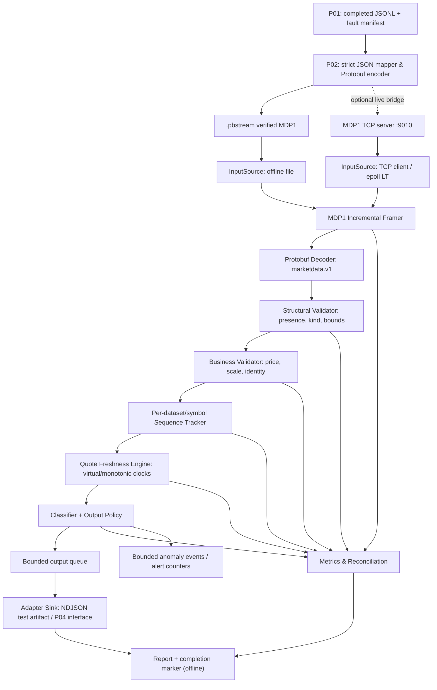
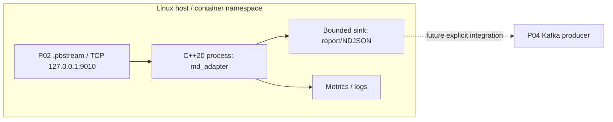
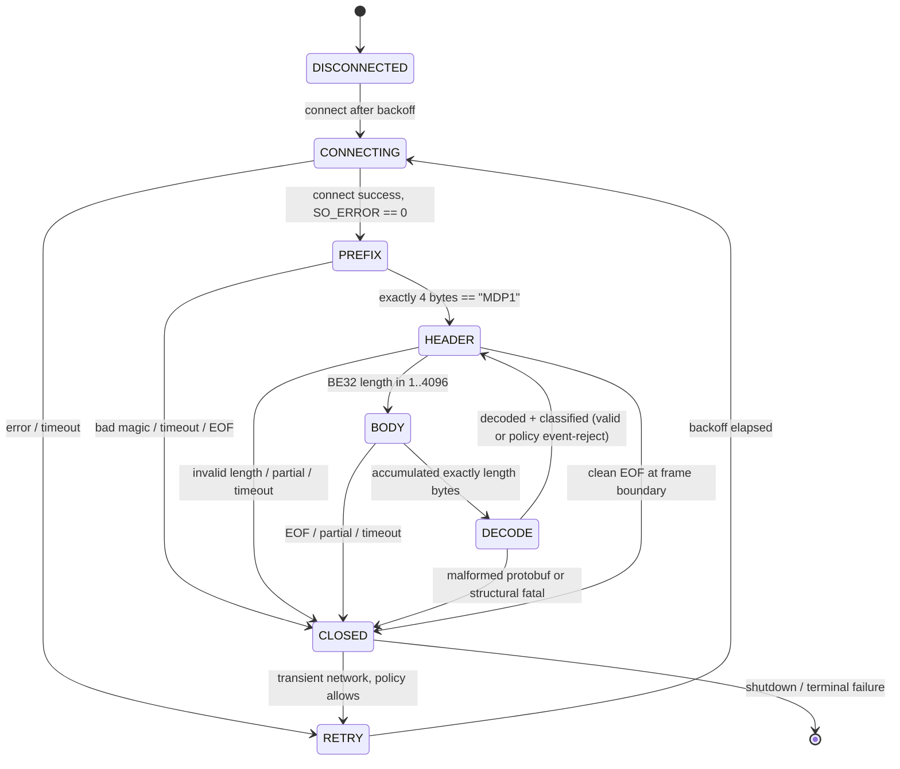

# PROJECT 03 — C++20 FX/CFD Market Data Adapter

> **System Design · Failure/Threat Modeling · Reliability & Capacity Test Plan · Handoff P01/P02/P04**  
> Ngôn ngữ: Tiếng Việt · Runtime mục tiêu: **C++20 trên Linux** · Mức ưu tiên: correctness → bounded resources → observability → throughput  
> Tài liệu phiên bản **1.0** · **2026-10-30** · Trạng thái **DESIGN_ONLY / TESTS_NOT_RUN / CAPACITY_NOT_ESTABLISHED**

## 0. Mục tiêu, nguồn gốc và ranh giới bằng chứng

Đây là **dự án nhỏ số 03/09** trong kế hoạch tự xây dựng lại **Market Data Streaming and Analytics Platform**. CV gốc xác nhận công việc **xây dựng C++ FX/CFD tick/quote adapters với feed validation, sequence-gap detection, stale-quote handling và deterministic replay**. CV **không xác nhận** protocol on-wire, source code, state machine, socket implementation, exact thresholds, queue sizes hay các kết quả benchmark riêng của adapter. Phần còn lại của tài liệu là **thiết kế mới được đề xuất** để học, triển khai và kiểm chứng, không được mô tả như hệ thống đã vận hành trước đây.

**Phụ thuộc tài liệu đã cung cấp:**

| Thành phần | Contract có sẵn từ bản thiết kế | Trạng thái triển khai |
|---|---|---|
| Project 01 — Simulator | `sim.v1` JSONL: giá fixed-point `int64`, `dataset_id`, `symbol`, sequence **theo symbol**, `event_time_ns`; TCP JSONL trên cổng ví dụ 9009; manifest và fault-plan | Mới là thiết kế; chưa thể khẳng định sender đã chạy |
| Project 02 — Protobuf | `marketdata.v1.MarketDataEvent`; `optional` fields; `oneof` quote/tick; `MDP1` TCP/`.pbstream` (4-byte magic một lần, sau đó BE32-length + payload 1–4096 B); cổng ví dụ 9010; Kafka dùng raw Protobuf value | Có schema starter và thiết kế; chưa thể khẳng định codec/bridge đã chạy |
| Project 03 — Adapter | **Tiêu thụ MDP1**, kiểm tra structural/business/stream-state; xuất event được phân loại, anomaly và số đo; offline replay | **Tài liệu này**, chưa chạy code |
| Project 04 — Kafka | Nhận event đã được phân loại từ Project 03; `record.key=symbol`, `record.value=raw MarketDataEvent` theo P02; giao nhận thực tế xây ở Project 04 | Chưa triển khai |

**Lựa chọn hòa giải P01 ↔ P02 ↔ P03:** cổng JSONL `9009` **không** phải cổng Protobuf `9010`. Đường tích hợp dự kiến là `P01(JSONL) → P02 strict mapper/MDP1 bridge → P03(MDP1)`. Có thể làm **offline** bằng dataset hoàn chỉnh P01 → `.pbstream` P02 → Adapter P03 trước khi có live bridge; không giả định Project 02 đã có live TCP bridge. P03 **không sniff protocol/auto-fallback** JSON↔Protobuf trên cùng một cổng. Nếu phát triển JSONL decoder riêng để debug, dùng một lệnh input explicit và chạy cùng domain validator nhưng **không bật trong bản production-like MVP**.

**“Hệ thống chịu nổi”** không đồng nghĩa *luôn tiếp tục nhận hoặc không bao giờ báo lỗi*. Một kết quả thành công có thể là **reject có lý do**, **degrade có cảnh báo**, **pause để tạo backpressure**, hoặc **fail closed trước khi làm hỏng state**. Không tài liệu nào có thể dự đoán *mọi* failure/what-if; ma trận bên dưới ưu tiên những lớp sự cố nhận diện được, kèm oracle và kế hoạch mở rộng từ lỗi thực tế.

### 0.1. In scope / out of scope

**In scope:** TCP client C++20 trên Linux (loopback trước); framing và decode P02; structural/business validation; sequence tracking và bounded duplicate/reorder window theo dataset+symbol; phân loại stale quote bằng hai loại clock; deterministic offline replay; fault-aware verification; bounded sink và metrics; stress/fuzz/chaos/soak; adapter output contract để nối P04.

**Out of scope:** broker/exchange thật, FIX gateway, TLS/credential production, quote/trading execution, Kafka producer/consumer thực (P04), exactly-once, recovery cursor durable/ACK end-to-end (cần protocol mới), “tự sửa” tick bị thiếu, tự khôi phục source không hỗ trợ replay, và khẳng định đạt 120k/s trước benchmark.

## 1. Yêu cầu và tiêu chí nghiệm thu

### 1.1. Functional requirements

| ID | Chức năng bắt buộc | Oracle nghiệm thu |
|---|---|---|
| FR-01 | Nhận `.pbstream` offline và TCP `MDP1` với explicit transport mode | Decode cùng fixture ra cùng **semantic projection**, giữ arrival order |
| FR-02 | Parse incremental TCP stream, không phụ thuộc `recv()` trùng frame boundary | Chunk 1 byte, random chunks và coalesced chunks cho kết quả đúng |
| FR-03 | Mọi frame có size/time/cost budget và lỗi phân loại | Header length bất thường → fail **trước allocation**; partial → không emit |
| FR-04 | Check field presence, oneof, schema, symbol và fixed-point integer | Missing/invalid fields reject; không zero-default/sửa giá |
| FR-05 | Phát hiện gap, duplicate, reorder, conflicting duplicate và sequence rollback theo **symbol** | Trace oracle với sequence cụ thể và thứ tự arrival |
| FR-06 | Phát hiện stale event-time **khác** feed inactivity | Replay quá khứ không bị false stale chỉ vì wall clock hôm nay |
| FR-07 | Bảo toàn event gốc khi xuất normalized event (nếu hợp lệ) | Core fields exact; annotation ngoài wire payload, không biến đổi giá/timestamp |
| FR-08 | Chế độ `strict_monitor`, `fault_observe`, `offline_verify` có policy rõ | Manifest hợp lệ mới cho phép test-only anomalies |
| FR-09 | State reset/continuity và reconnect nhất quán | Dataset khác → state mới; cùng dataset reconnect không reset ngầm |
| FR-10 | Replay deterministic với injected clock/scheduler | Same verified `.pbstream` + same config → same classification trace |
| FR-11 | Bounded processing queue, symbol table, anomaly storage và logs | RSS không tăng theo số events; khi vượt budget fail/pressure có reason |
| FR-12 | Counters/reconciliation và machine-readable report | Accepted/rejected/diagnostic counters khớp fixture và transport boundaries |
| FR-13 | Graceful shutdown, exit code/marker đúng semantics | SIGTERM drain trong deadline; SIGKILL ⇒ artifact incomplete |
| FR-14 | Build/test C++20 + Protobuf toolchain pinned | Version mismatch fail build/CI; sanitizer/fuzz tests reproducible |

### 1.2. NFR/SLO **mục tiêu đề xuất, chưa đo**

| ID | Chỉ tiêu | Mục tiêu MVP / điều kiện |
|---|---|---|
| NFR-01 | Correctness, fault classification | 100% golden fixtures có expected classification và exact core projection; **0 silent loss** ở test offline complete |
| NFR-02 | Parsing safety | `max_frame_payload=4096 B`; bad frame không làm emit partial; không allocate theo `length` chưa validate |
| NFR-03 | Bounded state | Tối đa `256 symbols`/dataset đang hoạt động, `4 datasets` per process; window `4096 sequences`/symbol; toàn bộ đều configurable có cap |
| NFR-04 | Network liveness | Prefix/header/body **absolute deadline 2 s mỗi stage** mặc định; idle frame-wait timeout policy tách biệt; connect 3 s |
| NFR-05 | Reconnect | Exponential backoff có jitter **được kiểm soát**, cap 10 s, max attempts hoặc time budget; không busy loop |
| NFR-06 | Shutdown | SIGTERM: dừng connect/ingest, drain tối đa 5 s rồi exit `INCOMPLETE` nếu còn event chưa xử lý |
| NFR-07 | Capacity | Thử 1k → 10k → 50k → 120k events/s nếu hardware cho phép; phải báo max **sustainable**, không suy từ peak |
| NFR-08 | Data latency | Báo p50/p95/p99/p99.9 **parse→classify** trên steady state; ngưỡng phụ thuộc máy và workload, không ấn một số “đạt” vô căn cứ |
| NFR-09 | Inactivity detection | Với controlled virtual clock: trigger trong vòng **1 timer tick ≤100 ms** sau ngưỡng inactivity cấu hình; tránh false positive khi clock test được pause |
| NFR-10 | Memory | Gợi ý ngân sách RSS ≤256 MiB cho MVP 3 symbols, queue 4096 events/8 MiB; xác nhận bằng load/soak và cgroup; không coi đây là guarantee |
| NFR-11 | Security | Kết nối `127.0.0.1` mặc định; không xử lý untrusted Internet feed như trusted source; fuzz/caps/denylist errors |
| NFR-12 | Reproducibility | Pin compiler, flags, proto descriptor hash, dataset SHA-256, config, CPU/RAM/kernel, workload, test seed, verdict |

**SLO phụ thuộc hoàn cảnh:** `120k ticks/s trên 8 partitions` và `p95 range query 280 ms trên 200M rows` trong CV là kết quả của **pipeline tổng thể**, không phải SLO riêng P03. Adapter không có Kafka partitions hay ClickHouse query. 120k events/s ở đây chỉ là một **load milestone cần đo**, không phải chỉ tiêu đã đạt.

## 2. Kiến trúc mức hệ thống



**Hai execution lanes (không pha trộn semantics):**

1. **Offline verifier:** xác minh manifest, hash và COMPLETED marker **trước khi gọi là authoritative replay**; đọc `.pbstream` từ đầu đến cuối; injected `VirtualClock` bảo đảm classification deterministic; xuất report/core projection. File chưa hoàn chỉnh chỉ được đọc trong **explicit salvage mode** và mọi verdict là `INCOMPLETE`, không tự biến thành `PASS`.
2. **Live receiver:** kết nối TCP MDP1; nhận theo bytes; classify và đẩy vào sink hữu hạn; không có ACK/cursor nên **không chứng minh network delivery completeness**. Kết quả live là `OBSERVED`/`PARTIAL` hoặc verified against independent server manifest **nếu có**.

### 2.1. Trách nhiệm module

| Module / interface | Chịu trách nhiệm | Không được làm |
|---|---|---|
| `config/validator` | Pin protocol/schema, validate caps/timeout, expected symbols/scale | Không thay default ngầm giữa các lần chạy |
| `input/mdp1_file_source` | Đọc stream hoàn chỉnh và provenance marker offline | Không tin `.part` hoặc EOF là complete |
| `input/mdp1_tcp_client` | Nonblocking connect, read, backoff, peer disconnect | Không tạo ACK/duplicate suppression giả |
| `protocol/framer` | Prefix `MDP1`, BE32, size cap, incremental FSM | Không scan để resync raw bytes trong production |
| `protocol/proto_decoder` | Parse protobuf v1 và kiểm tra parse status | Không coi parse-success là business-valid |
| `validation/structural` | Presence, `oneof`, UTF-8, ID/field caps | Không bypass structural safety trong fault mode |
| `validation/business` | Signed fixed-point, market bounds, per-symbol scale | Không clamp, round float hoặc sửa price |
| `state/sequence_tracker` | Gap/duplicate/reorder/missing window, confidence state | Không tự fill gap hay assume server đã resend |
| `state/freshness` | Event-time/watermark và monotonic quote inactivity | Không lấy wall clock so với archived event time |
| `policy/classifier` | Separate anomaly classes and forwarding policy | Không biến `FAULT_TEST_ONLY` thành market-valid |
| `output/bounded_queue` | Count+byte caps, read pausing, shutdown drain | Không silent drop khi sink slow |
| `output/sink` | Artifact test, metrics-only bench, future P04 adapter API | Không gọi `write()` là Kafka committed |
| `ops/metrics` | Bounded counters/timers, reconciliation | Không log mỗi tick tại tốc độ cao |
| `tests/oracle` | Independent expected trace và verdict | Không tự tạo golden từ output của SUT |

### 2.2. Sơ đồ triển khai MVP



**Thread model gợi ý:** một `io+decode+classification` **single-owner** thread, một `sink_writer` thread với **bounded SPSC queue**, một lightweight supervisor/signal controller; timeout có thể được xử lý trong event loop. Chưa cần lock-free SPSC ở MVP: ưu tiên bounded `mutex + condition_variable` với đúng ownership, sau đó benchmark để quyết định thay bằng ring. Nếu chỉ chạy `metrics_only`, bỏ writer thread để cô lập chi phí core adapter. Không tạo một thread cho mỗi symbol/event.

## 3. Wire/data contract — chốt trước khi viết code

### 3.1. Input transport matrix

| Input | Bytes | P03 xử lý | Mục đích |
|---|---|---|---|
| P01 `serve` :9009 | UTF-8 `sim.v1` JSON line + `\n` | **Không trực tiếp** trong MVP Protobuf; cần P02 bridge hoặc tool offline explicit | Giữ P01 contract nguyên vẹn |
| P02 `.pbstream` | `MDP1` once + `[BE32 L][protobuf]` repeated | Có; preferred M0/M1 | Deterministic offline |
| P02 TCP :9010 | Giống `.pbstream`, socket stream | Có; từ M2 | Live transport |
| P04 Kafka (future) | `MarketDataEvent.SerializeToString()` raw | **Không** thêm MDP1/length vào `record.value` | Dùng Kafka record boundary |

### 3.2. Protobuf schema P02 (không tự sửa)

```proto
syntax = "proto3";
package marketdata.v1;
message Quote { optional int64 bid_ticks = 1; optional int64 ask_ticks = 2; }
message Tick  { optional int64 price_ticks = 1; }
message MarketDataEvent {
  optional string dataset_id = 1;
  optional string symbol = 2;
  optional int64 sequence = 3;
  optional int64 event_time_ns = 4;
  optional int64 price_scale = 5;
  optional string source_schema_version = 6;
  oneof payload { Quote quote = 10; Tick tick = 11; }
}
```

**Exact semantic mapping:** `source_schema_version=sim.v1` thay `schema_version` của P01; `(dataset_id, symbol, sequence)` là logical event ID; tick là **synthetic price update**, không phải trade; `Quote` giữ cả bid/ask ticks. `run_instance_id`, fault manifest, receive wall-time và classification **không nằm** trong `MarketDataEvent v1`.

### 3.3. C++ domain model được đề xuất

```cpp
// Illustration only; not an implementation and not an ABI promise.
using PriceTicks = std::int64_t;
using EventTimeNs = std::int64_t;
using Sequence = std::int64_t;

struct QuotePrice { PriceTicks bid; PriceTicks ask; };
struct TickPrice  { PriceTicks price; };
using Payload = std::variant<QuotePrice, TickPrice>;

struct DomainEvent {
    std::string dataset_id;            // bounded UTF-8/ASCII allowlist
    std::string symbol;                // bounded ASCII symbol allowlist
    Sequence sequence;
    EventTimeNs event_time_ns;
    std::int64_t price_scale;
    std::string source_schema_version; // "sim.v1"
    Payload payload;
};

// Streaming annotation is out-of-band; do not mutate original MarketDataEvent.
struct ClassifiedEvent {
    DomainEvent source;
    std::uint32_t quality_flags;        // GAP / REORDER / EVENT_TIME_OLD / ...
    std::uint64_t arrival_index;        // local observation, not cross-run event ID
};
```

C++ `std::variant` kiểm tra loại payload sau khi `oneof` đã validate; không serialize `ClassifiedEvent` như thể đó là `.proto` P02. Muốn publish chất lượng dữ liệu trên Kafka về sau: topic phụ/headers/schema riêng có version, không thay ngầm record.value.

### 3.4. Structural invariants bắt buộc trong **mọi** mode

1. Đúng magic **chính xác một lần/connection/file**; prefix `MDP1` không phải marker để scan tìm điểm đồng bộ; BE32 `L` thuộc `[1,4096]` **trước** `resize`/`new`.
2. Bản tin trọn vẹn mới parse. Truncated prefix/header/body, timeout và Protobuf parse failure → reject/fail connection (file fail); tuyệt đối không emit partial.
3. `has_dataset_id`, `has_symbol`, `has_sequence`, `has_event_time_ns`, `has_price_scale`, `has_source_schema_version` đều đúng; không coi default 0/empty là field present. `oneof` phải là `quote` hoặc `tick` được hỗ trợ, và trường giá cần thiết phải có presence.
4. Hạn byte: `dataset_id<=128`, `symbol<=32`, `source_schema_version<=32`; UTF-8 hợp lệ, `symbol` ASCII allowlist (ví dụ `[A-Z0-9._-]`), không trim/lowercase/normalize ngầm.
5. `source_schema_version` là `sim.v1` trong đường normal P01; Protobuf package/descriptor pin đúng `marketdata.v1`. Lỗi version về semantics hoặc event kind → reject có reason.
6. Mọi `int64` giữ nguyên kể cả âm trong parsing; **chỉ sau đó** business validator mới reject anomalies hoặc route fault-test. Không ép float và không integer overflow khi tính price/spread/age/sequence delta.
7. Unknown field: không gán nghĩa mới khi consumer v1 chưa hiểu; nếu forwarding raw message cần ghi rõ policy unknown-field retention; output normalized v1 chỉ bao gồm core đã biết và không khẳng định lossless forwarding.
8. Đóng stream ngay khi corrupted framing/invalid wire theo chính sách `fail_closed` MVP; không tự thử JSON parser hoặc nhảy sang magic tiếp theo.

### 3.5. Business invariants (strict market quality)

| Trường | `strict_monitor` normal policy | `fault_observe` test-only |
|---|---|---|
| `sequence` | `>0` và trong signed int64 | Phân loại `INVALID_SEQUENCE`; không đưa vào tracker nếu không thể diễn giải |
| `event_time_ns` | `>=0`; event-time-old theo policy, không dựa wall-time | Giữ nguyên giá trị lỗi và annotation ngoài payload |
| `price_scale` | `>0`, khớp symbol config (`EURUSD/GBPUSD:100000`, `USDJPY:1000` ở fixture) | Flag `BAD_SCALE`; không tự thay scale |
| Quote | `bid>0`, `ask>=bid`, spread nằm trong khoảng per-symbol, guard overflow | Giữ giá nguồn; flag lỗi, không cập nhật `last_good_quote` |
| Tick | `price>0`, trong range và step policy tương ứng | Giữ giá nguồn; flag lỗi, không biến tick thành trade |
| Dataset/symbol | ID/version/allowlist/quotas chính xác | Trường structurally valid nhưng source anomaly có manifest được giữ làm test evidence |
| Sequence gap | Alert `GAP`, mark `DEGRADED`; không tự bịa tick còn thiếu | Preserve arrival-order và classification trace |
| Duplicate | Exact duplicate không publish lại trong strict; **conflicting duplicate** reject và alert nghiêm trọng | Ghi rõ `DUPLICATE_EXACT` vs `DUPLICATE_CONFLICT` |
| Reorder | Default strict **không publish** late arrival để tránh reorder ở sink; vẫn quan sát để sửa missing-window | Output test-only theo arrival order + flag REORDER |
| Stale quote | Flag `EVENT_TIME_OLD` / `QUOTE_INACTIVE`, không cập nhật last-good quote khi quote event-time-old | Preserve nguyên event cho test oracle, không đưa vào production-like quote state |

**Chế độ `fault_observe`** chỉ bật với **verified source manifest + fault plan + explicit flag**. Nếu source/corpus không chứng minh anomaly cố ý, không hạ cấp lỗi để accept. Không dùng mode này ở pipeline production. **Phân biệt detect != reject:** gap có thể là chất lượng feed bị giảm nhưng message mới còn hợp lệ; tài liệu lựa chọn default **phát event mới gắn cờ DEGRADED** và giữ trạng thái chưa có continuity, thay vì âm thầm drop toàn bộ feed. Downstream P04 phải tiêu thụ signal quality riêng nếu dùng dữ liệu để quyết định.

## 4. TCP, framer và trạng thái kết nối

### 4.1. Frame state machine (`MDP1`)



**I/O policy:** nonblocking sockets + Linux `epoll` **level-triggered** MVP; xử lý `EINTR`, `EAGAIN`/`EWOULDBLOCK`, `SO_ERROR` sau connect; đặt absolute deadline riêng cho prefix, header đang dở, body đang dở. Không **reset** body deadline sau mỗi byte nhận (chống slowloris). Không áp stage timeout cho trạng thái `HEADER` **chưa bắt đầu có byte** nếu feed hợp pháp im lặng; dùng **idle/feed inactivity timer riêng**. Với `EPOLLET` ở bản nâng cao: phải drain read tới `EAGAIN` và kiểm thử starvation/rearm trước khi bật (theo `epoll(7)`).

**Pseudo-algorithm** (sơ đồ, không phải code đã chạy):

```text
on_readable(socket):
  while bytes_budget_this_iteration > 0:
      n = recv_nonblocking(io_buffer, min(remaining_io_budget, available_space))
      if n > 0: frame_fsm.feed(bytes[0:n]); process_complete_frames_up_to_budget()
      else if n == 0: verify_boundary_then_close_and_report()
      else if errno == EINTR: retry_with_iteration_budget()
      else if errno == EAGAIN: break
      else: mark_io_error_close()
  if output_queue_blocked: PAUSE_READ (retain socket, bounded application buffers)
  tick_deadlines_monotonic()
```

Tất cả **budget có độ ưu tiên**: nếu socket liên tục có dữ liệu, vẫn dành thời gian cho timer/inactivity/logging/shutdown. Khi `PAUSE_READ`, TCP OS receive buffer tạo backpressure tự nhiên cho sender, **nhưng không được coi đó là confirmation** sender đã nhận phản hồi; UDP/producer sources khác không được suy diễn semantics này.

### 4.2. Error taxonomy, recovery boundary

| Code | Ví dụ | Hành động bắt buộc |
|---|---|---|
| `BAD_MAGIC` | JSONL gửi vào cổng MDP1 | Fail closed; không auto-detect fallback |
| `INVALID_LENGTH` | L=0, 4097 hoặc 0xFFFFFFFF | Reject trước alloc; close |
| `TRUNCATED_PREFIX/HEADER/BODY` | EOF giữa prefix/length/payload | No partial emit; mark stream incomplete |
| `FRAME_TIMEOUT` | Slow sender từng byte | Close/alert; không renew deadline theo mỗi byte |
| `PROTO_DECODE_ERROR` | Invalid varint/wire type | No event; close stream |
| `STRUCTURAL_REJECT` | Missing `optional`, no `oneof` | No event; close connection hoặc reject với explicit connection policy (MVP: close) |
| `BUSINESS_REJECT` | Quote negative, scale invalid | Reject event, record reason; frame boundary vẫn có thể tiếp tục |
| `SEQUENCE_GAP` | 41→43 | Mark degraded and continue, không fabricate seq 42 |
| `DUPLICATE_CONFLICT` | Cùng logical ID, payload khác | Reject và integrity alert; không silently pick last |
| `REORDER_OLD` | Late event 42 sau 43 | Default reject publication; may reconcile observed missing window |
| `EVENT_TIME_OLD` | Quote older than logical feed watermark | Reject as current quote; preserve anomaly metadata |
| `FEED_INACTIVE` | Không có valid quote trong threshold (monotonic) | Alert/feed degraded; không tự sinh quote |
| `QUEUE_BUDGET_EXCEEDED` | Sink slow | Pause read then deadline/fail; no silent drop |
| `SOURCE_UNVERIFIED` | Missing P02 marker / unknown live history | Fail offline verification; live confidence `UNVERIFIED_CONTINUITY` |
| `SINK_IO_ERROR` | Disk full/permission | Fail run; `.part` remains incomplete |
| `RESOURCE_EXHAUSTED` | RSS/FD/state cap exceeded | Fail safe; report not COMPLETE |

### 4.3. Bounded reconnect/backoff

- Chỉ retry **transient** (`ECONNREFUSED`, `ECONNRESET`, peer close) có budget. **Không retry vô hạn** khi `BAD_MAGIC`, `UNSUPPORTED_SCHEMA`, `INVALID_LENGTH` hoặc config invalid. Reconnect TCP không làm tìm lại bytes của kết nối trước.
- Theo dõi `connection_epoch` để phân biệt transport sessions. `dataset_id` giữ nguyên qua reconnect ⇒ **giữ trạng thái sequence đang có** trong cùng process nếu cấu hình `continue_dataset`, phân loại replay/duplicate; dataset khác ⇒ state mới với alert. Không reset silently.
- Sau process restart, in-memory state mất ⇒ trạng thái `START_UNVERIFIED` cho live stream cho đến khi có external verified snapshot/cursor; không gắn mác continuity verified chỉ vì frame đầu sequence 1.
- Nếu sender reset sequence 1 trong **cùng dataset_id** mà không có manifest/session contract mới: classify `SEQUENCE_ROLLBACK`, không tự diễn giải là phiên giao dịch mới.

## 5. Sequence tracker: phân loại đúng và có giới hạn

**Key:** `(dataset_id, symbol)` — không chỉ symbol. Mỗi key có `highest_seen_valid`, `contiguous_observed_valid`, `contiguous_published`, một bounded ring/window đánh dấu sequence đã thấy và một bản **typed core projection compact** cho các sequence trong cửa sổ, `first_seen`, gap counters, quote watermark. `window=4096` là **đề xuất**; sequence cũ hơn cửa sổ được kết luận `TOO_OLD_UNVERIFIABLE`, không đoán đó chắc chắn là duplicate. Sự kiện business-invalid không cập nhật valid-seen state; có counter `raw_sequence_observed_invalid` riêng.

**Exact duplicate là so sánh giá trị typed, không phải so hash rút gọn:** ring entry tối thiểu lưu `sequence`, `event_time_ns`, `price_scale`, payload kind, `bid_ticks`, `ask_ticks` hoặc `price_ticks`; `dataset_id`, `symbol`, source schema version đã được cố định theo key/policy. Có thể dùng hash để tăng tốc tìm kiếm, nhưng **không** kết luận `DUPLICATE_EXACT` dựa duy nhất trên hash 64/128-bit vì vẫn có collision. Phải giới hạn **bytes toàn bảng state** ngoài `max_symbols` và `max_datasets`; số RAM trong worst-case nhiều key có thể lớn hơn nhiều so với bitmap 512 B/key.

```text
on_business_valid(event e) for key=(dataset,symbol):
  if first event:
      initialize observed_high=e.sequence, mark_valid_seen(e)
      if verified fixture requires starting at 1 and e.sequence!=1: INITIAL_GAP
      if live baseline unverified: START_UNVERIFIED
  else if e.sequence > highest_seen_valid:   # compare safely; guard INT64_MAX
      if e.sequence > highest_seen_valid+1:
          flag GAP; calculate missing-slot count with checked wide arithmetic
          represent missing intervals within bounded window; no loop over gap
      mark_valid_seen(e); highest_seen_valid=e.sequence
  else if within_window(e.sequence) and is_seen_valid(e.sequence):
      if typed_core_equals(previous_at_sequence, e):
          flag DUPLICATE_EXACT; strict suppress
      else:
          flag DUPLICATE_CONFLICT; strict reject and integrity alert
  else if within_window(e.sequence) and is_known_missing(e.sequence):
      flag REORDER_LATE; mark_valid_seen(e) for observation only
      strict default: do not publish late event
  else:
      flag TOO_OLD_UNVERIFIABLE; strict reject without assuming duplicate
  update_contiguous_observed_valid_using_known_seen_window()
  if strict_published(e): update_published_continuity_only_when_in_order()
```

**Implementation invariant:** thứ tự stage `structural → business → sequence → freshness → output policy`. `seen_valid` có nghĩa **business-valid được quan sát**, không đồng nghĩa **đã xuất ra sink**. Nếu 1,2,4,3 đến, `contiguous_observed_valid` có thể đạt 4 sau late 3, nhưng `contiguous_published` vẫn bị thiếu 3 nếu strict suppress. Khi gap vượt cửa sổ, giới hạn độ tin cậy của `contiguous_observed_valid` và gắn cờ uncertainty; không lưu hàng tỷ missing slots. Business-invalid seq42 không cập nhật `seen_valid`, nên seq43 có thể báo gap accepted seq42. `gap_detected_count` không phải TCP loss count. `__int128` chỉ sử dụng nếu compiler/toolchain Linux hỗ trợ và có sanitizer tests; mọi phép `seq+1`, `timestamp delta` cần checked math.

**Hai chế độ continuity:**

- **`strict_monitor` (mặc định live):** event mới hợp lệ với gap có thể ra sink nhưng mang `DEGRADED`/`GAP` flag, không tuyên bố continuity; duplicate exact bị suppress; late/reorder mặc định không publish; conflicting duplicate alert.
- **`fault_observe` (offline/test):** giữ arrival order và anomaly per event ở **test-only sink**; thống kê và score đo detector, không coi mọi anomaly intentional hợp lệ. Các anomaly được manifest cho phép phải match exactly; anomaly khác ⇒ `UNEXPECTED_FAULT`.

### 5.1. Trace minh họa và expected result

| Arrivals cùng dataset/symbol | Classification | Normal publication |
|---|---|---|
| `1,2,3,4` | Normal; contiguous 4 | 4 events |
| `1,2,4` | `4:GAP[3]` | 1,2,4 (4 có degraded) |
| `1,2,4,3` | `4:GAP`, `3:REORDER_LATE / gap filled observed` | 1,2,4; seq 3 không publish strict |
| `1,2,2,3` (2 bản sao cùng payload) | `2#2:DUPLICATE_EXACT` | 1,2,3 |
| `1,2,2*,3` (2* khác price) | `2*:DUPLICATE_CONFLICT` | 1,2,3; integrity alert |
| `1,2,0,3` | `0:INVALID_SEQUENCE` | 1,2,3; lỗi riêng 0 không dùng làm baseline |
| `1,2,4,2` (2 đúng y hệt) | `4:GAP`, `2:DUPLICATE_EXACT` | 1,2,4 |
| `1,INT64_MAX` | Bounded `HUGE_GAP`, không allocate theo gap | Sản lượng thực 2 events, state hữu hạn |
| Connection restart, same dataset `1..100 → 50..120` | 50..100 repeat/detected within window; 101..120 new; **unverified delivery** | Không nhân đôi trong window; không khẳng định EXACTLY_ONCE |

**Không chọn một kiểu state duy nhất cho mọi symbol vô thời hạn:** max symbol cap + policy eviction chỉ cho **dataset hoàn tất/TTL có evidence**. Nếu phải evict active state, đánh dấu `CONTINUITY_LOST` và không báo sequence verified khi key trở lại.

## 6. Stale quote, event-time và clock

Ba điều này khác nhau, cần API và bài test riêng:

| Cơ chế | Đồng hồ tham chiếu | Kiểm tra | Lưu ý |
|---|---|---|---|
| **Event-time regression/stale** | Per-symbol maximum known good `event_time_ns` hoặc trusted **logical feed clock** nếu fixture hỗ trợ | `watermark - current_quote.event_time_ns > threshold` (checked signed delta) | First event không có watermark ⇒ `UNKNOWN`, không tự so với hôm nay |
| **Feed inactivity** | `steady_clock`/`CLOCK_MONOTONIC`, nhận quote **hợp lệ** gần nhất | `now_mono - last_good_quote_receive_mono > inactivity_threshold` | Tick không refresh quote timer; clock suspend semantics phải đo |
| **End-to-end transport age** | Receive wall time - event time **chỉ khi** feed live và clocks synchronized | Optional metric có trạng thái trusted/untrusted | **Không** dùng làm rule trong archived/accelerated replay |

**MVP policy:** `event_time_stale_threshold_ns=2_000_000_000` (2 giây, cấu hình), `quote_inactivity_threshold_ms=3000`, `timer_tick_ms=100`, **đây không phải threshold chung cho mọi broker**; chọn workload giả lập cụ thể. Một `quote` có timestamp stale/giá invalid **không cập nhật** last-good-quote clock. Tick hợp lệ không refresh quote inactivity, nhưng có thể cập nhật separate tick freshness nếu thêm sau. Nếu feed hoàn toàn im lặng, timer vẫn phải chạy (không chờ read callback). Nếu bộ thử dùng replay nhanh/chậm, `VirtualClock` của test cấp thời gian monotonic giả lập theo script; **payload event_time giữ nguyên**, không dùng actual CPU/wall-time làm oracle.

**Ví dụ tách bạch:**

- Dữ liệu replay năm 2025 vào năm 2026, sequence/timestamp tăng đúng → **không stale chỉ vì wall clock thực**.
- Quote seq 11 mang timestamp cũ hơn accepted watermark 10 giây → `EVENT_TIME_OLD`, bất kể TCP đến đúng giờ.
- Seq tiếp tục tăng nhưng chỉ có `Tick` suốt 5 giây không có quote hợp lệ → `QUOTE_INACTIVE`, bất kể tick vẫn đều.
- Producer freeze 5 giây trong TCP live → inactivity timer bắn; khi quote hợp lệ trở lại cần sự kiện `RECOVERED`/state transition rõ.
- Máy suspend/resume: `CLOCK_MONOTONIC` không tính thời gian suspend trên Linux; nếu muốn nhận biết hibernation/suspend, bổ sung kiểm chứng `CLOCK_BOOTTIME`/host signal, **không ghi nhận false guarantee**.

## 7. Output policy, durability và capacity budget

### 7.1. Sinks và delivery contract

| Sink | Kết quả `success` có nghĩa | Không được suy diễn |
|---|---|---|
| `metrics_only` | Decoder/validator/classifier xử lý xong record | Event đã đi Kafka hoặc tồn tại trên disk |
| `ndjson_test_sink` | Writer đã append bytes vào file `.part`; `COMPLETE` chỉ khi verify/hash/count + fsync/commit | File `write()` = power-loss durable |
| `P04_adapter_sink` (future) | Đã enqueue thành công vào interface bàn giao P04 | Kafka broker ACK hoặc Kafka consumer processed |
| `fault_trace_sink` | Lưu anomaly metadata và original fields với output cap | Đây là market-valid real-time feed |

**`OutputEvent`** gồm `MarketDataEvent` core (typed), `arrival_index`, `quality_flags`, `feed_state` và `provenance`. Chỉ **một owner** phát ra theo arrival order; nếu sink P04 chỉ nhận raw Protobuf, chất lượng dữ liệu phải gửi qua side-channel có schema riêng/headers và tiêu chí consistency, không nhét JSON tùy tiện vào `value`.

### 7.2. Backpressure & resources

- Bounded queue: `4096 events` **và** `8 MiB` serialized estimate+object overhead policy; check cả hai, không dùng duy nhất `std::queue::size`. Với small payload nhiều events, account object allocation và per-key state bằng profiling; đặt cap RSS/cgroup riêng.
- Nếu queue chạm high-watermark (ví dụ 80%), **pause receive**; resume dưới low-watermark (40%) với hysteresis, tránh busy-toggle; đo thời gian pause, queue age, OS socket buffer pressure.
- Sink blocked quá `output_stall_deadline_ms=5000` → `BACKPRESSURE_TIMEOUT`, **exit nonzero / incomplete**; không tự discard event hoặc drop oldest. `metrics_only` không được dùng để chứng minh sink throughput của pipeline.
- `max_symbols=256`/dataset, `max_datasets=4` nhưng **thêm `max_state_bytes=64MiB` cho toàn bộ per-key state** (đề xuất, phải được kiểm chứng). Per-symbol bitmap 4096 bits chỉ ≈512 B, **không** bao gồm 4096 typed core entries, intervals, allocations, allocator overhead. Nếu đủ 1024 active keys trong worst case khiến state vượt 64MiB, reject/mark `STATE_CAP_EXCEEDED`, không âm thầm evict active key. RSS 256MiB trong NFR chỉ là baseline cần test cho workload MVP 3 symbols; không phải bảo đảm trong mọi mix.
- `raw_bytes_read` buffer bounded theo `max_frame=4096`, `read_chunk=65536`, `max_frames_per_iteration=256`; không trữ tất cả frames trong vector tăng động.
- DoS guard: giới hạn số reconnects, anomaly log rate, `max_error_samples`, configuration sizes, symbol cardinality, metrics labels. Data-independent O(1)/O(log W) per event là mục tiêu; **không dùng loops theo kích thước gap**.

### 7.3. Counters và conservation equations

```text
transport_bytes_read                   # raw recv/file bytes, not event count
frames_complete = frames_decode_error + frames_decoded
frames_decoded = structural_reject + structural_ok
structural_ok = business_reject + business_ok
business_ok = policy_suppressed + classified_output_attempted
classified_output_attempted = output_success + output_failed_or_pending

# Các counters anomaly như gap_detected, stale_quote, duplicate_seen là
# TAGS/DIAGNOSTICS có thể overlap; KHÔNG cộng chúng vào partition equations.
# Partial prefix/header/body bytes do not count as complete frames.
# If fail closed on a malformed frame and the process stops early,
# rest-of-source may be UNOBSERVED; no false "zero loss" claim.
```

**Tính nhất quán quan trọng:** nếu một frame decode được nhưng business invalid, state không được cập nhật là accepted; nếu event đủ business valid nhưng output bị suppress do duplicate, vẫn tính `business_ok` và `policy_suppressed` rõ ràng. Nếu sink error, `output_failed_or_pending` phải giải thích được, không biến mất khỏi báo cáo.

## 8. Operational assumptions, threat model, failure envelope

| Failure / actor | Khả năng | Hạn chế và đối phó | Residual risk |
|---|---|---|---|
| Trusted-but-buggy P01 simulator/P02 bridge | Feed ra event sai, duplicate, gap, stale | Semantic validator, quality flags, manifest oracle | Không thể biết tick **chưa hề gửi** nếu không có source-side evidence |
| Misconfigured/hostile TCP peer | Length giả, slowloris, malformed Protobuf, connection churn | Loopback default; framing cap; absolute timeout; reconnect budget | Có thể DoS ở OS/network, không bảo đảm chống mọi traffic |
| Compromised schema/toolchain | Tag reuse, runtime mismatch, corrupt generated code | Pinned descriptor/runtime, CI gate, signed artifact policy | Không thể chứng minh supply-chain 100% bằng unit tests |
| Slow/failed sink | Queue đầy, disk full, I/O pause | Hysteresis backpressure, fail incomplete, report pending | TCP sender có thể bỏ dữ liệu vì không có durable ACK |
| CPU/memory/OS pressure | Starvation, OOM, FD exhaustion, system suspend | cgroups, cap, metrics, chaos tests | Kernel OOM/SIGKILL không cho graceful cleanup |
| Human/operator mistakes | Sai port, dataset, threshold, config hot reload | Validate config, hash, restart with explicit state reset policy | Restart làm mất cursor in-memory |

**Đặc tính không thể suy ra:** TCP cung cấp ordered/reliable bytes **trong một kết nối** khi chúng tới ứng dụng, nhưng không cung cấp app-level ACK/durable replay. Protobuf không có canonical wire bytes giữa mọi runtime và không tự xác nhận business semantics. Sequence gap phát hiện ra thiếu **logical slots được quan sát** chứ không chứng minh nguyên nhân là TCP loss; có thể do simulator fault injector, producer filtering, converter failure hoặc consumer restart.

## 9. WHAT-IF MATRIX — 231 tình huống có thể kiểm chứng

Bảng sau là **failure catalog thiết kế**, không phải kết quả kiểm thử đã chạy. Mỗi dòng chỉ có thể được đánh dấu `PASS` khi harness thực tế kích hoạt được điều kiện và lưu **evidence** tương ứng. Các trường hợp **không thể có oracle đáng tin** phải ghi `INCONCLUSIVE`, không ghi PASS. `P0/P1/P2` là ưu tiên kiểm chứng, không phải kết luận rủi ro đã được loại bỏ.

| Nhóm | Phạm vi | Số cases |
|---|---|---:|
| A | Protocol selection, address và connect | 12 |
| B | Nonblocking TCP, stream và transport faults | 14 |
| C | MDP1 framing, length và corrupted byte stream | 15 |
| D | Protobuf decoding, field presence và version | 14 |
| E | Business semantics, fixed-point price, identity | 15 |
| F | Per-symbol sequence detection, gaps, duplicates, reorder | 20 |
| G | Event-time, quote inactivity, timer and clock anomalies | 18 |
| H | Dataset provenance, session, replay và deterministic oracle | 14 |
| I | Output sink, backpressure, retry, data loss reporting | 15 |
| J | Bounded memory, file descriptors, OS/cgroups và resource exhaustion | 17 |
| K | Concurrency, state ownership, signal & lifecycle | 13 |
| L | Throughput, latency, overload và fairness | 14 |
| M | Security, hostile data, dependency và supply-chain | 13 |
| N | Metrics, evidence, alerting và test oracles | 12 |
| O | Integration P01/P02/P04 và cross-component faults | 13 |
| P | CI, deterministic tests, release/rollback và runbook | 12 |
| **Tổng** | **16 nhóm** | **231** |

**Severity breakdown:** P0 = **92**, P1 = **127**, P2 = **12**. Kỳ vọng với P0: fail-closed/no corruption/no false success; với P1: hành vi hợp đồng đúng dưới các lỗi phổ biến; với P2: kiểm soát và minh bạch điều kiện hiệu năng/vận hành. Nhóm tests có thể chạy bằng offline fixture trước khi live bridge sẵn sàng.

### 9.0. Quy tắc test matrix

- Test harness phải dùng **fault stimulus có kiểm soát**, bắt được error code/quality flags/counters và kiểm tra timeout/cap với tolerance được ghi trong report.
- Các case có `no drop` phải phân biệt **đầu vào đã được P03 quan sát**, **source-side emitted**, **published**; không gán lỗi mạng từ adapter nếu thiếu source manifest.
- Kịch bản cố tình phá business semantics chỉ pass ở strict nếu **reject/classify đúng**, ở `fault_observe` nếu preserve test-only đúng với verified manifest; structural/wire invalid **không bao giờ** bypass.
- `PASS` của malformed input nghĩa **an toàn khi từ chối**, không phải là hệ thống “xử lý được” dữ liệu bẩn để giao dịch.

### A. Protocol selection, address và connect (12 cases)

| ID | Ưu tiên | What if / Fault stimulus | Hành vi mong đợi | Cách kiểm chứng PASS/FAIL |
|---|---|---|---|---|
| `A-01` | `P0` | P01 JSONL được gửi thẳng vào cổng P03 MDP1 | `BAD_MAGIC`, đóng kết nối, không fallback JSON | Gửi 10 dòng JSONL và assert 0 event accepted, close reason đúng. |
| `A-02` | `P0` | Nhầm cổng 9009 với 9010 trong config | Startup validation hoặc connection `BAD_MAGIC` có reason rõ | CI negative-config test; không silent decode. |
| `A-03` | `P1` | TCP server P02 chưa khởi động khi client bắt đầu | `ECONNREFUSED` transient; backoff bounded | Fake server bật trễ; assert retries có delay và kết nối được khi trong budget. |
| `A-04` | `P1` | DNS trả nhiều địa chỉ và có địa chỉ không kết nối được | Không block vô hạn; numeric loopback mặc định, address iteration bounded | Stub resolver/timeout; không vượt connect budget. |
| `A-05` | `P1` | IPv6 `::1` trong khi P02 chỉ bind IPv4 127.0.0.1 | Fail address mismatch rõ; không tự đổi bind công khai | Integration test v4/v6 riêng với exact endpoint. |
| `A-06` | `P0` | P03 bị cấu hình kết nối endpoint Internet không được phê duyệt | Fail config/security gate cho MVP | Set host public: startup nonzero, không phát request. |
| `A-07` | `P1` | Server accept rồi không gửi prefix | Prefix absolute deadline, close & classify timeout | Dummy server sleep >2s; assert deadline và 0 event. |
| `A-08` | `P1` | Connect quá thời gian giữa SYN/retry | Nonblocking connect deadline và `SO_ERROR` đúng | Firewall/test harness fault; assert không block vô hạn. |
| `A-09` | `P1` | Reconnect tạo tight loop khi server từ chối liên tục | Exponential backoff + jitter capped và retry budget | Chạy 60s với refused port; đếm retry bounded và CPU thấp. |
| `A-10` | `P0` | Server đổi protocol từ MDP1 sang MDP2 cùng cổng | Reject `BAD_MAGIC`/`UNSUPPORTED_PROTOCOL`, không auto-switch | Feed magic khác; không emit và report migration issue. |
| `A-11` | `P1` | Client reconnect nhưng không phân biệt connection epoch | Mỗi TCP session có epoch metric; state rule tách khỏi socket lifecycle | Connect/disconnect 3 lần; 3 epoch, một dataset state theo policy. |
| `A-12` | `P2` | Nhiều adapter instance cùng đọc một server single-client | Second receiver bị refused/busy; không giả định fan-out | Chạy 2 clients; reason riêng, không gắn loss cho first client. |

### B. Nonblocking TCP, stream và transport faults (14 cases)

| ID | Ưu tiên | What if / Fault stimulus | Hành vi mong đợi | Cách kiểm chứng PASS/FAIL |
|---|---|---|---|---|
| `B-01` | `P0` | `recv()` trả đúng 1 byte mỗi lần | Accumulate incrementally không parse partial | Chunked server; compare event semantic trace với contiguous reference. |
| `B-02` | `P0` | Một `recv()` chứa 200 frames ghép lại | Parse hết theo bounded work quantum, giữ đúng arrival order | Coalesced corpus; counts bằng số frame, không nối payload. |
| `B-03` | `P0` | Header BE32 bị chia 1+1+1+1 bytes | Reassemble 4 bytes, không interpret native endian | Permute chunk lengths; 1 frame accepted exactly once. |
| `B-04` | `P0` | TCP FIN xảy ra giữa protobuf body | Mark `TRUNCATED_BODY`; không emit partial | Send L=100, body 99, FIN; 0 decoded for that frame. |
| `B-05` | `P1` | TCP FIN ở frame boundary sau N events | Kết thúc sạch **stream boundary**, nhưng live continuity vẫn unverified | N valid frames then FIN; valid=N, transport-close clean; no COMPLETED claim. |
| `B-06` | `P1` | RST đến sau frame đã parse hoàn chỉnh | Giữ những accepted events và báo connection-aborted | Inject RST; total events and incomplete status consistent. |
| `B-07` | `P1` | `EINTR` trên `epoll_wait` hoặc `recv` | Retry bounded với shutdown/signal check | Signal storm; không crash/busy-spin/hang. |
| `B-08` | `P1` | `EAGAIN` sau zero/partial progress | Return event loop; không coi là EOF | Nonblocking artificial EAGAIN; next readable continues. |
| `B-09` | `P0` | Reconnect rồi còn bytes từ connection trước trong parser buffer | Reset **framer** theo connection, không ghép bytes giữa sessions | Cut body conn1, send suffix conn2; phải reject suffix, không tạo event. |
| `B-10` | `P1` | Server gửi dữ liệu rất nhanh liên tục làm timers chết đói | Giới hạn frames/bytes mỗi iteration; timer/shutdown vẫn chạy | Load saturation 30s; inactivity tick/signal response bounded. |
| `B-11` | `P1` | `epoll` báo `EPOLLHUP` cùng `EPOLLIN` có data cuối | Drain/parse readable bytes theo policy trước khi finalize boundary | Controlled half-close; không bỏ frame hoàn chỉnh còn đợi. |
| `B-12` | `P1` | Linux báo socket readable nhưng `recv` trả 0 | Treat EOF và kiểm tra FSM boundary | Test EOF ở PREFIX/HEADER/BODY/idle; status khác nhau. |
| `B-13` | `P1` | Tắt mạng 1s rồi nối lại không có ACK/cursor | Mark `UNVERIFIED_CONTINUITY`, không khẳng định zero gap | Compare independent source manifest; gaps/unknown delivery rõ. |
| `B-14` | `P2` | Bật `EPOLLET` mà chỉ `recv` một lần | Không bật ET trước khi tests drain-to-EAGAIN đạt | ET regression 200k frames; no permanently stuck unread bytes. |

### C. MDP1 framing, length và corrupted byte stream (15 cases)

| ID | Ưu tiên | What if / Fault stimulus | Hành vi mong đợi | Cách kiểm chứng PASS/FAIL |
|---|---|---|---|---|
| `C-01` | `P0` | Prefix chỉ có `M`, `MD`, `MDP` rồi EOF | `TRUNCATED_PREFIX`, không parse payload | Corpus 1–3 prefix bytes; 0 accepted. |
| `C-02` | `P0` | Magic là `MDP0`, `MDP2`, chữ thường hoặc byte NUL | `BAD_MAGIC` exact match; fail closed | Mutate từng byte prefix; đều reject. |
| `C-03` | `P0` | Gửi `MDP1` lặp lại trước frame thứ hai | 4 byte đó được hiểu như length xấu, không coi magic mới | Frame1 valid then extra magic; close at next header. |
| `C-04` | `P0` | BE32 length bằng 0 | `INVALID_LENGTH` trước allocate | Frame header 0x00000000; alloc count không tăng. |
| `C-05` | `P0` | BE32 length bằng 4097 | `INVALID_LENGTH` trước allocate | Boundary 4096 accept nếu payload valid, 4097 reject. |
| `C-06` | `P0` | BE32 length bằng 0xFFFFFFFF | Fail without giant allocation | Harness memory cap 32MiB, RSS không spike khi reject. |
| `C-07` | `P0` | Length header chỉ có 1–3 bytes rồi EOF | `TRUNCATED_HEADER`; no partial event | Parameterized 1/2/3 byte tests. |
| `C-08` | `P0` | Payload ngắn hơn advertised length và peer vẫn mở | Absolute body deadline, no partial emit | Slowloris keeps socket 10s; close within 2s+tick budget. |
| `C-09` | `P0` | Payload nhiều hơn L và có bytes tiếp theo | Chỉ lấy đúng L, còn lại parse như next frame header | Valid frame then next valid; event count=2, no byte desync. |
| `C-10` | `P0` | Header native little-endian thay vì BE | Reject nếu BE size ngoài budget; không auto-swap | Encode L=64 as LE, expect INVALID_LENGTH (hoặc decode-reject nếu nhỏ). |
| `C-11` | `P1` | Nhiều frames valid xen giữa một malformed frame | Fail closed ở lỗi đầu; những frame sau phải `UNOBSERVED` | Input [good,bad,good]; output only first, reason đúng. |
| `C-12` | `P0` | Byte corruption tạo payload parseable nhưng đổi price | Validator chỉ bắt khi phá invariant; không tuyên bố CRC/auth | Two payloads semantically valid but different; oracle detects mismatch; adapter marks source untrusted unless external hash. |
| `C-13` | `P1` | Frame có padding bytes sau Protobuf hợp lệ | C++ parser có thể xử lý unknown fields; vẫn apply structural/policy, không trim tùy ý | Fuzz corpus kiểm tra khác biệt giữa valid unknown fields và garbage. |
| `C-14` | `P0` | Nơi tiêu thụ giả định Protobuf có frame boundary nội tại | Bắt buộc MDP1 frame parser; không parse `recv` trực tiếp | Split frames across arbitrary chunks; compare full semantic trace. |
| `C-15` | `P1` | File `.pbstream` thiếu magic nhưng có protobuf body valid | Reject file, không guess raw input | Fixture raw Protobuf; `BAD_MAGIC`, no events. |

### D. Protobuf decoding, field presence và version (14 cases)

| ID | Ưu tiên | What if / Fault stimulus | Hành vi mong đợi | Cách kiểm chứng PASS/FAIL |
|---|---|---|---|---|
| `D-01` | `P0` | Không có `sequence` optional trên wire | `MISSING_FIELD(sequence)`, reject structural | Crafted message with no seq; assert not treated as zero. |
| `D-02` | `P0` | `sequence` explicitly 0 có presence | Parse succeed; `INVALID_SEQUENCE` business, khác missing field | Missing-vs-zero corpus yields different reason codes. |
| `D-03` | `P0` | Thiếu `dataset_id`, `symbol`, `event_time_ns`, `price_scale` hoặc version | Structural reject từng field, không default | Remove each field in generated proto; 5 dedicated asserts. |
| `D-04` | `P0` | `oneof payload` không set | `UNSUPPORTED_EVENT_KIND`, no publish | Message has scalar fields but no quote/tick. |
| `D-05` | `P0` | `quote` set nhưng thiếu `bid_ticks` hoặc `ask_ticks` | Reject `MISSING_PRICE_FIELD`; không coi 0 là hợp lệ | Remove presence individually in quote. |
| `D-06` | `P0` | `tick` set nhưng thiếu `price_ticks` | Reject `MISSING_PRICE_FIELD` | Missing tick price fixture. |
| `D-07` | `P1` | Cùng wire có cả tag quote và tag tick | Parser thường chọn member cuối; **không** mặc định chứng minh wire chỉ có 1 | Crafted duplicate-oneof corpus; raw-wire audit optional nếu policy cần cấm. |
| `D-08` | `P0` | `source_schema_version` là `sim.v2` | `UNSUPPORTED_SOURCE_VERSION`, không tự coi là sim.v1 | Two versions test; no silently interpreted value. |
| `D-09` | `P1` | Producer v1.1 thêm field unknown | Giữ core interpretation; unknown forwarding policy explicit | Old/new binaries both process core; output core projection equal. |
| `D-10` | `P0` | Schema đổi tag/type nhưng dữ liệu vẫn parse thành giá “có vẻ đúng” | CI descriptor diff gate fail trước deploy; runtime semantic config mismatch alert | Schema-mutation CI test: forbidden change blocked. |
| `D-11` | `P0` | Generated C++ code và linked libprotobuf khác major/cross-version rules | Build/deploy fail version check, không dùng may-rủi runtime | Build matrix incompatible pair fails CI. |
| `D-12` | `P0` | Wire varint overflow/truncated / wrong wire-type | Decode fail; no partially initialized domain event | Fuzzer corpus with invalid varints; ASan/UBSan clean. |
| `D-13` | `P1` | Protobuf có unknown fields lớn chiếm gần 4096 B | Input cap vẫn bảo vệ; measure parser cost + symbol bounds | Fuzz size sweep, CPU/event budget; no heap blow-up. |
| `D-14` | `P0` | Parse thất bại sau một lần parse thành công với reused object | Clear/reset object state; không emit dữ liệu của frame cũ | Good frame then malformed; accepted exactly 1, no stale field reuse. |

### E. Business semantics, fixed-point price, identity (15 cases)

| ID | Ưu tiên | What if / Fault stimulus | Hành vi mong đợi | Cách kiểm chứng PASS/FAIL |
|---|---|---|---|---|
| `E-01` | `P0` | `bid_ticks = -1` nhưng protobuf structural hợp lệ | Strict reject, fault-test preserve only with matching manifest | Negative-bid fixture; reason `INVALID_BID`; no quote state update. |
| `E-02` | `P0` | `ask_ticks < bid_ticks` | Strict reject `CROSSED_QUOTE`; không swap hai trường | Bid 108350 ask 108340; output original in fault trace. |
| `E-03` | `P0` | `price_ticks = 0` hoặc âm | Reject `INVALID_TICK_PRICE` | 0,-1,INT64_MIN cases; no accepted tick. |
| `E-04` | `P0` | `price_scale = 0` hoặc âm | Reject `BAD_SCALE` trước mọi phép chia | Boundary tests; no SIGFPE/UB. |
| `E-05` | `P1` | EURUSD có scale USDJPY (1000 thay 100000) | Reject `SYMBOL_SCALE_MISMATCH` | Config-per-symbol cases; no silent reprice. |
| `E-06` | `P0` | Spread `ask-bid` overflow signed int64 | Checked math (wide int) và reject/flag, không UB | INT64_MAX/INT64_MIN generated values; UBSan clean. |
| `E-07` | `P1` | Spread dương nhưng lớn hơn spread policy | Reject/flag `SPREAD_OUT_OF_RANGE` | Min/max+1 boundary tests. |
| `E-08` | `P1` | Giá dương nhưng vượt min/max configured | Reject `PRICE_RANGE_VIOLATION` | Test just below/at/above bounds. |
| `E-09` | `P1` | Quote nhảy giá quá max_step giữa hai good quotes | Flag/reject theo price-step policy, không tự clamp | Controlled step > threshold; last-good price unchanged. |
| `E-10` | `P1` | Tick cùng symbol với quote và timestamp không đồng bộ | Không nhầm tick thành trade; tick/quote validation riêng | Alternate tick/quote fixture; quote inactivity không refresh bằng tick. |
| `E-11` | `P0` | `symbol` chứa NUL, newline hoặc byte UTF-8 control | Structural reject/allowlist; không dùng như filepath/metric label | Injection corpus; reject before output/log formatting. |
| `E-12` | `P1` | `symbol` không có trong allowlist | Reject unknown symbol và không tăng state cardinality | 100k random symbols; entries <=cap; reasons counted. |
| `E-13` | `P0` | `dataset_id` trống/dài hơn 128 bytes | Structural reject exact byte limit | Test 0,128,129 UTF8 byte boundaries. |
| `E-14` | `P1` | Cùng symbol bất ngờ đổi `price_scale` giữa stream | Reject inconsistency; per-key scale immutable trong dataset | Events 1..10 scale A then B; B rejected. |
| `E-15` | `P1` | Duplicate event_id có payload giá khác | `DUPLICATE_CONFLICT`, không lấy payload mới làm truth | Two same ID different bid/ask; integrity alert. |

### F. Per-symbol sequence detection, gaps, duplicates, reorder (20 cases)

| ID | Ưu tiên | What if / Fault stimulus | Hành vi mong đợi | Cách kiểm chứng PASS/FAIL |
|---|---|---|---|---|
| `F-01` | `P0` | 1,2,3,4 cùng symbol | Strict normal; no gaps/duplicates | Exact output sequence and counter expectation. |
| `F-02` | `P0` | 1,2,4 bỏ 3 | Detect `GAP[3]`, mark degraded, no fabricated seq 3 | Gap count=1, strict emits 1,2,4 with flag. |
| `F-03` | `P1` | 1,2,4,3 (late fill) | `REORDER_LATE`; recover observed gap diagnostic; strict default suppress 3 | Oracle class [OK,OK,GAP,LATE], published [1,2,4]. |
| `F-04` | `P0` | 1,2,2,3 identical duplicate | `DUPLICATE_EXACT`, suppress second 2 strict | Emitted IDs unique; duplicate counter=1. |
| `F-05` | `P0` | 1,2,2*,3 contradictory duplicate | `DUPLICATE_CONFLICT`, serious alert | Conflicting value never overwrites first semantic signature. |
| `F-06` | `P1` | A:1, B:1, A:2, B:2 | Sequence trackers independent per symbol | No false gap across interleaving. |
| `F-07` | `P0` | Dataset A seq 1..3, B seq 1..3 cùng symbol | State isolated per `(dataset_id,symbol)` | Both datasets no cross-dataset duplicate/gap. |
| `F-08` | `P0` | Sequence là 0 hoặc -2 | Business reject before tracker; no signed wrap | Inject 0,-2; next 1 normal baseline. |
| `F-09` | `P0` | Sequence ở `INT64_MAX` rồi nhận số lớn bất khả thi | No `seq+1` overflow; terminal overflow state/error | boundary INT64_MAX; sanitizer clean. |
| `F-10` | `P0` | Gap 1 → INT64_MAX trong một event | Gap arithmetic bounded; không loop theo missing count | 1M-run budget test; processing time bounded. |
| `F-11` | `P1` | Duplicate đến sau cửa sổ 4096 positions | `TOO_OLD_UNVERIFIABLE`, không tự tuyên bố exact duplicate | After 5000 events resend seq1; classification uncertainty. |
| `F-12` | `P1` | Reorder sâu hơn cửa sổ | `TOO_OLD_UNVERIFIABLE` và policy reject/alert | Move seq1 after >window; no unbounded memory. |
| `F-13` | `P1` | Duplicate cùng seq nhưng source raw protobuf bytes khác order | So sánh semantic typed core, không hash wire bytes | Semantically equal binary-different corpus → duplicate exact. |
| `F-14` | `P1` | Same sequence, event_time khác nhưng cùng price | `DUPLICATE_CONFLICT`, vì semantic projection khác | Mutation test timestamp changed; reject. |
| `F-15` | `P1` | Session reconnect resend 50..100 trong cùng dataset | Preserve bounded tracker state; classify duplicate within window | Trace after socket reconnect equals expected classes. |
| `F-16` | `P0` | Producer reset sequence về 1 nhưng giữ dataset_id | `SEQUENCE_ROLLBACK`/`TOO_OLD`, không reset automatically | After seq5000 receive 1; fail publish strict. |
| `F-17` | `P1` | Adapter nhận event đầu tiên seq 1000 live | Mark `START_UNVERIFIED`, không tự biết 1..999 đã mất | Offline with verified manifest can assert initial gap; live cannot. |
| `F-18` | `P1` | Business invalid seq42 rồi valid seq43 | 42 không cập nhật accepted state; 43 tạo missing accepted seq42 | Assert business rejected 42 and gap flagged 43. |
| `F-19` | `P1` | Thay symbol case (`EURUSD` → `eurusd`) | Reject non-allowlisted rather than opening new state silently | Case mutation; no new symbol in table. |
| `F-20` | `P1` | Một symbol cực bận khiến state khác bị starvation | Bounded per-iteration work; fair timers/sink | Mixed 99.9% EURUSD, 0.1% USDJPY; liveness of both within budget. |

### G. Event-time, quote inactivity, timer and clock anomalies (18 cases)

| ID | Ưu tiên | What if / Fault stimulus | Hành vi mong đợi | Cách kiểm chứng PASS/FAIL |
|---|---|---|---|---|
| `G-01` | `P0` | Replay events năm 2025 trong wall clock 2026 | Không mark stale chỉ vì wall clock khác | Verified replay historical data, false event-time stale=0. |
| `G-02` | `P0` | Quote timestamp lùi 10 giây so với per-symbol good watermark | `EVENT_TIME_OLD`, last-good quote clock không refresh | Config threshold 2s; oracle flags exactly that quote. |
| `G-03` | `P1` | Timestamp giảm 1ns (dưới threshold stale) | Flag `TIME_REGRESSION` nếu policy, không nhầm severe stale | Boundaries: 1ns vs threshold exactly. |
| `G-04` | `P1` | Timestamp bằng timestamp trước (nondecreasing) | Không tự coi là stale/sequence duplicate | Distinct seq same timestamp fixture accepted. |
| `G-05` | `P1` | Timestamp tương lai so với logical trusted reference | Flag `FUTURE_EVENT_TIME` theo reference policy, không so wall clock offline | Controlled virtual clock; upper skew boundary. |
| `G-06` | `P0` | First quote rất cũ nhưng không có trusted reference | Freshness=`UNKNOWN`; không giả vờ detect tuyệt đối | First event 2020, no baseline, result unknown not always stale. |
| `G-07` | `P0` | Không có quote hợp lệ trong 4 giây dù tick vẫn tới | `QUOTE_INACTIVE` fire; ticks không refresh quote timer | VirtualClock tick-only 4s; assert timer transition. |
| `G-08` | `P1` | Producer im lặng hoàn toàn > inactivity threshold | Timer fires without `recv()` activity | Empty socket for 4s; degrade state. |
| `G-09` | `P1` | Quote stale liên tục đến mỗi 100ms | Stale quote không refresh last-good timer | Synthetic old quotes; inactivity alarm vẫn nổ. |
| `G-10` | `P1` | Quote valid mới tới sau feed inactive | `RECOVERED` transition một lần, timer resets | One valid quote; state recovers, no repeated recover spam. |
| `G-11` | `P1` | Clock wall bị set lùi/tiến 1 giờ | `steady_clock` deadlines và receive inactivity không nhảy theo wall | Time namespace/mock wall; expected timer invariant. |
| `G-12` | `P1` | Process bị suspend 20 giây rồi resume | Document monotonic excludes suspend; optional BOOTTIME detects | Suspend simulation + BOOTTIME comparison; no false guarantee. |
| `G-13` | `P0` | `INT64_MIN` event_time trừ `INT64_MAX` watermark | Checked signed delta, no overflow | Extreme corpus; UBSan no errors. |
| `G-14` | `P1` | Nhiều symbols có logical event times khác tốc độ | Per-symbol watermark, không dùng maximum toàn hệ thống gây false stale | Symbols time offset 1h; no false cross-symbol stale. |
| `G-15` | `P1` | Replay accelerated 100x trên CPU chậm | Classification theo injected logical clock, không wall throughput | Replay same fixtures at 1x,100x output semantic trace identical. |
| `G-16` | `P1` | Quote valid nhưng sequence late/reordered | State mutation policy rõ; late quote strict không làm last-good freshness đi lùi | Replay 1,3,2 với timestamp 2 older; accepted last-good unchanged. |
| `G-17` | `P1` | Timeout calculation time source trở về cùng số nanosecond nhiều lần | Không giả định monotonic clock strictly increasing mỗi call | Mock equal-now repeated; no negative durations or infinite loop. |
| `G-18` | `P2` | Máy khởi động với timezone/DST khác | UTC `event_time_ns` không đổi; timezone chỉ metadata | Run with TZ=UTC/Asia_Ho_Chi_Minh; core trace equal. |

### H. Dataset provenance, session, replay và deterministic oracle (14 cases)

| ID | Ưu tiên | What if / Fault stimulus | Hành vi mong đợi | Cách kiểm chứng PASS/FAIL |
|---|---|---|---|---|
| `H-01` | `P0` | `.pbstream` không có COMPLETED marker/hash report | Offline `SOURCE_UNVERIFIED`, không gọi COMPLETE | Remove marker, command fails verification. |
| `H-02` | `P0` | `.pbstream.part` vẫn đang ghi bị mang làm input chính thức | Reject (ngoại trừ salvage explicit và verdict INCOMPLETE) | Try .part as complete; exit nonzero. |
| `H-03` | `P0` | File `.pbstream` bị đổi 1 byte sau khi report hash | Preflight hash mismatch, reject verified replay | Flip valid-frame byte; sha256 mismatch. |
| `H-04` | `P1` | Manifest đếm 1000 events nhưng file có 999 frames | Reconcile count mismatch, incomplete | Remove last full frame, regenerate fixture hash but not report count; fail. |
| `H-05` | `P1` | File có extra frames ngoài manifest count | Count mismatch; không tự bỏ thừa | Append valid frame to file, mismatch verdict. |
| `H-06` | `P1` | Replay bị ngắt giữa chừng bởi SIGTERM | Report partial with last input offset/seen count, no COMPLETE | Terminate after 30%; `INCOMPLETE`, no completed marker. |
| `H-07` | `P1` | Resume replay từ byte offset không nằm trên frame boundary | Reject invalid checkpoint; chỉ resume từ verified frame offsets | Supply offset+1; fails offset validation. |
| `H-08` | `P0` | Hai lần replay same file/config với virtual clock | Same classification/output core/order and counters | Hash canonical report core trace equal after removing nondeterministic runtime metadata. |
| `H-09` | `P1` | Thay config threshold stale nhưng giữ fixture | New config hash và expected verdict có thể khác; không reuse golden blindly | Run config A/B; manifest captures both, no hidden identical claim. |
| `H-10` | `P1` | Dataset ID đổi giữa live connection | Explicit new dataset state với event/metric, cap active datasets | A then B; state count 2, no silent swap. |
| `H-11` | `P1` | Cùng dataset ID xuất hiện với config hash/source provenance khác | Flag provenance conflict nếu metadata đáng tin có sẵn | Mock verified manifests mismatch; no false identity conflation. |
| `H-12` | `P0` | Kết nối live không có source-side authoritative manifest | Status `UNVERIFIED_CONTINUITY` kể cả không thấy gap | Live 100 events complete with unknown history; no `COMPLETE` claim. |
| `H-13` | `P1` | Process restart mất all in-memory cursor | `START_UNVERIFIED`, không claim exactly-once/dedup beyond new process | Restart test; confidence not verified. |
| `H-14` | `P2` | Thử salvage corrupt offline dataset bằng skip-bytes | Chỉ trong forensic offline mode, report unreliable regions, never normal pass | Corrupt middle byte; salvage verdict INCOMPLETE, no fake count exact. |

### I. Output sink, backpressure, retry, data loss reporting (15 cases)

| ID | Ưu tiên | What if / Fault stimulus | Hành vi mong đợi | Cách kiểm chứng PASS/FAIL |
|---|---|---|---|---|
| `I-01` | `P0` | Sink writer dừng đọc 10 giây nhưng TCP vẫn gửi | Queue reaches high watermark, pause reads; timeout => incomplete failure | Fake sink stall; bound events/bytes, no silent drop. |
| `I-02` | `P0` | Queue có 4095 events rồi event quá lớn vượt 8MiB | Reject/hold before enqueue, check event+byte caps together | Synthetic varying size queue; max counts and bytes respected. |
| `I-03` | `P1` | Queue liên tục lên 80% xuống 79% | Dùng resume 40% hysteresis, tránh pause/resume thrash | Oscillating slow sink; transition count bounded. |
| `I-04` | `P1` | Sink hồi phục ngay trước 5s stall deadline | Resume and drain without event reordering | Hold 4.5s then unblock; output order exact. |
| `I-05` | `P0` | Sink gặp `ENOSPC` sau khi ghi một phần batch | Mark `SINK_IO_ERROR`, close `.part`, no COMPLETE | Inject ENOSPC; output report incomplete and pending count. |
| `I-06` | `P0` | Sink trả `EIO` sau `write` thành công trước `fsync` | Không tuyên bố durable; incomplete commit | Inject fsync error; final marker absent. |
| `I-07` | `P1` | Output file có permission denied hoặc readonly FS | Fail explicit, không chuyển sang /tmp im lặng | chmod/RO mount test; no output anywhere else. |
| `I-08` | `P1` | `stdout` pipe đóng (EPIPE) khi dùng text-debug sink | Handle EPIPE with reason, không crash silently | `head -n1` pipe test; exit code/report appropriate. |
| `I-09` | `P0` | Test sink bị SIGKILL giữa khi `.part` viết dở | No COMPLETED marker; verifier cannot accept | Kill writer; verify file incomplete. |
| `I-10` | `P1` | File sink chậm làm network TCP window zero | Backpressure propagates bounded; status no promise of missing-free feed | Traffic capture/test peer telemetry; state pause vs server sends compared. |
| `I-11` | `P1` | Chạy `metrics_only` rồi báo đạt pipeline end-to-end | Tách lane metric; report labels `adapter_only` | Benchmark report schema forbids E2E claim for metrics_only. |
| `I-12` | `P0` | Producer P04 sink enqueue successful nhưng Kafka broker từ chối | Handoff only counts enqueue, không Kafka ACK | Stub P04 NACK; `p04_committed` counter không tăng giả. |
| `I-13` | `P1` | Sink viết same event hai lần sau retry local | Explicit idempotency/checkpoint policy; duplicate output test fails nếu không hỗ trợ | Fault writer on ack uncertainty; compare event_id multiset. |
| `I-14` | `P1` | Event quality flags không được chuyển tới P04 | Handoff gate: side-channel/headers contract tested hoặc no GO | Drop side channel; integration test fails quality annotation contract. |
| `I-15` | `P1` | Log anomaly mỗi event ở 120k/s làm nghẽn sink | Rate-limited sample + counters; anomaly severity retained | 120k bad events/s, RSS/log bytes cap; counter sums exact. |

### J. Bounded memory, file descriptors, OS/cgroups và resource exhaustion (17 cases)

| ID | Ưu tiên | What if / Fault stimulus | Hành vi mong đợi | Cách kiểm chứng PASS/FAIL |
|---|---|---|---|---|
| `J-01` | `P0` | 1 triệu unique symbols dù max_symbols=256 | Reject/limit state insertion, no cardinality explosion | Fuzz random symbol names, RSS bounded and exact reject counts. |
| `J-02` | `P0` | 100k datasets IDs dù max_datasets=4 | Fail cap without silent eviction active state | Synthetic unique IDs; active<=4, `DATASET_LIMIT` emitted. |
| `J-03` | `P0` | 1 event tạo missing gap cỡ 2^63 | Interval/bitmap bounded; no O(gap) loops or alloc | Benchmark max_gap case <fixed time budget and bounded RSS. |
| `J-04` | `P1` | 10M duplicate events cùng logical ID | Counters saturate safely, no unbounded hash set | Long-running duplicate flood; heap stable, no log explosion. |
| `J-05` | `P1` | Heap fragment lâu dài khi strings/small objects xoay vòng | Pool/reserve or measured allocations; do not claim fixed RSS without soak | 6h mixed payloads; record RSS trend/alloc flamegraph. |
| `J-06` | `P0` | New frame length 4096 nhưng app buffer đã near capacity | Checked append and max frame cap; no overrun | ASan boundary mutation 4095/4096/4097. |
| `J-07` | `P1` | `EMFILE`/`ENFILE` khi mở socket/artifact | Fail with resource error, close already opened fds | Set RLIMIT_NOFILE tiny; leak check after exit. |
| `J-08` | `P1` | System OOM kills P03 | Artifacts incomplete and health detects exit; no graceful guarantee | Cgroup memory.max tight; observe OOM event and marker absent. |
| `J-09` | `P1` | P03 chạy trong cgroup CPU quota 0.5 core | Throughput degrades with lag/backpressure; no silent gaps | Compare 1 core vs 0.5; record throttled time and data counts. |
| `J-10` | `P1` | Container memory.max thấp hơn budget requested | Validate capability or fail load gate, never claim 256MiB safety | cgroup 64MiB test; clear OOM-risk/failure policy. |
| `J-11` | `P1` | Page faults/swap gây stalls và timer lag | Measure scheduler delay and pause, separate feed inactivity from process stall | Force memory pressure; report timer lag vs quote latency. |
| `J-12` | `P0` | `SIGPIPE` do writer output disconnected | Handle with safe signal/write policy; no unclassified process death | Broken pipe injection; expected exit reason. |
| `J-13` | `P1` | Disk file exceeds available quota unexpectedly | Error -> incomplete; recorder bytes measured | Use disk quota/ENOSPC fault; no zero-error false pass. |
| `J-14` | `P1` | Kernel buffer grows due to socket autotuning | App queue caps not claimed as total memory budget | Measure RSS + /proc socket usage under slow sink. |
| `J-15` | `P1` | Metrics cardinality bùng nổ từ user-controlled dataset/symbol | No unbounded metric labels; use allowlist/sampling | 1M IDs test; metrics series count fixed or capped. |
| `J-16` | `P2` | Host có CPU frequency scaling/thermal throttling | Benchmark records clocks/temps, results labelled non-comparable | Stress with/without throttling; report environment differs. |
| `J-17` | `P2` | Huge system log journald rotation/IO pause | Async bounded log queue/sampling; not hot path synchronous log | Simulate slow stderr/log backend; receiver remains within policy. |

### K. Concurrency, state ownership, signal & lifecycle (13 cases)

| ID | Ưu tiên | What if / Fault stimulus | Hành vi mong đợi | Cách kiểm chứng PASS/FAIL |
|---|---|---|---|---|
| `K-01` | `P0` | IO thread và sink writer cùng sửa sequence state | Single-owner invariant; TSAN must show no race | Concurrent stress with TSAN; state never written by sink thread. |
| `K-02` | `P0` | Output queue producer writes while consumer destroys buffer | Lifetime ownership via RAII and queue protocol | TSAN/ASan randomized shutdown iterations. |
| `K-03` | `P1` | Stop signal arrives during partial prefix/header/body | Exit incomplete, no partial event commit | Signal at every FSM state; zero partial publish. |
| `K-04` | `P1` | Stop arrives while queue full and writer blocked | Bounded drain deadline; break deadlock, exit nonzero if pending | Inject signal+sink stall; process exits <deadline+margin. |
| `K-05` | `P0` | Exception thrown midway through parsing | RAII cleanup, frame not counted accepted, no undefined partial state | Fault-inject exception at parse/decode stages; invariants hold. |
| `K-06` | `P1` | Reader resumes after disconnect with stale epoll FD event | Generation token/FD ownership prevents use-after-close | Rapid connect/disconnect churn under ASan/TSan. |
| `K-07` | `P0` | Multiple ownership of same `DomainEvent` mutable object | Immutable/move-only handoff or unique ownership | Producer mutates after enqueue test; sink sees original values. |
| `K-08` | `P1` | Sink writer gets data after `STOPPED` state | Shutdown barrier ordering: no new enqueue after close | Randomized stop timing; no events lost silently or accepted after stop. |
| `K-09` | `P1` | Worker thread panics/throws while main keeps receiving | Supervisor sees failure, stop reads and mark run incomplete | Force sink thread exception; no continuing to report success. |
| `K-10` | `P1` | Signal handler uses malloc/iostream/locks | Handler only async-signal-safe flag/self-pipe/eventfd discipline | Static review and signal storm soak; no deadlock. |
| `K-11` | `P1` | Repeated start/stop 1000 times causes fd/thread leak | All resources closed and joined deterministically | `/proc/self/fd` & thread counts return to baseline. |
| `K-12` | `P1` | Fault injection changes scheduler timing non-deterministically | Virtual-clock oracle independent of wall timing; stress results separated | Same offline trace 100 runs, canonical classification hashes equal. |
| `K-13` | `P2` | Add multi-worker decoding without ordering contract | Remain single-owner until ordered merge/test added | Experimental multi-worker must pass per-symbol order invariants or NO-GO. |

### L. Throughput, latency, overload và fairness (14 cases)

| ID | Ưu tiên | What if / Fault stimulus | Hành vi mong đợi | Cách kiểm chứng PASS/FAIL |
|---|---|---|---|---|
| `L-01` | `P1` | 1k events/s for 10min normal | Sustainable throughput and exact oracle metrics | Count matches fixture; p99 measured; no errors. |
| `L-02` | `P1` | 10k events/s for 10min normal | Same functional SLO and bounded RSS | Steady-state rate test with producer measurement. |
| `L-03` | `P1` | 50k events/s for 10min normal | No silent drops, resource cap, queue stable or graceful overload | Rate ramp report 1s windows, cumulative counters. |
| `L-04` | `P1` | 120k events/s for 10min normal | Measure, not assume success; report bottleneck and max sustainable rate | P03 lane only; input generated, measured output counts and CPU. |
| `L-05` | `P1` | Burst 10x average rate trong 100ms | Queue handles bounded burst or intentional backpressure/fail | Burst trace; no corrupted frame or unaccounted event. |
| `L-06` | `P1` | Producer chạy 2x capacity suốt 30 phút | Bounded state then backpressure/controlled failure; no unbounded heap | Long overload under memory cgroup; no unexpected OOM before defined policy. |
| `L-07` | `P1` | Symbol skew 99% một symbol | No starvation in timer or sink; report per-symbol fairness | Compare timer drift and data counts for minority symbols. |
| `L-08` | `P1` | Payload size từ 50B lên gần 4096B | Throughput reported by both events/s và MB/s; no size-blind budget | Size distribution sweep, queue bytes accurate. |
| `L-09` | `P1` | `metrics_only` fast nhưng disk sink 100x chậm | Separate result lanes, sink backpressure measurable | Side-by-side benchmark with named mode. |
| `L-10` | `P1` | Log verbosity DEBUG gây 10x slowdown | Log sampled/rate-limited; benchmark release mode | Run debug vs sampled; throughput and log drop telemetry reported. |
| `L-11` | `P1` | Large unknown fields làm C++ parse CPU cao | CPU/event cap and fuzz; no pathological crash | 4KB adversarial corpus with profiler. |
| `L-12` | `P1` | Kernel scheduler preempts processing thread nhiều lần | p99.9 tails visible; no fake average-only SLO | Stress competing CPU; tail latency and run-to-run variance recorded. |
| `L-13` | `P2` | CPU pinning makes performance worse on oversubscribed host | Pinning is optional experiment, not blanket optimization | Compare pinned vs unpinned with exact environment. |
| `L-14` | `P2` | Build debug, ASan và release benchmark bị trộn | Bench release only for capacity; sanitizers separate correctness lane | CI tags each result with build flags, reject mixed comparison. |

### M. Security, hostile data, dependency và supply-chain (13 cases)

| ID | Ưu tiên | What if / Fault stimulus | Hành vi mong đợi | Cách kiểm chứng PASS/FAIL |
|---|---|---|---|---|
| `M-01` | `P0` | Protobuf bytes được fuzz thành parser crash | Fuzz target with ASan/UBSan must not crash for corpus budget | libFuzzer corpus/time budget, minimize regression reproducer. |
| `M-02` | `P0` | Deliberately oversized advertised length used for allocation DoS | Reject before memory allocation | 4GB header in 32MiB cgroup; no OOM. |
| `M-03` | `P1` | Slowloris sends one byte per second indefinitely | Fixed absolute stage deadline closes socket | Attack for 10s; connection dies ~2s deadline. |
| `M-04` | `P1` | Peer reconnect flood 1000 times/s | Connection attempt rate/budget caps, no fd leak | Fault server loop; CPU and fd count bounded. |
| `M-05` | `P0` | Symbol contains terminal escape or newline injection | Reject on byte allowlist; logs escape untrusted text | Inject control bytes; log/terminal safe. |
| `M-06` | `P0` | Path traversal injected via dataset_id used in artifact name | Never use raw dataset_id as filesystem path; generated safe basename | Dataset ID `../../x`; no filesystem escape. |
| `M-07` | `P1` | Protobuf valid wire with conflicting repeated oneof tags | Document raw-wire audit policy; test parser last-one semantics explicitly | Crafted wire multi-oneof test with expected conservative policy. |
| `M-08` | `P1` | Replay `.pbstream` is symlink to sensitive file | Safe file open policy (`O_NOFOLLOW` where needed) and sandbox paths | Sandbox symlink fixture; fail before read. |
| `M-09` | `P1` | Config path external or world-writable schema descriptor | Verify manifest/hash/permissions in trusted build pipeline | Tamper descriptor/config fixture; startup refuses. |
| `M-10` | `P0` | Build loads wrong protobuf shared lib at runtime | Pin/check runtime and fail deployment gate | LD_LIBRARY_PATH tamper in isolated CI; mismatch reported. |
| `M-11` | `P1` | Exposed endpoint on public network without auth/TLS | MVP rejects/non-supported; require separate security design | Non-loopback config blocked; security test scans bound sockets. |
| `M-12` | `P1` | Unknown future event kind silently mapped to tick | Fail `UNSUPPORTED_EVENT_KIND`, no guessed interpretation | Wire new event type; typed decode rejects. |
| `M-13` | `P2` | Compiler flags disable runtime hardening unexpectedly | CI verifies expected sanitizer/hardening presets and release config | Alter CMake preset; config linter fail. |

### N. Metrics, evidence, alerting và test oracles (12 cases)

| ID | Ưu tiên | What if / Fault stimulus | Hành vi mong đợi | Cách kiểm chứng PASS/FAIL |
|---|---|---|---|---|
| `N-01` | `P0` | `frames_complete` không bằng decoded+decode_error | Reconciliation gate fails test/report | Inject corrupted frame; assert exact partition equation. |
| `N-02` | `P0` | `business_ok` không bằng suppressed+attempted | Fail report with unexplained count | Deliberately misincrement counter in test; validator catches. |
| `N-03` | `P1` | Gap và stale xuất hiện cùng một event | Allow overlapping quality flags, do not sum as exclusive counts | Compound fixture; both counters correct, partitions still valid. |
| `N-04` | `P0` | Live network loss không thấy trên local sequence vì feed stopped | Report `UNVERIFIED_CONTINUITY`, cannot assert zero loss | Stop sender after seq100; no zero-loss verdict unless source-side verified. |
| `N-05` | `P1` | Reset counter after reconnect che mất errors cũ | Monotonic process counters and per-epoch counters separate | Three sessions with errors; aggregate preserved. |
| `N-06` | `P1` | Metrics writer chậm làm block hot path | Async bounded/sampled metrics; critical counters in memory | Force slow exporter; receiver controlled within queue budget. |
| `N-07` | `P1` | `dataset_id` làm Prometheus label gây triệu series | Bounded label cardinality, IDs in logs/report not live labels | Corpus many datasets; monitor series cap. |
| `N-08` | `P1` | p99 latency bị tính từ sample bias | Define sampling and quantile methodology, report `N` and confidence | Compare full trace vs sampled quantiles with seeded sample. |
| `N-09` | `P0` | Test FAIL nhưng artifact status ghi PASS | Report writer validates oracle, fail marker has priority | Force assert mismatch; release_verdict NO_GO. |
| `N-10` | `P1` | Fixture oracle được generate bởi chính adapter đang test | Separate independent Python/model oracle & signed expected fixtures | CI rejects same binary as SUT and oracle. |
| `N-11` | `P1` | Crash reporter không ghi được vì disk full | Exit/health status still indicates failure; report may be absent/incomplete | Inject ENOSPC; no false COMPLETE. |
| `N-12` | `P2` | Metrics timestamp thay đổi làm offline hash không ổn định | Canonical core trace hash excludes runtime timestamp metadata | Replay twice; semantic results byte-stable. |

### O. Integration P01/P02/P04 và cross-component faults (13 cases)

| ID | Ưu tiên | What if / Fault stimulus | Hành vi mong đợi | Cách kiểm chứng PASS/FAIL |
|---|---|---|---|---|
| `O-01` | `P0` | P01 `sim.v1` record → P02 encode → P03 decode | Exact core projection to source JSONL; no float rounding | 100k completed source events; compare each typed field. |
| `O-02` | `P0` | P02 bridge đang chạy nhưng gửi JSONL lên cổng MDP1 | Reject protocol confusion, no data accepted | Simulate bridge misconfig; BAD_MAGIC. |
| `O-03` | `P0` | P02 `.pbstream` có `MDP1` đúng nhưng count không khớp P01 manifest | Reconcile both source counts and fault injector rules | Diff expected fixture vs actual; report expected omitted/duplicates. |
| `O-04` | `P1` | P01 inject gap/duplicate/reorder và P02 fault_passthrough | P03 detector identifies exactly allowed anomalies; no extra silent anomalies | Verified fault manifest drives independent oracle. |
| `O-05` | `P1` | P01 inject invalid price nhưng P02 strict rejects trước P03 | Coverage gap documented; need P02 fault_passthrough test lane | Test both modes; P03 expected to see faulty price only in fault lane. |
| `O-06` | `P0` | P02 dropped unknown fields during mapping | Core v1 equality only guaranteed, never claim unknown losslessness | New field synthetic test; output policy documented and verified. |
| `O-07` | `P1` | P02 phiên bản mới tạo v1.1 additive field | P03 old parser handles core but does not invent semantics | v1/v1.1 binaries matrix and source fixture comparison. |
| `O-08` | `P0` | P04 producer serializes `MDP1` prefix vào Kafka `record.value` | Integration gate rejects; raw protobuf only | Inspect fake Kafka record bytes: first bytes decode as message not MDP1. |
| `O-09` | `P1` | Kafka partition key thiếu symbol hoặc sai casing | Handoff interface validates key exact from DomainEvent | Fake producer capture, compare key to symbol. |
| `O-10` | `P0` | P04 không xuất quality `DEGRADED` cho gap event | Integration fails quality propagation contract | Feed gap and inspect side-channel/headers correlation. |
| `O-11` | `P1` | P04 consumer cần strict per-symbol ordering nhưng P03 fault observe publish reorder | Fault-observe never wired to production P04 sink | Configuration gate forbids fault→prod sink combination. |
| `O-12` | `P1` | P01 rate slow but P03 flags quote inactivity unexpectedly | Validate inactivity threshold against source generation rate/quote ratio | Low-rate feed fixture with expected stale logic; no false assumptions. |
| `O-13` | `P1` | 200M rows ClickHouse metric bị gán cho P03 benchmark | Separate component KPI; P03 reports only adapter throughput/latency | Report schema rejects ClickHouse p95 as adapter evidence. |

### P. CI, deterministic tests, release/rollback và runbook (12 cases)

| ID | Ưu tiên | What if / Fault stimulus | Hành vi mong đợi | Cách kiểm chứng PASS/FAIL |
|---|---|---|---|---|
| `P-01` | `P0` | Code thay đổi sequence tracker nhưng golden trace không cập nhật | CI fails with trace diff; review required to bless new oracle | Mutation tests and pinned fixtures. |
| `P-02` | `P0` | `market_data.proto` bị đổi tag/field number trái versioning rules | Descriptor compatibility gate fails build | Swap tags in PR test; CI NO_GO. |
| `P-03` | `P1` | Runtime GCC/Clang version thay đổi performance bất ngờ | Lock/toolchain matrix + benchmark diffs; no unmeasured GO | Build with two compilers; report exact flags/perf. |
| `P-04` | `P1` | Bug xuất hiện chỉ khi optimized `-O3` | Run release+sanitizer+debug lanes; invariants all pass | Compare classification same corpus 3 build modes. |
| `P-05` | `P0` | Sanitizer finds heap-use-after-free in frame buffer | CI release blocked; minimized reproducer recorded | ASan seed regression test reproduces before fix. |
| `P-06` | `P0` | TSAN reports race in shutdown/queue | No GO until fixed or proven false-positive with evidence | Thread stress randomized; zero validated data races. |
| `P-07` | `P1` | Fuzz regression corpus changes with seed | Pin seeds/corpus artifacts + log crash minimization | Re-run minimized inputs across builds. |
| `P-08` | `P1` | Failed deployment restart loses continuity while system says healthy | Health distinguishes alive vs `UNVERIFIED_CONTINUITY`; SLO gate | Restart P03 and check health/readiness transitions. |
| `P-09` | `P1` | Rollback to old binary after emitting new event kind | Rollback compatibility test, old reader fail closed + isolate input | v2/v1 old reader test, no mapping to tick. |
| `P-10` | `P1` | Report missing hardware/kernel/cgroup configuration | Benchmark verdict `INCONCLUSIVE`, not PASS for capacity | Delete metadata and rerun report verifier. |
| `P-11` | `P1` | CI skipped full load test due to insufficient agent resources | `SKIPPED_WITH_REASON`, never PASS; release policy explicit | Simulate no runner; GO only if required capacity evidence available. |
| `P-12` | `P2` | New business rule adds stale threshold but docs not updated | ADR/config version/test oracle must be updated together | Change config schema without docs baseline: CI lint/document gate. |


## 10. Những bài E2E test bắt buộc (có fixture, oracle, PASS/FAIL)

**Quy tắc chung:** Mỗi test phải sinh `test_id`, exact input artifact SHA-256, execution mode, expected event trace/counters, observed report, failure logs, build hash, verdict; sự kiện từ simulator dùng **fault manifest** để phân biệt lỗi chủ động với lỗi do hệ thống. Chưa triển khai hệ thống thì trạng thái là `NOT_RUN`, không phải `PASS`.

### E2E-01 — Golden offline end-to-end (normal)

**Arrange:** tạo hoàn chỉnh (đã có `COMPLETED` và hash/count) 100.000 record `sim.v1`, 3 symbols và cả quote/tick; dùng P02 encoder tạo `.pbstream` tương ứng và report verified.  
**Act:** P03 `--input-mode pbstream` chạy strict; so semantic core projection với oracle độc lập từ JSONL.  
**PASS khi:** tất cả input expected records có output/explanation đúng, **0 unexpected reject**, per-symbol sequence không có false gap, price/time/scale/identity giữ nguyên, counters conservation khớp, resource trong budget, report COMPLETE.  
**FAIL:** thiếu/trùng/sai một event, thiếu marker, field biến dạng, nguồn chưa verified nhưng gắn COMPLETE.

### E2E-02 — Byte chunking & TCP boundary independence

**Arrange:** `.pbstream` verified có 1.000 events. TCP harness gửi với chunk sizes `[1,2,3,4,7,64,4096,65536]`, random deterministic chunks và ghép nhiều frames trong một `send`.  
**PASS:** mọi chunk arrangement sinh **cùng classification trace** và core fields, không phụ thuộc `recv` boundary, không frame bị emit hai lần; EOF clean ở boundary và lỗi partial được phân biệt.  
**FAIL:** thiếu/nhân đôi frame, đọc out-of-bounds hoặc parser bị treo.

### E2E-03 — Sequence oracle chính xác

**Input (cùng symbol/dataset, các payload tự định nghĩa):** `1,2,4,3,2,2*,5`, trong đó `2*` dùng cùng seq 2 nhưng khác giá.  
**Expected:** `1:OK, 2:OK, 4:GAP(3), 3:REORDER_LATE, 2:DUPLICATE_EXACT, 2*:DUPLICATE_CONFLICT, 5:OK`; strict output seq `1,2,4,5` và quality flag `4=DEGRADED`. Observed-valid continuity có thể phục hồi sau 3; **published continuity** vẫn có thiếu 3 nếu late bị suppress.  
**PASS:** từng classification chính xác, no fabricated seq, duplicate conflict không ghi đè payload seq2, independent state per other symbol.  
**FAIL:** dùng `sequence` global, tự sắp lại stream/khôi phục giả hoặc state overflow.

### E2E-04 — Chênh lệch giữa event-time stale và quote inactivity

**Arrange:** virtual time start=0, Quote seq1 `event_time=10s`, Quote seq2 `event_time=10.1s`; Quote seq3 `event_time=1s` (old); tick updates only cho đến virtual receive time=4s sau quote tốt gần nhất; threshold event-time 2s, inactivity 3s.  
**PASS:** seq3 có `EVENT_TIME_OLD`, không làm refresh last-good quote; sau 3s quote chưa hợp lệ, phát một transition `QUOTE_INACTIVE`; tick không làm reset; một quote fresh tiếp theo phát `RECOVERED`. Replay năm cũ khi wall-clock hiện tại mới vẫn không false stale.  
**FAIL:** dùng wall clock để đánh dấu mọi record lịch sử stale, quote cũ reset inactivity hoặc timer không chạy khi TCP im lặng.

### E2E-05 — Reconnect, source gaps và unknown history

**Arrange:** server gửi seq `1..100`, ngắt sau seq100, reconnect gửi `50..120`; biến thể khác restart P03 rồi server bắt đầu từ 101.  
**PASS:** reconnect cùng process vẫn nhận ra within-window duplicates 50..100, state không reset lén; process restart đặt `START_UNVERIFIED`, không tự tuyên bố đã nhận đủ 1..100 hoặc exactly-once.  
**FAIL:** tăng `processed_count` từ resend mà không có duplicate accounting, hoặc gắn COMPLETE trên live chưa có source-side proof.

### E2E-06 — Malformed framing/hostile input

**Arrange:** table-driven `BAD_MAGIC`, BE32 length `{0, 4097, UINT32_MAX}`, truncated header/body, invalid varint, missing presence, no oneof, unknown event kind.  
**PASS:** fail/close theo error taxonomy, 0 partial event cho frame hỏng, allocator/RSS bounded, no ASan/UBSan crash/hang.  
**FAIL:** parse as JSON fallback, giant allocation, prior DomainEvent reused hoặc process crash without controlled status.

### E2E-07 — Backpressure và sink failure

**Arrange:** feed 50k events/s trong 30s, output sink deliberately sleeps 6s, queue 4096/8 MiB, stall deadline 5s; biến thể disk `ENOSPC` và `EIO` tại fsync.  
**PASS:** queue bounded, pause_read được đo, quá deadline → fail incomplete với pending counts; `.part` không bị coi COMPLETE; không silently drop.  
**FAIL:** bộ nhớ tăng vô hạn, báo success dù writer chưa commit hoặc “received=delivered”.

### E2E-08 — Cross-build determinism và source provenance

**Arrange:** cùng completed dataset + same descriptor+config trên `-O0`, `-O2`/`-O3`, debug/Release, chạy nhiều lần; metadata runtime khác nhau được bỏ khỏi canonical **classification trace** hash.  
**PASS:** field-level semantics và classes identical, output source checksum/cursor trace stable; release benchmark chỉ so với release.  
**FAIL:** khác biệt theo optimization, clock thực chi phối offline detector hoặc reports không đủ provenance.

### E2E-09 — P03 → Project 04 handoff contract (stub trước)

**Arrange:** fake P04 producer ghi lại `{key, raw value, event_id, quality metadata}`; feed normal/gap/duplicate/reorder.  
**PASS:** key đúng symbol, `value` raw Protobuf không chứa `MDP1`, quality anomaly preserve theo contract side-channel, no fault_observe → production-like sink.  
**FAIL:** Kafka value có 4-byte length prefix, quality bị bỏ và downstream coi gap như clean.

### E2E-10 — Full fail-closed / resume matrix

**Arrange:** inject `SIGTERM`, `SIGKILL`, `ENOMEM`/cgroup OOM, `EMFILE`, disk-full, P02 crash/restart, incompatible schema, config change giữa các lần start.  
**PASS:** tất cả kịch bản tạo **một** verdict có thể kiểm chứng, không có `COMPLETE` giả, không giữ fd/thread rò rỉ ở shutdown sạch; status `UNVERIFIED_CONTINUITY` sau khởi động lại nếu thiếu cursor chứng thực.  
**FAIL:** chờ vô hạn, báo PASS cho chưa chạy hết, hoặc buffer từ session trước ghép vào mới.

### 10.1. Property-based tests và metamorphic tests

1. **Chunk invariant:** `decode(concat(chunks))` cho mọi partition bytes hợp lệ phải cùng semantic trace với stream nguyên vẹn.
2. **Per-symbol independence:** interleave thêm event symbol B không được tạo gap cho symbol A khi A trace không đổi (ngoại trừ timing/inactivity test có virtual-clock schedule thay đổi thì phải cố định schedule).
3. **Replay invariance:** cùng ordered events+logical test times+config ⇒ same core classification, dù filesystem read chunk sizes khác.
4. **No normalization:** decoded `int64` source core field giữ exact, không auto-fix quote/sequence/timestamp.
5. **Prefix invalid invariance:** thêm malformed MDP1 prefix ⇒ no accepted event trước khi có magic hợp lệ.
6. **Monotonic counters:** counters per process không giảm; per-connection được tag epoch, aggregate đúng.
7. **Bounded-state invariant:** số dataset/symbol/window entries và pending event bytes không vượt config cap dù adversarial input; external kernel buffer tính riêng.
8. **Duplicate typed equality:** protobuf wire-order khác nhau nhưng field presence/core giống nhau ⇒ duplicate exact theo typed projection.
9. **Fault manifest integrity:** generated anomalies match expected class; any unexpected or missing injection ⇒ FAIL oracle, không chấp nhận thêm bằng suppress.
10. **No completion without proof:** file missing marker/hash/count luôn `INCOMPLETE`; live no app ACK/source report không có `COMPLETED_DATASET` trạng thái dữ liệu.

## 11. Fuzzing, sanitizer và reliability test pyramid

| Layer | Mục tiêu | Mã giả target / cách làm | Điều kiện PASS |
|---|---|---|---|
| Unit | Frame FSM, presence, fixed-point, gap windows | GoogleTest / Catch2 (chọn 1, pin version), fake clock & fake socket | Exact states/reason codes |
| Property | Arbitrary valid input partitions/traces | Generator seeded; independent Python reference | Equivalence and invariants |
| Fuzz framing | Prefix/length/truncated/buffer transitions | libFuzzer `LLVMFuzzerTestOneInput` → `Framer::feed()` | No crash/hang/OOB, bounded cap |
| Fuzz protobuf | Malformed protobuf within size cap | `ParseFromArray` + strict validator, discard errors safely | No ASan/UBSan issues, no ghost events |
| Fuzz state | Sequence/price/time extremes | Event builder generates edge `int64` values | No overflow, no unbounded gap work |
| Concurrency | Reader/writer shutdown/queue ownership | ThreadSanitizer separate build; randomized stop | No validated data races |
| Integration | Python P02 encoder→C++ P03 | Golden `.pbstream`, TCP chunker, expected projection | Exact end-to-end trace |
| Chaos | Connection reset, disk, OOM, signal | `tc`/socket fakes, rlimits/cgroups, fault sinks | Controlled error/verdict |
| Stress/soak | High traffic and long-running state | Synthetic 3-symbol and cardinality attack fixtures | Resource bounds and report |

**Fuzzer harness chỉ nêu dưới dạng spec, chưa có mã:** giới hạn input ≤(nhiều frames × 4096), chạy parser với queue/offline sink giả để không phụ thuộc network/disk, limit per-input execution time, seed từ golden+malformed corpus, lưu minimized reproducer cho mỗi crash, cố định compiler/sanitizer version. Fuzz tests **không thay** schema-evolution tests; sanitizer tests **không bảo đảm** không còn bug.

**Chống false oracle:** không generate expected output bằng cùng class `SequenceTracker` hoặc `BusinessValidator` đang test. Viết reference model đơn giản (có thể Python) và lưu text fixture được review; với các bug từng phát hiện, thêm minimal regression test và công khai nguyên nhân/patch.

## 12. Capacity, stress/soak và benchmark có thể tái lập

### 12.1. Benchmark lanes (không trộn số liệu)

| Lane | Thành phần đo | Chỉ số cần báo | Không được tuyên bố |
|---|---|---|---|
| A — decode-only | RAM buffer → Protobuf decoder | decode events/s, CPU/event, alloc/event | TCP/P04 capacity |
| B — classify-only | Predecoded events → business+sequence+freshness | events/s, p50/p95/p99 classifier latency | Parser+network latency |
| C — offline-full | Verified `.pbstream` → classifier → `metrics_only` | read bytes/s, accepted/s, RSS, anomaly correctness | Durable downstream throughput |
| D — live-full | P02 synthetic sender → TCP → P03 → bounded NDJSON sink | observed ingress/egress/s, queue, read-pauses, end-to-end p95 | App-level exactly-once |
| E — sink-handoff | P03 → fake/real P04 interface (khi có) | enqueue, ack subtype if implemented by P04, partitions/quality delivery | ClickHouse query p95 |
| F — adversarial | Bad frames, max length, slow sender, distinct IDs | errors/s, peak RSS/CPU, deadline accuracy | Unlimited DoS resistance |

**Nominal baseline workload đề xuất:** 3 symbols, source `sim.v1`, Quote/Tick tỷ lệ 80/20 (chỉ là config test), payload sizes được đo từ actual fixtures, strict policy, no fault; benchmark **kèm** workload lỗi 1% và 10% để đánh giá việc classification/logging có gây overload. Bắt đầu offline, sau đó live; nếu P02 bridge chưa có, dùng TCP harness phát `.pbstream` đã verify và báo rõ đó là test driver, không giả danh whole pipeline.

### 12.2. Load progression

| Phase | Nominal target | Duration | Check |
|---|---:|---:|---|
| Warmup | 1k events/s | 60s | JIT không liên quan; warm page cache, alloc, socket |
| L1 | 1k/s | 10min | Exact counters, stable RSS, no false positives |
| L2 | 10k/s | 10min | p99, queue age, CPU/s, source/adapter conservation |
| L3 | 50k/s | 10min | No unaccounted drops, no unbounded queue |
| L4 | 120k/s **goal only** | 10min | Report PASS / graceful overload / hardware-limited |
| L5 | 2× measured sustainable | 30min | Controlled backpressure or fail; no invalid COMPLETE |
| Soak | 50–80% measured sustainable | 6–24h | RSS trend, FD count, log growth, timer/metric reliability |
| Chaos | Disconnect/slow-sink/OOM/signals | during L2/L3 | Safe failure, reconciliation, source vs observed deltas |

**Throughput definition:** `frames_fully_received/s`, `business_ok/s`, `output_success/s` là **ba** đại lượng khác nhau. Báo thời gian đo bằng steady monotonic clock và rate windows 1s/10s/60s; **max sustainable** chỉ tính khi hệ thống đồng thời thỏa correctness, output policy, queue/state bounds và không bị backlog tăng liên tục. Nếu upstream không tạo đủ load, benchmark verdict `INCONCLUSIVE`, không được ghi đạt 120k.

**Capacity order-of-magnitude (minh họa, không phải đo):** với 120.000 events/s và trung bình 100 byte Protobuf payload, phần raw payload ≈ `12 MB/s`; thêm 4 byte length/frame ≈ `0,48 MB/s`, chưa tính magic/OS/protocol overhead. Nếu trung bình 4096 bytes thì payload ≈ `491,52 MB/s`. Queue 8 MiB nếu downstream không đọc chỉ chứa được khoảng `8 MiB / data_rate` **trước object overhead**, rất nhanh đầy ở tải cao; cần có backpressure/fail budget, không được kéo dài queue vô hạn.

### 12.3. Methodology cần ghi đầy đủ

- CPU model/cores, frequency governor, cgroup CPU quota/memory.max, RAM/swap, Linux kernel, virtualization/WSL/native, NIC (nếu loopback thì ghi loopback), filesystem, mount options, clock source.
- Compiler version (`clang++`/`g++`), `-O` level, sanitizers on/off, `protoc` & libprotobuf versions, descriptor SHA-256, git commit, config checksum, dataset SHA-256, input payload-size histogram.
- Warmup tách khỏi measurement; CPU affinity/pinning chỉ khi ghi rõ, perf profile cả before/after; tránh dùng same machine quá tải cho generator và adapter rồi quy lỗi cho adapter.
- Chỉ so sánh p95/p99 trên **cùng workload, cùng clock boundary, cùng sampled population**, ghi N. `parse→classify` không bao gồm network RTT; network age không tính trên replay lịch sử.
- Khi source throttle, packet loss? TCP app-level incomplete có thể do source producer stopped, sender queue drop, reconnect; đối chiếu **independent source-side manifest**, không gán nguyên nhân chỉ từ adapter counters.

## 13. Observability & error budget

### 13.1. Metrics dictionary (đơn vị và semantics)

| Metric | Type | Ý nghĩa |
|---|---|---|
| `mdp3_transport_bytes_read_total` | counter bytes | Bytes đọc từ file/TCP; có thể bao gồm partial frame |
| `mdp3_frames_complete_total` | counter frames | Framer đã cắt đủ 1 payload theo L |
| `mdp3_proto_decode_error_total` | counter frames | Frame full nhưng protobuf decoder reject |
| `mdp3_structural_reject_total{reason}` | counter frames | Missing presence, wrong kind, unsupported version... `reason` enum bounded |
| `mdp3_business_reject_total{reason}` | counter frames | Price/scale/symbol/time invalid; có thể nhiều cause nhưng chọn primary reason cho partition |
| `mdp3_business_ok_total` | counter events | Structural+business valid, **chưa** quyết định publish |
| `mdp3_gap_detected_total` | counter incidents | Gap alerts; không đồng nhất missing count hay TCP loss |
| `mdp3_sequence_missing_slots_observed_total` | counter slots | Tổng chênh seq mới thấy, được bounded/saturating; không nhất thiết là lost bytes |
| `mdp3_duplicate_exact_total` | counter events | Identical logical event_id and semantic core within tracked window |
| `mdp3_duplicate_conflict_total` | counter events | Same logical ID different semantic core within window |
| `mdp3_reorder_late_total` | counter events | Seen event arrives in observed missing range |
| `mdp3_stale_event_time_total` | counter events | Event-time older than known/verified watermark threshold |
| `mdp3_quote_inactive_transitions_total` | counter transitions | State transition active→inactive, không tăng mỗi timer tick |
| `mdp3_policy_suppressed_total{reason}` | counter events | Dedupe/reorder/rejected for publication after business ok |
| `mdp3_classified_output_attempted_total` | counter events | Số event thử đưa sang sink |
| `mdp3_output_success_total` | counter events | Sink-specific ack/commit semantics documented |
| `mdp3_output_pending` | gauge events | Accepted for handoff nhưng chưa confirmed sink-level success |
| `mdp3_queue_bytes`, `mdp3_queue_events` | gauge | Queue state; both caps enforced |
| `mdp3_read_paused_seconds_total` | counter seconds | Thời gian pause do backpressure |
| `mdp3_connection_epoch_total`, `mdp3_reconnect_total` | counters | TCP session transitions, không reset totals |
| `mdp3_start_unverified_total` | counter | Sessions không có nguồn/cursor verified |
| `mdp3_processing_latency_seconds` | histogram | Framer complete → classifier result (clock monotonic) |
| `mdp3_rss_bytes`, `mdp3_fd_count` | gauges | OS measured resource observation, không bảo đảm mọi allocation |
| `mdp3_run_status` | enum in report | `COMPLETE_OFFLINE`, `PARTIAL_LIVE`, `INCOMPLETE`, `FAILED`, ... |

**Metric cardinality:** không dùng raw `dataset_id`, arbitrary symbol, message payload, test seed làm unbounded live metric labels; phép phân nhóm symbol phải allowlisted/top-K. Logs mẫu có rate-limit, quote fields escape/redact khi nguồn untrusted; dành manifest/report để giữ ID chi tiết ngoài hot path.

### 13.2. State & confidence đánh giá feed

```text
PROCESS: STARTING → RUNNING → DRAINING → STOPPED | FAILED
CONNECTION: DISCONNECTED → CONNECTING → CONNECTED → RETRY | CLOSED
FEED_KEY (dataset, symbol): INITIAL/START_UNVERIFIED → HEALTHY/DEGRADED
                            → INACTIVE → RECOVERING → HEALTHY
INPUT_PROVENANCE: VERIFIED_COMPLETE_FILE | VERIFIED_PARTIAL_FILE
                  | LIVE_UNVERIFIED | LIVE_WITH_SOURCE_EVIDENCE
```

**Ví dụ:** feed có gap đã phát ra event seq43 thì `HEALTHY → DEGRADED`, không xóa quality flag của seq43 khi seq42 đến muộn. Nếu production policy suppress seq42, continuity **published** không phục hồi; status có thể chỉ hồi phục sau explicit new verified dataset epoch/snapshot/reconciliation policy. `DEGRADED` không tự hết theo một timer ngẫu nhiên. Metadata phục vụ kiểm toán phải đi cùng event hoặc side-channel từ P03 tới P04.

## 14. Cấu hình đề xuất (chưa phải config có chương trình đọc)

```toml
[identity]
protocol = "MDP1"
proto_package = "marketdata.v1"
source_schema_version = "sim.v1"
expected_descriptor_sha256 = "SET_FROM_PINNED_P02_BUILD"
allowed_symbols = ["EURUSD", "GBPUSD", "USDJPY"]
max_symbols = 256
max_datasets = 4
max_state_bytes = 67108864

[input]
mode = "pbstream" # pbstream | tcp
file = "../02-market-data-protobuf-contracts/out/events.pbstream"
require_completed_manifest = true
host = "127.0.0.1"
port = 9010
max_payload_bytes = 4096
read_chunk_bytes = 65536
max_frames_per_iteration = 256
connect_deadline_ms = 3000
prefix_deadline_ms = 2000
header_partial_deadline_ms = 2000
body_deadline_ms = 2000
idle_timeout_ms = 0 # 0 = idle transport wait allowed; freshness timer still runs

[validation]
mode = "strict_monitor" # strict_monitor | fault_observe | offline_verify
fault_manifest = "" # required for fault_observe
max_dataset_id_bytes = 128
max_symbol_bytes = 32
max_source_version_bytes = 32
sequence_window = 4096
on_business_reject = "skip_with_reason"
on_malformed_frame = "fail_closed"

[prices.EURUSD]
price_scale = 100000
min_price_ticks = 1
max_price_ticks = 500000
min_spread_ticks = 0
max_spread_ticks = 200

[prices.GBPUSD]
price_scale = 100000
min_price_ticks = 1
max_price_ticks = 500000
min_spread_ticks = 0
max_spread_ticks = 200

[prices.USDJPY]
price_scale = 1000
min_price_ticks = 1
max_price_ticks = 500000
min_spread_ticks = 0
max_spread_ticks = 200

[freshness]
event_time_stale_threshold_ns = 2000000000
quote_inactivity_threshold_ms = 3000
timer_tick_ms = 100
clock_mode = "virtual_for_replay" # virtual_for_replay | monotonic_live

[output]
sink = "ndjson_test" # metrics_only | ndjson_test | p04_stub
max_queue_events = 4096
max_queue_bytes = 8388608
pause_read_high_watermark_pct = 80
resume_read_low_watermark_pct = 40
output_stall_deadline_ms = 5000
shutdown_drain_deadline_ms = 5000
file = "out/adapter_events.ndjson"

[reconnect]
initial_backoff_ms = 100
max_backoff_ms = 10000
max_attempts = 50
continue_dataset_within_process = true

[benchmark]
target_events_per_sec = [1000, 10000, 50000, 120000]
report_interval_ms = 1000
sample_processing_latency = true
```

**Config validator:** reject unknown keys, float/NaN/negative budgets, queue high ≤low, `max_queue_bytes<max_payload_bytes`, cap symbols nhỏ hơn allowed symbols, `fault_observe` không có verified manifest, P04 production-like sink dùng `fault_observe`, non-loopback host, descriptor digest không đúng, tick/time/spread bounds có thể overflow, zero/infinite deadline cho partial frame, empty symbol, output path unsafe. `clock_mode=virtual_for_replay` chỉ dành offline/harness; không được bật trên TCP live mà không cấp logical test-clock contract thật.

### 14.1. CLI giả định cho implementation tương lai

```bash
# 1) P01: generate verified dataset -- command syntax sẽ được chốt ở P01 implementation.
# 2) P02: generate .pbstream bằng codec đã build, verified source.
# 3) P03: build (chưa có source thực thi):
cmake -S . -B build/release -DCMAKE_BUILD_TYPE=Release
cmake --build build/release -j
ctest --test-dir build/release --output-on-failure

# Dự kiến CLI sau khi có implementation; không chạy được chỉ từ tài liệu:
./build/release/md_adapter --config config/example.toml \
  --input-mode pbstream --input ../02-market-data-protobuf-contracts/out/events.pbstream \
  --report reports/offline.json

./build/release/md_adapter --config config/example.toml \
  --input-mode tcp --host 127.0.0.1 --port 9010 \
  --report reports/live.json

./build/release/md_adapter_bench --config config/benchmark.toml \
  --lane classify-only --report reports/bench-classifier.json
```

## 15. Cấu trúc mã nguồn đề xuất

```text
03-cpp-market-data-adapter/
├── README.md
├── SYSTEM_DESIGN.md
├── CMakeLists.txt
├── cmake/CompilerWarnings.cmake
├── config/example.toml
├── config/benchmark.toml
├── include/md_adapter/
│   ├── domain_event.hpp
│   ├── status.hpp
│   ├── config.hpp
│   ├── framer.hpp
│   ├── decoder.hpp
│   ├── validators.hpp
│   ├── sequence_tracker.hpp
│   ├── quote_freshness.hpp
│   ├── virtual_clock.hpp
│   ├── input_source.hpp
│   ├── bounded_queue.hpp
│   ├── sink.hpp
│   └── metrics.hpp
├── src/
│   ├── main.cpp
│   ├── mdp1_framer.cpp
│   ├── mdp1_file_source.cpp
│   ├── mdp1_tcp_client.cpp
│   ├── protobuf_decoder.cpp
│   ├── structural_validator.cpp
│   ├── business_validator.cpp
│   ├── sequence_tracker.cpp
│   ├── quote_freshness.cpp
│   ├── classifier.cpp
│   ├── bounded_sink.cpp
│   ├── report.cpp
│   └── config.cpp
├── schemas/                       # generated from P02; do not fork .proto
│   └── generated-cpp/
├── fixtures/
│   ├── normal/
│   ├── malformed_mdp1/
│   ├── malformed_protobuf/
│   ├── sequence_oracles/
│   ├── freshness_oracles/
│   ├── integration_p01_p02/
│   └── expected/
├── tests/
│   ├── unit/
│   ├── property/
│   ├── integration/
│   ├── chaos/
│   ├── fuzz/
│   ├── tsan/
│   └── performance/
├── tools/
│   ├── tcp_chunker.py
│   ├── fault_sink.py
│   ├── reference_oracle.py
│   └── verify_report.py
├── scripts/
│   ├── build_sanitizers.sh
│   ├── run_e2e_matrix.sh
│   ├── run_soak.sh
│   └── generate_test_report.sh
├── docs/
│   ├── adr/
│   ├── protocol_handoff.md
│   ├── runbook.md
│   └── failure-catalog.md
└── reports/                       # CI artifacts; not committed as success claims
```

## 16. ADRs — decisions, alternatives, trade-offs

| ADR | Quyết định | Lý do | Trade-off / tiêu chí đổi |
|---|---|---|---|
| ADR-01 | `MDP1` Protobuf primary; không auto JSON fallback | Contract rõ, tránh protocol confusion | Cần P02 bridge hoặc offline codec trước live demo |
| ADR-02 | POSIX nonblocking TCP + `epoll` LT trên Linux | Explicit control buffer, deadlines, observability | Đổi Asio khi cross-platform/maintainability đáng giá |
| ADR-03 | Single owner cho parsing+feed state | Determinism và không race per symbol | Thêm sharded workers khi throughput test chỉ ra bottleneck; cần ordered merge |
| ADR-04 | `std::variant` typed payload; no float math | Preserve exact signed values, state invariants | Conversion for visualization ngoài hot path |
| ADR-05 | Sliding bitmap/ring + bounded missing intervals | Bounded memory, no loop over huge gaps | Cửa sổ quá nhỏ => `TOO_OLD_UNVERIFIABLE`; cần durable replay protocol riêng |
| ADR-06 | Tách `observed_valid` vs `published` continuity | Late fill không ngầm làm pipeline in-order | Hai chiều metrics phức tạp hơn, nhưng trung thực |
| ADR-07 | `strict_monitor` forward new-with-gap as DEGRADED; suppress dup/late | Analytics vẫn thấy feed mới, không đẩy reorder không minh bạch | Execution/risk consumers phải chọn fail-closed theo quality |
| ADR-08 | Timestamp logical vs monotonic inactivity vs optional wall-age | Replay quá khứ không false stale | Cần trusted clock agreement để tính end-to-end age |
| ADR-09 | Queue bounded và pause-read, timeout fail | Không âm thầm mất dữ liệu hoặc tăng heap vô hạn | Capacity giảm nếu sink chậm, cần batch/sink tuning |
| ADR-10 | Offline verified manifest trước khi gọi COMPLETE | Chống false success trên dataset hỏng | Verifier phải được triển khai và test độc lập |
| ADR-11 | Fail closed corrupted stream, không resync scan magic | Không che gap/corruption, giảm ambiguity | Một frame hỏng chặn các frame sau trong connection; source cần reconnect/replay |
| ADR-12 | Không hỗ trợ durable ACK/cursor ở MVP | Scope rõ, tránh claim exactly-once | Muốn at-least-once/exactly-once phải thiết kế protocol/sink semantics mới |
| ADR-13 | Pin P02 `.proto` và protobuf runtime/toolchain | Cross-language/schema stability | Upgrade có compatibility matrix và canary/rollback |
| ADR-14 | P04 event value raw protobuf; quality metadata contract riêng | Giữ đúng P02/Kafka wire semantics | Tăng coupling với metadata side-channel/headers |

## 17. Milestones và Definition of Done

| Milestone | Nội dung / deliverables | DoD & blockers |
|---|---|---|
| **M0 — Freeze contract** | Chốt P02 schema digest, MDP1 framing, error enum, config schema, golden P01/P02 corpus | Source verified; review P01/P02/P03 compatibility; chưa có source thì fixture synthetic ghi rõ |
| **M1 — Offline parser & validator** | `.pbstream` reader, framer FSM, Proto decoder, structural/business validation | E2E-01/02/06 offline + ASan/UBSan green; no partial event |
| **M2 — Sequence engine** | Per-key state, bounded bitmap/gaps, duplicate/conflict/reorder classes | E2E-03 + all P0 cases F pass, no overflow |
| **M3 — Freshness + virtual clock** | Event-time regression, quote inactivity, transition machine, deterministic replay | E2E-04/08 pass; no wall-clock false stale |
| **M4 — Live TCP & reconnect** | Nonblocking IO, absolute deadlines, pause-read, retry, status semantics | TCP chunker/slowloris/close/reconnect scenarios pass |
| **M5 — Bounded sink & observability** | NDJSON test sink `.part`→COMPLETE, metrics, report verifier, chaos | E2E-07/10, counters conservation, no false durability |
| **M6 — Cross-component integration** | P01→P02→P03 golden, P04 stub handoff, schema evolution tests | E2E-09 + integration P0/P1 pass; quality propagation proven |
| **M7 — Capacity/soak and release gate** | Lane benchmarks, stress, fuzz corpus, 6–24h soak, runbook, ADR evidence | Complete performance report, P0 all PASS, required P1 PASS, safety budgets upheld; otherwise NO-GO |

### 17.1. GO / NO-GO, severity và verdict

| Độ ưu tiên | Ý nghĩa | Release policy |
|---|---|---|
| `P0` | Safety/correctness/integrity: crash, unbounded allocation, false COMPLETE, silent data corruption | **Bắt buộc PASS** trước GO; untested P0 → NO-GO |
| `P1` | Reliability/reconnect/latency/state under faults | Required P1 lanes phải PASS; nếu môi trường không thực thi được thì **NO-GO cho claim liên quan** |
| `P2` | Optimization/hardening mở rộng | Có thể defer có lý do và documented residual risk; không được tự mark PASS |

| Verdict | Khi nào dùng |
|---|---|
| `PASS` | Oracle match, evidence và run metadata complete |
| `FAIL` | Bất biến/safety/SLO rõ ràng bị vi phạm |
| `INCOMPLETE` | Test chưa chạy đủ, dataset thiếu marker, run bị kill, pending data không đối chiếu được |
| `NOT_RUN` | Chưa thực thi (mặc định tất cả test trong tài liệu này) |
| `SKIPPED_WITH_REASON` | Hạ tầng thiếu, test intentionally skip và ghi scope |
| `INCONCLUSIVE` | Không đủ oracle, nguồn load không đạt yêu cầu, metrics bị sai/sampled không đáng tin |

**Không được ghi `PASS` khi adapter đã “còn sống” nhưng source phát không đủ load, queue backlog tăng, output thiếu event mà không giải thích hoặc test bị cắt.** Một thành phần có thể **PASS safe-failure** với `NO_GO` cho mục tiêu availability/throughput; công bố hai kết luận riêng.

## 18. Mẫu báo cáo benchmark/reliability (chưa điền kết quả)

```yaml
project: "P03-C++-FXCFD-Market-Data-Adapter"
document_version: "1.0"
run_id: "FILL_AT_TEST_TIME"
timestamp_utc: "FILL_AT_TEST_TIME"
status: NOT_RUN
mode: "pbstream"
test_lane: "offline-full"
input:
  dataset_id: "FILL"
  p01_manifest_sha256: "FILL"
  p02_pbstream_sha256: "FILL"
  p02_descriptor_sha256: "FILL"
  source_completeness: "UNVERIFIED"
  expected_frames: null
runtime:
  git_commit: "FILL"
  compiler: "FILL"
  compiler_flags: "FILL"
  libprotobuf: "FILL"
  linux_kernel: "FILL"
  cpu_model: "FILL"
  cpu_governor: "FILL"
  cgroup_cpu_quota: "FILL"
  cgroup_memory_limit_bytes: null
  ram_bytes: null
  clock_source: "CLOCK_MONOTONIC"
config:
  sha256: "FILL"
  max_payload_bytes: 4096
  sequence_window: 4096
  max_state_bytes: 67108864
  output_queue_bytes_cap: 8388608
workload:
  target_events_per_second: null
  generator_observed_events_per_second: null
  duration_seconds: null
  payload_size_p50_bytes: null
  payload_size_p99_bytes: null
reconciliation:
  transport_bytes_read: null
  frames_complete: null
  proto_decode_error: null
  structural_reject: null
  structural_ok: null
  business_reject: null
  business_ok: null
  policy_suppressed: null
  classified_output_attempted: null
  output_success: null
  output_failed_or_pending: null
  source_manifest_missing_or_unknown_events: null
anomalies:
  gap_incidents: null
  missing_slots_observed: null
  duplicate_exact: null
  duplicate_conflict: null
  reorder_late: null
  event_time_old: null
  quote_inactive_transitions: null
  unexpected_faults: null
resources:
  peak_rss_bytes: null
  peak_queue_bytes: null
  max_fd_count: null
  average_cpu_percent: null
  backpressure_pause_seconds: null
performance:
  input_events_per_second: null
  output_events_per_second: null
  processing_latency_p50_us: null
  processing_latency_p95_us: null
  processing_latency_p99_us: null
  sustainable_throughput_verified: false
checks:
  p0_total: 0
  p0_passed: 0
  p1_required_total: 0
  p1_passed: 0
  all_conservation_equations_hold: null
  no_silent_loss_when_full_source_verified: null
  bounded_memory_under_stress: null
  sanitizer_clean: null
  fuzz_budgets_completed: null
  source_reference_verified: null
evidence:
  test_case_reports: []
  command_lines: []
  logs: []
  flamegraphs: []
  perf_stat: null
  artifact_hashes: []
known_limitations:
  - "No app-level ACK/replay cursor in MVP"
  - "Live stream completeness is not provable without external source-side evidence"
release_verdict: NOT_EVALUATED # GO | NO_GO | NOT_EVALUATED
```

**Lưu ý test harness:** mọi trường `null` là **chưa đo**, không phải 0; source expected count có thể khác logical slots vì P01 fault omission/duplication. `expected_frames` lấy từ P02 verified manifest/output, không đoán từ count nguồn P01 nếu fault plan làm thay đổi số record. `source_manifest_missing_or_unknown_events=null` nghĩa **không biết**, không phải “không mất”.

## 19. Công việc ưu tiên bắt đầu code

1. Freeze schema `.proto` P02 không fork; định nghĩa typed `DomainEvent` và independent reference fixtures.
2. Viết incremental MDP1 `Framer` với `feed(span<const byte>)`, pre-allocation cap, byte accounting, EOF/status; unit test mọi chunk arrangement.
3. Tích hợp generated C++ protobuf decoder với explicit optional presence, oneof và parse failure behavior; dùng ASan/UBSan sớm.
4. Xây `BusinessValidator` strict, test fixed-point bounds và schema source version.
5. Xây `SequenceTracker` per dataset+symbol với bounded bitmap, classify late/dup/conflict/huge-gap; viết oracle Python riêng.
6. Xây `FreshnessEngine` với injected clock, event watermark và inactivity timer, kiểm chứng replay quá khứ và tick-only.
7. Xây offline `.pbstream` verifier + `ndjson_test_sink` + report/COMPLETE rules, không giả định peer ACK.
8. Thêm nonblocking TCP client + reconnect/backpressure + fault server, test EPOLLIN/HUP/EAGAIN/EINTR/slowloris.
9. Chạy full matrix P0, fuzz/sanitizers, integration P01→P02→P03, rồi P04 handoff stub.
10. Cuối cùng mới tối ưu throughput bằng profile C++/Linux `perf`, so trước/sau theo cùng workload; đừng bỏ validation để đạt con số mục tiêu.

## 20. Tham khảo chính thức và những giới hạn không thể bỏ qua

**Tài liệu nội bộ trong cuộc trò chuyện:** `PROJECT_01_FX_CFD_Market_Data_Simulator_System_Design.md`, `PROJECT_02_Market_Data_Protobuf_Schema_System_Design.md`, `PROJECT_02_Schema_Starter/market_data.proto`, CV mục **Market Data Streaming and Analytics Platform**. Project 01/02 là **design documents**, không phải bằng chứng triển khai đã đạt benchmark.

**Các nguồn kỹ thuật độc lập đã tham khảo cho thiết kế:**

1. Linux `epoll(7)`: nonblocking LT/ET, `EAGAIN` và fairness — https://man7.org/linux/man-pages/man7/epoll.7.html
2. Linux `clock_gettime(2)`: khác biệt `CLOCK_MONOTONIC`, `CLOCK_BOOTTIME` và `CLOCK_REALTIME` — https://man7.org/linux/man-pages/man2/clock_gettime.2.html
3. Protocol Buffers C++ generated API — https://protobuf.dev/reference/cpp/cpp-generated/
4. Protocol Buffers field presence — https://protobuf.dev/programming-guides/field_presence/
5. Protocol Buffers wire format vs noncanonical serialization — https://protobuf.dev/programming-guides/serialization-not-canonical/
6. Protocol Buffers cross-version runtime guarantee — https://protobuf.dev/support/cross-version-runtime-guarantee/
7. LLVM libFuzzer — https://llvm.org/docs/LibFuzzer.html
8. LLVM AddressSanitizer — https://clang.llvm.org/docs/AddressSanitizer.html
9. LLVM ThreadSanitizer — https://clang.llvm.org/docs/ThreadSanitizer.html
10. GoogleTest advanced/death tests — https://github.com/google/googletest/blob/main/docs/advanced.md
11. Linux `recv(2)` behavior — https://man7.org/linux/man-pages/man2/recv.2.html

**Không được hiểu tài liệu này như bằng chứng triển khai:** chưa có C++ binaries, chưa có actual validation result, không có throughput/RSS/p99 benchmark, chưa xác minh toàn bộ 231 What If bằng chạy test. `fault_observe`, quality side-channel và offline completion proof chỉ có hiệu lực nếu implementation thực sự làm đúng contract. Dù có fuzz/chaos/soak, vẫn tồn tại unknown unknowns; phải cập nhật failure catalog theo incident thật và mỗi lần đổi nguồn feed/transport/schema.

**Release status at document creation: `DESIGN_ONLY / TESTS_NOT_RUN / CAPACITY_NOT_ESTABLISHED`.**
