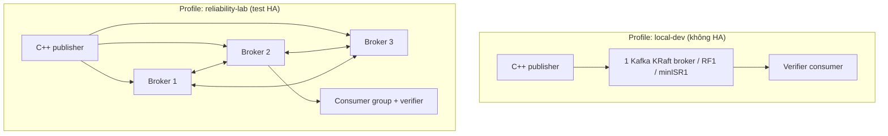
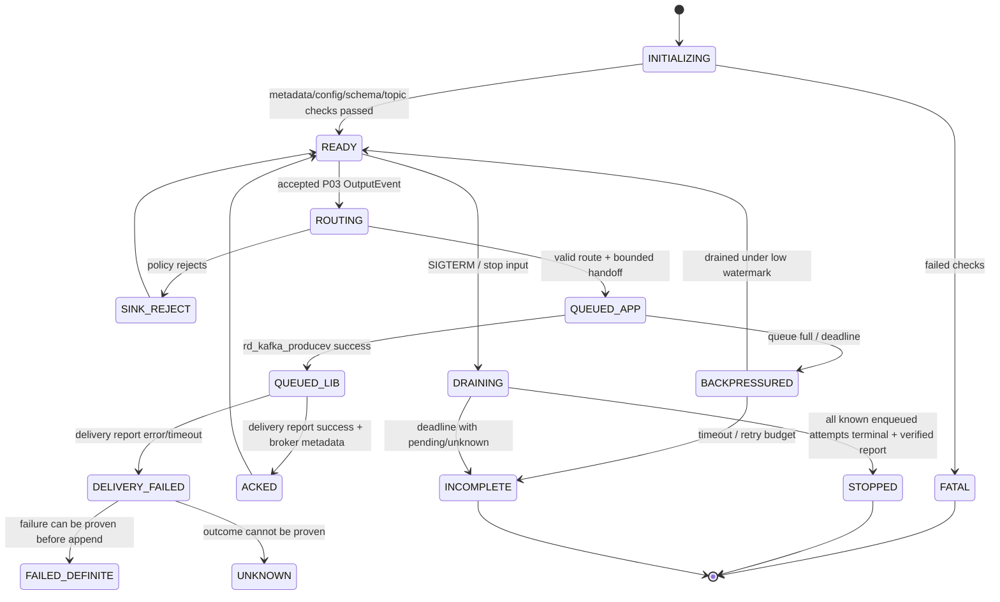

# PROJECT 04 — Kafka Market Data Streaming (C++20 / Protobuf / Kafka)

> **System Design + Reliability/Failure Modeling + Capacity Plan + 280 What-If Tests**  
> Ngôn ngữ: Tiếng Việt · Nền tảng: Linux · Producer: **C++20 + librdkafka** · Payload: **Protobuf `marketdata.v1`** · Broker: **Apache Kafka KRaft**  
> Phiên bản tài liệu: **1.0** · Ngày: **2026-10-30** · Trạng thái: **DESIGN_ONLY / IMPLEMENTATION_NOT_STARTED / TESTS_NOT_RUN / CAPACITY_NOT_VERIFIED**  
> Mức ưu tiên: **data correctness → khả năng giải trình dữ liệu → bounded resources → recovery → hiệu năng**.

## 0. Nguồn gốc, phạm vi và giới hạn bằng chứng

Đây là **dự án thứ 04/09** trong kế hoạch tự xây dựng lại **Market Data Streaming and Analytics Platform**. Theo CV, dự án lớn có thiết kế **Kafka topics theo event type; partitions keyed by symbol; idempotent producers; consumer groups; manual offset commits; at-least-once ingestion với idempotent sinks; versioned Protobuf schemas**. CV cũng nêu throughput **120k ticks/s với 8 partitions**, nhưng đây là chỉ số **pipeline tổng thể**, không phải benchmark độc lập của Project 04. CV **không chứng minh** phiên bản Kafka, client, topology, transactional flow, broker hardware, cách xử lý lỗi, tên topic hoặc mức độ bền vững dữ liệu. Tất cả những chi tiết chưa nêu dưới đây là **thiết kế mới được đề xuất**, không được trình bày như thành quả cũ.

### 0.1. Các contract kế thừa, **không được thay ngầm**

| Project | Hợp đồng đang có trong tài liệu thiết kế | Ranh giới P04 |
|---|---|---|
| **P01 — FX/CFD Simulator** | `sim.v1` JSONL, `dataset_id`, `symbol`, `sequence` **per symbol**, integer price ticks, `event_time_ns`, record/replay và fault manifest; JSONL TCP `:9009`. | Không đưa JSONL trực tiếp vào Kafka binary stream; không tự sinh giá hay sửa dữ liệu. |
| **P02 — Protobuf Contracts** | `marketdata.v1.MarketDataEvent`, `oneof quote/tick`, `optional` scalar presence. `MDP1` chỉ dùng cho TCP/`.pbstream` (`:9010`); Kafka **key = `symbol`, value = raw serialized Protobuf**, **không** có `MDP1`/4-byte prefix. | Dùng đúng `.proto`/descriptor đã pin, không tự đổi field number/type hoặc auto-fallback parser. |
| **P03 — C++ Adapter** | Nhận MDP1, validate structural/business/sequence/freshness, output `OutputEvent = typed MarketDataEvent + arrival_index + quality_flags + feed_state + provenance`; `P04_adapter_sink` chỉ bảo đảm **enqueue tại handoff**. | Chính P04 chịu trách nhiệm route, produce, delivery callback, publish ledger và giải trình ACK; không nhận mọi anomaly như market-valid. |
| **P05 — Python Batch Ingestion** | Consumer thực sự ghi ClickHouse, offset commit sau sink theo policy at-least-once và idempotency sẽ triển khai sau. | P04 chỉ cung cấp **test consumer + handoff contract**; chưa được gọi là end-to-end exactly-once. |

**Nguồn dữ liệu chính:** `PROJECT_01_FX_CFD_Market_Data_Simulator_System_Design.md`, `PROJECT_02_Market_Data_Protobuf_Schema_System_Design.md`, `PROJECT_02_Schema_Starter/market_data.proto`, `PROJECT_03_CPP_FX_CFD_Market_Data_Adapter_System_Design.md`, và các dòng mô tả dự án trong CV. Tài liệu P01–P03 là **thiết kế chưa triển khai/kiểm thử**, vì vậy các luồng tích hợp dưới đây là *target architecture*, không phải thành phần đã chạy.

### 0.2. Mục tiêu và câu hỏi khó

- Biến event được P03 **chấp nhận theo policy** thành Kafka records có key/topic/partition/headers rõ ràng, decode được bằng C++ và Python.
- **Không nhầm** `accepted_by_adapter`, `queued_in_p04`, `queued_in_librdkafka`, `broker_acknowledged`, `consumer_observed`, `sink_committed`.
- Giữ thứ tự **trong từng topic-partition**, và chỉ tuyên bố order per symbol khi chủ sở hữu/partition mapping không thay đổi. **Không có total order giữa topic `tick` và `quote`.**
- Bảo đảm producer idempotence **trong phạm vi Kafka producer session**; nhận diện được duplicates do app-level resend / restart / replay.
- Fail có giải thích khi broker down, ISR co lại, queue đầy, disk đầy, network partition, rebalances, topic/config thay đổi; không in `SUCCESS` dựa trên mỗi lệnh produce enqueue.
- Kiểm chứng khả năng chịu tải từ 1k → 10k → 50k → 120k events/s **khi máy cho phép**, đo sustained rate, queue age, p95/p99 latency, consumer lag và mức sử dụng CPU/RAM/disk/network.
- Biết **những gì không thể chứng minh** nếu upstream không có replayable cursor/durable outbox, Kafka retention đã xóa dữ liệu, ACK ambiguity, hoặc thiếu source manifest.

**Không thể liệt kê mọi sự cố trên đời.** Ma trận 280 test dưới đây kết hợp failure modes, stress axes và invariant-based/property/chaos testing. Một case chỉ được ghi `PASS` khi có fault injection + oracle độc lập + artifact; kịch bản không thể kết luận phải ghi `INCONCLUSIVE`, không được chuyển thành PASS.

### 0.3. Phạm vi / ngoài phạm vi

**In scope:** C++20 producer dùng librdkafka, raw Protobuf serialization, explicit routing, keyed partitioning, idempotent producer config, async delivery callbacks, bounded queue/backpressure, test consumer/consumer groups, read-only verifier, offset/lag observability, local single broker và 3-broker KRaft test topology, security baseline, CI+fault/stress/chaos/replay, P05 handoff.

**Out of scope ở MVP:** nối broker thật, FIX order execution, chạy chiến lược trading, Kafka Connect/Streams, exactly-once ghi ClickHouse, coordinator transactions 2-phase với source, tự động reshard mà giữ total order, multi-region disaster recovery, SASL/IAM production đầy đủ, thay đổi schema tùy tiện, và cam kết 120k/s trên mọi máy.

---

## 1. Yêu cầu chức năng và Non-functional Requirements

### 1.1. Functional Requirements

| ID | Yêu cầu | Oracle nghiệm thu |
|---|---|---|
| FR-01 | P03 đưa `OutputEvent` typed vào P04 bounded handoff | Event bị reject/suppress không lẫn vào market topic; enqueue status có meaning rõ. |
| FR-02 | Routing tách quote/tick theo event type | `quote → md.quotes.v1`, `tick → md.ticks.v1`; không topic được chọn bằng input string ngoài allowlist. |
| FR-03 | Kafka key = bytes của `symbol`, value = **raw Protobuf MarketDataEvent** | `key == event.symbol`, `value` parse trực tiếp bằng Python/C++; value không chứa `MDP1` hoặc BE32-length. |
| FR-04 | Pin 8 partitions **cho mỗi** market topic trong bài benchmark chuẩn | Admin verifier kiểm tra count/routing; topic sai count từ chối start, không sửa ngầm. |
| FR-05 | Pin partitioner/key canonicalization | Cùng key/topic/count/partitioner → cùng partition; không cross-language hash drift. |
| FR-06 | Idempotent producer, ACK policy cấu hình và validate fail-fast | `enable.idempotence=true`, `acks=all`, `max.in.flight≤5`, retries cho phép; incompatible config fail. |
| FR-07 | Poll delivery callbacks và lưu terminal status + broker offset khi có | Không coi `produce()` thành công là ACK. |
| FR-08 | Record identity và provenance để reconcile | `dataset_id+symbol+sequence` rõ ràng; phân biệt duplicate app-level và producer-internal retries. |
| FR-09 | Backpressure bounded số lượng **và** bytes | Queue chạm cap thì pause upstream hoặc exit `INCOMPLETE`, không silently drop. |
| FR-10 | Test consumer group và independent verifier | Decode core fields, kiểm chứng topic, key, monotonic per topic+symbol, không giả định order across topics. |
| FR-11 | Fault injection network/broker/ISR/queue/rebalance | Mỗi class lỗi có expected transition + metric + safe policy. |
| FR-12 | CI/fixtures/schema compatibility và benchmark reproducible | Lưu version/digest/seed/config/topology/hardware, có exit code và completion marker. |
| FR-13 | Topic provisioning qua Admin script | Không dựa `auto.create.topics.enable`; mismatch partitions/RF/cleanup policy phát hiện trước produce. |
| FR-14 | Explicit read-only verifier vs P05 sink consumer | P04 không đánh dấu ClickHouse write/commit nếu chưa thực hiện P05. |
| FR-15 | Rollout/rollback an toàn và không đổi partition mapping tự phát | Manifest ghi topic generation, schema hash, partitioner và mapping; rollout gate kiểm tra. |
| FR-16 | Observability và conservation equations | Log/metric/report tách enqueued, delivered, failed, ambiguous, observed, still pending. |

### 1.2. NFR — **mục tiêu đề xuất, phải đo sau khi code**

| ID | Đề xuất / budget | Cách bác bỏ hoặc xác nhận |
|---|---|---|
| NFR-01 | 100% golden fixtures giữ **semantic core equality**; không float/round price | C++ producer → Kafka → Python/C++ consumer, compare typed fields + presence. |
| NFR-02 | **0 unreported loss** trong offline verified dataset ở điều kiện đầy đủ; bất kỳ record nào thiếu phải có trạng thái chưa được giải trình | So producer ledger và independent consumer snapshot, manifest nguồn, không dùng aggregate counts làm proof duy nhất. |
| NFR-03 | Handoff queue mặc định 4096 events **và** 8 MiB, chọn limit chạm trước | Load slow broker, cgroup; RSS/queue/counter bounded. |
| NFR-04 | librdkafka producer queue ví dụ `100000 messages` và `64 MiB` (không dùng default 1 GiB) | Verify config effective; queue fullness có tín hiệu, nguồn không tiếp tục unbounded. |
| NFR-05 | `max_event_payload_bytes=4096` (theo P02), key `≤32 ASCII bytes`, headers tổng `≤512 B` đề xuất | Oversize fail trước queue; wire/protocol input không thể allocate vô hạn. |
| NFR-06 | Local development single-broker KRaft RF=1 chỉ để học; HA test **3 brokers, RF=3, minISR=2**, unclean election off | Chaos leader/follower fail; single broker **không** được mô tả HA. |
| NFR-07 | Rate ladder: 1k/10k/50k/120k **total events/s**; peak chưa đủ, báo bền vững trong 15–60 phút khi có tài nguyên | Thử burst và soak, đo tỉ lệ ACK/queue/lag/CPU/disk. |
| NFR-08 | Handoff→ACK p50/p95/p99/p99.9 đo theo **monotonic** clock; không dùng event_time để suy network latency | Histogram sample đúng, stage boundaries có định nghĩa. |
| NFR-09 | Tải bền vững: pending/queue age/consumer lag không tăng liên tục trong steady state | Kiểm tra xu hướng và backlog drain sau ngừng nguồn. |
| NFR-10 | Shutdown đề xuất tối đa 15 s flush/drain; chưa có terminal ACK → `INCOMPLETE` và nonzero | SIGTERM dưới slow broker + timeout; no false COMMITTED. |
| NFR-11 | Có max retry/delivery time hữu hạn, không block vô hạn | Network blackhole; upper bound test và callback status rõ. |
| NFR-12 | Topic retention đáp ứng replay/khôi phục; margin tính bằng backlog-rate, không mặc định 7 ngày là đủ | Simulate lag so với retention, phát hiện offset out-of-range. |
| NFR-13 | Audit cardinality bounded: metric theo `topic`, `partition`, error class; symbol label chỉ có allowlist nhỏ | Inject 100k fake symbols, exporter không nổ RAM. |
| NFR-14 | Pin Kafka image digest, librdkafka version, compiler, `.proto` SHA-256 và `config_hash`; benchmark report có môi trường | CI clean build/verify, so golden corpus cùng semantic oracle. |

**Lưu ý số học benchmark:** Nếu payload thực tế trung bình giả sử **256 B/record**, **120.000 record/s** ≈ **30,72 MB/s payload logical** hay ≈ **2,65 TB/ngày trước compression và Kafka overhead**. RF=3 có thể làm lượng dữ liệu replica ghi tổng xấp xỉ **3 lần** phần payload trước compression; network/disk/OS/index overhead thay đổi theo topology. **256 B chỉ là giả định minh họa**, cần đo bản tin thật và batch compression. Nếu hai topic đều phát 120k/s thì tổng tải **240k/s**, **khác** mục tiêu 120k/s tổng nêu trong tài liệu.

---

## 2. Kiến trúc system-level

### 2.1. Architecture diagram

```mermaid
flowchart LR
  subgraph SRC["Projects 01–03: upstream source"]
    P01["P01 JSONL Simulator / recorded dataset"] --> P02["P02 strict mapper & MDP1 bridge"]
    P02 --> P03["P03 C++ Adapter / Validator / Classifier"]
  end
  subgraph P04["Project 04: C++20 Kafka Publishing Service"]
    HO["Typed OutputEvent handoff"] --> PO["Publish Policy / Market-vs-Fault gate"]
    PO --> RO["Routing & Key Builder / Schema guard"]
    RO --> BQ["Bounded Outbound Queue by count+bytes"]
    BQ --> PR["librdkafka Producer / enqueue, poll, DR callbacks"]
    PR --> LED["Terminal-status ledger & metrics"]
  end
  P03 --> HO
  PR --> K["KRaft Kafka cluster: RF=3, minISR=2 in HA tests"]
  K --> T["md.ticks.v1 / 8 partitions"]
  K --> Q["md.quotes.v1 / 8 partitions"]
  T --> V["Independent C++/Python Test Consumer"]
  Q --> V
  V --> RP["Verifier report / offsets / hash / gaps"]
  T -. future .-> P05["P05 Python batch ingest → ClickHouse"]
  Q -. future .-> P05
  PO --> AN["Capped anomaly audit lane / optional fault topic"]
```



`md.ticks.v1` và `md.quotes.v1` được đề xuất theo CV “topics per event type”. **8 partitions là số cho mỗi topic trong benchmark mô phỏng**, tổng 16 partitions ở hai topic. `P01→P02→P03` trước đó vẫn là **thiết kế**, không giả định nguồn live đã có thật.

### 2.2. Deployment topology — local vs reliability lab



**KRaft quorums:** 3 Kafka brokers có thể là combined broker/controller cho test lab đơn giản, nhưng đây **không** phải khuyến nghị topology production. Khi mô phỏng HA thật phải xác minh cấu hình quorum/controller, broker failure-domain, bootstrap listener, replication factor và placement, không chỉ kiểm tra 3 container “đang chạy”. Không công bố HA nếu tất cả replicas nằm cùng một ổ đĩa/host duy nhất.

### 2.3. Module responsibilities (source layout đề xuất)

| Module | Làm | Không làm |
|---|---|---|
| `handoff/output_event` | Đóng gói typed P03 output + provenance | Không giả định enqueue là delivered. |
| `policy/publish_gate` | Chặn `reject`, `suppressed`, `fault_test_only` khỏi market topics theo policy | Không auto-correct price/sequence. |
| `protocol/protobuf_serializer` | Dùng generated P02 schema pinned; preserve core semantic values | Không thêm MDP1 vào Kafka value. |
| `routing/route_table` | Mapping `quote→quotes`, `tick→ticks`, canonical key | Không chọn topic từ symbol/user input. |
| `routing/partition_policy` | Pin partitioner, partition count/mapping và audit on start | Không silently accept repartition. |
| `queue/bounded_handoff` | Hạn chế count/bytes, pause/resume hysteresis | Không drop oldest và không cấp phát vô hạn. |
| `producer/kafka_producer` | RAII librdkafka config, `produce`, `poll`, delivery callback | Không gọi produce-return là ACK. |
| `ledger/publish_status` | Trạng thái per attempt, broker metadata và ambiguous outcomes | Không dùng RAM-only ledger để tuyên bố crash durability. |
| `ops/topic_admin_check` | Verify partitions, topic configs, ACL, RF và `minISR` | Không auto-create/sửa topic trên startup live. |
| `verifier/kafka_reader` | Independent consumer, semantic compare và captured high watermarks | Không giả làm durable ClickHouse sink. |
| `ops/metrics` | Counter/histogram/queue age/lag/error taxonomy, cap cardinality | Không per-event hot-path logging ở 120k/s. |
| `tests/fault_lab` | Toxiproxy/iptables/cgroup/broker kill/throttle/fixtures | Không đánh dấu pass nếu fault chưa xảy ra. |

### 2.4. Thread/ownership model — MVP

1. P03 **single-owner input/classification** gọi một **bounded handoff**; producer owner xử lý các event theo thứ tự enqueue, không phân luồng theo symbol làm đảo order.
2. **Một producer thread** thực hiện route + encode + `rd_kafka_producev()` và liên tục `rd_kafka_poll()` hoặc có **poll thread chuyên trách**; callback phải nhanh, không làm disk I/O blocking hay chờ mutex vòng tròn. Dùng `librdkafka` C API bọc trong C++ RAII.
3. Một lightweight supervisor xử lý SIGTERM/config/fatal state; verifier chạy **process riêng**, không chung consumer/producer state.
4. Internal librdkafka có threading/buffering riêng; tổng memory budget gồm **handoff + library queue + delivery contexts + broker/network buffers + metrics**. Không được nhân nhượng queue vô hạn chỉ vì ứng dụng đang ở C++.
5. **Cùng symbol cần một owner sản xuất logic**. Nếu nhiều upstream producer chạy đồng thời cho cùng symbol/topic, Kafka không thể cung cấp global producer order nếu ứng dụng không thiết lập order coordinator.

---

## 3. Kafka Record Contract, routing, key, headers và invariants

### 3.1. Schema P02 **nguyên văn theo starter**

```proto
syntax = "proto3";
package marketdata.v1;
message Quote { optional int64 bid_ticks = 1; optional int64 ask_ticks = 2; }
message Tick  { optional int64 price_ticks = 1; }
message MarketDataEvent {
  optional string dataset_id = 1;
  optional string symbol = 2;
  optional int64 sequence = 3;
  optional int64 event_time_ns = 4;
  optional int64 price_scale = 5;
  optional string source_schema_version = 6;
  oneof payload { Quote quote = 10; Tick tick = 11; }
}
```

**Không thay schema v1 để thêm metadata Kafka.** Hợp đồng `kafka.record.value = MarketDataEvent.SerializeToString()`; nếu muốn bảo toàn byte-to-byte raw P02 fixture, phải giữ raw payload riêng trước decode/re-encode và kiểm thử; **semantic field equality** mới là oracle giữa hai runtime/phiên bản.

### 3.2. Topics và policy

| Topic đề xuất | Value | Key | Partitions (bench) | Cleanup | Loại dữ liệu |
|---|---|---|---:|---|---|
| `md.ticks.v1` | raw Protobuf `MarketDataEvent`, oneof `tick` | UTF-8/ASCII `symbol` | 8 | `delete` | Synthetic tick events được P03 chấp nhận, không phải trades. |
| `md.quotes.v1` | raw Protobuf `MarketDataEvent`, oneof `quote` | UTF-8/ASCII `symbol` | 8 | `delete` | Quote `bid_ticks/ask_ticks`. |
| `md.anomalies.v1` *(optional, separate contract)* | **không** giả dạng `MarketDataEvent`; dùng JSON test-only có schema riêng hoặc Protobuf anomaly message phiên bản khác | hash/bounded symbol nếu hợp lệ | tùy | `delete` | Chẩn đoán/test, không feed market-valid. |

Không dùng `cleanup.policy=compact` cho raw ticks/quotes vì compaction xóa các bản tin cũ có cùng **key=symbol** và phá lịch sử tick. Có thể dùng compaction cho topic **state/snapshot riêng** khi thiết kế thích hợp, nhưng không cho stream event log.

### 3.3. Key và identity

```text
record.topic = (event.oneof == tick) ? "md.ticks.v1" : "md.quotes.v1"
record.key   = ASCII_UPPERCASE(event.symbol)  # CHỈ nếu P03 đã validate canonical uppercase
record.value = serialized MarketDataEvent      # NO MDP1, NO BE32-length
identity     = (dataset_id, symbol, sequence)   # logical source identity across both topics
kind         = oneof {quote, tick}
```

`ASCII_UPPERCASE` ở đây là **assert/check**, không phải âm thầm sửa symbol không chuẩn. Byte key là dãy ASCII đúng như field `symbol` được duyệt, ví dụ `EURUSD`. `dataset_id` nằm trong value và trong optional header, **không thêm vào key** để bảo toàn partition affinity theo symbol. Logic dedupe/reconciliation phải dùng **`dataset_id, symbol, sequence`** và **topic/kind** khi phân tích, bởi các dataset khác nhau có thể reset sequence.

**Partitioner:** chọn và pin ví dụ `murmur2_random` của librdkafka để tương thích hash key kiểu Java, kiểm thử mapping golden với N=8. Khóa rỗng/NULL → reject trước producer; không cho fallback random. Không mặc định mọi partitioner C++/Java có cùng hash.

**Điểm nguy hiểm — chia topics theo event type:** P01/P03 sequence **tăng trên mọi logical event của cùng symbol**, nhưng P04 chia hai topics. Do đó:

- Trong một `(topic, symbol)` đã đi vào **cùng partition**, thứ tự các sequence nhận được theo đúng một publisher owner là **tăng**, **không nhất thiết liên tiếp** (giữa chúng có event thuộc topic còn lại hoặc event P03 suppress).
- **Không** được xem thiếu số sequence trong topic `md.ticks.v1` như bằng chứng Kafka làm mất tick.
- **Không** có thứ tự quan sát chung giữa `md.ticks.v1` và `md.quotes.v1`; reader muốn tái tạo thứ tự tổng phải dùng **offline finite dataset + sort/merge theo sequence + manifest**, hoặc bổ sung **canonical single-topic** `md.events.v1` với *chính sách fan-out/generation đồng bộ* ở giai đoạn sau. Cross-topic transactions cũng **không** tự tạo global consumption order.
- Tăng số partition của cùng topic có thể đổi mapping key → partition, khiến symbol trải trên **nhiều partitions qua thời gian**. Với yêu cầu order theo key, **cutover sang topic generation mới**; không tự tăng partition inline.

### 3.4. Headers đề xuất (không phải một phần protobuf value)

| Header | Type/max | Mục đích / ghi chú |
|---|---|---|
| `md-schema` | ASCII string ≤64 B | Ví dụ `marketdata.v1`; **không** thay descriptor hash/compatibility test. |
| `md-descriptor-sha256` | 64 ASCII hex | Trace schema build; không dùng như auth. |
| `md-publish-policy` | ASCII enum ≤24 B | `market_valid` hoặc `verified_fault_test` **chỉ khi topic test riêng**. |
| `md-dataset-id` | UTF-8 ≤128 B | Duplicate audit; phải khớp value. |
| `md-run-id` | ASCII ≤64 B | Tương quan test run; không chứa PII. |

Không đưa unbounded flags/provenance JSON vào headers. Nếu cần `quality_flags`, quyết định schema/version của **audit record** độc lập. Kafka key/value/headers/metadata theo đúng cap và verifier so metadata với value. Header order không được dùng làm oracle business.

### 3.5. Publish policy — điểm quyết định trước Kafka

| P03 classification | Market topics? | Test/anomaly lane? | Điều kiện |
|---|---|---|---|
| Structural/wire invalid | **NO** | Diagnostic capped | Không có trusted valid `MarketDataEvent`. |
| Business reject / corrupted price | **NO** | Diagnostic only | Không sửa giá, không gửi nhầm vào feed dùng để phân tích market-valid. |
| Duplicate suppressed | **NO** | Audit counter | Nếu chủ động replay có thể xuất duplicate trên Kafka, verifier phải phát hiện; không hứa exactly-once. |
| `FAULT_TEST_ONLY`/stale/injected gap | **NO** theo strict default | Optional **isolated test topic/dataset** | Fault manifest verified + namespace test; không chảy vào production-like topic. |
| Accepted `market_valid` | **YES** | Optional low-cost audit | Preserve sequence, prices, timestamps và identity; producer enqueue có ledger. |

**Consistency của anomaly lane:** việc ghi hai topics riêng **không atomic** nếu không dùng Kafka transaction; không cho phép báo `audit_committed=true` dựa trên ACK của market record. Chế độ test cần chứng minh correlation thì phải verify cả hai terminal states, hoặc lưu audit trong manifest ngoài stream, với rủi ro crash được ghi rõ.

---

## 4. Producer flow: enqueue ≠ broker ACK ≠ consumer observed

### 4.1. Async producer lifecycle



**Diagram mô tả logical event attempt; mọi event có trạng thái terminal hoặc pending, không phải physical thread state đồng nhất.** Callback `delivery report success` cho biết broker đã acknowledge theo `acks=all` cấu hình đang có; **không** chứng minh consumer đọc, sink ClickHouse ghi, hoặc sống sót trong mọi thảm họa (VD mất toàn bộ replicas).

### 4.2. Idempotence, retries, ISR và ambiguity — quyết định bắt buộc

- `enable.idempotence=true`, `acks=all`, `retries>0`, `max.in.flight.requests.per.connection≤5`. **Pin explicit** thay vì phụ thuộc mặc định của client. Thực thi kiểm tra **effective config** trên startup; librdkafka phải fail khi config không tương thích.
- Idempotence của Kafka giúp chống duplicate do **producer internal retries** trong phạm vi producer identity/sequence, nhưng **không dedupe app gọi `produce()` hai lần**, cùng record được replay sau restart, nhiều producer cùng symbol, hay sink downstream.
- Lỗi `message.timeout.ms`/delivery callback error có thể là **ambiguous**: broker có thể đã append/ACK bị mất; không được gắn nhãn `NOT_WRITTEN`. Retry ở application layer có nguy cơ tạo duplicate. `FAILED` nghĩa producer không xác nhận thành công; `UNKNOWN` khi kết quả thực tế chưa kiểm chứng.
- `acks=all`, RF3/minISR2 tăng mức an toàn trước broker failure nhưng **không tương đương sync fsync mỗi record** và không bảo đảm chịu **mất toàn bộ failure domain**. Unclean leader election disabled. Khi ISR < `minISR`, **fail publish có lý do** thay vì tự giảm `acks`.
- Nếu cần guaranteed recovery qua crash của **P04 process** thì phải có **upstream durable replay cursor/outbox** hoặc một chính sách handoff có durable ACK và reconciliation. MVP P01/P03 live TCP **chưa** có durability/end-to-end ACK; do đó `process crashed` phải tạo `UNVERIFIED/INCOMPLETE` nếu không có verified offline source manifest.

### 4.3. C++ producer pseudo-flow (minh họa, **không phải code đã chạy**)

```cpp
// Spec-level pseudocode (not a drop-in compilable API example).
Status publish(const OutputEvent& in) {
    auto decision = publish_gate(in);
    if (!decision.market_valid) return counters.policy_suppressed(decision.reason);
    auto r = build_route_and_validate(in); // fixed topic, canonical key, <=4096 B value
    if (!r) return reject_with_reason(r.error());
    if (!bounded_handoff.try_reserve(r.estimated_bytes, 1))
        return backpressure_and_pause_upstream();
    auto attempt = ledger.create(in.identity, r.topic, r.key);
    // Convert to raw Protobuf value; no MDP1 header/length prefix.
    auto err = producer.producev(r.topic, r.key, r.value, callback_context(attempt));
    if (err != OK) { bounded_handoff.release(...); ledger.mark_enqueue_failed(attempt, err); return RETRY_OR_FAIL; }
    ledger.mark_queued_in_library(attempt);  // NOT delivered
    return ACCEPTED_FOR_ASYNC_DELIVERY;
}
// Poll delivery callbacks in a bounded/liveness-safe loop.
// A successful DR stores broker topic/partition/offset, otherwise reason + ambiguity.
// SIGTERM: stop upstream, drain poll/flush until deadline, persist incomplete report if pending.
```

**Memory ownership:** `payload`/`opaque` lifetime phụ thuộc flags và API `librdkafka` được pin (`RD_KAFKA_MSG_F_COPY` vs zero-copy). Callback context phải tồn tại đến delivery report terminal. Không giữ con trỏ tới `OutputEvent` stack đã bị hủy; không blocking lâu trong callback. **Đọc API phiên bản đang pin trước khi copy code thật.**

### 4.4. Queue/backpressure policy (hai tầng bắt buộc)

```text
P03/P04 typed handoff: max 4096 records AND 8 MiB (whichever first)
    HIGH = 80%, LOW = 40%, pause P03 read/handoff at HIGH
    STALL_DEADLINE = 5s (proposed), fail INCOMPLETE if not drain

librdkafka producer: queue.buffering.max.messages=100000
    queue.buffering.max.kbytes=65536 (KiB, ~64MiB) [example only]
    message.timeout.ms=30000 (example; verify version, request/linger)
    enable.idempotence=true; acks=all; max.in.flight.requests.per.connection=5
```

Hai queue cùng đầy là expected dưới broker outage. `pause upstream` trong một TCP stream **không** đảm bảo source sẽ giữ tất cả events; TCP/kernel buffers chỉ làm chậm, server P01 có thể ngắt/discard theo contract. Khi downstream không thể tiến, **fail closed có report** an toàn hơn tiếp tục nhận rồi OOM. Nếu yêu cầu *không mất data across outage*, ưu tiên **offline verified replay** hoặc thiết kế durable spool/outbox **ở phase bổ sung** (có fsync/metadata, disk-cap và resume semantics rõ).

### 4.5. Kafka topic provisioning, retention và pin config

**Profile `local-dev`:** 1 broker Kafka KRaft, topic RF=1, minISR=1; dùng để học protocol/unit/integration, **không chạy HA/leader failover tests**.  
**Profile `reliability-lab`:** 3 brokers, topic RF=3, minISR=2, `unclean.leader.election.enable=false`, 8 partitions **mỗi topic**, auto-creation disabled; verify actual runtime/Admin metadata trước run. 

**Retention phải là SLA:** `retention.ms`/`retention.bytes` theo **mỗi partition**, yêu cầu source có thể replay trong lúc downstream outage. Ví dụ chạy 120k/s liên tục nhiều giờ dễ chiếm TB; cap disk có thể khiến dữ liệu cũ bị xóa trước khi consumer phục hồi. Không bật compaction cho market event logs.

**Không thay đổi partitions trực tiếp trong production-like test**; muốn scale/order, tạo `md.ticks.v2` / `md.quotes.v2` hoặc tên `-g2` cùng manifest generation, deploy consumer có hỗ trợ đọc 2 thế hệ và quy tắc cutover explicit. Việc partition key được hash ổn định cần **cùng số partitions và cùng thuật toán**.

---

## 5. Consumer group verifier và offset contract (không lấn sang P05)

### 5.1. Hai loại verifier, không trộn claims

| Mode | Cách đọc | Điều chứng minh được | Không chứng minh được |
|---|---|---|---|
| `snapshot_verifier` | Ghi nhận `begin/end offsets` cho **mọi topic-partition** tại thời điểm chụp; `assign+seek` theo exact offsets, đọc tới **captured end offset** và đối chiếu manifest | Tập records tại một finite snapshot với retention chưa xóa; semantic equality, duplicates và gaps so nguồn | Live source không bao giờ mất event, hoặc cross-topic chronological order. |
| `group_verifier` | Group.id độc lập, subscribe 2 topics, inject join/leave/rebalance, track assignment/lag; optional commit chỉ sau report checkpoint | Consumer group assignment, rebalance và offset control hoạt động đúng | ClickHouse sink durable; exactly-once external side effect. |

**Offset convention:** Kafka committed offset là **offset của record tiếp theo cần đọc** (`last fully processed contiguous offset + 1`), **per topic-partition**. Nếu có parallel processing, chỉ tiến checkpoint tới **contiguous completed frontier**; không commit `max seen offset+1`. Sử dụng `enable.auto.commit=false` để explicit; với librdkafka nếu workflow có manual offset store thì `enable.auto.offset.store=false`. Revoke callback phải dừng workers, xử lý in-flight/bounded deadline và không commit partition khi đã mất quyền sở hữu; crash trước commit có thể đọc lại.

**Điểm quan trọng:** `group_verifier` có thể chọn **không commit offsets** trong mode chỉ quan sát. Trong mode kiểm tra commit, kết quả phải nằm trong một **artifact local hoàn chỉnh/đã fsync** trước khi commit; file local đó vẫn không thay thế database idempotent sink P05. Không cam kết exactly-once từ verifier.

### 5.2. Independent reconciliation oracle

`dataset_manifest` của P01 và `P03 classified trace` cho biết những **logical events được kỳ vọng publish**, tách khỏi event cố tình omit/reject/suppress. `P04 publish ledger` ghi attempt status, bao gồm `ACKED` với topic/partition/offset và `UNKNOWN` cho các trường hợp không xác định. `snapshot_verifier` tạo map `(dataset_id,symbol,sequence,kind) → observed count + core field projection + Kafka metadata`.

```text
SOURCE_EXPECTED_MARKET_VALID
  = P03_PUBLISH_ATTEMPTED + P03_NOT_OFFERED_WITH_REASON
P03_PUBLISH_ATTEMPTED
  = P04_POLICY_REJECTED + P04_ENQUEUE_REJECTED + P04_ENQUEUE_ACCEPTED
P04_ENQUEUE_ACCEPTED
  = P04_ACKED + P04_DELIVERY_FAILED + P04_UNKNOWN_OR_PENDING
# Counting these requires a shared scoped run and terminal snapshot; retries are attempts,
# not necessarily unique logical events. Never blindly add overlapping counters.

SNAPSHOT_OBSERVED_UNIQUE is based on identities + core projection, NOT just topic counts.
BROKER_ACKED != SNAPSHOT_OBSERVED (until independently verified to captured offsets).
```

Ở **một run hữu hạn** với completed source manifest, no retention, read-only consumer scan đến captured end offset, nếu `expected` không có trên Kafka → `MISSING/UNVERIFIED`; nếu identity có nhiều record → `DUPLICATE`; nếu identity cùng nhưng core khác → `CONFLICT` (P0). Chỉ khi đã kiểm tra độc lập mới đánh giá `PASS`. Aggregate count bằng nhau **không đủ** nếu 1 missing + 1 duplicate bù nhau.

### 5.3. Offset gaps không đồng nghĩa lost market events

Kafka offsets có thể không liên tục từ góc độ **logical market sequence** vì dữ liệu bị lọc, event ở topic khác, retention, compaction (không dùng), giao dịch aborted, hoặc các cơ chế metadata/control tùy client/mode. Không dùng `event.sequence == previous.sequence+1` làm oracle trong **mỗi topic event-type**. Dùng manifest expected route + partition mapping để phân biệt bỏ sót thực sự với event thuộc stream khác. Kafka `offset` là vị trí trong partition log, không phải `event.sequence` của P01.

---

## 6. Failure envelope & trạng thái hệ thống khi chịu sự cố

| Sự cố | Hành vi đúng cho MVP | Bằng chứng cần có | Cái không thể tự suy ra |
|---|---|---|---|
| Broker leader chết | Producer retriable/backoff, bầu leader mới trong ISR hoặc error | Errors, ISR/leader metadata, ACK terminal, snapshot verifier | Tất cả payload được bền vững qua mọi kiểu disaster. |
| 2/3 replicas down (`minISR=2`) | Publish bị từ chối/timeout, queue bounded, fail `INCOMPLETE` nếu quá deadline | NotEnoughReplicas errors, pending ledger, no false ACK | Messages timeout chắc chắn chưa append. |
| Producer ACK timeout/connection reset | `UNKNOWN` nếu chưa reconcile, không app blind resend | Delivery callback and verifier by identity | 100% not written. |
| Publisher SIGKILL trước callback | Ledger volatile bị mất, run incomplete; replay source + verifier cần đối soát | Run marker/manifest, broker log | Exactly-once qua restart nếu không có outbox/cursor. |
| Source sends duplicate | Identity duplicate được P03 suppress hoặc verifier P04 báo | P03 trace, observed multiplicity | Kafka idempotence xử lý duplicate app-level. |
| Consumer crash trước commit | Reconsume theo committed offset; P05 cần idempotent sink để chống ghi trùng | Offset history, repeated identity, sink test P05 | Exactly-once DB. |
| Retention làm mất backlog | Offset out-of-range, gap báo rõ; FAIL recovery | Begin/end offset snapshots, retention stats | Tự tái tạo lịch sử đã bị Kafka xóa nếu không còn source. |
| Hot symbol chiếm gần hết traffic | One partition là bottleneck, queue/lag tăng; báo capacity limit | Rate theo key/partition, histograms | 8 partitions bảo đảm 8-way parallelism với 1 key. |
| ISR shrinking/disk full | Backpressure, fail closed; không thay `acks` | ISR/disk/queue alerts | Tự chữa mà không mất availability. |
| Topic partition count thay đổi giữa run | Fail startup/revalidate metadata và dừng khi mapping không còn như manifest | Admin metadata versions | Per-symbol order liên tục khi remap. |
| Poison record bị P05 reject | P05 xử lý DLQ/policy độc lập; P04 verifier phải phát hiện contract mismatch | decode/validation errors, message identity | P04 publish thành công = downstream ingest thành công. |

### 6.1. Dữ liệu synthetic/fault test phải được cô lập

- Không gửi quote âm/spread đảo/stale có chủ ý vào `md.quotes.v1` được người dùng xem như market-valid. Strict default reject market lane; fault-testing dùng namespace/topic riêng, mốc test `run_id` và manifest đã được verify.
- Không đưa Kafka broker trong lab lên mạng public. KRaft listeners/controller ports đóng ngoài host; bật ACL/SASL/TLS khi mô phỏng truy cập đa máy theo phase sau.
- Không dựa trên idempotence để xử lý `duplicate` do P01 intentionally emit; đây là *separate semantic fault domain*.

---

## 7. Capacity, resource và performance model (chỉ là kế hoạch)

### 7.1. Phân lớp phép đo

| Layer | Mốc bắt đầu/kết thúc | Ý nghĩa |
|---|---|---|
| `P03 output→P04 app queue` | P03 handoff → queue accepted | Handoff latency, **không** chứng minh broker. |
| `P04 app queue→librdkafka` | Dequeue → `producev()` queued | Queue wait + serialization + route. |
| `librdkafka enqueue→broker DR success` | Accepted by library → DR callback success | Producer publish acknowledgement latency. |
| `broker append/visibility→verifier` | ACK record metadata → reader sees record | Visibility delay **không đồng nhất với E2E latency**, cần clocks/offsets tương quan. |
| `snapshot_verifier` | Captured offset bounds → all records scanned | Finite completeness/reconciliation. |

**Không lấy `event_time_ns` của simulator để trừ trực tiếp thời gian hiện tại**: replay event-time có thể là timestamp lịch sử; dùng `steady_clock` local cho các stage cùng process. Timestamps trên các máy cần time sync/clock uncertainty rõ.

### 7.2. Tải thực nghiệm và stop conditions

| Bài | Tải đề xuất | Thời lượng/tiêu chí | Kỳ vọng đúng |
|---|---|---|---|
| Smoke | 1k events/s, 3 symbols | ≥5 phút | 100% semantic match, ACK terminal, verified scan. |
| Moderate | 10k events/s | ≥10 phút | Queue ổn định, không failures ngoài intentional. |
| High | 50k events/s | ≥15 phút | Resource bounded, lag không tăng vô hạn. |
| Reference | **120k events/s tổng trên hai topics** | ≥15 phút rồi soak nếu đủ máy | Chỉ PASS nếu sustainable, không chỉ peak. |
| Burst | 2× rate sustainable trong 10–30 s | Kiểm tra pressure/drain | Dừng/pause an toàn khi quá năng lực. |
| Soak | 50–80% measured sustainable | ≥60 phút, có 1 test ≥6h nếu máy chịu | RSS/FD/queue/lag/trend ổn định. |
| Partition skew | 95–100% traffic vào một symbol | ≥10 phút | Báo hot partition/đúng limit; không tự quảng cáo scale bằng 8 partitions. |
| Chaos | Kill leader/network partition/ISR shrink during 10–50k/s | Recover/reconcile theo run | Không ACK giả, không mất mà không báo. |

**GO không dựa vào rate duy nhất:** phải có data correctness, terminal-status ledger reconciliation, bounded RSS, bounded queue, metric coverage, and durable source oracle (offline). Nếu thử 120k/s thất bại vì CPU/disk, report **max sustained đạt được** cùng lý do.

### 7.3. Capacity math bắt buộc khi thực thi

```text
logical_payload_Bps       = measured_avg_serialized_value_B * accepted_events_per_sec
kafka_wire_Bps            = measure_on_wire(batch_headers, compression, protocol, acks)
replica_disk_Bps          ≈ logical_written_Bps * replication_factor
                            (rough assumption BEFORE compression/segments/indices)
retention_logical_bytes   ≈ logical_payload_Bps * retention_seconds
queue_drain_seconds       = pending_records / (sustained_ack_rate - arrival_rate)
                            valid only if sustained_ack_rate > arrival_rate
partition_hotspot_ratio   = max_partition_events_per_sec / total_events_per_sec
consumer_backlog_seconds  ≈ consumer_lag_records / effective_consume_rate
```

Đừng nhầm `replication factor` với tổng network bandwidth chính xác; leader/followers, compression, controller, fetch, replica catch-up và ACK tạo overhead khác nhau. Thực tế phải lấy Kafka broker/client metrics, `iostat`, `sar`/network và storage counters.

---

## 8. Metrics, error taxonomy và runbook báo động

### 8.1. Các metrics bắt buộc

```text
p04_upstream_accepted_total{kind}
p04_policy_suppressed_total{reason}
p04_route_invalid_total{reason}
p04_app_queue_records / p04_app_queue_bytes / p04_app_queue_oldest_age_seconds
p04_lib_queue_records / p04_lib_queue_bytes (library stats)
p04_produce_enqueued_total{topic}
p04_produce_enqueue_failed_total{error_class}
p04_delivery_acked_total{topic,partition}
p04_delivery_failed_total{error_class}
p04_delivery_unknown_total{reason}
p04_broker_ack_latency_seconds{topic} (histogram)
p04_backpressure_seconds_total / p04_backpressure_timeout_total
p04_caught_fatal_errors_total{class}
p04_partition_mapping_mismatch_total
p04_verifier_observed_total{topic}
p04_verifier_duplicate_identity_total / p04_verifier_conflict_total
p04_verifier_missing_expected_total / p04_verifier_inconclusive_total
p04_consumer_lag_records{topic,partition}
p04_consumer_rebalances_total / p04_consumer_revoke_with_inflight_total
p04_process_rss_bytes / p04_process_fd_count / p04_process_cpu_seconds
p04_kafka_cluster_isr_under_min_total / p04_topic_retention_risk_seconds
```

**Cardinality:** không label metrics theo `dataset_id`, full event ID, random symbol/trace ID; các giá trị đó nằm trong **bounded sampled diagnostic artifact**/run manifest. Metrics `partition` có max 8 × 2 trong benchmark; nếu topology đổi phải cập nhật cap. `event_time_ns` không phải latency clock.

### 8.2. Error taxonomy

| Class | Ví dụ | Safe action |
|---|---|---|
| `CONTRACT_ERROR` | Wrong oneof/key/header/value or schema | Reject trước publish hoặc stop run. |
| `ROUTING_ERROR` | Unknown topic, partition change, unsupported event | Fail startup/publish route; không dynamic topic. |
| `BACKPRESSURE` | App queue hoặc producer queue full | Pause producer handoff, hysteresis, deadline; no silent drop. |
| `TRANSIENT_TRANSPORT` | Broker unreachable, metadata timeout | Retry internal bounded, track pending/lag. |
| `DURABILITY_UNAVAILABLE` | ISR < minISR, disk failure | Reject/timeout, fail closed; không hạ acks. |
| `DELIVERY_UNKNOWN` | Timeout, callback missing after crash | Reconcile by identity; report ambiguous. |
| `CONSUMER_COORDINATION` | Rebalance, revoked partition, fencing | Stop/complete in-flight by policy; avoid invalid commits. |
| `RETENTION_DATA_LOSS` | Offset out-of-range and source unavailable | Fail recovery proof; no skip-to-latest silently. |
| `SECURITY_ERROR` | ACL deny, bad credentials, unexpected listener | Stop, no insecure fallback. |
| `CAPACITY_EXCEEDED` | CPU/RAM/disk/network budget exceeded | Throttle/exit incomplete; record max load. |

### 8.3. Severity and runbook starter

- `P0`: nguy cơ **data corruption/silent loss/false durability/ACL bypass** → stop publish / freeze migration, keep evidence và compare manifest.
- `P1`: liveness/capacity/rebalance/availability → pause/bounded retry; escalate khi quá deadline và verdict `INCOMPLETE`.
- `P2`: tuning/observability noise/benchmark regressions → record và xử lý trước release gate.
- Sự kiện hồi phục phải có **clear condition**: health endpoint xanh **không đủ**; yêu cầu queue drain, delivery callbacks terminal, ISR healthy, verifier scan complete, reconciled expected identities.

---

## 9. WHAT-IF TEST MATRIX — có oracle, fault injector và điều kiện PASS/FAIL

**Đây là danh mục test đề xuất, chưa chạy.** `P0` = correctness/safety, `P1` = reliability/liveness/operability, `P2` = performance/tuning. Cột **PASS oracle** quy định bằng chứng tối thiểu; nếu chưa kích hoạt được stimulus thì `NOT_RUN` hoặc `INCONCLUSIVE`, không phải PASS.

**Các nguyên tắc chung:** (1) Một Kafka ACK chỉ là producer success theo Kafka config, không là ClickHouse commit; (2) với `.pbstream`/JSONL nguồn verified, expected events phải lấy từ manifest độc lập, **không lấy output của SUT tạo golden**; (3) Fault injection P01 gây missing/duplicate không được gán nhầm thành Kafka loss; (4) hệ thống có thể **từ chối an toàn** dưới lỗi thay vì tiếp tục phục vụ; (5) dùng reproducible seeds, timeouts và budgets; (6) kết hợp fault đôi/ba và boundary values sau khi chạy mọi case P0 độc lập.

| Nhóm | Phạm vi | Số What If |
|---|---|---:|
| **A** | P01/P02/P03 handoff, provenance và policy | 14 |
| **B** | Topic routing, Kafka key, partitioner và ordering | 14 |
| **C** | Topic provisioning, metadata, lifecycle và policy config | 14 |
| **D** | Protobuf value, key/headers và schema semantics | 14 |
| **E** | Idempotent producer, retries và record duplication | 14 |
| **F** | Delivery reports, ledger, ACK uncertainty và reconciliation | 14 |
| **G** | Broker availability, networking và Kafka protocol failures | 14 |
| **H** | Replication, minISR, leader election, durability và retention | 14 |
| **I** | Producer queues, backpressure, overload và memory ownership | 14 |
| **J** | Throughput, fairness, hot-key skew và benchmark validity | 14 |
| **K** | Consumer groups, rebalance, assignment và liveness | 14 |
| **L** | Offsets, replay, deduplication và completeness oracle | 14 |
| **M** | Schema evolution, version rollout và partition migration | 14 |
| **N** | CPU, memory, file descriptors, disk và OS/cgroups | 14 |
| **O** | Security, ACL, credentials, isolation và hostile inputs | 14 |
| **P** | Observability, audit, monitoring và evidence quality | 14 |
| **Q** | Concurrency, shutdown, restart và race conditions | 14 |
| **R** | Combined failures, chaos experiments và failover | 14 |
| **S** | P05 downstream handoff, at-least-once và idempotent sinks | 14 |
| **T** | CI/CD, harness validity, release, rollback và operations | 14 |
| **Tổng** | **20 nhóm kiểm thử** | **280** |

**Phân bố ưu tiên:** P0 = **134**, P1 = **126**, P2 = **20**. Các mức này do thiết kế gán, không phải số liệu incident thực tế.

### A. P01/P02/P03 handoff, provenance và policy (14)

| ID | Ưu tiên | What If / fault stimulus | Hành vi hệ thống mong đợi | PASS oracle / Fault injection |
|---|---|---|---|---|
| **A-01** | `P0` | P03 đưa business-rejected quote vào P04 | Không publish market topic, tăng rejected-by-policy | Gửi price-invalid fixture; verifier đếm 0 record market cho identity đó. |
| **A-02** | `P0` | P03 đánh duplicate suppressed nhưng P04 vẫn nhận | Chặn publisher và giải trình suppression, không đẩy duplicate | Fixture seq 1,2,2; expected published 2 identities, not 3. |
| **A-03** | `P0` | P03 forward `FAULT_TEST_ONLY` mà không có verified manifest | Fail closed khỏi market/test routing | Bỏ manifest/hash; assert 0 produce, `FAULT_MANIFEST_REQUIRED`. |
| **A-04** | `P0` | Typed event khác raw P02 payload về core fields | Không silent mutation; reject/reconcile trước route | Cố ý sửa bid_ticks trong handoff; semantic equality test FAIL. |
| **A-05** | `P0` | P01 JSONL được đưa thẳng vào P04 Kafka value | Reject format, không auto-fallback JSON | Produce JSON bytes qua guarded interface; strict decoder fail, 0 ACK market. |
| **A-06** | `P0` | P03 vừa gửi event chưa classified vừa gửi event classified | Chỉ accepted `market_valid` mới được route theo policy | Inject `feed_state=UNKNOWN`; assert explicit suppress reason. |
| **A-07** | `P1` | P03 pause vì P04 queue đầy | Hysteresis pause/resume, không busy spin | Slow broker, đo high=80%/low=40% và pause duration. |
| **A-08** | `P0` | P03 báo enqueue success nhưng P04 hết RAM trước nhận ownership | Handoff chỉ ACK sau reserve/copy/ownership, else explicit error | Fault memory allocation trước handoff; assert upstream no false ACCEPTED. |
| **A-09** | `P0` | `dataset_id` reset nhưng sequence giữ 1 | Identity khác dataset không bị coi duplicate | Hai completed datasets cùng symbol/seq; verifier thấy distinct keys. |
| **A-10** | `P0` | Dataset mixing khi policy yêu cầu single active dataset | Reject second dataset theo mode configured | Parallel run A/B; assert `DATASET_MIX_REJECTED` và no cross contamination. |
| **A-11** | `P1` | P03 reconnect làm lặp đoạn source đã quan sát | Phân loại application replay/duplicate, không dựa idempotence Kafka | Inject replay same logical IDs; verifier phát hiện hoặc suppression theo policy. |
| **A-12** | `P1` | P03 upstream stopped trước khi thông báo complete | P04 run `INCOMPLETE` nếu không có source complete marker | Kill P03 after N, assert no global PASS, pending explicitly reported. |
| **A-13** | `P1` | P03 đổi quality flags sau khi queued | Immutable snapshot/owned data cho publish attempt | Mutate original object after handoff; published semantic/metadata unchanged. |
| **A-14** | `P2` | P03 event load tăng đột ngột 100 lần | Bounded handoff và deterministic overload behavior | 10s burst, verify no unbounded heap, clear failure metrics. |

### B. Topic routing, Kafka key, partitioner và ordering (14)

| ID | Ưu tiên | What If / fault stimulus | Hành vi hệ thống mong đợi | PASS oracle / Fault injection |
|---|---|---|---|---|
| **B-01** | `P0` | Quote bị gửi vào topic tick | Validate oneof→topic, reject mismatch | Inject wrong route; independent verifier checks all record kind+topic. |
| **B-02** | `P0` | `symbol` NULL/empty key | Reject trước Kafka, không random partition | Make key empty; assertion `KEY_INVALID`, 0 enqueued market. |
| **B-03** | `P0` | Key trong Kafka là `eurusd` nhưng Protobuf `EURUSD` | Reject mismatch, không auto-normalize payload | Mixed-case key fixture; consumer asserts key bytes exact. |
| **B-04** | `P0` | Symbol chứa Unicode confusables / NUL | P03/P04 schema guard reject | Use `EUR\0USD`, fullwidth letters; 0 market records, error class. |
| **B-05** | `P0` | Topic count tăng 8→12 khi đang publish | Stop/fail mapping-contract, không tiếp tục remap âm thầm | Admin alter partitions midrun; detect metadata drift, no falsely ordered PASS. |
| **B-06** | `P0` | Thay partitioner librdkafka sang random | Startup policy reject/contract test fail | Compare expected mapping golden 3 symbols N=8, fail before publishing. |
| **B-07** | `P0` | Java và C++ dùng khác hash key | Pin exact partitioner algorithm and bytes | Golden mapping using librdkafka vs independent expected mapping. |
| **B-08** | `P0` | Cùng symbol do 2 app producer publish song song | Reject ownership overlap / report unordered risk | Start two publishers without lease; assert ownership fence/gate or STOP. |
| **B-09** | `P0` | Tick và quote cùng symbol được đọc theo thứ tự khác | Document no cross-topic ordering; verifier không gán lỗi sai | Generate seq 1 quote, 2 tick, 3 quote; reorder consumer scheduling; no false total-order claim. |
| **B-10** | `P0` | Sequence trong mỗi event-type topic nhảy 10→12 do event khác loại | Dùng source route manifest; không báo Kafka missing sai | Offline fixture interleaves events; expected monotonic only within topic. |
| **B-11** | `P1` | One symbol chiếm 100% traffic, 8 partitions vẫn nóng | Báo hot-key bottleneck, không hứa parallelism | Skew test, measure per-partition rate and saturated partition. |
| **B-12** | `P1` | Many symbols hash collision vào một partition | Đo distribution, cảnh báo skew, không đổi key ngầm | Find colliding test keys; compare expected partition load distribution. |
| **B-13** | `P1` | Consumer cần order cross-event topics để tính bars | Handoff nêu no total-order, require offline sort or canonical stream | Try online merge while delaying one topic; validator refuses strong ordering claim. |
| **B-14** | `P2` | Thay topic generation v1→v2 | Explicit cutover/watermark + dual readers + manifest | Canary publish generations, verify no silent remap or mixed topic epoch. |

### C. Topic provisioning, metadata, lifecycle và policy config (14)

| ID | Ưu tiên | What If / fault stimulus | Hành vi hệ thống mong đợi | PASS oracle / Fault injection |
|---|---|---|---|---|
| **C-01** | `P0` | Topic không tồn tại khi producer start | Fail startup; auto-create không được phụ thuộc | Disable auto-create, missing `md.ticks.v1`; exit nonzero before data. |
| **C-02** | `P0` | Topic tồn tại nhưng chỉ 1 partition thay vì 8 | Reject config mismatch | Admin describe topic N=1, assert startup stopped. |
| **C-03** | `P0` | Topic bật compaction trên raw ticks | Reject startup; historical events phải giữ theo retention | Set `cleanup.policy=compact`; assert specific topic policy error. |
| **C-04** | `P0` | Topic RF=1 trong HA test profile | Refuse HA verdict, profile mismatch | Admin shows RF1; HA suite NOT_RUN/NO_GO. |
| **C-05** | `P0` | `min.insync.replicas=1` trong HA profile | Reject as durability misconfiguration | Admin describes minISR1, assert NO_GO. |
| **C-06** | `P1` | Bootstrap URL sai advertised listeners | Bounded metadata/connect retry, clear error | Inject `advertised.listeners` unreachable; producer times out without OOM. |
| **C-07** | `P1` | DNS resolves to stale broker IP | Metadata refresh/rebootstrap within budget | Change DNS target or stub; eventual connected or timed out with reason. |
| **C-08** | `P1` | Broker added/removed during run | Refresh metadata; mapping/topic rules remain pinned | Scale brokers while partition count unchanged; no false route mismatch. |
| **C-09** | `P0` | Topic ACL allows write but no describe | Startup cannot verify contract → fail closed | Deny DESCRIBE, allow WRITE; fail before market publish. |
| **C-10** | `P1` | Topic configs changed while in flight | Detect drift at periodic reconciliation; stop new enqueues | Flip retention/cleanup; assert bounded detection window. |
| **C-11** | `P1` | Topic deleted and recreated with same name | Topic identity/offset discontinuity → stop run | Admin delete+recreate; verifier detects missing history/start marker. |
| **C-12** | `P1` | Topic retention too short for 2h consumer outage | Predict/detect offset out-of-range; no skip latest | Tiny retention + paused consumer; capture missing earliest offsets. |
| **C-13** | `P1` | Kafka metadata request storms from many publishers | Rate-limit startup/retries, avoid thundering herd | Launch 50 lab producers; count metadata calls and retry jitter. |
| **C-14** | `P2` | Topic size/quota misconfiguration | Report broker reject/truncation risk vs target message caps | Set max.message.bytes too low; explicit fail report and config diff. |

### D. Protobuf value, key/headers và schema semantics (14)

| ID | Ưu tiên | What If / fault stimulus | Hành vi hệ thống mong đợi | PASS oracle / Fault injection |
|---|---|---|---|---|
| **D-01** | `P0` | Kafka value có tiền tố MDP1 | Contract gate/consumer decoder reject; never publish production-like | Send framed fixture; 0 accepted decoded as raw Protobuf. |
| **D-02** | `P0` | Kafka value có BE32 length prefix trước Protobuf | Reject transport confusion | Take `.pbstream` bytes minus magic; produce value; decode FAIL, report WRONG_FORMAT. |
| **D-03** | `P0` | Field `sequence` absent trong proto3 optional | Fail structural; không default zero | Construct message with no sequence; no market produce. |
| **D-04** | `P0` | oneof payload unset | Reject event type, không fallback topic | Serialize envelope empty oneof; expect `MISSING_PAYLOAD`. |
| **D-05** | `P0` | oneof contains tick nhưng `symbol` header says another | Header/value mismatch → reject | Mutate `md-dataset-id`/key while value fixed; exact mismatch assertion. |
| **D-06** | `P0` | price_ticks bị chuyển qua float/round | Preserve int64, semantic equal | INT64 edge + 5-digit price; Python/C++ compare exact ticks. |
| **D-07** | `P0` | `event_time_ns` overflow khi chuyển runtime | Reject invalid before produce, no wrap | Boundary INT64_MAX+1 in mapper P02, P04 no accepted event. |
| **D-08** | `P0` | Producer serialize schema wrong major version | Descriptor compatibility gate, refuse | Swap generated v2 incompatible; baseline descriptor/semantic tests fail. |
| **D-09** | `P0` | Extra unknown fields bị parser cũ drop khi reserialize | Document / test lossless requirement separately | Golden unknown-field V1.1; test semantic projection, flag non-byte-identical. |
| **D-10** | `P1` | Value 4097 B > P02 cap | Reject before memory/queue / metrics count | Generate 4097B serialized protobuf; assert no Kafka enqueue. |
| **D-11** | `P1` | Headers >512 B / too many labels | Reject/cap before produce | Create 1k flags; verify bounded queue/RSS and error class. |
| **D-12** | `P1` | Corrupted bytes injected via raw Kafka API outside P04 | Verifier rejects with independent decode error | Inject random invalid Protobuf into test topic, zero falsely accepted. |
| **D-13** | `P1` | Payload parse succeeds but business invalid | Verifier must not treat parse-success as market-valid | Quote bid > ask; assert error and provenance of test injection. |
| **D-14** | `P2` | Binary bytes differ despite same semantic fields | Use semantic equality; don't compare raw hashes across builds | Encode Python/C++; check same projection, allow differing valid bytes. |

### E. Idempotent producer, retries và record duplication (14)

| ID | Ưu tiên | What If / fault stimulus | Hành vi hệ thống mong đợi | PASS oracle / Fault injection |
|---|---|---|---|---|
| **E-01** | `P0` | `enable.idempotence=false` accidentally | Startup config fail, not silent fallback | Mutate config; process refuses and CI negative test passes. |
| **E-02** | `P0` | `acks=1` while idempotence required | Fail config; do not auto-weaken ACK | Set `acks=1`; expect librdkafka config failure/status FATAL. |
| **E-03** | `P0` | `max.in.flight.requests.per.connection=10` | Reject as incompatible with idempotence | Run config init test; no producer created. |
| **E-04** | `P0` | `retries=0` configured | Reject under required idempotence policy | Client creation/assert explicit validation error. |
| **E-05** | `P0` | Broker returns transient failure after first batch | Internal retry maintains per-partition ordering | Fault broker response; verifier checks monotonic ordering and multiplicity. |
| **E-06** | `P0` | ACK dropped after broker append | Timeout is ambiguous, not `NOT_WRITTEN` | Drop response packets; verifier scans identity in Kafka, ledger UNKNOWN until reconcile. |
| **E-07** | `P0` | Application retries `producev()` after ambiguous timeout | Duplicates possible; no exactly-once claim | Explicit resend same logical ID; verifier must flag duplicate or suppress at app layer. |
| **E-08** | `P0` | P03 replay publishes same dataset twice after restart | Idempotence alone insufficient; idempotency oracle detects | Publish fixture twice in separate producer sessions, count identities>1. |
| **E-09** | `P0` | Two producers same symbol with producer IDs differ | Application-level coordination required | Launch 2 independent producers, interleave; detect order threat and fail gate. |
| **E-10** | `P1` | Error callback says disconnected but producer later recovers | Do not mark all pending failed prematurely | Toxiproxy brief fault; DR eventually ACK or timeout per attempt. |
| **E-11** | `P1` | Delivery timeout fires before broker recovers | Mark failure/ambiguity, no false losslessness | Down >message.timeout, then up; compare broker log/ledger statuses. |
| **E-12** | `P1` | Producer epoch/ID rollover or broker transition | Client follows idempotence protocol or fatal safely | Long-running producer/restart, fault injection; no silent reorder in observed subset. |
| **E-13** | `P1` | Retry storm causes producer queue full | Bounded backpressure and stable CPU | Introduce 50% packet loss, verify queue cap and retry rate. |
| **E-14** | `P2` | Reduce in-flight from 5→1 for stronger simplicity | Document throughput trade-off with proof unchanged | A/B benchmark throughput and order oracle on both settings. |

### F. Delivery reports, ledger, ACK uncertainty và reconciliation (14)

| ID | Ưu tiên | What If / fault stimulus | Hành vi hệ thống mong đợi | PASS oracle / Fault injection |
|---|---|---|---|---|
| **F-01** | `P0` | `producev()` returns OK but no broker reachable | Mark LIB_QUEUE only; never ACKED | Publish with broker down; report 0 delivered until callback success. |
| **F-02** | `P0` | Delivery callback returns success but offset not recorded | Capture topic/partition/offset or report incomplete evidence | Stub callback missing metadata; verifier flags missing publish proof. |
| **F-03** | `P0` | Delivery callback fails but process logs success by attempt count | Count failed separately, exit incomplete | Inject `MSG_TIMED_OUT`; assert report mismatch detection. |
| **F-04** | `P0` | `rd_kafka_poll()` never called | Callbacks starve; liveness watchdog signals | Disable poll loop; unresolved count grows to budget then fail. |
| **F-05** | `P0` | Callback called after opaque context freed | RAII lifetime protected until callback terminal | ASan/TSan regression with delayed callbacks; zero use-after-free. |
| **F-06** | `P0` | Callback refers to wrong identity after reusable slot index | Unique attempt handle/epoch; no status corruption | Reuse attempt IDs under 100k events; match source core IDs and DR. |
| **F-07** | `P0` | Broker ACK succeeded but verifier sees different payload | Conflict is P0, not “already delivered” | Mutate test consumer expected projection; identity+fields mismatch FAIL. |
| **F-08** | `P0` | Counts balance but one ID missing and another duplicated | Use set+multiset identity oracle; counts insufficient | Inject one missing+one duplicate; verifier must FAIL both. |
| **F-09** | `P0` | Application process SIGKILL before delivery callback | Run incomplete; no invented terminal ACK status | Kill at predetermined enqueue count; independent snapshot/recovery check. |
| **F-10** | `P1` | Delivery callback arrives out of enqueue wall-time order | Track by attempt ID, no assumption callback order | Inject variable broker delay per partition; ledger statuses correct. |
| **F-11** | `P1` | Duplicate delivery callbacks due wrapper bug | One terminal transition per attempt; flag double finalize | Call callback twice in unit fake; ledger invariants fail fast. |
| **F-12** | `P1` | No terminal statuses at shutdown deadline | Exit INCOMPLETE and export bounded pending identity sample | Blackhole broker + SIGTERM, assert nonzero and pending>0. |
| **F-13** | `P1` | Ledger flushed to file but directory not fsynced | Do not claim power-loss-durable report; completion marker guarded | Filesystem crash/rename test; marker only after promised durability steps. |
| **F-14** | `P2` | Full per-event ledger causes memory exhaustion | Stream append bounded/aggregate after completion; estimate memory | Soak 50M records; RSS stable, report stats + searchable artifact if enabled. |

### G. Broker availability, networking và Kafka protocol failures (14)

| ID | Ưu tiên | What If / fault stimulus | Hành vi hệ thống mong đợi | PASS oracle / Fault injection |
|---|---|---|---|---|
| **G-01** | `P0` | Broker leader killed while in-flight batches | Retry/leader election, delivered or error terminal; no phantom ACK | Kill leader during 50k/s, compare producer DR and independent scan. |
| **G-02** | `P1` | Follower killed but ISR remains≥2 | ACK continues/degrades per policy; warn replication health | Kill follower RF3, check ISR and success/error metrics. |
| **G-03** | `P0` | Network partition isolates producer from all brokers | Bounded retries/queue; no silent event drop | Toxiproxy cut for >timeout; assert backpressure & incomplete state. |
| **G-04** | `P0` | Broker receives batch then socket RST before ACK | Delivery ambiguous pending independent verification | Cut response after append; reconcile by identity, never say certainly absent. |
| **G-05** | `P1` | One broker's advertised address unreachable | Metadata/leader failover or explicit timeout | Misconfigure advertised listeners for leader; no indefinite block. |
| **G-06** | `P1` | DNS changes while producer has cached metadata | Refresh/rebootstrap according to pinned client budget | Swap DNS after disconnect, verify recovery or bounded exit. |
| **G-07** | `P1` | Network high latency 500ms each direction | Linger/retries affect p99, queue budget remains bounded | Toxiproxy latency; latency histogram and lag visible. |
| **G-08** | `P1` | Packet loss 5% or random RST | Retry/DR terminal; reproducible seed in report | Toxiproxy seeded loss test, verify no false ACK and queue cap. |
| **G-09** | `P1` | Bandwidth throttled below arrival rate | Backpressure/age grows to deadline, safe fail | Throttle 1MB/s, 10MB/s; monitor backlog and reason. |
| **G-10** | `P1` | Half-open TCP sessions keep apparent connection | Transport timeouts detect, bounded liveness | Drop outbound without RST, assert max time-to-terminal budget. |
| **G-11** | `P1` | TLS handshake fails (security-lab profile) | Fail closed, do not downgrade PLAINTEXT | Wrong CA; connection fails without insecure retry. |
| **G-12** | `P1` | Broker request throttled due quotas | Respect throttle, report sustainable throughput | Set low producer quota, check rate/queued age and no spin. |
| **G-13** | `P1` | Coordinator down, producer still healthy | Publisher unaffected; verifier consumer failure reported independently | Kill group coordinator scenario, verify publish DR vs reader metrics. |
| **G-14** | `P2` | Reconnect attempts synchronize across 100 publishers | Use backoff/jitter, prevent thundering herd | Kill/revive cluster, histogram reconnect attempts. |

### H. Replication, minISR, leader election, durability và retention (14)

| ID | Ưu tiên | What If / fault stimulus | Hành vi hệ thống mong đợi | PASS oracle / Fault injection |
|---|---|---|---|---|
| **H-01** | `P0` | RF3 and ISR drops to 1 while `minISR=2` | Writes rejected/time out, never downgrade acks | Kill 2 replicas; expect NotEnoughReplicas and NO_GO availability. |
| **H-02** | `P0` | Unclean leader election enabled in HA profile | Startup/topic drift checker stops run | Set unclean=true; validation FAIL before chaos certification. |
| **H-03** | `P0` | `acks=all` incorrectly documented as disk fsync proof | Report only broker ACK according to config | Inject crash scenario; doc/report assertions no fsync claims. |
| **H-04** | `P0` | All 3 replicas on same physical disk | No HA certification; label single failure domain | Inspect broker host/volume identity manifest; fail HA gate. |
| **H-05** | `P0` | Leader killed immediately after ACK | Read availability and reconcile based on ISR settings | Kill leader at ACK timing; compare committed/read records with metadata. |
| **H-06** | `P0` | Replica log diverges and unclean election attempted | Refuse unsafe leader/data loss; report unavailable | Force stale follower; assert no unclean election or mark data loss. |
| **H-07** | `P1` | Follower lag grows due slow disk | ISR health monitored; warn when minISR in jeopardy | Throttle disk follower, chart ISR changes and DR latency. |
| **H-08** | `P1` | Broker log disk full | Producer fails/backpressures without event silently dropped | Fill broker volume under quota; ledger and error class correct. |
| **H-09** | `P1` | Kafka retention deletes data while verifier offline | Detect begin offset advanced; recovery NOT PROVEN | Set tiny retention, sleep; scan reports OUT_OF_RANGE/MISSING. |
| **H-10** | `P1` | Retention.bytes set low on one hot partition | Per-partition retention check; alert early | Skew 95% to one partition; record deletion + lag gap. |
| **H-11** | `P1` | Segment roll late delays retention reclamation | Capacity model considers segment-based cleanup | Force large segment, retention small; disk monitoring and documented lag. |
| **H-12** | `P1` | Broker clock skew affects timestamp-based retention | Use independent event identity/offset snapshots | Skew broker wall time in isolated lab; report offset changes, no timestamp proof. |
| **H-13** | `P1` | Replica catch-up saturates network after outage | Throttle/queue/lag bounded, no false green state | Bring follower back after outage, observe sustained publish and ISR recovery. |
| **H-14** | `P2` | Compression codec changed under load | Compare disk/network vs CPU and p99 | A/B zstd/lz4/none with same dataset; data oracle exact. |

### I. Producer queues, backpressure, overload và memory ownership (14)

| ID | Ưu tiên | What If / fault stimulus | Hành vi hệ thống mong đợi | PASS oracle / Fault injection |
|---|---|---|---|---|
| **I-01** | `P0` | P04 handoff queue hits record count cap | No allocation past 4096 count, pause upstream | Slow producer, run >20k events; high watermark/pause triggers. |
| **I-02** | `P0` | Queue hits byte cap before count cap | Enforce 8MiB independently | Feed 4KB events; assert byte cap triggers earlier than count cap. |
| **I-03** | `P0` | librdkafka buffer full (`ERR__QUEUE_FULL`) | Do not drop; hold bounded handoff/retry or fail incomplete | Block brokers, drive load until queue_full, reconcile all logical statuses. |
| **I-04** | `P0` | `queue.buffering.max.kbytes=0` or default huge | Config guard forbids unbounded/mis-budgeted queue | Invalid config test, startup error with effective values. |
| **I-05** | `P0` | Producer callback owns freed payload after producev | Copy or retained lifetime according to API, sanitizer clean | Force slow DR and destroy original event, ASan verify. |
| **I-06** | `P0` | OOME from many delivery contexts | Bound outstanding count/bytes and fail before OOM | Cap cgroup 128MB; stress until limiter, no false PASS if cgroup OOM/SIGKILL occurs; harness must mark run INCOMPLETE. |
| **I-07** | `P1` | Upstream rate exceeds ACK rate for minutes | Oldest age rises; stop at stall deadline | Send 100k/s while broker handles 20k/s; time-to-fail bounded. |
| **I-08** | `P1` | Producer library queue drains but app queue remains high | Do not unpause prematurely; both budgets monitored | Alternate lib queue/full and app high; correct hysteresis. |
| **I-09** | `P1` | Producer stops polling while waiting for queue space | Poll progress integrated; no self-deadlock | Make queue full, block producer task; watchdog shows progress/callbacks. |
| **I-10** | `P1` | Handoff condvar missed wakeup | Wait predicate + timeout, no infinite hang | Stress producer-consumer races with TSan and fake clock. |
| **I-11** | `P1` | Burst from 3 symbols leads to repeated pause/resume thrash | Hysteresis high/low works, no high CPU oscillation | Wave-pattern burst; measure pause toggles and CPU. |
| **I-12** | `P1` | OS page cache hides growing broker disk pressure | Track actual free space and dirty pages, not RSS only | Sustain burst with constrained volume; alert before ENOSPC. |
| **I-13** | `P1` | Poison event logging grows memory unbounded | Sampling/rate limits and capped diagnostics | 100k error events/s, memory and logs bounded. |
| **I-14** | `P2` | Tune batch/linger while latency SLO strict | Measure end-to-end ACK p99 vs throughput trade-off | Matrix linger 0/5/20ms and batch sizes, no blind speed claim. |

### J. Throughput, fairness, hot-key skew và benchmark validity (14)

| ID | Ưu tiên | What If / fault stimulus | Hành vi hệ thống mong đợi | PASS oracle / Fault injection |
|---|---|---|---|---|
| **J-01** | `P0` | 120k/s generated but only 80k/s ACKed | Rate FAIL, not 120k PASS | Compare source actual/offer/enqueue/ACK over same steady window. |
| **J-02** | `P0` | 1-minute burst peak 120k/s then backlog unbounded | Not sustainable; benchmark FAIL | Run 15min, queue age and lag slopes >0 invalidate pass. |
| **J-03** | `P0` | One symbol 100% of load on one partition | Recognize 1-partition bottleneck | Histogram per-partition publish/consume, no claimed 8× scale. |
| **J-04** | `P1` | 90% quote /10% tick mix changes resource cost | Benchmark mixes separately, report skew | Three workloads 50:50,90:10,10:90 with exact source counts. |
| **J-05** | `P1` | 5B tiny payload vs 4KB max payload workload | Measure range; avoid generalizing avg performance | Run payload percentile matrix and CPU/network/disk metrics. |
| **J-06** | `P1` | 100k symbols exceed allowed key cardinality | Reject/bound memory, no metric explosion | Mass-random keys until cap; memory/metrics stable. |
| **J-07** | `P1` | Compression ratio synthetic data unrealistically high | Include random/noncompressible baseline | A/B compressible vs high-entropy fixtures, compare actual bytes/sec. |
| **J-08** | `P1` | Consumer lag grows while producer ACK rate fine | Mark pipeline downstream-limited | With slow verifier, report publish healthy but end-to-end FAIL. |
| **J-09** | `P1` | CPU thermal throttling mid-benchmark | Record frequency/throttled time, rerun/qualify | Constrain CPU/thermal model; report invalidated condition. |
| **J-10** | `P1` | Broker IO latency spikes p99 despite stable average | Histogram tail captures and alerts | Inject 500ms disk pauses, inspect p99 vs avg. |
| **J-11** | `P1` | Benchmark runs other workloads concurrently | Environment manifest and load indicators, mark contaminated | Start background IO/CPU, record competing load. |
| **J-12** | `P1` | Client and broker share one host, fake network performance | Label single-host loopback and limits, no production extrapolation | Compare local vs 3 node isolated network, reports separate. |
| **J-13** | `P1` | Clock changes during timestamp latency calculation | Use monotonic local stages, reject negative/double-count | Warp system wall clock; ACK latency stays consistent. |
| **J-14** | `P2` | More partitions improve throughput but break mapping | Benchmark new topic generation, not same-topic silent expansion | Create 8/16 partition topics separate, compare and document order trade-off. |

### K. Consumer groups, rebalance, assignment và liveness (14)

| ID | Ưu tiên | What If / fault stimulus | Hành vi hệ thống mong đợi | PASS oracle / Fault injection |
|---|---|---|---|---|
| **K-01** | `P0` | 2 consumers cùng group đọc 8 partitions | Mỗi partition chỉ có owner active theo generation; no competing work | Record assignment map via callbacks; assert no duplicate active ownership. |
| **K-02** | `P0` | 9 consumers cho 8 partitions một topic | Consumer dư idle hợp lệ; không invent order/multiplicity | Scale 1→9 in single topic test; assigned partitions =8 unique. |
| **K-03** | `P0` | Consumer killed giữa batch đang verify | No fake checkpoint; redelivery allowed | Kill after read-before-persist; new consumer re-reads, verifier notes duplicate processing. |
| **K-04** | `P0` | Revoke callback đến khi workers còn in-flight | Pause and drain/cancel, don't commit past contiguous finish | Trigger rebalance midwork, assert no invalid commits after revoke. |
| **K-05** | `P0` | Partition assigned lại cho instance khác nhưng old worker vẫn process | Fence epoch/generation, stop stale worker publication | Inject delayed worker after revoke; reject stale completion. |
| **K-06** | `P1` | Member joins group every second | Rebalance count/availability monitored, bounded liveness | Churn 20 joins, measure partitions ownership/throughput. |
| **K-07** | `P1` | Consumer group coordinator unavailable | Poll retry/timeout, no silent skip | Kill coordinator; group verifier marks incomplete, publisher separate. |
| **K-08** | `P1` | `max.poll.interval.ms` exceeded by slow handler | Protect poll loop/worker separation; rebalance visible | Sleep >max.poll, verify ownership revoked and errors logged. |
| **K-09** | `P1` | Static member reboots while group active | Follow pinned group protocol behavior, no false immediate takeover | Use `group.instance.id`, reboot and measure assignment/timeout. |
| **K-10** | `P1` | Classic vs new consumer group protocol differs | Pin protocol/client; deterministic test matrix per supported mode | Start mixed config or unsupported broker, fail compatibility gate. |
| **K-11** | `P1` | Rebalance happens during `seek()` replay | Reassign/reseek only under owner epoch; explicit mode separation | Force rebalance while verifier seeks, record final scanned offsets. |
| **K-12** | `P1` | Consumer lags only one hot partition | Per-partition lag alerts, not average-only | Throttle one partition consumer; aggregate lag hides hotspot but detector catches. |
| **K-13** | `P1` | Consumer subscription regex matches unrelated topic | Explicit allowlist topics, no wildcard in MVP | Create `md.ticks.secret`; verifier must not subscribe. |
| **K-14** | `P2` | Cooperative vs eager rebalancing comparison | Evaluate supported assignor with pinned client | A/B churn benchmark; correctness invariant unchanged. |

### L. Offsets, replay, deduplication và completeness oracle (14)

| ID | Ưu tiên | What If / fault stimulus | Hành vi hệ thống mong đợi | PASS oracle / Fault injection |
|---|---|---|---|---|
| **L-01** | `P0` | Consumer commits offset before durable verification | Disallow advance; crash causes missing proof | Force crash between poll and report persistence, expect reread. |
| **L-02** | `P0` | Parallel worker finished offset 102 before 101 | Commit frontier remains 101 (next contiguous) | Out-of-order completions trace; assert committed=101, not 103. |
| **L-03** | `P0` | Offset commit success but artifact unfinished | Checkpoint invalid; mark incomplete, not exactly-once | Kill before report final marker; re-run verifier from safe offset. |
| **L-04** | `P0` | Start group with `auto.offset.reset=latest` inadvertently | No skipping historical expected records | Fresh group under strict fixture expects earliest/explicit begin, refuses latest. |
| **L-05** | `P0` | Retention deleted committed offset | Detect offset-out-of-range; do not auto-seek latest silently | Short retention, resume old commit; verdict recovery FAIL. |
| **L-06** | `P0` | Reader only checks count, one missing one duplicate | Identity multiset oracle catches both | Inject missing+duplicate equal count, assert FAIL. |
| **L-07** | `P0` | Duplicate ID has different payload/value | Flag `CONFLICT`, not normal retry | Create 2 records same dataset/symbol/seq, different bid, no pass. |
| **L-08** | `P0` | Verifier compares event sequence across two topics in arrival order | Reject total-order claim; compare manifest offline | Delay quote stream, offline sort and independent expected route check. |
| **L-09** | `P0` | Consumer sees Kafka offset 200 after 198 | Not conclude event seq gap; inspect exact partitions/log/transaction | Insert controlled offsets, assert not tied to logical sequence gap. |
| **L-10** | `P1` | Snapshot high watermark captured while publisher still live | Clearly define finite snapshot cut, not global run complete | Publish after capture; verifier reports snapshot complete only. |
| **L-11** | `P1` | Verifier seek past captured end offset | Stop at boundary, no unbounded watch | Set end offsets then stream more; scan ends on captured highs. |
| **L-12** | `P1` | Consumer reads compacted/changed topic accidentally | Topic policy gate rejects, otherwise incomplete history | Switch cleanup policy, trigger retained history loss, fail oracle. |
| **L-13** | `P1` | Checkpoint file crash during atomic rename | Treat `.part` incomplete; only verified COMPLETED report accepted | SIGKILL/fsync injected, restart rechecks metadata and integrity. |
| **L-14** | `P2` | Offline replay at 10× speed | Preserve values/identity but report broker-scheduling differences | Compare semantic sets/traces over repeated runs, not byte timing. |

### M. Schema evolution, version rollout và partition migration (14)

| ID | Ưu tiên | What If / fault stimulus | Hành vi hệ thống mong đợi | PASS oracle / Fault injection |
|---|---|---|---|---|
| **M-01** | `P0` | Writer adds field and old reader interprets core wrongly | Golden V1/V1.1 cross binary matrix gate | Build 4 old/new combos; core projection equality required. |
| **M-02** | `P0` | Tag number reused across releases | Descriptor compatibility test forbids | Mutate reserved/used tags, CI fails before merge. |
| **M-03** | `P0` | Writer adds new oneof event kind but routes as quote | Reject unsupported kind until explicit new topic/policy | Create future payload kind; old publisher fails, no raw guessing. |
| **M-04** | `P0` | Old consumer drops unknown fields on republish | Document no lossless forwarding guarantee; test raw preservation path separately | V1.1 unknown-field fixture, compare known projection + lost unknown warning. |
| **M-05** | `P0` | Producer v2 publishes into topic v1 without migration | Block by descriptor/topic generation allowlist | Canary with incompatible proto, startup/version gate fails. |
| **M-06** | `P0` | Partition count expanded within old topic during deployment | Fail mapping contract, cutover generation required | Alter partitions midrun; mapping drift alert/stopped. |
| **M-07** | `P0` | Two producers with different key partitioners in same topic | Reject incompatible producer instance configuration | Launch Java-default vs C++ wrong hash; detect mapping divergence. |
| **M-08** | `P1` | Consumer V1 rollout behind producer V1.1 | Deploy compatible readers first, staged producer rollout | Canary release matrix + rollback simulation. |
| **M-09** | `P1` | Rollback writer after V1.1 records persisted | Old writer/reader must still handle retained v1.1 safely | Read history and replay old producer version, no silent rejects. |
| **M-10** | `P1` | Headers version and value schema disagree | Cross-check and reject/quarantine | Flip `md-schema` header only, verifier catches mismatch. |
| **M-11** | `P1` | Changed `symbol` canonicalization across release | Schema/policy version gate; explicit cutover needed | Test lowercase/UTF8/case map, all old/new partition mapping compare. |
| **M-12** | `P1` | Topic generation dual publish causes duplicates | Separate generation identity, deprecate only after verify | Dual-topic canary and consumer dedupe/provenance reconciliation. |
| **M-13** | `P1` | Release swaps protobuf runtime with gencode mismatch | Build/runtime startup gate; CI reproducible | Pin protoc+runtime, test old/new incompatible compile or decode. |
| **M-14** | `P2` | Incremental canary 1% symbols | Deterministic route plan; identical semantics on canary | Selected symbols matrix; no cross-owner key conflict. |

### N. CPU, memory, file descriptors, disk và OS/cgroups (14)

| ID | Ưu tiên | What If / fault stimulus | Hành vi hệ thống mong đợi | PASS oracle / Fault injection |
|---|---|---|---|---|
| **N-01** | `P0` | Process RSS grows 1MB/min under steady load | Declare memory leak test FAIL, bounded queues not enough | 6h soak RSS slope & heap profiler, compare baseline. |
| **N-02** | `P0` | Application has 100k pending callback contexts | Cap in-flight contexts and bytes, no unbounded allocation | Blackhole ACK + 120k/s; assert deterministic stop before OOM. |
| **N-03** | `P0` | Broker disk ENOSPC but producer keeps accepting | Backpressure/failure, no fake success | Fill disk while recording DR/ISR and producer state. |
| **N-04** | `P0` | FD exhaustion at producer process | Fail clearly, release resources; no socket churn runaway | `ulimit -n 64` then connection churn, assert resource-safe behavior. |
| **N-05** | `P1` | cgroup memory limit too low | Avoid OOM during normal cap workload or mark failed conditions | Container limit 128MB, report max safe rate; no false completed. |
| **N-06** | `P1` | CPU quota 25% of 1 core | Publish slows/backpressure; no busy-spin | `cpu.max` throttle and metrics; queue bounded. |
| **N-07** | `P1` | Broker GC pauses long (if JVM) | Latency/ISR warnings, producer timeouts safely | Inject stop-the-world-like pause in lab, record DR histogram. |
| **N-08** | `P1` | Network device buffer saturation | Bound queue, retry and latency tracking | `tc netem` + rate cap, observe TCP and ACK backlog. |
| **N-09** | `P1` | System clock jumps backwards 10min | Monotonic deadline/latency not negative | Change wallclock in isolated namespace; metrics reliable. |
| **N-10** | `P1` | Disk fills with diagnostic logs | Rate limit logs, retention, no diagnosis DOS | 100k errors/s, cap logs and disk usage. |
| **N-11** | `P1` | Huge debug logging at 120k/s burns CPU | Disable per-message logs, sampled error artifacts | A/B info/debug, verify log volume bounded in release. |
| **N-12** | `P1` | CPU affinity pins hot publisher to same core as broker | Benchmark records topology, diagnose bottleneck | Pin threads adversarially, compare throughput and report. |
| **N-13** | `P1` | Kernel/container reboot while kafka unclean | Publisher incomplete, broker recovery verified independently | Restart host/namespace in lab, snapshot verify after recovery. |
| **N-14** | `P2` | Small page vs huge page memory tuning | No correctness changes, report only perf impact | A/B memory allocator/page flags with same semantic corpus. |

### O. Security, ACL, credentials, isolation và hostile inputs (14)

| ID | Ưu tiên | What If / fault stimulus | Hành vi hệ thống mong đợi | PASS oracle / Fault injection |
|---|---|---|---|---|
| **O-01** | `P0` | Producer connects PLAINTEXT to public endpoint by config | Network allowlist fails; no accidental Internet data exposure | Set public broker URI, startup refuses in MVP. |
| **O-02** | `P0` | Kafka ACL denies WRITE | Fail safe, explicit permission error, no silent fallback | Deny write on quote topic; no market delivery, report correct class. |
| **O-03** | `P0` | Kafka ACL denies READ to verifier | Verifier NOT_RUN/INCOMPLETE; publisher ACK not misused as proof | Deny verifier group topic read, no PASS completeness. |
| **O-04** | `P0` | SASL authentication fails | Do not downgrade security mode | Wrong credentials, assert auth error and no PLAINTEXT retry. |
| **O-05** | `P0` | TLS certificate hostname mismatch | Reject peer, no insecure skipVerify | Mitm wrong SAN cert, connection fails. |
| **O-06** | `P0` | Unknown topic name injected via symbol | Static allowlist, no topic injection | Symbol `../../other`/delimiter strings, 0 dynamic topic creation. |
| **O-07** | `P0` | Kafka message contains malformed Protobuf 4GB advertised field | Decoder size/depth budget rejects safely | Fuzz mutated Protobuf within Kafka max bytes, no parser OOM. |
| **O-08** | `P0` | Untrusted header claims `market_valid` but P03 flagged invalid | Publish gate trusts typed classification/policy, not user header | Override header, assert no route to market topic. |
| **O-09** | `P0` | Test anomaly data accidentally targets production-like broker | Namespace/client ACL + environment gate | Point fault mode at prod profile, startup denies. |
| **O-10** | `P1` | Leaked credentials in logs/config report | Redact secrets and scrub artifacts | Inject token-looking secret, grep artifact must find zero leaks. |
| **O-11** | `P1` | Kafka dependency CVE / compromised image | Pin image digests/SBOM, scan with release gate | Supply-chain scan fixture and hash diff fails deployment. |
| **O-12** | `P1` | Broker quota / ACL escalations appear after rollout | Audit permissions, refuse broadened scope | Attempt modify topic ACL during runtime; security check alert. |
| **O-13** | `P1` | Metrics endpoint exposed unprotected | Loopback bind default, explicit auth for remote lab | Scan network ports from separate container, access blocked. |
| **O-14** | `P2` | Synthetic `symbol` carries long/random strings to explode metric labels | Finite labels/allowlist, diagnostics bounded | Fuzz 100k labels, metrics series cardinality stable. |

### P. Observability, audit, monitoring và evidence quality (14)

| ID | Ưu tiên | What If / fault stimulus | Hành vi hệ thống mong đợi | PASS oracle / Fault injection |
|---|---|---|---|---|
| **P-01** | `P0` | Metric `publish_success` increments on enqueue | Rename/split ack metric, reject false success | Disconnect broker; enqueue increases, ack remains 0. |
| **P-02** | `P0` | Report omits failed/unknown messages | Conservation equation fails and NO_GO | Drop terminal status samples, validate report schema flags mismatch. |
| **P-03** | `P0` | Producer DR success but Kafka verifier misses identity | Raise mismatch, not success end-to-end | Delete/withhold one consumed record in synthetic scan, expected FAIL. |
| **P-04** | `P0` | Warning is present in logs only, no machine-readable class | Required error counter/status code; release gate fail | Induce ISR<minISR, inspect structured report not only grep log. |
| **P-05** | `P0` | Chaos test never triggered actual fault | Mark NOT_RUN/INCONCLUSIVE, not PASS | Disable toxiproxy injection while test configured, harness verifies fault evidence. |
| **P-06** | `P1` | Kafka metrics become high-cardinality per event ID | Ban per-ID labels, use bounded samples | 100k unique IDs, verify metrics series count stable. |
| **P-07** | `P1` | Counter wraps 32-bit under long load | 64-bit counters, overflow alarms | Inject near-INT32_MAX counters, assert monotonic 64-bit. |
| **P-08** | `P1` | Clock drift between consumer and producer hosts | Do not assert network latency without sync uncertainty | Inject +5s skew, compare monotonic local and recorded uncertainty. |
| **P-09** | `P1` | Logs reorder due parallel threads | Correlate `attempt_id`, not wall log sequence | Schedule callback concurrency, ledger event transitions valid. |
| **P-10** | `P1` | Alert green while pending queue old > deadline | Health requires queue age/drain, not only broker connect | Keep broker connected but throttled, readiness false. |
| **P-11** | `P1` | Metrics collection crashes during test | Data plane continues or fails defined; report incomplete evidence | Kill exporter, verify publish liveness and test verdict policy. |
| **P-12** | `P1` | Observed ACK rate hides consumer processing lag | Separate dashboards/rates and NO_GO when E2E lag growing | Throttle reader, publisher green but pipeline readiness red. |
| **P-13** | `P1` | Error sample contains full raw payload with sensitive accidental data | Redact/safe hash/cap sample sizes | Inject secret-looking fixture, scan logs/report leaks. |
| **P-14** | `P2` | Trace sampling distorts tail latency measurements | Dedicated histogram counters on all events or documented sampling | Compare sampled vs full histogram under burst, label confidence. |

### Q. Concurrency, shutdown, restart và race conditions (14)

| ID | Ưu tiên | What If / fault stimulus | Hành vi hệ thống mong đợi | PASS oracle / Fault injection |
|---|---|---|---|---|
| **Q-01** | `P0` | SIGTERM during `producev()` call | Stop intake, preserve attempt status and drain deadline | Signal at instrumented enqueue point, no missing ledger transition. |
| **Q-02** | `P0` | SIGKILL during delivery callback | Restart requires reconciliation, old run incomplete | Kill callback thread/process, inspect marker and broker observed. |
| **Q-03** | `P0` | Producer shutdown destroys Kafka client before callbacks complete | RAII shutdown order correct, outstanding report incomplete | Instrument stop at large queue; ASan clean and pending count accurate. |
| **Q-04** | `P0` | Two threads try publish same symbol concurrently | Single-owner serialization or explicit sequencer; no unverified order | Race schedule with event sequence 1..N, verify ordered per topic. |
| **Q-05** | `P0` | Consumer revoke arrives while async commit pending | Fenced assignment generation, no stale callback advancing next owner | Delay commit callback then revoke, assert no invalid frontier. |
| **Q-06** | `P0` | Producer context points to freed `std::string` key | Copy/ownership contract maintained until DR | Buffer reuse + ASan stress, verify exact Kafka keys. |
| **Q-07** | `P1` | Poll thread deadlocks on mutex held by producer callback | Non-blocking callbacks, lock hierarchy / watchdog | TSan + timed callback/reentrant fake; no hang. |
| **Q-08** | `P1` | Concurrent metrics scrape locks hot path | Lock-free snapshots/atomics or low overhead; no deadlock | Scrape 100Hz at 50k/s, no latency explosion. |
| **Q-09** | `P1` | Shutdown begins while handoff queue nonempty | Drain in dependency order, publish pending or incomplete | SIGTERM with 4000 queued events, reconcile all outcomes. |
| **Q-10** | `P1` | Producer restarts with same run ID but different config | Reject/hard version run epoch; no count mixing | Change partitioner/descriptor under same run ID, startup NO_GO. |
| **Q-11** | `P1` | Consumer restart uses same group.id with stale committed offsets | Honor explicit committed/source checkpoint and report replay duplicates | Restart before and after commit, verify expected reconsume. |
| **Q-12** | `P1` | Application clock timer pauses during system suspend | Monotonic deadline policy documented; no negative time | Suspend/resume simulated clock, terminal liveness tested. |
| **Q-13** | `P1` | Fatal Kafka error while callbacks still pending | Stop new accepts, drain finite, mark unknown safely | Inject fatal client error, verify all attempts terminal or pending. |
| **Q-14** | `P2` | Performance optimization introduces lock-free queue ABA bug | Use sanitizer/stress/property before adopting | High contention 10M ops with sequence tags, compare reference queue. |

### R. Combined failures, chaos experiments và failover (14)

| ID | Ưu tiên | What If / fault stimulus | Hành vi hệ thống mong đợi | PASS oracle / Fault injection |
|---|---|---|---|---|
| **R-01** | `P0` | Broker leader killed while producer ACK response dropped | Ambiguous status + leader recovery, reconcile by identity | Kill leader + response cut synchronized; verify no false absent or ACK. |
| **R-02** | `P0` | ISR shrinks below 2 while upstream bursts 2× | Backpressure bounded, NO_GO if ACK unavailable | Kill 2 replicas + 100k/s, cgroup RSS/queue limits enforced. |
| **R-03** | `P0` | Consumer rebalances while retention deletes old offsets | Offset-out-of-range detected; no silent seek latest | Churn group + short retention; manifest reconciliation FAIL. |
| **R-04** | `P0` | Producer restart overlaps old producer same symbol | Ownership fencing/application epoch prevents unverified order | Start new producer while old alive, assert only one active owner. |
| **R-05** | `P0` | Partition count changes during broker leader failover | Stop mapping-contract, no mixed partition routing | Alter topic after failover, assert STOP before additional accepted records. |
| **R-06** | `P0` | Host OOM + incomplete source dataset + lost DR callback | Cannot claim completeness; verdict INCONCLUSIVE/FAIL with evidence | Kill both source and publisher under load, restart verifier. |
| **R-07** | `P1` | Network latency spike + CPU quota throttling | Bounded stalls, no busy wait or queue leak | 500ms latency + 20% core, measure queue age/cpu. |
| **R-08** | `P1` | Broker disk nearly full + compression disabled | Pressure/error predictable, no false ACK | Fill volume 95% then switch compression; observe ENOSPC behavior. |
| **R-09** | `P1` | Malformed test record arrives during consumer rebalance | Decode errors classified, no invalid offset checkpoint | Inject malformed into test topic + group join, checkpoint invariant. |
| **R-10** | `P1` | High-cardinality symbol flood + auth failures | Fail pre-enqueue, avoid logging amplification | Random symbol flood + deny ACL, memory/disk bounded. |
| **R-11** | `P1` | Controller quorum lost while brokers appear healthy | Metadata/publish behavior reported, no false healthy | Isolate controller quorum lab, compare broker reads/writes and app verdict. |
| **R-12** | `P1` | Clock jump + delayed callback + process SIGTERM | Monotonic time and correct pending accounting | Warp time, delay DR, SIGTERM, check deadlines/report. |
| **R-13** | `P1` | Broker recovers during producer's final shutdown deadline | Only actual terminal statuses count, no invented success | Recover just before deadline, inspect ACK/pending transitions. |
| **R-14** | `P2` | 3 concurrent faults from deterministic seeds | Replay fault plan gives reproducible classification, compare outcomes | Run seeded combinations twice, semantic verdicts same with timing tolerance. |

### S. P05 downstream handoff, at-least-once và idempotent sinks (14)

| ID | Ưu tiên | What If / fault stimulus | Hành vi hệ thống mong đợi | PASS oracle / Fault injection |
|---|---|---|---|---|
| **S-01** | `P0` | P05 commits offset before ClickHouse batch durable | P04 handoff contract forbids; P05 must prove sink-first commit | Integration fake sink fail after poll; assert no ahead commit. |
| **S-02** | `P0` | P05 inserts data then crashes before offset commit | At-least-once replay/duplicate expected; idempotent sink needed | Crash after insert-before-commit, read replay and check unique identity. |
| **S-03** | `P0` | P05 idempotency key uses only sequence (no dataset) | Conflict across datasets; require dataset+symbol+sequence | Two datasets seq reset, verifier finds false dedupe under bad key. |
| **S-04** | `P0` | P05 assumes quote/tick chronological order by consumption | Document cross-topic merge limitation; requires sort/trigger policy | Artificially delay one topic, verify bars not claimed globally ordered. |
| **S-05** | `P0` | P05 parser accepts old schema but drops new oneof kind | Version policy reject/quarantine; no silent insertion | Publish new kind in test topic, downstream error explicit. |
| **S-06** | `P0` | P05 batch partially inserted then retries | Idempotent sink and per-batch replay proof are P05 responsibilities | Fake partial-write sink, replay and compare expected identity set. |
| **S-07** | `P0` | P04 retries app-level after ambiguous ACK, P05 writes duplicates | No E2E exactly-once claim; dedupe designed downstream | Force ACK ambiguity+resend, verify P05 exactly one logical row only if sink idempotent. |
| **S-08** | `P1` | P05 consumer slower than P04 publisher | Lag alert and retention SLA; not P04 publish success proof | Throttle sink to 25% incoming rate, backlog/retention warnings. |
| **S-09** | `P1` | P05 new consumer group starts `latest` | Prevent missed historical dataset through explicit offset policy | Start group fresh after producer done, verify all expected read. |
| **S-10** | `P1` | P05 can only parse raw Kafka Protobuf, sees MDP1 | Contract integration FAIL, P04 must not frame Kafka value | Cross-language verifier directly decodes value every record. |
| **S-11** | `P1` | P05 needs anomaly metadata but no header available | Define separate audit schema or explicit field contract; don't silently infer | Drop audit lane, downstream acknowledges unknown quality state. |
| **S-12** | `P1` | P05 writes retries from two different topic generations | Versioned sink dedupe/partition migration needed | Dual publish old/new, compare IDs and per-generation records. |
| **S-13** | `P1` | P05 lag exceeds retention window and data ages out | Recovery cannot proceed solely from Kafka; require offline source | Wait until earliest offset advances, assert NO_GO recovery. |
| **S-14** | `P2` | P05 scales consumers above partition count | Show ceiling, cost of extra consumers, no fake throughput gain | Scale 8→16 consumers subscribed ONLY to one 8-part topic; verify 8 members idle. Với cả hai topics, assignment khác. |

### T. CI/CD, harness validity, release, rollback và operations (14)

| ID | Ưu tiên | What If / fault stimulus | Hành vi hệ thống mong đợi | PASS oracle / Fault injection |
|---|---|---|---|---|
| **T-01** | `P0` | CI uses different Protobuf descriptor than binary | Generate/pin digest fail before tests | Change `.proto` without regen, clean build must fail. |
| **T-02** | `P0` | CI tests only mock broker for ACK guarantees | Require real Kafka integration/chaos profile before release GO | Mock green but real broker ACL fails, release gate blocks. |
| **T-03** | `P0` | Chaos scenario PASS despite broker never killed | Harness checks fault evidence before verdict | Disable container kill step, scenario verdict NOT_RUN/FAIL. |
| **T-04** | `P0` | Release changes topic/partitioner without migration doc | Block rollout and rollback unsafe state | Config diff auto-check; no `topic_generation` migration => NO_GO. |
| **T-05** | `P0` | Test report no dataset checksum or config hash | Invalid evidence, NO_GO | Remove hash field, JSON schema check fails. |
| **T-06** | `P0` | Benchmark says 120k based on generator's requested rate | Compare actual ACK and snapshot totals, no rate inflation | Offer 120k while broker ACK 80k, benchmark must FAIL. |
| **T-07** | `P1` | Docker broker not healthy but app starts | Explicit health+metadata readiness, bounded startup retry | Start producer before KRaft ready, eventually ready or timeout cleanly. |
| **T-08** | `P1` | Kafka service image `latest` silently upgrades | Pin version+digest, diff on CI | Alter digest, manifest and compatibility suite gate. |
| **T-09** | `P1` | Broken docker-compose volume loses data unexpectedly | Persistence profile documented, no HA durability claim | Recreate containers with/without volume, report expected data survival. |
| **T-10** | `P1` | Rollback producer while consumer schema newer | Staged rollback and history replay test | Writer old/new matrix; core equality verification. |
| **T-11** | `P1` | Release artifact build race alters binary hash | Reproducible build metadata and clean-room smoke | Rebuild two environments, compare toolchain manifest and functional tests. |
| **T-12** | `P1` | Tester ignores failure because exit code 0 from shell pipeline | `set -euo pipefail`, assert process/report verdict | Kill producer in subshell; CI must fail. |
| **T-13** | `P1` | Runbook says restart endlessly on bad schema | Fail closed/fatal vs transient taxonomy; no crash loop | Bad schema deployment repeatedly crashes, backoff and alert. |
| **T-14** | `P2` | Daily benchmark varies >20% due shared CI runner | Label noisy results, use pinned dedicated runner/reference hardware | Compare 5 runs with CPU contention, report confidence intervals. |

---

## 10. Test strategy — từ unit, integration, chaos tới proof of correctness

### 10.1. Test pyramid & independent oracles

| Level | Inputs / công cụ | Bắt buộc assert | Không thay thế được |
|---|---|---|---|
| Unit | C++20, GoogleTest/Catch2, fake producer/clock, fixture từ P02 | Routing, key bytes, publish policy, payload presence, state transitions, queue budgets, identity ledger | Kafka ACK/ISR thật. |
| Property-based | Generated constrained event corpus + mutation fuzz | `decode(encode(x))` semantic equality; key/topic stable; ack accounting; bounded queue | Live broker behavior. |
| Integration | Kafka single broker KRaft trong Docker, C++ publisher, Python/C++ verifier | `produce` → DR → Kafka → decode; per-topic per-key ordered; independent snapshot identity counts | RF3 availability. |
| Reliability lab | 3 brokers RF3 minISR2, control broker/network/disk | ISR/failover/ACK ambiguity/backpressure, no false success | Multi-host disaster survivability nếu lab cùng host. |
| Chaos/combination | Fault campaign recorded with seed, Toxiproxy + `tc` + cgroup + SIGKILL | Mỗi fault thực sự kích hoạt; trạng thái terminal/recovery/loss visible | Absolute proof of never losing any record. |
| Long-running | Sustained 15–60 min, soak ≥6h tùy máy | Stable resource slope, consumer lag, queue age, no unhandled callback contexts | Đảm bảo 24/7 sản xuất thật. |
| Security/negative | ACL restrictions, TLS lab, malformed frames/Protobuf, secret scan | Fail closed, no dynamic topic, no sensitive artifact | Complete pentest. |

**Oracle độc lập (bắt buộc cho P0):**

1. Fixture từ P01/P02 có **manifest nguồn**, expected `dataset_id, symbol, sequence, kind, core fields`, expected fault flags; hash được tạo/kiểm bởi **tool bên ngoài P04**.
2. P03 classifier trace cho biết event nào **được phép** route market topic và event nào intentionally suppressed. Không dùng raw source total như số event Kafka phải có vì P03 có policy reject.
3. P04 `attempt ledger`: mỗi attempted enqueue có unique `attempt_id` (không dùng `event identity` làm attempt ID) và final/ambiguous status. Producer DR success lưu Kafka metadata khi có; callback failure có reason.
4. **Independent verifier** tiêu thụ từ **captured offset ranges** trên tất cả topic partitions; giữ multiset identity+core, kiểm tra topic/key/partition/order và semantic values. Kafka consumer không được sử dụng exact same serialization implementation làm oracle duy nhất (dùng Python cross-language).
5. Reconcile hai miền: **event identity logical** vs **Kafka attempts/offsets physical**. Một logical ID có thể có nhiều physical records sau app-level retry; nếu xảy ra phải đánh dấu duplicate chứ không cho counts tự bù.

### 10.2. Golden fixtures cần tạo trước khi chạy Kafka

| Fixture ID | Nội dung | Expected route/verdict |
|---|---|---|
| `F01-normal-mixed` | 3 symbols, 1000 events per symbol; quote/tick interleaved, sequential logical seq | 2 market topics, correct values, **monotonic subsequence** in each topic/symbol. |
| `F02-dataset-reset` | Dataset A/B cùng symbol, sequence từ 1 | Distinct identities, policy theo mode mixing. |
| `F03-missing-seq` | Sequence 1,2,4 do fault-plan verified | P03 classification/counters đúng; không kết luận Kafka mất seq 3. |
| `F04-duplicate` | Duplicate event cùng identity/bytes | Suppressed theo strict; test lane phân biệt duplicate nếu chủ ý. |
| `F05-conflicting-duplicate` | Same dataset/symbol/seq với price khác | P0 conflict, không được coi idempotent Kafka retry. |
| `F06-malformed-proto` | Missing optional, unknown oneof, random wire invalid | No market route hoặc decoder reject. |
| `F07-max-value` | Giá/time/seq near int64 boundaries | Same semantic values C++↔Python, no float loss. |
| `F08-unknown-field` | V1.1 extension compatible | V1 core same, unknown-field losslessness claim tách riêng. |
| `F09-large-event` | 4096B and 4097B encoded payload | 4096 allowed if structurally valid; 4097 rejected pre-enqueue. |
| `F10-skew` | 95% EURUSD, 5% others | Hot partition observed, capacity warnings. |
| `F11-many-symbols` | Many synthetic unique symbols up to/beyond cap | Valid allowlist supported; adversarial IDs rejected/bounded. |
| `F12-replay-two-sessions` | Same completed run fed twice after producer restart | Verifier observes duplicates if not app-level suppressed; no EOS assertion. |
| `F13-truncated-source` | P01/P02 incomplete `.part`/manifest mismatch | Run can be diagnostic but verdict `INCOMPLETE`, not completeness proof. |
| `F14-no-cross-topic-order` | Sequence alternates tick and quote while consumers read at different speeds | No total-order assertion; finite offline merge sorted by seq only under full manifest. |

### 10.3. E2E executable scenarios — pass criteria cụ thể

#### E2E-01 — C++ producer → 1 broker → Python verifier

1. Tạo offline fixture `F01`, validate P02 `.proto` descriptor hash và P03 classification; số `expected_market_valid` đã biết.
2. Create topics `md.ticks.v1` / `md.quotes.v1`, `partitions=8`, RF1 chỉ ở local-dev; verify config trước publish.
3. P04 publish event thành raw Protobuf; **poll all DR**; capture acknowledged records metadata.
4. Stop source; record end offsets; verifier independent Python consume `assign+seek` tới captured end offsets.
5. Assert key bytes = `symbol`, value schema/oneof, per-topic ordering, identities/core match, 0 missing/conflict/unknown; process exit code 0 chỉ khi **completed manifests + verifier**.

**PASS:** `expected == observed unique` về identity/value, `observed duplicate=0`, `publisher ACKED expected`, no invalid market event; no cross-topic total-order check. **FAIL:** lệch identity, key, topic, payload, queue/callback statuses hoặc artifact incomplete.

#### E2E-02 — Key→partition mapping golden

- Với `EURUSD`, `GBPUSD`, `USDJPY` và 50 keys kiểm thử, pin thuật toán/encoding/N=8; ghi partition ID expected bằng test oracle độc lập.
- Publish cả tick và quote cho một key, kiểm tra **trong mỗi topic** hash ra partition tương ứng; không giả định partition ID same giữa topics nếu metadata partitions khác.
- **PASS:** exact mapping trong từng topic đúng và constant suốt run. Không dùng `hash()` phụ thuộc process/language của Python.

#### E2E-03 — Partition skew (hot EURUSD)

- Chạy `F10` trên 8 partitions, phân phối 95% traffic vào EURUSD.
- **PASS:** không làm sai giá/sequence và hệ thống báo bottleneck, queue/backpressure/lag đúng; **capacity GO** chỉ nếu tiếp tục sustainable trong test. Nếu hệ thống không chịu nổi, **đánh giá an toàn có thể PASS nhưng performance FAIL**.

#### E2E-04 — Idempotent producer under transient broker response loss

- RF3/minISR2; inject dropped ACK responses, brief leader failover; bật idempotence explicit.
- **PASS:** không có duplicate do **internal retry** trong phạm vi producer session ở các record được broker lưu và xác minh; identity multiset verifier không có duplicate do path này; unresolved statuses được báo `UNKNOWN`, không automatic “not written”.
- **Không PASS:** app-level `produce()` replay hai lần được Kafka idempotence tự loại trùng — đó là claim sai.

#### E2E-05 — Application resend after ambiguity

- Publish một logical identity, drop response sau broker append, gọi lại `producev()` cho cùng identity **ở application** theo chế độ test.
- **PASS:** verifier nhận diện mọi duplicate/possible duplicate và reconciliation không thể tự khẳng định exactly-once; nếu policy loại duplicate thì phải có independent proof của app gate.

#### E2E-06 — RF3/minISR2 survive 1 broker down

- Healthy 3 broker, kiểm tra replication và ISR, then kill **một** follower/leader khi đang chạy.
- **PASS correctness:** mỗi event attempted có ACK hoặc error/unknown rõ ràng, data snapshot khớp với các ACK đã được verification; hệ thống có thể pause/retry và hồi phục trong budget test.
- **PASS availability** chỉ nếu throughput/ACK recovery và run completed trong ngưỡng đã công bố; không auto-pass chỉ vì 2 brokers còn sống.

#### E2E-07 — ISR below minimum

- Kill 2/3 replicas, verify live ISR `≤1` với minISR2, produce thêm N events.
- **PASS safety:** publish không báo ACK bịa, backpressure và deadline gây `INCOMPLETE/NO_GO`; sau recovery muốn claim completeness phải reconcile nguồn replay được.

#### E2E-08 — Slow broker → queue full → upstream pause

- Throttle Kafka network xuống nhỏ hơn incoming byte rate, drive until either app queue or librdkafka queue full.
- **PASS:** CPU/RSS bounded; `queue_full` observable; P03 pause/resume theo thresholds; nếu timeout exit nonzero + unresolved ledger; không vô hạn retry/no silent drop.

#### E2E-09 — Group rebalance and commits

- Chạy `group_verifier` 2 consumers với 8 partitions/topic, add/kill/restart members khi xử lý batch; instrumented revoked callbacks.
- **PASS:** assignment per topic-partition độc quyền theo generation, checkpoint không vượt `last contiguous processed + 1`, record có thể được đọc lại nhưng không đánh dấu sink commit giả.

#### E2E-10 — Retention expiration / offset out-of-range

- Tạo topic test với retention ngắn; verifier pause đủ lâu để earliest offset tiến qua checkpoint.
- **PASS:** detector phân biệt history đã mất, `NO_GO` for recovery nếu source không có; không silent `seek(latest)`.

#### E2E-11 — Producer crash in 4 cut points

- Inject SIGKILL: **trước queue**, **sau app queue**, **sau librdkafka enqueue**, **sau broker append/trước DR**.
- **PASS:** mọi cut point có classification đúng về uncertainty, no `.complete` giả; independent verifier/replay chứng minh những gì có thể chứng minh. Không có durable upstream ACK/outbox ⇒ không được yêu cầu impossible zero-loss guarantee qua mọi crash.

#### E2E-12 — Schema V1↔V1.1 compatibility

- Chạy old/new writer/reader binaries; add `optional` field mới mà không đổi v1 core.
- **PASS:** v1 core preserved, topic-key routing stable, unsupported new `oneof` fail closed, descriptor rollout/rollback gate valid.

#### E2E-13 — Topic count change and migration

- Đang publish, admin alter partitions 8→12 ở topic lab; startup/periodic metadata policy phát hiện và dừng.
- **PASS:** không tiếp tục publish lặng lẽ với key remap khi còn claim per-key order; new generation topic + cutover có separate tests.

#### E2E-14 — Rate ladder 1k/10k/50k/120k

- Cùng dataset class nhưng thay **offered rate**, capture delivered/observed sustained rates; ghi hardware, Kafka configs, payload size distribution và flush time.
- **PASS perf stage:** trong cửa sổ steady≥15min, ACK sustained≥target rate trong sai số được duyệt trước và backlog/lag không tăng, correctness oracle PASS; **không** dùng rate requested hoặc short peak để báo đạt.

#### E2E-15 — Recovery with offline verified replay

- Kết thúc run source completed; kill P04 midrun; restart P04 từ nguồn offline/replay theo manifest. Đối chiếu physical broker history trước/sau.
- **PASS safety:** no missing identity nếu replay+detection policy hỗ trợ, duplicates được phát hiện/đánh dấu, không cố tuyên bố replay exactly-once chỉ dựa producer idempotence.

#### E2E-16 — Multi-fault campaign

- Seeded campaigns: `(leader kill + ACK packet loss)`, `(ISR shrink + burst)`, `(consumer rebalance + retention rollover)`, `(publisher SIGKILL + source incomplete)`.
- **PASS:** injector chứng minh fault xảy ra, data-plane invariants và verdict đúng, report có đầy đủ chưa giải trình; thay đổi timing/hardware được coi là variance chứ không giả byte-timing deterministic.

### 10.4. Property / metamorphic invariants

```text
# Semantic identity and route
forall accepted event e:
    route(e).topic in {md.ticks.v1, md.quotes.v1}
    kafka.key == encode_ascii(e.symbol) && kafka.key != empty
    parse_proto(kafka.value).core == e.core
    len(kafka.value) <= 4096

# Counters per attempt (at a reconciled cut)
accepted_offer = policy_suppressed + app_enqueue_rejected + app_queue_enqueued
app_queue_enqueued = lib_queue_failed + lib_queue_enqueued + still_in_app_queue
lib_queue_enqueued = delivery_ack_success + delivery_error_or_unknown + still_in_lib_queue

# No silent market corruption
for each observed market record:
    oneof_kind agrees with topic
    header.dataset_id (if present) == value.dataset_id
    key == value.symbol
    fixed_point_price_ticks unchanged

# Order is local to ONE topic-partition and ONE producer ownership epoch
for key K, topic T, partition P and verified consecutive observations:
    event.sequence must be strictly increasing when no application-level replay
    (not necessarily +1 because event types split across topics / filtering)

# Backpressure
app_queue_records <= 4096 && app_queue_bytes <= 8 MiB
library_queue within configured cap (allow documented client bookkeeping overhead)
when sustained ack rate < ingress rate:
    eventual pause OR bounded incomplete, never unbounded buffering

# Broker effects
producer.enqueue_success DOES NOT imply broker ACK
broker ACK DOES NOT imply consumer saw record
consumer saw record DOES NOT imply ClickHouse committed
```

**Metamorphic tests**: (a) cùng fixture & routing policy nhưng thay burst pacing → **cùng semantic identities** nếu offline fully completed, thời gian/partition offsets có thể khác; (b) Kafka consumer count 1→8 với same finite data → **same multiset**, processing order across partitions có thể khác; (c) thay compression → same semantic records, bytes/disk/CPU thay đổi; (d) tăng producer parallelism **không** được làm order claim sai nếu có multi-owner; (e) thay compiler/Protobuf runtime → semantic projection same, protobuf bytes không buộc same.

### 10.5. Fuzzing và mutation suites

- **Fuzz domain input:** invalid symbol, absent optional fields, invalid oneof, extreme int64 price/time, fabricated `quality_flags`, dataset strings; assert route rejection/cap, not crash.
- **Fuzz Protobuf wire:** truncated fields, oversized varints, deep nested unknown group fields (runtime guards), many unknown fields, duplicate wire tags; parse/cap/callback lifetime safety.
- **Fuzz Kafka record metadata:** null/empty key, wrong topic, invalid header/value mismatch, excessive header bytes, malformed offset metadata in verifier fake.
- **Stateful/model-based producer ledger:** randomized enqueue, callback success/error, queue_full, shutdown and recovery transitions; assert each attempt state invariant and no double-finalize.
- **Fault combinator:** sample pairs/triples across **network × broker × memory × consumer × clock**. Dùng covering arrays/pairwise trước khi random long campaign; store RNG seed và minimized replay trace cho bất kỳ failure.

---

## 11. Test harness và chạy thử có thể tái lập

### 11.1. Proposed repository tree

```text
04-kafka-market-data-streaming/
├── README.md
├── docs/
│   ├── system-design.md
│   ├── adr/
│   └── what-if-matrix.md                 # optionally extract §9 later
├── config/
│   ├── local-dev.example.toml
│   ├── reliability-lab.example.toml
│   ├── expected-topics.yaml
│   └── topic-partition-golden.json
├── src/
│   ├── app/main.cpp
│   ├── handoff/output_event.h
│   ├── policy/publish_gate.{h,cpp}
│   ├── routing/route_table.{h,cpp}
│   ├── serialization/marketdata_codec.{h,cpp}
│   ├── queue/bounded_handoff.{h,cpp}
│   ├── producer/rdkafka_producer.{h,cpp}
│   ├── ledger/publish_status.{h,cpp}
│   └── ops/{metrics,topic_guard,run_manifest}.{h,cpp}
├── verifier/
│   ├── cpp_group_verifier/
│   └── python_snapshot_verifier/
├── schemas/                              # referenced/pinned from P02, avoid divergent copies
├── tests/
│   ├── unit/
│   ├── property/
│   ├── fixtures/
│   ├── integration/
│   ├── chaos/
│   ├── stress/
│   └── expected/what_if_verdicts.yaml
├── deploy/
│   ├── docker-compose.local.yml
│   ├── docker-compose.ha-lab.yml
│   ├── topic-create.sh
│   └── fault-inject.sh
├── tools/
│   ├── summarize_run.py
│   ├── compare_manifests.py
│   └── benchmark_matrix.py
├── CMakeLists.txt
└── Makefile
```

### 11.2. Cấu hình minh họa (TOML — **chưa có binary/CLI thực thi**)

```toml
[run]
run_id = "p04-local-001"
mode = "offline_verified_publish"  # or live_publish, snapshot_verify, group_verify
source_manifest = "../01-market-data-simulator/out/dataset-manifest.json"
proto_descriptor_sha256 = "SET_FROM_P02_BUILD"
expected_source_schema = "sim.v1"
allow_fault_test_into_market_topics = false
single_active_dataset = true

[kafka]
bootstrap_servers = "127.0.0.1:9092"
security_protocol = "PLAINTEXT"      # ONLY local loopback, never production Internet
client_id = "p04-publisher-01"
profile = "local-dev"
ticks_topic = "md.ticks.v1"
quotes_topic = "md.quotes.v1"
expected_partitions_per_topic = 8
expected_replication_factor = 1       # RF=3 in reliability-lab
expected_min_insync_replicas = 1      # minISR=2 in reliability-lab
expected_cleanup_policy = "delete"
expected_unclean_leader_election = false
partitioner = "murmur2_random"
allow_auto_topic_create = false

[producer]
enable_idempotence = true
acks = "all"
max_in_flight_requests_per_connection = 5
retries = 2147483647                 # bounded by message timeout, not infinite wall time
message_timeout_ms = 30000
linger_ms = 5
batch_size_bytes = 65536
compression_type = "lz4"             # benchmark before declaring optimal
queue_buffering_max_messages = 100000
queue_buffering_max_kbytes = 65536   # KiB, ~64MiB
poll_interval_ms = 10

[handoff]
max_records = 4096
max_bytes = 8388608
high_watermark_percent = 80
low_watermark_percent = 40
stall_timeout_ms = 5000

[contract]
max_kafka_value_bytes = 4096
max_key_bytes = 32
max_headers_total_bytes = 512
max_active_symbols = 256
max_active_datasets = 4

[shutdown]
drain_deadline_ms = 15000
stop_on_contract_mismatch = true

[verifier]
mode = "snapshot"
auto_commit = false
auto_offset_store = false
start_policy = "explicit_captured_begin_offsets"
stop_policy = "explicit_captured_end_offsets"
strict_semantic_equality = true
```

**Config notes:** `queue.buffering.max.kbytes` của librdkafka dùng **KiB**; `message.timeout.ms` của librdkafka còn được gọi alias `delivery.timeout.ms` trong client docs, nhưng **không copy assumptions của Java producer**. Có thể có version-specific defaults/permissions; pin client, inspect effective values, test before using. `retries` không phải bảo đảm vô hạn vì `message.timeout.ms` hữu hạn. `single_active_dataset` là policy của ứng dụng, không phải Kafka config.

### 11.3. Sơ đồ chạy test theo từng profile

```mermaid
sequenceDiagram
    participant S as P01 source fixture
    participant A as P03 Adapter (mock or real)
    participant P as P04 C++ Producer
    participant K as Kafka Cluster
    participant V as Independent Verifier
    S->>A: Completed events + manifests
    A->>P: OutputEvent (P04 enqueue handoff)
    P->>P: Gate, route, serialize, reserve budget
    P->>K: Async keyed raw Protobuf record
    K-->>P: Delivery ACK/error via callback
    Note over P,K: ACK is not consumer commit
    P->>V: Publish ledger + run manifest (after stop)
    V->>K: Capture begin/end offsets; seek each partition
    K-->>V: Raw Kafka records + metadata
    V->>V: Decode C++/Python + reconcile identities
    V-->>P: Independent verdict PASS/FAIL/INCONCLUSIVE
```

**Test harness preconditions:** seed and fault plan pinned; clocks/liveness/timeouts deterministic in unit tests; KRaft cluster healthy and metadata verified; data directory isolated by test run; topic state reset or recorded exact begin offsets; **không xoá/chỉnh topic chứa dữ liệu không thuộc bài test**; test destructive (disk full/kill) chỉ chạy trong network/namespace sandbox.

### 11.4. Tiêu chí GO/NO-GO theo lớp

| Lớp | GO | NO-GO |
|---|---|---|
| Correctness P0 | Tất cả P0 chạy thực tế PASS với independent oracle; semantic mismatch=0 | Bất kỳ conflict/missing/unverified P0, chưa trigger được fault quan trọng, hoặc source manifest incomplete. |
| Producer delivery | ACK/failed/unknown/pending giải trình được, callback poll + shutdown đúng | `produce()` báo success giả thành delivered, pending biến mất, callback use-after-free. |
| Kafka durability-lab | RF3/minISR2 verified, 1 broker fail test đúng, 2 broker fail safe | RF1 nhưng báo HA, giảm acks, unclean election enabled, false ACK. |
| Ordering | Mỗi `topic/key/partition/owner epoch` đúng; no cross-topic global claim | V2 repartition ngầm, đa producer một key không được kiểm soát. |
| Performance | Sustainable target stage + correctness + bounded backlog; report exact conditions | Chỉ peak/requested rate đạt, lag/queue/RSS tăng không giới hạn. |
| Recovery | Finite source/replay, no retention loss, output ledger/independent scan được reconcile | Raw incomplete source/offset out-of-range nhưng báo zero-loss. |
| Production-like | Security/ACL/schema/topic versions pinned, release rollback tested | Public plaintext endpoint, canary schema incompatible, missing audit. |

**Security caveat:** mọi GO/NO-GO ở đây cho **lab**. Để sử dụng trong môi trường tài chính thực tế cần thêm control/infosec, compliance, audit, multi-AZ, secrets management, capacity planning và vận hành thực; không được dùng synthetic simulator làm nguồn execution hoặc trading quote thật.

---

## 12. Roadmap triển khai M0–M8 (Definition of Done)

| Milestone | Nội dung | Test nghiệm thu trước khi chuyển bước |
|---|---|---|
| **M0 — Contract Freeze** | Đọc P01–P03; pin `.proto`/descriptor, accepted/suppressed policy, topic/key, idempotence/ACK semantics, manifest fields | Golden F01–F14, P0 contract tests; không thay schema P02. |
| **M1 — Kafka Local Lab** | Kafka 1-broker KRaft, provisioning/Admin guard, 8 partitions/topic, independent Python verifier scaffold | Healthy topic metadata, create/delete isolated test topics, no implicit auto-create. |
| **M2 — C++ Producer MVP** | RAII librdkafka, raw Protobuf, key routing, poll DR, terminal ledger, counts and reason codes | E2E-01/02 + async callback ownership ASan; broker disconnected must not report success. |
| **M3 — Bounded Reliability** | Dual caps queue, pause/resume, delivery timeout, shutdown drain, error classification, unknown outcomes | Queue full/blackhole/burst/SIGTERM/SIGKILL and reconciliation tests. |
| **M4 — Consumer Group Verification** | Explicit snapshot verifier, group verifier, assignment/rebalance, manual checkpoint tests | E2E-09, identity multiset and contiguous offset frontier correct. |
| **M5 — 3-Broker Chaos** | HA profile RF3/minISR2, fail leader, follower, ISR shrink, network partitions, retention cases | E2E-04–08/10/11 and P0 broker/replication cases PASS. |
| **M6 — Performance & Soak** | Workloads 1k→120k/s, payload/key skew, batch/linger/compression, CPU/RAM/disk/network profiles | Sustainable figures with measured environment; correctness and bounded memory across runs. |
| **M7 — Schema + P05 Handoff** | Compatibility matrix V1/V1.1, Python consumer, README for P05, idempotency/commit rules | P04→P05 raw payload decode, duplicate/replay/out-of-order contract tests. |
| **M8 — Release Gate** | All P0/P1 risks triaged, 280 matrix status+evidence, CI, reproducible runbook, ADR & rollback | Signed or checksumed reports, `GO/NO_GO` machine-readable, fail fast on unrun mandatory P0. |

**Nên code theo thứ tự:** `route+proto+unit` → `Kafka local + independent Python reader` → `poll/DR/status ledger` → `bounded memory` → `snapshot verifier` → `groups/rebalance` → `3-broker chaos` → `capacity` → `P05`.

---

## 13. Architecture Decision Records (ADRs)

| ADR | Chọn | Lý do | Đánh đổi / trigger xem lại |
|---|---|---|---|
| ADR-01 | **2 event-type topics** `ticks`/`quotes`, 8 partitions mỗi topic | Khớp CV, consumer phân biệt type rõ | Không global order cross-topic; nếu cần → canonical single-topic với explicit fan-out. |
| ADR-02 | `symbol` là key, pin `murmur2_random` + exact byte encoding | Per-key same partition khi count/mapping ổn định | Hot key không scale ngang; cần sharding mới sẽ mất total order. |
| ADR-03 | Raw Protobuf value, headers bounded; **no MDP1** | Kafka record boundary đã có; C++/Python interop | Không bao gồm P03 classifications trong value; audit lane riêng. |
| ADR-04 | Idempotent async C++ producer with explicit configs | Retry correctness, throughput tốt | Không EOS app-level/restart/external sink. |
| ADR-05 | No durable spool at MVP; offline verified replay for proof | Đơn giản, không lẫn durability claims | Live crash có unknown/loss; cần replay cursor/outbox nếu SLO thay đổi. |
| ADR-06 | Fail closed on topic partition/config mismatch | Giữ semantics ordering và audit | Availability giảm khi có drift; yêu cầu cutover/ops. |
| ADR-07 | Two-tier bounded queues + hysteresis | Không OOM khi broker chậm; điều khiển luồng | Upstream P01 TCP không có replay ACK; phải ghi incomplete. |
| ADR-08 | Separate independent `snapshot_verifier` and `group_verifier` | Phân biệt finite completeness với group liveness | Chi phí thêm harness, cần source manifest. |
| ADR-09 | Local 1-broker profile and 3-broker HA lab profile | Phát triển nhanh rồi thử lỗi thực | 3 broker cùng host không bảo đảm AZ resilience. |
| ADR-10 | No transactions in MVP | Focus producer idempotence and P05 at-least-once | Nếu cần atomic publish across topics/consumed offsets, thiết kế transaction riêng; vẫn cần external sink semantics. |
| ADR-11 | Explicit topic generation for partition migration | Không phá per-key mapping giữa run | Tốn storage và dual-read/transition logic. |
| ADR-12 | Safety/correctness verdict separate from performance verdict | Quá tải an toàn cũng là hành vi đúng | Không được gọi safe shutdown là “đạt 120k/s”. |

### 13.1. Các câu hỏi mở phải chốt trước M2

1. P03 interface sẽ là **in-process library sink** hay IPC riêng? Nếu IPC, cần versioned framing/backpressure/ACK **mới**; không giả định `OutputEvent` typed đi qua process boundary tự động.
2. **Một producer owner** có tồn tại cho mỗi symbol không? Cần cơ chế ownership nếu có nhiều adapter replicas, ví dụ lease/epoch hoặc upstream partitioning.
3. Consumer cần các event ở tick/quote **theo thứ tự tổng** hay chỉ per-type? Nếu tổng, cân nhắc canonical single-topic thay vì tuyên bố order giả trên hai topics.
4. **Mốc zero-loss** muốn bao phủ source→Kafka trong live crash hay chỉ offline verified replay? Nếu live zero-loss, P01/P03 protocol phải thay đổi để có durable cursor/ACK/outbox.
5. Sẽ xây bounded audit anomaly topic ngay MVP hay để sau? Nếu cần transaction atomic giữa audit+market events, ghi ADR migration và test riêng.
6. Kafka client/runtime được pin cụ thể phiên bản nào? `consumer group protocol` và defaults thay đổi theo client/broker. Cần lock trước chạy CI.
7. Source benchmark là 120k **tick**/s hay tổng `tick+quote`/s? Phải chốt để không nhân đôi chỉ số throughput trong report.
8. Mức tài nguyên thật của máy: CPU cores, RAM, storage capacity/write IOPS, NIC, container limits, và Kafka topology? Từ đó mới đặt target SLO định lượng hữu ích.

---

## 14. Mẫu test report & evidence contract

**Bắt buộc xuất JSON và báo cáo Markdown ngắn**, gắn hash, timestamps, verdict cùng one-line reproduction script. Gợi ý schema:

```json
{
  "project": "P04-Kafka-Market-Data-Streaming",
  "run_id": "p04-chaos-20261030-001",
  "verdict": "NOT_RUN",
  "safety_verdict": "NOT_RUN",
  "performance_verdict": "NOT_RUN",
  "tested_case_ids": ["E-06", "F-06", "G-01", "H-01"],
  "fault_activation_evidence": [],
  "dataset_sha256": "SET_AFTER_GENERATION",
  "proto_descriptor_sha256": "SET_AFTER_GENERATION",
  "binary_sha256": "SET_AFTER_BUILD",
  "config_sha256": "SET_AFTER_FINAL_CONFIG",
  "kafka_version": "SET_FROM_ACTUAL_RUNNING_CLUSTER",
  "librdkafka_version": "SET_FROM_ACTUAL_LINKED_LIBRARY",
  "compiler": "SET_FROM_ACTUAL_BUILD",
  "broker_profile": "reliability-lab",
  "topic_metadata": {
    "md.ticks.v1": {"partitions": 8, "replication_factor": 3, "min_isr": 2},
    "md.quotes.v1": {"partitions": 8, "replication_factor": 3, "min_isr": 2}
  },
  "source_expected_market_valid": null,
  "p04_enqueued_in_library": null,
  "p04_broker_acked": null,
  "p04_delivery_error_or_unknown": null,
  "p04_pending_at_shutdown": null,
  "verifier_observed_unique": null,
  "verifier_missing": null,
  "verifier_duplicates": null,
  "verifier_conflicts": null,
  "requested_events_per_second": 120000,
  "actual_sustained_acked_events_per_second": null,
  "p99_ack_ms": null,
  "max_app_queue_records": null,
  "max_app_queue_bytes": null,
  "max_process_rss_bytes": null,
  "max_consumer_lag_records": null,
  "hardware": "TO_BE_MEASURED",
  "exit_code": null,
  "notes": "DESIGN ONLY. These values are placeholders, not measured output."
}
```

**Quy tắc report:**

- Không thay `null` bằng số 0 khi chưa đo. `0` là quan sát có bằng chứng, còn `null` nghĩa chưa quan sát/không đủ evidence.
- `PASS` test nào phải có: **đã kích hoạt fault** + expected result + actual result + oracle independent + file logs/metrics/config/manifest. Không thể tự động gán PASS vì process không crash.
- `FINISHED_SOURCE` khác `KAFKA_ACKED` khác `VERIFIER_COMPLETE`; mỗi ranh giới có marker/verdict riêng. Mất nguồn/retention/unknown => `INCOMPLETE/INCONCLUSIVE` trừ khi có source-based recovery proof.
- Include toàn bộ P0/P1/P2 test IDs, status `NOT_RUN/PASS/FAIL/INCONCLUSIVE/BLOCKED`, bug link, seed, repro command, first/last timestamps, expected vs actual.

---

## 15. Danh sách tài liệu kỹ thuật tham chiếu

**Tài liệu gốc trong bộ Project 01–03** (cần giữ hợp đồng nhất quán):

1. `PROJECT_01_FX_CFD_Market_Data_Simulator_System_Design.md`: `sim.v1`, file/TCP source, fault manifest, replay, honest delivery accounting.
2. `PROJECT_02_Market_Data_Protobuf_Schema_System_Design.md` và `PROJECT_02_Schema_Starter/market_data.proto`: optional presence, `oneof`, MDP1 vs raw Kafka payload, versioned schema.
3. `PROJECT_03_CPP_FX_CFD_Market_Data_Adapter_System_Design.md`: `OutputEvent`, accepted/suppressed policy, P04 handoff queue semantics, sequence and stale detection.
4. CV gốc, phần *Market Data Streaming and Analytics Platform*: Kafka topics per type, keyed by symbol, idempotent producers, consumer groups/manual commits, at-least-once with idempotent sinks; throughput 120k ticks/s on 8 partitions.

**Tài liệu chính thức/đối chiếu triển khai** (cấu hình thay đổi theo phiên bản; đọc đúng phiên bản pin trong test):

- Apache Kafka 4.2 producer configuration: <https://kafka.apache.org/42/configuration/producer-configs/> — `acks`, idempotence, retries, in-flight, batch/linger, delivery timeout.
- Apache Kafka 4.2 consumer configuration: <https://kafka.apache.org/42/configuration/consumer-configs/> — auto-commit, max poll interval, assignment/group behavior, fetch.
- Apache Kafka 4.2 topic configuration: <https://kafka.apache.org/42/configuration/topic-configs/> — retention, cleanup policy, `min.insync.replicas`, unclean leader election.
- Confluent/librdkafka reference configuration: <https://github.com/confluentinc/librdkafka/blob/master/CONFIGURATION.md> — `enable.idempotence`, `queue.buffering.max.kbytes`, `message.timeout.ms`, `partitioner`, `enable.auto.offset.store`; **master có thể đổi**, pin release/tag cụ thể lúc code.
- librdkafka Introduction (C/C++ use): <https://github.com/confluentinc/librdkafka/blob/master/INTRODUCTION.md> — asynchronous `rd_kafka_poll`, delivery reports, callback/threading; **master không phải pinned version**.
- librdkafka producer FAQ: <https://github.com/confluentinc/librdkafka/wiki/FAQ> — enqueue returns before broker delivery; poll/callback/flush semantics.

**Quan trọng:** docs được tham khảo để tránh lỗi về Kafka semantics; chúng **không thay thế** chạy test với actual broker/client pin cụ thể. Nếu config/version đang sử dụng khác docs, test/repro ưu tiên phiên bản **thực tế đã pin**, kiểm tra changelog trước khi đổi release.

---

## 16. Kết luận kỹ thuật / Definition of Done

Project 04 chỉ được coi là **hoàn thành theo system design** khi:

1. C++20 publisher nhận typed accepted events từ P03, serialize **raw** Protobuf P02, route đúng hai topics, **key=symbol** và partition mapping được pin.
2. Idempotence/config/`acks=all` được verify tại startup; delivery callback đưa terminal status/offset đúng, **không nhầm enqueue với ACK**.
3. Bounded queues, shutdown, network outage, ISR failures, restart và recovery có policy không OOM, không silent corruption/loss và có giải trình unknowns.
4. Independent snapshot verifier đối chiếu completed source/P03 manifest với **Kafka records thật**, chứng minh event sets + values, duplicate/conflict + ordering **trong phạm vi Kafka có thể bảo đảm**.
5. `group_verifier` kiểm tra rebalances và offset frontier đúng; P05 handoff nói rõ consumer-side at-least-once/idempotent sink **chưa nằm trong Project 04**.
6. 280 What If có status/evidence, toàn bộ **P0 phải PASS** trong lab được cấu hình đúng; P1 critical được triage; không có `INCONCLUSIVE` mạo danh PASS.
7. Báo throughput sustained theo hardware/payload/topic mix, kèm CPU/RSS/disk/network/queue/lag và confidence; **120k/s là benchmark target**, không phải số liệu đã đo.

**Khuyến nghị bắt đầu:** M0 contract freeze và M1 Kafka local lab, tiếp theo M2 C++ producer + independent Python verifier. Chưa vội tối ưu batching/lock-free/transactions trước khi chứng minh **đúng dữ liệu, đúng route và đúng ACK semantics**.
