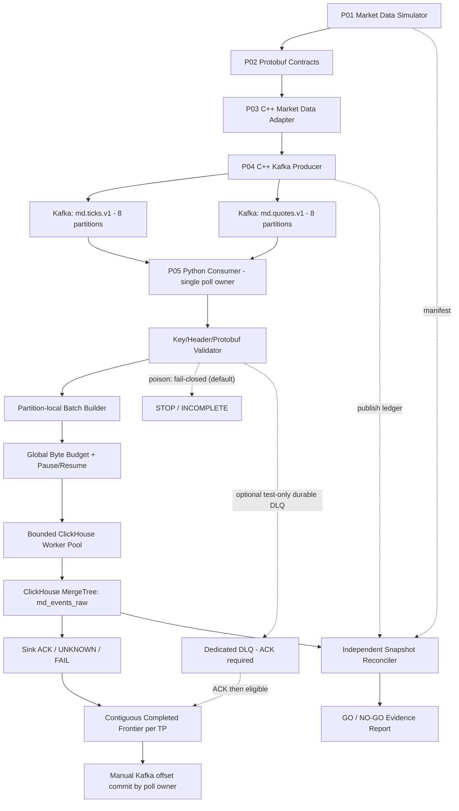
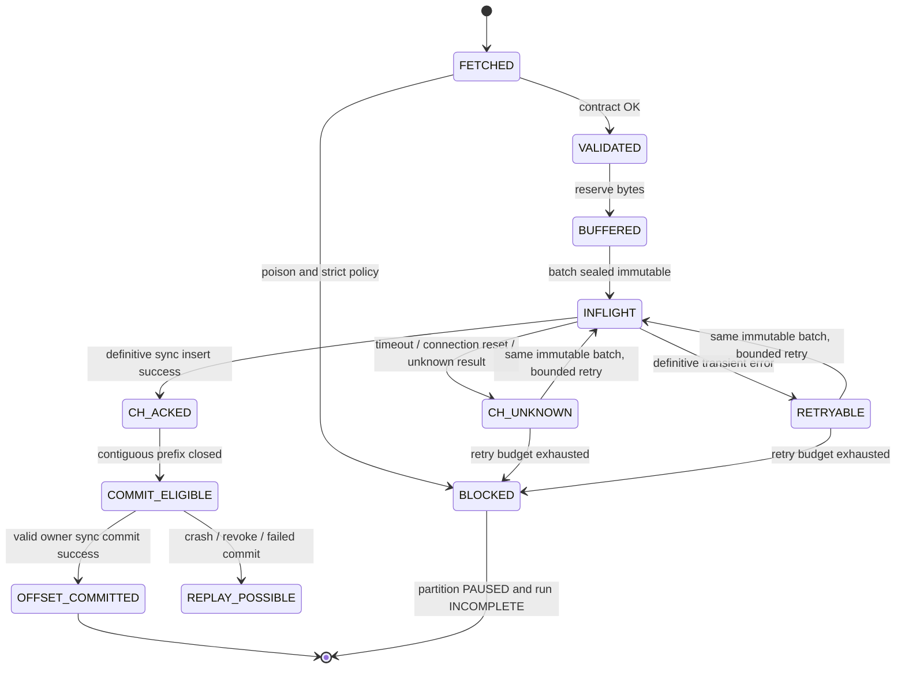
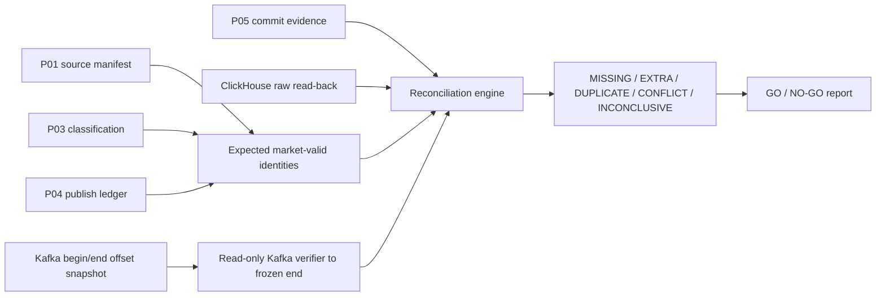

# PROJECT 05 — Python Kafka Batch Ingestion (Kafka → Protobuf → ClickHouse)

> **System Design + Correctness Proof Plan + Reliability/Capacity Engineering + 336 What-If Scenarios**  
> Ngôn ngữ: Tiếng Việt · Python **3.12** · `confluent-kafka` · Protobuf `marketdata.v1` · ClickHouse MergeTree · Docker/Linux  
> Phiên bản tài liệu: **1.0** · Ngày: **2026-10-30**  
> Trạng thái: **DESIGN_ONLY — IMPLEMENTATION_NOT_STARTED — TESTS_NOT_EXECUTED — SLO_NOT_VERIFIED**  
> Thứ tự ưu tiên: **correctness → không bỏ sót âm thầm → bounded resources → recovery → throughput**.

## 0. Nguồn gốc, giả định và giới hạn tuyên bố

Đây là **Project 05/09** trong chương trình xây dựng lại **Market Data Streaming and Analytics Platform**. CV mô tả pipeline `C++20 / Python 3.12 / Kafka / Protobuf / ClickHouse / PostgreSQL`, Kafka topics theo event type, partitions keyed by symbol, idempotent producers, consumer groups, manual offset commits, **at-least-once ingestion với idempotent sinks**, Python batch ingestion và lưu ticks trên ClickHouse MergeTree. CV nêu **120.000 ticks/s trên 8 Kafka partitions** và p95 range query trên 200M rows; đây là số liệu của dự án lớn, **không phải kết quả đã benchmark của riêng P05**.

Tài liệu P01–P04 và `.proto` đã tồn tại dưới dạng **đặc tả**, chưa chứng minh đã có phần mềm chạy được. Phần dưới là **thiết kế triển khai mới**, không tự suy diễn là kiến trúc đã triển khai tại công ty trong CV. Không thể liệt kê mọi lỗi khả dĩ; **336 case định danh** cộng property-based/fuzz/chaos/long-running tests nhằm kiểm tra một tập rộng có hệ thống. Mọi PASS yêu cầu **stimulus được xác nhận thực sự xảy ra và oracle độc lập**.

### 0.1. Contract kế thừa, không sửa ngầm

| Upstream | Hợp đồng hiện có trong thiết kế trước | Cam kết bắt buộc ở P05 |
|---|---|---|
| P01 — Simulator | `sim.v1` synthetic FX/CFD; `dataset_id`, `symbol`, `sequence` tăng theo **tất cả event cùng symbol**, `event_time_ns`, giá fixed-point `*_ticks`, `price_scale`; có fault/replay manifest. | Không tự sinh hay làm tròn giá; đối chiếu với manifest nếu làm finite replay. |
| P02 — Protobuf | `marketdata.v1.MarketDataEvent`; `optional` fields và `oneof quote/tick`; raw protobuf trên Kafka; `MDP1` chỉ cho TCP hoặc `.pbstream`. | Parse raw value **không** đọc 4-byte length/MDP1; validate presence trước business logic. |
| P03 — C++ Adapter | Phân loại `market_valid`, reject/suppress, anomaly test; có handoff output `OutputEvent` và provenance. | P05 **không thể** khôi phục `quality_flags` P03 từ value P02 nếu P04 không publish; không phỏng đoán. |
| P04 — Kafka Streaming | Topics `md.ticks.v1`, `md.quotes.v1`; key ASCII uppercase `symbol`; 8 partitions **mỗi topic** ở benchmark; headers tùy chọn; `dataset_id,symbol,sequence` là logical source identity; producer ACK ≠ DB durable. | Consumer group độc lập đọc cả hai topic; lưu Kafka coordinates; **không** hứa ordering giữa topics hoặc exactly-once ClickHouse. |
| P06 — ClickHouse Analytics | MergeTree, date partition, symbol/time ordering, TTL, materialized bars. | P05 cung cấp raw ingest table; **không bật aggregate bar sai do retry duplicates**; việc chọn rollup đúng thuộc P06. |

**Tham chiếu hợp đồng:** `PROJECT_01_FX_CFD_Market_Data_Simulator_System_Design.md`, `PROJECT_02_Market_Data_Protobuf_Schema_System_Design.md`, `PROJECT_02_Schema_Starter/market_data.proto`, `PROJECT_03_CPP_FX_CFD_Market_Data_Adapter_System_Design.md`, `PROJECT_04_Kafka_Market_Data_Streaming_System_Design.md`.

### 0.2. Định nghĩa thành công chính xác

**Tuyệt đối không coi các trạng thái sau là tương đương**:

1. `Kafka fetched`: consumer đã nhận message vào memory, **chưa xử lý xong**.
2. `Parsed/validated`: đã diễn giải đúng message, **chưa ghi ClickHouse**.
3. `Insert sent`: request đã được gửi, **chưa biết DB có ghi không**.
4. `ClickHouse acknowledged`: server/client đã xác nhận thành công theo **cấu hình đồng bộ đã kiểm chứng**, **chưa commit Kafka offset**.
5. `Kafka offset committed`: broker đã nhận next-offset commit hợp lệ **cho partition ownership hiện hành**.
6. `Independently reconciled`: verifier đã so chiếu **identities + payload digest + snapshot offsets** với dữ liệu cuối; mức bằng chứng mạnh hơn chỉ đếm số rows.

**Delivery semantics đề xuất:** Kafka → ClickHouse là **at-least-once có điều kiện** (Kafka còn giữ các offsets, xử lý/commit đúng, nguồn có thể replay khi cần). ClickHouse và Kafka **không** tham gia một atomic transaction chung. Physical rows có thể bị duplicate. **Logical idempotency** ở tầng query/reconciliation được định nghĩa bằng event identity; ClickHouse *block deduplication* là công cụ bổ sung hữu hạn, **không** phải chứng minh exactly-once vĩnh viễn.

### 0.3. Trong / ngoài phạm vi

**In scope:** Python 3.12 Kafka Consumer, partition-aware batching, Protobuf decode, strict contract validation, client-side sync inserts vào ClickHouse, retry an toàn, offset commit sau sink ACK, rebalance/lost ownership, bounded queue, metrics/trace, fail-closed, controlled DLQ tùy chọn, runbook, test harness, integration với P04/P06, capacity/chaos/fuzz/soak.

**Out of scope MVP:** giao dịch distributed Kafka+ClickHouse, broker/LP thực, real FX market feed, quyền giao dịch, ClickHouse Cloud production topology, exactly-once vật lý, schema v2 chưa chốt, PostgreSQL ledger transaction (CV chưa xác định vai trò), guarantee không mất dữ liệu khi Kafka retention hết và không còn nguồn replay, total ordering xuyên tick/quote topics.

---

## 1. Requirements và Acceptance Criteria

### 1.1. Functional Requirements

| ID | Yêu cầu | Bằng chứng PASS |
|---|---|---|
| FR-01 | Subscribe đúng `md.ticks.v1` + `md.quotes.v1` trong consumer group chuyên dụng | Observe topic/partition assignment và offset policy; fail nếu topic lạ. |
| FR-02 | `enable.auto.commit=false` và explicit `commit(offsets=..., asynchronous=False)` | Fake sink fail → không commit; commit trả về không lỗi từng partition. |
| FR-03 | Pin schema/descriptor, parse raw protobuf đúng P02 | Golden C++ producer → Python consumer field-by-field equality. |
| FR-04 | Kiểm chứng topic↔oneof, Kafka key↔symbol, required presence và giới hạn bytes | Mutated fixture bị reject hoặc cách ly có bằng chứng. |
| FR-05 | Giữ giá số nguyên signed int64, timestamp nanosecond, sequence và scale | Không xuất hiện float, overflow hoặc time-zone conversion. |
| FR-06 | Batching **theo topic-partition**, flush theo `max_rows`, `max_bytes`, `max_wait_ms` | Mỗi batch bounded; không vượt global budget khi N partitions. |
| FR-07 | Một in-flight sink batch cho mỗi topic-partition ở MVP | Không commit vượt qua batch chưa có terminal decision. |
| FR-08 | Retry ClickHouse có timeout + bounded backoff + immutable batch digest/token | ACK lost → resend đúng payload; không tự chia/reorder khi retry cùng batch. |
| FR-09 | Offset commit = `last fully processed *consumed* record offset + 1` | Crash ở mọi điểm → không bỏ qua record chưa sink ACK/quarantine durable. |
| FR-10 | `pause/resume` + bounded consumer internal queue và Python queues | Slow ClickHouse không gây tăng RSS vô hạn; vẫn poll đủ để giữ liveness. |
| FR-11 | Rebalance handling theo assignment epoch; `on_lost` không commit | Completion từ owner cũ không được commit sau mất partition. |
| FR-12 | Strict poison-record policy mặc định fail-closed; DLQ là opt-in | Không silently skip; khi DLQ bật phải thấy durable ACK trước commit. |
| FR-13 | Stable logical event identity `(dataset_id,symbol,sequence)` và canonical payload digest | Duplicate hợp lệ tách khỏi **identity conflict**; không xóa nhầm. |
| FR-14 | Lưu Kafka `(topic,partition,offset)` và ingestion trace vào ClickHouse | Reconcile source/Kafka/database theo từng record và run. |
| FR-15 | Snapshot verifier đối chiếu expected identities và toàn bộ raw rows | Detect missing, duplicate, conflicting payload, unexpected extra; counts-only không PASS. |
| FR-16 | Bounded shutdown/restart và điểm dừng `INCOMPLETE` rõ ràng | SIGTERM/SIGKILL test; no false SUCCESS. |
| FR-17 | Isolate verified_fault_test khỏi market-valid | P04 test topic không lẫn vào bảng analytics production-like. |
| FR-18 | Table/schema/settings preflight, lifecycle DB permissions, Kafka retention headroom | Sai config startup phải fail, không tự sửa lặng lẽ. |
| FR-19 | Benchmarks có run manifests và đo data parts/merge pressure/lag | Không dùng requested producer rate làm insert throughput. |
| FR-20 | Tối thiểu một pathway chuẩn bị cho P06 dedup-aware analytics | Derived bars không bị nhân đôi âm thầm khi raw có duplicate. |

### 1.2. NFR/SLO **đề xuất, chưa đo**

| ID | Goal / constraint ban đầu | Phương pháp bác bỏ hoặc xác minh |
|---|---|---|
| NFR-01 | 100% golden dataset giữ semantic fields, presence, numeric precision | Verify exact field tuples và canonical SHA-256, không tin row count đơn thuần. |
| NFR-02 | **Không commit trước sink decision**; `committed_next <= processed_contiguous_next` theo mỗi TP | Model-check state transitions, fuzz worker completions. |
| NFR-03 | `max_record_value_bytes=4096` theo P02; Kafka key `<=32` ASCII; header budget `<=512 B` đề xuất | Reject trước costly parse/allocation; đo RSS và CPU. |
| NFR-04 | Batcher mặc định 5.000 rows **hoặc** 4 MiB **hoặc** 2.000 ms; flush theo ngưỡng tới trước | Fake clock + hot/idle partitions; mỗi batch có timestamp start/end. |
| NFR-05 | App buffered payload+row buffers không vượt **64 MiB** global; `max_inflight_batches=4`; Kafka prefetch cap riêng | Cgroup test với slow DB, nhớ đo *RSS*, không chỉ `len(queue)`. |
| NFR-06 | Python container baseline soft target **<=512 MiB RSS** ở profile dev; không mặc định áp được 120k/s | Lập byte budget bằng object profiler; điều chỉnh dựa vào thực đo. |
| NFR-07 | `db_insert_timeout_s=10`, bounded 5 retries, exponential backoff ±jitter; sau budget exhaustion STOP partition | Inject CH timeout/503; no busy loops, no auto-commit on UNKNOWN. |
| NFR-08 | Thời gian poll gap bình thường dưới `max.poll.interval.ms` với safety margin >=3x | Delay workers; owner poll thread vẫn hoạt động; chaos rebalance. |
| NFR-09 | Default `async_insert=0` (đợi insert hoàn tất); nếu chuyển async bắt buộc `wait_for_async_insert=1` và test riêng | Misconfiguration `wait=0` phải bị chặn startup. |
| NFR-10 | p95 Kafka-consumed→CH-ACK mục tiêu khám phá **<=4 s** ở 10k events/s profile dev (không phải SLO sản xuất) | Histogram monotonic; lưu CPU/RAM/storage config và test repeatability. |
| NFR-11 | Rate ladder **1k / 10k / 50k / 120k events/s tổng**, nếu phần cứng cho phép; steady backlog không tăng | Chạy 15–60 phút và đo chính xác rows/logical events committed. |
| NFR-12 | Kafka retention headroom >= recovery time + max outage + safety margin, ví dụ >= 2x required window | Đọc log-start/end offsets, lag age, forced retention test. |
| NFR-13 | Crash/rebalance/timeout → duplicate logic được nhận diện, **0 unexplained missing** trong finite verified run chưa expire retention | Independent reconcile per identity+payload, repeat xN seeded runs. |
| NFR-14 | Không lộ credentials, Kafka payload/PII vào logs/metrics; fake synthetic input only | Secret scanning, fault inject bad permissions, log sampling. |
| NFR-15 | Không vượt quá CH part creation/merge pressure budget được đo; không benchmark sai khi DB nghẽn merges | Observe `system.parts`, `system.merges`, latency và queue slope. |

**Budget là cấu hình thiết kế** và phải tuning lại qua benchmark; 120k/s không thể được bảo đảm trên laptop hoặc trên một consumer đơn độc.

---

## 2. Architecture — dataflow, deployment và ownership

### 2.1. Component architecture



**Điểm cắt responsibility:** P05 không xác minh được Kafka producer ACK nội bộ P04 chỉ qua `poll()`. Từ góc nhìn P05, Kafka record đã tồn tại trong partition log. P05 chỉ quản trị các records được trả về cho consumer trong group, write status, và committed next offsets.

### 2.2. Logical modules (proposal)

| Module | Trách nhiệm / owner | Phạm vi không được vượt |
|---|---|---|
| `consumer_owner.py` | **Một thread** sở hữu `Consumer.poll/commit/pause/resume/subscribe/close` và callback | Worker không trực tiếp gọi Consumer. |
| `assignment_manager.py` | epoch per TP, assigned/revoked/lost; lifecycle fence | Không coi stale worker success là quyền commit. |
| `contract_validator.py` | caps, key/topic/headers, `proto3 optional`, strict market semantics | Không tự làm sạch malformed record. |
| `event_mapper.py` | protobuf → typed Python ints → fixed schema row + digest | Không làm tròn giá hay downcast ns. |
| `partition_batcher.py` | FIFO per TP, rows/bytes/age; one in-flight/batch | Không merge TP lẫn nhau trong MVP. |
| `budget_manager.py` | global+per-TP bytes, consumer prefetch, pause/resume hysteresis | Không giữ hai bản unbounded của một payload. |
| `sink_worker.py` | Chạy sync insert ClickHouse, bounded timeouts/retries, structured result | Không commit offsets hoặc thao tác Consumer. |
| `commit_coordinator.py` | Chỉ owner thread advance proven frontier và sync commit explicit TP offsets | Không dùng `max processed offset` nếu còn hole. |
| `quarantine.py` | Mặc định STOP; opt-in durable DLQ có manifest/ACK | Không gọi lỗi dữ liệu là successful market insert. |
| `reconciler.py` | Oracle độc lập theo finite Kafka snapshot, source manifest, ClickHouse rows | Không dùng app counters làm proof độc lập. |
| `metrics.py` | Prometheus/counters/histograms bounded cardinality; audit trail | Không gắn event_id/symbol không giới hạn vào metric labels. |

### 2.3. Deployment profiles

```text
LOCAL-DEV: P04 Kafka 1 broker RF=1 + ClickHouse 1 node + Python consumer 1
  -> học API, correctness, crash; KHÔNG phải HA.
RELIABILITY-LAB: Kafka KRaft 3 brokers RF=3 minISR=2 + ClickHouse replicated test topology
  -> failover, ISR, replica lag, ambiguous ACK; chỉ chứng minh trong topology/config đã đo.
CAPACITY-LAB: Kafka topics 8+8 partitions, 1..N P05 group members, CH tuned storage
  -> throughput, part pressure, backpressure, long soak, retention envelope.
```

MVP nên chạy **1 process Python + 1 owner poll thread + tối đa 4 blocking CH sink workers**. Một worker có client/connection riêng hoặc driver pool đã xác minh thread-safety; không dùng cùng client object bừa bãi. Khi mở rộng N consumers, toàn bộ concurrency phải được thiết kế lại theo số partitions và capacity ClickHouse, không chỉ tăng threads.

### 2.4. Ranh giới HA thực tế

- Kafka có RF=3 và `min.insync.replicas=2` **không** kéo theo ClickHouse HA. ClickHouse replication và ZooKeeper/ClickHouse Keeper phải được kiểm thử riêng.
- Việc thêm group member có thể gây rebalance; **ngay cả khi consumer cũ mất quyền sở hữu**, request INSERT đã gửi vẫn có thể hoàn thành tại ClickHouse. Epoch chỉ **chặn stale commit**, không thể xóa external side-effect.
- Kafka metadata, ClickHouse table DDL, data volume, network TLS, DNS, disk/cgroup limits và retention là phần của bằng chứng benchmark; không được trừu tượng hóa hết bằng mocks.

---

## 3. Kafka/Protobuf identity & validation contract

### 3.1. Source schema (P02, trích đúng các trường)

```proto
syntax = "proto3";
package marketdata.v1;
message Quote { optional int64 bid_ticks = 1; optional int64 ask_ticks = 2; }
message Tick { optional int64 price_ticks = 1; }
message MarketDataEvent {
  optional string dataset_id = 1;
  optional string symbol = 2;
  optional int64 sequence = 3;
  optional int64 event_time_ns = 4;
  optional int64 price_scale = 5;
  optional string source_schema_version = 6;
  oneof payload { Quote quote = 10; Tick tick = 11; }
}
```

**Kafka record (đúng P04):**

```text
(topic=md.ticks.v1,  key="EURUSD", value=MarketDataEvent{oneof=tick})
(topic=md.quotes.v1, key="EURUSD", value=MarketDataEvent{oneof=quote})
# value = protobuf bytes, NO MDP1 prefix, NO framing length prefix.
# Topic/partition/offset là Kafka metadata, KHÔNG phải source sequence.
```

| Input | Rules bắt buộc |
|---|---|
| `topic` | strict allowlist; `md.ticks.v1` ↔ `WhichOneof('payload') == 'tick'`; quotes ↔ quote. |
| `key` | bytes ASCII uppercase 1..32, **exactly** `event.symbol.encode('ascii')`. Không lowercase tự sửa. |
| `value` | max 4096 bytes trước decode, non-null; bytes phải parse và có required-by-business presence. |
| `dataset_id` | required-by-business, không trống, max 128 UTF-8 bytes; phải khớp optional header nếu header có. |
| `sequence` | int64 hiện diện, hợp lệ theo strict feed policy; **sequence per symbol across BOTH topics**. |
| `event_time_ns` | int64 hiện diện; giữ nguyên số nguyên nano UTC, không dùng client arrival time thay thế. |
| `price_scale` | int64 hiện diện, >0 và thuộc symbol policy; không chuyển đổi float trước DB. |
| Quote | cả `bid_ticks`/`ask_ticks` hiện diện; bid/ask hợp lệ theo strict policy. |
| Tick | `price_ticks` hiện diện; tick là **price update**, không mặc định là trade/volume. |
| Header | `md-schema`, `md-descriptor-sha256`, `md-dataset-id`, `md-run-id`, `md-publish-policy` chỉ nếu có; bounded; mismatch → fail/quarantine. |

**Fault manifest:** Dữ liệu lỗi có chủ đích của P01/P03/P04 chỉ được đọc trong isolated test namespace có một manifest xác thực theo fixture. Không thay đổi business validation để dễ đạt benchmark. Unknown protobuf fields có thể được parser giữ hoặc bỏ tùy thao tác/runtime; **không suy diễn loại message mới từ unknown fields**.

### 3.2. Identity, digest và hai loại duplicate

```text
logical_event_id = (dataset_id, symbol, sequence)
logical_projection = (
   dataset_id, symbol, sequence, event_time_ns, price_scale,
   kind, bid_ticks?, ask_ticks?, price_ticks?, source_schema_version,
   explicit field presence bits
)
payload_digest = SHA256(canonical_binary_encoding(logical_projection))
transport_coordinate = (kafka_cluster_id, topic_generation, topic, partition, offset)
batch_identity = (topic_generation, topic, partition, first_offset, last_offset,
                  hash(ordered per-record transport_coordinate + payload_digest))
```

`canonical_binary_encoding` **phải có thuật toán cụ thể** như dưới đây. **KHÔNG dùng `SerializeToString()` của protobuf làm canonical byte oracle cross runtime**.

```text
P05-CORE-V1 canonical bytes (đề xuất, chốt ở M0):
  ASCII "P05-CORE-V1\0"                     # domain separator
  str(dataset_id) = uint32_BE(byte_length) + exact UTF-8 bytes
  str(symbol) = uint32_BE(byte_length) + exact uppercase ASCII bytes
  int64_BE(sequence)                    # signed 2's-complement
  int64_BE(event_time_ns)
  int64_BE(price_scale)
  str(source_schema_version) = uint32_BE(len) + UTF-8 bytes
  uint8(kind) = 1 for tick, 2 for quote
  for each field in fixed order: [bid_ticks, ask_ticks, price_ticks]:
      uint8(has_field ? 1 : 0)
      if has_field: int64_BE(value)

payload_digest = lower_hex(SHA256(canonical_bytes)), always 64 ASCII hex chars
# Kafka topic/partition/offset, ingested_at, run instance, headers,
# CH query settings, unknown protobuf fields are NOT part of the semantic digest.
# Unknown fields are still subject to descriptor/version compatibility gate.
```

Golden corpus phải có ít nhất: quote với hai giá dương, tick với price, zero **present**, missing optional **absent**, giá âm chỉ trong isolated fault test, các giá sát int64 bounds, UTF-8 dataset IDs và cặp duplicate/conflict. C++/Python independent encoders phải tạo **cùng canonical digest** cho cùng typed projection, không chỉ so với một implementation copy từ cùng mã. Không dùng Python built-in `hash()` để tạo stable ID. Không chỉ dùng `sequence` vì đổi dataset có thể reset. `event_kind` **không** nằm trong key dedupe nguồn; cùng key nhưng khác kind/payload = **identity conflict** (P0), không chọn 1 ngẫu nhiên.

| Trường hợp | Ý nghĩa và cách xử lý |
|---|---|
| Cùng identity + cùng semantic digest + Kafka coordinate khác | Duplicate logical event do replay/app retries: cho phép raw có nhiều rows; logical view tính **một event**. |
| Cùng identity + cùng digest + đúng cùng Kafka coordinate lặp | Sink retry physical duplicate; raw có thể lặp nếu CH dedup window expired; logical view tính một. |
| Cùng identity + **khác digest** | Identity conflict, không tự chọn theo max Kafka offset/timestamp; báo P0, cô lập dataset cho reconciliation. |
| Cùng symbol+sequence ở dataset khác | Hai event **khác**; không dedupe chéo dataset. |
| Cùng source sequence nhưng một record ở tick và một ở quote | Conflict theo P01 contract nếu cùng dataset; không ngầm coi là hai event hợp lệ. |
| Sequence gap trong **mỗi topic** | Không tự kết luận mất dữ liệu; quote/tick tách topics, và P03 có thể reject event. |

### 3.3. Cross-topic ordering và event-time

Kafka chỉ giữ thứ tự **trong một topic-partition**, không có thứ tự thống nhất giữa `md.ticks.v1` và `md.quotes.v1`. Đọc hai topics song song có thể khiến `sequence=102` được ghi trước `sequence=101` cùng symbol. ClickHouse raw có thể chứa arrival/insert order khác event order. Analytics cần `event_time_ns`/`sequence` và provenance/dedup-aware logic; không dùng `ingest_at` để suy market chronological order. Kiểm thử event-time drift, equal timestamp, out-of-order across topics, late event và stale quote là các trục khác với Kafka offset monotonicity.

---

## 4. Processing protocol, state machines và correctness invariants

### 4.1. Record / batch lifecycle



`CH_ACKED` không tự chứng minh row đã được nhân bản sang tất cả replicas hoặc các materialized views luôn atomic theo snapshot. Nếu dùng materialized views, cần kiểm tra riêng consistency/visibility (có thể có intermediate states). `REPLAY_POSSIBLE` không phải mất dữ liệu; nó có thể tạo physical duplicate.

### 4.2. Invariants bất khả vi phạm

1. **I-01 Sink-first:** `commit_next(tp) <= proven_completed_frontier(tp)` với mỗi topic-partition; hoàn thành có nghĩa **ACK ClickHouse hoặc durable-quarantine ACK theo policy**.
**Khởi tạo frontier sau restart:** `proven_completed_frontier` phải bắt đầu ít nhất tại **last authoritative committed next offset** nếu group/DDL/config đã được xác minh tương thích và các offset cũ được coi là checkpoint đã được nghiệm thu; không bắt đầu từ `0` rồi kết luận mọi commit trước đây là sai. Khi tiếp quản một group không có evidence hoặc thay đổi sink table/schema, cần chạy independent reconciliation trước khi tin checkpoint cũ. Trong một execution epoch mới, frontier chỉ được nâng thêm khi có sink proof của **epoch đó**.

2. **I-02 Ownership:** Commit chỉ thực hiện bởi consumer có assignment epoch hiện hành; `on_lost` cấm commit.
3. **I-03 Prefix:** Không commit qua một record đã fetch nhưng chưa có terminal durable result, kể cả khi record sau đã ACK.
4. **I-04 Immutable retry:** Khi một batch đã gửi, các retries của cùng logical request có **cùng rows/order/schema/settings/digest/insert token**.
5. **I-05 Bound:** `buffered_bytes <= configured_global_budget` cho phần ứng dụng có quản lý; phải đo riêng thư viện/client/native buffers và RSS.
6. **I-06 Preservation:** Giá ticks, sequence, time ns và presence giữ đúng từ proto sang ClickHouse; no implicit coercion.
7. **I-07 No silent poison skip:** Malformed/invalid event không được ghi market table hoặc commit qua nếu chưa có terminal DLQ ACK (opt-in).
8. **I-08 No false EOS:** Kafka không có “dataset hoàn chỉnh” chỉ từ poll rỗng. Finite run success cần P01/P04 manifest, captured end offsets và snapshot scan.
9. **I-09 Distinct clocks:** Event-time nano, Kafka log append time (nếu có), processing monotonic duration và ClickHouse ingestion wall-clock là bốn khái niệm khác nhau.
10. **I-10 Truthful consistency:** Physical `count()` có thể lớn hơn số event logical; query/report bắt buộc có `distinct`, `conflict_count`, `unreconciled_count`.
11. **I-11 Offset policy:** `auto.offset.reset` của consumer group production-like đặt `error`/`none` theo client-supported value, hoặc có explicit planned initial positions; không silently chuyển `latest` khi offset hết hạn.
12. **I-12 Isolated fault lanes:** Verified synthetic anomalous events không nhập chung với bảng `market_valid`.

### 4.3. Partition state machine

```text
UNASSIGNED -> ASSIGNED(epoch=E) -> FETCHING -> BUFFERING -> INFLIGHT -> COMMITTING -> FETCHING
                          |                   |                      |
                          +-> REVOKING -------+----> REVOKED --------+
                          +-> LOST -----------> LOST (no commit) ----+-> UNASSIGNED
                          +-> FATAL/POISON ---> PAUSED/INCOMPLETE
```

- Có **tối đa một in-flight batch mỗi TP** trong MVP, nhưng có thể có prefetched messages đã giới hạn; hoàn tất batch A rồi mới đánh dấu batch B eligible.
- Worker completion chứa `(topic, partition, assignment_epoch, batch_id, write_result)` và được gửi tới **owner event loop**. Nếu epoch không khớp, bỏ quyền commit; **không giả vờ hủy** một ClickHouse write đã phát đi.
- `on_revoke`: ngừng enqueue mới, cố drain trong deadline ngắn; sync commit chỉ những prefix đã ACK và vẫn còn ownership. Không chắc → để replay. `on_lost`: tuyệt đối không commit, mark `INCOMPLETE`, release/ignore late callbacks.
- **Commit call phải truyền exact `TopicPartition(offset=next_offset)`**, không gọi offset-less `commit()` vốn có thể dùng positions khác ý định. Validate per-partition result (`.err`). Với event offsets có lỗ do Kafka control records, frontier nghĩa là **tập các records consumer đã thực sự nhận theo thứ tự** chứ không phải bắt buộc mỗi integer offset xuất hiện.

### 4.4. Poll loop vs blocking ClickHouse insert

```text
OWNER THREAD (chỉ owner gọi Kafka APIs)
  subscribe(on_assign, on_revoke, on_lost)
  loop while RUNNING:
    poll(timeout<=100ms); record assignment heartbeat/events
    validate bounded frame + schema + routing
    append to per-TP bounded batch buffer (or pause that TP)
    if batch ready and worker slots available:
       seal immutable batch; submit blocking insert to sink worker
    drain completion queue; if epoch matches and CH_ACKED:
       update fully processed contiguous frontier
       commit explicit next offset sync (or batch commit on timer)
    pause/resume TP based on global/partition budget with hysteresis
    if fatal/retention-missing/unsafe config: STOP INCOMPLETE
  on SIGTERM: stop fetch, drain within deadline, commit only proven frontiers, close

SINK WORKER THREAD (không đụng Consumer)
  acquire own ClickHouse client / checked pool
  send one immutable batch with bounded timeout and settings
  classify ACKED vs RETRYABLE vs UNKNOWN vs PERMANENT
  retry same batch only within bound; send result to owner
```

Đây là **pseudocode thiết kế**, không phải code runnable. Hướng an toàn hơn trước khi tối ưu: **1 worker, 1 TP**, kiểm chứng các invariants, sau đó nâng dần concurrency.

### 4.5. Crash-point truth table

| Crash point | Kafka committed? | Có thể xảy ra ở ClickHouse? | Phục hồi an toàn |
|---|---|---|---|
| Trước fetch | Không | Không | Đọc bình thường. |
| Sau fetch trước validate | Chưa | Chưa | Re-fetch. |
| Sau validate/buffer trước insert | Chưa | Chưa | Re-fetch; batch boundary có thể đổi. |
| Insert request đang bay, chưa nhận response | Chưa | **UNKNOWN** | Retry đúng batch nếu còn artifact; nếu restart có thể regroup → logical dedupe + reconciliation. |
| Insert ACK thành công, trước commit | Chưa | Có | Re-fetch → có thể physical duplicate; semantic dedupe. |
| Kafka commit request timeout | UNKNOWN | Đã ACK | Read committed position trở lại, replay nếu cần. |
| Kafka commit ACK nhưng process crash ngay | Có | Đã ACK | Không bỏ dữ liệu; đối chiếu bằng verifier. |
| Partition revoked khi in-flight | Không được commit stale | Old write vẫn có thể thành công | New owner replay, dedupe, conflict detection. |
| DLQ ACK thành công, commit chưa xong | Chưa | Không có market row; DLQ có thể trùng | Replay và quarantine idempotent theo Kafka coordinate. |
| Commit thành công **trước** sink ACK (bug) | Có | Có thể không | **Data loss, P0 failure; release NO-GO**. |

---

## 5. Batch assembly, checkpoint, retry và backpressure

### 5.1. Batch formation rules

- **Partition-local, FIFO:** một batch chỉ chứa records của một `(topic, partition)` đã giao cho một owner epoch. Giữ thứ tự consumer đọc; không dùng `dict`/unordered set để thay row sequence.
- **Seal khi chạm ngưỡng đầu tiên**: `max_rows=5_000`, `max_serialized_bytes=4 MiB`, `max_wait_ms=2000`, hoặc shutdown/revoke. Byte cap áp dụng cả raw protobuf, decoded rows, serialized insert columns và retry copies; đo actual RSS.
- **Không chia batch sau khi đã send** nếu đang retry một insertion không rõ trạng thái. Trước lần send đầu tiên có thể chia batch theo date/size để giảm ClickHouse partitions-per-insert nhưng phải chốt immutable identity cho từng sub-batch và commit chỉ khi **tất cả** sub-batches đã ACK.
- **Per-TP ordered worker protocol:** batch B có thể chờ sau A trong một queue nhỏ; B không được làm frontier vượt A. Nếu batch A fail, partition pause; các TP khác có thể tiến nếu global resource budget còn.
- **Low rate/idle:** timeout flush thực hiện bằng monotonic time, không phụ thuộc có `poll()` nhận record mới; empty polls không ngầm báo hết dataset.
- **Batch id/token:** stable hash của `(topic_generation, topic, partition, record coordinates + core digest, table destination schema version, configured insert mode)`. Retry cùng batch **giữ y nguyên token**; hai batches khác nhau không dùng lại token.

### 5.2. Retry classification: không gộp tất cả lỗi thành một

| Class | Ví dụ | Retry? | Offset commit? |
|---|---|---|---|
| `ACKED` | Sync insert thành công, response hợp lệ | Không cần | Chỉ khi prefix hoàn tất & owner hợp lệ. |
| `AMBIGUOUS` | Timeout, TCP reset sau gửi request | Có, **cùng batch**, bounded, dedup caveat | Không cho đến khi có outcome an toàn. |
| `TRANSIENT` | 429/503, overload, DNS temporary, CH briefly unavailable | Bounded backoff, pause; max deadline | Không nếu chưa ACK. |
| `PERMANENT` | Unknown column, schema mismatch, permission denied, invalid value/DDL | Không blind retry; alert STOP | Không. |
| `POISON_INPUT` | Kafka value invalid, topic mismatch, invalid presence | Default halt TP; optional durable DLQ | Chỉ sau DLQ ACK nếu opted-in. |
| `OWNERSHIP_LOST` | consumer lost TP/generation fenced | Old worker result không tiến commit | Không bởi owner cũ. |
| `RETENTION_LOST` | committed offset < earliest available | Không auto reset; cần offline recovery manifest | Không; global NO-GO. |

**Retry storms:** mỗi worker có exponential backoff có jitter và absolute retry deadline; tổng connections / request count capped. Circuit breaker sau liên tiếp lỗi DB; pause toàn bộ nếu CH down; không tạo batch trong RAM cho tới khi OOM. Không dùng retry không giới hạn vì ClickHouse dedup window hữu hạn.

### 5.3. Chính sách khi broker/DB bất đồng

**Ghi thành công, mất ACK từ ClickHouse:** từ client nhìn thấy `UNKNOWN`. Chỉ retry với immutable batch+insert dedup config; sau khi có explicit ACK mới cho commit. Nếu process crash trước khi giữ batch artifact, group replay tạo batch mới có thể khác ranh giới → phải dựa vào **logical identity** cho correctness queries. Không hứa block dedup sẽ luôn xóa physical duplicate.

**Ghi thành công, commit Kafka timeout:** không gán trạng thái "offset đã chắc chắn commit"; đọc lại committed position/assignment khi reconnect. Đối soát `raw` theo identity trước khi công bố kết quả. Replay hoàn toàn được phép; logical view phải chống nhân đôi.

### 5.4. Global capacity budget

```text
app_total_budget_bytes = 64 MiB (default proposed)
per_partition_batch_max = 4 MiB serialized, nhưng decoded Python objects có overhead
max_inflight_batch_count = 4 (global)
consumer_native_queue_cap = configured separately (e.g. queued.max.messages.kbytes)
OS cgroup memory.max = hard stop envelope; test RSS peak + allocator retention

PROCESS USED ~= native consumer fetch queue + Python raw messages + decoded objects
             + CH column buffers / HTTP encoded bytes + retry copies + allocator overhead.
# KHÔNG chứng minh <=64MiB RSS từ queue budget 64MiB; phải đo thực tế.
```

Khi byte budget gần ngưỡng cao (`high_watermark=80%`), **pause các TP nóng**. Chỉ resume khi dưới `low_watermark=50%`; tiếp tục gọi consumer.poll để bảo toàn liveness (phải đo behavior theo client). Nếu một record lớn hơn cap thì fail trước queue; không tăng cap vô hạn. Kafka sẽ giữ backlog nhưng **retention là hữu hạn**; nếu lag age vượt recovery window thì alert và chuyển NO-GO.

---

## 6. ClickHouse ingestion: SQL, idempotency và visibility

### 6.1. Bảng raw đề xuất cho P05 (để P06 tiếp quản analytics)

```sql
CREATE DATABASE IF NOT EXISTS md_ingest;

CREATE TABLE IF NOT EXISTS md_ingest.market_events_raw
(
    dataset_id       String,
    symbol           LowCardinality(String),
    sequence         Int64,
    event_kind       Enum8('tick' = 1, 'quote' = 2),
    event_time_ns    Int64,
    event_date       Date,
    price_scale      Int64,
    bid_ticks        Nullable(Int64),
    ask_ticks        Nullable(Int64),
    price_ticks      Nullable(Int64),
    source_schema_version LowCardinality(String),
    payload_digest   FixedString(64),
    kafka_topic      LowCardinality(String),
    kafka_partition  Int32,
    kafka_offset     Int64,
    topic_generation LowCardinality(String),
    ingest_run_id    String,
    ingested_at      DateTime64(3, 'UTC') DEFAULT now64(3)
)
ENGINE = MergeTree
PARTITION BY toYYYYMMDD(event_date)
ORDER BY (symbol, event_time_ns, dataset_id, sequence, kafka_topic, kafka_partition, kafka_offset)
SETTINGS non_replicated_deduplication_window = 1000;  -- MVP sync retry window; must verify
```

**Lưu ý:** Đây là **SQL thiết kế** chưa chạy trên ClickHouse được pin; `event_date` phải được tính UTC chính xác từ `event_time_ns`, trong supported date range. `ORDER BY` của MergeTree **không** phải unique constraint; raw vẫn có thể chứa duplicated rows. Partition theo ngày phù hợp mô tả CV/P06 nhưng **có thể** tạo nhiều parts khi batch phủ nhiều ngày; performance test phải so sánh day vs month và bàn giao quyết định cuối cho P06. Đừng dựa `ingested_at DEFAULT now64()` để tính canonical digest: giá trị này thay đổi giữa retries.

Cấu hình sink mặc định: client-side batching, **sync insert** (`async_insert=0`), wait for documented success, explicit insert columns, metadata schema preflight và enforce TLS/auth nếu chạy không phải local. Không bật `wait_for_async_insert=0`. Một INSERT trả success không chứng minh cross-region durability hoặc atomic visibility của materialized view nếu topology chưa test.

### 6.2. Hai tầng chống duplicate, không đánh tráo guarantees

**Tầng 1 — block/insert-level dedup trong ClickHouse (optimization):** *MergeTree family có tùy chọn dedup các insert retries; ReplicatedMergeTree có window mặc định, non-replicated cần cấu hình `non_replicated_deduplication_window`; `deduplicate_insert='enable'` **trong ClickHouse 26.2+**; với bản cũ dùng `insert_deduplicate=1` theo compatibility/version; có thể dùng stable `insert_deduplication_token`.* Nhưng hiệu quả phụ thuộc **table engine, window, block boundaries, insert settings, materialized views và phiên bản ClickHouse**. Nếu retry lâu hoặc regroup khác, **physical duplicates vẫn có thể xảy ra**. Không sử dụng token chỉ từ first offset nếu payload có thể thay đổi; token cần phân biệt batch identity/digest.

**Tầng 2 — logical dedup (correctness):** mỗi event được định danh `(dataset_id,symbol,sequence)`, với `payload_digest`. Một event có thể có nhiều physical rows; với cùng digest chỉ tính **một** trong view/reconciler. Nếu có ≥2 digests cho cùng identity thì `CONFLICT`, chặn analytics/GO (không tùy ý chọn row mới nhất). Dùng query grouping, explicit verification; `ReplacingMergeTree` nếu dùng sau này chỉ dedup **eventually** và `FINAL`/query logic mới cho kết quả truy vấn đúng trước merges.

**Cảnh báo quan trọng cho P06:** Materialized view tính OHLC/count/sum trực tiếp từ `market_events_raw` có thể **đếm trùng** khi ClickHouse retry tạo duplicate. Không thể gắn nhãn `idempotent sink` chỉ vì `ReplacingMergeTree` sẽ eventually merge. Phải chứng minh giải pháp rollup dedup-aware hoặc tạo canonical staging trước khi dùng materialized bars có tác động giao dịch/analytics.

### 6.3. Query kiểm tra data quality — ví dụ SQL

```sql
-- Physical duplicates: cùng logical identity và cùng semantic digest.
SELECT dataset_id, symbol, sequence,
       count() AS physical_rows, uniqExact(payload_digest) AS variants
FROM md_ingest.market_events_raw
GROUP BY dataset_id, symbol, sequence
HAVING physical_rows > 1
ORDER BY physical_rows DESC LIMIT 100;

-- Identity conflict: một identity nhưng nhiều semantic payload.
SELECT dataset_id, symbol, sequence, uniqExact(payload_digest) AS variants
FROM md_ingest.market_events_raw
GROUP BY dataset_id, symbol, sequence
HAVING variants > 1;

-- Logical number of distinct identities (chỉ hợp lệ khi conflict_count = 0).
SELECT uniqExact(tuple(dataset_id, symbol, sequence)) AS logical_events
FROM md_ingest.market_events_raw
WHERE dataset_id = 'demo-a1b2c3';

-- Query canonical (chỉ dùng sau khi đã GATE conflict_count=0 cho dataset):
SELECT dataset_id, symbol, sequence,
       any(event_time_ns) AS event_time_ns,
       any(event_kind) AS event_kind,
       any(bid_ticks) AS bid_ticks,
       any(ask_ticks) AS ask_ticks,
       any(price_ticks) AS price_ticks
FROM md_ingest.market_events_raw
WHERE dataset_id = 'demo-a1b2c3'
GROUP BY dataset_id, symbol, sequence
ORDER BY symbol, sequence;
```

`any()` chỉ hợp lệ về business khi **đã xác minh mọi physical rows của identity có cùng semantic projection**; `payload_digest` không phải integrity proof mạnh hơn việc so đầy đủ fields trong audit. Không dùng `uniqExact()` vô giới hạn trên hàng tỷ rows trong request trực tuyến: chọn offline reconciler/dataset scope và tối ưu memory/partitions qua benchmark.

### 6.4. Async insert và materialized views

- **Default P05:** đặt tường minh `async_insert=0`, sync batching phía client để dễ định nghĩa ACK. **Từ ClickHouse 26.2, mặc định `async_insert` có thể được bật**; tuyệt đối không dựa vào giá trị default khi kiểm chứng ACK.
- Nếu tối ưu bằng `async_insert=1`, bắt buộc `wait_for_async_insert=1`; `wait=0` chỉ phản ánh đã buffer phía server, có nguy cơ mất dữ liệu mà consumer đã commit.
- Dedup cho asynchronous inserts/phụ thuộc MVs có thay đổi qua các bản ClickHouse, ví dụ ClickHouse **26.1** mở rộng dedup consistency cho dependent materialized views; test đúng version/pinned settings, không mặc định tính năng này có ở mọi version.
- Materialized view updates có thể tạo intermediate states giữa source và target; cần độc lập verify source/target sau khi settle. Không bật aggregate bars mặc định trong P05.

---

## 7. Failure model và đáp án không tự lừa mình

| What happens | Hành vi an toàn | Thứ không thể khẳng định |
|---|---|---|
| CH write ACK lost | `UNKNOWN`, bounded same-batch retry; nếu không xác nhận thì STOP+reconcile | Timeout nghĩa là DB chưa ghi. |
| CH down 5 min | Pause Kafka, retry bounded, alert retention headroom; không commit | Cứ retry mãi sẽ không mất dữ liệu. |
| Kafka consumer restart | Resume committed next offset; có thể ghi physical duplicates | Exactly-once vật lý. |
| Rebalance khi insert chưa kết thúc | Old owner không commit; new owner replay, logical dedup | External ClickHouse insert có thể bị fenced bởi Kafka epoch. |
| Offset out of range | NO-GO; offline recovery dựa verified manifest / retained source | Có thể tự cứu từ Kafka sau khi retention đã xóa. |
| Topic partition remap | Block until topic generation/migration plan verified | Giữ order tuyệt đối bằng tăng partitions. |
| P04 publishes malformed market record | Strict failure/quarantine, không âm thầm skip | Đó là fault test hợp lệ nếu manifest thiếu. |
| Timestamp event rất cũ/tương lai | Validate domain/range, tách event-time với processing latency | Arrival time là source market time. |
| Hot symbol chiếm hầu hết traffic | Một TP nghẽn; báo lag/limit, không che bằng 8 partition tổng | Throughput tăng tuyến tính theo số partitions. |
| CH rows count bằng expected nhưng có missing+duplicate | Independent identity-level reconciliation FAIL | Count bằng nhau đủ chứng minh completeness. |
| Source Kafka tick/quote topics có sequence chéo | Không kiểm tra sequence liên tục per topic; dùng manifest tổng | Kafka làm mất event vì `seq` nhảy. |
| DB inserts ACK nhưng subsequent replica fail | Cần durability/replica tests theo topology thật | ACK đảm bảo survived any regional disaster. |

---

## 8. WHAT-IF MATRIX — **336 cases / 24 nhóm**

### 8.1. Cách dùng, severity và bộ bằng chứng bắt buộc

- **P0 (134 cases):** correctness/data loss/unsafe commit/security isolation; **NO-GO** ngay nếu fail, test không chạy hoặc không có fault evidence đầy đủ ở gate đã khai báo.
- **P1 (175 cases):** reliability/operational resilience/recovery; cần PASS theo scope milestone, lỗi có thể yêu cầu giữ release ở môi trường lab và ghi mitigation.
- **P2 (27 cases):** performance/operability/advanced behavior; có thể defer với documented trade-off nhưng không được tuyên bố đã PASS.
- Test ID có dạng `P05-A-01` tới `P05-X-14`. Mỗi row gồm **fault stimulus**, **safe expected behavior**, **cách inject + PASS oracle**. Severity là đề xuất, phải review theo production threat model.
- **Verdict hợp lệ:** `PASS` khi fault thật + oracle độc lập đạt; `FAIL` khi vi phạm; `INCONCLUSIVE` khi thiếu bằng chứng; `NOT_RUN` khi không thực thi; `BLOCKED` khi chưa có dependency. Không được biến ba trạng thái cuối thành PASS.
- Mỗi test chạy trên synthetic dataset đã pin seed/manifest. Evidence tối thiểu: `case_id, run_id, source_manifest_sha256, protocol_schema_sha256, kafka_cluster_id, topic_generation, topic-partition start/end snapshots, group committed offsets before/after, clickhouse_version, table_ddl_sha256, config_digest, fault_trigger_proof, timeline, observed_ledger, logical_identity_diff, resource_metrics, verdict, exit_code`.
- Một test có thể kiểm tra nhiều failure modes; 336 là số **kịch bản độc lập được định nghĩa**, không có nghĩa đã kiểm thử đủ mọi trạng thái liên tục. Property-based/fuzz/chaos testing ở §9 giúp mở rộng tổ hợp ngoài ma trận.

| Tổng quan | Số lượng |
|---|---:|
| P0 — correctness/data-loss critical | **134** |
| P1 — reliability/recovery | **175** |
| P2 — performance/operability | **27** |
| **Tổng** | **336** |

### A. Upstream contract, provenance và handoff P01→P04 (14)

| ID | Priority | What If / fault stimulus | Expected safe behavior | Fault injection / PASS oracle |
|---|---|---|---|---|
| **P05-A-01** | `P0` | P04 gửi `MDP1` + length thay vì raw protobuf trong Kafka value | Không auto-fallback parser; STOP trên violation | Publish byte fixture có `MDP1`; decoder rejects, offset không tiến. |
| **P05-A-02** | `P0` | Quote nằm trong `md.ticks.v1` | Fail key/topic/payload consistency trước CH INSERT | Inject wrong topic, query CH không có row sai route, commit không tiến. |
| **P05-A-03** | `P0` | P04 Kafka key khác `event.symbol` | Fail, không sửa symbol ngầm | Mutate record key EURUSD→GBPUSD; trace P0 và không sink. |
| **P05-A-04** | `P0` | `dataset_id` bị mất hoặc header mâu thuẫn value | Contract violation, fail-closed | Golden value + mutated header; output không bị chuyển dataset. |
| **P05-A-05** | `P0` | P03 reject bad price nhưng P04 vẫn publish vào market topic | P05 reject business-invalid; report upstream leak | Publish bid>ask, verify zero invalid rows and failing run. |
| **P05-A-06** | `P1` | P01 replay cùng dataset vào Kafka topic generation khác | Reconcile theo source identity + generation; nhận duplicates, không false extra | Hai topic generations chứa cùng payload; logical count giữ nguyên. |
| **P05-A-07** | `P1` | P04 publish duplicated accepted event vì app restart | Không giả định producer idempotence đã loại app duplicates | Replay cùng identity trên hai Kafka offsets; logical dedup == 1. |
| **P05-A-08** | `P0` | P04 đổi protobuf descriptor không pin với P05 | Fail startup/preflight hoặc reject incompatible messages | Change field number; schema digest mismatch gate. |
| **P05-A-09** | `P0` | P04 dùng `dataset_id` source không unique giữa hai fixtures khác payload | Identity conflict, NO-GO và isolate source | Hai fixtures cùng id khác giá, conflict detector >0. |
| **P05-A-10** | `P1` | Không có P01 manifest cho live run | Chỉ claim sink progress; không claim finite completeness | Run không manifest, report status NOT_PROVEN. |
| **P05-A-11** | `P1` | P04 headers có quality flags nhưng P05 chỉ biết v1 payload | Không đoán nội dung quality flags; check header contract version | Drop header while preserving protobuf, mark unknown provenance. |
| **P05-A-12** | `P0` | Fault-test records vào topic market-valid | Reject nếu không có isolated namespace+manifest | Inject negative price without signed test manifest; no CH market row. |
| **P05-A-13** | `P1` | P04 ACKed message nhưng P05 consumer chưa thấy vì lag | Tách producer ACK vs consumer observed vs DB ACK | Delay consumer, compare P04 ledger and P05 metrics. |
| **P05-A-14** | `P2` | P04 partition count mỗi topic là 8 nhưng tất cả symbols hash vào 1 TP | Capacity honest: hot-key limit; không suy 16-way balanced throughput | Feed 1 symbol at 120k/s; profile per-partition lag. |

### B. Consumer group assignment, rebalance và lost ownership (14)

| ID | Priority | What If / fault stimulus | Expected safe behavior | Fault injection / PASS oracle |
|---|---|---|---|---|
| **P05-B-01** | `P0` | `on_lost` xảy ra khi ClickHouse write chưa xong | Old owner không commit; late ACK chỉ đưa vào audit | Force fencing during delayed CH response, assert zero stale commits. |
| **P05-B-02** | `P0` | `on_revoke` trong lúc batch N đang chờ sink | Stop polling TP; drain bounded rồi commit proven prefix hoặc replay | Force rebalance after submit; compare committed offset with proof. |
| **P05-B-03** | `P0` | Batch từ epoch E trả ACK sau khi TP đã assign epoch E+1 | Stale completion không nâng frontier mới | Delay worker E then reassign E+1; test owner generation gate. |
| **P05-B-04** | `P1` | Cooperative rebalance chỉ revoke một TP | Các TP không revoke vẫn tiếp tục an toàn | 2 members + cooperative assignor, move 1 TP, compare per TP progress. |
| **P05-B-05** | `P1` | Eager rebalance revoke toàn bộ partitions | Drain/commit bounded cho các TP còn owned | Join 3rd member, trace revocations and no overcommit. |
| **P05-B-06** | `P0` | Worker mất quyền TP nhưng vẫn gọi consumer.commit trực tiếp | Cấm bằng ownership/thread API và test negative | Inject direct commit attempt from worker, test denies interface. |
| **P05-B-07** | `P1` | `max.poll.interval.ms` bị vượt vì insert sync trong poll loop | Tách owner/worker, continue poll bounded | Delay CH 2x configured poll interval, owner stays polling or marks lost. |
| **P05-B-08** | `P1` | Group coordinator restart liên tục | Không crash loop hoặc commit speculative | Kill/restart coordinator; verify offset state monotonic when authoritative. |
| **P05-B-09** | `P1` | Cùng group chạy 16 members cho hai topic x8 partitions | Report actual assignments, không hứa tất cả members bận | Count assigned TP per member, idle count measured. |
| **P05-B-10** | `P0` | Hai processes dùng group.id khác nhưng ghi cùng CH dataset | Dedupe logical vẫn đúng; report unintended double ingestion | Launch two groups, physical vs logical counts tracked. |
| **P05-B-11** | `P1` | Consumer subscribe sai topic do wildcard/typo | Startup fail on allowlist mismatch | Inject extra md.anomalies topic, assert no subscription. |
| **P05-B-12** | `P1` | Assignment callback thất bại giữa rejoin | Recover/reset local state only after valid assignment; no stale commit | Raise in callback, assert NO-GO or clean retry. |
| **P05-B-13** | `P1` | Close consumer không gọi revoke callback trước shutdown | Bounded shutdown cannot depend on callback arrival | SIGTERM while assigned; verify explicit drain/commit behavior. |
| **P05-B-14** | `P2` | Static group membership restarts after short disconnect | Measure churn, no stronger sink exactly-once claim | Restart static member, compare rebalances and duplicates. |

### C. Offset control, frontier và commit semantics (14)

| ID | Priority | What If / fault stimulus | Expected safe behavior | Fault injection / PASS oracle |
|---|---|---|---|---|
| **P05-C-01** | `P0` | `enable.auto.commit=true` bị bật khi triển khai | Preflight reject, do not start processing | Start config mutation, assert exit nonzero. |
| **P05-C-02** | `P0` | `enable.auto.offset.store=true` đi cùng commit mode manual | Reject to avoid implicit stored offsets and hidden errors | Config test + fake sink pending; no implicit success. |
| **P05-C-03** | `P0` | Gọi `commit()` không truyền offsets sau khi poll vượt completed batch | Forbidden; only explicit TP next-offsets | Mock commit API asserts explicit offset list. |
| **P05-C-04** | `P0` | Commit offset n+1 trước ClickHouse ACK của n | Safety invariant violated, release NO-GO | Freeze DB then inject bug; offset audit shows no advances. |
| **P05-C-05** | `P0` | Batch B hoàn tất trước batch A cùng TP do bug concurrency | Không commit vượt A; one-inflight per TP MVP | Reorder worker completions, assert frontier <= A first. |
| **P05-C-06** | `P0` | Lấy `max_seen_offset+1` làm checkpoint khi có poison giữa batch | Không commit qua poison; safe prefix only | Offsets 10 good,11 poison,12 good; committed <=11. |
| **P05-C-07** | `P0` | Increment next-offset hai lần sau processing | Commit exactly last consumed offset+1 | Single record at 20; assert commit 21, not 22. |
| **P05-C-08** | `P0` | Kafka trả per-TP commit errors nhưng call không throw | Check every returned `.err`; FAIL TP on error | Mock mixed successful/failed TP commits, no false COMMITTED. |
| **P05-C-09** | `P1` | Commit request timeout nhưng broker có thể đã lưu | Mark commit UNKNOWN, later read authoritative committed position | Drop commit response; restart verify no loss, possible replay. |
| **P05-C-10** | `P1` | Old async commit callback về sau newer commit | MVP sync explicit only; if async phase future, ignore stale ack | Inject delayed old callback; frontier not rewound. |
| **P05-C-11** | `P0` | New consumer group starts from `latest` with historical dataset | Require planned `earliest`+snapshot or explicit offsets; no silent skip | New group after finite publish, assert all expected records seen. |
| **P05-C-12** | `P0` | Committed Kafka offset bị retention xóa | Fail offset-out-of-range, no auto-reset-to-latest | Short retention + long outage, assert NO-GO and missing ranges recorded. |
| **P05-C-13** | `P1` | Kafka offsets có gaps do control records/filtering | Frontier tracked on actually delivered records, no false market loss | Produce transactional/control-gap fixture; no bogus source sequence inference. |
| **P05-C-14** | `P1` | Group offset moves backward after operator intervention | Alert manual reset, require replay manifest and sink reconciliation | Use Admin reset in lab; report change before continuing. |

### D. Batch formation, ordering, timer và immutable retries (14)

| ID | Priority | What If / fault stimulus | Expected safe behavior | Fault injection / PASS oracle |
|---|---|---|---|---|
| **P05-D-01** | `P1` | Batch đầy `max_rows=5000` | Flush at threshold exactly, no off-by-one | Feed 5001 records, inspect 5000+1 or configured flush reason. |
| **P05-D-02** | `P1` | Batch chạm `max_bytes=4MiB` trước row count | Flush before bound, no over-allocation | Fixed variable-length payloads, snapshot batch bytes. |
| **P05-D-03** | `P1` | Idle partition chỉ có 3 events trong 2.000 ms | Flush by monotonic timer even without new events | Fake clock then poll empty, confirm eventual CH ACK. |
| **P05-D-04** | `P1` | Timer wall clock nhảy lùi do NTP | Age decisions use monotonic clock | Mock wall-time change, verify stable flush deadlines. |
| **P05-D-05** | `P0` | Batch accidentally mixes two Kafka topic-partitions | MVP reject, keep TP-local ACK/commit audit | Inject cross-TP row into batch, batch validator rejects. |
| **P05-D-06** | `P0` | Python sorting by event timestamp reorders Kafka offsets | Preserve TP consumer arrival order for offset accountability | Feed out-of-order event-time, inspect exact row offset sequence. |
| **P05-D-07** | `P1` | Receive Kafka null value/tombstone under delete-only raw topics | Treat as poison, not silent ignore | Produce null value, no commit unless DLQ ACK. |
| **P05-D-08** | `P1` | Event exceeds protobuf 4096B cap | Reject before decode/batch copy | Publish 100KiB value and instrument allocations. |
| **P05-D-09** | `P0` | Retry same batch but changed row ordering | Violation of immutable retry; fail batch identity check | Shuffle retry request; hash mismatch blocks retry. |
| **P05-D-10** | `P0` | Retry same batch with different ClickHouse insert settings | Forbidden without reset/reconciliation | Mutate token/async setting after timeout; test fail-fast. |
| **P05-D-11** | `P1` | Batch spans two event_date partitions creating many CH parts | Measure part fanout, optionally split BEFORE first INSERT | Feed 10 dates, validate split completeness and CH parts. |
| **P05-D-12** | `P1` | One TP idle while another hot keeps global worker pool full | Fair scheduling and age cap or explicit starvation alert | Hot symbol flood + sparse symbol, measure sparse p99 lag. |
| **P05-D-13** | `P0` | An already-sealed batch is modified by a later `poll` | Snapshot immutable buffers + stable digest; no mutation | Modify original list post-submit, sink sees original digest. |
| **P05-D-14** | `P2` | Flush empty batch after shutdown/revoke | No INSERT, no offset commit; metrics remain accurate | Zero-record case, verify no CH parts and commits. |

### E. Protobuf decoder, header compatibility và structural faults (14)

| ID | Priority | What If / fault stimulus | Expected safe behavior | Fault injection / PASS oracle |
|---|---|---|---|---|
| **P05-E-01** | `P0` | Protobuf bytes truncated mid-varint | Decode error, no DB write/no commit | Byte truncation fuzz, inspect STOP or durable DLQ. |
| **P05-E-02** | `P0` | Payload has unknown `oneof` variant in a future schema | Do not parse as known market valid; version gate rejects | Encode v2 new oneof, v1 decoder lacks payload selection. |
| **P05-E-03** | `P0` | `optional sequence` absent but decoded as 0 | Presence check rejects, no false source ID | Remove field from wire, assert HasField false and halt. |
| **P05-E-04** | `P0` | `optional bid_ticks=0` present vs absent field | Distinguish structural presence from business price validity | Two fixtures equal default scalar but different presence. |
| **P05-E-05** | `P0` | `oneof` unset | Reject; do not choose tick by default | Empty MarketDataEvent with other fields valid. |
| **P05-E-06** | `P0` | Malformed wire with recursive/deep nested content | Use payload size cap, parser resource limits and fuzz | Grammar fuzz deep fields, measure bounded memory/CPU. |
| **P05-E-07** | `P1` | Unknown fields preserved/stripped by cross-runtime operations | Core semantic compare only; gate incompatible schema | C++/Python fixture with unknown tags, compare known fields. |
| **P05-E-08** | `P0` | Multiple wire occurrences overwrite singular fields | Do not claim cryptographic integrity; detect when business invariants conflict | Craft duplicate `sequence` tags; document parser last-one-wins risk. |
| **P05-E-09** | `P0` | Two protobuf messages concatenated produce a valid merged message | No guaranteed detection from proto alone; provenance/manifest verification required | Concatenate fixtures with same fields, note ambiguity; do not fake PASS structural integrity. |
| **P05-E-10** | `P1` | Header `md-descriptor-sha256` differs from pinned descriptor | Reject/alert when present, no silent schema switch | Change digest header only; no INSERT. |
| **P05-E-11** | `P0` | Message is quoted JSON masquerading as Kafka protobuf | Reject raw parser, no autodetection | Inject ASCII JSON payload, no CH write. |
| **P05-E-12** | `P1` | Header size/cardinality exceeds budget | Reject before allocating unbounded metadata structures | Generate many oversized headers, measure bounded memory. |
| **P05-E-13** | `P1` | Runtime/protoc version changed generated Python behavior | Pin and run old/new golden corpus | Upgrade protobuf dependency in isolated CI, test cross-build equality. |
| **P05-E-14** | `P2` | Payload order of unknown fields changes but semantic core same | Do not require `SerializeToString` byte hash equivalence | Reencode same logical event, semantic digest should match. |

### F. Market business validation, symbol, price, time và numeric precision (14)

| ID | Priority | What If / fault stimulus | Expected safe behavior | Fault injection / PASS oracle |
|---|---|---|---|---|
| **P05-F-01** | `P0` | Quote `bid_ticks>ask_ticks` strict mode | Fail business validation; no market row | Negative-spread fixture, assert reject. |
| **P05-F-02** | `P0` | Price negative/zero outside permitted strict policy | Fail, not coerce to positive | Boundary int64 zero/minus test, no CH row. |
| **P05-F-03** | `P0` | `price_scale=0` hoặc âm | Reject, no divide-by-zero/scale guessing | Inject 0/-1, verify fast fail. |
| **P05-F-04** | `P0` | `price_scale` thay đổi bất ngờ cùng symbol/dataset | Flag contract violation unless explicit manifest migration | Same dataset scale 1e5 then 1e3, assert conflict. |
| **P05-F-05** | `P0` | int64 near max nanosecond/sequence/tick value | Exact int conversion or range reject, never float overflow | 2^63-1 fixtures and DB typed round trip. |
| **P05-F-06** | `P0` | `event_time_ns` missing/negative or out of supported Date range | Fail; no silent epoch default or invalid Date cast | Inject negative and year outside Date; compare source field. |
| **P05-F-07** | `P1` | Event-time quá tương lai so với receive clock | Policy alert, isolate quality from transport; never rewrite timestamp | Synthetic +1 day and +1 year fixtures, verify flags. |
| **P05-F-08** | `P1` | Quote stale theo event-time nhưng Kafka delivery mới | Keep source timestamp, report stale via policy, not substitute ingested_at | Delay quote 1h, verify raw/event-time unchanged or strict reject. |
| **P05-F-09** | `P0` | Symbol lower-case/non-ASCII/empty | Reject; don't auto uppercase or accept random partition key | Send `eurusd`, Unicode confusables, empty key, no CH write. |
| **P05-F-10** | `P0` | Source `dataset_id` empty or length exceeds cap | Reject before identity hashing | Missing/129-byte id fixtures, assert halt. |
| **P05-F-11** | `P1` | Tick value looks like trade but no volume in schema | Store as price update; no fake volume field | Inspect row schema and analytics definitions. |
| **P05-F-12** | `P1` | `event_kind` mismatches oneof route | Route validation fail; no wrong columns filled | Quote payload on tick topic, assert no row. |
| **P05-F-13** | `P1` | Event timestamp in nanoseconds truncated to milliseconds | Detect exact mismatch against integer fixture | Value with last 6 ns digits nonzero, round trip SQL equality. |
| **P05-F-14** | `P2` | Valid zero bid presence in fault test but strict business mode rejects | Structural pass and business fail logged distinctly | Compare missing-zero vs explicit-zero statuses. |

### G. Event identity, replay, duplicate và conflicts (14)

| ID | Priority | What If / fault stimulus | Expected safe behavior | Fault injection / PASS oracle |
|---|---|---|---|---|
| **P05-G-01** | `P0` | Same `(dataset,symbol,sequence)` published twice with same fields | Allow raw duplicate, logical view count exactly one | Replay via distinct offsets, verify logical count and physical rows. |
| **P05-G-02** | `P0` | Same identity but different bid/ask | Identity conflict P0; don't select newer Kafka offset | Emit conflict pair, verify `uniqExact(digest)>1` and NO-GO. |
| **P05-G-03** | `P0` | Same identity but `tick` vs `quote` | Conflict across topics, block analytics | Publish same ID on both topics, query conflict. |
| **P05-G-04** | `P0` | Different dataset IDs both use sequence=1 | Do not dedupe across datasets | Two dataset fixtures, logical count 2. |
| **P05-G-05** | `P0` | Only `sequence` used as primary key accidentally | Fail identity unit test; dataset and symbol mandatory | Two symbols seq=1, dedup must retain 2. |
| **P05-G-06** | `P1` | Replay uses different Kafka topic generation | Reconcile logical duplicate but retain generation provenance | Feed old/new topic generations to isolated lab, compare identity. |
| **P05-G-07** | `P0` | ClickHouse insert dedup window evicted before retry | Physical duplicate possible; logical view still one | Shrink window then replay same batch, count physical and logical. |
| **P05-G-08** | `P0` | Process restart regroups Kafka offsets into different batch | ClickHouse block dedup not guaranteed; logical dedup correct | Kill between insert and commit, change batch size, replay. |
| **P05-G-09** | `P1` | Protobuf bytes differ in encoding but semantically same | Canonical semantic digest equal | C++ encode/Python encode with field order variation. |
| **P05-G-10** | `P0` | Digest computed from `ingested_at` wall time | Preflight/hash test rejects noncanonical projection | Same event replay with different ingestion times, digest must match. |
| **P05-G-11** | `P0` | Two different payloads are given same insertion token | Prevent silent data skip by token digest verification | Force token collision config; audit identifies missing/conflict. |
| **P05-G-12** | `P1` | Two Kafka coordinates for same event carry different headers/run-id | Source semantic identity wins; retain both transport provenance | Duplicate event with different run headers, core projection equal. |
| **P05-G-13** | `P1` | ReplacingMergeTree merges background but queries pre-merge duplicate | Do not assume immediate dedup; query `FINAL`/explicit logic if used | Disable merges; query raw and dedup-view separately. |
| **P05-G-14** | `P2` | Payload SHA-256 digest collision hypothetically | Never call digest equal absolute proof; audit full field projection | Mock digest function constant; audit compare columns detects mismatch. |

### H. ClickHouse insert lifecycle, ACK uncertainty và retries (14)

| ID | Priority | What If / fault stimulus | Expected safe behavior | Fault injection / PASS oracle |
|---|---|---|---|---|
| **P05-H-01** | `P0` | INSERT returns timeout after server wrote all rows | Mark UNKNOWN, retry same batch, no early commit | Proxy drops response after DB success, inspect CH+Kafka offsets. |
| **P05-H-02** | `P0` | HTTP connection reset after partial request body | Unknown status; retry immutable request bounded | Fault proxy reset mid-upload, no skip. |
| **P05-H-03** | `P1` | CH returns 503/overloaded | Backoff with jitter, pause TP, bounded retries | Temporarily deny CH, inspect retry rate and RSS. |
| **P05-H-04** | `P1` | CH returns 429 quota exceeded | Rate-limit client; don't busy-spin | Set CH user quota, measure retry budget. |
| **P05-H-05** | `P0` | CH returns success when `wait_for_async_insert=0` buffers only | Startup reject unsafe mode; no early Kafka commit | Config mutation to async wait=0 must fail preflight. |
| **P05-H-06** | `P0` | Retry body identical but client uses different column order | Token/immutable insert contract catches mismatch | Reorder explicit columns on attempt 2, test rejects. |
| **P05-H-07** | `P0` | CH success response but wrong table was targeted | Table allowlist/preflight; verify dataset landed in expected table | Mutate target database name, assert no Kafka commit. |
| **P05-H-08** | `P1` | CH server accept write but client times out before parsing response | Treat AMBIGUOUS, inspect independent reconciliation | Inject slow response body, catch timeout path. |
| **P05-H-09** | `P0` | CH permanently rejects unknown column | Permanent STOP, not infinite retries | ALTER schema incompatible then send batch. |
| **P05-H-10** | `P0` | CH returns type conversion error on a batch | No partially accepted prefix assumed; verify DB before replay | Inject too-wide column or bad data, check status and raw table. |
| **P05-H-11** | `P1` | Worker runs out of 5 retries without ACK | Pause partition+INCOMPLETE, keep offsets uncommitted | 500s DB unavailable with small retry deadline, no success flag. |
| **P05-H-12** | `P1` | CH transient DNS outage | Retry within deadline and preserve identity | Blackhole DNS resolver, restore and reconcile. |
| **P05-H-13** | `P0` | Retry insert token reused for different batch body | Fail invariant before send; avoid silent dedup data loss | Same token for different `payload_digest` lists, assert error. |
| **P05-H-14** | `P2` | ClickHouse client switches compression format between retries | Same logical batch digest, but block dedup may change; pin request parameters | Change compressor in harness; confirm dedup behavior empirically. |

### I. ClickHouse schema, MergeTree parts, dedup windows và TTL (14)

| ID | Priority | What If / fault stimulus | Expected safe behavior | Fault injection / PASS oracle |
|---|---|---|---|---|
| **P05-I-01** | `P0` | Raw MergeTree `ORDER BY` bị hiểu nhầm là unique key | Không dựa sorting key để chống duplicate; logical query explicit | Insert same row 3 lần, confirm physical count can be 3. |
| **P05-I-02** | `P1` | Partition mỗi ngày tạo hàng nghìn sparse parts | Part pressure alert; benchmark daily vs monthly before P06 decision | Feed 100 dates x small batches, inspect `system.parts`. |
| **P05-I-03** | `P0` | TTL xóa dữ liệu trước khi reconciliation hoàn tất | Block TTL policy incompatible with proof window | Set TTL short, run delayed verifier, must NO-GO. |
| **P05-I-04** | `P1` | Schema column `event_time_ns` đổi từ Int64 sang DateTime64 precision 3 | Migration compatibility gate; no silent ns truncation | Alter staging schema and compare ns fixture. |
| **P05-I-05** | `P0` | `payload_digest` insert sai chiều dài/encoding | Reject canonical digest length before INSERT | Write 63/65-char digest, validator catches. |
| **P05-I-06** | `P1` | ClickHouse dedup window quá nhỏ so replay recovery window | Treat block dedup optimization; preserve logical dedup | Set small window, retry old block after N inserts, detect dup. |
| **P05-I-07** | `P1` | `deduplicate_insert=disable` ở first attempt (hoặc legacy equivalent theo version) | Cannot assume retry dedup later; block unsafe setting | Mutate session setting, preflight rejects. |
| **P05-I-08** | `P0` | `insert_deduplication_token` thiếu batch digest | Potential collision/skip; manifest requires stable unique token | Generate same token for distinct batches; assert fail. |
| **P05-I-09** | `P1` | Nullable tick/quote columns tự chuyển thiếu sang 0 | Preserve NULL for non-applicable fields, not price 0 | Insert quote then tick, query exact NULL patterns. |
| **P05-I-10** | `P1` | LowCardinality symbol dictionary phình theo hostile symbols | Symbol allowlist+bounded cardinality, monitor memory | Inject 1M random symbols, abort at allowlist. |
| **P05-I-11** | `P0` | `event_date` tính theo local timezone thay UTC | Preflight conversion test; partition correct UTC date | Event 23:59:59 UTC and timezone +7, query partition. |
| **P05-I-12** | `P1` | Merge background chạy chậm và parts vượt ngưỡng | Reduce insert rate, grow batches or fail bounded | Throttle merges in lab, inspect parts/lag pressure. |
| **P05-I-13** | `P1` | ALTER TABLE xảy ra giữa retries của cùng batch | Stop incompatible retries; reconcile before resume | Change schema after first UNKNOWN, check no blind resend. |
| **P05-I-14** | `P2` | ClickHouse table backup/restore giữ rows nhưng reset dedup log | Logical dedup still correct; no assumed insert-history retention | Restore backup to lab, replay batch and compare physical/logical. |

### J. ClickHouse topology, replicas, quorum và materialized-view visibility (14)

| ID | Priority | What If / fault stimulus | Expected safe behavior | Fault injection / PASS oracle |
|---|---|---|---|---|
| **P05-J-01** | `P0` | CH primary node chết sau ACK nhưng replica chưa có dữ liệu | Do not claim disaster durability; require replica/loss test and topology-specific verdict | ACK then kill primary, read surviving replica and compare. |
| **P05-J-02** | `P1` | ClickHouse Keeper temporarily unavailable | Backoff+pause, no speculative commit | Stop Keeper on replicated lab; check errors/retention. |
| **P05-J-03** | `P1` | Replica lag tạo hai kết quả SELECT khác nhau | Verifier yêu cầu read consistency / replica settle window | Query primary/follower after burst, snapshot evidence. |
| **P05-J-04** | `P0` | Load balancer đưa retry cùng batch tới replica khác với dedup settings khác | Stable settings and audit guarantee; logical dedupe still safe | Alternate replicas across retries with forced ACK loss. |
| **P05-J-05** | `P0` | Distributed table chỉ ghi một phần shards | No Kafka commit on ambiguous partial; reconcile identities across shards | Kill shard during Distributed insert, verify missing IDs. |
| **P05-J-06** | `P1` | `insert_quorum` không phù hợp topology nhưng vẫn bật | Preflight quorum settings; bounded retry, no false HA claim | Require unavailable quorum, assert STOP without commit. |
| **P05-J-07** | `P1` | ClickHouse replica detached/readonly khi insert | Classify transient vs permanent; circuit breaker | Force readonly replica, inspect errors and retry cap. |
| **P05-J-08** | `P0` | Materialized view tạo row trước raw table visible trong concurrent read | Do not call views atomic; consistency verifier waits/reconciles | Query raw and view during controlled insert, capture intermediate state. |
| **P05-J-09** | `P0` | ClickHouse old version async MV dedup khác kỳ vọng bản mới | Version-specific integration gate, no assumed 26.1 behavior | Run pinned older version profile, inject async retries. |
| **P05-J-10** | `P1` | Materialized view bị drop/alter giữa insert | Fail release gate and P06 outputs until rebuild | Drop view mid-run, verify audit and counts. |
| **P05-J-11** | `P0` | Raw rows được insert hai lần nhưng view SUM nhân đôi | Do not enable naive raw→bars MV without proof | Duplicate replay, assert bars incorrect in naive control and block release. |
| **P05-J-12** | `P1` | CH rolling upgrade trong lúc ingest | Canary/protocol/schema compatibility and bounded downtime | Upgrade 1 replica then others, compare read/write statuses. |
| **P05-J-13** | `P1` | Replica disk full while other replicas fine | Durability and query consistency degraded; alert and throttle | Fill one replica disk in lab, inspect insert/replication backlog. |
| **P05-J-14** | `P2` | Multi-region network split mất replica và Kafka vẫn healthy | Report downstream partition; no global durability assertion | Blackhole CH region, run failover reading alternate region. |

### K. Poison pill policy, quarantine và DLQ (14)

| ID | Priority | What If / fault stimulus | Expected safe behavior | Fault injection / PASS oracle |
|---|---|---|---|---|
| **P05-K-01** | `P0` | One protobuf record malformed ở giữa batch | Default STOP TP, không commit vượt bad record | Good at 10, bad 11, good 12; assert committed <=11. |
| **P05-K-02** | `P0` | DLQ được bật nhưng DLQ producer timeout | No successful quarantine proof, no offset commit | Drop DLQ ACK, assert partition remains blocked. |
| **P05-K-03** | `P0` | DLQ topic bị delete/retention expired trước audit | Cannot treat quarantine as durable for required window | Force DLQ short retention, run delayed audit => NO-GO. |
| **P05-K-04** | `P0` | DLQ payload vượt Kafka message.max.bytes | Refuse skipping; capped quarantine artifact/STOP | Send max-size malformed event with headers, watch DLQ reject. |
| **P05-K-05** | `P1` | DLQ producer retries after ambiguous ACK gây duplicate DLQ | Stable DLQ identity `(topic,partition,offset,topic_generation)` | Drop DLQ ACK after append; verify one logical quarantine. |
| **P05-K-06** | `P0` | Malformed event bị filter rồi offset tiếp theo được commit | No invisible skip; quarantine ACK mandatory if skip opted-in | Inject bad event and disable DLQ, assert no commit beyond. |
| **P05-K-07** | `P1` | DLQ outage kéo dài nhưng market events khác TP vẫn healthy | Pause bad TP, preserve independent progress safely | Break DLQ only, compare per-TP committed frontiers. |
| **P05-K-08** | `P0` | Poison event là intentional fault fixture nhưng vào market-valid topic | Strict mode does not silently treat as expected test | Publish bad price on real topic without manifest, P0 gate. |
| **P05-K-09** | `P1` | DLQ chứa credentials/proprietary payload trong logs | Redact/harden isolated storage; synthetic data only | Inject sentinel secret string, scan logs and metrics. |
| **P05-K-10** | `P1` | DLQ writer success response nhưng Kafka `acks=1` under ISR failures | Require chosen durable ACK policy for quarantine | Misconfigure acks, preflight fails and no eligible commit. |
| **P05-K-11** | `P0` | Poison event headers claim old schema but body future incompatible | Reject version/descriptor mismatch, not auto-demote | Provide mismatched headers+proto, verify DLQ or STOP. |
| **P05-K-12** | `P1` | DLQ record bị người vận hành replay lại vào raw market topic | Revalidation mandatory and namespace isolation | Replay poison to market topic, no CH market row. |
| **P05-K-13** | `P1` | Mixed valid+poison batch triggers partial CH write before validation finished | Validate all records before sending batch | Put poison as last record in batch, assert zero partial sink. |
| **P05-K-14** | `P2` | Operator edits poison policy from stop to skip mid-run | Config immutability/manifest gating; no silent semantics change | Hot change settings, assert rollout/restart required. |

### L. Kafka broker, offsets retention, topic topology và network (14)

| ID | Priority | What If / fault stimulus | Expected safe behavior | Fault injection / PASS oracle |
|---|---|---|---|---|
| **P05-L-01** | `P1` | Kafka partition leader bầu lại lúc P05 poll | Transient handling, no data invented, resume committed offset | Kill leader in KRaft lab, compare broker offsets+rows. |
| **P05-L-02** | `P1` | Kafka coordinator không phục vụ commit trong 30 giây | No provisional committed success, bounded retry | Block group coordinator, record UNKNOWN commits. |
| **P05-L-03** | `P1` | Consumer fetch request bị TCP reset sau broker gửi response | At-least-once replay acceptable; no double logical count | Fault proxy reset fetch connection repeatedly. |
| **P05-L-04** | `P0` | Kafka retention xóa beginning offset trong CH downtime | NO-GO; exact lost offset range and source recovery needed | 1-minute retention, 5-minute pause, assert no auto seek latest. |
| **P05-L-05** | `P0` | Kafka topic vô tình đổi `cleanup.policy=compact` | Startup metadata policy reject; data history untrusted | Enable compact test topic, preflight fail. |
| **P05-L-06** | `P1` | Kafka broker disk full → P04 stops publish but P05 sees no new records | Do not claim dataset finished from silence | Fill broker disk, P05 completeness status UNKNOWN. |
| **P05-L-07** | `P0` | Topic `md.ticks.v1` bị recreate cùng tên sau data loss | Generation/cluster-id manifest mismatch must block | Delete/recreate topic lab, assert preflight/runtime alarm. |
| **P05-L-08** | `P1` | Consumer receives broker error code as polled message | Classify and don't silently swallow | Inject auth or partition error, check structured error state. |
| **P05-L-09** | `P1` | Kafka leader fetch from out-of-sync replica returns error/stale state | No offset guessing; read broker committed position | Simulate follower/isr changes, compare complete offsets. |
| **P05-L-10** | `P1` | Network RTT Kafka tăng tới vài giây | Monitor poll/lag age and retry budgets, bounded memory | Netem 2500ms jitter for 10 min, inspect lag/retention. |
| **P05-L-11** | `P0` | `isolation.level=read_uncommitted` reads aborted transactional record upstream | Choose explicit `read_committed` only if P04 uses transactions; document contract | Publish aborted transaction in test topic, compare both modes. |
| **P05-L-12** | `P1` | DNS resolves broker to wrong cluster | Verify cluster identity and topic generation; refuse cross-cluster data | Switch bootstrap DNS to lab-B, preflight stops. |
| **P05-L-13** | `P1` | Kafka offset commit already succeeds but Kafka reply lost | Restart from authoritative group offset; no false failure success | Drop offset commit response via proxy and inspect recovery. |
| **P05-L-14** | `P2` | Kafka log empty during first 200 ms after startup | Keep polling; not terminal EOS | Publish late event after idle, verify ingestion. |

### M. Backpressure, memory budgets, fairness và overload (14)

| ID | Priority | What If / fault stimulus | Expected safe behavior | Fault injection / PASS oracle |
|---|---|---|---|---|
| **P05-M-01** | `P0` | Incoming rate 120k/s nhưng CH writes only 30k/s | Pause, lag rises in Kafka, bounded RSS; alert headroom | Constrain CH rate; 15-min test RSS and offset lag slope. |
| **P05-M-02** | `P0` | Global byte budget vượt do decoded Python object overhead | Measure RSS; reject/slow before cgroup OOM | Large low-byte proto producing many Python objects; memory profile. |
| **P05-M-03** | `P1` | Pause threshold oscillates 79%↔81% mỗi poll | Hysteresis high=80%, low=50%; bounded resume rate | Oscillating sink speed, count pause/resume transitions. |
| **P05-M-04** | `P1` | Kafka native fetch queue grows despite Python queue cap | Configure queued.max.messages.kbytes; monitor combined RSS | Pause consumer while producer floods, inspect native stats. |
| **P05-M-05** | `P0` | Retry tasks mỗi lần copy toàn bộ 4MiB batch | Copies accounted or reused; no unbounded amplification | Simulate 5 retries x N workers, peak RSS bounded. |
| **P05-M-06** | `P1` | One hot TP repeatedly fills workers, starving cold TP | Fair queue/age limit; report starvation bound | 99% EURUSD + low-volume USDJPY, p99 residence measured. |
| **P05-M-07** | `P1` | CH worker permanently hangs despite configured client timeout | Watchdog/circuit breaker and fail-stop; cannot promise cancel physical insert | Fake stuck socket, ensure owner poll and bounded tasks. |
| **P05-M-08** | `P1` | Log JSON includes full payload for every message at 120k/s | Sampling/redaction, bounded log rate/size | Enable verbose logs under flood, monitor CPU/disk. |
| **P05-M-09** | `P0` | `pause` invoked after huge poll drained messages into app | Admission control before decode/copy, count all buffered bytes | Fake consumer burst, assert global cap not exceeded. |
| **P05-M-10** | `P1` | N=16 assigned TP all fill max 4MiB at once | Global budget arbitrates per-TP allocations; no implicit 16x cap | Feed all TP at once, inspect sum buffered and RSS. |
| **P05-M-11** | `P1` | CH backlog grows but Kafka lag metric is in messages only | Estimate lag age and retention risk, not just count | Throttle CH and compute estimated recovery time. |
| **P05-M-12** | `P1` | Microbatch too small under low traffic creates too many parts | Balance max_wait and min_rows; report part pressure | 1 event every 2s, observe CH parts growth. |
| **P05-M-13** | `P1` | Sustained overload exceeds Kafka retention and no replay source | Fail closed / NO-GO rather than claim no loss | Run backlog > retention, manifest missing count alarm. |
| **P05-M-14** | `P2` | Change max_inflight workers 4→16 on laptop | Benchmark actual CH scaling vs memory and part pressure | Compare 4/8/16 workers, reject if throughput worse or RSS unsafe. |

### N. Python threads, concurrency, ownership và race conditions (14)

| ID | Priority | What If / fault stimulus | Expected safe behavior | Fault injection / PASS oracle |
|---|---|---|---|---|
| **P05-N-01** | `P0` | Sink worker gọi `Consumer.commit()` trực tiếp | Disallow by design; owner only APIs | Instrument thread IDs, negative test from worker raises. |
| **P05-N-02** | `P0` | ClickHouse client instance shared across threads unsafely | One connection/client per worker or verified pool | Fuzz concurrent insert/query, inspect protocol errors. |
| **P05-N-03** | `P0` | Future completion from revoked assignment mutates current checkpoint | Epoch token checked atomically by owner | Rebalance after submit, deliver stale callback and assert fence. |
| **P05-N-04** | `P0` | Two batches same TP run concurrently despite MVP invariant | Scheduler rejects second dispatch | Saturate pool, assert one in-flight per TP. |
| **P05-N-05** | `P1` | Completion result appears twice from retry callback bug | Idempotent owner transition; no duplicate commit | Inject duplicate completion messages, observe single frontier transition. |
| **P05-N-06** | `P1` | SIGTERM races with batch seal and worker submission | Atomic stop admission, drain known tasks only | Send SIGTERM at seal boundary 1000 seeded iterations. |
| **P05-N-07** | `P1` | Metrics updates from workers lose increments due race | Single owner aggregation/thread-safe counters | Concurrent 1M result increments, compare reference. |
| **P05-N-08** | `P0` | Worker catches exception and reports success by default | Explicit terminal enum, unknown on exception | Inject unexpected Python exception, committed offset unchanged. |
| **P05-N-09** | `P1` | `asyncio` event loop blocks on sync CH client | MVP threads; if async phase use executor/nonblocking driver | Run slow CH under asyncio prototype, test poll gap violation. |
| **P05-N-10** | `P0` | Worker cancelled after request sent but assumes rollback | Treat external side effect UNKNOWN, never cancel-as-not-written | Cancel future during socket write, inspect DB after. |
| **P05-N-11** | `P1` | Queue task object reused/mutated after dispatch | Immutable dataclass/snapshot, digest unchanged | Mutate source buffer concurrently, validate worker digest. |
| **P05-N-12** | `P1` | Lock inversion between commit manager and metrics exporter | No nested locks across blocking calls, bounded shutdown | Stress forced interleaving, deadlock detector. |
| **P05-N-13** | `P1` | Python GIL contention causes poll interval to exceed limit | Use workers/processes/profile and check interval alarms | CPU-heavy proto mapping+hashing, measure owner poll gaps. |
| **P05-N-14** | `P2` | Thread pool scheduling unfair across partitions | Per-TP fairness queue with aging; measure starvation | Randomized completion schedule, percentile queue ages. |

### O. Startup, shutdown, crash, restart và checkpoint lifecycle (14)

| ID | Priority | What If / fault stimulus | Expected safe behavior | Fault injection / PASS oracle |
|---|---|---|---|---|
| **P05-O-01** | `P0` | SIGKILL after CH ACK before Kafka commit | Replay duplicates allowed; logical count exact | Crash hook at this boundary, restart and reconcile. |
| **P05-O-02** | `P0` | SIGKILL while CH request is in flight | Status UNKNOWN; no offset advance | Kill process after TCP send, restart, compare DB and committed. |
| **P05-O-03** | `P1` | SIGTERM while buffered partial batch below thresholds | Drain within deadline; if cannot, leave uncommitted INCOMPLETE | Terminate with 123 pending rows, inspect sink and offsets. |
| **P05-O-04** | `P1` | SIGTERM while DB down 2 minutes | Respect shutdown deadline; nonzero/incomplete without loss claim | Block DB before signal, process exits bounded time. |
| **P05-O-05** | `P1` | Container OOMKilled during decode | Restart from Kafka offsets; report crash and duplicates | cgroup low memory, push records, reconcile after restart. |
| **P05-O-06** | `P0` | Restart với `group.id` mới nhưng operator tưởng resume checkpoint cũ | Config/run manifest must make new-group semantics explicit | Switch group ID in config, preflight warns/fails. |
| **P05-O-07** | `P0` | Startup CH table missing nhưng consumer vẫn poll/commit | Preflight CH DDL before subscribe/processing | Drop table then boot, assert zero commits. |
| **P05-O-08** | `P1` | Kafka ready but CH not ready at bootstrap | Bounded startup retry; no empty-success | Start P05 before CH, later restore; assert eventual or explicit failure. |
| **P05-O-09** | `P1` | Restart loop on permanent schema mismatch | Circuit breaker/fatal exit; no infinite hot loop | Bad schema repeatedly, alert suppressed restarts with backoff. |
| **P05-O-10** | `P0` | Relaunch with different dataset/test mode but same sink table | Run manifest/namespace check, prevent fault contamination | Switch market_valid→fault_test while preserving table, preflight reject. |
| **P05-O-11** | `P1` | Two deployments share same group but different Python contract version | Canary/version gate prevents mixed interpretation | Deploy old/new consumer simultaneously, verify compatibility matrix. |
| **P05-O-12** | `P1` | Crash before writing final report despite data complete | Status remains UNVERIFIED until independent report reconstructs | Kill after last commit before report write; verify no false PASS. |
| **P05-O-13** | `P1` | After reboot no stable Kafka group checkpoint due coordinator data loss | Detect missing offsets, require explicit source manifest/seek | Reset broker group metadata, startup fail safe. |
| **P05-O-14** | `P2` | Graceful close causes late revoke callback after worker pool already stopped | Callbacks idempotent, process exits bounded | Force signal/revoke overlap with instrumented close. |

### P. OS/cgroups, capacity, disk, clocks và process safety (14)

| ID | Priority | What If / fault stimulus | Expected safe behavior | Fault injection / PASS oracle |
|---|---|---|---|---|
| **P05-P-01** | `P0` | RSS exceeds cgroup memory.max during 120k/s load | No claiming bounded; pause/fail before or OOM report INCOMPLETE | Cgroup 256MB then 512MB, record peak RSS and exit. |
| **P05-P-02** | `P1` | File descriptor limit exhausted by many CH connections | Cap workers/connections, backoff and alert | Set ulimit -n 64, push connections, inspect FD count. |
| **P05-P-03** | `P1` | Linux CPU quota throttles Python consumer heavily | Observe throttling, reduce rate, protect liveness | cgroup 1 CPU on multi-core host, poll intervals measured. |
| **P05-P-04** | `P1` | ClickHouse disk full mid-insert | No ACK/commit until verified; backpressure | Fill CH volume in lab, inspect failure and cleanup. |
| **P05-P-05** | `P1` | ClickHouse filesystem inode exhaustion | Classify sink failure, pause and alarm | Consume inodes in scratch CH lab, retry bounded. |
| **P05-P-06** | `P1` | OS sends SIGPIPE/TCP connection reset to DB | Unknown write classification and safe reconnect | Netem/iptables reset after request write. |
| **P05-P-07** | `P1` | Monotonic clock remains stable but wall clock drifts >1min | Use monotonic durations, event ns untouched | Clock skew in VM, verify request timeout and headers. |
| **P05-P-08** | `P0` | Python int converted to float by pandas/JSON helper | Forbidden path; exact int64 round-trip test | Use price near 2^53 and nonzero ns suffix, compare CH values. |
| **P05-P-09** | `P1` | Disk read IO spike from CH query saturates ingestion IO | Measure contention and backpressure; no silent data loss | Run heavy P06 query during ingest load. |
| **P05-P-10** | `P1` | OS swap thrashing makes process appear alive but no progress | Progress watchdog + lag age alarm, pause and fail | Artificial memory pressure/swap, check bounded recovery. |
| **P05-P-11** | `P1` | DNS resolver intermittent failure to Kafka and CH | Separate error signals, bounded reconnect | Kill DNS then restore; verify no wrong cluster reconnect. |
| **P05-P-12** | `P1` | Host timezone changes while computing `event_date` | Use explicit UTC, no partition drift | Set TZ Asia/Ho_Chi_Minh then UTC, compare date exactly. |
| **P05-P-13** | `P1` | Log disk full blocks processing thread | Non-blocking bounded logging, distinct alert/stop policy | Fill log volume; measure poll liveness. |
| **P05-P-14** | `P2` | Huge Python object churn causes allocator fragmentation after hours | Soak profile RSS high-water + GC not just queue count | 6-hour run with varied payload, inspect RSS growth slope. |

### Q. Throughput, latency, batching economy và capacity validity (14)

| ID | Priority | What If / fault stimulus | Expected safe behavior | Fault injection / PASS oracle |
|---|---|---|---|---|
| **P05-Q-01** | `P1` | Load 1k events/s constant 15 min | Stable rows/s, lag not rising, p95 measured | Record broker high watermark, CH logical count, CPU/RSS. |
| **P05-Q-02** | `P1` | Load 10k events/s constant 15 min | Meet exploratory latency target or report bottleneck | Run 3 repeats, publish achieved not requested rate. |
| **P05-Q-03** | `P1` | Load 50k events/s constant 15 min | Backpressure/part budget observed; no data loss silence | Measure insert ACK throughput and CH parts/merge pressure. |
| **P05-Q-04** | `P1` | Load 120k events/s constant 15–60 min | PASS only if sustainable on documented hardware and no unexplained loss | Compare finite snapshot, backlog slope, resource envelope. |
| **P05-Q-05** | `P1` | 2x burst 120k→240k events/s for 30s | Bound queue, lag spike then drain with measurable catch-up | Generate burst, measure backlog drain after normal rate resumes. |
| **P05-Q-06** | `P1` | One symbol carries 99% rate despite 8 partitions | Report hot-partition ceiling and lag fairness | Skew generator traffic; per-TP lag and throughput chart. |
| **P05-Q-07** | `P1` | Quote payload 4x expected byte size at same msg/s | Capacity in bytes/s degrades; no false rate guarantee | Vary payload/header sizes, report MB/s/RSS. |
| **P05-Q-08** | `P1` | Consumer count 1→2→4→8→16 | Measure actual scaling and idle partitions, DB saturation | Group assignment snapshots+CH inserts/s/CPU. |
| **P05-Q-09** | `P1` | Batch sizes 100/1000/5000/20000 rows | Quantify insert overhead vs p95 latency and parts | Controlled A/B fixed dataset, randomized order runs. |
| **P05-Q-10** | `P1` | 200M rows ClickHouse query runs concurrently | Record P06 p95 independently from ingest throughput | Preload 200M and run workload while P05 ingests. |
| **P05-Q-11** | `P0` | Performance report uses producer requested 120k/s not CH confirmed | Benchmark invalid; require proven CH ACK + snapshot reconciliation | Throttle CH to 60k, report must not claim 120k sustained. |
| **P05-Q-12** | `P1` | Recovery drain after outage runs slower than incoming rate | Compute catch-up impossibility and retention headroom | CH 80k vs input 120k, report growing lag duration. |
| **P05-Q-13** | `P2` | ClickHouse compression makes wire bytes smaller but CPU larger | Measure CPU/bytes/latency, not just bandwidth | Toggle compression pinned configs in isolated A/B. |
| **P05-Q-14** | `P2` | Benchmark on shared runner shows ±30% variation | Mark noisy/inconclusive, dedicated capacity profile required | Repeat runs under CPU contention and confidence intervals. |

### R. Event-time, cross-topic ordering, late data và analytics semantics (14)

| ID | Priority | What If / fault stimulus | Expected safe behavior | Fault injection / PASS oracle |
|---|---|---|---|---|
| **P05-R-01** | `P0` | Tick seq=102 committed before quote seq=101 same symbol | Do not claim cross-topic insertion order; analytics sorts by source identity/time | Delay quote consumer, compare raw then canonical timeline. |
| **P05-R-02** | `P1` | Two source events have equal `event_time_ns` | Use source sequence tie-break only within same dataset/symbol | Fixture same timestamp and seq 20/21, deterministic query order. |
| **P05-R-03** | `P1` | Event_time older than data already stored by 10 days | Raw preserves original time; P06 late-data policy explicit | Replay older dataset after fresh feed, query partitions. |
| **P05-R-04** | `P0` | Convert nanoseconds to microseconds and lose final 3 digits | Reject lossy transform; round trip exact int64 | Use event_time_ns %1000 !=0 fixture, equality. |
| **P05-R-05** | `P1` | Timestamp from broker append time differs P01 event timestamp | Store separate metadata if used; not overwrite event_time_ns | Delay producer 60s, query both clocks. |
| **P05-R-06** | `P1` | NTP backwards jump causes apparent negative processing latency | Compute stage latency with monotonic clock | Skew wall time midrun, metrics nonnegative. |
| **P05-R-07** | `P1` | Sequence gap on ticks topic because intervening quote existed | No per-topic contiguous sequence assertion | P01 seq 1 tick,2 quote,3 tick; no Kafka loss error. |
| **P05-R-08** | `P1` | Symbol has two datasets with overlapping event times | Do not merge streams without dataset scope | Publish dataset A and B simultaneously, logical IDs separate. |
| **P05-R-09** | `P0` | Same source event id arrives with updated event_time | Identity conflict, not late correction | Two digests same id different ns; NO-GO. |
| **P05-R-10** | `P1` | Late record crosses ClickHouse TTL boundary | Reject or document retention semantics, P06 reconciliation fails if removed | Inject event older than TTL policy, inspect response and query. |
| **P05-R-11** | `P1` | OHLC materialized bars were computed before late quote arrives | P06 must define correction/backfill semantics | Delayed tick changes historical high, test bar recomputation. |
| **P05-R-12** | `P1` | Broker offset timestamp used to order across partitions | Forbid; no total order | Multi-partition fixture with non-monotonic timestamps. |
| **P05-R-13** | `P2` | Dataset replay runs 20x faster than real-time clock | Distinguish event rate vs wall-clock processing rate | Compare real_time and accelerated dataset with same semantic digest. |
| **P05-R-14** | `P2` | DateTime64 nanosecond out-of-supported conversion range | Keep Int64 source and reject Date derived out of range | Boundary years 1960/2263 test target CH version. |

### S. Security, permissions, secrets và hostile-input resilience (14)

| ID | Priority | What If / fault stimulus | Expected safe behavior | Fault injection / PASS oracle |
|---|---|---|---|---|
| **P05-S-01** | `P0` | Kafka/CH credentials in source repository or test report | Secret scanning and redact; release NO-GO | Inject fake credential sentinel; scanning must catch. |
| **P05-S-02** | `P1` | Kafka SASL credentials expire during long soak | Auth failure alert, safe pause; resume after rotation | Rotate broker secret, observe reconnect. |
| **P05-S-03** | `P1` | ClickHouse password rotation mid-batch | Write UNKNOWN or transient, no speculative commit | Invalidate CH auth during request, restore, reconcile. |
| **P05-S-04** | `P0` | TLS certificate invalid/hostname mismatch | Fail closed, never disable verification silently | MITM/self-signed test cert, connection refused. |
| **P05-S-05** | `P0` | Symbol resembles SQL injection payload | Only typed column inserts and allowlist; never interpolate value into SQL | Try `EURUSD');DROP TABLE--`, fails validation, no schema change. |
| **P05-S-06** | `P0` | Kafka payload 50MB despite configured max 4KiB P02 | Reject early, bound memory/cpu and quarantine cap | Publish large record on test cluster, inspect RSS. |
| **P05-S-07** | `P1` | Header contains megabytes of Unicode/confusable values | Enforce byte caps + ASCII where defined | Fuzz headers 1MB, parser refuses before logs. |
| **P05-S-08** | `P1` | Protobuf fuzz stream crashes native extension | Corpus+subprocess isolation, report crash as P0 | AFL/libFuzzer-style malformed corpus via test harness. |
| **P05-S-09** | `P1` | Untrusted `ingest_run_id` used as file path traversal | Validate ids and safe root; no arbitrary write | Set `../../etc` run-id, assert invalid. |
| **P05-S-10** | `P1` | ClickHouse user has DDL/DROP privilege unnecessarily | Least-privilege insert/query roles, audit | Attempt DROP TABLE as sink user, permission denied. |
| **P05-S-11** | `P1` | Kafka consumer ACL allows unrelated market topics | Allowlist required even if ACL broad; least privilege test | Subscribe wildcard, verify denied/blocked. |
| **P05-S-12** | `P1` | DLQ accidentally sent to externally accessible broker | Namespace isolation and explicit target allowlist | Change DLQ bootstrap in config, deployment validation fails. |
| **P05-S-13** | `P2` | Audit logs leak raw payload in exception traceback | Redaction and max-length encoding, no secrets | Inject sentinel in payload, scan logs. |
| **P05-S-14** | `P2` | Third-party dependency compromised or unpinned | Lock hashes/SBOM/version pin and CI vuln gate | Mutate dependency version/digest, build gate stops. |

### T. Observability, proofs, reconciliation và false-positive tests (14)

| ID | Priority | What If / fault stimulus | Expected safe behavior | Fault injection / PASS oracle |
|---|---|---|---|---|
| **P05-T-01** | `P0` | `inserted_rows` metric incremented on send, not ACK | Separate attempted/acked/unknown, no false success | Drop ACK after write, inspect three counters. |
| **P05-T-02** | `P0` | Exactly one missing event compensated by one duplicate row | Counts-only must FAIL; identity diff detects both | Remove identity A and duplicate B, compare counts + sets. |
| **P05-T-03** | `P0` | Verifier scans Kafka until current moving end offset | Finite snapshot end offset captured before scan | Keep producer running, verifier must stop at frozen cut. |
| **P05-T-04** | `P0` | Verifier only compares rows for one topic, ignores quote topic | Scope manifest lists all topics+partitions | Omit quote scan, report INCOMPLETE not PASS. |
| **P05-T-05** | `P0` | Verifier trusts P05's own sink ACK ledger without DB query | Require independent ClickHouse snapshot/readback | Fake ACK while suppressing insert, verifier must fail. |
| **P05-T-06** | `P0` | Fault injection script says broker killed but kill command didn't run | Check actual fault evidence/process state before PASS | Disable kill action deliberately, verdict NOT_RUN/INVALID. |
| **P05-T-07** | `P1` | Source dataset manifest checksum absent | Cannot make completeness claim; status UNVERIFIED | Delete manifest signature/checksum, report gated. |
| **P05-T-08** | `P1` | Metric labels use raw event_id/symbol causing cardinality explosion | Bound tags to topic/partition/outcome; logs carry sampled ids | Generate 1M ids, metrics series count bounded. |
| **P05-T-09** | `P1` | Prometheus unavailable during chaos | Local audit still records minimal evidence; report missing metrics | Stop exporter, test verdict cannot fake full observability. |
| **P05-T-10** | `P1` | Lag metric is in offsets only but retention measured by time | Report lag age/headroom and offset span | Lag 1M records at different rates, compute headroom. |
| **P05-T-11** | `P1` | Retry attempts counted as unique business events | Distinct attempts, ACKed batches, physical rows, logical events | Force 3 retries per batch, conservation equation holds. |
| **P05-T-12** | `P1` | ClickHouse replica read lag hides some ACKed rows | Snapshot read consistency warning and reconciling phase | Read lagging replica after inserts, no premature missing verdict. |
| **P05-T-13** | `P1` | Final manifest claims PASS though schema hash is wrong | Schema/config artifact gate fails report | Tamper pinned descriptor hash in report JSON. |
| **P05-T-14** | `P2` | Dashboard visually shows green from old run metrics | Run-id, timestamps and freshness watermark required | Replay stale metrics output; status STALE. |

### U. P06 ClickHouse analytics handoff, rollups và query correctness (14)

| ID | Priority | What If / fault stimulus | Expected safe behavior | Fault injection / PASS oracle |
|---|---|---|---|---|
| **P05-U-01** | `P0` | P06 creates OHLC MV directly from raw with duplicate retries | Require dedup-aware canonical model or block rollout | Insert duplicate tick, compare raw-naive bar vs expected oracle. |
| **P05-U-02** | `P0` | P06 counts tick price updates as exchange trades/volume | Semantic contract forbids fake trade counts | Inspect bar schema for volume=unavailable unless defined. |
| **P05-U-03** | `P1` | P06 aggregates across two `dataset_id` values by symbol/time | Dataset scoping or explicit merge policy required | Parallel synthetic datasets same symbol/day, separate reports. |
| **P05-U-04** | `P0` | Conflict same event ID different price reaches bar computation | Quarantine/conflict gate blocks canonical analytics | Insert conflict pair, assert no trusted bar output. |
| **P05-U-05** | `P1` | Late events modify already-published bar high/low | Late-data/backfill policy must be measurable | Send late high-price tick, compare recalculated bar. |
| **P05-U-06** | `P1` | TTL removes raw source before bars can be rebuilt | Retention/backup gate, explicit data lifecycle | Drop old raw partition before rebuild, report not recoverable. |
| **P05-U-07** | `P1` | Daily partition `event_date` wrong due local timezone | P05 passes UTC date and P06 query correctly scopes | UTC midnight boundary fixtures, range query exact. |
| **P05-U-08** | `P1` | P06 selects latest ingestion row as canonical duplicate | Do not use ingested_at to choose identity conflicts | Duplicate with different ingested_at same digest, canonical unaffected. |
| **P05-U-09** | `P1` | P06 query latency 280ms measured on 2M not 200M rows | Require dataset size/query selectivity and hardware manifest | Benchmark load 2M then 200M, report distinguish. |
| **P05-U-10** | `P1` | Symbol/time sorting key bad for target range queries | P06 design test evaluates ORDER BY tradeoffs | Compare EXPLAIN and p95 for symbol+time filter. |
| **P05-U-11** | `P1` | Materialized view dependent-table dedup not enabled under pinned CH version | Run retry+view consistency E2E before turning on | Simulate ack loss, compare raw vs target events. |
| **P05-U-12** | `P1` | P06 backfill inserts logical events again into same raw table | Use id-based dedup/audit; prevent silent double bars | Run backfill twice, logical counts stable. |
| **P05-U-13** | `P2` | P06 adds query workload at peak ingest and slows CH merges | Measure workload isolation and ingestion SLO separately | Concurrent 20 readers at 120k input, p95/lag report. |
| **P05-U-14** | `P2` | P06 wants post-ingest compacted canonical table | Design explicit lineage, reversible mapping, conflict policy | Prototype derived canonical dataset and compare source IDs. |

### V. Combined failures and chaos fault campaigns (14)

| ID | Priority | What If / fault stimulus | Expected safe behavior | Fault injection / PASS oracle |
|---|---|---|---|---|
| **P05-V-01** | `P0` | CH ACK lost + consumer rebalance + old write completes after revoke | New owner replay, no stale commit, logical exactly one | Proxy drops ACK, force rebalance, inspect both owner epochs. |
| **P05-V-02** | `P0` | Kafka retention shrinks while CH outage causes lag growth | NO-GO when recovery impossible, exact missing ranges | Change retention during 10-minute outage, verify earliest offset drift. |
| **P05-V-03** | `P0` | CH primary failover + insert timeout + group coordinator restart | No false commit, verify rows after topology stabilizes | Kill CH node and coordinator during same batch. |
| **P05-V-04** | `P0` | Consumer crash after CH ACK + dedup window expired before restart | Physical duplicates allowed, logical view exact | Crash hook, insert >window blocks, restart and compare. |
| **P05-V-05** | `P0` | DLQ producer down + malformed record + healthy later records | Cannot skip poison; strict stop affected TP | Poison at 11, DLQ unavailable, 12 valid, committed <=11. |
| **P05-V-06** | `P0` | Memory pressure + retry storm + huge Kafka fetch queue | Backpressure and fail-stop without unaccounted loss | 3 faults simultaneously in cgroup, trace RSS/lag/commits. |
| **P05-V-07** | `P1` | CPU starvation + broker RTT spike + CH slow merges | Liveness/watchdog triggers, no speculative finish | Throttle CPU, netem Kafka, pause merges together. |
| **P05-V-08** | `P0` | P04 topic generation cutover while P05 old group still active | Version/migration gate; no silent duplicate or loss | Route producer to v2, keep v1 reader, assert run incomplete without migration. |
| **P05-V-09** | `P1` | Credential rotation simultaneously Kafka and ClickHouse | Clearly distinguish failures and safe recover on renewal | Rotate both secrets during 60k/s load. |
| **P05-V-10** | `P0` | Operator resets offsets backwards during active CH ACK ambiguity | Block unplanned reset, resume via signed manifest only | Admin reset while paused, replay identity audit required. |
| **P05-V-11** | `P0` | Kafka loses 1 event + DB duplicates another, count happens to match | Independent identity reconciliation flags both faults | Manipulate topic fixture+insert duplicate, equal physical count but FAIL. |
| **P05-V-12** | `P1` | Random SIGKILL among multiple consumers every 20–60s for 1 hour | No unknown loss; recover within retention or explicit NO-GO | Chaos loop with fault evidence and finite source dataset. |
| **P05-V-13** | `P1` | ClickHouse table alteration during consumer rolling upgrade | Schema migration gate and stable mapping across versions | Change column type while old/new consumers coexist. |
| **P05-V-14** | `P0` | Chaos harness marks success even though target system never received fault | Evidence validator must reject false execution | Fake failure-script exit=0 without action, report INVALID. |

### W. CI/CD, migrations, deployment versioning và release rollback (14)

| ID | Priority | What If / fault stimulus | Expected safe behavior | Fault injection / PASS oracle |
|---|---|---|---|---|
| **P05-W-01** | `P0` | P05 generated Python proto != P02 pinned descriptor | Clean build hash check fails | Mutate `.proto` without regen, CI must RED. |
| **P05-W-02** | `P0` | Integration CI uses only fake ClickHouse / fake Kafka | No release GO without real broker+CH tests | Mock green, real ACL/DDL failure inserted in gate. |
| **P05-W-03** | `P1` | Python 3.12 dependency updates introduce API semantics change | Pin dependencies, compatibility and E2E suite | Upgrade confluent-kafka/client in matrix, compare results. |
| **P05-W-04** | `P1` | ClickHouse release upgrade changes async dedup/MV behavior | Pin version and regression tests per mode | Compare old/current versions with retried async inserts. |
| **P05-W-05** | `P0` | DDL migration incompatible with writer still running | Deploy gate stops writers/drains/canary before switch | Alter raw schema live without migration, CI preflight fails. |
| **P05-W-06** | `P1` | Rollback consumer executable but topic generation already migrated | Rollback plan includes route+group offsets/data reconciliation | Start old app after v2 migration, ensure NO-GO until plan. |
| **P05-W-07** | `P1` | Kafka topic auto-create silently uses 1 partition | Preflight broker metadata rejects wrong topology | Delete and auto-create incorrect topic, startup fails. |
| **P05-W-08** | `P1` | Release artifact lacks config hash, schema digest, git revision | Artifact incomplete; cannot claim reproducible test | Remove metadata, CI evidence schema validator fails. |
| **P05-W-09** | `P1` | Fault tests flaky because shared random seeds | Record seed, deterministic manifest, replay shrink case | Re-run same seed 10x with equal logical fixtures. |
| **P05-W-10** | `P1` | Build releases unsafe `auto.commit=true` from environment override | Effective config validation at runtime, test env precedence | Set env override to true, startup rejects. |
| **P05-W-11** | `P1` | CI uses host timezone not UTC for event_date | UTC boundary tests and TZ matrix | Run tests under UTC and +07, compare identical SQL values. |
| **P05-W-12** | `P1` | Load tests run on shared CI runner with hidden CPU contention | Label INCONCLUSIVE and require dedicated perf report | Introduce competing process, detect benchmark instability. |
| **P05-W-13** | `P2` | SBOM/image digests not captured for reproducibility | Pin version and digest in benchmark manifest | Swap Docker image tag at same version, report discrepancy. |
| **P05-W-14** | `P2` | Canary produces 1k/s but promotion directly to 120k/s | Require staged ramp/soak and rollback trigger | Promote after canary only, deploy gate holds. |

### X. Operator workflows, safety stops, audit truth và runbooks (14)

| ID | Priority | What If / fault stimulus | Expected safe behavior | Fault injection / PASS oracle |
|---|---|---|---|---|
| **P05-X-01** | `P0` | Operator forces `--skip-bad-record` without DLQ proof | CLI blocks unsafe flag in market-valid mode | Attempt skip flag, nonzero exit and no commit. |
| **P05-X-02** | `P0` | Operator manually commits offsets ahead to clear lag | Runbook forbids unverified forward reset; require data-loss declaration | Admin advance 1k offsets, independent verifier reports missing. |
| **P05-X-03** | `P1` | Alert threshold tuned only to number of messages lag | Require retention headroom and lag age, not single counter | Change producer rate, monitor recovery viability. |
| **P05-X-04** | `P1` | System keeps retrying permanent CH syntax error forever | Classify fatal, STOP, page, no restart storm | Bad DDL/SQL fixture, attempts capped. |
| **P05-X-05** | `P0` | Report says GO though poison TP is paused indefinitely | GO gate checks every subscribed partition and run snapshot | Poison 1 TP while others succeed; verdict NO-GO. |
| **P05-X-06** | `P1` | No distinction `UNKNOWN` vs `FAILED` sink ACK in logs | Outcome enum mandatory with request id and timestamp | Drop HTTP response then error; audit distinguishes. |
| **P05-X-07** | `P1` | Operator changes retention without recalculating RTO | Runbook validates Kafka retention budget under max outage | Reduce retention to 5m with 30m outage target, preflight fails. |
| **P05-X-08** | `P1` | Operator restarts system during intentional replay and duplicates rise | Manifest labels replay; logical event count stable | Restart test twice, report physical vs logical. |
| **P05-X-09** | `P1` | Runbooks treat cluster HA test results as valid for single-broker dev | Evidence scoped by topology, no generalized claim | Compare RF=1 vs RF=3 run manifests. |
| **P05-X-10** | `P1` | Monitoring backend outage during a P0 event | Local terminal artifact/event journal or status UNKNOWN | Block metrics backend while injecting missing event. |
| **P05-X-11** | `P1` | No network egress restriction and ClickHouse URI points external | Host allowlist/local profiles; require explicit remote config approval | Change CH host to arbitrary domain, preflight rejects. |
| **P05-X-12** | `P1` | An unresolved missing identity is hidden by '99.99% success' | Hard zero-unexplained-loss gate for finite correctness run | Delete 1 of 1M expected IDs, GO must fail. |
| **P05-X-13** | `P1` | User deletes Kafka test topic before reconciliation | Status irrecoverable without P01 replay, report evidence gap | Delete topic after ingest but before snapshot verifier. |
| **P05-X-14** | `P2` | User expects benchmark success to equal production readiness | Labels separate correctness/reliability/capacity/security and topology envelope | Make performance green but chaos red, overall NO-GO. |

---

## 9. Test strategy — unit, property, model checking, integration, chaos

### 9.1. Test pyramid: từng lớp chứng minh điều gì?

| Level | Tool/facility đề xuất | Bằng chứng nên cung cấp | Không đủ để chứng minh |
|---|---|---|---|
| Unit | `pytest`, `hypothesis`, test doubles | Canonical digest, caps, presence, offset frontier, batch sealing, state transitions | Broker metadata/real offset behavior. |
| Property/model | Random schedule of `poll`, `ACK`, `timeout`, `rebalance`, `crash`, `commit` | `no early commit`, no unbounded queue, no stale owner commit | Real ClickHouse dedup behavior. |
| Integration | Real Kafka in Docker + ClickHouse dev + Protobuf fixtures | End-to-end fields, offsets, table writes, business reject | HA, storage survival under disaster. |
| Fault injection | Network proxy/toxiproxy/netem, SIGKILL, controlled CH failpoints | Unknown ACK, timeout, retry, rebalance, retention, bounded recovery | Failure modes not actually triggered or not observed. |
| Soak/stress | Rate-controlled P01/P04 + KRaft + CH + metrics | Sustainable throughput/lag age/parts/RSS, fairness | Correctness nếu không có identity reconciliation. |
| Verifier | **Independent** Kafka snapshot scanner + ClickHouse readback + P01/P04 manifest | Completeness/duplicate/conflict/extra at finite snapshot | Future integrity beyond retention/backups/topology tested. |
| Security | Fuzz malformed bytes, bad auth/TLS, secret/DDL permission scans | Bounded hostile-input behavior and least privilege | Universal security proof. |

**Tạo `test_id` và fixture SHA-256 cho từng row §8.** Test runner phải thực thi theo thứ tự: `preflight → baseline snapshot → arm fault → verify fault occurred → run workload → capture cut → wait for settled/terminal status → independent reconcile → resource check → verdict`. Fault không xảy ra ⇒ `NOT_RUN/INVALID`, không PASS.

### 9.2. Independent reconciliation algorithm (finite dataset)



**Chuẩn bị snapshot:** trước workload biết `run_id`, `dataset_id`, `topic_generation`; sau khi P04 kết thúc finite publish, ghi **end offsets (next readable positions)** cho mọi `md.ticks.v1`, `md.quotes.v1` partitions. Verifier riêng `assign+seek` trên các range đã biết đến captured end offsets; không đợi Kafka rỗng để xác định EOF. P04 ledger/dataset manifest phải phân biệt **accepted market events** với những event P03 reject/suppress; nếu không có manifest đầy đủ chỉ được kết luận ở mức quan sát, không được claim source completeness.

**Tập dữ liệu so sánh (không chỉ totals):**

```text
E = expected market_valid identities từ P01 manifest + P03 classification + P04 route policy
K = observed identities + semantic digests tại Kafka frozen cut
D = observed identities + semantic digests từ ClickHouse raw
C = successful completion ledger theo TP (CH ACK hoặc verified durable DLQ)
O = broker group committed next offsets

MISSING_FROM_KAFKA = E - keys(K)
MISSING_FROM_CH    = keys(K_market_valid) - keys(D)
EXTRA_IN_CH        = keys(D_for_run) - keys(K_market_valid)
DUPLICATE_PHYSICAL = {id: count(D[id]) > 1 and all digests identical}
CONFLICT           = {id: number of distinct semantic projections > 1}

# Completeness PASS chỉ khi source manifest/expected route đủ,
# Kafka snapshot và ClickHouse query đều hoàn tất, settle window hợp lệ,
# không có unexplained missing/extra/conflict, và không commit ahead của sink proof.
# Physical duplicates không bắt buộc zero trong at-least-once design,
# nhưng phải được báo và logical dedupe không được đếm thành 2 business events.
```

**Trường hợp confidence thấp:** ClickHouse replica có thể lag; retry/write còn UNKNOWN; end snapshot đang trôi; Kafka retention đã xóa beginning offset; `event_id` bị collision; source manifest không còn; cross-topic ordering chưa có. Khi đó verdict `INCONCLUSIVE/NO-GO`, không được đổi sang PASS vì SQL `count(*)` khớp.

### 9.3. Property-based invariants và mô hình state machine

```python
# PSEUDOCODE FOR TEST DESIGN, không phải code ứng dụng đã triển khai.
# Generate operations: fetch(tp, offset), validate, seal(batch),
# insert_send, insert_ack/timeout, commit_ok/error, revoke/lost, crash, restart.

assert all(commit_next[tp] <= proven_contiguous_next[tp] for tp in known_tps)
assert all(batch.partition == tp for tp, batches in registry.items() for batch in batches)
assert all(max_inflight_per_tp[tp] <= 1 for tp in known_tps)
assert all(not result.epoch_is_stale or not result.allowed_to_commit for result in completions)
assert all(batch_retry_digest[b] == first_attempt_digest[b] for b in retry_batches)
assert all(not row.is_invalid_market_event for row in market_raw_rows)
assert all(not outcome == 'UNKNOWN' or not outcome.commit_eligible for outcome in outcomes)

# Logical correctness after settling (assuming complete source retained):
assert expected_event_id_set == actual_valid_logical_event_id_set
assert identity_conflict_set == set()
assert all(source_projection[id] == ch_projection[id] for id in expected_event_id_set)
```

Property-testing cần generate nhiều TP, offsets không liên tiếp về mặt integer nhưng đúng thứ tự tiêu thụ, rebalance epochs thay đổi, terminal decisions đến bất kỳ thứ tự nào, replay sau crash và state transitions lặp. Không dùng time.sleep thật trong unit; fake monotonic clock + deterministic scheduler để test nhanh và tái lập.

### 9.4. Fuzzing và hostile corpus

- **Protobuf:** empty/truncated varint, huge length-delimited field, unknown wire tags, repeated field tags, unknown oneof variants, invalid UTF-8 theo behavior protobuf runtime, nested recursion/bomb bounded bởi 4KiB cap; validate crash/CPU/RSS.
- **Kafka record:** wrong topic, null key, wrong key encoding, noncanonical symbol, missing/duplicated headers, excessive header count/bytes, group assignment metadata mutation.
- **ClickHouse response:** HTTP 200 truncated body, 429/503, timeout after full insert, TCP half-close, TLS renegotiation, mismatched content, response delayed after rebalance, driver exception after server success.
- **Concurrency:** random delayed completions, duplicate callbacks, sequence of revoke/assign/lost, signal injection at every transition boundary, bounded global/per-TP queues.
- **Database:** schema changes, duplicate rows, conflicting IDs, dedup log eviction, server restart during insert, replica query lag, TTL expiration, tiny batches creating many parts.

Fuzzer finding = tạo regression fixture với seed, minimized input, expected failure, sanitized logs, process exit status. Một crash hoặc OOM từ hostile input là P0 nếu trong configured threat envelope.

### 9.5. E2E executable scenarios — test spec và PASS/FAIL

> Tất cả các lệnh minh họa dưới đây là **contract CLI dự kiến**, chưa có implementation. Các bài test chỉ PASS khi lưu được manifest, fault proof, independent reconciliation và resource evidence.

| E2E | Fixture / workload và fault điểm chèn | PASS oracle chính |
|---|---|---|
| E2E-01 — Golden pipeline | 100.000 events đa symbol, ticks/quotes, P04 Kafka 8+8 TP, CH fresh | Every expected market-valid identity hiện đúng 1 logically; full core field equality; commits không vượt sink. |
| E2E-02 — ACK-before-commit crash | Kill P05 sau CH ACK và trước commit TP | Replay xảy ra; raw physical có thể trùng, logical unique và conflict=0; no missing. |
| E2E-03 — Lost CH response | Proxy trả reset sau CH đã ghi batch | `UNKNOWN` không commit; exact batch retry bounded; kết quả reconciled sau khi ACK được xác minh. |
| E2E-04 — Lost consumer ownership | CH INSERT delay 10s; launch extra group member để revoke/lost | Old owner không commit stale; new owner replay; logical uniqueness. |
| E2E-05 — Kafka commit timeout | CH ACK OK; drop broker commit response | Unknown commit reconciled on restart; records không bị bỏ sót. |
| E2E-06 — Poison strict stop | 10 good + 1 invalid protobuf + 10 good cùng TP | No commit vượt poison; no invalid market rows; terminal INCOMPLETE. |
| E2E-07 — Durable DLQ optional | Poison record with capped raw payload; DLQ acks=all valid | Only ACKed DLQ record enables skip; durable quarantine identity unique logically. |
| E2E-08 — Sink backpressure | Feed 50k/s nhưng CH 5k/s | RSS bounded / Kafka lag rises / operator alarm / no false throughput PASS. |
| E2E-09 — Retention outage | 1-min Kafka retention, CH down >1min, no source replay | Detect out-of-range; NO-GO and exact missing offsets. |
| E2E-10 — Identity conflict | Same source ID different prices on two offsets | Conflict count >0; quarantine/NO-GO, no arbitrary winner. |
| E2E-11 — Cross-topic order | Same symbol seq 1 tick, 2 quote, 3 tick; delay quote topic | No gap falsely inferred from ticks topic, event source ordering preserved in offline canonical reconstruction. |
| E2E-12 — Midnight/date | ns timestamp at UTC day boundary, TZ+07 host | `event_date` UTC correct; exact `event_time_ns` and fixed-price columns. |
| E2E-13 — Broker leader loss | Kafka RF=3, minISR=2, leader kill while processing | Resume/rebalance within measured envelope; no unexplained missing; no speculative commits. |
| E2E-14 — CH replica loss | Replicated CH lab, kill node after insert ACK | Measured survival/consistency scoped to topology, not automatic disaster guarantee. |
| E2E-15 — Retry dedup eviction | Tiny CH dedup window + delayed process restart | Physical may duplicate; logical remains one; correct warning documented. |
| E2E-16 — Naive materialized bar trap | Retry same tick and roll up naive SUM/COUNT | Test proves naive rollup is **unsafe**; canonical rollup gate blocks until fixed. |
| E2E-17 — Schema mismatch rollout | P02 v1 writer + deliberately incompatible v2 field/oneof | Decode/version mismatch explicit, no silent write/commit. |
| E2E-18 — Load ladder | 1k, 10k, 50k, 120k total events/s | Actual CH ACK rate+logical rows; queue/lag/parts/RSS and p95/p99 measured; target may FAIL honestly. |
| E2E-19 — 6h soak + chaos | 6-hour rate possible on machine; random SIGKILL/CH slow | No unbounded RSS/FD growth; retention headroom and replay verified. |
| E2E-20 — False-PASS detector | Fault injector disabled yet returns shell exit 0 | Verdict NOT_RUN/INVALID; cannot pass without target fault evidence. |
| E2E-21 — Missing/duplicate cancellation | Remove one expected event, insert another twice | `count()` matches but identity-level oracle fails. |
| E2E-22 — Rolling deployment | old/new consumer binary, pinned schema, cooperative rebalance | No commit-ahead; per-version read compatibility; unknown side effects reconciled. |

### 9.6. Tối thiểu 5 điểm crash hook phải có

```text
CRASH_01_AFTER_FETCH_BEFORE_DECODE
CRASH_02_AFTER_DECODE_BEFORE_BATCH_SEAL
CRASH_03_AFTER_CH_REQUEST_SENT_BEFORE_RESPONSE
CRASH_04_AFTER_CH_ACK_BEFORE_KAFKA_COMMIT
CRASH_05_AFTER_COMMIT_RESPONSE_BEFORE_REPORT_FSYNC
```

Mỗi hook cần mechanism xác nhận thực sự đã tới điểm đó (marker + parent watchdog), rồi `SIGKILL`. Không dùng marker chưa fsync làm bằng chứng durability tuyệt đối. Khi restart, so sánh Kafka authoritative committed offsets và CH raw snapshots; không coi process exit 137 tự nó là test success.

---

## 10. Capacity engineering, throughput và điều kiện dừng stress

### 10.1. Capacity equations phải tính trước khi test

```text
λ = producer-ACKed Kafka input rate vào P05 [events/s] (trong test finite, theo frozen cut)
μ = stable ClickHouse-ACKed processing rate [events/s]
Δbacklog ≈ λ - μ [events/s] nếu backlog đủ lớn
Backlog tăng khi λ > μ; không có tính năng batch nào làm bất đẳng thức biến mất.

Nếu backlog = B và μ > λ, recovery_time_lower_bound ≈ B / (μ - λ).
Nếu μ <= λ, backlog không thể drain khi nguồn vẫn chạy ở λ.

Approx wire rate = events_per_second × mean_per_record_wire_bytes.
Example scenario, giả định trung bình 300 bytes/event:
  120,000 × 300 = 36,000,000 bytes/s = 36 MB/s (decimal)
  ≈ 129.6 GB/hour before protocol overhead, replication, index/CH compression.

Nếu tốc độ tiêu thụ μ=80k/s, nguồn λ=120k/s:
  backlog +40k records/s = +144,000,000 records/hour
  ≈ +43.2 GB/hour at 300 bytes/event (không kể Kafka overhead).

200M rows / 120k records/s ≈ 1,667 s ≈ 27.8 phút ở tốc độ không đổi.
# 200M rows và 120k ticks/s trong CV có thể đến từ bài đo khác nhau;
# không giả định 120k/s chạy 24/7 trên dataset 200M rows.
```

**Bẫy mục tiêu:** CV ghi **120k ticks/s**, còn rate ladder P04/P05 được thiết kế **120k total market-data events/s** (ticks + quotes). Hai đại lượng **khác nhau** nếu workload có trộn tick/quote. Benchmark phải ghi mix rõ ràng để không trình bày cùng một chỉ số giả.

### 10.2. Load/capacity test matrix

| Profile | Load plan đề xuất | Test duration | Mục tiêu và stop condition |
|---|---|---|---|
| `CORRECTNESS_SMALL` | 1k events/s, 2–4 symbols, 1 consumer | 5–15 phút | Full semantic equality, zero unexplained missing, stable RAM. |
| `BASELINE` | 10k events/s, 8+8 TP, 2 consumers | 15 phút ×3 runs | Stage latency/parts baseline; tune batch size/flush. |
| `MID` | 50k events/s, 4 consumers | 15–30 phút | Batch/CH insert throughput, retention headroom, CPU/RSS. |
| `TARGET` | 120k **total** events/s, 8+8 TP, 4–8 consumers | 15–60 phút nếu có tài nguyên | Only PASS if μ sustains λ and no rising lag/parts/RSS trends. |
| `SKEW` | 99% 1 symbol, varied rates | 15 phút | Partition bottleneck/fairness, no aggregate-only PASS. |
| `BURST` | 2x baseline for 30 s | 10–20 phút including recovery | Queue bounded; backlog catch-up measured. |
| `CH_SLOW` | Reduce CH capacity to 25% while input continues | 10–15 phút | Correct pauses/retry, no false commits, survival under configured window. |
| `REBALANCE_CHAOS` | Add/remove consumer group members every 30s | 30–60 phút | No stale commit, duplicates accounted. |
| `CRASH_CHAOS` | SIGKILL at staged crash hooks | 100–1000 seeded iterations | No unknown missing if source preserved, partial runs explicitly labeled. |
| `SOAK` | 10k–50k or maximum safe stable λ | 6h initially, then 24h optional | Memory/FD drift, CH parts/merges, Kafka lag age and error budget. |

### 10.3. ClickHouse parts vs batching trade-off

ClickHouse hiệu quả khi insert theo **batch tương đối lớn** (hướng dẫn chính thức thường khuyến nghị tối thiểu ~1.000 rows, lý tưởng 10.000–100.000 rows/insert khi phù hợp). Batcher **per-TP** đơn giản cho correctness nhưng dễ sinh **nhiều INSERT nhỏ** khi event rate thấp và có nhiều TP. Với `max_wait_ms=2000`, 1k events/s chia đều 16 TP chỉ ~125 events/TP/2s: đó **không** phải profile tối ưu cho ClickHouse. Benchmark cần đo parts/merges và cân nhắc:

1. **MVP correctness:** giữ TP-local batches, chấp nhận throughput thấp hơn mục tiêu; không giả vờ production optimized.
2. **Phase 2:** có thể coalesce nhiều TP thành một **immutable ClickHouse insert block**, nhưng *commit frontier vẫn phải theo từng TP*, mỗi TP chỉ eligible khi **toàn bộ** rows tương ứng đã ACK/verified. Khi single combined request UNKNOWN, replay tất cả involved TP theo idempotency contract.
3. **Low-rate alternative:** server-side `async_insert=1, wait_for_async_insert=1` theo version-gated dedup tests; hoặc tăng flush wait ở profile batch-oriented, với tail latency được đo và chấp nhận.
4. Nếu load nhỏ khiến parts/memory không ổn, **fail capacity goal** trước khi tăng workers một cách vô kiểm soát.

### 10.4. Công cụ đo, không trộn thời gian

- **Kafka lag (offsets):** broker end offset - consumer group committed next offset; Kafka transactions/control records khiến giá trị này không đúng bằng số business events chờ.
- **Kafka lag age:** ước lượng thời gian của record chưa hoàn thành so retention, không chỉ số message.
- **Ingestion latency:** `monotonic_now - monotonic_at_consumer_observed` cho từng stage trong cùng process; dùng đồng hồ monotonic, không dùng event_time_ns trừ phi đo business/event-time freshness đã xác định đồng hồ.
- **E2E latency:** nếu muốn tính P01→CH, cần clock sync/manifest và stage origin rõ ràng, không dùng client wall clocks lệch múi giờ.
- **Throughput:** `CH_ACKed rows/s`, `Kafka consumed/s`, `Kafka committed frontiers/s`, `unique reconciled events/s` là các metrics **khác nhau**.
- **RSS/CPU/IO:** cgroup + host memory, Py allocator, GC, CH parts/merges/disk, queue bytes, network/protocol overhead. Báo p50/p95/p99/p99.9 có sample size.

### 10.5. Emergency stop conditions

- Một **P0 invariant** bị vi phạm: commit vượt sink proof, stale owner commit, corrupt core fields, identity conflict chưa giải trình, accidental data mixing, unauthorized topic/DB.
- `global_buffer` / `RSS` vượt safety envelope; `cgroup OOM` mà test không được thiết kế để kiểm tra OOM ⇒ stop/report failure.
- Kafka lag age xấp xỉ retention headroom; không còn khả năng catch-up trước khi log bị xóa ⇒ stop/NO-GO data completeness.
- ClickHouse `system.parts`/merge backlog tăng liên tục, disk/CPU vượt profile, hoặc sink μ<λ kéo dài ⇒ không gọi sustain PASS.
- Fault injector không cung cấp bằng chứng xảy ra; metric collection hoặc snapshots thiết yếu mất ⇒ `INCONCLUSIVE`, không pass.

---

## 11. Metrics dictionary, logging và alerts

### 11.1. Metrics tối thiểu, với nghĩa chính xác

| Metric | Type / labels gợi ý | Ý nghĩa, giới hạn |
|---|---|---|
| `p05_kafka_records_fetched_total` | counter; `topic,partition` | Records returned by poll; không đồng nghĩa DB records. |
| `p05_records_validated_total` | counter; `kind,result` | Cấu trúc/domain validation; không tăng trên duplicate retry attempts theo cách nhập nhằng. |
| `p05_batches_sealed_total` | counter; `topic,reason` | Flush do rows/bytes/timer/revoke/shutdown. |
| `p05_batches_insert_attempted_total` | counter; `result_category` | Số HTTP/Native attempts, retries được tính riêng. |
| `p05_clickhouse_batches_acked_total` | counter; `table` | Server-confirmed insert status theo configured sync mode. |
| `p05_clickhouse_batches_unknown_total` | counter | Request outcome ambiguous; **không** coi là failed-not-written. |
| `p05_clickhouse_insert_latency_seconds` | histogram | Stage request send→response trên monotonic clock. |
| `p05_kafka_commit_attempts_total` | counter; `status` | Explicit commit calls; cần quan sát per-TP errors. |
| `p05_committed_next_offset` | gauge; `topic,partition` | Authoritative last confirmed committed next offset (nếu kiểm chứng). |
| `p05_proven_frontier_next_offset` | gauge; `topic,partition` | Highest next offset safe to commit theo sink proof. |
| `p05_buffer_bytes` | gauge; `component` | Python raw/decoded/batch/retry, không thay RSS. |
| `p05_inflight_batches` | gauge; `topic,partition` bounded | 0/1 per TP MVP, ≤global max. |
| `p05_kafka_lag_offsets` | gauge; `topic,partition` | Committed-to-end offset gap, chưa phải market event gap. |
| `p05_estimated_lag_age_seconds` | gauge; `topic,partition` | Retention exhaustion risk, ước lượng có confidence. |
| `p05_partition_state` | gauge; `topic,partition,state` limited | ASSIGNED/PAUSED/REVOKED/LOST/BLOCKED. |
| `p05_identity_conflicts_total` | counter; `dataset_class` | P0 data integrity; không gắn raw ID vào metrics label. |
| `p05_reconciliation_missing_total` | gauge per run | Independent oracle; phải ghi snapshot scope. |
| `p05_ch_parts_active` | gauge; `table` | CH `system.parts` active parts, theo partition/file stats. |
| `p05_process_rss_bytes` | gauge | RSS actual trong container; đo memory bloat. |
| `p05_fault_injection_confirmed_total` | counter; `fault_id` fixed | Không xem fault test PASS nếu metric này không tăng. |

Không gắn raw `dataset_id`, `event_id`, `symbol` tùy ý vào Prometheus labels. Với dataset IDs/record keys, dùng trace/sample/audit artifact có chính sách retention và permission. Logs phải tách `fetched`, `validated`, `insert_attempted`, `insert_acked`, `commit_attempted`, `commit_ack`, `reconciled` thành transitions rõ ràng.

### 11.2. Alert examples (đề xuất threshold, phải tune)

| Severity | Điều kiện gợi ý | Hành động |
|---|---|---|
| CRITICAL | `commit_next > proven_frontier_next` bất kỳ TP | Freeze release, mark NO-GO, capture ledger, investigate loss. |
| CRITICAL | Any identity conflict trong trusted dataset | Stop affected dataset and quarantine, audit source/CH. |
| CRITICAL | Kafka oldest required offset < log start offset | Data completeness NO-GO; initiate verified P01/P04 source recovery. |
| CRITICAL | `async_insert=1 & wait_for_async_insert=0` effective settings | Reject startup, never commit on buffered ACK. |
| HIGH | Lag age >50% configured retention safety window | Scale/tune CH or suspend upstream safely if protocol permits. |
| HIGH | No CH ACK progress for >retry deadline | Circuit breaker, STOP partition, assess data retention. |
| HIGH | CH active parts/merge backlog rising over steady 10m | Larger batches, reduced inserts/s or different topology, measure. |
| HIGH | RSS >80% cgroup budget, trending up | Pause, cap concurrency, warn; stop before OOM if necessary. |
| MEDIUM | p95 ingest latency >4s in 10k dev profile | Examine batch wait/DB latency; not production SLO claim. |
| MEDIUM | Rebalances > configured rate | Audit group churn/slow polling; flag reliability. |

---

## 12. Cấu hình đề xuất, CLI giả định và code layout

### 12.1. `config/dev.toml` — **minh họa, chưa có chương trình đọc**

```toml
[project]
project = "p05"
mode = "market_valid"        # market_valid | isolated_fault_test
run_id = "p05-dev-001"
topic_generation = "md-v1-generation-a"
source_manifest = "fixtures/golden/manifest.json"

[kafka]
bootstrap_servers = "localhost:9092"
group_id = "md-p05-dev-v1"
topics = ["md.ticks.v1", "md.quotes.v1"]
enable_auto_commit = false
enable_auto_offset_store = false
# Kafka client must explicitly support selected reset policy; use "error" (librdkafka)
# where available. For fresh finite test, explicitly assign/seek captured beginning offsets.
auto_offset_reset = "error"
allow_auto_create_topics = false
isolation_level = "read_committed"  # if P04 transactional policy is ever enabled
session_timeout_ms = 10000
max_poll_interval_ms = 300000
queued_max_messages_kbytes = 16384  # 16 MiB native consumer prefetch target

[contracts]
protobuf_package = "marketdata.v1"
protobuf_descriptor_sha256 = "REPLACE_WITH_ACTUAL_SHA256"
max_record_value_bytes = 4096
max_key_bytes = 32
max_headers_total_bytes = 512
max_dataset_id_bytes = 128
strict_symbol_ascii = true
strict_market_validation = true

[batch]
per_partition_max_rows = 5000
per_partition_max_serialized_bytes = 4194304
max_wait_ms = 2000
max_inflight_batches_per_partition = 1
max_inflight_batches_global = 4
app_buffer_budget_bytes = 67108864
pause_high_watermark = 0.80
resume_low_watermark = 0.50

[clickhouse]
host = "localhost"
port = 8123
database = "md_ingest"
table = "market_events_raw"
user_env = "P05_CH_USER"
password_env = "P05_CH_PASSWORD"
secure = false  # local lab only; secure=true in remote profiles
connect_timeout_s = 3
insert_timeout_s = 10
async_insert = false
wait_for_async_insert = true  # only relevant if async_insert=true; still pinned
deduplicate_insert = "enable"  # CH 26.2+; use version-specific legacy setting for older CH
# non_replicated_deduplication_window = 1000 in the example MergeTree DDL above.
# Exact config + query settings must be verified against the pinned CH version.

[retry]
max_attempts = 5
initial_backoff_ms = 100
max_backoff_ms = 3000
overall_deadline_s = 30
jitter_seed = 1337

[quarantine]
mode = "stop" # default; alternative durable_dlq only in explicitly isolated profile
# topic = "md.ingest.dlq.v1" and acks=all only with approved contract

[shutdown]
drain_timeout_s = 20
hard_exit_on_incomplete = true

[tests]
fault_plan = "fixtures/faults/none.json"
require_independent_reconciliation_for_go = true
```

**Effective config preflight:** thực tế tên config có thể khác giữa `confluent-kafka`, librdkafka và chương trình TOML wrapper. Khi code, mapping phải được test và dump các **effective client properties** an toàn (redact secrets). Không tự suy luận mọi `librdkafka` property được thư viện wrapper hỗ trợ giống Java. Dùng SHA-256 của config đã chuẩn hóa, sau khi đã thay references bí mật bằng placeholders. Cấm khởi động nếu descriptor placeholder chưa thay.

**Lưu ý `read_committed`:** P04 đang thiết kế idempotent producer, không bắt buộc transactional producer; cấu hình này vẫn có thể đọc non-transactional data, nhưng phải test với pinned Kafka/client. Các gap offsets do transaction/control không được nhầm source gap.

### 12.2. Command contracts **dự kiến sau khi có code**

```bash
# Các lệnh minh họa; hiện CHƯA có CLI chạy được từ tài liệu này.
python -m p05_ingest.cli doctor --config config/dev.toml
python -m p05_ingest.cli run --config config/dev.toml
python -m p05_ingest.cli snapshot --config config/dev.toml --out artifacts/kafka_cut.json
python -m p05_ingest.cli reconcile --dataset fixtures/golden/manifest.json --cut artifacts/kafka_cut.json
pytest -q tests/unit
pytest -q tests/integration -m kafka_clickhouse
pytest -q tests/chaos -m destructive_lab_only
python tools/run_scenarios.py --cases P05-C-01,P05-H-01,P05-V-01 --profile reliability_lab
python tools/benchmark.py --rates 1000,10000,50000,120000 --profile capacity_lab
```

### 12.3. Source tree đề xuất

```text
05-python-batch-ingestion/
├── README.md
├── pyproject.toml                  # Python 3.12, hash-pinned dependencies
├── uv.lock / requirements.lock    # choose one reproducible lock strategy
├── config/
│   ├── dev.toml
│   ├── reliability_lab.toml
│   └── capacity_lab.toml
├── schemas/                       # SOURCE = P02; do not fork .proto independently
│   └── descriptor.sha256
├── src/p05_ingest/
│   ├── __init__.py
│   ├── cli.py
│   ├── config.py
│   ├── preflight.py
│   ├── consumer_owner.py
│   ├── assignment_manager.py
│   ├── contract_validator.py
│   ├── canonical_digest.py
│   ├── event_mapper.py
│   ├── partition_batcher.py
│   ├── budget_manager.py
│   ├── sink_worker.py
│   ├── clickhouse_sink.py
│   ├── retry_policy.py
│   ├── commit_coordinator.py
│   ├── quarantine.py
│   ├── metrics.py
│   └── state.py
├── sql/
│   ├── 001_create_raw_table.sql
│   ├── 002_audit_queries.sql
│   └── 003_p06_handoff_contract.sql
├── tests/
│   ├── unit/
│   ├── property/
│   ├── integration/
│   ├── chaos/
│   └── performance/
├── fixtures/
│   ├── golden/
│   ├── schema_compat/
│   ├── poison/
│   ├── replay/
│   └── faults/
├── tools/
│   ├── run_scenarios.py
│   ├── fake_ch_ack_proxy.py
│   ├── verifier.py
│   ├── benchmark.py
│   └── report_validator.py
├── deployment/
│   ├── docker-compose.dev.yml
│   └── docker-compose.reliability.yml
├── docs/
│   ├── adr/
│   ├── runbooks/
│   └── contract-migration.md
└── artifacts/                      # do not commit secrets / large datasets
```

### 12.4. Code sketch: commit phải là hành động có chứng cứ

```python
# MINIMAL ILLUSTRATION — không phải implementation đầy đủ, chưa có Kafka/CH live test.
from confluent_kafka import Consumer, TopicPartition

consumer = Consumer({
    'bootstrap.servers': 'localhost:9092',
    'group.id': 'md-p05-dev-v1',
    'enable.auto.commit': False,
    'enable.auto.offset.store': False,
    'auto.offset.reset': 'error',  # verify pinned client effective value
})

# PSEUDOCODE: invoked by owner only AFTER a particular TP's sink batch ACK
# and after a full contiguous consumed prefix is proven complete.
def commit_proven_prefix(topic: str, partition: int, next_offset: int):
    results = consumer.commit(
        offsets=[TopicPartition(topic, partition, next_offset)],
        asynchronous=False,
    )
    if results is None or any(tp.err is not None for tp in results):
        raise RuntimeError('Kafka offset commit not confirmed')
    # Only NOW may the owner record COMMITTED; CH already ACKed beforehand.
```

Hàm minh họa **không** chứa proof/epoch state machine, error classification, rebalance handling hay ClickHouse worker. Không copy nguyên vào production. `on_lost`/fencing và commit result semantics cần test với phiên bản `confluent-kafka` được pin.

---

## 13. Architecture Decision Records (ADRs) và alternative trade-offs

| ID | Quyết định | Lý do và hệ quả |
|---|---|---|
| ADR-001 | Dùng Python 3.12 + `confluent-kafka` (librdkafka binding) | Consumer API/manual offsets, throughput; pin version và test callback semantics. |
| ADR-002 | **One owner thread** Kafka consumer; CH writes ở worker threads | Không block poll loop; giảm race ownership. Worker không touch Kafka API. |
| ADR-003 | **One in-flight batch per topic-partition** ở MVP | Đơn giản hóa contiguous offset frontier; có bottleneck, tối ưu phase 2. |
| ADR-004 | Strict fail-closed poison mặc định | Không bỏ sót âm thầm; DLQ là opt-in với durable ACK proof. |
| ADR-005 | `enable.auto.commit=false`, explicit sync commits sau sink ACK | At-least-once có kiểm chứng; thêm commit overhead. |
| ADR-006 | CH sync client-side batching mặc định | ACK semantics rõ; low-rate parts là trade-off cần benchmark. |
| ADR-007 | Stable canonical logical event identity + payload digest | Đối soát sau crash/retry; không phụ thuộc protobuf serialized byte hashing. |
| ADR-008 | CH block dedup chỉ là optimization hữu hạn | Window/blocks/settings/versions gây duplicate; logical dedup bắt buộc. |
| ADR-009 | Raw `MergeTree` có thể có duplicates; analytics canonical gating | Giữ provenance đầy đủ và phát hiện conflict; P06 phải xây rollup dedup-aware. |
| ADR-010 | Preserve per-TP Kafka ordering, không total order giữa topics | Đúng P04; cross-topic timeline cần source sequence + finite merge manifest. |
| ADR-011 | Stop on retention-out-of-range | Auto reset latest sẽ xóa bằng chứng mất dữ liệu. |
| ADR-012 | 8+8 Kafka partitions và benchmark total events/s | P04 pipeline contract, không đồng nghĩa CV 120k ticks/s. |
| ADR-013 | Default partition-local batching; v2 may coalesce many partitions in one DB insert | Ưu tiên correctness; nhiều small parts là giới hạn thật cần đo. |
| ADR-014 | Separate independent verifier | Counter logs/process success không đủ để chứng minh không missing+duplicate cancellation. |
| ADR-015 | P05 không xây PostgreSQL ledger ở MVP | CV nhắc PostgreSQL nhưng không mô tả vai trò trong pipeline này; tránh giả định sai atomicity. |
| ADR-016 | Synthetic namespace, no live trading endpoints | Giảm nguy cơ lẫn test fault với dữ liệu giao dịch thật. |

### 13.1. Những quyết định bắt buộc chốt trước coding milestone M2

1. Pin Python 3.12 patch, `confluent-kafka`, protobuf toolchain, `clickhouse-connect`, Kafka broker và ClickHouse image **versions + digests**; chạy compatibility suite trên những tổ hợp thật sự hỗ trợ.
2. P02 descriptor hash và contract `source_schema_version=sim.v1`; policy header/namespace của P04 đã được đóng băng chưa?
3. DB table cho P05 chỉ raw events hay bao gồm ingest receipts? Nếu thêm receipts, không được coi hai INSERTs là atomic.
4. ClickHouse standalone MergeTree hay ReplicatedMergeTree? Test block dedup `non_replicated_deduplication_window` vs `replicated_deduplication_window` và insert token behavior trên engine/version thực.
5. `strict poison STOP` hay durable DLQ? Nếu bật DLQ, chốt topic, key, cap bytes, ACK durability và retention proof.
6. Offset bootstrap cho group mới: captured beginning offsets/manifest, không dựa vào `latest` mặc định; `auto.offset.reset` phải được client chấp nhận và được test.
7. `event_date` UTC date range và schema/partition strategies thống nhất P06, test Date/DateTime64 range.
8. Tất cả các claim capacity phải ghi rõ workload mix tick/quote, symbols, burstiness, row size, data parts, Kafka RF/minISR và ClickHouse topology.

---

## 14. Roadmap triển khai M0–M9 với Definition of Done

| Milestone | Công việc | Definition of Done / exit gate |
|---|---|---|
| **M0 — Freeze contracts & corpus** | P01–P04 fixtures, P02 codegen, source identity/digest, topic+header spec | Golden data có manifest+checksum; roundtrip 100% logical equality, frozen descriptor. |
| **M1 — Real Kafka/ClickHouse lab** | Docker Kafka, ClickHouse DDL, group offsets, preflight/health | Produce/read/query real services; no auto-created topic; metrics readiness verified. |
| **M2 — Python reader/validator** | Consumer owner, protobuf presence, strict market validation, end snapshots | Unit+fuzz corpus pass; no invalid market writes; key/topic enforced. |
| **M3 — Partition-local batcher** | Immutable batches, rows/bytes/age thresholds, fairness, global budgets | Property tests for flush/order/bounds; no stale mutation; RSS bounded in lab. |
| **M4 — ClickHouse sync sink** | Typed row mapping, table DDL, explicit INSERT ACK/UNKNOWN | Golden SQL data equality; CH parts/performance observed; lost-ACK test. |
| **M5 — Commit/rebalance/recovery** | Owner epochs, contiguous frontiers, sync commits, crash hooks | P0 commit/rebalance/crash invariants pass across real Kafka. |
| **M6 — Idempotency, DLQ optional** | Stable batch tokens, logical id audit, conflict detection; optional durable DLQ | ACK ambiguity, dedup window eviction, conflict, poison tests pass or explicit NO-GO. |
| **M7 — Reconciliation & observability** | Independent Kafka snapshot and CH verifier, status reports, alert contracts | Missing/extra/duplicate/conflict oracle catches deliberate faults. |
| **M8 — Load, chaos, release hardening** | 1k→120k lab ladder, 6h soak, broker/CH outage, ACL/TLS, CI | Document measured capacity envelope; all planned P0/required P1 cases PASS. |
| **M9 — P06 handoff** | Canonical analytics contract, late-data/dedupe-aware materialized bars plan | P06 can safely compute bars or documents required redesign; no naive duplicate counting. |

**Ưu tiên làm thực tế:** M0→M2 ở **1 topic, 1 partition, 1 consumer, 1 CH node**, sau đó M3/M4 chứng minh lost-ACK, M5 chứng minh crash-after-insert-before-commit, rồi mới mở rộng 8+8 partitions và tuning. Không bắt đầu bằng 120k/s khi correctness oracle chưa chạy.

### 14.1. GO / NO-GO rubric

| Gate | PASS khi | NO-GO khi |
|---|---|---|
| `CONTRACT_GO` | Schema P02/key/topic/presence/byte caps/canonical digest đúng | Bất kỳ mutation mất precision, unknown schema tự accept, header leak. |
| `CORRECTNESS_GO` | Zero unexplained missing/extra/conflict theo finite manifest, no early commit | Commit ahead, false PASS từ count-only, stale owner commit. |
| `RELIABILITY_GO` | Staged crash/rebalance/lost ACK/retention tests đều có evidence và safe transitions | Unbounded retries, silent offset reset, lost ownership commit. |
| `SECURITY_GO` | Scoped ACL, TLS per profile, secret-free logs, bounded hostile payloads | Arbitrary SQL, disabled TLS verification, leaked credentials. |
| `CAPACITY_GO` | Sustained μ≥λ trên workload/hardware cụ thể; lag/parts/RSS stable | Chỉ đạt peak ngắn, backlog tăng, CH partial failures hoặc report sai rate. |
| `P06_HANDOFF_GO` | Logical dedup+conflict gate P06 tiêu thụ được | Naive MV nhân đôi counts/OHLC, schema/time precision sai. |
| `OVERALL_GO` | All required gates pass (các test NOT_RUN không bị ẩn) | Một P0 fail/unknown hoặc thiếu mandatory evidence. |

**Mặc định tất cả là `NOT_RUN`**. Thiết kế không cấp quyền tự kết luận đạt 120k/s, không mất dữ liệu, exactly-once hoặc HA trước khi chạy trên topology và workloads thật.

---

## 15. Runbook cho sự cố khi code xong

### RUNBOOK-01 — ClickHouse timeout / ACK ambiguous

1. Ghi `topic,partition,first/last_offset,batch_id,token,content_sha256` và driver error category, **không** log raw market payload không cần thiết.
2. Không commit qua batch đang UNKNOWN; bounded retry **cùng immutable request**, giữ nguyên table/columns/settings/token.
3. Nếu retry trả definitive ACK, commit proven contiguous prefix theo assignment epoch. Nếu hết deadline, pause/STOP affected partition, emit INCOMPLETE.
4. Nếu process đã crash/regroup batch, đọc committed offset từ Kafka và reprocess; sau đó **reconcile logical identity** để tìm physical duplicate/conflict.
5. Không sửa manual Kafka offset để “giải quyết” timeout.

### RUNBOOK-02 — Consumer rebalance / lost assignment

1. Owner `on_revoke` stop intake, drain bounded known in-flight; commit **chỉ** ACKed prefix nếu still owner.
2. `on_lost` invalidate epoch, không commit; late CH ACK → audit only.
3. New owner đọc lại theo group committed position, accept possible physical duplicate; verify identity after stable period.
4. Nếu rebalance storm, inspect poll loop liveness, `max.poll.interval.ms`, workers, cgroup CPU and Kafka coordinator logs.

### RUNBOOK-03 — Retention exhaustion / offset out-of-range

1. **Dừng auto-recovery**, không chạy `latest` để che mất dữ liệu; capture earliest/end/group offsets.
2. So source manifest/P04 ledger/offline replay capability; nếu không có nguồn, report **IRRECOVERABLE_GAP / NO-GO** cho run.
3. Nếu có verified replay, lập migration run/namespace, isolate dataset, dedup lại theo event_id, reconcile Kafka và CH.
4. Sau khôi phục, điều chỉnh Kafka retention/time + disk capacity, Alert lag age và CH throughput.

### RUNBOOK-04 — Poison / schema mismatch

1. Record first offending `(topic,partition,offset)` + non-sensitive payload hash, reason/descriptor; strict STOP mặc định.
2. Nếu DLQ đã được enable theo hợp đồng, đợi durable ACK được xác minh trước offset progression.
3. Nếu schema incompatible, rollback/upgrade theo compatibility matrix, **không** sửa proto auto-fallback để bỏ qua message.
4. Independent verifier xác nhận không có invalid market rows và không committed offset qua bad record.

### RUNBOOK-05 — ClickHouse too many parts / disk pressure

1. Pause/throttle workload qua bounded backpressure, không tăng workers để che tình trạng parts.
2. Inspect `system.parts`, `system.merges`, disk IO, materialized view performance, per-date partition fanout và batch rows/insert.
3. Tuning `max_wait`, batch sizes, sink coalescing, ClickHouse insert strategy; test trước/sau trên same finite dataset.
4. Không áp `OPTIMIZE TABLE ... FINAL` theo lịch một cách tùy tiện để “chữa” parts: có thể gây I/O lớn và vấn đề về sau; cần test/đánh giá riêng.

---

## 16. Test report artifact template (bắt buộc khi triển khai)

```yaml
project: P05-Python-Kafka-Batch-Ingestion
document_revision: "1.0"
run_id: "REPLACE_RUN_ID"
run_status: NOT_RUN             # PASS | FAIL | INCONCLUSIVE | NOT_RUN | BLOCKED
execution_timestamp_utc: null
source_and_contract:
  source_manifest_sha256: null
  dataset_id: null
  expected_market_valid_logical_events: null
  protobuf_descriptor_sha256: null
  kafka_cluster_id: null
  topic_generation: null
  topic_partition_counts: null
  group_id: null
  consumed_offset_cut_sha256: null
configuration:
  python_version: null
  confluent_kafka_version: null
  protobuf_runtime_version: null
  clickhouse_connect_version: null
  kafka_broker_version: null
  clickhouse_version: null
  clickhouse_table_ddl_sha256: null
  config_sha256_redacted: null
  docker_image_digests: []
workload:
  requested_total_events_per_s: null
  achieved_kafka_input_events_per_s: null
  clickhouse_acked_rows_per_s: null
  unique_reconciled_events_per_s: null
  tick_quote_ratio: null
  symbols: null
  mean_wire_record_bytes: null
  duration_seconds: null
  hardware_and_cgroup_limits: null
correctness:
  kafka_snapshot_all_partitions_completed: null
  clickhouse_readback_completed: null
  missing_expected_identities: null
  extra_identities: null
  duplicate_physical_rows: null
  conflicting_identities: null
  partition_commit_ahead_violations: null
  stale_owner_commit_attempts: null
  unverified_outcomes: null
reliability:
  fault_case_ids: []
  fault_trigger_evidence_paths: []
  crash_hooks_triggered: []
  offset_out_of_range_observed: null
  replay_recovered_and_reconciled: null
performance:
  poll_gap_p99_ms: null
  consume_to_sink_ack_p50_ms: null
  consume_to_sink_ack_p95_ms: null
  consume_to_sink_ack_p99_ms: null
  process_peak_rss_bytes: null
  process_cpu_pct: null
  consumer_lag_offsets_peak: null
  consumer_lag_age_peak_seconds: null
  clickhouse_active_parts_peak: null
  clickhouse_merge_backlog_peak: null
  backlog_slope_events_per_s: null
verdicts:
  contract: NOT_RUN
  correctness: NOT_RUN
  reliability: NOT_RUN
  security: NOT_RUN
  capacity: NOT_RUN
  p06_handoff: NOT_RUN
  overall: NOT_RUN
artifacts:
  clickhouse_query_snapshots: []
  kafka_offset_snapshots: []
  producer_publish_ledger: null
  source_manifest: null
  sanitized_logs: null
  metrics_timeseries: null
  profiler_artifacts: []
  independent_verifier_output: null
review:
  failures_and_caveats: []
  approved_by: null
```

**Không để script tự điền `PASS` khi field bắt buộc còn `null`**. Lưu kèm source/hash của tool test harness để chống tình huống oracle và implementation cùng lỗi. P0 breach phải lưu một minimal repro fixture.

---

## 17. Ưu tiên công việc đầu tiên và handoff P04/P06

1. **Bắt đầu từ P02 `.proto` thực tế**: generate Python classes, pin descriptor hash, thử parsing raw Kafka record từ P04 fixtures. Không tạo schema Protobuf thứ hai trong P05.
2. Dựng ClickHouse raw table + typed mapper, chạy unit tests cho presence, `int64`, UTC date, null columns, stable semantic digest; benchmark small insert trước khi thêm concurrency.
3. Viết **single-partition synchronous reference pipeline** với `enable.auto.commit=false`: `poll → validate → batch → insert sync → commit explicit next offset`; fail-closed khi lỗi.
4. Inject 3 lỗi đầu tiên: CH ACK lost, crash after CH ACK/before commit, poison record between valid records. Nếu một bài cho thấy offset đi trước sink, không mở rộng hệ thống.
5. Thêm assignment epoch/rebalance; tiếp theo independent Kafka snapshot+ClickHouse verifier theo IDs; chỉ sau đó mở rộng sang 8+8 topics/partitions và 4-worker pool.
6. Chuyển cho P06 **raw schema, canonical logical identity/digest contract, event_time_ns, strict conflict gate** cùng ví dụ duplicate-retry làm hỏng naïve aggregation. Không bật materialized bars cho tới khi có giải pháp dedup-aware được test end-to-end.

---

## 18. Nguồn tham khảo kỹ thuật để xác minh behavior (không thay benchmark)

1. [Confluent Kafka Python client documentation — consumer delivery guarantees, manual offset/store semantics](https://docs.confluent.io/kafka-clients/python/current/overview.html).
2. [Confluent Python API reference — Consumer.commit, subscribe/on_revoke/on_lost, pause/resume](https://docs.confluent.io/platform/current/clients/confluent-kafka-python/html/index.html).
3. [librdkafka configuration reference — enable.auto.commit, enable.auto.offset.store, queued.max.messages.kbytes](https://docs.confluent.io/platform/current/clients/librdkafka/html/md_CONFIGURATION.html).
4. [Confluent Kafka consumer behavior — commits, rebalances, offset reset and limitations](https://docs.confluent.io/platform/current/clients/consumer.html).
5. [ClickHouse — deduplicating inserts on retries, block IDs, insertion tokens and window limitations](https://clickhouse.com/docs/guides/developer/deduplicating-inserts-on-retries).
6. [ClickHouse — best practices for batch INSERT and async INSERT](https://clickhouse.com/docs/guides/inserting-data).
7. [ClickHouse — ReplacingMergeTree eventual dedup and `FINAL`](https://clickhouse.com/docs/guides/replacing-merge-tree).
8. [ClickHouse — Python integration using `clickhouse-connect`](https://clickhouse.com/integrations/python).
9. [ClickHouse Release 26.1 — changes to async insert dedup with dependent materialized views](https://clickhouse.com/blog/clickhouse-release-26-01).
10. [ClickHouse — when not to use `OPTIMIZE ... FINAL`](https://clickhouse.com/resources/engineering/clickhouse-optimize-table-final).
11. [P01 Simulator System Design](./PROJECT_01_FX_CFD_Market_Data_Simulator_System_Design.md) (local spec).
12. [P02 Protobuf Schema System Design](./PROJECT_02_Market_Data_Protobuf_Schema_System_Design.md) và [P02 starter](./PROJECT_02_Schema_Starter/market_data.proto) (local spec/source).
13. [P03 C++ Market Data Adapter System Design](./PROJECT_03_CPP_FX_CFD_Market_Data_Adapter_System_Design.md) (local spec).
14. [P04 Kafka Streaming System Design](./PROJECT_04_Kafka_Market_Data_Streaming_System_Design.md) (local spec).

**Version note:** Tài liệu ClickHouse hiện hành ghi từ **26.2** các settings `deduplicate_insert`, `async_insert`, và dependent-MV dedup có defaults/precedence mới; bản cũ có `insert_deduplicate`/`async_insert_deduplicate`. P05 phải kiểm tra **effective** settings và engine dedup window, không coi `insert_deduplicate=1` là bảo đảm trên mọi version.

Các tài liệu chính thức có thể thay đổi theo phiên bản. Trước M0/M1 cần **pin version/digest**, so API và semantics với binary/runtime được triển khai. Một mô tả từ tài liệu hiện hành không phải bằng chứng cho bản Kafka/ClickHouse cũ hơn.

---

## 19. Kết luận, nhưng không gọi là kết quả chạy thật

**Definition of Done thật của P05** không phải một consumer có thể đọc Kafka và in ra log `INSERT OK`. Nó là một pipeline có thể **chứng minh** rằng không commit Kafka trước khi xử lý record an toàn; khi ClickHouse mơ hồ kết quả hoặc consumer mất quyền sở hữu thì không đẩy offset sai; khi retry tạo duplicate thì business query và reconciliation vẫn đúng; khi broker retention hết hoặc raw analytics sai thì hệ thống **thành thật dừng và báo không thể chứng minh**.

**Trạng thái tại ngày viết:** Đây là **tài liệu thiết kế**, có **336 tình huống What If (134 P0, 175 P1, 27 P2)** và kế hoạch test/benchmark. Không có bằng chứng một dòng Python nào đã được build/run, các tình huống đã được inject, ClickHouse table đã được tạo, hay hệ thống đã đạt **120.000 events/s**. Những con số đó chỉ được công bố sau khi có report và independent verification theo §16.
