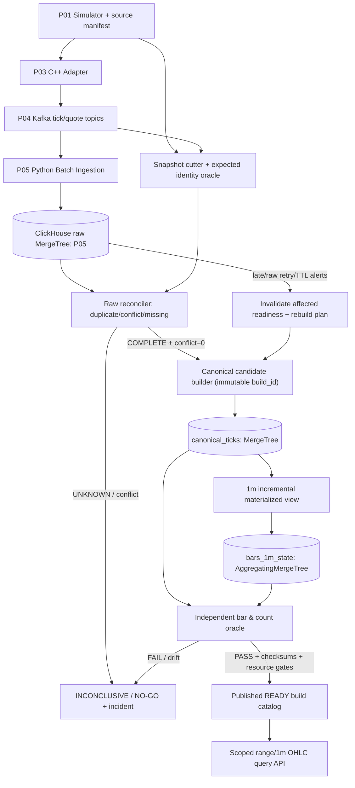
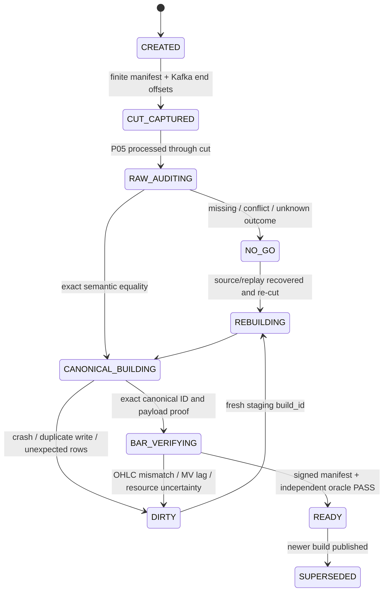
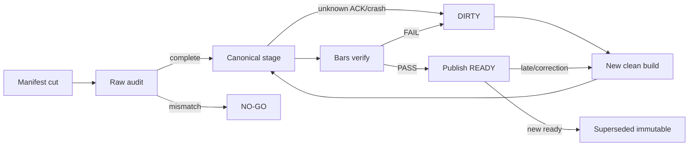

# PROJECT 06 — ClickHouse Time-Series Analytics & Materialized OHLC Bars

> **System Design · Data Correctness/Proof Plan · Capacity/Recovery Design · What-If/Chaos/Stress Test Matrix**  
> Chương trình: **Market Data Streaming and Analytics Platform — Project 06/09**  
> Stack: **ClickHouse MergeTree / AggregatingMergeTree / SQL / Python 3.12 verifier / Kafka lineage**  
> Tài liệu phiên bản **1.0 — 2026-10-30** · Trạng thái **DESIGN_ONLY / NOT_IMPLEMENTED / NOT_BENCHMARKED**  
> Ưu tiên: **correctness → không công bố sai → khả năng đối soát → bounded resources → recovery → hiệu năng**.

## 0. Phạm vi chứng cứ, lời hứa và liên kết các dự án

Theo CV, dự án Market Data Streaming and Analytics Platform sử dụng **C++20, Python 3.12, Kafka, Protobuf, ClickHouse, PostgreSQL**; ticks được lưu trong **ClickHouse MergeTree** với **date partitions, symbol/time ordering, TTL, materialized bars** và Python batch ingestion; CV nêu throughput **120.000 ticks/s trên 8 partitions** và **p95 range query giảm từ 2,4 giây còn 280 ms trên 200 triệu rows**. Đó là kết quả được **mô tả cho dự án tổng**, **không** phải benchmark đã chạy trên bản tái dựng Project 06.

Tài liệu này là **thiết kế mới để học, viết code và kiểm chứng**; mọi topology/DDL/SLO/cơ chế canonical/bars dưới đây là *đề xuất triển khai*, không tự nhận đã tồn tại trong CV. Project 05 đã chọn **append-only raw MergeTree**, chấp nhận khả năng physical duplicate do at-least-once; Project 06 **không được giả định raw tự nhiên unique**. Không thể dự đoán *mọi* lỗi có thể xảy ra; ma trận bên dưới bao phủ nhiều lớp rủi ro độc lập, còn property-based/fuzz/soak/chaos kiểm tra các tổ hợp chưa liệt kê.

### 0.1. Hợp đồng kế thừa — không tự đổi ngầm

| Nguồn | Contract đã ghi trong thiết kế Project 01–05 | Hệ quả bắt buộc cho P06 |
|---|---|---|
| P01 simulator | `dataset_id`, `symbol`, `sequence` tăng **theo symbol trên cả tick và quote**, `event_time_ns` nanosecond UTC, giá integer ticks + `price_scale`, finite dataset/manifest/fault scenarios | Không dùng sequence liên tục *theo từng topic*, không dùng float để tính giá |
| P02 Protobuf | `marketdata.v1.MarketDataEvent`; `oneof tick(price_ticks)` và `quote(bid_ticks, ask_ticks)`; optional presence | **Tick là cập nhật giá, không mặc định là giao dịch**; không tự sinh trade volume |
| P03 C++ adapter | Accepted/rejected events, sequence/stale validation; có thể suppress event bất hợp lệ | Source expected set chỉ gồm các event đã được publish theo policy; không so raw với mọi synthetic event |
| P04 Kafka | `md.ticks.v1`, `md.quotes.v1`, keyed symbol; 8 partitions **mỗi topic** trong profile benchmark; không bảo đảm tổng thứ tự xuyên topics | Analytics sắp theo source `(event_time_ns, sequence)` và phân scope theo dataset, không theo Kafka arrival |
| P05 ingestion | `md_ingest.market_events_raw` chứa identity, payload digest, source-time/price/kafka coordinates; at-least-once, *physical duplicates và identity conflict có thể tồn tại* | P06 phải kiểm chứng unique **logical** events trước aggregation, đối soát việc ghi/merge/TTL |
| P07–09 | Replay, capacity, deployment được xây sau | Cung cấp golden fixtures, manifest, invariant, scripts, test contract cho các giai đoạn sau |

**Tên bảng và trường raw đã tồn tại trong tài liệu P05**: `md_ingest.market_events_raw(dataset_id, symbol, sequence, event_kind, event_time_ns, event_date, price_scale, bid_ticks, ask_ticks, price_ticks, source_schema_version, payload_digest, kafka_topic, kafka_partition, kafka_offset, topic_generation, ingest_run_id, ingested_at)`; Engine `MergeTree`, `PARTITION BY toYYYYMMDD(event_date)`, `ORDER BY (symbol, event_time_ns, dataset_id, sequence, kafka_topic, kafka_partition, kafka_offset)`.

**Giới hạn giao diện**: P06 **không** chỉnh Kafka offset, không commit thay P05, không tin `ingested_at` là market timestamp, không sửa raw P05 để “làm sạch” lỗi, không tự gắn nhãn `exactly-once` cho pipeline Kafka→ClickHouse. PostgreSQL được liệt kê trong CV nhưng vai trò P06 không được xác nhận; bản MVP không bắt buộc dùng PostgreSQL.

### 0.2. Phân biệt 6 trạng thái dữ liệu

1. **P05 raw-ACKed**: ClickHouse nhận INSERT thành công theo mode đã xác minh; raw còn có thể trùng/missing với nguồn.
2. **Source snapshot sealed**: có source manifest + Kafka end-offsets cố định + P05 terminal state; không dùng `consumer lag == 0` làm end-of-dataset.
3. **Raw reconciled**: independent verifier đối chiếu identity và exact semantic fields, phát hiện duplicate/conflict/missing/extra.
4. **Canonical candidate**: một physical row/identity được chọn sau khi kiểm tra cùng digest và không có conflict; ở **build_id** riêng, chưa public.
5. **Bars reconciled**: OHLC/count từ canonical candidate khớp oracle tham chiếu độc lập; MV insert/merge đã settle.
6. **Published snapshot**: catalog/manifest chỉ rõ `build_id` **READY**; query layer bắt buộc scope theo build đó.

`COUNT(*) == expected` **không** chứng minh correctness. `ORDER BY`/`PRIMARY KEY` ClickHouse **không** là unique constraint. Background merges **không** đảm bảo logic dedup, và INSERT vào một bảng không tự tạo transaction xuyên mọi bảng/phụ thuộc liên quan.

## 1. Mục tiêu, yêu cầu và tiêu chí nghiệm thu

### 1.1. Functional requirements

| ID | Chức năng | PASS bằng bằng chứng độc lập |
|---|---|---|
| FR-01 | Đọc raw schema của P05 *không làm biến đổi dữ liệu* | Schema preflight; roundtrip typed fixtures |
| FR-02 | Giữ `Int64 event_time_ns`, fixed-point ticks và `price_scale` nguyên vẹn | 1 ns, ±large values, UTC boundaries giữ semantic equality |
| FR-03 | Physical duplicate và logical identity conflict được phân biệt | `(dataset_id,symbol,sequence)` vs semantic digest; không chọn phiên bản bất kỳ |
| FR-04 | Cắt snapshot upstream bằng manifest/offset ranges | Replay cũ/tương lai ngoài cut không được nhập nhằng |
| FR-05 | Canonical build **exactly one event per identity** sau reconcile | Golden id set & full-field digest equality; conflict→NO-GO |
| FR-06 | Tick bars 1 phút đúng OHLC; trade volume **không suy từ tick** | Python reference aggregator với tie-break `(event_time_ns,sequence)` |
| FR-07 | MVs chỉ nhận nguồn canonical đã gate; không dùng direct raw MV gây double count | Retry raw + delayed merge không làm bars tăng sai |
| FR-08 | Late data/correction có trạng thái `DIRTY`, quy trình versioned rebuild | Không âm thầm coi bar final sau late event |
| FR-09 | Query raw/canonical/bars filter dataset + symbol + `[start,end)` | No cross-dataset or future/out-of-range leakage |
| FR-10 | Date partition, ORDER BY, TTL được benchmark và vận hành có giới hạn | EXPLAIN indexes + parts/merges + TTL/retention gate |
| FR-11 | Benchmark 200M rows và p95 query bằng workload có thể tái lập | Save SQL/workload/hardware/config/versions/cold-warm measurements |
| FR-12 | Backfill shadow `build_id` và publish chỉ sau audit | Crash ở mọi bước không công bố build thiếu |
| FR-13 | Đối soát upstream→raw→canonical→bars theo identity | Phát hiện missing, extra, duplicates, conflict, wrong-bar |
| FR-14 | Query limits, concurrency/admission, protection khi tài nguyên cạn | OOM/disk-pressure không trả về “PASS” giả hoặc dữ liệu thiếu |
| FR-15 | Giám sát hệ thống/incident runbooks + metadata build | `system.parts`, `system.merges`, query/part logs, alerts có timeline |
| FR-16 | Migration, TTL, rollback có bảo vệ recovery windows | Không xóa dữ liệu duy nhất để phục hồi khi chưa backup/gate |
| FR-17 | Ingestion 120k/s phối hợp query trong capacity lab (nếu máy đủ) | Peak rate thực đo + lag slope + query p95 + part pressure |
| FR-18 | Demo độc lập và CI correctness + performance regression | Fixture SHA + SQL version + build artifact + explicit verdict |

### 1.2. Nonfunctional objectives — **đề xuất, chưa được đo**

| ID | Ngưỡng/định nghĩa | Phương pháp nghiệm thu hoặc bác bỏ |
|---|---|---|
| NFR-01 | `missing=0, extra=0, conflicts=0, wrong_projections=0` cho snapshot READY | So expected manifest với canonical identity và fields |
| NFR-02 | `physical_duplicates≥0` được phân loại; mỗi canonical ID = 1 | Random duplicate injection + self-contained oracle |
| NFR-03 | p95 **280 ms** trên 200M rows là **benchmark reference**, không phải SLO mặc định của máy lab | Cố định workload/symbol/time window/cache/hardware; so 2.4s baseline |
| NFR-04 | Initial dataset 1M → 10M → 50M → 200M **unique tick events** cho query benchmark; quotes có thể bổ sung ngoài count | Dataset generator tạo manifest độc lập, không lấy DB làm ground truth |
| NFR-05 | Đường tăng tải 1k → 10k → 50k → 120k **events/s total**; đo cả P05/CH và query | Steady-state 15–60 phút; không tăng backlog liên tục trong cửa sổ đo |
| NFR-06 | **0 silent drop** và **0 false READY**, mọi timeout/unprovable ra `INCONCLUSIVE/NO-GO` | Kill/replay/TTL/late tests; observer độc lập |
| NFR-07 | Mỗi query bounded `max_execution_time`, result limit và `max_memory_usage` (pin theo máy, không hardcode universal) | Query adversarial + cgroup memory limit |
| NFR-08 | Không quá nhiều active parts/partition theo budget cấu hình và trend | `system.parts`, `system.part_log`, `system.merges` + alert |
| NFR-09 | Tách resource budget cho ingestion, read, backfill | Concurrent load không làm ingestion fail âm thầm |
| NFR-10 | Snapshot READY bất biến; sửa lịch sử = build mới | Mutation/late/correction test so old/current build |
| NFR-11 | TTL chỉ được bật khi `retention ≥ max(recovery, audit, rebuild, late-arrival windows)` + backup/restore đã test | Short TTL chaos test và rebuild toàn bộ |
| NFR-12 | Mọi benchmark có ClickHouse version, `system.build_options`, DDL SHA, config digest, driver versions và môi trường | Cùng fixture + cùng biến đo khi rerun |

**Số học capacity:** `120.000 events/s × 86.400 = 10,368 tỷ events/ngày` **nếu** tải duy trì liên tục (không được nhầm với 120.000 *trên mỗi topic*). 200M rows tương đương khoảng **27,8 phút** sinh dữ liệu ở tốc độ này **nếu toàn bộ 120k events/s đều tạo ra 1 tick row/event**. Nếu còn quote, throughput tick thấp hơn, phải đo riêng. Dung lượng vật lý phải đo từ `system.parts`, không được suy rằng một tick cố định tốn X byte; giả định **60 byte/row compressed** chỉ để planning: `200M × 60 = 12 GB` raw column data trước overhead, replicas, MVs, indexes, backup và free-space reserve.

## 2. Kiến trúc tổng thể, dataflow và trách nhiệm



**Hai chế độ hoàn toàn khác nhau:**

- **Correctness-first MVP (được nghiệm thu):** ingest finite replay → cut snapshot → reconcile raw → create immutable canonical **candidate** → derive 1m bars → verify → publish `build_id`. Khách hàng chỉ đọc READY build. Cách này dễ chứng minh tại sao OHLC không bị nhân đôi bởi Kafka retries.
- **Live/near-real-time nâng cao (chưa hứa ở MVP):** yêu cầu bổ sung một *durable canonical admission* có thể chứng minh uniqueness, conflict handling, repair/rebuild watermark, idempotency vượt khỏi cửa sổ insert dedup. Bảng raw và `ReplacingMergeTree` merge hậu kỳ **không đủ** để tạo realtime bar chính xác mặc định. Có thể hiển thị `PROVISIONAL` nhưng phải ghi rõ chưa certified, không phục vụ kết luận trading.

### 2.1. Các module đề xuất

| Module | Input/Output | Quy tắc an toàn |
|---|---|---|
| `schema_preflight.py` | raw metadata → compatible DDL | Mismatch dừng, không ALTER tự phát |
| `snapshot_cutter.py` | P01 manifest + P04 end offsets + P05 commit proof → `snapshot.json` | Không lấy `SELECT count()`/lag-zero làm cut |
| `raw_auditor.py` | raw + finite source → duplicates/conflicts/missing/extra | Semantic compare, không chỉ hashes hoặc counts |
| `canonical_builder.py` | verified snapshot → rows `(build_id, source ids, price)` | Immutable, 1 row/source identity, staged |
| `bars_1m` MV | canonical ticks → aggregate states | Không nhận raw trực tiếp; no quote-as-trade |
| `bars_verifier.py` | ClickHouse states + independent Python oracle → proof | Tie-break deterministic, aggregate count exact |
| `build_catalog.py` | check results → `READY` manifest pointer | Publish only after audit; publish race safe via serialized gate |
| `query_service.py` | `(build,dataset,symbol,time range)` → bounded SQL | Reject unsafe filters; no hidden fallback to raw |
| `ttl_controller.py` | retention policy + watermark + backup state | Retention gate / restore rehearsals |
| `benchmark_runner.py` | workload spec + seed → latency throughput resource report | Same input/query, cold/warm split, no cherry-picking |
| `chaos_harness.py` | fault plan → injection proof → observed state | Failed injection is INVALID, not PASS |
| `observability.py` | ClickHouse system tables + OS/cgroup | Low-cardinality metrics, no secret/PII disclosure |

### 2.2. Deployment profiles

- **DEV:** 1 ClickHouse server, 1 P05 consumer, finite Kafka replay, <=1M rows. Chỉ để học/correctness, **không phải HA**.
- **INTEGRATION:** P04/P05 real, 10–50M rows, config version pinned, fault injection, query+ingest concurrent.
- **CAPACITY:** 200M rows, 8 Kafka partitions/topic, 1..N consumers, fast storage, pinned CPU/RAM/cgroup, query concurrency/chaos. **Không bắt buộc đạt 120k/s trên máy cá nhân.**
- **HA-LAB (optional):** replicated ClickHouse + Keeper, replication/readonly/lag/leader/failover testing. Replication topology phải có tests riêng; replica Kafka không tự khiến ClickHouse HA.

## 3. Contract dữ liệu, identity, giá và thời gian

### 3.1. Identity và nguồn chân lý

```text
source_identity = (dataset_id, symbol, sequence)
source_order    = (event_time_ns, sequence)  # valid ONLY within same dataset_id+symbol
source_kind     = tick | quote
physical_record = source_identity + kafka_topic + kafka_partition + kafka_offset
semantic_core   = (dataset_id, symbol, sequence, event_kind, event_time_ns,
                   price_scale, quote bid?/ask? or tick price?, source_schema_version,
                   logical field presence)
payload_digest  = SHA256(canonical_encoding(semantic_core))  # P05 algorithm
```

**Same ID + same semantic core** → physical duplicate, chỉ xuất hiện một lần canonical. **Same ID + different semantic core** → `CONFLICT`, **không** chọn `any`/`argMax(ingested_at)` để che mâu thuẫn. **Different dataset_id + same symbol/time/seq** → hai event khác nhau, phải luôn giữ scoped `dataset_id`.

`event_date` phải đúng **UTC** từ `event_time_ns` (kể cả local host TZ=Asia/Ho_Chi_Minh). P05 có thể lưu `event_time_ns` dạng Int64; các helper SQL chỉ được dùng sau range preflight, và phải kiểm chứng `fromUnixTimestamp64Nano()` ở ClickHouse version pin. Không cast sang `DateTime64(3)` rồi mất nanoseconds. Int64 epoch nanoseconds chỉ hỗ trợ một khoảng năm hữu hạn; dữ liệu ngoài contract → reject/no-go (không wrap số).

### 3.2. Tick price không phải volume

- `Tick.price_ticks`: một cập nhật giá; có thể tạo **OHLC price bars** và `tick_count` cho 1m/5m/1h. **Không có trade size**; `tick_count ≠ traded_volume`.
- `Quote.bid_ticks/ask_ticks`: không trộn vào tick OHLC. Nếu muốn quote bars, tạo **sản phẩm riêng** (BidOHLC, AskOHLC hoặc midpoint ticks với quy tắc integer rounding được phê duyệt).
- **Giá thập phân chỉ để hiển thị:** `price = price_ticks / price_scale` sau khi đã validate `scale>0` và hợp đồng symbol scale cố định; không dùng `Float64` làm data correctness oracle.
- Nếu thay đổi `price_scale` trong cùng dataset/symbol, **không** tính OHLC chung trừ khi có migration policy với conversion exact, đã kiểm chứng riêng. Bản MVP: STOP/CONFLICT.

### 3.3. Semantics của “bar 1 phút”

```text
bar_start_ns = floor(event_time_ns / 60_000_000_000) * 60_000_000_000 (UTC)
bar_key      = (build_id, dataset_id, symbol, price_scale, bar_start_ns)
bar_interval = [bar_start_ns, bar_start_ns + 60_000_000_000)
OPEN         = price_ticks of event with minimum (event_time_ns, sequence)
HIGH         = max(price_ticks)
LOW          = min(price_ticks)
CLOSE        = price_ticks of event with maximum (event_time_ns, sequence)
TICK_COUNT   = number of *canonical tick identities* in interval
```

Không tạo 1m bar giả cho phút không có tick nếu chưa định nghĩa fill-forward. Cùng một `event_time_ns`, dùng `sequence` để tie-break, chỉ cùng dataset/symbol; sequence xuyên tick/quote vẫn phù hợp để order tick subsequence. Sự cố *event-time đi ngược*, clock skew, late events là chất lượng dữ liệu/watermark chứ không tự động là broker loss.

## 4. Logical data model và ClickHouse SQL tham chiếu

> **Lưu ý thực thi:** SQL dưới đây là **starter design**, chưa được chạy/bảo đảm cú pháp trên bản ClickHouse pin. CI phải chạy thật với pinned ClickHouse image và kiểm thử `SHOW CREATE TABLE`, `EXPLAIN`, `system.tables`, return types, rounding/UTC và AggregateFunction serialization trước khi release. Raw SQL gốc thuộc P05, **không CREATE lại trong P06**.

### 4.1. Canonical ticks — bảng chỉ nhận dữ liệu qua verified build

```sql
CREATE DATABASE IF NOT EXISTS md_analytics;

CREATE TABLE IF NOT EXISTS md_analytics.canonical_ticks
(
    build_id           String,
    dataset_id         String,
    symbol             LowCardinality(String),
    sequence           Int64,
    event_time_ns      Int64,
    event_date         Date,                  -- UTC, inherited/verified
    price_scale        Int64,
    price_ticks        Int64,
    payload_digest     FixedString(64),
    source_schema_version LowCardinality(String)
)
ENGINE = MergeTree
PARTITION BY toYYYYMMDD(event_date)
ORDER BY (build_id, dataset_id, symbol, event_time_ns, sequence);
```

- `build_id` ở đầu sorting key giúp tách các snapshots. Giữa dataset và symbol/time: với query yêu cầu `(build_id,dataset_id,symbol,start/end)` thứ tự này vẫn tối ưu cho time ranges **trong một source scope**. Benchmark so sánh với `(symbol,event_time_ns,dataset_id,...)` và với monthly partition khi dữ liệu/batches phân tán nhiều ngày.
- `MergeTree` **không enforce unique**; invariant 1 row/source ID thuộc trách nhiệm **builder + independent post-build verifier**. Builders không insert lại vào **cùng build_id** sau ACK ambiguity nếu chưa kiểm tra cleanup/rebuild. Có thể dùng **bảng staging riêng per build** và replace-in-version thay vì append retry. Snapshot publish vẫn phải gate.
- Tất cả rows của build luôn có cùng source manifest digests, schema hash, expected ID count, và versioned configuration; nếu thiếu một trong các chứng cứ này không lên READY.

### 4.2. State table và Incremental MV cho 1m OHLC

```sql
CREATE TABLE IF NOT EXISTS md_analytics.bars_1m_state
(
    build_id       String,
    dataset_id     String,
    symbol         LowCardinality(String),
    price_scale    Int64,
    bar_start_ns   Int64,
    open_state     AggregateFunction(argMin, Int64, Tuple(Int64, Int64)),
    high_state     AggregateFunction(max, Int64),
    low_state      AggregateFunction(min, Int64),
    close_state    AggregateFunction(argMax, Int64, Tuple(Int64, Int64)),
    count_state    AggregateFunction(count)
)
ENGINE = AggregatingMergeTree
PARTITION BY toYYYYMMDD(toDateTime(intDiv(bar_start_ns, 1000000000), 'UTC'))
ORDER BY (build_id, dataset_id, symbol, price_scale, bar_start_ns);

CREATE MATERIALIZED VIEW IF NOT EXISTS md_analytics.mv_canonical_ticks_to_bars_1m
TO md_analytics.bars_1m_state AS
SELECT
    build_id,
    dataset_id,
    symbol,
    price_scale,
    intDiv(event_time_ns, 60000000000) * 60000000000 AS bar_start_ns,
    argMinState(price_ticks, tuple(event_time_ns, sequence)) AS open_state,
    maxState(price_ticks) AS high_state,
    minState(price_ticks) AS low_state,
    argMaxState(price_ticks, tuple(event_time_ns, sequence)) AS close_state,
    countState() AS count_state
FROM md_analytics.canonical_ticks
GROUP BY build_id, dataset_id, symbol, price_scale, bar_start_ns;
```

**Chú ý:** Incremental MV là insert trigger trên blocks; không tự phản ánh DELETE, UPDATE, `DROP PARTITION`, merge hậu kỳ tại source. Nếu chèn **trùng canonical** thì state count tăng sai; `AggregatingMergeTree` không hề tự khử trùng lặp logical events. Version-specific insert dedup (kể cả các cải tiến async + MV từ 26.1) có điều kiện, window hữu hạn và không thay thế source identity proof. Vì vậy trong MVP *chỉ insert vào canonical khi đã gate unique*; ACK ambiguity/canonical retry gây `BUILD_DIRTY`, cần rebuild sạch staging.

### 4.3. Truy vấn OHLC 1 phút đã hợp nhất aggregate states

```sql
SELECT
    dataset_id, symbol, price_scale, bar_start_ns,
    argMinMerge(open_state) AS open_ticks,
    maxMerge(high_state) AS high_ticks,
    minMerge(low_state) AS low_ticks,
    argMaxMerge(close_state) AS close_ticks,
    countMerge(count_state) AS tick_count
FROM md_analytics.bars_1m_state
WHERE build_id = {build_id:String}
  AND dataset_id = {dataset_id:String}
  AND symbol = {symbol:String}
  AND bar_start_ns >= {start_ns:Int64}
  AND bar_start_ns < {end_ns:Int64}
GROUP BY dataset_id, symbol, price_scale, bar_start_ns
ORDER BY bar_start_ns
LIMIT 10000;
```

**Tại sao phải `*Merge`?** Mỗi batch insert có thể tạo nhiều aggregate-state rows cho cùng bar; background merge chưa chạy xong. `count_state` là count **tick** chứ không phải trade volume. `start_ns/end_ns` áp dụng với **bar start**, không tự diễn giải là chính xác số tick nằm trong `[start,end)` nếu biên không căn phút; query service phải yêu cầu aligned range hoặc định nghĩa rõ semantics.

### 4.4. Canonical range query (biên đóng/mở rõ ràng)

```sql
SELECT event_time_ns, sequence, price_ticks, price_scale
FROM md_analytics.canonical_ticks
WHERE build_id = {build_id:String}
  AND dataset_id = {dataset_id:String}
  AND symbol = {symbol:String}
  AND event_time_ns >= {start_ns:Int64}
  AND event_time_ns < {end_ns:Int64}
ORDER BY event_time_ns, sequence
LIMIT {row_limit:UInt32};
```

Không expose raw query tùy ý nếu chưa có resource guard; data quality audit được dành cho admin offline. Không dùng `SELECT *`, tránh implicit timezone conversions. Query limit phải được enforce server-side/role-profile, không dựa duy nhất client.

### 4.5. QA SQL (read-only, offline, bounded scope)

```sql
-- Detect logical conflict (same ID, different P05 semantic digests)
SELECT dataset_id, symbol, sequence, count() AS physical_count,
       uniqExact(payload_digest) AS digest_variants
FROM md_ingest.market_events_raw
WHERE dataset_id = {dataset_id:String}
GROUP BY dataset_id, symbol, sequence
HAVING digest_variants > 1;

-- Build uniqueness check for canonical; require zero rows
SELECT dataset_id, symbol, sequence, count() AS n
FROM md_analytics.canonical_ticks
WHERE build_id = {build_id:String}
GROUP BY dataset_id, symbol, sequence
HAVING n != 1;

-- Inspect table parts/merge pressure
SELECT database, table, partition, count() AS active_parts,
       sum(rows) AS rows, sum(bytes_on_disk) AS bytes_on_disk
FROM system.parts
WHERE active = 1 AND database IN ('md_ingest', 'md_analytics')
GROUP BY database, table, partition
ORDER BY active_parts DESC
LIMIT 100;

-- Query diagnostics (logs can have delay; require log_queries enabled)
SELECT query_duration_ms, read_rows, read_bytes, memory_usage, query_id
FROM system.query_log
WHERE type = 'QueryFinish' AND event_time >= now() - INTERVAL 1 HOUR
ORDER BY query_duration_ms DESC LIMIT 50;
```

Các truy vấn `uniqExact`/`GROUP BY source_identity` có thể rất tốn RAM trên 200M rows; kiểm toán chạy offline, phân mảnh có chứng cứ/streaming external verifier, giới hạn resource. `uniqExact(digest)` chỉ là một lớp phát hiện conflict; oracle còn so typed semantic projection.

## 5. Snapshot-cut, canonicalization và versioned publication

### 5.1. Reconciliation-first, không gọi trạng thái “final” vội



**S1 — Cut nguồn:** finite P01 dataset manifest + P03 accepted-event ledger + P04 Kafka **per-topic-partition end offsets** + P05 consumer durable frontier (`next offset`) + query snapshot metadata. Nếu raw vẫn đang insert, cut theo **Kafka coordinates** đã seal. Không lấy `now()` hoặc ClickHouse `ingested_at` làm cut.

**S2 — Raw audit:** xác nhận identity expected, Kafka-coordinate provenance, semantic value, data-quality flags; đếm physical duplicates và differentiate conflicting variants. Nếu source manifest không có hoặc Kafka retention đã mất dữ liệu, `INCONCLUSIVE`, **không** suy rằng 200M raw rows = 200M đúng.

**S3 — Staging build:** ứng dụng tạo `build_id=SHA256(manifest_sha + raw_cut + schema_hash + builder_version + canonical_policy)`. Với cùng content/semantic version có thể tính lại cùng build ID nhưng *phải tạo staging sạch/nhận diện attempt riêng*. Bảng canonical dùng `build_id` ở PK sort; không expose build cho readers trước READY.

**S4 — Generate bars:** insert staged canonical (one ID), MV tạo `AggregateFunction` states. Sau INSERT ACK, **đợi/query đến khi verifier độc lập chứng minh states khớp** (không giả định MV atomic transaction toàn hệ). Dữ liệu tick/quote tách; quote không góp vào bars.

**S5 — Publish gate:** manifest chứa `build_id`, source snapshot IDs/ranges, `schema_sha`, query SQL SHA, `canonical_count`, `tick_count`, `bar_count`, business fields checksum/samples, version, env, `READY`, signature hoặc tamper evidence; publish pointer atomically ở **catalog bên ngoài** có atomic conditional write/compare-and-swap hoặc single-writer serialization. **Không dùng một SELECT ClickHouse duy nhất thay điều kiện gate**. Trường hợp không có metadata store ở MVP: manual `active_build.json` atomic replace trên cùng filesystem + single writer lock + audit; không coi là multi-host HA.

**S6 — Late/correction:** source event ngoài cut không được auto-thêm vào build READY. Chỉ xuất hiện trong **build mới** sau new cut; nếu conflict ID thì NO-GO, repair theo policy minh bạch rồi rebuild. Không tự động cập nhật OHLC của published build bằng `ALTER UPDATE/DELETE` raw.

### 5.2. Quy tắc khi build thất bại

| Sự kiện | Quyết định | Tại sao |
|---|---|---|
| ACK canonical insert timeout/unknown | `DIRTY`; preflight reuse/cleanup hoặc rebuild *fresh* version | Không chắc physical side effect và MV đã nhận block hay chưa |
| Crash sau canonical, trước bars verified | `NOT_READY`; reconcile/rebuild MV trong staging | Canonical insert ACK không là proof bar đầy đủ |
| Đã READY rồi phát hiện raw late record | READY build **giữ nguyên semantics snapshot**, tạo build kế tiếp | Tránh thay output khách hàng một cách lặng lẽ |
| Có duplicate cùng semantic trong raw | Cho phép raw physical duplicates; canonical chỉ 1/source ID | At-least-once là chuyện bình thường cần chứng minh |
| Conflicting payload digest/semantic | `NO_GO`, xuất báo cáo, không `argMax(last_write)` | Chọn bất kỳ bản nào là mất tính trung thực |
| TTL đã xóa nguồn cần rebuild và không có backup | `INCONCLUSIVE/NO_GO` | Không thể chứng minh completeness từ dữ liệu đã mất |
| Background merge đang chạy | Query states qua `*Merge`, không `OPTIMIZE FINAL` thường xuyên | Merges asynchronous; cưỡng chế merge ảnh hưởng capacity |

## 6. MergeTree data layout, partition, index và parts pressure

- **Raw P05**: daily partition `toYYYYMMDD(event_date)`, sorting `(symbol,event_time_ns,dataset_id,sequence,kafka_coord...)`; thích hợp truy vấn symbol/time khi dataset scope cần scan thêm, benchmark tradeoff key prefix.
- **Canonical P06**: `(build_id,dataset_id,symbol,event_time_ns,sequence)`, `PARTITION BY day UTC`. Query server bắt buộc filter `build_id+dataset_id+symbol+time`; thiếu prefix dễ kéo full scan.
- **1m bars state**: `(build_id,dataset_id,symbol,price_scale,bar_start_ns)`, `AggregatingMergeTree`. Các row state phải đọc bằng `*Merge`, kể cả chưa merge background.
- **Daily vs monthly partition**: ngày phù hợp CV nhưng N × days × hot symbols × tiny batches có thể tạo quá nhiều parts. Compare ngày/tháng trên cùng workload, mức độ partition pruning, merge CPU/I/O và TTL efficiency; quyết định cần đo, không áp dụng “partition day always best”.
- **LowCardinality**: symbol domain allowlist nhỏ giúp compact; random symbols do hostile test có thể làm dictionaries/cardinality phình. Fail hoặc quarantine nếu contract phá vỡ.
- **Secondary indexes/projections**: chỉ thêm khi `EXPLAIN indexes=1` và read_rows/marks chứng minh lợi ích; thử CPU/disk write amplification; không cắm bloom/skip index theo cảm tính.
- **Merges**: mỗi INSERT/partition sinh parts; background consolidation không ràng buộc latency; quá nhiều small inserts từ P05 có thể khiến `Too many parts`, OOM, query degradation. Sửa batching, query workload, partition strategy trước khi chạy `OPTIMIZE TABLE ... FINAL` (không tự động gọi trong cron).
- **Retention**: `TTL event_date + INTERVAL 90 DAY DELETE` là **policy mẫu chỉ để thử**, không bật cho dataset cần chứng minh toàn vẹn trước khi chọn age, backup và recovery window. TTL theo event-time, nên dữ liệu late cũ hơn TTL có thể bị xóa gần như lập tức sau merge; TTL diễn ra *asynchronous*, không là cơ chế xóa chính xác ngay tại deadline.

## 7. Materialized bars và correctness đặc biệt khó

### 7.1. Những sai lầm phải chặn

1. **Direct MV từ raw + `countState()`**: có duplicate retry → tick_count nhân đôi; high/low có thể không đổi nhưng count sai, aggregate sums/VWAP sai.
2. **ReplacingMergeTree trên raw → MV**: merge xóa duplicates về sau, nhưng incremental MV không tự undo aggregate states đã chèn; `FINAL` trên raw khi SELECT không tự sửa target.
3. **`sum(price_ticks)`** không có ý nghĩa trade volume; `tick_count` mới là số update có thể tính được từ P02.
4. **`any(price_ticks)` để xác định OPEN/CLOSE**: không deterministic, nhất là insert/replay/out-of-order; dùng `argMin/argMax` theo `(event_time_ns, sequence)`.
5. **Trộn scale** của hai symbol hoặc phiên bản scale: OHLC không còn đơn vị đồng nhất; group price_scale và enforce symbol policy.
6. **Chuyển ns → milliseconds**: tie-break sai cho events gần nhau, méo window edge; tính bucket từ ns integer.
7. **Merge state chưa hoàn tất**: query trực tiếp state rows hoặc group không dùng `*Merge` → trả nhiều rows cho cùng phút.
8. **`POPULATE`/backfill race** khi tạo MV: behavior có thể thay đổi theo version; MVP tạo MV trước staged inserts, không dựa vào `POPULATE` khi source đang live.
9. **Backfill cùng `build_id` hai lần**: additive aggregate states nhân đôi, không dùng lại nếu chưa clean staging.
10. **Historical correction**: source mutations không propagate; rebuild new version và đổi public manifest, không PATCH bar thủ công.

### 7.2. Python oracle tham chiếu (logic, không phải code đã kiểm thử)

```python
from collections import defaultdict

# inputs: exact canonical tick rows with (build_id,dataset_id,symbol,sequence,
# event_time_ns,price_ticks,price_scale), one logical ID each.
bars = defaultdict(list)
for event in canonical_ticks:
    assert event.price_scale > 0
    minute_ns = (event.event_time_ns // 60_000_000_000) * 60_000_000_000
    bars[(event.build_id, event.dataset_id, event.symbol,
          event.price_scale, minute_ns)].append(event)

reference = {}
for key, events in bars.items():
    ordered = sorted(events, key=lambda e: (e.event_time_ns, e.sequence))
    prices = [e.price_ticks for e in ordered]
    reference[key] = {
        "open_ticks": prices[0], "high_ticks": max(prices),
        "low_ticks": min(prices), "close_ticks": prices[-1],
        "tick_count": len(ordered),
    }
# Compare exact integer states with ClickHouse *Merge query, including no extra bars.
```

Oracle phải đọc verified source/canonical fixture độc lập với SQL MV. Với 200M rows dùng streaming sort/chunked external aggregation đủ RAM/disk theo budget, không load toàn bộ vào Python RAM. Hash aggregate để lấy thống kê có thể là bằng chứng hỗ trợ, nhưng không tự chứng minh **full semantic equality** nếu chưa dùng identity membership/reconcile.

## 8. Late events, out-of-order, watermark và data retention

**Event time** là `event_time_ns` từ nguồn; **ingestion time** chỉ giúp đo độ trễ. Kafka top tick/quote không có total order, và log source có thể đến ngoài thứ tự do retry/replay. Bản MVP xuất snapshot **SEALED**; không suy watermark từ “lần cuối thấy event”. Nếu chuyển realtime, phải định nghĩa **lateness bound L** theo hợp đồng nguồn (không tự phỏng đoán), per-symbol progress/watermark, event repair, và đảm bảo không publish `FINAL` trước khi đủ bằng chứng. Nếu source clock đi lùi không bị chặn, watermark chỉ là **giả định giới hạn độ trễ**, không proof tuyệt đối.

- Late tick thuộc bar chưa public: add trước gate, bar recompute từ canonical.
- Late tick thuộc bar READY build cũ: không mutate build cũ; cut mới + rebuild version, hoặc expose corrected version có audit/lineage.
- Event ngoài retention window và không backup: `NOT_RECONSTRUCTABLE`, không tự tạo bar bằng dữ liệu còn lại.
- Cùng event identity nhưng khác giá: identity conflict (có thể là correction chưa được mô hình hóa), không tự xem là duplicate hợp lệ.
- Data timestamps future-dated vượt domain: quarantine/NO-GO; không dùng TTL event time để âm thầm giữ mãi.

## 9. TTL, backup và disaster recovery

| Điều kiện | Phản ứng dự kiến | Cách kiểm chứng |
|---|---|---|
| TTL background hoạt động trễ | Alert nếu retention lag vượt ngưỡng; **không** coi deadline xóa là SLA | Track old partitions/parts + TTL merge tasks |
| TTL xóa raw trước khi verify | NO-GO và khôi phục từ backup/P01 source | Replay fixture hết hạn trước audit |
| Dữ liệu đến muộn đã ngoài TTL | Thông báo không thể lưu/rebuild theo policy, không fake READY | Insert late 100-day record vào 90-day TTL lab |
| MV bars tồn tại lâu hơn raw | Ghi rõ không còn full raw audit; backup/manifest provenance | Drop raw, run bar-source reconstruction gate |
| Disk full khi backup | Snapshot failed/invalid; không báo restore point | Fill backup destination, validate integrity |
| Restore partial | Unpublished staging, revalidate IDs/checksums/bars | Kill restore giữa chừng, attempt restart |
| Replica lag | Khác freshness; không query lagging replica cho READY proof | Delay replica apply, compare offset/version |

**Backup proof:** chụp versioned build metadata + raw source manifest + canonical + bars + schema/DDL/config; kiểm tra restore trên một môi trường sạch với exact ID sets và integer OHLC, không chỉ “backup file exists”. Với single-node local, disk loss có thể đồng nghĩa mất toàn bộ dữ liệu nếu không có nguồn replay/backup.

## 10. Query API / admission / resource budgets

**Contract query:** `GET /bars?build_id=...&dataset_id=...&symbol=...&from_ns=...&to_ns=...&limit=...` là mô hình API **đề xuất, không có server thực**. Authorize tenant/dataset, validate symbol allowlist, `from < to`, aligned minute boundary cho bars, max time range, max rows/bytes, concurrency, cancellation, timeout. Bất kỳ build `NOT_READY/DIRTY/REVOKED` → error rõ (không fallback sang raw).

**Chia tải:** (1) P05 ingestion, (2) canonical backfill + MV, (3) interactive query, (4) offline audit. Resource profiles/throttling độc lập theo user/profile. Đo đồng thời peak insert + query + merges; giới hạn `max_execution_time`, `max_memory_usage`, `max_threads`, `max_result_rows`, request concurrency; hiểu rằng limit `LIMIT` không nhất thiết giảm toàn bộ cost đọc/aggregation. Không dùng SQL string interpolation cho user-controlled fields; nếu driver không hỗ trợ parameter type như SQL mẫu phải dùng cơ chế bind được ClickHouse driver hỗ trợ và verify.

## 11. Observability, alert và proof ledger

**Nguồn đo**: `system.parts`/`part_log` cho part churn; `system.merges`/`mutations` cho merge/mutation backlog; `system.query_log` cho latency/read_rows/read_bytes/memory; `system.processes` cho in-flight; `system.disks` và OS `df -i`, iostat, PSI/cgroup CPU/RAM/disk; P05 Kafka consumer lag và slow DB ACK; MV target `countMerge`; build catalog và raw/canonical/bar reconcile counters.

**Không quan sát sai:** ClickHouse system logs thường bất đồng bộ, local-to-node; query theo thời gian/cluster để phân tích; snapshot trạng thái khi query chạy đồng thời với ingest không nhất thiết cùng một cut nếu chưa có snapshot protocol. `query_log` có overhead/loss nếu logging disabled. Dùng clock monotonic để đo client end-to-end; lưu version/clock skew, warm vs cold cache. Metric labels theo table/phase/status/query template, **không label mỗi event_id**.

| Metric/alert | Dấu hiệu | Đáp án |
|---|---|---|
| `active_parts_per_partition` | tăng liên tục trong steady state | chỉnh batch/partition, throttle P05, điều tra merges |
| `merge_backlog_age / bytes` | merge dài, write amplification tăng | isolate backfill/read, đo disk/CPU |
| `p05_kafka_lag_age` | truy vấn đẩy ingestion chậm, retention risk | query admission/backpressure, cảnh báo nguồn |
| `query_p95_by_template` | baseline drift | EXPLAIN, cache control, query_log read_rows |
| `raw_conflicts`, `canonical_duplicate_ids` | bất kỳ >0 | NO-GO, đừng publish snapshot |
| `bars_wrong_count` | bất kỳ >0 ở READY candidate | DIRTY, rollback candidate |
| `build_ready_without_proof` | bất kỳ >0 | release-blocking incident |
| `disk_free`, `inode_free`, `rss_pct` | dưới thresholds pin theo máy | throttle/backfill pause, fail safe |
| `ttl_age_gap`, `backup_age` | source không còn tái dựng được | revoke future publication gate |

## 12. Performance methodology: 200M rows, p95 2.4 s → 280 ms

**Baseline phải tái lập:** một tập 200M logical ticks (không đếm duplicate như unique), cùng dữ liệu phân phối symbols và days, workload gồm ví dụ 1 phút/1 giờ/1 ngày cho hot/cold symbol và nhiều datasets. Cùng hardware, ClickHouse build/version, ORDER BY, partition, compression, concurrency, cache policy, query predicates, query result count. Chia riêng **cold cache** và **warm cache**; benchmark nhiều lặp lại (ít nhất 100–1000 query nếu phù hợp) và báo median/p95/p99 cùng confidence interval/bootstrapping nếu đủ mẫu. Warm-up chỉ công khai khi bật. Tài liệu CV chỉ cho hai con số, **không cho query SQL/hardware**, nên phép tái dựng sẽ là benchmark mới chứ không thể chứng minh “lặp lại đúng CV” nếu thiếu môi trường gốc.

**A/B tuning từng biến**:
1. Baseline raw MergeTree `ORDER BY(symbol,time,dataset,...)` vs canonical `(build,dataset,symbol,time,seq)`.
2. Query có/không filter full prefix; track marks/granules read `EXPLAIN indexes = 1`.
3. Daily vs monthly partitions, cùng row set, đo parts + TTL + range p95.
4. Raw tick range vs preaggregated bars, bảo đảm **kết quả queries tương đương về semantics** trước khi so latency.
5. Client batch 1k/5k/20k/50k, query concurrency 1/4/16/32, writer load 0/10k/50k/120k/s.
6. Compression codec and row width, LowCardinality, projections/skip indexes **chỉ sau** khi A/B proof.
7. Mixed workload: merge storms, warm/cold, disk almost full, peak Kafka lag, rebuild chạy đồng thời.

**Phân biệt mục tiêu:** CV mô tả **120.000 ticks/s trên 8 partitions**. Các bài P04/P05 nền tảng trong tài liệu này dùng **120.000 events/s tổng**, bao gồm hỗn hợp tick/quote, nên **không được coi là tái lập throughput trong CV**. Để so đúng mốc CV, phải chạy thêm profile **120.000 tick events/s riêng trên 8 partitions của `md.ticks.v1`**, report quote rate và `total events/s` riêng, đồng thời đo actual sink ACK rate và độ trễ. Dataset range-query 200M phải có **200M unique tick rows** (không được thay bằng raw physical duplicate hoặc 200M tick+quote hỗn hợp).

**Chỉ số**: actual P05 ACKed rows/sec, source unique events/sec, CH inserted physical rows/sec, query p50/p95/p99 & errors, read_rows/bytes, parts count, merge time, disk IOPS/await, CPU utilization/steal, RSS/peak, Kafka lag age/slope, MV verification lag, storage bytes/event. **Không** lấy producer requested rate làm throughput thực, không coi `LIMIT 100` là luôn đọc tối đa 100 rows.

### 12.1. Điều kiện báo SUCCESS/FAIL của 280 ms

- `p95 <=280 ms` chỉ ghi PASS nếu **query template và dataset 200M** đã chốt, sample đủ, hardware/cache/workload như report, correctness oracle PASS, không có query errors/partials; nếu khác thiết lập thì ghi `measured_on_new_profile`, **không gọi là lặp lại CV**.
- Nếu p95 >280 ms nhưng hệ thống không mất dữ liệu: **performance NOT_MET**, không đổi thành correctness failure.
- Nếu p95 đẹp nhưng missing/canonical conflicts/bars wrong: **GLOBAL NO-GO**, không công bố benchmark kết quả như đạt.
- Nếu đo lỗi, profiling overhead, mixed load thay đổi giữa baseline/optimized: `INCONCLUSIVE`, sửa experiment trước khi kết luận.

## 13. Reliability policy và incident response

| Failure class | Cấp | Response | Recovery proof |
|---|---|---|---|
| Semantic mismatch, same ID multiple payloads | P0 | freeze build, NO-GO | source manifest/canonical exact comparison |
| Retry duplicated canonical row | P0 | mark DIRTY, rebuild new clean candidate | zero duplicate IDs and correct bars |
| TTL deletes data prior to audit | P0 | stop publish, restore/replay if possible | audited recovered identity set |
| MV target missing/partial after insert | P0 | not READY; stage rebuild | independent OHLC+count exact |
| Query OOM/resource limit | P1 | bounded error, admission/backoff | no corrupted READY; query error metrics |
| Too many parts / merge backlog | P1 | throttle batch/build/query | pressure drains, p95/backlog stabilizes |
| ClickHouse restart during build | P1 | stale candidate remain not READY | replay evidence and staging cleanup |
| Replica/restore inconsistency | P1 | remove node from proof/serving until verified | consistent snapshot metadata and checksum |
| Index/query regression | P2 | rollback query/schema build, rerun A/B | identical semantic results and measured diff |

**Operator never:** tự `OPTIMIZE FINAL` trong hot path, tự `ALTER DELETE` khi data conflict, tự auto-commit offsets thay P05, sửa price float, rút ngắn TTL để giải quyết disk mà không backup, đánh dấu READY chỉ vì INSERT success, gắn trade volume giả vào tick bars.

## 14. Test framework, inputs, evidence, verdict

### 14.1. Independent golden corpus (P01→P05)

1. 1 symbol, 6 events không trùng, 3 tick + 3 quote, cùng/sát minute edge.
2. Nhiều symbols, same epoch/timestamp/seq khác dataset, same timestamp tie-break, scale khác nhau nhưng hợp đồng rõ.
3. P01 inject missing sequence, duplicate exact, identity conflict, stale/future timestamp, negative/zero prices trong isolated test namespace.
4. P04 Kafka retry và partition skew; P05 Kafka rebalances, ACK loss, restarted batch boundaries; physical duplicates in raw.
5. Late ticks giữa 2 snapshot cuts; replay sau TTL, corrupted/partial files, unknown schema.
6. 1M, 10M, 50M và 200M synthetic logical events với manifest deterministic và independent serialized digest.

### 14.2. Verdict chặt chẽ

- `PASS`: stimulus **đã xảy ra và có bằng chứng**, oracle độc lập chứng minh output/transition/invariant, metric đo có timestamps, không vượt resource gates.
- `FAIL`: violation of invariant hoặc crash/timeout vượt ngân sách, silent loss/duplicate/corruption/false READY.
- `NO_GO`: vẫn có dữ liệu mâu thuẫn/missing/unreconstructable và không được public (có thể là *đúng* safe behavior của hệ thống nếu test yêu cầu NO_GO).
- `INCONCLUSIVE`: unknown ACK/replica lag/no source proof/no comparable benchmark; **không** suy ra PASS.
- `INVALID/NOT_RUN`: fault injector chưa gây được tình huống, fixture/hardware/timeout thiếu, oracle không độc lập.

**Schema evidence (mỗi test):** `case_id, priority, timestamp, git_sha, clickhouse_version, image_digest, dataset_manifest_sha, protobuf_descriptor_sha, raw_table_ddl_sha, canonical_ddl_sha, MV_ddl_sha, config_sha, build_id, Kafka topic_generation + offset cut, test_fixture_sha, fault_injection_proof, before/after DB ID sets, full-field mismatch counts, bars_ref_diff, parts/merge/query log, resource peaks, verdict, reason, exit_code`. Bằng chứng không đầy đủ → INCONCLUSIVE.

**Test runner:** `preflight → create isolated DB/build → setup source cut → arm fault → prove injection → execute → drain/wait bounded → independent reconcile → check resource/latency → classify verdict → export immutable evidence`. No fake PASS khi test không thật sự gây lỗi.

---

## 15. Ma trận 420 tình huống **WHAT IF** (30 nhóm)

**Cách đọc:** `P0` = critical: nguy cơ trả kết quả sai/mất nguồn/false READY; `P1` = reliability, recovery và integrity dưới lỗi; `P2` = hiệu năng, vận hành và điều tra. Mỗi row gồm **tình huống**, **hành vi bắt buộc**, **cách gây lỗi/oracle**. Dù P0/P1/P2, **test chưa được chạy thì không ghi PASS**. Trước khi chạy các case phá disk, cluster, hệ thống phải kiểm tra môi trường **LAB** + volume disposable; không làm trên production.

**Phạm vi không thể hữu hạn hóa:** lỗi phối hợp theo mọi thứ tự, mọi runtime version/hardware không thể liệt kê hết. 420 case là *catalog kiểm thử đề xuất*, bổ sung fuzz/properties/model-checker/soak, không phải tuyên bố đã kiểm chứng tất cả. Đặc biệt lỗi không observable làm phép đo `INCONCLUSIVE`, không lờ đi.

| Phân loại | Số case | Chính sách |
|---|---:|---|
| P0 | 150 | Bắt buộc PASS hoặc **an toàn NO-GO** đối với tình huống buộc hệ thống phải từ chối; không được có silent corruption |
| P1 | 210 | Phải có bằng chứng về xử lý lỗi, khôi phục, resource bound và operator visibility |
| P2 | 60 | Hiệu năng/UX/ops, có baseline và không được làm mất correctness |
| **Tổng** | **420** | **30 nhóm × 14 test/nhóm, ID duy nhất `P06-<GROUP>-<NN>`** |


### 15.1. Danh mục 30 nhóm kiểm thử

| Nhóm | Chủ đề | Số case |
|---|---|---:|
| A | Upstream P01–P05 contracts & end-to-end lineage | 14 |
| B | Raw table schema, SQL DDL và metadata preflight | 14 |
| C | Fixed-point prices, scale, signed boundaries & overflow | 14 |
| D | Nanosecond event-time, UTC, DST & minute boundaries | 14 |
| E | Source identity, physical retries & data conflict | 14 |
| F | Finite source snapshot, Kafka cuts & completeness proof | 14 |
| G | Canonical builder, staging, retries & atomic publication | 14 |
| H | OHLC semantic correctness for tick events | 14 |
| I | AggregateFunction state, merge correctness & deterministic tie-breaking | 14 |
| J | Late ticks, out-of-order sequences, watermarks & repair | 14 |
| K | Incremental materialized view lifecycle & dependent-table drift | 14 |
| L | Background merges, mutations, FINAL & storage-state interpretation | 14 |
| M | Date partitions, partition count & part explosion | 14 |
| N | Primary index, ORDER BY, filtering & EXPLAIN | 14 |
| O | TTL expiry, retention math & legal data lifecycle | 14 |
| P | Backup, restore, disaster recovery & rebuildability | 14 |
| Q | Schema evolution, table migration & rollbacks | 14 |
| R | Query API validation, isolation & client-visible semantics | 14 |
| S | Concurrent queries, isolation, consistency & fairness | 14 |
| T | Ingestion throughput, P05 interplay & write amplification | 14 |
| U | Range-query correctness, latency, cache and p95 | 14 |
| V | Parts pressure, merge scheduler, I/O and maintenance | 14 |
| W | CPU, RAM, network, filesystem and cgroup pressure | 14 |
| X | Replication, Keeper, readonly mode & cluster consistency (optional HA) | 14 |
| Y | Security, RBAC, query injection & metadata tampering | 14 |
| Z | Observability, query logs, provenance and forensic audit | 14 |
| AA | Operations, CI/CD, release gate and rollback runbooks | 14 |
| AB | Compound chaos: two or more failures at once | 14 |
| AC | Scale: 200M–billions, skew, cardinality and data growth | 14 |
| AD | Test-oracle integrity, fuzz, statistical proof & completeness limits | 14 |

### 15.2. Chi tiết từng tình huống và oracle

#### A. Upstream P01–P05 contracts & end-to-end lineage (14 case)

| Test ID | Priority | What If — kích thích/failure | Hành vi bắt buộc | Test injection + PASS/FAIL oracle |
|---|---|---|---|---|
| P06-A-01 | P0 | P05 raw nhận bản tin `quote` nhưng P06 coi là `tick` | Chặn bar pipeline; không tạo bar từ quote | Chèn quote có `price_ticks=NULL`, xác nhận tick_count không tăng và validation nêu đúng kind. |
| P06-A-02 | P0 | Hai topic tick/quote cùng symbol có sequence đan xen | Không báo gap giả khi nhìn riêng tick stream | Feed tick seq1, quote seq2, tick seq3; đối chiếu manifest per-symbol qua hai topics. |
| P06-A-03 | P0 | P04 tăng partition count khiến P05 physical records thay Kafka coordinate | Canonical ID không dùng partition/offset làm source ID | Replay cùng dataset qua partition topology khác, kết quả canonical event IDs giữ nguyên. |
| P06-A-04 | P0 | P03 reject event nhưng P06 đòi phải có trong raw | Expected set dựa publish/accept ledger, không trên mọi simulator event | Fixture P03 reject 3/100 events; verifier chỉ đòi 97 accepted IDs và ghi reject rationale. |
| P06-A-05 | P0 | P05 ghi value `MDP1` prefixed thay raw Protobuf metadata | Chặn schema/contract mismatch trước build | Tiêm record kiểu framing sai từ P04, preflight và parse ledger phải FAIL rõ. |
| P06-A-06 | P1 | Header optional không có `md-run-id` | Dựa manifest và canonical fields đã được chứng minh, không tạo run_id ảo | Publish corpus thiếu header, xem cut evidence; thiếu provenance bắt buộc thì INCONCLUSIVE. |
| P06-A-07 | P1 | Kafka source nằm ở 2 topic và `ingested_at` khác thứ tự event | Order bars dựa event-time + sequence, không arrival | Delay quote/tick một phút, so output oracle theo source order. |
| P06-A-08 | P1 | Cùng dataset được replay ở topic generation khác | Logical dedup không nhân đôi số events; raw vẫn giữ lineage | Phát hai Kafka topic generations, kiểm tra per-source identity và transport coordinates. |
| P06-A-09 | P1 | P05 bỏ qua poison record vào DLQ có ACK | Expected dataset cần publish policy và DLQ ledger rõ | Tiêm poison record, kiểm tra source acceptance, DLQ durable proof và P06 final count. |
| P06-A-10 | P1 | Producer ledger bị mất nhưng Kafka records vẫn còn | Không đánh dấu source completeness dựa raw count | Xóa ledger test; snapshot verdict INCONCLUSIVE dù số raw rows đúng. |
| P06-A-11 | P1 | P02 thay schema v1 sang v2 có field mới | Không tự đoán semantics của field mới | Feed unknown field, pin descriptor SHA, assert build fails hoặc policy explicitly ignores without semantic drift. |
| P06-A-12 | P1 | P05 consumer lag trong lúc P06 cắt snapshot | Không đưa dữ liệu chưa được commit tới cut vào READY | Giữ consumer paused, capture end offsets, build phải đợi frontier đến cut. |
| P06-A-13 | P2 | Raw extra headers/metadata không liên quan semantic projection | Giữ semantic equality, vẫn theo dõi transport provenance | Randomize benign headers, canonical fields/bars phải bất biến. |
| P06-A-14 | P2 | P04 8 partitions mỗi topic nhưng tài liệu benchmark đọc là 8 tổng | Báo topology chính xác, không nhân đôi throughput | Admin snapshot đếm 8+8 và kiểm tra report ghi total rates. |

#### B. Raw table schema, SQL DDL và metadata preflight (14 case)

| Test ID | Priority | What If — kích thích/failure | Hành vi bắt buộc | Test injection + PASS/FAIL oracle |
|---|---|---|---|---|
| P06-B-01 | P0 | `event_time_ns` bị đổi thành `Float64` trong raw | Chặn startup vì mất integer precision | ALTER trên isolated DB, schema hash mismatch dẫn tới NO-GO. |
| P06-B-02 | P0 | `price_ticks` bị đổi từ Nullable(Int64) sang Decimal64 không migration | Reject incompatible source schema | Create wrong DDL, `system.columns` preflight phải fail. |
| P06-B-03 | P0 | Raw `event_date` thiếu hoặc tính theo local timezone | Không query/publish với partition date sai | Tạo host TZ+07, midnight UTC fixture; compare UTC expected event_date. |
| P06-B-04 | P0 | Bảng raw dùng `ReplacingMergeTree` khác P05 contract | Không tự tin rằng record được dedup đúng business | Change engine ở fixture schema, preflight fail tới khi explicit migration verified. |
| P06-B-05 | P0 | `payload_digest` FixedString(64) bị truncation/space padded | Đối chiếu SHA encoding 64 char và full semantic projection | Insert malformed padded digest, verify invalid digest and fail build. |
| P06-B-06 | P1 | `LowCardinality(String)` bị thay thành String | Report schema drift, có compatibility policy và benchmark lại | Switch type trong lab, ensure schema manifest version increments. |
| P06-B-07 | P1 | Column `sequence` đổi signed→unsigned | Không im lặng wrap negative/overflow | Inject `-1`, `2^63-1`, schema-drift preflight and typed decoder checks. |
| P06-B-08 | P1 | Người vận hành rename bảng raw giữa build | Không đọc nhầm empty/new table | Rename raw; builder must fail on missing pinned table identifier/hash. |
| P06-B-09 | P1 | `CREATE TABLE IF NOT EXISTS` che đi bảng cùng tên khác DDL | So `SHOW CREATE`/system.columns chứ không tin CREATE success | Pre-create wrong DDL then run setup; NO-GO and no writes. |
| P06-B-10 | P1 | Raw add column có default timestamp now() | Canonical digest bỏ qua nondeterministic `ingested_at` | Replay source cũ, compare stable core hash across runs. |
| P06-B-11 | P1 | P05 insert bảng raw không có source_schema_version | Không tạo schema version giả | Delete column fixture, build preflight reports missing required metadata. |
| P06-B-12 | P1 | Client SQL parameters bị cast implicit sang Float64 | Enforce typed `Int64` and exact bound checks | Run endpoint around ns=1700000000000000001, compare returned number exactly. |
| P06-B-13 | P2 | Metadata `system.tables` stale trong warm cache client | Revalidate critical DDL at build boundary, not per cached copy | Change DDL between runs, detector sees new schema hash. |
| P06-B-14 | P2 | Dữ liệu raw compressed codecs khác baseline | Coi là performance config change, không data correctness change nếu exact values | A/B same IDs across codecs, compare read/bytes/latency and content. |

#### C. Fixed-point prices, scale, signed boundaries & overflow (14 case)

| Test ID | Priority | What If — kích thích/failure | Hành vi bắt buộc | Test injection + PASS/FAIL oracle |
|---|---|---|---|---|
| P06-C-01 | P0 | Giá 1.23456 bị convert thành float rồi về ticks lệch 1 | Integer-only pipeline, không làm tròn | Golden price=123456 scale=100000 roundtrip via SQL and Python exact. |
| P06-C-02 | P0 | `price_scale=0` hoặc âm | Reject, không chia cho zero | Inject 0 và -1, verify no canonical row in READY build. |
| P06-C-03 | P0 | Cùng symbol/dataset đổi scale từ 100000 sang 1000 | NO-GO hoặc explicit versioned normalization đã proof | Feed 2 ticks different scales; assert no mixed OHLC bar. |
| P06-C-04 | P0 | `price_ticks` gần max Int64 | Không overflow khi MIN/MAX/argMin; reject invalid arithmetic | Fixture `2^63-1` và max-1; compare SQL/Python exact. |
| P06-C-05 | P0 | Quote có bid>ask nhưng tick bars vẫn phải độc lập | Raw validity gate theo P03; không biến quote thành tick | Inject crossed quote; check policy reject and tick OHLC unchanged. |
| P06-C-06 | P1 | Zero-price market tick trong fault fixture | Reject/flag theo symbol validation, không cho bar xấu lọt vào READY | Seed `price_ticks=0`, verify expected status from accepted-event policy. |
| P06-C-07 | P1 | Negative price tick trong synthetic fault feed | Không coerces `abs(price)` hoặc silently clamp | Seed negative price, verify quarantine/fail gate per strict rule. |
| P06-C-08 | P1 | Tổng hợp giá bằng `SUM` gây Int64 overflow | OHLC chỉ dùng extrema/tie-break; không sum giá | Stress many high ticks; guard no `sum(price_ticks)` in bar SQL. |
| P06-C-09 | P1 | Rounding hiển thị 5 decimal làm thay đổi source ticks | UI formatting tách khỏi stored numeric correctness | Roundtrip export/import 1000 fixed-point values with 7-digit variation. |
| P06-C-10 | P1 | Midprice từ quote có `(bid+ask)` overflow | Quote midprice là optional product, phải dùng safe integer/decimal method | Feed near-Int64 extremes, optional quote builder should reject or compute safely. |
| P06-C-11 | P1 | Scale của EURUSD và USDJPY khác, query group cả hai | Group theo symbol/scale và dataset | Run two symbols overlapping bars, no cross-symbol aggregation. |
| P06-C-12 | P1 | `Decimal` vs `Float` SQL khác nhau khi compare high/low | Expected state là signed integer ticks | Compare candidate bars to independently sorted int oracle, not FLOAT equality. |
| P06-C-13 | P2 | Các nguồn đổi precision trong rolling deployment | Không ẩn quy đổi; new schema/policy version and rebuild | Roll price_scale policy under same dataset, verify staging NO-GO. |
| P06-C-14 | P2 | Negative zero từ JSON/float đầu vào | Không có negative zero ở Int64; parser must preserve contract | Feed `-0.0` through unsupported mapping, validator rejects before P06. |

#### D. Nanosecond event-time, UTC, DST & minute boundaries (14 case)

| Test ID | Priority | What If — kích thích/failure | Hành vi bắt buộc | Test injection + PASS/FAIL oracle |
|---|---|---|---|---|
| P06-D-01 | P0 | Tick tại `12:00:59.999999999` | Thuộc bar 12:00, không bar 12:01 | Two ticks separated 1 ns around boundary, compare bar_start_ns exact. |
| P06-D-02 | P0 | Tick tại `12:01:00.000000000` | Thuộc bar 12:01 | Check floor-minute ns and canonical rows via SQL. |
| P06-D-03 | P0 | Timestamp có 1 ns nhưng conversion về `DateTime64(3)` | Cấm loss khi order/tie-break/partition | Two events within 1ms reversed seq; compare exact ns sorting. |
| P06-D-04 | P0 | Local TZ Asia/Ho_Chi_Minh ở máy database | Partition/ngày và bars theo UTC | Replay 23:59:59 UTC+1ns fixture on TZ+07 server, assert UTC. |
| P06-D-05 | P0 | Timestamp ngoài range Int64 nanoseconds | Reject before DateTime conversion, no wrap | Test min/max and overflow string inputs, assert explicit bad-input status. |
| P06-D-06 | P1 | Ngày cuối tháng/leap day 2028-02-29 | Date partitions/calendar math chính xác | Boundary fixture Feb28/29/Mar1, compare to Python UTC date. |
| P06-D-07 | P1 | DST start/end ở timezone source/client | UTC epoch semantics không tạo duplicate/skip minutes | Simulate New York DST display while timestamps UTC; 60-second buckets stable. |
| P06-D-08 | P1 | Event time hợp lệ nhưng event_date P05 lệch 1 ngày | Raw audit catches mismatch, no READY | Corrupt one `event_date` around midnight, compare derived UTC date. |
| P06-D-09 | P1 | Timestamp hai ticks giống nhau | Tie-break bằng sequence để open/close ổn định | Permute ingest arrival 100 lần, compare deterministic OHLC. |
| P06-D-10 | P1 | Future timestamp +100 năm nhưng nằm trong Int64 | Data quality policy reject/flag, TTL cannot silently keep forever | Inject future time beyond source allowed window; verify no READY without approval. |
| P06-D-11 | P1 | Timestamp bị âm do synthetic test | Reject theo P01/P05 supported domain | Insert -1 ns in isolated DB, audit must flag before `toDateTime`. |
| P06-D-12 | P1 | Client query uses inclusive `to_ns` | Require `[start,end)` semantics; no double counts at adjacent ranges | Request two adjacent 1-min windows, union counts equal golden. |
| P06-D-13 | P2 | User passes nanoseconds as JS 53-bit integer | Query service accepts validated decimal string/typed int64, no loss | Call with 1700000000000000001 and inspect received int64. |
| P06-D-14 | P2 | Leap second representation in input string | Use epoch-ns contract; reject unsupported textual `23:59:60` | Parse leap-second string attempted; no silent reinterpretation. |

#### E. Source identity, physical retries & data conflict (14 case)

| Test ID | Priority | What If — kích thích/failure | Hành vi bắt buộc | Test injection + PASS/FAIL oracle |
|---|---|---|---|---|
| P06-E-01 | P0 | Same `(dataset,symbol,sequence)` twice with identical digest | Raw duplicates allowed, canonical exactly one | Insert 2 Kafka offsets same payload, verify 1 canonical identity/bar count. |
| P06-E-02 | P0 | Same ID twice but different price_ticks | CONFLICT/NO-GO; no last-write-wins | Inject seq=7 price 100 then 101, verify `digest_variants>1` and no READY. |
| P06-E-03 | P0 | Same ID twice but different `event_time_ns` | CONFLICT dù price giống | Mutate 1 ns field and rerun auditor; reject candidate. |
| P06-E-04 | P0 | Same ID twice but different event kind tick vs quote | CONFLICT, not two different events | Put tick+quote with same source ID, fail semantic projection check. |
| P06-E-05 | P0 | Cùng dataset/symbol/seq nhưng `payload_digest` sai và core giống | Do not trust digest blindly; compare core and digest regeneration | Corrupt digest bytes, audit rejects malformed vs semantic core. |
| P06-E-06 | P1 | Different `dataset_id` reuse sequence=1 | Do not dedup across datasets | Two datasets same symbol seq, both retained in scoped builds. |
| P06-E-07 | P1 | Different symbols reuse sequence=1 | Do not dedup across symbols | EURUSD and USDJPY sequence 1, verify two IDs. |
| P06-E-08 | P1 | Record retry after ClickHouse dedup window expired | Canonical oracle still one, no reliance on server block dedup | Sleep beyond lab dedup window, replay same event, verify raw dup and clean canonical. |
| P06-E-09 | P1 | Same bytes across Kafka offsets but source manifests disagree | Conflict between manifest and raw reported, no guessed source truth | Provide wrong expected payload fixture, verifier flags exact field mismatch. |
| P06-E-10 | P1 | Hash collision simulated in fake digest function | Full semantic tuple check still detects differences | Force digest constant for differing price, audit still reports conflict. |
| P06-E-11 | P1 | Kafka metadata reused after topic deletion/recreation | Use topic_generation for lineage, not logical source ID | Recreate topic, write identical fixture; separate transport coordinates. |
| P06-E-12 | P1 | Raw rows late-arrive after sealed cut | Do not include out-of-cut record in old build | Insert after end offset capture, ensure original build remains stable. |
| P06-E-13 | P2 | Physical duplicate stored in different daily partition due bad event_date | Audit global by source ID, catch partition mismatch | Insert same ID with two dates, compare cross-partition IDs. |
| P06-E-14 | P2 | Source UUID/dataset name changes whitespace/case | Canonical identity normalization is contract-defined, not automatic | Inject `demo` vs `demo `; show distinct IDs or strict rejection per config. |

#### F. Finite source snapshot, Kafka cuts & completeness proof (14 case)

| Test ID | Priority | What If — kích thích/failure | Hành vi bắt buộc | Test injection + PASS/FAIL oracle |
|---|---|---|---|---|
| P06-F-01 | P0 | `consumer lag=0` nhưng P05 last INSERT chưa ACK | Cut not sealable without durable sink frontier | Pause CH after Kafka fetch, assert READY impossible. |
| P06-F-02 | P0 | Kafka retention deletes offsets before independent verifier reads | INCONCLUSIVE/NO-GO, no auto seek earliest/latest | Expire selected offset, reconcile must report exact missing range. |
| P06-F-03 | P0 | P01 source manifest lists 1M but P03 published 999k | Expected scope must reference accepted/published ledger | Suppress 1000 P03 events, verify publish-source reconciliation correct. |
| P06-F-04 | P0 | Kafka end-offset snapshot taken at differing moments for two topics | Document per-topic cuts; do not invent total order | Continue publishing while capturing high-water; manifest includes each TP cut. |
| P06-F-05 | P0 | P05 committed offset beyond a failed sink batch | Global NO-GO: source event possibly missing | Inject faulty early commit in lab, auditor finds missing and blocks. |
| P06-F-06 | P1 | P05 consumer group offsets reset by operator | Must revalidate lineage and expected cut, no automatic READY | Reset group offset to end, verify raw missing IDs caught. |
| P06-F-07 | P1 | Test source continues generating unbounded data | Cannot claim finite snapshot from steady live stream without formal cut | Run infinite producer, ensure snapshot manifest needs explicit per-TP bounds. |
| P06-F-08 | P1 | P04 ACK-ledger lacks one event Kafka actually contains | Detect source/Kafka audit discrepancy, do not count only one side | Drop ledger row but keep Kafka record, independent verifier finds extra. |
| P06-F-09 | P1 | Replica query lags primary when checking P05 raw | Do not interpret temporary replica miss as permanent loss | Read two replicas with lag injector; mark INCONCLUSIVE until cut proof stable. |
| P06-F-10 | P1 | P05 DLQ accepted invalid record, raw excludes it | Cross-check DLQ durable receipts and policy in expected set | Inject invalid event, verify disposition and no silent skip. |
| P06-F-11 | P1 | Snapshot cut lacks topic generation IDs | No reliable Kafka offset coordinates after recreation | Remove generation field; stage NO-GO even with matching counts. |
| P06-F-12 | P1 | Two builders race to publish same dataset | Single-writer/CAS catalog prevents stale READY overwrite | Launch parallel builds, one pointer update wins; other superseded. |
| P06-F-13 | P2 | Kafka partition hot while others idle at cut | Cut per partition, never assume one global offset | Skew source 99% one partition, collect TP-specific end positions. |
| P06-F-14 | P2 | Source manifest tampered after snapshot | SHA/signature mismatch blocks publication | Modify one JSONL row and recalc no signature, verify gate rejects. |

#### G. Canonical builder, staging, retries & atomic publication (14 case)

| Test ID | Priority | What If — kích thích/failure | Hành vi bắt buộc | Test injection + PASS/FAIL oracle |
|---|---|---|---|---|
| P06-G-01 | P0 | Builder crashes after writing half of canonical rows | Build remains NOT_READY and incomplete staging detected | SIGKILL at 50%; verify no catalog READY and source id diff >0. |
| P06-G-02 | P0 | Canonical INSERT succeeded but client timed out | No blind resubmit into same build with additive MV | Inject ACK loss; mark DIRTY, new clean attempt or verified reset. |
| P06-G-03 | P0 | Two workers insert same source identity concurrently | Unique build guarantee must be externally proven | Force overlap partitions, assert duplicate ID gate fails before READY. |
| P06-G-04 | P0 | Builder restarts and reuses old build_id with stale rows | No mixed versions; stage isolated or complete cleanup verified | Old partial rows + new build; ensure no stale bar leak/READY. |
| P06-G-05 | P0 | Bar MV created after partial canonical insert | Do not claim historical canonical rows automatically backfilled | Create MV late; verify missing bars then rebuild target from clean stage. |
| P06-G-06 | P1 | Build_id hash inputs omit canonical policy version | Policy changes must generate new build ID | Change tie-break/symbol scale policy; assert manifest/build ID changes. |
| P06-G-07 | P1 | `INSERT SELECT` snapshot sees concurrently appended raw rows | Use sealed source offsets/manifest, reject inconsistent cut | Stream new P05 rows during build; compare only captured coordinates. |
| P06-G-08 | P1 | Builder does `any()` on conflicting IDs | Pre-audit catches conflict; no `any` before conflict gate | Mutate same ID price; builder halted even if query would choose a row. |
| P06-G-09 | P1 | MV row count mismatches canonical due throttled dependent insert | No READY until independent bar audit settles | Inject slow target, query interim count; wait bounded then check oracle. |
| P06-G-10 | P1 | Catalog publish crashes halfway writing JSON | Atomic replace/conditional store prevents torn READY file | Kill publisher while writing temp, catalog stays prior pointer. |
| P06-G-11 | P1 | READY build mutated by rogue job | Immutable ACL + periodic digest audit; mark revoked if drift | Attempt ALTER/INSERT with reader/job role, should reject; admin mutation detected. |
| P06-G-12 | P1 | Repair job deletes old build before new build READY | Old remains queryable until replacement proves correct | Fail new build validation, read old result unchanged. |
| P06-G-13 | P2 | Builder cache reused across 2 symbols | No cross-symbol state carryover | Alternate EURUSD/GBPUSD events in bounded chunks, compare ID map. |
| P06-G-14 | P2 | Idempotent rebuild from same fixture different insertion chunk sizes | Exact logical output and bars equality despite blocks differ | Build with batches 1k/5k/50k, compare final row projections. |

#### H. OHLC semantic correctness for tick events (14 case)

| Test ID | Priority | What If — kích thích/failure | Hành vi bắt buộc | Test injection + PASS/FAIL oracle |
|---|---|---|---|---|
| P06-H-01 | P0 | OPEN chosen by ingestion order instead of event-time | OPEN must be earliest `(event_time_ns,sequence)` | Reverse arrival of 5 ticks with prices 100..104, compare OPEN. |
| P06-H-02 | P0 | CLOSE chosen by last ClickHouse INSERT | CLOSE must be latest source order | Insert earliest tick last, expected CLOSE remains max event-time key. |
| P06-H-03 | P0 | HIGH accidentally computed from `ask_ticks` quote | Only `tick.price_ticks` contributes | Feed quote ask higher than all tick prices, HIGH stays tick max. |
| P06-H-04 | P0 | LOW accidentally computed by first tick | LOW is min across all canonical ticks | Random permutation 100 prices; compare Python `min`. |
| P06-H-05 | P0 | COUNT includes duplicate raw physical records | COUNT = canonical distinct tick identities | Replay each tick 3 times raw, tick_count unchanged. |
| P06-H-06 | P1 | Tick-count mistakenly treated as traded volume | Document unit `tick_count`, do not label `volume` | Inspect schema/API/UI labels and assert no trade volume field without size. |
| P06-H-07 | P1 | Bars grouped across datasets with same symbol | Dataset_id mandatory grouping dimension | Dataset A prices 100; B 200 same minute; bars remain separate. |
| P06-H-08 | P1 | Bars grouped across price scales | Scale mismatch blocks or stays separated; no mixed units | Create two scale versions via test policy and verify no blended bar. |
| P06-H-09 | P1 | One minute contains 0 ticks | No synthetic bar without explicit fill-forward policy | Feed gap for 12:01, only 12:00 and 12:02 bars exist. |
| P06-H-10 | P1 | One minute contains exactly 1 tick | O=H=L=C=price, tick_count=1 | Single record boundary fixture, all values exact. |
| P06-H-11 | P1 | Two ticks share timestamp but different sequence | Tie-break sequence deterministic for O/C | Swap append order 20x, output same O/C. |
| P06-H-12 | P1 | Tick prices are unsorted and alternate high/low | OHLC respects extrema; no sorting price values as time | Fixture 100,200,50,150 with source times; H=200 L=50. |
| P06-H-13 | P2 | 5-minute bars built by averaging 1m OHLC | Must aggregate O/H/L/C with correct semantics, count sum | Generate 5m oracle from original ticks, compare future derived 5m product. |
| P06-H-14 | P2 | All ticks have identical price | OHLC all equal, tick_count still tracks every unique update | 1000 constant-price events, verify count=1000. |

#### I. AggregateFunction state, merge correctness & deterministic tie-breaking (14 case)

| Test ID | Priority | What If — kích thích/failure | Hành vi bắt buộc | Test injection + PASS/FAIL oracle |
|---|---|---|---|---|
| P06-I-01 | P0 | MV outputs 2 partial states for same bar before merge | Read with `argMinMerge/maxMerge/minMerge/argMaxMerge/countMerge` | Disable background merges temporarily, query returns one logical bar. |
| P06-I-02 | P0 | User SELECTs serialized `AggregateFunction` state as if Int64 | Reject invalid query path, only expose finalized aggregates | Run raw-state SELECT via public role, deny or API guards. |
| P06-I-03 | P0 | Bar late tick arrives with earlier timestamp than OPEN | In new build O updates correctly without append-mutating READY | Create late event and re-cut; compare new version OPEN. |
| P06-I-04 | P0 | Same-timestamp events have sequence tie-break collision | Canonical identity or source data inconsistency → NO-GO | Two same dataset/symbol/sequence but conflicting price trigger gate. |
| P06-I-05 | P0 | Accidentally use `sumState(price_ticks)` for HIGH | Compile/semantic gate catches wrong aggregation | Swap SQL definition in fixture, Python oracle detects wrong high. |
| P06-I-06 | P1 | State table partitioning differs from bar UTC day | DDL preflight and boundary audit detect it | Build date crossing UTC midnight, inspect parts partition names. |
| P06-I-07 | P1 | MV replays same canonical row after insert retry | Additive states duplicate; builder marks dirty/rebuild | Retry same canonical block twice, expect count mismatch + NO-GO. |
| P06-I-08 | P1 | `argMin` second argument loses ns by casting | Order tuple remains `(Int64 ns, Int64 seq)` | Nanosecond collision fixture, compare deterministic open/close. |
| P06-I-09 | P1 | Merge background consolidates state parts asynchronously | Query correctness independent of merge timing | Run `SYSTEM STOP MERGES` in isolated lab; merged query exact. |
| P06-I-10 | P1 | State row contains wrong symbol/dataset_id from SELECT | Cross-check GROUP BY keys and reference set | Mutate MV SELECT to constant symbol, assert mismatch catch. |
| P06-I-11 | P1 | `countMerge` returns UInt64 beyond display client integer | API output typed; avoid JS number precision loss | Simulate large count serialized as string/int64-safe representation. |
| P06-I-12 | P1 | State compaction changes compressed bytes/hash | Semantic bar equality, not binary state bytes hash | Compare finalized values before/after OPTIMIZE controlled lab. |
| P06-I-13 | P2 | High cardinality bar keys trigger RAM spikes in `GROUP BY` | Resource profile/limits prevent unbounded grouping | 1M distinct symbols fault fixture with allowlist bypass, query bounded error. |
| P06-I-14 | P2 | Query uses FINAL instead of `*Merge` on AggregatingMergeTree | No implicit semantic equivalence claim | Compare query plans/correctness before/after merges, retain `*Merge` standard. |

#### J. Late ticks, out-of-order sequences, watermarks & repair (14 case)

| Test ID | Priority | What If — kích thích/failure | Hành vi bắt buộc | Test injection + PASS/FAIL oracle |
|---|---|---|---|---|
| P06-J-01 | P0 | Tick for minute M arrives after build M marked READY | Old READY immutable; new build or explicit corrected revision | Publish snapshot A, late tick appears, verify A unchanged/B updated. |
| P06-J-02 | P0 | Late tick changes prior HIGH | Rebuild new version with corrected HIGH | Inject high price 500 after cut, compare B oracle high and A unchanged. |
| P06-J-03 | P0 | Late tick changes earliest OPEN | Rebuild new version with changed OPEN | Insert earlier event_time_ns, audit A vs B open. |
| P06-J-04 | P0 | Late record has same ID but different price | Identity conflict, not ordinary lateness; NO-GO | Inject correction with same identity but new price; verify stopped. |
| P06-J-05 | P0 | Unbounded late arrivals while using fixed watermark | Cannot claim FINAL from time-only heuristic | Generate past timestamps after watermark, mark provisional/rebuild required. |
| P06-J-06 | P1 | Same symbol events arrive reversed but both before sealing | Sort by source order, bar correct | Reverse canonical insertion order, compare reference. |
| P06-J-07 | P1 | Kafka tick topic slower than quote topic | Don't infer missing ticks from a cross-topic sequence gap | Delay ticks 60s; eventual finite cut sees full source set. |
| P06-J-08 | P1 | Future timestamp poisons watermark progress | Reject/flag future time, no premature finalize | Inject year+30 tick, assert no watermark leap to future. |
| P06-J-09 | P1 | Latency distribution has 99.9% burst tails | Late-bound derived from measured policy; provisional threshold explicit | Inject 30-min tail into 1-min policy and verify late metric+rebuild. |
| P06-J-10 | P1 | Late event date already TTL-expired | No false recovery: alert missing source/replay path | Inject 100-day old tick with 90-day TTL, verify not READY as complete. |
| P06-J-11 | P1 | Sequence gap remains after Kafka retention | Report incomplete, not auto fill-forward | Remove a unique source event and expire Kafka, assert gap/missing identity. |
| P06-J-12 | P1 | Wall-clock NTP jumps during build | Use source UTC ns + monotonic benchmarking, not process clock for order | Change system clock in safe test container, output OHLC unchanged. |
| P06-J-13 | P2 | Burst of out-of-order events across 8 partitions | No global ordering assumption, prove per symbol identity set | Shuffle delivery 100x under identical source manifest, compare bar hashes. |
| P06-J-14 | P2 | Late update affects 1 minute but rebuild chooses whole day | Report measured repair cost vs correctness, no unsafe micro patch | Compare targeted build candidate vs full-day oracle under replay. |

#### K. Incremental materialized view lifecycle & dependent-table drift (14 case)

| Test ID | Priority | What If — kích thích/failure | Hành vi bắt buộc | Test injection + PASS/FAIL oracle |
|---|---|---|---|---|
| P06-K-01 | P0 | MV được tạo sau khi canonical có sẵn 50% rows | No implicit backfill; mark build incomplete and recompute clean | Create view mid-load, compare expected/actual state bar counts. |
| P06-K-02 | P0 | MV bị DROP trong lúc canonical vẫn insert | Block publish; cannot silently return partially updated bars | Drop MV after 1st batch, insert 2nd, assert bar verifier catches missing. |
| P06-K-03 | P0 | MV DDL bị thay sang query sai group key | DDL SHA mismatch triggers NO-GO | ALTER/recreate view grouping without dataset, preflight blocks. |
| P06-K-04 | P0 | MV target đổi bảng `TO` sang table khác | Do not publish missing/untracked target | Swap target name in lab, compare catalog target binding. |
| P06-K-05 | P0 | Retry source insert deduped nhưng dependent MV insert vẫn duplicated under version/config | Test pinned CH/version; no assumption retry behavior universal | Induce ack loss with async/sync configurations, independently count states. |
| P06-K-06 | P1 | MV target insert fails after source insert success | Incomplete dependent write => DIRTY, no READY | Make target readonly/full, observe source/target mismatch and safe stop. |
| P06-K-07 | P1 | `CREATE MATERIALIZED VIEW POPULATE` racing with concurrent INSERT | MVP avoids POPULATE during live writes; version-specific test | Run concurrent writes and `POPULATE` in HA lab; audit exact IDs and bars. |
| P06-K-08 | P1 | Backfill INSERT INTO target races active MV stream | No double counting; staging operations isolated by build_id | Run both pipelines on same target, expected gate catches duplicates. |
| P06-K-09 | P1 | MV pipeline enabled on raw instead of canonical | Preflight source table must equal canonical table identifier | Attach test MV to P05 raw; schema topology gate rejects. |
| P06-K-10 | P1 | MV SELECT uses `now()` event grouping | Event-time bar boundaries must use source nanoseconds | Replay same data one day later, bar keys identical. |
| P06-K-11 | P1 | Materialized view has hidden dependencies on dictionary tables | Pin dependency snapshot; no time-varying price conversion | Mutate dictionary mapping while inserts run, verify DDL/dependency gate. |
| P06-K-12 | P1 | View metadata survives server restart but target parts are partial | Post-restart bar audit, no automatic READY | SIGKILL ClickHouse during MV write, compare canonical vs aggregate states. |
| P06-K-13 | P2 | MV adds expensive transformations and slows ingestion | Measure MV amplification and P05 lag/parts | A/B no MV vs 1 MV vs multiple views, chart rate + resource. |
| P06-K-14 | P2 | Refreshable MV used instead of incremental by mistake | Different semantics/SLA; preflight rejects wrong engine mode | Create refreshable view in lab and verify class mismatch. |

#### L. Background merges, mutations, FINAL & storage-state interpretation (14 case)

| Test ID | Priority | What If — kích thích/failure | Hành vi bắt buộc | Test injection + PASS/FAIL oracle |
|---|---|---|---|---|
| P06-L-01 | P0 | `ReplacingMergeTree` merge removes duplicates after MV already counted them | Never treat source merges as MV correction | Inject physical duplicates then merge raw; bar count must remain flagged wrong. |
| P06-L-02 | P0 | `OPTIMIZE TABLE FINAL` accidentally run during peak | Operator guard avoids hot-path compaction, protects workload | Run controlled OPTIMIZE in staging at 50k/s and compare query lag/resources. |
| P06-L-03 | P0 | Source table DELETE mutation removes fraud/corrupt row but target stays | Rebuild bars / revoke old build; no ghost aggregates | Insert then DELETE source, verify MV target unchanged until rebuild. |
| P06-L-04 | P0 | Mutation changes `event_time_ns` without updating bar | Revoke/repair version, no inconsistent published OHLC | ALTER UPDATE test isolated table, verify discrepancy detection. |
| P06-L-05 | P0 | Merge corruption or failed data part read | Raise storage error/NO-GO, don't return incomplete successful result | Corrupt lab data file under test harness, query should error and catalog invalidate. |
| P06-L-06 | P1 | Merge backlog grows faster than completion | Throttle writers/backfill and alert | Force small batches, inspect active parts trend and merge rate. |
| P06-L-07 | P1 | `system.parts` shows inactive parts retained during cleanup | Capacity report distinguishes active/inactive and disk occupancy | Trigger merges and compare active rows vs bytes on disk. |
| P06-L-08 | P1 | Merge process OOM kills server | Recovery safe; no snapshot READY without post-restart checks | Constrain cgroup RAM during high part merges; analyze exit, run audits. |
| P06-L-09 | P1 | Merge concurrent with query changes read performance | Results stable, latency distribution reported under mixed load | Run query during merges; compare exact output and p95. |
| P06-L-10 | P1 | MV states merge but query lacks `GROUP BY`/`*Merge` | Incorrect duplicates detected by oracle | Query test multiple states for same bar before and after merge. |
| P06-L-11 | P1 | Multiple `OPTIMIZE FINAL` tasks queue up | Admin rate limits and incident alert prevent resource starvation | Launch repeated OPTIMIZE via test role, should be denied/throttled. |
| P06-L-12 | P1 | Partition detach/attach mid-build | Audit partition and target completeness, no READY | Detach one UTC day, verify exact missing IDs/bar count. |
| P06-L-13 | P2 | Merge schedule differs between versions | Semantic correctness identical; performance version-tagged | Replay same data across two pinned CH versions, compare OHLC and part counts. |
| P06-L-14 | P2 | `FINAL` on raw causes memory blow-up | Offline quality query bounded and resource-limited | Generate 200M dup dataset, compare FINAL vs group-identity auditor safe termination. |

#### M. Date partitions, partition count & part explosion (14 case)

| Test ID | Priority | What If — kích thích/failure | Hành vi bắt buộc | Test injection + PASS/FAIL oracle |
|---|---|---|---|---|
| P06-M-01 | P0 | `event_date` derives from ingest day, not source UTC | Raw audit catches mispartition; don't hide via SELECT cross-partition | Replay old event today; verify expected date from ns. |
| P06-M-02 | P0 | Table partition key includes symbol (millions of partitions) | Reject DDL/config due unbounded cardinality | Use 100k symbols fixture, preflight estimates/alerts active partitions. |
| P06-M-03 | P0 | Daily partition merges data across two datasets but query lacks dataset filter | Authorization/data isolation gate fails | Two datasets same UTC day, user query without dataset gets hard error. |
| P06-M-04 | P0 | Canonical partition by day but bar target partitions by local time | UTC midnight edge bar verification fails | Host TZ+07; compare partition names around boundary. |
| P06-M-05 | P0 | Adding monthly partition silently changes retention operational behavior | Migration and TTL/restore tests required | A/B day vs month with partial-expiry rows, compare data retention. |
| P06-M-06 | P1 | One ingestion batch spans 100 historical days | Many parts per INSERT; reject or throttle bad workload | Insert 10k events across 100 days, inspect part_log per partition. |
| P06-M-07 | P1 | Tiny 1-row inserts create Too many parts | P05 batch sizes/pause pressure, no silent drops | Send 1-row bursts until threshold; assert controlled error/backpressure. |
| P06-M-08 | P1 | Daily partition strategy creates too many long-term partitions | Measure cardinality and metadata overhead; roll-up/archive policy | Simulate 10y of daily data, record metadata/restart/query latency. |
| P06-M-09 | P1 | Partition pruning ineffective because query lacks event_date constraint | EXPLAIN identifies full scan; index tests required | Compare same symbol+time query with and without suitable date predicate. |
| P06-M-10 | P1 | Hot symbol dominates one partition but dataset spans dates | Monitor per-partition inserts/merge pressure, no linear scaling assumption | Feed 99% EURUSD during one day, graph part creation and p95. |
| P06-M-11 | P1 | TTL drops an entire partition containing some unexpired rows | Don't force DROP PARTITION unless all rows safe under policy | Mixed event-date age fixture, verify retained rows survive. |
| P06-M-12 | P1 | Manual DROP PARTITION run on wrong day | RBAC/approval + backup restore; mark affected build invalid | Attempt DROP with reader account; privileged chaos restore checks. |
| P06-M-13 | P2 | Monthly partitions reduce parts but slow pruning for daily query | Choose measured trade-off, not dogma | Same 200M rows day vs month A/B read_rows and latency. |
| P06-M-14 | P2 | Partition key expression depends on source timestamp type migration | Invalidate DDL hash and reverify UTC boundary | Alter time representation and compare exact partition map. |

#### N. Primary index, ORDER BY, filtering & EXPLAIN (14 case)

| Test ID | Priority | What If — kích thích/failure | Hành vi bắt buộc | Test injection + PASS/FAIL oracle |
|---|---|---|---|---|
| P06-N-01 | P0 | Client omits `build_id` predicate | Do not return multiple snapshot versions mixed | Query without build_id rejected before SQL execution. |
| P06-N-02 | P0 | Client omits `dataset_id` predicate | Reject cross-dataset disclosure / aggregation | Inject two tenants, access scope requires authorized dataset. |
| P06-N-03 | P0 | `ORDER BY(symbol,time)` assumed unique | No uniqueness claim; explicit source identity proof | Insert duplicate source ID to MergeTree, verify physical duplicates remain. |
| P06-N-04 | P0 | Query filters `DateTime` rounded milliseconds but source stores ns | No silent boundary losses | Range straddles 1 ns, compare filtered SQL with integer oracle. |
| P06-N-05 | P0 | Query uses `<= end_ns` causing duplicate at adjacent windows | Strict half-open range | Two adjacent range requests and union vs full canonical IDs. |
| P06-N-06 | P1 | Sorting key starts with irrelevant high-cardinality column | A/B rebuild and EXPLAIN, reject if read amplification severe | Compare keys `(random_id,symbol,time)` and `(build,dataset,symbol,time)`. |
| P06-N-07 | P1 | Sort order optimized for one hot symbol but broad cross-symbol scans slow | Document workload-specific trade-off | Run multi-symbol historical query with same data and measure marks. |
| P06-N-08 | P1 | Skip index added to nonselective field | Only retain if `EXPLAIN`/bench show benefit | A/B with/without index using real symbol distributions. |
| P06-N-09 | P1 | Projection speeds queries but increases ingest write amplification | Joint ingestion+query SLO evaluation | Enable projection, measure P05 lag/parts/write bytes and p95. |
| P06-N-10 | P1 | Query `ORDER BY event_time_ns` without sequence tie-break | Nondeterministic order of equal timestamp ticks | Feed equal ns diff seq, repeated queries order must match `(time,seq)`. |
| P06-N-11 | P1 | Query uses `IN (100k symbols)` from user input | Cap request shape/memory, reject adversarial workloads | Construct huge symbol list; bounded 4xx/error, no server OOM. |
| P06-N-12 | P1 | Predicate applies computed `toDate()` to timestamp column and disables pruning | Use sargable integer bounds plus date pruning | EXPLAIN with/without computed filter; compare read rows. |
| P06-N-13 | P2 | `SELECT *` reads unnecessary columns | Select typed columns only; monitor read_bytes | Compare SELECT* and selected columns on 200M staging dataset. |
| P06-N-14 | P2 | Index granularity changed without declaring experiment | Record settings and rerun fairness benchmark | A/B granularity 8192/4096, report memory/index cost and p95. |

#### O. TTL expiry, retention math & legal data lifecycle (14 case)

| Test ID | Priority | What If — kích thích/failure | Hành vi bắt buộc | Test injection + PASS/FAIL oracle |
|---|---|---|---|---|
| P06-O-01 | P0 | TTL deletes raw before canonical source completeness audit | Block publication; restore or NO-GO | Enable 1-min TTL in lab, hold audit 10 min, inspect missing IDs. |
| P06-O-02 | P0 | Late tick arrives already older than raw TTL | Cannot guarantee stored until next verification; mark unsafe | Insert event_date 100 days ago under 90d TTL, force merges lab then audit. |
| P06-O-03 | P0 | TTL on canonical expires rows while READY manifest still points to them | Revoke READY/rebuild/retention policy prevents this | Set short canonical TTL in isolated lab, wait expiry, verify catalog refuses serving. |
| P06-O-04 | P0 | TTL on bars target expires sooner than canonical source | Query rejects incomplete bar response, rebuild target possible | Expire bar partition only, compare bar reference, assert no false empty success. |
| P06-O-05 | P0 | Operator changes TTL from 90d to 7d without gate | Require manifest/backup/approval and simulate impact | Apply ALTER TTL in staging with 30d dataset, blocker identifies affected builds. |
| P06-O-06 | P1 | TTL deletion merges delayed by disk pressure | Retention is eventual, monitor delayed expiry without declaring privacy guarantee | Saturate merges; observe old part presence and TTL age gap. |
| P06-O-07 | P1 | TTL uses processing time instead of event time | Reject incorrect lifetime semantics | Replay old source today, confirm retention based policy event_date UTC. |
| P06-O-08 | P1 | TTL expires only some rows in a mixed part | Validate remaining rows and resource/merge cost | Mix expired/unexpired times, force TTL merges, compare source IDs. |
| P06-O-09 | P1 | `ALTER TABLE ... MATERIALIZE TTL` overloads disk | Run controlled maintenance with capacity budget | Materialize TTL on 50M rows under read load, record IOPS/p95. |
| P06-O-10 | P1 | Manual cleanup deletes data in backup window | Policy blocks until verified restore point | Delete candidate's raw before backup, release gate NO-GO. |
| P06-O-11 | P1 | Retention calculated without downtime/backlog headroom | Recovery window margin requirement must hold | Pause ingestion for >retention time, verify alert before irreversible loss. |
| P06-O-12 | P1 | Future-dated data evades TTL indefinitely | Reject future time outside allowed source domain | Inject year+50 fixture, validation/expiry policy reports exception. |
| P06-O-13 | P2 | TTL affects column only, leaves row but nullifies price | Schema evolution/TTL audit catches semantic corruption | Set column TTL for price in lab, query detects wrong raw projection. |
| P06-O-14 | P2 | Whole-day partition fast delete removes audit provenance | Only remove after audit/retention approval | Attempt DROP PARTITION on sealed build day, require explicit release authorization. |

#### P. Backup, restore, disaster recovery & rebuildability (14 case)

| Test ID | Priority | What If — kích thích/failure | Hành vi bắt buộc | Test injection + PASS/FAIL oracle |
|---|---|---|---|---|
| P06-P-01 | P0 | Backup claims success but omits bars state table | Restore+oracle check fails; no successful recovery claim | Backup only raw/canonical, restore isolated, verify missing bar proofs. |
| P06-P-02 | P0 | Backup omits source manifest/build catalog | Cannot prove lineage or READY, despite row counts | Restore DB without manifests, verdict INCONCLUSIVE. |
| P06-P-03 | P0 | Restore includes partial canonical build but catalog says READY | Post-restore reconcile revokes stale readiness | Truncate staged subset in backup, restore, compare source IDs. |
| P06-P-04 | P0 | Restored raw rows have same count but one price corrupted | Field-level checksum/oracle catches mismatch | Flip one `price_ticks` in backup fixture, restore detects wrong row. |
| P06-P-05 | P0 | Single-node disk loss without backup or replay source | Explicit NOT_RECOVERABLE, no fabricated data | Destroy disposable CH volume after backup disabled; expected permanent loss report. |
| P06-P-06 | P1 | Backup destination disk becomes full mid-upload | Backup marked failed; no valid restore-point entry | Fill destination volume, check error and ledger. |
| P06-P-07 | P1 | Restore interrupted halfway by SIGKILL | Staging not READY; restart/cleanup safely | Kill restore at 50%; verify no active build switch. |
| P06-P-08 | P1 | Backup and TTL run simultaneously | Backup consistency strategy validated; missing set caught | Trigger TTL and backup under multi-day fixture, restore compare snapshot cut. |
| P06-P-09 | P1 | Backup schema version newer than restored server | Version compatibility preflight and migration plan | Restore 26.x artifact to pinned incompatible version lab, fail safely. |
| P06-P-10 | P1 | One replica's backup lags primary | Capture consistency cut/replication status | Back up lagging replica, compare build manifest offsets to primary. |
| P06-P-11 | P1 | Restore creates duplicate `build_id` next to existing partial | Isolation/reset before publish prevents additive MV double count | Restore same build twice, ensure one active canonical set. |
| P06-P-12 | P1 | Encryption key missing for backup | Security/restore gate says NOT_RECOVERABLE until key restored | Rotate test key then remove; attempt restore, capture status. |
| P06-P-13 | P2 | Backups grow faster than retention policy plan | Budget disk/transport costs and warn before exhaustion | Simulate 100 daily builds, report compressed backup size trend. |
| P06-P-14 | P2 | Restore is only tested by listing backup files | Acceptance demands full replay query and compare | Fake successful `ls` output but missing data, gate fails. |

#### Q. Schema evolution, table migration & rollbacks (14 case)

| Test ID | Priority | What If — kích thích/failure | Hành vi bắt buộc | Test injection + PASS/FAIL oracle |
|---|---|---|---|---|
| P06-Q-01 | P0 | Migration drops `sequence` from canonical | Block DDL due broken identity/tie-break | Run modified schema in migration CI, preflight fails. |
| P06-Q-02 | P0 | Migration downcasts `event_time_ns` to DateTime64(3) | Reject nanosecond precision loss | Golden 1-ns differences, compare before/after SQL roundtrip. |
| P06-Q-03 | P0 | Migration changes `price_scale` type/int meaning | Versioned migration, exact numeric proof or reject | Attempt scale conversion with nondivisible tick, assert no silent rounding. |
| P06-Q-04 | P0 | Migration changes `bars_1m_state` AggregateFunction signature | Cannot read old/new states interchangeably silently | Change argMinState tuple type, compare SHOW CREATE and blocked query. |
| P06-Q-05 | P0 | Rollback points catalog to build whose table was dropped | Pointer validation denies query, fallback only to verified READY copy | Remove old build table, simulate rollback, expect explicit error. |
| P06-Q-06 | P1 | DDL applied to source but materialized view target unchanged | Dependency DAG audit catches incompatible columns | ALTER canonical column type only, check view/target schema mismatch. |
| P06-Q-07 | P1 | New version modifies SQL OPEN tie-break rule | Must rebuild new build_id, not mutate READY silently | Change tie key to event_time only; manifest hash and oracle detect drift. |
| P06-Q-08 | P1 | Concurrent old/new query servers interpret `bar_start_ns` differently | Version/API compatibility gate | Canary old/new server on same fixtures, compare bucket semantics. |
| P06-Q-09 | P1 | Migration adds Nullable(price_ticks) to canonical | Reject unexpected null in tick source or explicit business policy | Insert NULL candidate tick, verify no READY. |
| P06-Q-10 | P1 | Migration backfills while P05 raw still ingesting | Use sealed cut; avoid mixed snapshot | Start writer during migration, compare source cutoff membership. |
| P06-Q-11 | P1 | Schema hash changes but benchmark report reuses old version tag | Invalid benchmark evidence, rerun | Alter column codec/DDL, CI checks report DDL SHA. |
| P06-Q-12 | P1 | Rolling ClickHouse upgrade changes MV/dedup behavior | Version-specific integration tests before promoting | Replay ACK-loss MV tests on old/new versions, compare states. |
| P06-Q-13 | P2 | Renaming `event_date` column breaks TTL expression | Schema dependency validator catches before release | Rename in isolated DB, inspect TTL and partition metadata. |
| P06-Q-14 | P2 | Rollback only SQL view but not persisted aggregate states | Reject mixed semantics; rebuild states | Switch view definition without cleaning target, auditor catches wrong bars. |

#### R. Query API validation, isolation & client-visible semantics (14 case)

| Test ID | Priority | What If — kích thích/failure | Hành vi bắt buộc | Test injection + PASS/FAIL oracle |
|---|---|---|---|---|
| P06-R-01 | P0 | User requests dataset they do not own | Authorization check before querying ClickHouse | Use tenant A token to request tenant B dataset, expect denied/no rows. |
| P06-R-02 | P0 | User requests `build_id=DIRTY` | Return explicit NOT_READY; do not fallback | Mark build DIRTY after late correction, query returns error. |
| P06-R-03 | P0 | `start_ns >= end_ns` | Reject invalid range before SQL execution | Try equal and reversed bounds, verify 4xx and zero DB load. |
| P06-R-04 | P0 | Client requests OHLC for non-minute-aligned boundaries | Enforce alignment or explicit documented snapping | Query from 12:00:30 to 12:01:30, contract returns validation error. |
| P06-R-05 | P0 | Client sends arbitrary SQL in symbol parameter | Typed parameterization + allowlist, no injection | Try crafted `EURUSD' OR 1=1`, verify no data leak/SQL execution. |
| P06-R-06 | P1 | Very wide time range billions of bars | Clamp range/limit and server resource policy | Request 100-year 1m bars, reject or bounded pagination. |
| P06-R-07 | P1 | Query returns floating price with silent rounding | Return integer ticks and scale or exact decimal serialization | Inspect JSON on price 1234567/1000000, ensure exact representation. |
| P06-R-08 | P1 | Pagination begins after duplicate bar start due changing source | Cursor pins READY build_id and deterministic sort | Page through two versions while catalog switches; prior cursor stays old build. |
| P06-R-09 | P1 | Empty minute means no bar but client assumes price zero | Return absent bucket, not synthetic 0-price candle | Query known no-tick minute, response missing bar explicitly. |
| P06-R-10 | P1 | Client sends nanoseconds beyond 53-bit JS safe integer | Accept typed decimal string and validate full 64-bit | Request 1700000000000000001 exactly, check DB bind/query result. |
| P06-R-11 | P1 | Client requests source quotes OHLC through tick endpoint | Reject unsupported product or separate quote contract | Call tick endpoint with quote-only dataset, no fabricated tick bars. |
| P06-R-12 | P1 | HTTP timeout after DB query success | Retry idempotent SELECT; no change READY build | Inject client network reset mid-response, replay same request. |
| P06-R-13 | P2 | UI labels `tick_count` as `volume` | Schema tests reject misleading label | Snapshot JSON schema docs assert tick_count semantics. |
| P06-R-14 | P2 | User filters symbol lowercase `eurusd` | Explicit normalization policy or reject, no cross-symbol mismatch | Send case variations, verify policy matches P01 source allowlist. |

#### S. Concurrent queries, isolation, consistency & fairness (14 case)

| Test ID | Priority | What If — kích thích/failure | Hành vi bắt buộc | Test injection + PASS/FAIL oracle |
|---|---|---|---|---|
| P06-S-01 | P0 | Readers query bar target during partial canonical build | Only published READY builds served | Flood reads during stage, assert no partial build IDs visible. |
| P06-S-02 | P0 | Catalog build pointer flips mid paginated session | Pin build_id per request/cursor, no mixed rows | Fetch page1 then promote build, page2 stays original. |
| P06-S-03 | P0 | Two concurrent publishers perform lost-update catalog write | CAS/single-writer lock enforces serial version | Race publishers with different build IDs, expect exactly one active pointer. |
| P06-S-04 | P0 | Query from replica with incomplete latest READY build | Replica readiness/freshness check, do not return partial bars | Delay replication after READY primary, follower query denied until caught up. |
| P06-S-05 | P0 | Raw data being updated while offline auditor scans | Snapshot/cut-consistent scan or INCONCLUSIVE | Continuously insert/revoke during long audit, compare stable cutoff. |
| P06-S-06 | P1 | 20 heavy query users starve ingestion IO | Admission isolation/throttle, P05 lag within policy or safe degradation | Run 20 analytical queries at 50k/s writer, track lag and p95. |
| P06-S-07 | P1 | One abusive user repeatedly makes expensive COUNT DISTINCT | Rate/memory/time caps per role, others retain service | Launch 100 uniqExact scans, verify request limiting and no server OOM. |
| P06-S-08 | P1 | Canonical rebuild runs while peak reads occur | Lower-priority backfill throttled, READY query results stable | Run build of 200M while 16 users query old READY. |
| P06-S-09 | P1 | Client cancellation not propagated to server | Cancellation/timeout cleanup to free resources | Kill HTTP connection mid aggregation, inspect `system.processes` drain. |
| P06-S-10 | P1 | Query timeout returns partial body that caller interprets as success | Propagate terminal status/error; no partial success | Force max_execution_time, assert structured error and no valid success JSON. |
| P06-S-11 | P1 | Connection pool exhaustion causes request queue growth | Bound pool/queue and backpressure | Cap connections 2, send 100 clients, measure bounded pending. |
| P06-S-12 | P1 | Concurrent ALTER and SELECT on target table | Version gate + explicit error, no wrong values | Execute ALTER in isolated environment under readers; audit result consistency. |
| P06-S-13 | P2 | Cold and warm users share caches, fairness noisy | Report separate cache regimes and tenancy | Alternate cold scan and hot ranges, note p95 divergence. |
| P06-S-14 | P2 | Reader mixes raw and bar queries without same source cut | Client-visible API requires consistent build reference | Run RAW query with current live and BAR with READY; reject unpinned joined report. |

#### T. Ingestion throughput, P05 interplay & write amplification (14 case)

| Test ID | Priority | What If — kích thích/failure | Hành vi bắt buộc | Test injection + PASS/FAIL oracle |
|---|---|---|---|---|
| P06-T-01 | P0 | P05 retries same Kafka batch after ambiguous ClickHouse ACK | Raw may duplicate; P06 canonical count remains exact | ACK-loss simulation, verify raw physical rows + canonical logical rows. |
| P06-T-02 | P0 | P05 commits Kafka before ClickHouse durable ACK | Global proof gate finds missing source IDs | Inject bad commit behavior in lab, cut auditor blocks. |
| P06-T-03 | P0 | Materialized view directly attached to raw increases counts on P05 retry | Reject direct raw MV topology | Retry 1k events and compare bar tick_count; topology gate fails. |
| P06-T-04 | P0 | P06 query/backfill pressure forces P05 to silently drop messages | Backpressure/retention alerts; no false completeness | Saturate ClickHouse CPU, compare Kafka/source vs raw after drain. |
| P06-T-05 | P0 | P05 consumer lag outlives Kafka retention while P06 holds resources | NO-GO, restore/replay needed | Set short retention and impose long query load, detect missing offsets. |
| P06-T-06 | P1 | Batch size shrinks from 5k to 1 row | Monitor part explosion, throttle and retune | A/B same workload, inspect system.part_log, writer errors. |
| P06-T-07 | P1 | Batch includes rows for many UTC partitions | Insert creates many parts, report amplification | Make 100-day mixed batch, compare daily partition writes. |
| P06-T-08 | P1 | P05 and P06 build write simultaneously to same disk | Combined IO budget prevents unbounded stalls | Simulate writer + 200M canonical insert, measure p05 lag and disk await. |
| P06-T-09 | P1 | P05 Kafka group rebalances every 30 seconds | Raw retries accepted; completeness verified across ownership | Chaos restart consumers, audit physical/logical IDs. |
| P06-T-10 | P1 | ClickHouse sync vs async insert default changed after version upgrade | Pin `async_insert` and wait semantics; test ACK behavior | Inspect effective settings old/new ClickHouse, run ambiguous-ACK test. |
| P06-T-11 | P1 | Writer reports 120k input but sink only 60k accepted | Capacity report states actual durable ACK rate, queue slope | Generate 120k/s finite, count source Kafka vs DB and lag age. |
| P06-T-12 | P1 | One hot symbol occupies 99% traffic | No claim parallel scaling by 8 partitions | Skew P04 routing, profile per-partition P05 backlog and CH parts. |
| P06-T-13 | P2 | Multiple MVs double write amplification | Benchmark no MV / 1 / 3 MVs with identical source | Record inserted bytes, CPU, throughput and query p95. |
| P06-T-14 | P2 | Input compression level changes broker or sink CPU | Performance profile explicitly versioned | A/B compression with same semantic dataset and resource telemetry. |

#### U. Range-query correctness, latency, cache and p95 (14 case)

| Test ID | Priority | What If — kích thích/failure | Hành vi bắt buộc | Test injection + PASS/FAIL oracle |
|---|---|---|---|---|
| P06-U-01 | P0 | p95 reported 280 ms on wrong 1M-row subset not 200M | Benchmark invalid; dataset full 200M unique proof required | Cross-check 200M source manifest and canonical unique count, then run benchmark. |
| P06-U-02 | P0 | Query returns quickly because filter accidentally selects zero rows | Require nonempty expected result and semantic equality | Use seeded query template, compare returned row IDs/values to oracle. |
| P06-U-03 | P0 | Warm-cache 280 ms compared against cold-cache 2.4 s | No apples-to-oranges claim; split cold/warm results | Run fixed SQL alternating controlled cache regimes, report separately. |
| P06-U-04 | P0 | Query A/B uses different symbol/day distribution | Invalidate comparison or rebalance fixture | Pin query manifest with exact symbol/date params across builds. |
| P06-U-05 | P0 | Query benchmark omits concurrent P05 ingestion while production has it | Do not call mixed-load SLO proven | Run 0 and 120k/s writer profiles separately and report both. |
| P06-U-06 | P1 | p95 computed from 10 queries only | Require sufficient sample count and report uncertainty | Run >=100 samples/template with raw latencies; bootstrap interval if applicable. |
| P06-U-07 | P1 | Query uses sampled `quantile` instead of actual latency p95 | Client metrics/precise histogram validate p95 methodology | Compare sorted per-request latencies with aggregator histogram. |
| P06-U-08 | P1 | Benchmark includes failed/timeouts only as zero duration | Count errors/timeouts separately and treat as breach | Inject 10% query timeouts, ensure no artificial p95 improvement. |
| P06-U-09 | P1 | System clock jumps during latency measurement | Use monotonic timestamps for duration | Adjust wall clock in sandbox, timing remains nonnegative stable. |
| P06-U-10 | P1 | Query result serialization/network dominates ClickHouse SQL time | Measure server query duration and end-to-end separately | Return 10k bars across slow link, compare both latencies. |
| P06-U-11 | P1 | `LIMIT 100` masks full-table read cost | Use read_rows/read_bytes/EXPLAIN and result check | Run predicate-less LIMIT query vs scoped query, inspect marks scanned. |
| P06-U-12 | P1 | Concurrent queries increase p99 while p95 looks good | Report p50/p95/p99/max/errors and concurrency | Run 1/4/16/32 clients, track long tail, admission. |
| P06-U-13 | P2 | Cache pollution from rebuild causes intermittent regressions | Profile cache states and rebuild interference | Compare pre/during/post backfill same query list. |
| P06-U-14 | P2 | Query optimizer plan changed after upgrade | Regression gate with EXPLAIN and golden correctness | Save plans/read_rows before/after pinned version update. |

#### V. Parts pressure, merge scheduler, I/O and maintenance (14 case)

| Test ID | Priority | What If — kích thích/failure | Hành vi bắt buộc | Test injection + PASS/FAIL oracle |
|---|---|---|---|---|
| P06-V-01 | P0 | Active parts per partition increase indefinitely under steady inserts | Throttle/backpressure and avoid false capacity PASS | Run sustained tiny batches, measure part-count slope >0 over window. |
| P06-V-02 | P0 | `Too many parts` exception treated by P05 as permanent success | Ingestion must not commit Kafka offset on failed insert | Force part cap, inspect P05 commit frontier and raw reconciliation. |
| P06-V-03 | P0 | Unbounded mutations block TTL and merges | Prevent unsafe maintenance and alert | Schedule many ALTER UPDATEs in lab, monitor `system.mutations` and parts. |
| P06-V-04 | P0 | Disk-full merge failure leaves canonical build incomplete | No READY; safe restart/rebuild | Fill data volume while merges, verify errors and build state. |
| P06-V-05 | P0 | Forced `OPTIMIZE FINAL` consumes all disk reserve | Policy denies or schedules controlled maintenance | At low free space trigger OPTIMIZE via restricted role, assert denial. |
| P06-V-06 | P1 | Data parts distributed across slow/fast disks incorrectly | Report physical placement and performance impact | Move test volume to throttled disk, inspect system.disks/storage policies. |
| P06-V-07 | P1 | Merge IO competes with query range scans | Query admission/merge throttling with measured tradeoffs | Simulate high merge backlog plus 16 readers, record iowait/p95. |
| P06-V-08 | P1 | Background merge task stuck for hours | Monitor age and progress, alert before retention/capacity loss | Fault inject paused merges in test, assert threshold alert. |
| P06-V-09 | P1 | Small partitions aged out individually but MV target remains bloated | Separate lifecycle policy for raw, canonical, bars | Set raw TTL short, inspect target bytes and stale bars audit. |
| P06-V-10 | P1 | Part metadata grows memory during 10-year history | Partition design A/B, startup memory and query plan tracked | Generate many empty/small partitions and restart server. |
| P06-V-11 | P1 | Unexpected compression ratio shifts disk usage | Storage budget based on observed bytes/row, not fixed guess | Insert random vs repetitive price fixtures, compare size. |
| P06-V-12 | P1 | Server shutdown during background compaction | Recovery and semantic state proof | SIGKILL ClickHouse during merge on disposable volume, rerun bar audit. |
| P06-V-13 | P2 | Manual `SYSTEM STOP MERGES` not restored after test | Cleanup verifies merges resumed and backlog draining | Stop merges, cleanup test, check system.merges/parts trend. |
| P06-V-14 | P2 | Index marks memory rises when index_granularity reduced | Report cost vs p95 benefit | A/B index_granularity=4096/8192 in staging, compare peak RSS. |

#### W. CPU, RAM, network, filesystem and cgroup pressure (14 case)

| Test ID | Priority | What If — kích thích/failure | Hành vi bắt buộc | Test injection + PASS/FAIL oracle |
|---|---|---|---|---|
| P06-W-01 | P0 | ClickHouse OOM-killed during canonical insert | Build NOT_READY, no false success; recovery audited | Limit memory cgroup; SIGKILL/OOM test, verify catalog state and rows. |
| P06-W-02 | P0 | Filesystem free bytes=0 during P05 raw write | No P05 early commit/READY; alert stop | Fill mounted test volume under load, reconcile Kafka vs raw. |
| P06-W-03 | P0 | Filesystem runs out of inodes with bytes remaining | Storage error detected, no silent loss | Create tiny files to exhaust test volume inodes, monitor errno. |
| P06-W-04 | P0 | Data corruption on disk silently changes one tick price | Semantic checksum/backup read detects corruption | Mutate disposable data part/backup, verify audit or query error. |
| P06-W-05 | P0 | Process exits with signal 9 during MV target append | Cannot trust partial MV; stage audit/rebuild | SIGKILL at selected insert stage, then restart + prove bar equality. |
| P06-W-06 | P1 | CPU quota reduced from 8 to 1 core mid-workload | Bound latency/backpressure and expose capacity degradation | Adjust cgroup quota under 50k/s, watch lag/merges p95. |
| P06-W-07 | P1 | Memory overcommit due many concurrent queries | Enforce per-query and global admission limits | Launch 32 heavy scans with max_memory_usage, observe controlled errors. |
| P06-W-08 | P1 | High network RTT between P05 and remote ClickHouse | Retry/backoff and batch sizing preserve bounded buffers | Apply netem 300ms/1s RTT, inspect sink ACK and queue budgets. |
| P06-W-09 | P1 | Remote ClickHouse TCP connection resets mid INSERT | Ambiguous ACK treated unknown, no false committed proof | Fault proxy resets post-send, audit physical vs logical rows. |
| P06-W-10 | P1 | Slow storage creates cache thrash | Report saturation and stop benchmarks when unsuitable | Throttle disk IOPS to 100, measure p95/lag/parts. |
| P06-W-11 | P1 | Container CPU steal on shared host distorts benchmark | Tag uncontrollable host noise; run dedicated/perf controlled repeat | Compare host steal% and repeated trials, classify variance. |
| P06-W-12 | P1 | Memory leaks in query API/canonical builder over 24h | Soak limit RSS slope, alert/fail | 24h bounded dataset replay/query loop, track process memory/FDs. |
| P06-W-13 | P2 | Page cache fills from 200M backfill | Separate cold/warm cache results and interference | Measure before/after backfill with OS memory telemetry. |
| P06-W-14 | P2 | Low file descriptor ulimit under many connections | Reject/admit bounded, no process crash | Set ulimit 128, open 500 query clients, verify safe errors. |

#### X. Replication, Keeper, readonly mode & cluster consistency (optional HA) (14 case)

| Test ID | Priority | What If — kích thích/failure | Hành vi bắt buộc | Test injection + PASS/FAIL oracle |
|---|---|---|---|---|
| P06-X-01 | P0 | Replica serves READY build before replication catches up | Serving gate checks build data visibility on chosen replica | Block replication, publish primary, query lagging replica denied. |
| P06-X-02 | P0 | Replica has same row count but differing price value | Field-level consistency proof, not count-only | Mutate replica isolated copy, compare digest/projection. |
| P06-X-03 | P0 | Keeper quorum lost during replicated writes | Writes denied/unknown, no false ACK/READY | Kill quorum in HA lab, inspect P05 behavior and build state. |
| P06-X-04 | P0 | ClickHouse replica split-brain / divergent metadata | No automatic READY across inconsistent versions | Isolate Keeper/network, compare table UUID and build manifests. |
| P06-X-05 | P0 | Distributed query scans shards twice due duplicated routing | Cross-shard identity uniqueness proof required | Misconfigure shard routing, compare global IDs vs source manifest. |
| P06-X-06 | P1 | Follower restart replays parts slowly | Report lag, route reads only to proven replicas | Stop follower, ingest, start, check replication queue and freshness. |
| P06-X-07 | P1 | Replica becomes readonly due Keeper issue | Ingestion pause/alert; no offset commit for failed sink | Inject readonly mode, verify P05 cannot treat INSERT as success. |
| P06-X-08 | P1 | Different replicas use different ClickHouse versions | Pin matrix compatibility, regression tests | Upgrade one replica first, compare MV state/TTL behavior. |
| P06-X-09 | P1 | `Distributed` table queries mix old/new build IDs | Build_id scoped on every shard, no data cross-version | Query multi-shard after partial deployment, compare ID sets. |
| P06-X-10 | P1 | Replica lag passes `max_replica_delay_for_distributed_queries` threshold | Explicit consistency/availability policy and error | Delay replica, test selection and logged status. |
| P06-X-11 | P1 | Replica disk full while primary healthy | Cluster degraded alert; no HA claim if insufficient good replicas | Fill follower disk, inspect backpressure and read routing. |
| P06-X-12 | P1 | Backup one replica while another mutates TTL | Capture exact cut/metadata and restore proof | Time backup with TTL+replication delay, compare restored IDs. |
| P06-X-13 | P2 | Query routed randomly changes p95 across replicas | Report per-replica latency distribution | Run 1000 queries pinned vs random routing, record profiles. |
| P06-X-14 | P2 | Failover changes filesystem cache warmth | Post-failover SLO tested separately | Kill query-serving node, measure cold standby p95 and data correctness. |

#### Y. Security, RBAC, query injection & metadata tampering (14 case)

| Test ID | Priority | What If — kích thích/failure | Hành vi bắt buộc | Test injection + PASS/FAIL oracle |
|---|---|---|---|---|
| P06-Y-01 | P0 | Analytics read role can INSERT/DELETE canonical | Least-privilege RBAC denies writes | Attempt INSERT/ALTER/DROP as read-only user, ensure denied. |
| P06-Y-02 | P0 | P05 ingest role can publish READY catalog | Separate privileges, only verified publisher allowed | Invoke catalog promotion with ingestion credentials, should reject. |
| P06-Y-03 | P0 | One tenant can query another dataset by forged build_id | Dataset ACL checked against authenticated principal | Call cross-tenant build_id, expect access denial without metadata leak. |
| P06-Y-04 | P0 | SQL injection via symbol/build_id parameter | Server-side typed bindings/allowlist; no arbitrary SQL | Fuzz SQL metacharacters, verify no leaked other symbols/DDL. |
| P06-Y-05 | P0 | Build manifest content modified after READY | Cryptographic/hash integrity checks revoke or deny | Alter manifest checksum/canonical count, query gate rejects. |
| P06-Y-06 | P1 | ClickHouse HTTP interface exposed without TLS/auth on remote host | Deployment security check blocks external startup | Start with bind-all/no password in isolated VM, preflight fails. |
| P06-Y-07 | P1 | Database password appears in logs/benchmark artifacts | Redact secrets and fail secret scan | Inject fake sentinel secret; ensure it never appears in published report. |
| P06-Y-08 | P1 | Abusive query triggers resource exhaustion | Per-role CPU/RAM/concurrency/time limits | Send 100 expensive requests; validate bounded overload response. |
| P06-Y-09 | P1 | User can set unsafe query settings overriding guards | Locked server profiles prevent bypass | Attempt client override `max_memory_usage` to huge value, denied/clamped. |
| P06-Y-10 | P1 | Open-source query endpoint exposes raw source data unintentionally | Public API only READY-scoped aggregates, raw behind admin auth | Try raw table via public connection, permission denied. |
| P06-Y-11 | P1 | Untrusted dataset_id includes newline/control chars | Validate bounded ASCII/UTF-8 per source contract and safe logs | Inject control characters, parser rejects or escapes without log spoofing. |
| P06-Y-12 | P1 | Backup encryption disabled for external storage | Require security policy and verify encrypted restores | Inspect backup configuration in test profile, preflight denies insecure external target. |
| P06-Y-13 | P2 | Symbol identifiers used as metrics labels create cardinality explosion | Bound metric labels and keep per-symbol audit offline | Generate 100k symbols, exporter memory/series count bounded. |
| P06-Y-14 | P2 | Test fault data accidentally routed to public analytics | Namespace isolation + publish policy check | Publish verified_fault_test dataset, confirm no public READY endpoint. |

#### Z. Observability, query logs, provenance and forensic audit (14 case)

| Test ID | Priority | What If — kích thích/failure | Hành vi bắt buộc | Test injection + PASS/FAIL oracle |
|---|---|---|---|---|
| P06-Z-01 | P0 | Query latency is low but canonical has missing event | Correctness gate overrides performance PASS | Remove source event and run benchmark, global verdict NO-GO. |
| P06-Z-02 | P0 | Query log disabled during benchmark | Telemetry missing makes performance proof invalid | Disable log_queries, check evidence contract flags INCONCLUSIVE. |
| P06-Z-03 | P0 | MV target counts drift but no alert | Reconcile health monitor must fire before READY | Corrupt bar state fixture, trigger alert and block publication. |
| P06-Z-04 | P0 | `system.query_log` sampled/local to one replica | Cluster-level or explicitly node-scoped measurement | Run two replicas with unequal load; show single-node reporting invalid. |
| P06-Z-05 | P0 | Metrics publisher reports `READY` before full oracle done | Enforce signed evidence state transition, no optimistic status | Delay verifier and inspect API/canonical state remains NOT_READY. |
| P06-Z-06 | P1 | `system.part_log` events delayed after INSERT | Observer accounts asynchronous logs; no immediate absence=zero parts | Insert batch, watch before/after SYSTEM FLUSH LOGS in lab. |
| P06-Z-07 | P1 | Clock skew across Kafka, P05, CH distorts end-to-end latency | Use per-process monotonic timers and clock offsets, not naïve subtraction | Inject 500ms skew on one host, report uncertainty. |
| P06-Z-08 | P1 | Metric `rows/s` mixes physical duplicates with logical source rate | Expose both; report cannot claim unique throughput from physical | Replay duplicate 20%, compare physical_inserted vs unique events/sec. |
| P06-Z-09 | P1 | Percentiles averaged across queries incorrectly | Compute pooled distribution/histogram with counts; per-template p95 | Merge two skewed query groups, compare correct quantile to avg p95. |
| P06-Z-10 | P1 | Error classification collapses timeout into empty successful result | Explicit response status and incident timeline | Trigger query timeout and assert no successful zero-row metric. |
| P06-Z-11 | P1 | Build SHA references wrong Git commit | Evidence provenance must match artifacts | Modify SQL after build hash, verify report invalidated. |
| P06-Z-12 | P1 | Metrics cardinality grows with event_id | Alert and strip dangerous labels | Feed 1M IDs, assert bounded telemetry time series. |
| P06-Z-13 | P2 | Saturated disk leads to log write loss | Proof runner marks missing evidence INCONCLUSIVE | Fill log filesystem; no fabricated PASS despite clean app counters. |
| P06-Z-14 | P2 | Query cache hit ratio changes unnoticed | Profile cold/warm and record relevant settings | Run same template with different cache configs, evidence includes settings. |

#### AA. Operations, CI/CD, release gate and rollback runbooks (14 case)

| Test ID | Priority | What If — kích thích/failure | Hành vi bắt buộc | Test injection + PASS/FAIL oracle |
|---|---|---|---|---|
| P06-AA-01 | P0 | CI runs unit tests but never starts ClickHouse SQL engine | Release cannot claim DDL/MV validity | Disable integration service, release gate refuses SQL PASS. |
| P06-AA-02 | P0 | Release bundles old MV SQL with new canonical DDL | DDL schema hashes/dependency tests block | Mix artifacts from two commits; preflight mismatch. |
| P06-AA-03 | P0 | Deployment swaps active build before data restore done | Single publication gate prevents premature serving | Kill migration before bars audit, old pointer remains active. |
| P06-AA-04 | P0 | Rollback script drops only copy of raw source data | Require backup/authorization and restore drill | Attempt destructive rollback with no backup marker, should abort. |
| P06-AA-05 | P0 | Chaos test executed against production namespace | Environment guard refuses destructive fault injection | Set env=production with kill/fill-disk fault, runner aborts. |
| P06-AA-06 | P1 | ClickHouse image tag `latest` changes during CI | Pin image digest and version, report reproducibility | Rerun with mutated image digest; gate detects unexpected build. |
| P06-AA-07 | P1 | Developer changes query SQL without updating golden fixtures | Query-result semantic regression check | Modify `<=end` operator, test catches boundary double count. |
| P06-AA-08 | P1 | Release defaults `async_insert=1` while P05 expects sync | Explicit setting validation and ACK tests | Read effective settings at startup, reject mismatch. |
| P06-AA-09 | P1 | Migration rerun accidentally creates duplicate MV definition | Idempotent provisioning validates table UUID/DDL | Run provisioning twice, ensure one correct MV and target. |
| P06-AA-10 | P1 | Oncall tries `OPTIMIZE FINAL` as emergency fix | Runbook advises safer throttle/parts triage first | Exercise tabletop + simulated high write load, no unsafe auto command. |
| P06-AA-11 | P1 | Operator has no revert path for new bar logic | Keep previous READY build and tested switch-back | Publish bad candidate in staging, rollback pointer to old verified. |
| P06-AA-12 | P1 | P06 releases while P05 backpressure threshold changed | Cross-project contract compatibility gate and mixed-load test | Alter P05 batch/concurrency, rerun critical P06 E2E. |
| P06-AA-13 | P2 | CI timing variance on shared runner causes p95 false alarm | Correctness in CI, repeat perf on pinned hardware | Run noisy test on shared VM, classify perf as noisy/inconclusive. |
| P06-AA-14 | P2 | Documentation says 120k/s achieved after only simulator dry-run | Evidence requirement separates producer offered vs sink actual rate | Generate requested 120k but insert disabled; report must say not measured. |

#### AB. Compound chaos: two or more failures at once (14 case)

| Test ID | Priority | What If — kích thích/failure | Hành vi bắt buộc | Test injection + PASS/FAIL oracle |
|---|---|---|---|---|
| P06-AB-01 | P0 | ClickHouse ACK lost + P05 restart + dedup window expires | Reconcile logical IDs, bar cannot double count | Inject triple sequence, compare raw physical and canonical count. |
| P06-AB-02 | P0 | Raw TTL deletes rows + backup fails + Kafka retention expires | Declare unrecoverable, no fabricated rebuild | Coordinate short TTL/retention and broken backup; expect NO-GO. |
| P06-AB-03 | P0 | MV target disk full + canonical insert ACKed + publisher crashes | No READY, rebuild states from verified staging | Force failure chain and inspect build catalog/published rows. |
| P06-AB-04 | P0 | Two builders race + one loses network after catalog CAS | Exactly one active READY pointer, stale builder cannot overwrite | Concurrent publish with ACK-loss fault proxy, inspect manifest versions. |
| P06-AB-05 | P0 | Identity conflict + query benchmark hits 280ms | Global correctness NO-GO despite latency PASS | Inject conflicting price, run fast query, compare final verdict. |
| P06-AB-06 | P1 | Kafka skew + slow ClickHouse merges + 16 readers | Backpressure, lag/parts alert, no data lost silently | 99% hot symbol + throttle disk + client flood; compare snapshot. |
| P06-AB-07 | P1 | UTC midnight boundary + late tick + TTL merge | No incorrect partition/bar or lost provenance | Late record at 23:59:59.999999999, short TTL/merge, audit. |
| P06-AB-08 | P1 | ClickHouse restart + follower lag + query failover | Only proven replica serves READY, bounded errors | Kill primary during replication lag; query consistency verified. |
| P06-AB-09 | P1 | Schema migration + canonical builder still writing | Stop/restart versioned build, no mixed schema | ALTER schema during build, manifest hash mismatch and stage abort. |
| P06-AB-10 | P1 | Server OOM + backup in progress + disk nearing full | Recovery fails closed, no false restore point | Combine cgroup kill and backup fault, check catalog. |
| P06-AB-11 | P1 | Two Kafka topic generations + source dataset replay + raw duplicate | Logical identity stable with provenance preserved | Replay on recreated topics, verify one canonical per source event. |
| P06-AB-12 | P1 | NTP clock jump + 120k offered rate + expired TTL | No fake latency/retention correctness claims | Skew host time under overload, compare source-time proof. |
| P06-AB-13 | P2 | Query cache thrash + merges paused + slow HDD | Report degraded capacity, bounded requests | Run cold scans, stop merges, throttle IOPS; inspect p99 and errors. |
| P06-AB-14 | P2 | Secret leaked in crash dump + log upload automated | Security release gate blocks artifact distribution | Inject fake token into crash test, scanner must quarantine evidence. |

#### AC. Scale: 200M–billions, skew, cardinality and data growth (14 case)

| Test ID | Priority | What If — kích thích/failure | Hành vi bắt buộc | Test injection + PASS/FAIL oracle |
|---|---|---|---|---|
| P06-AC-01 | P0 | 200M physical rows include 10M duplicates | Benchmark dataset has only 190M unique IDs; must report truth | Generate 190M logical + 10M retries; validator rejects 200M unique claim. |
| P06-AC-02 | P0 | 1M unique IDs but repeated 200x to reach 200M physical | Bar tick_count stays 1M not 200M | Replay finite fixture 200 times, source identity oracle counts 1M. |
| P06-AC-03 | P0 | Source sends >Int64 sequence after very long run | Reject overflow and document ID rollover policy | Simulate sequence=`2^63` string in upstream, no wrap to negative. |
| P06-AC-04 | P0 | 1 minute contains hundreds of millions of ticks | Aggregator count/time/memory bounded; cannot overflow API | Generate concentrated minute with many events, report count64/resource limits. |
| P06-AC-05 | P0 | 200M rows include a single symbol 99% hot | No presumed linear scale by 8 partitions; range latency separately measured | Skew histogram, compare hot/cold symbol read_rows/p95. |
| P06-AC-06 | P1 | Datasets thousands across same date create key-space expansion | Catalog metadata/primary index and query guards bounded | Generate 10k dataset IDs and measure parts/index memory. |
| P06-AC-07 | P1 | Time distribution spans 10 years with sparse days | Partition metadata and TTL/restore strategy re-evaluated | Synthetic sparse 10-year data, inspect active partitions/startup memory. |
| P06-AC-08 | P1 | All data arrives as 1-row inserts despite 120k/s target | Merge pressure identified before claims | Drive micro inserts until parts limit, record fail-safe backpressure. |
| P06-AC-09 | P1 | Symbol allowlist expands from 3 to 1000 | LowCardinality and GROUP BY memory benchmark | A/B symbol cardinality profiles with same event count. |
| P06-AC-10 | P1 | Datasets per symbol overlap event-time months | Scope every query; no inter-dataset bar pollution | Build multiple datasets with same symbol/time, verify scoped results. |
| P06-AC-11 | P1 | Multiple bar resolutions 1m/5m/1h increase MV count | Write amplification and consistency independently audited | Enable 1/3/5 MVs; measure insertion, counts and disk bytes. |
| P06-AC-12 | P1 | 200M historical rows + 120k/s live writes exceed disk reserve | Capacity report with modeled daily volume and actual bytes/row | Fill 80% disk, start sustained write, alert before failure. |
| P06-AC-13 | P2 | Compression dataset is highly random rather than smooth FX prices | Storage budget and throughput tested under worst-case entropy | Generate high-entropy prices, compare compressed bytes/row. |
| P06-AC-14 | P2 | Cold query covers 200M rows without useful filtering | Reject interactive broad scan or queue to offline class | Issue broad query with limits, verify controlled resource usage/error. |

#### AD. Test-oracle integrity, fuzz, statistical proof & completeness limits (14 case)

| Test ID | Priority | What If — kích thích/failure | Hành vi bắt buộc | Test injection + PASS/FAIL oracle |
|---|---|---|---|---|
| P06-AD-01 | P0 | Fault injection fails to trigger but runner records PASS | Verdict `INVALID/NOT_RUN`, not PASS | Disable netem/kill step, runner checks expected fault markers absent. |
| P06-AD-02 | P0 | Oracle uses ClickHouse MV output as its own expected result | Use independent Python/source reference | Swap bad SQL result and ensure independent oracle detects it. |
| P06-AD-03 | P0 | Oracle checks only count not exact prices | Full-field semantic and OHLC comparison required | Change price for one ID keeping count constant, test must FAIL. |
| P06-AD-04 | P0 | Golden fixture SHA changes but test cache still passes | Pin SHA/manifest and invalidate cached evidence | Mutate one byte fixture, runner refuses stale PASS. |
| P06-AD-05 | P0 | Benchmark p95 success but 1% query requests error | Global performance NOT_MET, errors included in report | Force 1% timeouts; result must not declare 280ms PASS. |
| P06-AD-06 | P1 | Fuzzer generates all invalid fixtures and never tests valid | Track valid/invalid coverage classes and seed corpus | Measure mutation distribution, fail coverage gate if no valid roundtrips. |
| P06-AD-07 | P1 | Property test uses tiny input, misses boundary overflow | Include extreme Int64, UTC minute and batch size boundaries | Generate systematic boundary seeds incl 0,1,2^63-1, midnight ±1ns. |
| P06-AD-08 | P1 | State-machine model ignores concurrent publisher version swap | Include catalog CAS and query pinning transitions | Model interleavings of publish/read/rollback; assert no mixed build. |
| P06-AD-09 | P1 | Chaos test passes on single node but doc claims HA | Scope evidence to topology, HA gated on replica tests | Run single-node fault and validate report marks HA not tested. |
| P06-AD-10 | P1 | Soak test 1 hour but conclusion claims 24-hour stability | Report actual duration and envelope | Short-run test case must label observed 1h only. |
| P06-AD-11 | P1 | Stress test resource caps omitted | Run invalid until CPU/RAM/disk/version recorded | Remove cgroup limits from config, report INCONCLUSIVE capacity. |
| P06-AD-12 | P1 | Tests executed on old schema after migration | Pin DDL SHA and rerun tests when changed | Alter schema then attempt reusing old golden proof, gate rejects. |
| P06-AD-13 | P2 | Statistical p95 swings due noisy VM | Report uncertainty/repeats and no false claim | Repeat 10 runs with injected host load, compare confidence/variance. |
| P06-AD-14 | P2 | Unenumerated failure mode appears after release | Invariant monitors + fuzz+incident learning feed test suite | Introduce new synthetic corruption class, add case with replayable evidence. |

---

## 16. Bài test End-to-End ưu tiên thực thi (32 E2E)

Mỗi E2E phải dùng **isolated schema, pinned source manifest và ClickHouse image**, trừ khi thử Kafka/P05 thật. Harness phải lưu snapshot toàn bộ Kafka TP offsets, canonical/target DDL, case IDs §15, exact identities và independent OHLC oracle. Một số test dưới đây có *kết quả đúng là từ chối publication*, đó là **PASS của safety behavior**, không phải hệ thống đạt năng lực chịu tải.

| E2E | Input + fault kích thích | Điều kiện PASS cụ thể | What-If liên quan |
|---|---|---|---|
| E2E-01 — 6-event golden | 4 tick + 2 quote, 1 symbol, 2 phút | Raw 6 unique, canonical tick 4, OHLC/count chính xác, quote không góp bars | A-01, H-03 |
| E2E-02 — UTC 1ns | Hai ticks hai phía 12:01:00 UTC ±1 ns | Mỗi tick thuộc đúng phút khác, không downcast | D-01, D-02, D-03 |
| E2E-03 — Reversed arrival | 5 ticks arrival order đảo với event time | OPEN/CLOSE giống source oracle | H-01, H-02 |
| E2E-04 — Equal timestamp | 2 ticks same ns, sequence khác | OPEN/CLOSE quyết định theo sequence, bất biến khi đảo insert order | H-11, I-08 |
| E2E-05 — Physical triple retry | 1000 unique ticks, P05 tạo 3000 rows | Canonical=1000, `tick_count=1000` không phải 3000 | E-01, H-05 |
| E2E-06 — Identity conflict | Same source ID, different price | Conflict>0, no READY | E-02, G-08 |
| E2E-07 — Source missing | P01 manifest 10k, P05 raw thiếu 1 | Missing exactly 1, NO-GO | F-05, Z-01 |
| E2E-08 — Source extra | Raw có ID không nằm accepted ledger | Extra detected, no READY | A-04, F-08 |
| E2E-09 — Quote only minute | 100 quote updates, không tick | Không sinh tick OHLC bar/trade volume | H-03, R-11 |
| E2E-10 — Single tick minute | 1 unique tick | O=H=L=C và count=1 | H-10 |
| E2E-11 — Empty minute | Gap 1m giữa hai populated buckets | Không có bar 0-price/fill giả | H-09, R-09 |
| E2E-12 — Cross-dataset | Hai datasets same symbol+sequence/time, price khác | Hai scoped builds/outputs độc lập, không cross-tenant | E-06, H-07 |
| E2E-13 — Late high | Late tick thay HIGH cho 1 phút đã READY | Build A không đổi, build B đúng HIGH mới | J-02, G-12 |
| E2E-14 — Late open | Tick event time sớm hơn OPEN đã publish | New build OPEN corrected; prior build deterministic | J-03, I-03 |
| E2E-15 — Source timestamp poison | `event_date` host local khác UTC date | Audit fail và no READY | B-03, D-08 |
| E2E-16 — P05 ACK ambiguity | INSERT raw thành công, mất ClickHouse ACK, retry | Physical duplicates classified; one canonical tick; no early commit | T-01, AB-01 |
| E2E-17 — Builder ACK loss | Canonical INSERT success but client timeout | Candidate DIRTY/NOT_READY, new clean attempt + correct bars | G-02, I-07 |
| E2E-18 — MV target unavailable | Target readonly/disk-full while canonical inserts | Build not READY, independent mismatch detected | K-06, AB-03 |
| E2E-19 — Partial build crash | SIGKILL after half canonical + partially written MV | Catalog old READY preserved; new candidate invalid until rebuild | G-01, W-05 |
| E2E-20 — Before/after merge | Many partial states, background merges stopped | Bar query with `*Merge` same exact result before/after merges | I-01, L-09 |
| E2E-21 — Wrong MV SQL | `argMin` without sequence tie key | Comparison detects wrong O/C even with same count | I-08, Q-07 |
| E2E-22 — Short raw TTL | TTL 1–2 minutes vs 10-minute audit delay | No false readiness; missing data/backup path explicit | O-01, AB-02 |
| E2E-23 — Daily/monthly A/B | Identical 10M rows with 2 partition strategies | Exact results equal; parts, merge IO, p95 separately measured | M-05, M-13 |
| E2E-24 — `ORDER BY` A/B | Identical 10M/200M rows with two candidate sort keys | Results equal; EXPLAIN indexes/read_rows and latency evidence | N-06, U-02 |
| E2E-25 — Too many parts | Tiny batch burst with limited parts | P05 safe failure/backpressure, Kafka not prematurely committed | M-07, V-02 |
| E2E-26 — Parallel publisher | Two builds promote concurrently | One active pointer, no mixed build pagination | G-10, S-03 |
| E2E-27 — Read during build | 16 readers while staging new build | Only prior READY served, no partial build leaked | S-01, S-08 |
| E2E-28 — Mixed query/ingest | 1k→10k→50k→120k events/s total, 1/4/16/32 readers | Source/DB identity reconciled; lag/resource/p95 full report | T-11, U-05, W-06 |
| E2E-29 — 200M p95 baseline | 200M unique **tick** rows, pinned query suite + cold/warm | Same SQL/result sets, latency distribution recorded; 280ms is measured goal | U-01, U-03, AD-05 |
| E2E-30 — Replica lag | HA-LAB primary READY, follower behind | No partial READY results from lagging replica | X-01, S-04 |
| E2E-31 — Restore proof | Backup raw+canonical+bars+manifest; restore isolated | Byte/semantic identity + OHLC counts match source oracle | P-01, P-04 |
| E2E-32 — Compound disaster | ACK loss, consumer restart, TTL and backup failure | Either demonstrably recovered or explicit NOT_RECOVERABLE/NO-GO | AB-01, AB-02 |

### 16.1. Golden input/output minh họa (dễ viết assertion đầu tiên)

```text
Dataset = GOLDEN-01; symbol = EURUSD; price_scale = 100000
Tick #1 12:00:00.000000000 UTC seq=1 price_ticks=100000
Quote #2 12:00:20.000000000 UTC seq=2 bid=100010 ask=100012
Tick #3 12:00:30.000000000 UTC seq=3 price_ticks=100200
Tick #4 12:00:30.000000000 UTC seq=4 price_ticks=99900
Quote #5 12:00:45.000000000 UTC seq=5 bid=99950 ask=99952
Tick #6 12:01:00.000000000 UTC seq=6 price_ticks=100100

EXPECT bar [12:00,12:01):
    OPEN=100000  HIGH=100200  LOW=99900  CLOSE=99900  TICK_COUNT=3
EXPECT bar [12:01,12:02):
    OPEN=100100  HIGH=100100  LOW=100100  CLOSE=100100  TICK_COUNT=1

Inject duplicate seq=3 identical: raw physical +1, EXPECT OHLC/count unchanged.
Inject conflict seq=3 price=100300: EXPECT NO-GO (not HIGH=100300 automatically).
Inject late tick seq=7 event_time=12:00:10 price=100400 AFTER READY:
    existing build unchanged; new build may have HIGH=100400 once re-cut/re-verified.
```

**Quan trọng:** nếu late seq=7 được tạo sau seq=6, thứ tự nguồn theo sequence và event-time khác nhau; trong thiết kế OHLC, **event-time quyết định OPEN/CLOSE và sequence chỉ là tie-break**. Nếu source contract cấm timestamp đảo thời gian, fixture này phải nằm trong chế độ verified anomaly/test; không tráo nó thành market-valid. E2E phải chốt chính sách P03 accepted ledger trước khi công bố expected set.

## 17. Property-based tests, fuzz, model-checking và chaos runner

### 17.1. Bất biến hình thức

Cho một snapshot có manifest chứng minh tập **accepted source identities** `S`, physical raw multiset `R`, canonical set `C`, tập canonical tick identities `T`, và bar keys `B`. Định nghĩa `valid(R)` là tập logical IDs có cùng một exact semantic projection sau khi loại duplicate vật lý. Công bố READY **chỉ nếu**:

```text
INV-01  S == valid(R) == identities(C)
INV-02  |C| == number_of_distinct_source_identities(S)
INV-03  no identity in R has >1 distinct semantic projection
INV-04  each source ID in C appears in exactly ONE canonical physical row
INV-05  for every bar b: b.tick_count == |{t in T : bar_key(t)=b}|
INV-06  sum_b(b.tick_count) == |T|        # only if all ticks in covered range
INV-07  for every b with count>0: LOW <= OPEN <= HIGH, LOW <= CLOSE <= HIGH
INV-08  OPEN/CLOSE determined by min/max (event_time_ns, sequence), not insertion order
INV-09  bar source scope (build,dataset,symbol,price_scale) is never crossed
INV-10  PUBLISHED(build) implies manifest READY AND independent proofs valid
INV-11  Superseded build immutable and pinned queries never mix versions
INV-12  Raw TTL cannot silently invalidate the agreed proof/recovery window
INV-13  Failure or missing evidence never maps to `PASS`/`READY`
INV-14  Queries are bounded by approved scope, time, concurrency, memory and permissions
```

**Không được sử dụng** `INV-07` như proof đầy đủ: một OHLC sai vẫn có thể thỏa bất đẳng thức đó. `INV-08`/full equality to reference oracle là bắt buộc. `INV-06` loại trừ quote events, cancelled/quarantined events và bars ngoài query window. Với các snapshots versioned, `T` phải scope đúng build.

### 17.2. Generators và metamorphic tests

- **Data generators:** hợp lệ/không hợp lệ của timestamp UTC, minute boundary ±1ns, overflow signed int64, giá fixed-point, nullable fields, N symbols, skew Zipf, duplicate % và conflict %, event time out-of-order, nhiều datasets.
- **Metamorphic MR-01:** hoán vị thứ tự INSERT các canonical ticks (giữ ID) → cùng OHLC.
- **MR-02:** nhân đôi physical raw rows với cùng semantic values → cùng canonical/bars.
- **MR-03:** chia 1 batch thành N batches **sau clean canonical gate** → cùng OHLC; kiểm chứng MV `*Merge` không phụ thuộc merge schedule.
- **MR-04:** thêm quote giữa hai ticks nhưng không thêm tick → tick OHLC không đổi.
- **MR-05:** thêm một tick giá cao hơn trong một phút của **new build** → HIGH mới ≥ HIGH cũ, `tick_count + 1`; old build không thay đổi.
- **MR-06:** đổi dataset_id của mọi events, giữ giá/thời gian → bản bars mới có giá trị giống nhưng scoped key khác.
- **MR-07:** thay host timezone, giữ epoch-ns → bar_start_ns, UTC partitions bất biến.
- **MR-08:** materialized states được background merge hay chưa → finalized output giống nhau.
- **MR-09:** thay cấu hình query cache → kết quả semantic như nhau, chỉ p95/IO có thể đổi.
- **MR-10:** bỏ một accepted source event → READY bị bác bỏ dù OHLC có thể tình cờ không đổi.

**Fuzz targets:** builder manifest parser, SQL typed parameter layer, malformed symbols/dataset IDs, source content/digest conflicts, generated SQL migration, JSON/Parquet/CSV export nanosecond preservation, file restore corruption. Mỗi crash có minimized seed + failing input SHA + end-state oracle; chạy fuzz nhiều lần và thay seed theo lịch. Khi fuzz đối tượng ngoài phạm vi business, expected terminal result là explicit reject, không phải “hoàn thành task”.

### 17.3. State-machine model



Model checker/random scheduler inject tại **mọi transition**: SIGTERM/SIGKILL, ACK ambiguity, concurrent build publisher, stale query cursor, after-catalog write failure, rollback. Safety property: **không có trace nào cho phép partial/unverified build ở READY hoặc user query trộn build IDs**.

### 17.4. Chaos profiles và giới hạn thực hành

| Profile | Faults | Mục tiêu |
|---|---|---|
| C1 network | P05→ClickHouse timeout, TCP reset, jitter | Unknown ACK, retry, no early proof |
| C2 storage | Disk full, inode full, disk latency x100 | Bounded errors, no silent partial/corruption |
| C3 process | SIGKILL P05/CH/builder/publisher at gates | Catalog atomics, clean rebuild, source identity recovery |
| C4 metadata | Schema drift, wrong MV TO target, catalog tamper | DDL hash and independent oracle guard |
| C5 data | Late timestamps, duplicates, conflicts, out-of-order | Exact OHLC, strong NO-GO on conflict |
| C6 lifecycle | TTL+backup failure+late replay | Recover or explicitly NOT_RECOVERABLE |
| C7 performance | 200M rows, 16–32 readers + steady write | Actual latency/lag/parts, resource envelopes |
| C8 multi-fault | ACK loss + restart + TTL or follower lag | Fail closed, no false READY |

Faults phá dữ liệu/phần cứng **chỉ chạy trên disposable lab**. Runner cần trigger verification; nếu `SIGKILL` không thành công, không được ghi “system survives process kill”.

## 18. Capacity planning, stress/soak workload và report

### 18.1. Workload ladder — không gán kết quả trước đo

| Mức | Dataset/throughput | Thời lượng kiểm thử đề xuất | Mục tiêu chứng minh |
|---|---|---|---|
| C0 | 1k golden → 1M logical events | đến khi finite snapshot READY | Kiểm chứng identity, exact OHLC, migration/UTC |
| C1 | 10M events / 1k events/s | 10–30 phút + drain | parts trends, query baseline, no source loss |
| C2 | 50M events / 10k events/s | 15–30 phút + drain | ingest+query isolation, merges/TTL readiness |
| C3 | 200M unique tick events / 50k events/s offered (tick-only profile) | 15–60 phút hoặc finite replay + drain | 200M query benchmark, data reconciliation |
| C4 | offered 120k events/s **total** | 15–60 phút steady-state, khi host đủ | actual sustained ACK+logical rate, lag slope, query p95 |
| C5 | 200M + 1/4/16/32 concurrent readers | mỗi profile nhiều lặp lại | p50/p95/p99/errors/memory/read_rows |
| C6 | burst 2× max safe steady rate | 30–120 giây + drain | bounded queues, controlled overload, recovery time |
| C7 | soak at 50–80% of proven safe sustained throughput | 6h, rồi 24h nếu môi trường cho phép | FD/RSS drift, parts backlog, lag/TTL, state proofs |
| C8 | combined faults under load | at least 1h per campaign or targeted triggers | đúng crash/NO-GO/restore behavior |

**Không mặc định một laptop duy trì được 120k/s hoặc giữ được 200M rows ở mức p95 280ms.** Để ước lượng storage nếu đo được `s` bytes/unique event nén trên raw và tốc độ `λ` events/s, dùng:

```text
raw_bytes_per_day = 86400 * lambda * s
storage_required >= raw + canonical_active_builds + bars_states + tmp_merge_space
                  + replicas + backup + free_disk_reserve + audit_evidence

Example ONLY (not measured):
  lambda = 120_000 events/s; s = 60 bytes/event (compressed assumption)
  raw ≈ 622.08 GB/day decimal, before other amplification
  200M raw logical rows ≈ 12 GB under same assumption
```

Tách **`source_unique_count`**, **`raw_physical_count`**, **`canonical_unique_count`**, **`bar_tick_count`** và **`P05 ACKed inserts`**; lưu CPU%/core, memory RSS, free space, IOps, query p95 under aligned/mixed load. Chỉ so sánh throughput khi đã nói rõ có tính quote, tick, retries, và tổng của bao nhiêu topics/partitions.

### 18.2. Mẫu report benchmark (để copy sang mỗi run)

```yaml
run_id: P06-YYYYMMDD-001
status: NOT_RUN         # PASS / FAIL / INCONCLUSIVE / NO_GO / INVALID
clickhouse_version: TO_FILL
clickhouse_image_digest: TO_FILL
hostname_cpu_ram_disk_fs: TO_FILL
cgroup_limits: TO_FILL
schema_hashes: {raw: TO_FILL, canonical: TO_FILL, mv: TO_FILL, bars: TO_FILL}
manifest_sha256: TO_FILL
build_id: TO_FILL
dataset_unique_events: TO_FILL
raw_physical_rows: TO_FILL
raw_duplicate_id_count: TO_FILL
raw_conflict_id_count: TO_FILL
canonical_unique_ids: TO_FILL
bar_count: TO_FILL
bar_tick_count: TO_FILL
source_kafka_cuts: TO_FILL
workload_sql_sha256: TO_FILL
query_templates: [range_1m, range_1h, range_1d, ohlc_1m]
cache_profile: cold_or_warm
writers_offered_events_s: TO_FILL
p05_acknowledged_events_s: TO_FILL
writer_kafka_lag_age_p95_ms: TO_FILL
p95_client_query_ms: TO_FILL
p95_server_query_ms: TO_FILL
p99_client_query_ms: TO_FILL
query_error_rate: TO_FILL
read_rows_by_template: TO_FILL
parts_per_partition_peak: TO_FILL
merge_backlog_age_s: TO_FILL
cpu_memory_disk_peak: TO_FILL
fault_trigger_proof: TO_FILL
bar_reference_mismatch_count: TO_FILL
missing_ids: TO_FILL
extra_ids: TO_FILL
recovery_result: TO_FILL
release_verdict: TO_FILL
notes: 'No performance claims before execution'
```

## 19. Roadmap triển khai M0–M11 và acceptance gates

| Milestone | Trọng tâm | Deliverables / Exit criteria |
|---|---|---|
| **M0 — Requirements freeze** | Hợp đồng P01–05, nguồn ID, tick semantics | `contracts.md`, `.proto` hash, raw DDL hash, invariants INV-01…14, source manifest golden; tất cả stakeholder assumptions explicit |
| **M1 — Local ClickHouse** | Pin version, 1-node Docker, read-only SQL CLI | `docker-compose`, config, healthcheck, roles, small reference DB; test CREATE/SHOW/EXPLAIN chạy thật |
| **M2 — Data fixtures and verifier** | Golden data, source cut, raw auditor | Python test fixtures, canonical digest/projection, 6-event OHLC oracle; E2E-01..05 PASS |
| **M3 — Canonical staging** | Versioned candidate, stable build_id, dedup/conflict | Reconciled raw→canonical, fail closed under conflict; E2E-06..08 & 17–19 PASS |
| **M4 — 1m OHLC states** | AggregatingMergeTree + incremental MV + finalized query | E2E-09..14,20,21 PASS; correct before/after merges |
| **M5 — Query service** | Typed parameters, scope, pagination, build pinning | E2E-26,27 + security S/R/Y tests; query auth/memory bounds |
| **M6 — TTL, backup, restore** | Retention gate and reconstruction | E2E-22,31; backup restore with exact semantic audit and correct outage behavior |
| **M7 — Performance 10M/50M** | `ORDER BY`, partition, batch sizes, indices | 10M/50M benchmark with EXPLAIN/parts and A/B SQL results equal |
| **M8 — 200M benchmark** | p95 query reference, cold/warm, concurrency | E2E-24,29; real p50/p95/p99, query SQL, hardware logged; no invented success |
| **M9 — Mixed load / 120k offered** | P05 Writer, 8 partitions/topic, query fanout | Actual sustained ACK and logical counts, bounded lag/parts/RSS; E2E-28 |
| **M10 — Chaos + recovery** | Fault injection, multi-fault, HA optional | E2E-16..19,25,30,32, priority P0 catalog; safe failure or proven recovery |
| **M11 — Delivery & handoff** | CI/CD, documentation, releases, test inventory | `make verify`, static SQL + runtime integration, corpus, runbooks, GO/NO-GO report, P07/P09 handoff |

### 19.1. Cấu trúc repository đề xuất

```text
06-clickhouse-analytics/
├── README.md
├── docs/
│   ├── system-design.md                 # file này
│   ├── source-contracts.md
│   ├── readiness-and-recovery.md
│   ├── runbooks.md
│   └── benchmarks.md
├── sql/
│   ├── 001_database.sql
│   ├── 002_canonical_ticks.sql
│   ├── 003_bars_1m_state.sql
│   ├── 004_mv_canonical_to_bars.sql
│   ├── 005_read_queries.sql
│   └── 006_audit_queries.sql
├── src/
│   ├── snapshot_cutter.py
│   ├── raw_auditor.py
│   ├── canonical_builder.py
│   ├── bars_verifier.py
│   ├── build_catalog.py
│   ├── query_service.py
│   └── metrics.py
├── tests/
│   ├── fixtures/                         # P01/P02/P05 data + manifest SHA
│   ├── test_exact_ohlc.py
│   ├── test_utc_boundaries.py
│   ├── test_identity_conflicts.py
│   ├── test_build_publication.py
│   ├── test_migration_and_ttl.py
│   ├── test_restore.py
│   ├── e2e/
│   ├── chaos/
│   └── property/
├── scripts/
│   ├── preflight.sh
│   ├── run_e2e.sh
│   ├── run_chaos_lab.sh
│   ├── bench_query.py
│   └── export_evidence.py
├── config/
│   ├── dev.toml
│   ├── integration.toml
│   └── capacity.toml
├── docker-compose.yml
└── Makefile
```

### 19.2. Cấu hình TOML ví dụ — mọi số là **giả định cho dev lab**

```toml
[project]
project_id = "P06"
profile = "dev"
contract_version = "marketdata.v1"
raw_table = "md_ingest.market_events_raw"
canonical_table = "md_analytics.canonical_ticks"
bars_1m_table = "md_analytics.bars_1m_state"
require_manifest_sha256 = true
require_p05_offset_cut = true
require_independent_reconcile = true
allow_direct_raw_to_mv = false
allow_publish_on_unknown_ack = false
allow_publish_with_conflicts = false

[time]
timezone = "UTC"
unit = "nanoseconds_since_unix_epoch"
bar_interval_ns = 60000000000
reject_unsupported_timestamp_range = true

[queries]
require_ready_build = true
require_dataset_scope = true
require_symbol_scope = true
require_minute_alignment = true
max_bars_returned = 10000
max_query_window_minutes = 10080
max_execution_time_seconds = 5
max_concurrent_interactive_queries = 4

[canonical]
require_unique_source_identity = true
require_identical_semantic_digest_on_retries = true
publish_mode = "sealed_snapshot_only"
manual_rebuild_on_late_corrections = true

[retention]
enabled = false                  # NOT ENABLED until backup/recovery gates pass
raw_ttl_days_candidate = 90
require_restore_drill = true

[benchmark]
query_repetitions = 200
query_concurrency = [1, 4, 16, 32]
dataset_rows_targets = [1000000, 10000000, 50000000, 200000000]
offered_rates_events_s = [1000, 10000, 50000, 120000]
```

### 19.3. Các lệnh kiểm chứng mẫu (sau khi viết tooling)

```bash
# Pseudocommands/expected future Make targets, NOT executed in this document:
make dev-up
make schema-check
make fixtures-generate
make e2e TEST=E2E-01
make e2e TEST=E2E-06
make e2e TEST=E2E-17
make verify-build BUILD_ID=<id>
make benchmark PROFILE=200m-cold
make benchmark PROFILE=200m-mixed
make chaos-lab CASE=P06-AB-01
make export-evidence
make dev-down
```

Các Make targets trên là **định nghĩa cần triển khai**, không ngụ ý đã có file Makefile chạy được.

## 20. Decision records (ADR), những đánh đổi cần nhớ

| ADR | Quyết định | Lý do | Hạn chế/điểm cần chứng minh |
|---|---|---|---|
| ADR-001 | Raw P05 bất biến/append-only | Giữ toàn bộ duplicate/retry & lineage để audit | Tốn lưu trữ, cần logical canonicalization |
| ADR-002 | MVP sealed snapshots thay vì realtime final OHLC | Đơn giản hóa correctness, không giả exactly-once | Latency từ lúc event đến READY cao; live version là workstream riêng |
| ADR-003 | Canonical unique *bằng verified builder*, không bằng MergeTree PK | PK của CH chỉ sorting/index | Cần source cut, independent verifier & staging rollback |
| ADR-004 | Tick bars 1m `AggregatingMergeTree` + `argMin/argMax` states | Incremental partial state merge đúng và hiệu quả | Không tự sửa khi source DELETE/UPDATE/retry duplicate |
| ADR-005 | `event_time_ns Int64`, numeric prices Int64 | Giữ nano và fixed precision xuyên C++/Python/CH | Cần reject outside supported ranges/price_scale violation |
| ADR-006 | `build_id,dataset_id,symbol,time,seq` sorting canonical | Locality cho scoped range queries, bảo vệ snapshot | Chưa biết tốt nhất cho toàn bộ workload, A/B day/month and key candidates |
| ADR-007 | Old READY build immutable, correction = new version | Audit/reproducibility; no surprise changes | Storage amplification and catalog complexity |
| ADR-008 | TTL chỉ sau backup/recovery gate | Không xóa nguồn cần đối soát/rebuild | Storage pressure tăng trong dev nếu không quản lý |
| ADR-009 | `*Merge` trong OHLC query | Correct even before background merge | CPU/query overhead; cần đo dưới concurrency |
| ADR-010 | Không coi `OPTIMIZE FINAL` là giải pháp duplicate ở hot path | FINAL nặng và không sửa additive MV đã sai | Cần correctness-first staging/rebuild |

## 21. Release gates và danh mục bàn giao

### 21.1. Điều kiện **GO** (đồng thời tất cả)

- [ ] Data contract P01→P05 pinned, `.proto` + raw DDL SHA đúng; phân biệt 120k total events/s và 8 partitions/topic.
- [ ] Các E2E golden/duplicate/conflict/late/time-boundary/unknown-ACK đã **thực thi** với evidence.
- [ ] Đối soát theo source identity, full semantic projection và payload digest; **`missing=0`, `extra=0`, `conflict=0`**, có bằng chứng chứ không chỉ count.
- [ ] Tất cả canonical identities đúng 1 physical row và bar tick-count đúng; source ticks vs quotes không lẫn.
- [ ] Bar OHLC count/origin/time identical reference Python oracle; kể cả trước background merges.
- [ ] 100% P0 case có kết quả evidence hợp lệ (PASS hoặc safe NO-GO expected theo case); không có FAIL/INCONCLUSIVE bị tô thành PASS.
- [ ] Query authorization/time bounds/typed ns/limits/timeout/cancellation được test.
- [ ] TTL/recovery/backup/restore policy có bài test và không làm mất nguồn proof trước thời hạn.
- [ ] Query p95 benchmark chỉ được công bố khi đúng workload + 200M unique events + đủ samples + cold/warm/host recorded.
- [ ] Mixed throughput test có actual durable writer ACK, source IDs và lag/parts trend; không đo nguồn offered rate làm successful rate.
- [ ] DDL migrations/rollbacks/manifest atomic promotion được kiểm chứng với crash tests.
- [ ] Sơ đồ, test cases, scripts, runbooks, benchmark artifacts và Git tag có thể chạy lại từ môi trường sạch.

### 21.2. Điều kiện **NO-GO/INCONCLUSIVE** (chỉ cần một)

- Có bất kỳ semantic conflict/missing proof/duplicate canonical/wrong OHLC/false READY.
- Không có source cut hoặc accepted-event ledger cần thiết; Kafka retention/TTL đã xóa mất nguồn, backup chưa restore được.
- Bar target sai hoặc thiếu, MV source/migration DDL drift, query trộn datasets/builds.
- Unknown ACK canonical INSERT chưa được xử lý bằng clean staging/rebuild và audit.
- Disk/memory/parts/merge backlog vượt budget không thể bounded; ingestion lag tiến đến retention loss.
- Chaos stimulus không xảy ra mà test bị ghi PASS, query p95 có timeout/error và bị loại khỏi thống kê.
- Không đo được real sustained ingestion, không có benchmark đúng 200M unique events, hoặc benchmark môi trường không tái lập.

### 21.3. Deliverables bàn giao sang Project 07/08/09

1. `canonical_snapshot_manifest` có source cut, build_id, DDL/proto hashes, audit verdict, backup pointer.
2. `golden_ohlc_reference.jsonl` và fixtures riêng cho replay, conflict, duplicate, late arrival, TTL.
3. SQL DDL/query/audit đã biên dịch và được kiểm tra với ClickHouse version pinned; versioned migrations.
4. Test inventory 420 IDs + 32 E2E + property/fuzz/chaos report, với mỗi test `PASS/FAIL/INCONCLUSIVE/INVALID` và artifact.
5. Throughput/query/parts/merges/IO/CPU/RAM report; kết quả thực tế có thể thấp hơn 120k/s hoặc chậm hơn 280ms.
6. Runbooks backup/restore/rebuild/rollback, security roles, retention policy và incident severity map.

---

## 22. Tài liệu chính thức và giới hạn diễn giải (tham khảo, tra cứu 2026-10-30)

Các liên kết bên dưới là nguồn kỹ thuật công khai để xác nhận những điều **có thể thay đổi giữa ClickHouse versions**. Khi triển khai phải **pin chính xác version, chạy E2E trên version đó**, không suy rằng release mới hơn tự động tạo end-to-end exactly-once với Kafka hoặc tự khử các logical source duplicates.

1. [ClickHouse — Working with Time Series Data](https://clickhouse.com/blog/working-with-time-series-data-and-functions-ClickHouse): kiểu thời gian, precision nano và các hàm thao tác time series.
2. [ClickHouse — Real-time market data app (OHLCV/MV reference)](https://clickhouse.com/blog/build-a-real-time-market-data-app-with-clickhouse-and-polygonio): ví dụ official dùng `AggregatingMergeTree`, `argMinState/argMaxState`, tie-break tuple và state merging; **khác dữ liệu P02 vì P02 tick không có trade size**.
3. [ClickHouse — Common mistakes (Materialized Views & parts)](https://clickhouse.com/blog/common-getting-started-issues-with-clickhouse): MV incremental chỉ phản ứng với insert blocks, không tự đồng bộ mutations/merges/deletes; tiny inserts gây pressure.
4. [ClickHouse — ClickHouse 26.1 release / async dedup with dependent MVs](https://clickhouse.com/blog/clickhouse-release-26-01): behavior dedup có điều kiện và đã thay đổi qua phiên bản, cần version-specific test.
5. [ClickHouse — ClickHouse 26.3 release](https://clickhouse.com/blog/clickhouse-release-26-03): async insert defaults có thể thay đổi; pin effective P05 settings, đặc biệt ACK semantics.
6. [ClickHouse — When to use OPTIMIZE FINAL](https://clickhouse.com/resources/engineering/clickhouse-optimize-table-final): ReplacingMergeTree eventual merges, FINAL/OPTIMIZE tradeoffs.
7. [ClickHouse — Handling Updates and Deletes](https://clickhouse.com/blog/handling-updates-and-deletes-in-clickhouse): TTL/deletes liên quan merges, không phải complete instant source-to-target corrections.
8. [ClickHouse — 2026 definitive guide to query optimization](https://clickhouse.com/resources/engineering/clickhouse-query-optimisation-definitive-guide): ORDER BY, primary index, EXPLAIN, read_rows/bytes, query log, controlled A/B.
9. [ClickHouse — Concurrency and workload isolation](https://clickhouse.com/resources/engineering/high-concurrency-sizing-user-analytics): admission, per-class memory/time/concurrency, query observability.
10. [ClickHouse — Debugging using system tables](https://clickhouse.com/blog/clickhouse-debugging-issues-with-system-tables): parts, merges, query profiling và write-path investigations.

### Trạng thái cuối tài liệu

**Đã có:** thiết kế kiến trúc/DDL *dự kiến*, data correctness gates, 420 What-If cases, 32 E2E plans, 14 formal invariants, property/fuzz/chaos scenarios, capacity methodology, M0–M11, GO/NO-GO, docs references.  
**Chưa có:** source code chạy thật, Docker lab, ClickHouse DDL compile/execute, actual retries, 200M-row dataset, latency measurements hoặc chứng cứ đạt 120k events/s / 280ms p95.  
**Vì vậy:** tài liệu chứng minh **cách sẽ thử hệ thống có chịu nổi không**, **không** chứng minh nó đã chịu nổi.
