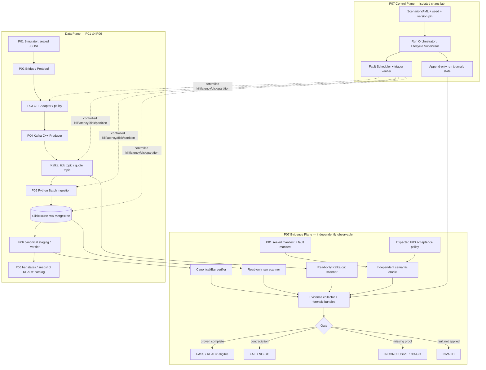
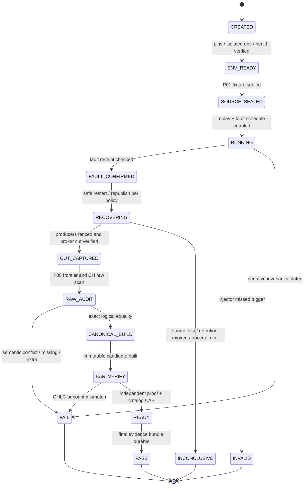

# PROJECT 07 — Deterministic Replay & Failure Recovery

> **System Design + End-to-End Recovery Protocol + Fault/Threat Modeling + 448 What-If Tests**  
> **Dự án 07/09** của *Market Data Streaming and Analytics Platform* · C++20 · Python 3.12 · Kafka · Protobuf · ClickHouse · Linux  
> Phiên bản tài liệu **1.0 — 2026-10-30** · Ngôn ngữ: **Tiếng Việt**  
> **Trạng thái: `DESIGN_ONLY / NOT_IMPLEMENTED / NOT_TESTED / NOT_BENCHMARKED`.** Các giá trị SLO, thời gian phục hồi, ngưỡng tải và kết quả PASS trong tài liệu là **đề xuất kiểm chứng**, không phải kết quả thực tế.

## 0. Phạm vi, nguồn gốc và điều không được ngầm khẳng định

Project 07 được đề xuất sau khi đã có thiết kế P01–P06: **đo, gây lỗi có kiểm soát, phát lại và đối soát** toàn bộ pipeline. CV gốc chỉ xác nhận *deterministic replay* ở adapter và công nghệ/hiệu năng của hệ thống lớn; CV **không nói** đã có Chaos Harness, Recovery Journal, Oracle độc lập hay đúng 448 bài test này. Tất cả là **thiết kế mới để tự xây lại** và kiểm tra khả năng chịu lỗi.

**Câu hỏi cần trả lời:** Sau khi một hoặc nhiều thành phần chết, dữ liệu có bị mất/trùng/sai nghĩa không? Có thể *chứng minh* điều đó với sự kiện theo `dataset_id, symbol, sequence` và bản ghi/bằng chứng ngoài các service đang bị thử hay không? Nếu dữ liệu Kafka đã hết retention, source bị mất hoặc ClickHouse trả về ACK mơ hồ, **không được báo `PASS` chỉ vì services đã lên lại**.

**Ưu tiên:** (1) correctness, (2) không công bố dữ liệu sai, (3) không im lặng khi thiếu chứng cứ, (4) bounded resource & safety, (5) phục hồi, (6) latency/throughput. Không có hữu hạn kịch bản nào bao phủ *mọi* tổ hợp lỗi. Ma trận 448 case là inventory có cấu trúc; property-based, stateful model, mutation, pairwise và random chaos bổ sung lỗ hổng có thể còn lại.

### 0.1. Đối chiếu với bản thiết kế đã có

| Dự án | Hợp đồng đã chốt trong tài liệu P01–P06 | Project 07 phải kiểm chứng |
|---|---|---|
| P01 Simulator | `sim.v1` JSONL, `dataset_id`, `symbol`, `sequence` **theo symbol và xuyên tick/quote**, `event_time_ns` ns UTC, `price_scale`, fixed-point ticks; seed, fault manifest; `.part` không phải dataset hoàn tất | Source manifest sealed, đủ logical slots, source fault policy; reproducible *cùng môi trường/version* |
| P02 Protobuf | `marketdata.v1.MarketDataEvent`, `oneof` tick/quote, `optional` business fields, C++/Python codecs; bridge JSONL→binary; Kafka value **không** có MDP1 prefix | Semantic parity và field-presence parity; không dùng hash của Protobuf bytes để chứng minh logical equality |
| P03 C++ adapter | TCP framing, validation, per-symbol sequence/gap, stale/inactivity, accepted/rejected, bounded queue | Đối chiếu expected accepted/rejected với **oracle độc lập**, không lấy P03 counters tự làm ground truth |
| P04 Kafka | `md.ticks.v1`, `md.quotes.v1`, key=`symbol`; 8 partitions **mỗi topic trong benchmark**; idempotent producer; ACK ambiguity; không có order xuyên topic | Sealed end-offsets theo `(topic_generation, topic, partition)`; physical record + logical identity; producer ACK không đồng nghĩa downstream durability |
| P05 Python ingestion | at-least-once, manual offset commit theo contiguous frontier; raw ClickHouse `md_ingest.market_events_raw` có thể **physical duplicate**; core digest `P05-CORE-V1` | Crash ở mọi bước INSERT/commit; epoch fencing; ambiguous ACK; consistency giữa Kafka log ↔ raw logical dataset |
| P06 Analytics | Raw audit → canonical candidate theo `build_id` → OHLC bars được verify → `READY` catalog; late/correction → build mới | Atomic publish gate về mặt catalog; thử crash/rebuild/version switch; không tính OHLC trực tiếp từ raw duplicates |

**Đường dẫn tài liệu liên quan trong cùng thư mục:** [P01](./PROJECT_01_FX_CFD_Market_Data_Simulator_System_Design.md) · [P02](./PROJECT_02_Market_Data_Protobuf_Schema_System_Design.md) · [P03](./PROJECT_03_CPP_FX_CFD_Market_Data_Adapter_System_Design.md) · [P04](./PROJECT_04_Kafka_Market_Data_Streaming_System_Design.md) · [P05](./PROJECT_05_Python_Kafka_Batch_Ingestion_System_Design.md) · [P06](./PROJECT_06_ClickHouse_Time_Series_Analytics_System_Design.md).

### 0.2. Trong / ngoài phạm vi

**Trong phạm vi:** finite deterministic replay; fault scheduling; safe isolated lab; restart orchestration; Kafka evidence capture; ClickHouse raw/canonical/bar reconciliation; independent oracle; RPO/RTO có phương pháp đo; chaos/stress/soak; recovery runbooks; GO/NO-GO report. **Ngoài phạm vi:** sửa business semantics của P01–P06, tạo live trading signal, tích hợp broker thật, chứng minh HA chỉ từ một Kafka broker/ClickHouse node, mặc định tự khôi phục dữ liệu khi cả source và Kafka đều mất, hay cam kết exactly-once end-to-end. Phục hồi data thật cần precondition lưu bền source/backup độc lập.

---

## 1. Yêu cầu, lời hứa và điều kiện nghiệm thu

### 1.1. Functional requirements

| ID | Yêu cầu | Evidence để PASS |
|---|---|---|
| FR-01 | Replay source finite theo seed/config/dataset manifest cố định | Same semantic expected set, oracle độc lập; hash JSONL cùng env/version nếu P01 hứa bitwise |
| FR-02 | Distinguish **fresh run**, **same-dataset retry**, **restore generation** | Manifest có `dataset_id`, `run_id`, `topic_generation`, cut trước/sau |
| FR-03 | Inject fault chính xác theo event/state/offset/time trigger | Injection receipt + verified target affected + cleanup receipt |
| FR-04 | Kill/restart từng service & broker trong lab cô lập | Stage markers + health + exact recovery frontier, không dựa solely liveness |
| FR-05 | Reconcile source logical ↔ P03 policy ↔ Kafka log ↔ P05 raw ↔ P06 canonical ↔ bars | Identity+semantic/field-presence equality, counts, diff samples, independent computation |
| FR-06 | Phân biệt intentional drop, business reject, transport loss, duplicate, conflict và late event | Category proof với link `fault_id`/policy/version |
| FR-07 | Bắt lỗi ACK ambiguous (producer/CH/offset) | Không suy outcome từ timeout; replay + reconcile → verdict hợp lệ |
| FR-08 | Recovery sau consumer rebalance, worker stale và Kafka retention | Per-TP durable frontier + ownership epoch; missing Kafka range → NO-GO |
| FR-09 | Canonical and OHLC versioned snapshots, no false `READY` | Independent verifier + atomic/single-writer publication receipt |
| FR-10 | Resource isolation và bounded failures | Queue byte cap, cgroup, timeouts, safe shutdown, diagnostics đầy đủ |
| FR-11 | Chạy test deterministic, random và tổ hợp lỗi | Repro bundle: seed, fault sequence, artifact hashes, runtime & broker/DB versions |
| FR-12 | Chạy load/soak/recovery performance có baseline | throughput, backlogs, resource, RTO/RPO definitions, confidence windows |
| FR-13 | Cung cấp runbooks cho incident thực hành | Có restore procedure và rehearsal/rollback evidence |
| FR-14 | Phân loại `PASS/FAIL/INCONCLUSIVE/INVALID/NOT_RUN` | Không chuyển timeout thành PASS/FAIL nếu không phân biệt được state |
| FR-15 | Không làm hỏng máy hoặc dữ liệu ngoài lab | Docker namespace/network/volume allowlist; dry-run destructive actions |
| FR-16 | Handoff cho P08 benchmark và P09 deployment | Machine-readable test catalog + CI gate + reports |

### 1.2. Non-functional targets (chỉ là **proposal**, phải đo)

| ID | Mục tiêu đề xuất | Đo/thẩm định |
|---|---|---|
| NFR-01 | Với finite dataset **đã seal và source/offset còn khả dụng**: `missing=0`, `extra=0`, `conflict=0`, `semantic_mismatch=0` trong READY build | Full identity diff, không chỉ `COUNT(*)` hoặc một sample |
| NFR-02 | `physical_duplicates` có thể >0, nhưng logical canonical phải đúng 1/ID | Group by identity & digest, exact compare oracle |
| NFR-03 | 0 false `READY`; no silent reset to `latest`; 0 untracked drops | Audit guardrail, injected unknown outcome |
| NFR-04 | Fault injection xác minh kích hoạt 100% của **valid** tests | Trigger receipt kèm correlation, nếu injector thất bại → INVALID |
| NFR-05 | Queue và sidecar logs bounded, không OOM trong workload nằm trong memory budget | Memory/FD trend + cgroup pressure; vượt budget → controlled fail |
| NFR-06 | Correctness tests reproducible trên pinned binary/schema/docker image | same semantic diff/expected fault results, lưu hash assets |
| NFR-07 | Phục hồi từ 1 crash đơn lẻ không làm xuất hiện lỗi logic trong ready data | RTO báo riêng theo lab, không đưa số hứa trước khi đo |
| NFR-08 | `120k events/s total` là **capacity challenge** cho lab P07, không phải throughput bảo đảm; CV có **120k ticks/s trên 8 partitions** cho hệ thống tổng | Publish actual rates, tick ratio, hardware, Kafka partition counts, query workload |
| NFR-09 | 0 premature Kafka offset commit theo proven contiguous frontier | Fault at all boundaries + Kafka committed-next-offset proof |
| NFR-10 | Không unbounded retry/replay khi broker/CH không phục hồi | Deadline, retry budget, hold state, alerts và resource guardrail |
| NFR-11 | Recovery RPO từ **verified source cut** bằng 0 logical event khi không có data loss và source còn; nếu source không còn, đánh dấu phạm vi mất | Oracle-based count; RPO không suy từ service restart |
| NFR-12 | Soak test theo lớp 1h → 6h → 24h chỉ khi budget cho phép | Memory slope, leak, backlog slope, disk/parts, audit counters |

### 1.3. Các trường hợp không thể hứa RPO=0

- P01 chỉ có TCP bytes mà **không có immutable source file** và P04 chưa ACK: không có bằng chứng replay được.
- Kafka `retention` đã xóa offset cần thiết và không có source snapshot/backup hoặc upstream republish đã kiểm chứng.
- ClickHouse bị mất volume và backup chưa từng restore thành công, hoặc P06 phụ thuộc raw đã bị TTL xóa trước khi audit.
- Dataset chứa intentional invalid events: `missing` được đo so với **expected accepted set theo policy**, không so với toàn bộ generated events.
- Replication factor 1 hoặc sự cố correlated xóa toàn bộ Kafka replicas; việc reconnect không tái tạo dữ liệu đã mất.

---

## 2. Kiến trúc tổng thể: control plane, data plane, evidence plane



**Control-plane độc lập data-plane**: P07 phải thu chứng cứ từ Kafka/ClickHouse và host, không chỉ tin log P01–P06. **Evidence-plane cần lưu trên volume riêng**; khi P05/CH crash không được khiến journal test mất cùng lúc nếu test đang nhằm xác minh chúng. Ở chaos toàn máy, đưa bản sao receipt ra artifact store khác failure domain hoặc hạ verdict `INCONCLUSIVE` nếu không có bằng chứng.

### 2.1. Module và trách nhiệm

| Module | Trách nhiệm | Không được làm |
|---|---|---|
| `scenario_loader.py` | validate schema, schedule, targets allowlist, seed, expected fault | Parse và thực thi arbitrary shell từ untrusted config |
| `dataset_sealer.py` | verify P01 `.jsonl`/manifest completed, source hash, fault-plan | Chấp nhận `.part` hoặc mutate source để giả pass |
| `acceptance_oracle.py` | chạy independent reference policy của P03 từ source, ghi expected accepted/rejected | Copy output P03 làm expected mà không independently validate |
| `orchestrator.py` | state transitions; start/stop isolated containers; collect logs | Stop/kill resources không mang lab labels |
| `fault_scheduler.py` | trigger theo proof boundary, event key hoặc monotonic elapsed | Chỉ `sleep()` rồi giả rằng đã đánh trúng critical section |
| `injectors/` | process, TCP/net, Kafka, CH disk/time/cgroup faults | Chạy `iptables`, disk wipe hoặc clock change trên host production |
| `kafka_scanner.py` | scan per `topic_generation/topic/TP` đúng `[start,end)` | Sort Kafka offsets của 2 topic và gọi đó là global order |
| `raw_scanner.py` | query P05 raw theo dataset + coordinates; classify duplicate/conflict | Dùng `count()` làm oracle duy nhất |
| `canonical_verifier.py` | exact identity projection against independent expected | Tin MV auto sửa khi raw delete/mutate |
| `bar_oracle.py` | Python reference 1m OHLC from canonical ticks | Coi tick là trade volume; dùng float để tính giá |
| `cut_coordinator.py` | freeze input and capture end offsets after publisher drained, consumer frontiers | Coi `consumer lag=0` là snapshot sealed |
| `proof_ledger.py` | immutable-ish append-only receipts, hash chain, artifact inventory | Coi file hash không có trust root là bằng chứng không thể bị sửa |
| `recovery_coordinator.py` | restart/replay/restore logic + precondition checks | Auto offset reset `latest` hoặc skip unproved holes |
| `verdict_engine.py` | apply invariants/gates, result reason codes | Bỏ qua injector failure, timeout, missing artifacts |
| `reporter.py` | summary + JSON artifacts + versions + benchmark samples | Tự tạo actual PASS/throughput chưa đo |

### 2.2. Deployment profiles và failure domains

- **UNIT / MODEL:** deterministic simulation, fake ACK/offset machines, no Kafka/CH. Chứng minh logic riêng, **không** chứng minh real broker/DB behavior.
- **LOCAL-DEV:** 1 Kafka broker KRaft RF=1 + 1 ClickHouse node, cgroup bounded; kiểm thử crash/replay, **không khẳng định failover/HA**.
- **RELIABILITY-LAB:** 3 Kafka brokers RF=3, minISR=2, 1 hoặc nhiều P05 consumers, ClickHouse replica/Keeper **nếu có HA tests**. Test capacity phải dựa actual topology.
- **CAPACITY-LAB:** pinned versions + 8 partitions/topic, expected set đủ lớn; isolate CPU/disk, monitor Kafka/ClickHouse resource. Tách read load khỏi ingest nếu cần để định vị bottleneck.
- **DISASTER-LAB (optional):** backup store nằm ngoài broker/DB host, cold restore exercise và measured RPO/RTO; không làm trên máy vận hành thật.

---

## 3. Hợp đồng dữ liệu, sequence và phạm vi đối soát

### 3.1. Identity phải nhất quán từ đầu tới cuối

```text
source_identity = (dataset_id, symbol, sequence)
source_order    = sequence within (dataset_id, symbol) across BOTH tick + quote
semantic_core   = dataset_id, symbol, sequence, event_time_ns, price_scale,
                  event_kind, source_schema_version,
                  presence(bid_ticks, ask_ticks, price_ticks) and their integer values
payload_digest  = lowercase SHA256(P05-CORE-V1 canonical encoding of semantic_core)
transport_coord = (kafka_cluster_id, topic_generation, topic, partition, offset)
run_id          = replay attempt identity; NOT part of source_identity
build_id        = P06 snapshot version; NOT part of source_identity
```

Dùng thuật toán canonical digest **chính xác** trong P05: prefix `P05-CORE-V1\0`, string length `uint32_BE`, signed `int64_BE`, `uint8(kind)`, presence byte cho từng optional field, và giá trị fixed-point. P07 phải có implementation **độc lập** so semantic field-by-field và digest, không chỉ so hash do P05 cung cấp. Hash của serialized Protobuf **không phải** canonical identity cross runtime/schema.

### 3.2. Source truth và các expected sets (không circular oracle)

```text
G = logical slots generated by P01 according to sealed manifest
F = intentional fault records, omissions and generated anomalies from P01 fault manifest
A = events an independent P03 policy oracle expects ACCEPT
R = events an independent P03 policy oracle expects REJECT/SUPPRESS
K = physically observed Kafka records in sealed topic/partition offset ranges
W = physically observed P05 raw ClickHouse rows (including duplicates)
C = canonical logical events in a P06 candidate build_id
B = P06 materialized 1m OHLC result for the same build_id

Target correctness (finite, market-valid dataset):
  set(logical(K)) = set(A)       # subject to P04 publish policy, successful publish cut
  set(logical(W)) = set(A)       # duplicates allowed only in physical W, no conflicts
  set(C)          = set(A)       # exactly one canonical row per ID and semantic core
  B               = reference_ohlc(ticks(C))

For intentional faults F:
  expected policy effects tracked explicitly; no requirement that invalid data be published.
```

**Quan trọng:** `K` và `W` không phải *set of raw bytes* mà là tập/multiset physical records có provenance; diff cần xác minh toàn bộ fields (bao gồm optional presence) và không gộp hai `dataset_id`. Một Kafka record không mang `MDP1` TCP prefix. Kafka offset là **metadata theo partition**, không phải source `sequence`. `symbol` làm partition key chỉ bảo đảm affinity **trong topic thế hệ giữ nguyên partition mapping**; không có `total order` xuyên `md.ticks.v1` và `md.quotes.v1`.

**Tiêu chí identity mismatch:** cùng ID + cùng digest = physical retry/duplicate; cùng ID + khác semantic core = **CONFLICT/NO-GO**. Nếu `event_kind` khác nhưng source ID trùng, vẫn là conflict. Mọi equality check thuộc scope `(dataset_id,symbol,sequence)`, không vô tình dedupe chéo dataset hay chéo topic.

### 3.3. Finite snapshot cut: không bị đánh lừa bởi các ACK

1. **P01 sealed:** hash JSONL, confirm `.part` không còn, P01 fault manifest consistent. Ghi source count theo symbol và event_kind; lưu exact oracle accepted set ở evidence store riêng.
2. **P03/P04 flush fence:** ngừng generation/publish mới, chờ producer callbacks terminal với bounded timeout; unresolved ACK là **UNKNOWN**, không coi là not published. P04 publish ledger là evidence phụ trợ, độc lập scan Kafka là quyết định downstream.
3. **Kafka freeze:** sau khi producer fence, capture `topic_generation` và mỗi `(topic,partition)` với `start_offset` và `end_offset_exclusive`; confirm broker high-watermarks ổn định tại thời điểm cut. Capture topic config, partition count và broker cluster ID. Nếu vẫn có writer khác → invalid cut, retry/quarantine.
4. **P05 drain:** mỗi partition phải chứng minh **completed contiguous frontier** đã xử lý đến cut, và sink state/callbacks terminal. Kafka committed offset là *chỉ dấu* chứ không thay exact read-only raw proof.
5. **P06 audit:** raw logical IDs + digest ↔ `A`, duplicates/conflicts; canonical staging ↔ `A`; bars ↔ oracle. Chỉ sau đó `READY` được công bố.
6. **Late/retry sau cut:** không được âm thầm nhập vào READY snapshot; mở `new cut/new build_id`, hoặc flag DIRTY nếu vi phạm frozen snapshot.

Nếu partition offsets đã bị retention xóa, scanner không truy xuất được nguồn; **NO-GO/INCONCLUSIVE** cho cut đó. Nếu có immutable P01 source, có thể **republish vào topic generation mới** và lập cut mới nhưng **không tuyên bố Kafka offsets cũ còn tồn tại**.

### 3.4. Proof level: cần bằng chứng ở từng ranh giới

| Level | Phát biểu hợp lệ | Không đủ để khẳng định |
|---|---|---|
| L0 source generated | P01 tạo payload và manifest | Kafka nhận được |
| L1 producer enqueued | C++ producer nhận vào internal queue | Broker persisted |
| L2 broker-ACKed / independently scanned | Kafka lưu record trong phạm vi cut và scanner thấy | ClickHouse committed |
| L3 sink ACK / raw scan | Raw rows tồn tại theo query+provenance; có thể trùng | Unique logical / correct OHLC |
| L4 canonical reconciled | One logical row per expected source identity với semantic equality | Bar đã publish đúng |
| L5 bars independently verified | OHLC/tick count bằng reference output | Đã backup/restore được |
| L6 READY published | Catalog trỏ immutable verified build, receipt tồn tại | Khả năng HA hay hiệu năng ngoài topology đã thử |

---

## 4. Deterministic replay: định nghĩa chặt và trade-offs

### 4.1. Ba loại reproducibility

1. **Source-bitwise:** cùng P01 implementation, pinned Python/config/seed/t0/fault-plan → JSONL byte stream giống nhau; đối chiếu SHA-256 *file sealed*. Không hứa across Python updates nếu P01 đổi encoding hoặc serialization.
2. **Semantic replay (bắt buộc P07):** C++/Python parse thành cùng semantic core/presence bits; cùng accepted/rejected theo pinned P03 policy; expected Kafka/canonical logical set trùng. Kafka offset, network bytes segmentation, ClickHouse physical part layouts có thể khác.
3. **Temporal replay (best effort):** mô phỏng event-time intervals ở tốc độ factor 0.1x/1x/10x, ghi jitter scheduler. Không đòi hệ điều hành tạo y hệt wall-clock interleaving/consumer scheduling; **semantic identity** mới là oracle chính.

### 4.2. Replay modes và safety

| Mode | Mục đích | Giới hạn |
|---|---|---|
| `source_replay` | P01 JSONL→P02/P03 làm lại không thay field | Chỉ từ **SEALED** dataset; new `run_id`; same `dataset_id` |
| `network_replay` | Reproduce TCP segmentation/drop/stall của adapter | `send()` success không chứng minh receiver processed |
| `broker_replay` | Consumer group mới/seek cut đã ghi; P04 không republish | Tất cả offsets còn retention, use read-only group / isolated topic |
| `republish` | Source immutable vào Kafka generation **mới** khi log cũ hỏng/expired | Ghi new coordinates, không trộn end-offsets của các generation |
| `ingestion_replay` | Re-run P05 từ snapshot Kafka cut để thử dedup/recovery | Raw physical duplicate chấp nhận; canonical vẫn unique |
| `analytics_rebuild` | Staging fresh `build_id`, verify OHLC từ canonical candidate | Không sửa READY build tại chỗ; report link parent build |
| `fault_replay` | Chạy lại cùng fault-plan | Trigger theo logical state/event; race injection có thể nondeterministic → phải lưu actual schedule |

### 4.3. Replay theo sequence không phải theo 2 Kafka topics

P01 sequence theo từng symbol xuyên tick/quote. P04 chia 2 topics; Kafka **không** bảo đảm merge-order giữa topics. Offline oracle cho 1 symbol sắp theo `source.sequence`, dùng `event_time_ns` cho OHLC order (tie-break source sequence). Không kết luận gap từ Kafka tick-only consecutive sequence. Không dùng `ingested_at` để xác định market time. Khi cố tình insert late, phải đối chiếu *event time* và cut status, không đổi event_time để “sửa” test.

---

## 5. Lifecycle, Recovery Journal và các trạng thái không đánh lừa



`PASS` nghĩa **trong điều kiện, workload và fault đã mô tả**, invariants chứng minh đúng. `FAIL` là có phản ví dụ xác nhận. `INCONCLUSIVE` là không đủ khả năng kết luận (source/offset/proof mất, timeout chưa định được outcome). `INVALID` là test không áp dụng được hoặc injector chưa kích hoạt chính xác. `NOT_RUN` khác với cả bốn trạng thái. Cả `INCONCLUSIVE` và `INVALID` đều **NO-GO** nếu test đó là release gate P0.

### 5.1. Recovery journal phải có trạng thái bền

```text
JournalRecord:
  test_case_id, scenario_id, run_id, dataset_id, attempt_id
  parent_run_id?, topic_generation, build_id?, env_fingerprint
  timestamp_monotonic_ns, wall_time_utc_ns, phase, actor, operation
  target_service, target_state_before, intended_fault, observed_fault
  begin_marker, completion_marker, result_code, reason_code
  evidence_artifact_refs[], sha256_prev_entry, sha256_this_entry
```

**Hash-chain chỉ phát hiện sửa đổi khi anchor đáng tin cậy được bảo quản độc lập**; không phải chữ ký số hoặc chống lại người có quyền sửa tất cả artifacts. Journal append-only, commit bằng temp→`fsync(file)`→`rename`→`fsync(parent dir)` cho những marker cần durability POSIX; vẫn phải test filesystem/storage thực tế. Nếu không có independent journal, khoanh vùng proof, không giả rằng dữ liệu surviving reboot là bền.

### 5.2. Exactly-once vs idempotent business outcome

`P04 producer idempotence`, `Kafka offset commit`, `P05 ClickHouse INSERT` và `P06 catalog publish` **không chia sẻ một atomic transaction**. Không gọi đây là exactly-once end-to-end. Mục tiêu là **at-least-once processing + observable physical duplicates + canonical exactly-one logical identity sau independent reconcile** trong bounded sealed snapshot. Với ambiguous INSERT ACK, cùng batch retry có thể xuất hiện nhiều physical rows tùy dedup window/setting; P06 không được tính 2 lần.

### 5.3. Failure point matrix theo stage

| Crash ở đâu? | Side effect có thể đã xảy ra | Phục hồi đúng | Không được làm |
|---|---|---|---|
| P01 trước seal | `.part`/unsealed output | Xóa/quarantine partial, generate lại pinned source hoặc resume có checkpoint proof | Đọc `.part` như complete source |
| P02 đã encode, P03 chưa nhận | TCP bytes chưa complete | Reopen source + reframe | Dựa vào `send()` để skip source |
| P03 accepted, P04 enqueue chưa ACK | Kafka ghi hoặc chưa | Scan Kafka cut, dedupe identity; unresolved ACK → unknown | Retry vô hạn + auto mark success |
| Kafka ACK, P05 chưa poll | Log Kafka bền trong retention envelope | Consumer bắt đầu từ explicit cut start | Reset offset latest cho nhanh |
| P05 đã poll, ClickHouse chưa insert | In-memory batch biến mất | Reconsume từ last committed next offset | Commit batch vì đã decode |
| CH insert succeeded nhưng ACK mất | Raw có thể có rows | Retry bounded, then independent reconcile; idempotent logical projection | Coi timeout = failed / completed một cách chắc chắn |
| CH ACK, Kafka commit chưa ACK | Kafka offset có thể cũ hoặc đã mới | Read broker committed frontier; idempotent reprocess nếu cần | Skip dựa vào local counter |
| Rebalance khi worker còn ghi | Old worker vẫn có side effect | Fencing commit với epoch, do raw audit | Tin epoch chặn được CH side effects |
| P06 canonical staging nửa chừng | Partially built candidate | Mark DIRTY, build mới hoặc staged cleanup có proof | Publish staging build |
| P06 bars MV chưa verified | Partial states/duplicate side effects | Independent bar comparison, rebuild nếu mismatch | Coi INSERT ACK = OHLC đúng |
| READY catalog switch crash | Pointer trước hoặc sau | Read pointer + CAS receipt + immutable build audit | Ghi đè READY build tại chỗ |
| Dữ liệu hết retention | Source Kafka không còn | Khôi phục từ sealed P01 into new generation, rebaseline cut | Dùng old offsets hoặc suy missing=0 |

---

## 6. Fault injection engine: cần đánh trúng **proof boundary**

### 6.1. Trigger DSL (thiết kế đề xuất)

```yaml
scenario_id: p07-ch-ack-ambiguity-001
run_id: generated-by-runner
profile: reliability-lab
source:
  dataset_manifest: fixtures/valid_100k/manifest.json
  expected_sha256: SET_FROM_SEALED_FILE
trigger:
  phase: p05.sink_insert
  match: {topic: md.ticks.v1, partition: 3, first_offset_gte: 10000}
  barrier: after_server_commit_before_client_observes_reply
  max_wait_seconds: 45
fault:
  type: proxy_drop_response
  target: clickhouse_ingest_proxy   # container network ONLY
  duration_seconds: 3
recover:
  method: resume_and_reconcile
  max_seconds: 300
oracle:
  require_fault_receipt: true
  expect_logical_duplicate_count: 0
  allow_physical_duplicates: true
  require_zero_conflicts: true
  require_proven_frontier: true
```

**Giới hạn công cụ:** một TCP proxy không quan sát trực tiếp “server commit” nếu không có CH-side instrumentation/verified query barrier; ví dụ trigger trên chỉ đạt yêu cầu nếu fault harness thực sự có marker chính xác. Nếu không xác nhận đã chặn response *sau* commit, kết luận `INVALID`, không tuyên bố đã thử ambiguous ACK tại boundary đó. Với CI có thể dùng failpoint ở test client/CH test wrapper; với real broker/DB phải có independent evidence.

### 6.2. Các lớp injector và nguyên tắc cô lập

| Loại | Công cụ minh họa | Điều kiện an toàn/evidence |
|---|---|---|
| App process | Docker compose stop/kill, Linux signal trong container | Exact container ID+test label; kill receipt, expected process exit |
| TCP/protocol | Toxiproxy hoặc user-space proxy | Proxy latency/drop/reset receipt + packet counters |
| Kafka availability | Stop 1 broker trong 3-broker lab; restrict broker route | Capture leader/ISR, bootstrap/probe; không đụng broker production |
| Disk | Full **test-only** mounted quota/volume; throttle I/O | `df`, quota, CH/Kafka errors; never fill host root FS |
| CPU/RAM | cgroup CPU quota/`memory.max` cho target container | pressure metrics, process OOM status; artifact collector separate |
| Clock | Logical clock skew ở P01, monkeypatch isolated process; container time namespaces nếu hỗ trợ | Không thay host NTP/time để tiêm lỗi |
| DB behavior | Driver stub / proxy / isolated CH server setting | Distinguish simulated ACK ambiguity and real CH-side effect |
| Schema | Version-pinned P02 descriptor mismatch | Check compiler/runtime, maintain golden fixtures |
| Filesystem | Corrupt **copy** of fixture/backup in disposable volume | Never mutate sealed baseline; pre/post digest |

### 6.3. Fault receipt & test validity gate

```text
fault_confirmed =
  trigger_precondition_verified
  AND intended_target_matched
  AND injection_command_acknowledged
  AND independent_observation_of_effect
  AND timestamp_range_known
  AND injection_cleanup_or_terminal_state_recorded

IF NOT fault_confirmed -> INVALID (never PASS).
IF fault confirmed AND observed invariants violate policy -> FAIL.
IF fault confirmed AND proof unavailable/expired -> INCONCLUSIVE.
IF fault confirmed AND all exact gates proven -> PASS.
```

**Không dùng `sleep(2)` như một boundary proof**. Đối với race windows, dùng failpoint test-only / barrier handshake / causal marker, hoặc ghi tỷ lệ trigger real-world stress nếu injector xác nhận bị tác động. Fault event IDs và version của chính injector là một phần reproducibility bundle.

---

## 7. Recovery, replay và reconciliation protocol (thuật toán tham chiếu)

### 7.1. Stage-by-stage recovery playbook

1. **Freeze & isolate:** khẳng định correct `scenario_id/run_id`; chặn new source writes; acquire single-writer/recovery lock; chụp runtime health, PID, group assignment, Kafka `high watermark`, CH query/error/parts.
2. **Protect evidence:** copy source manifest, config, topic metadata, P05 checkpoint và CH DDL into independent artifact store trước khi làm thao tác phá hủy. Không thay đổi proof trong khi thu thập.
3. **Identify last PROVEN boundary:** dùng P01 sealed set, producer delivery receipts (supporting), Kafka scanner exact `[start,end)`, CH raw scanner, catalog pointer; classify UNKNOWN side effects.
4. **Check replay feasibility:** source file sealed còn không, Kafka offsets còn không, topic generation/version có đúng không, schema/code compatibility, disk/TTL windows đủ không. Nếu thiếu một điều bắt buộc → `INCONCLUSIVE/NO-GO`, không auto reset.
5. **Restart dependencies có thứ tự:** Kafka/CH healthy (no false liveness), P05 consumer assignment acquired, producer reconnect; verify no stale process retaining ownership.
6. **Replay at right boundary:** Prefer Kafka read-from explicit offsets; nếu Kafka lost and sealed source exists, **republish isolated new topic_generation** with new cut; document dedup of logical identities across generations only by explicit recovery policy.
7. **Drain and reconcile:** Kafka→raw sink to frontier; scan raw logical/physical; produce diff reports incl duplicates/conflicts; P06 build new candidate; verify bars from source oracle.
8. **Publish or stop:** only publish READY after all independent checks. Restore old READY pointer on failed build; issue incident with scope and RPO uncertainty.

### 7.2. Pseudocode independent oracle (không phải code đã chạy)

```python
# Domain-level pseudocode. Do not trust application counters as expected truth.
manifest = load_and_verify_sealed_manifest(source_manifest)
source = read_jsonl_exact(manifest)  # include optional-field presence / fixed-point ints
expected = independent_apply_p03_policy(source, manifest.fault_plan, p03_policy_version)
expected_by_id = {event.source_identity: event.semantic_core for event in expected.accepted}
assert len(expected_by_id) == len(expected.accepted)  # conflicts handled before building map

cut = read_verified_kafka_cut(cluster_id, topic_generation, per_partition_offset_ranges)
kafka_records = scan_all_exact(cut)  # full scan, every TP, detect missing offsets
kafka_projection = validate_key_topic_headers_and_decode(kafka_records)
# May contain physical retry duplicates; classify before reducing.
classification = classify(kafka_projection, key='(dataset_id,symbol,sequence)')
assert classification.identity_conflicts == []
assert logical_projection(classification) == expected_by_id

raw_rows = scan_clickhouse_raw(dataset_id=manifest.dataset_id, cut=cut)
assert all_rows_have_verified_kafka_provenance(raw_rows, kafka_records)
assert classify(raw_rows).identity_conflicts == []
assert logical_projection(raw_rows) == expected_by_id

canonical = read_p06_build(build_id, status='CANDIDATE')
assert exactly_one_row_per_id(canonical)
assert semantic_projection(canonical) == expected_by_id
bars_observed = read_bars_for_build(build_id)
bars_expected = independent_integer_ohlc([x for x in expected.accepted if x.kind == 'tick'])
assert bars_observed == bars_expected
publish_ready_only_after_atomic_catalog_gate(build_id, evidence_bundle)
```

Nếu P03 policy quy định intentional suppress, expected Kafka set phải lấy từ policy đó; không đánh giá Kafka là thiếu event P03 đã chủ động từ chối. Nếu muốn so Kafka physical record exact với expected cần xác định hợp đồng publish-duplicate cho P04; nói **logical** sau classify để chấp nhận retry có cùng ID/digest. Với `md.anomalies.v1` test-only phải có oracle khác, không trộn market topics.

### 7.3. Reconciliation outcome taxonomy

| Case | Kết quả | Quyết định |
|---|---|---|
| `expected ID` không có Kafka/canonical | Missing nếu cut proven complete; nếu cut không chứng minh → Unknown | FAIL hoặc INCONCLUSIVE, không READY |
| `actual ID` không thuộc expected | Extra/bad publish | FAIL, quarantine |
| Cùng ID và same semantic core nhiều physical rows | Duplicate retry | Record duplicate count; canonical 1 ID |
| Cùng ID và khác semantic core | Identity conflict | FAIL P0; không chọn min/max/latest |
| Kafka log đủ nhưng raw thiếu | P05 ingestion gap/commit bug | FAIL; test replay feasibility |
| Raw đủ nhưng canonical thiếu | P06 build/audit bug | FAIL; staged rebuild |
| Canonical đúng nhưng bars lệch | OHLC/MV bug | FAIL; rebuild bars; no READY |
| Raw/canonical đã đúng, nhưng source manifest absent | Không có independent expected set | INCONCLUSIVE; không nhận PASS bằng counts |
| Kafka range đã bị retention xóa | Không scan lại được old cut | INCONCLUSIVE/NO-GO old cut; restore new generation nếu có P01 |
| Test injector không đạt condition | Không có bài chaos hợp lệ | INVALID, không sử dụng cho release gate |

### 7.4. RPO, RTO, catch-up math

- **RPO (event-count):** số `expected accepted identities` ở source cut **không thể tái tạo hoặc chứng minh** sau sự cố. Dùng exact source diff, không chỉ “số phút chưa ghi”. RPO=0 chỉ khi recovery source/cut và evidence đầy đủ.
- **RTO-SERVICE:** thời gian từ fault confirmed đến P05/Kafka/CH trở lại phục vụ request health check; **không** phải thời gian hệ thống đã đúng dữ liệu.
- **RTO-CORRECT:** từ fault confirmed tới khi full source cut được reconcile và P06 READY build được publish (hoặc verdict terminal). Đây là metric phục hồi trọng tâm.
- Nếu backlog `B` events khi service khôi phục, tốc độ new arrivals `λ` và processing sustainable `μ`: với `μ > λ`, thời gian catch-up xấp xỉ `B/(μ−λ)` giây (*giả định steady state, cùng units, không tính startup/merge/DB read overhead*); `μ ≤ λ` → backlog **không thể** giảm về 0. Ví dụ **chỉ minh họa**: `B=6,000,000`, `λ=60k/s`, `μ=100k/s` → khoảng **150 s** trước overhead; không phải benchmark thực tế.
- Kafka retention **phải lớn hơn** outage + catch-up + verify + safety buffer và chịu được byte retention/disk pressure; không chỉ so timestamp. Backlog bytes ≈ events × actual encoded record bytes đo được + log overhead/replication.

---

## 8. Resource budgets, safety và degraded modes

| Resource | Lab cap đề xuất | Hành vi bắt buộc khi vượt |
|---|---|---|
| Source fixture | File size tối đa + SHA256 + read-only mount | Reject unsealed/oversize; không thử trên dữ liệu broker thật |
| Protobuf | P05 Kafka `value` ≤4096 B theo contract; P03 framing có cap riêng | Reject/quarantine; không allocate từ untrusted length |
| Per-P05 batch | giới hạn count/bytes/age, in-flight 1/TP trong MVP | Pause/retry/stop, không commit vượt unfinished hole |
| Global queues | giới hạn bytes + count + hysteresis | Pause source/consumer; không silent drop |
| Kafka | `queued.max`, `message.max.bytes`, retention + ISR budget pin | Reject/hold when minISR unavailable, alert, no forced ACK downgrade |
| ClickHouse | `max_memory_usage`, query time/rows, active parts, disk headroom | Admission/limit; no partial result declared complete |
| Fault injection | capped duration, exact allowlisted container IDs | Auto cleanup; missing cleanup receipt → no-go lab |
| Evidence artifacts | quota + metadata/hash catalog; preflight free space | Stop test early and mark INCONCLUSIVE; never silently truncate report |
| Orchestration | max concurrent chaos jobs per failure domain | Deny overlapping unsafe operations unless scenario explicitly models combination |

**Degraded states:** `NORMAL`, `BACKPRESSURED`, `SOURCE_HELD`, `KAFKA_UNAVAILABLE`, `SINK_UNKNOWN`, `REPLAY_REQUIRED`, `AUDIT_REQUIRED`, `READY_BLOCKED`, `NO_GO`. Không có trạng thái “healthy” được suy chỉ từ container Up hoặc HTTP 200. Kafka broker RF=1, CH single-node có thể phục hồi process nhưng không cung cấp HA.

---

## 9. Test philosophy, coverage và evidence standard

### 9.1. Test pyramid

- **Unit:** state machine, source identity, digest/presence, offset frontiers, P03 policy, P06 OHLC tie-break, verdict classifier.
- **Property-based:** repeated replay with random seeds/valid inputs; invariant preserved across mutations and fault sequences; arbitrarily grouped Kafka batches; schedule/model interleavings.
- **Model/stateful:** tiny 1–3 symbol, 1–3 topic partitions, buffer/ACK/commit as nondeterministic transitions; verify `committed_frontier <= completed_contiguous_frontier` and `READY ⇒ reconciled`.
- **Integration:** real pinned Kafka + ClickHouse, stage fault boundary, data diff exact.
- **Chaos:** kill, network partition, disk full, broker leader election, ISR loss, stale worker, ambiguous ACK, conflict and TTL.
- **Stress/soak:** 1k→10k→50k→120k events/s **total input**, then concurrent query and disorder; report sustained vs offered throughput; 1h/6h/24h if resources allow.
- **Security:** hostile byte stream, path traversal in fixture names, untrusted config, resource exhaustion, metric/log cardinality explosion, cross-namespace escape.

### 9.2. Evidence per test case

**Required:** `test_id`, code/schema/version images, `dataset_id/run_id/topic_generation`, seed, fault schedule, injected target and independent fault receipt, Kafka cuts `[start,end)`, P05 frontier, ClickHouse DDL/settings, expected identities, actual identities/digests, physical duplicate/conflict counts, bars comparison, metrics trace, timestamp, `verdict`, reason code, SHA-256 artifact hashes. Logs/counters help diagnosis, nhưng **không thay full reconciliation**.

**PASS:** fault actually applied, preconditions met, exact invariant checks complete, evidence durable and resources within budget.  **FAIL:** proven contradictory data/safety state. **INCONCLUSIVE:** missing/unreadable/expired source or Kafka cut, uncertain client-side ACK not resolved by independent scan, insufficient sample or timeout. **INVALID:** fault never triggered, unexpected test topology, wrong version/target, injector died. **NOT_RUN:** no execution.

### 9.3. Checklist release gate

- P0 phải có 100% valid execution và PASS trên target lab/version; nếu có mandatory P0 `INVALID/INCONCLUSIVE/NOT_RUN` → **NO-GO**.
- P1 phải có planned reliability scope (tối thiểu scenarios theo milestone), zero unresolved correctness regression; waiver ghi owner, rationale, expiry, compensating control.
- P2 performance/scale phải công bố điều kiện máy và rate actual; có thể không đạt target nếu hardware giới hạn, không chỉnh số thành đạt.
- Một `PASS` ở mock không chứng minh PASS trên Kafka/CH thực; report tách unit vs integration vs real-chaos.

---

## 10. WHAT-IF MATRIX — inventory kiểm thử có thể chạy, **448 cases / 32 nhóm**

**Quy ước:** ID `P07-Gxx-NN`; mức **P0**=data loss/silent corruption/false READY/security catastrophic, **P1**=recovery/reliability correctness, **P2**=operational/observability/performance regression. Mỗi row gồm **Fault/What if → reaction oracle → evidence PASS**. Ở bài intentional corruption, PASS có thể là *reject/NO-GO có chứng cứ*, **không** phải data luôn đi qua. `PASS` chỉ khi injection thành công và đủ witness độc lập. Các kịch bản bên dưới chưa chạy (`NOT_RUN`).

### G01. 01 — Source manifest, dataset seal & provenance

Nguồn độc lập là điều kiện tiên quyết; đừng lấy P01 log status làm source-truth không kiểm chứng.

| Test ID | Priority | What if / injection | Expected safe behavior | Independent PASS evidence |
|---|---|---|---|---|
| `P07-G01-01` | **P0** | P01 chết giữa lúc ghi JSONL, còn `.part` | Quarantine partial; không mở cut | File list + seal receipt + refusal reason |
| `P07-G01-02` | **P0** | Manifest ghi 100k nhưng JSONL chỉ 99,999 events | Reject source before Kafka | Count+sha check independent |
| `P07-G01-03` | **P0** | Manifest hash đúng nhưng file JSONL đã bị thay và manifest cũng bị sửa | Phát hiện nếu trust anchor bên ngoài khác; nếu không, INCONCLUSIVE | External pinned digest/anchor |
| `P07-G01-04` | **P0** | `dataset_id` trùng giữa hai source fixtures khác semantic contents | CONFLICT/NO-GO, không trộn nguồn | Source semantic digest inventory |
| `P07-G01-05` | **P1** | Source chứa event duplicate nhưng fault manifest không khai báo | Reject untracked duplicate/identity conflict | Per-ID independent diff |
| `P07-G01-06` | **P1** | Fault manifest khai báo intentional omission nhưng source thực tế vẫn có event | INVALID fixture; không suy transport loss | Logical slots vs fault manifest |
| `P07-G01-07` | **P1** | Source có event sai giá và strict P03 phải reject | Expected accepted loại event đó | Independent policy classification |
| `P07-G01-08` | **P1** | Source bị xóa sau P04 ACK nhưng trước build | Nếu Kafka cut còn đầy đủ thì reconcile được; mất cả hai → INCONCLUSIVE | Kafka full scan + source availability note |
| `P07-G01-09` | **P1** | Một symbol không có event nhưng manifest bảo có | Preflight fail | Per-symbol expected counts |
| `P07-G01-10` | **P1** | Cùng source có tick/quote lặp sequence nhưng khác event kind | Identity conflict, không dựng canonical | `(dataset,symbol,sequence)` projected comparison |
| `P07-G01-11` | **P1** | Manifest dùng timezone local thay UTC | Fail validation, không silently shift ns | UTC/epoch field equality |
| `P07-G01-12` | **P1** | Dataset version P01 đổi mà source manifest ghi version cũ | Reject skew until migration explicitly verified | Schema/config hashes |
| `P07-G01-13` | **P2** | Artifact store đầy khi chụp source | Stop early, evidence incomplete ⇒ INCONCLUSIVE | Disk quota + missing artifact detection |
| `P07-G01-14` | **P2** | Manifest không chứa fault-plan hash nhưng run được gọi fault replay | Mark not reproducible; prevent deterministic claim | Required metadata schema check |

### G02. 02 — Replay seeds, logical time & reproducibility

| Test ID | Priority | What if / injection | Expected safe behavior | Independent PASS evidence |
|---|---|---|---|---|
| `P07-G02-01` | **P0** | Cùng seed/config/t0 và pinned image nhưng JSONL đổi bytes | Source-bitwise regression FAIL | 2 run sha256 comparison |
| `P07-G02-02` | **P0** | Đổi seed nhưng run_id/dataset_id không được phân biệt | Reject identity/run collision | Source identity proof |
| `P07-G02-03` | **P0** | Cùng semantic event nhưng Python Protobuf serialization bytes khác C++ | Semantic replay PASS nếu field parity; không dùng byte hash | Golden semantic oracle |
| `P07-G02-04` | **P0** | Replay 10x làm output khác thứ tự symbol trong raw fixture | Source order violation FAIL | Source sequence per symbol |
| `P07-G02-05` | **P1** | Phát lại nguồn ở wall clock khác | `event_time_ns` giữ nguyên; scheduler elapsed được phép khác | Semantic diff |
| `P07-G02-06` | **P1** | Retry partial replay từ checkpoint ở giữa một symbol | No silent gap or duplicate unexplained | Resume boundary + per-ID set |
| `P07-G02-07` | **P1** | Replay qua 2 machine CPU khác nhau | Semantic set same; jitter/throughput khác được ghi | Cross-host semantic inventory |
| `P07-G02-08` | **P1** | Fault-plan bằng random seeded nhưng một module dùng global RNG khác | Fail reproducibility proof | Re-run same seed, compare fault IDs |
| `P07-G02-09` | **P1** | Replay nhiều dataset trong một process | Không cross-dataset state bleed | Per-dataset sequence/digest diff |
| `P07-G02-10` | **P1** | Replay cùng dataset với new run_id vào topic generation cũ | Quarantine/explicit retry policy | Generation/run manifest |
| `P07-G02-11` | **P1** | Stop rồi resume scheduler sau long pause | Logical clock preserve, không tự thêm timestamps | Event_time sequence proof |
| `P07-G02-12` | **P1** | Event-time đi ngược với source sequence theo fault plan | Deterministic anomaly, P03 policy xử lý nhất quán | Policy oracle diff |
| `P07-G02-13` | **P2** | Replay factor cực nhỏ 0.01x | Bounded timers/resources; no premature success | Duration and memory evidence |
| `P07-G02-14` | **P2** | Replay factor 1000x vượt CPU | Resource-limited backpressure + honest offered/achieved rate | Queue/resource trends |

### G03. 03 — Protobuf, presence, schema skew & semantic digest

| Test ID | Priority | What if / injection | Expected safe behavior | Independent PASS evidence |
|---|---|---|---|---|
| `P07-G03-01` | **P0** | Tick `price_ticks=0` hiện diện vs field absent | Không coi như cùng semantic core; reject invalid presence | Cross-language has-field checks |
| `P07-G03-02` | **P0** | Quote thiếu `ask_ticks` nhưng default 0 | Reject business-invalid, không nhập ClickHouse | C++/Python decoder presence parity |
| `P07-G03-03` | **P0** | C++ encoder schema v1, Python decoder v1.1 | Chỉ cho phép evolution qua compatibility matrix | Descriptor hash + golden fixtures |
| `P07-G03-04` | **P0** | Unknown field bị giữ ở C++ nhưng bỏ khi Python re-encode | Không dựa protobuf bytes/digest để so equality | `P05-CORE-V1` compare |
| `P07-G03-05` | **P1** | Frame chứa truncated Protobuf | Quarantine/reject, không commit accepted event | Decode error + no downstream ID |
| `P07-G03-06` | **P1** | Payload chứa oneof tick và quote bytes cạnh tranh | Parser policy kiểm last-oneof rồi strict validation; test explicit | Typed schema-parse result parity |
| `P07-G03-07` | **P1** | `int64 event_time_ns` vượt phạm vi policy timestamp | Reject, không overflow trong conversion | Boundary fixture + CH absence |
| `P07-G03-08` | **P1** | `price_scale=0` hoặc -1 | Reject before sink | Strict oracle and actual P03/P05 errors |
| `P07-G03-09` | **P1** | C++/Python endian canonical digest khác nhau | FAIL, no canonical publication | Golden digest comparison |
| `P07-G03-10` | **P1** | Semantic digest same ID nhưng khác optional presence bits | Detect conflict, not identical logical core | independent field projection |
| `P07-G03-11` | **P1** | Protobuf schema tag đổi kiểu không compatible | Block release/rollback | Descriptor compatibility CI |
| `P07-G03-12` | **P1** | Encoded Kafka value chứa MDP1 TCP prefix | Reject topic value, no false parse accepted | Raw Kafka decode verifier |
| `P07-G03-13` | **P2** | Deeply nested/oversize crafted payload | Bounded reject and memory cap | Parser/CPU/RSS trace |
| `P07-G03-14` | **P2** | Cùng known semantic fields nhưng unknown fields khác | Policy flags version-skew; no stable Protobuf hash claim | Descriptor/presence and unknown-field report |

### G04. 04 — TCP segmentation, framing & stream replay

| Test ID | Priority | What if / injection | Expected safe behavior | Independent PASS evidence |
|---|---|---|---|---|
| `P07-G04-01` | **P0** | TCP gửi length header thành 4 đoạn 1 byte | Framer ghép đúng, không mất event | Wire fixture vs decoded semantic set |
| `P07-G04-02` | **P0** | Socket close khi payload còn thiếu 1 byte | Reject truncated frame; không output partial event | Frame-level error and source diff |
| `P07-G04-03` | **P0** | Length prefix quảng cáo 4 GiB | Reject before allocation per P03 cap | Peak RSS and reject receipt |
| `P07-G04-04` | **P0** | Header MDP1 sai magic/version | Fail closed; không resync tùy tiện | Decoder state trace |
| `P07-G04-05` | **P1** | Hai frames dính chung một read() | Decode cả hai đúng một lần | Event ID cardinality |
| `P07-G04-06` | **P1** | Một frame split thành 100 reads | Decode đúng một lần, bounded buffer | Byte-level harness |
| `P07-G04-07` | **P1** | TCP duplicate application frame sau reconnect | P03 classification theo source ID, no hidden double publish | P03/Kafka logical diff |
| `P07-G04-08` | **P1** | TCP reconnect sau P03 accepted nhưng P04 chưa enqueue | Recovery có source replay và scan; else unknown | P03 acceptance vs Kafka cut |
| `P07-G04-09` | **P1** | Slow reader làm P01 TCP queue đầy | Bounded queue/backpressure; explicit loss if selected policy | Queue bytes and result |
| `P07-G04-10` | **P1** | `send()` trả success nhưng receiver crash | Không coi delivered downstream | Receiver+Kafka proof absent |
| `P07-G04-11` | **P1** | Client kết nối nửa vời không gửi header | Timeout, bounded connection budget | FD/time trace |
| `P07-G04-12` | **P1** | Malicious frame làm parser resynchronization ra event giả | No synthetic market event accepted | Full stream negative fixtures |
| `P07-G04-13` | **P2** | TCP fd bị tái sử dụng sau reconnect | Connection generation reset isolation | Session IDs and event-set diff |
| `P07-G04-14` | **P2** | Restart P03 giữa handshake và first frame | No false accepted event | Stage/handshake log + Kafka scan |

### G05. 05 — P03 sequence tracker, acceptance policy & gaps

| Test ID | Priority | What if / injection | Expected safe behavior | Independent PASS evidence |
|---|---|---|---|---|
| `P07-G05-01` | **P0** | Source per-symbol sequence 1,2,4 có intentional 3 omission | Gap flagged, expected publish follows explicit policy | Reference policy vs P03/Kafka |
| `P07-G05-02` | **P0** | Source 1,2,2 cùng digest | Duplicate suppressed or test-lane per policy | Expected accepted vs Kafka ID multiset |
| `P07-G05-03` | **P0** | Source same sequence but different tick prices | Conflict/reject, no silent overwrite | Full semantic diff |
| `P07-G05-04` | **P0** | P03 accepts malformed price despite strict rule | FAIL upstream policy, no READY | Independent acceptance oracle |
| `P07-G05-05` | **P1** | Tick/quote share one sequence counter; tick-only view 1,3,5 | Không gọi Kafka tick-only gap là transport loss | Cross-topic merged source sequence |
| `P07-G05-06` | **P1** | Two symbols both have sequence 1 | Không dedupe chéo symbol | Identity tuple exact |
| `P07-G05-07` | **P1** | Two datasets both have EURUSD seq 1 | Không dedupe chéo dataset | Dataset scoped scans |
| `P07-G05-08` | **P1** | Sequence reordered within bounded late window | Log late/reorder and policy correctly | Oracle classification trace |
| `P07-G05-09` | **P1** | Sequence very near Int64 max | Controlled boundary failure, no wrap into negative | Input/decoded invariants |
| `P07-G05-10` | **P1** | Sequence resets after P01 restart but same dataset_id | Detect invalid reset/conflict | Per-symbol monotonic oracle |
| `P07-G05-11` | **P1** | One sequence gap only noticed at end of finite dataset | Incomplete stream flagged per expected fault | Expected slots / observed trace |
| `P07-G05-12` | **P1** | Sequence 0/missing optional field | Reject no implicit default value | Presence/sequence check |
| `P07-G05-13` | **P2** | P03 policy version changed mid-replay | Invalidate expected-set proof or split versioned cut | Policy hash in run ledger |
| `P07-G05-14` | **P2** | P03 tracks gap indefinitely and memory increases | Bounded window with explicit unresolved gap counter | Soak RSS and gap summary |

### G06. 06 — Stale quotes, event time & feed inactivity

| Test ID | Priority | What if / injection | Expected safe behavior | Independent PASS evidence |
|---|---|---|---|---|
| `P07-G06-01` | **P0** | Quote timestamp stale 10s nhưng source arrival mới | Classify event-time stale correctly | Clock policy + event timestamps |
| `P07-G06-02` | **P0** | No quote arrives 10s but last event-time was fresh | Feed inactivity separate from stale | Heartbeat vs payload trace |
| `P07-G06-03` | **P0** | NTP clock jumps backward on harness host | Logical monotonic durations, no false success | Clock skew injection receipt |
| `P07-G06-04` | **P0** | Event timestamp 1ns difference lost in cast ms | Fail semantic equality / reject conversion | Int64 ns field-by-field |
| `P07-G06-05` | **P1** | Cross-midnight UTC event with local +07 host | Correct UTC event date and bar boundary | Calendar fixture |
| `P07-G06-06` | **P1** | Future-dated timestamp > configured skew | Reject/flag per policy | Independent time oracle |
| `P07-G06-07` | **P1** | Out-of-order event-time but increasing source sequence | Log policy effect; no forced ascending time rewrite | Source field equality |
| `P07-G06-08` | **P1** | Late quote arrives after snapshot sealed | New cut/rebuild if admitted; READY unchanged | Build/pointer audit |
| `P07-G06-09` | **P1** | Stale quote and sequence gap occur together | Both flags retained; reason not overwritten | Multi-anomaly verdict |
| `P07-G06-10` | **P1** | Feed silence caused by Kafka broker outage, not P01 | Separate source vs downstream inactivity | Stage timestamps+health |
| `P07-G06-11` | **P1** | Large wall-time timeouts while logical replay paused | No drift of event_time; proper timeout/cancel | Deadline/journal trace |
| `P07-G06-12` | **P1** | Timestamp near Int64 ns limit | Fail range preflight, no overflow | Edge fixture and CH rejection |
| `P07-G06-13` | **P2** | Leap-second string in P01 config not understood | Reject or documented normalization, never silent timezone change | Source config validation |
| `P07-G06-14` | **P2** | Two ticks same `event_time_ns` different sequence | OHLC tie-break `(time_ns,seq)` deterministic | Reference bar diff |

### G07. 07 — C++ Kafka producer enqueue, ACK & retry ambiguity

| Test ID | Priority | What if / injection | Expected safe behavior | Independent PASS evidence |
|---|---|---|---|---|
| `P07-G07-01` | **P0** | Producer enqueue succeeds, process SIGKILL before delivery callback | Unknown publish status; scan Kafka cut | Kafka independent record scan |
| `P07-G07-02` | **P0** | Broker writes record but response lost | No `timeout=not written`; classify duplicate on retry | Broker log + attempt ID |
| `P07-G07-03` | **P0** | Idempotent producer restarted with new PID and re-publishes same source | Physical duplicate allowed, logical canonical unique | Kafka multisets + P06 proof |
| `P07-G07-04` | **P0** | Delivery callback success but disk/source manifest unsealed | No full pipeline PASS | Source seal + cut mismatch |
| `P07-G07-05` | **P1** | Out-of-order callbacks within producer queue | Per-record delivery ledger correct; no callback order assumption | Correlated IDs/attempts |
| `P07-G07-06` | **P1** | Queue full on sustained burst | Bounded rejection/backpressure; not silent drop | Queue and produced vs ACKed |
| `P07-G07-07` | **P1** | `acks=0` accidentally configured for reliability test | Preflight NO-GO (must pin acks/all/ISR profile) | Effective producer config |
| `P07-G07-08` | **P1** | `enable.idempotence` toggled false under upgrade | Config gate catches regression | Effective settings snapshot |
| `P07-G07-09` | **P1** | Producer retries after timeout into wrong topic | Reject topic-kind and no market pollution | Kafka scanner |
| `P07-G07-10` | **P1** | Producer retries with altered payload same source identity | Conflict FAIL (not dedup) | Per-ID digest compare |
| `P07-G07-11` | **P1** | Multiple owners publish same symbol concurrently | Detect order/ownership risk; no false sequence assertion | Partition ordered sequence trace |
| `P07-G07-12` | **P1** | Unresolved in-flight messages at P07 cut time | Cut INVALID/INCONCLUSIVE, not fenced | Producer in-flight and broker-scan proof |
| `P07-G07-13` | **P2** | Delivery reports overflow log/evidence buffer | Data path bounded + count lost receipts ⇒ inconclusive | Delivery callback counter cross-check |
| `P07-G07-14` | **P2** | Timeout budget too short relative to leader election | Retry controlled, result measured; no false fail-not-written | Broker state and eventual scan |

### G08. 08 — Kafka keys, partitions, topology and cross-topic ordering

| Test ID | Priority | What if / injection | Expected safe behavior | Independent PASS evidence |
|---|---|---|---|---|
| `P07-G08-01` | **P0** | Null Kafka key on tick event | Reject before producer, never random-route | Raw key scanner |
| `P07-G08-02` | **P0** | Key lower-case but message `symbol=EURUSD` | Strict mismatch reject/quarantine | Value/key equality |
| `P07-G08-03` | **P0** | Partition count increased from 8 to 16 mid-dataset | Generation cut required; no order guarantee across remap | Topic metadata and generation ledger |
| `P07-G08-04` | **P0** | Consumer tries to order tick+quote by Kafka offsets | Oracle catches cross-topic incorrect order | Per-symbol source seq reconstruction |
| `P07-G08-05` | **P1** | `md.ticks.v1` contains quote oneof | Reject topic-kind mismatch | Kafka raw decode audit |
| `P07-G08-06` | **P1** | Same symbol spread across partitions by partitioner configuration drift | Detect routing invariant broken | Symbol→TP map histogram |
| `P07-G08-07` | **P1** | New dataset reuses source seq 1 | Maintain scoped identity, not dedupe across datasets | Dataset keyed diff |
| `P07-G08-08` | **P1** | Cross-topic tick-only source seq jumps due to quote | Not treated as missing Kafka tick | Merge source expected ids |
| `P07-G08-09` | **P1** | Topic generation string reused after recreation | Reject cluster/topic identity ambiguity | Cluster ID + creation epoch manifest |
| `P07-G08-10` | **P1** | Compaction enabled on tick history topic | Preflight NO-GO: logs can lose historical keyed events | Effective cleanup.policy |
| `P07-G08-11` | **P1** | Partition offline while others healthy | Preserve partial cut per TP, no global success | Per-TP offsets/health |
| `P07-G08-12` | **P1** | One topic has extra external writer | Cut contaminated; quarantine non-expected dataset | Identity + writer/ACL audit |
| `P07-G08-13` | **P2** | Producer partitioner hash changes on library upgrade | Golden mapping gate / generation switch | Known key→partition fixtures |
| `P07-G08-14` | **P2** | Tick topic partitions=8, quote partitions=4 unexpectedly | Profile mismatch invalidates benchmark | Topic config and throughput report |

### G09. 09 — Kafka broker, leader, ISR & cluster failure

| Test ID | Priority | What if / injection | Expected safe behavior | Independent PASS evidence |
|---|---|---|---|---|
| `P07-G09-01` | **P0** | Leader broker SIGKILL immediately after durable append, before ACK | Recovery classifies unknown ACK; no loss claim without scan | Old/new leader log compare |
| `P07-G09-02` | **P0** | 3-broker RF=3 cluster loses one broker | Continue only if ISR/minISR condition satisfied | ISR timeline+publish probe |
| `P07-G09-03` | **P0** | minISR drops below configured 2 | `acks=all` publish fails/holds, no forced weaker durability | Effective config+error codes |
| `P07-G09-04` | **P0** | Two brokers unavailable concurrently | No HA guarantee; stop safely; no fake publish success | Quorum state and unpublished list |
| `P07-G09-05` | **P1** | Broker leader changes while producer requests in-flight | Retry bounded, per-key order policy verified | Partition logs + source seq |
| `P07-G09-06` | **P1** | Controller election stalls > timeout | RTO measured; no data declared delivered until proof | Cluster health and ACK ledger |
| `P07-G09-07` | **P1** | Disk full on leader broker | Controlled errors, retention & recovery audit | Broker disk/log status |
| `P07-G09-08` | **P1** | Broker returns NotEnoughReplicas but producer callback mislabels success | FAIL transport proof | Error classification + Kafka scan |
| `P07-G09-09` | **P1** | Network split isolates producer from leader but broker remains up | Backpressure; bounded queues; recover cut when connected | Network/queue/broker evidence |
| `P07-G09-10` | **P1** | Broker alive but log directory corrupted in lab | No optimistic replay; restore/republish if source exists | Broker recovery audit |
| `P07-G09-11` | **P1** | Broker clock differs from simulator event-time | No rewrite of source event_time_ns | Protobuf data equality |
| `P07-G09-12` | **P1** | Broker changes advertised listeners/DNS during restart | Reconnect or clear failure within budget | Client DNS/reconnect trace |
| `P07-G09-13` | **P2** | Slow follower creates persistent ISR churn | Retry and load shedding; expose sustained lag | ISR time-series and backlog |
| `P07-G09-14` | **P2** | Broker rolled while controller quorum reduced | No HA claims from liveness alone | Controller quorum+partition availability |

### G10. 10 — Kafka retention, offset range & replay feasibility

| Test ID | Priority | What if / injection | Expected safe behavior | Independent PASS evidence |
|---|---|---|---|---|
| `P07-G10-01` | **P0** | Retention deletes oldest required Kafka offset | Explicit NO-GO for old cut, never reset silently | earliest vs requested start per TP |
| `P07-G10-02` | **P0** | `auto.offset.reset=latest` on new group in recovery | Preflight fail; require explicit start offsets | Effective consumer config |
| `P07-G10-03` | **P0** | Kafka raw log compacted due to wrong cleanup policy | Detect missing expected identities; no hidden acceptance | Scanner + topic configuration |
| `P07-G10-04` | **P0** | Kafka log truncated due to storage failure | Source restore only via new generation and independent compare | Missing-coordinate proof |
| `P07-G10-05` | **P1** | Topic deleted/recreated with same name | Reject old coordinates without generation identity | Cluster/topic generation record |
| `P07-G10-06` | **P1** | Old consumer committed offset expired | Use sealed cut and exact seek; no implicit newest | Broker group offsets vs cut |
| `P07-G10-07` | **P1** | One of 16 topic-partitions has retention expired | NO-GO full snapshot even if 15/16 complete | Per-TP scan coverage |
| `P07-G10-08` | **P1** | Retention time > downtime but byte retention triggers early deletion | Detect via earliest offsets, not time alone | `retention.bytes` & offset availability |
| `P07-G10-09` | **P1** | Broker high-watermark moves during cut (rogue writer) | Cut invalid, refence writers and recapture | Two adjacent HW observations |
| `P07-G10-10` | **P1** | Offset start is negative/greater than end | Reject manifest before consumption | Cut schema validation |
| `P07-G10-11` | **P1** | Consumer reaches end offset but P05 has in-flight inserts | No seal until sink frontier proven | Per-TP unfinished queue state |
| `P07-G10-12` | **P1** | Kafka transaction visibility/isolation mismatch | Read with pinned isolation level; proof eligible only for committed visibility | Transaction/LSO probe |
| `P07-G10-13` | **P2** | Replay uses cut from another Kafka cluster ID | Reject mismatched provenance | Cluster ID validation |
| `P07-G10-14` | **P2** | Long recovery replay takes longer than retention safety margin | Admission warning/stop early; report unrecoverable risk | Forecast catch-up vs earliest progression |

### G11. 11 — Consumer group rebalance, assignment epoch & stale workers

| Test ID | Priority | What if / injection | Expected safe behavior | Independent PASS evidence |
|---|---|---|---|---|
| `P07-G11-01` | **P0** | P05 rebalance after async INSERT sent, before callback | Old worker may still insert; fenced commit + raw dedup proof | Epoch and CH rows |
| `P07-G11-02` | **P0** | Partition lost callback fires after new owner inserted | Do not commit old ownership; conflict-free canonical required | on_lost + committed offsets |
| `P07-G11-03` | **P0** | New member joins while batch unfinished | Pause/drain/epoch gate, contiguous frontier only | Per-TP job status |
| `P07-G11-04` | **P0** | Consumer crashes before first offset commit | Re-read from intended cut start; no silent latest | Broker committed next offset |
| `P07-G11-05` | **P1** | `max.poll.interval.ms` elapsed during slow insert | Rebalance handled, no commit stale frontier | Assignment generation trace |
| `P07-G11-06` | **P1** | Two workers process same TP during transition | Physical duplicates may appear; logical canonical remains one | In-flight worker and raw rows |
| `P07-G11-07` | **P1** | Consumer falsely reports partition retained on on_revoke | Hard fencing; no commit after revoke | Commit rejection and reason |
| `P07-G11-08` | **P1** | Worker returns success callback after poll owner shutdown | No offset commit, audit external side effect | Journal timestamp + CH scan |
| `P07-G11-09` | **P1** | Group coordinator unavailable during commit | Unknown broker commit until read back; retry safely | Broker group committed frontier |
| `P07-G11-10` | **P1** | Consumer group static membership ID collision | Fail ownership / do not run two owners | Rebalance/fencing logs |
| `P07-G11-11` | **P1** | Cooperative rebalance revokes subset only | Preserve other TP in-flight without global bad commit | Per-TP owner and proof |
| `P07-G11-12` | **P1** | Consumer uses same group for independent verifier | Isolation failure, verdict INVALID | Verifier group.id isolation |
| `P07-G11-13` | **P2** | Consumer group assignment oscillates under churn | Bounded restart/backoff, collect rebalance rate | Group timeline / RSS |
| `P07-G11-14` | **P2** | Consumer restart with different rebalance protocol version | Version gate and regression proof | Effective protocol and E2E sample |

### G12. 12 — P05 batches, worker queues & partial progress

| Test ID | Priority | What if / injection | Expected safe behavior | Independent PASS evidence |
|---|---|---|---|---|
| `P07-G12-01` | **P0** | Crash after batch constructed but before ClickHouse send | Reconsume, no premature commit | Kafka frontier+raw absence/presence |
| `P07-G12-02` | **P0** | Batch contains 100 offsets but one middle record invalid | Stop/quarantine per explicit policy, do not commit past hole | Per-offset completion bitmap |
| `P07-G12-03` | **P0** | Batch spans two topic-partitions despite MVP isolation requirement | Reject configuration/mutation | Batch record coordinates |
| `P07-G12-04` | **P0** | Batch row ordering differs from Kafka poll order | Proven per-TP frontier remains correct | Source sorted offsets |
| `P07-G12-05` | **P1** | Partial batch flush succeeds after timer fires during rebalance | Epoch-fenced commit, raw audit | Batch state transitions |
| `P07-G12-06` | **P1** | Sink worker returns success after batch timeout canceled | Treat side-effect UNKNOWN unless verified | CH readback/digest |
| `P07-G12-07` | **P1** | Global queue budget hit while partitions are paused | No unbounded prefetch growth | Queue bytes + consumer pause trace |
| `P07-G12-08` | **P1** | Worker queue exhausted, consumer still polling messages | Backpressure, no offset store/commit ahead | Cached records and frontier |
| `P07-G12-09` | **P1** | Batch has same ID twice due source retry | Two physical rows allowed, logical dedup canonical | Input batch vs CH raw |
| `P07-G12-10` | **P1** | Batch age deadline triggers flush under low input | No starvation; correct contiguous frontier | Flush-time + offset proof |
| `P07-G12-11` | **P1** | One TP stuck while others advance | Isolation per TP; no global fake completeness | Per-TP lag and end offsets |
| `P07-G12-12` | **P1** | Batch size configured larger than memory cap | Fail config preflight | Memory budget schema check |
| `P07-G12-13` | **P2** | Too-small batch generates CH parts storm | Throttle/admission, no uncontrolled part growth | `system.parts` trend |
| `P07-G12-14` | **P2** | Too-large batch causes memory spikes | Bounded split/retry and correct identity consistency | RSS/CH insert metrics |

### G13. 13 — ClickHouse INSERT ACK ambiguity & server visibility

| Test ID | Priority | What if / injection | Expected safe behavior | Independent PASS evidence |
|---|---|---|---|---|
| `P07-G13-01` | **P0** | CH server commits block; proxy drops response | UNKNOWN client state; retry/reconcile, no early commit | CH query proof + batch IDs |
| `P07-G13-02` | **P0** | CH rejects block before write but client times out | Recover without assuming side effect | Server query log + raw scan |
| `P07-G13-03` | **P0** | CH accepts part of dependent MV update and request fails | Bars never READY without independent proof | Raw/canonical/bar diff |
| `P07-G13-04` | **P0** | Async INSERT returns enqueue ACK, not durable visibility per configuration | ACK semantics pinned, no false sink-complete | Effective CH settings + visibility scan |
| `P07-G13-05` | **P1** | CH timeout after 10 attempts; rows may exist | INCONCLUSIVE until scan, never count as clean failure | Retry ledger+CH raw audit |
| `P07-G13-06` | **P1** | Client connection dies during INSERT payload upload | Possibly no/partial request; replay with dedup aware audit | Network receipt + raw scan |
| `P07-G13-07` | **P1** | Server restarts immediately after ACK | Verify persistence after restart before READY | CH raw and part scan |
| `P07-G13-08` | **P1** | INSERT into wrong database/table but returns success | Schema/table preflight & source-to-raw proof catches | `system.tables` + dataset scan |
| `P07-G13-09` | **P1** | Driver auto-retries hidden under app retry | Detect physical duplicates, record attempts | Driver settings and raw rows |
| `P07-G13-10` | **P1** | `insert_deduplication_token` reused for different batch | Block config; no accidental dropping valid events | Batch IDs and CH settings |
| `P07-G13-11` | **P1** | Non-replicated MergeTree dedup window default 0 | Expect physical duplicates, canonical still exact | Effective table setting + duplicate count |
| `P07-G13-12` | **P1** | Dedup window expires before delayed retry | Physical duplicates possible; never naïve OHLC count | Raw physical multiset vs C |
| `P07-G13-13` | **P2** | Same block data encoded in new row order on retry | Dedup assumptions invalid; logical correctness still mandatory | Batch fingerprint + raw audit |
| `P07-G13-14` | **P2** | CH schema migration mid-insert changes type | Block/rollback migration until versioned test | DDL version + field-presence diff |

### G14. 14 — Kafka offset commits, ordering & atomicity gaps

| Test ID | Priority | What if / injection | Expected safe behavior | Independent PASS evidence |
|---|---|---|---|---|
| `P07-G14-01` | **P0** | Offset `next=101` committed before offset 100 sink ACK | FAIL: unprocessed hole skipped | Commit vs contiguous completed frontier |
| `P07-G14-02` | **P0** | CH ACK returned, Kafka commit fails | Reprocess allowed, logical canonical unique | Broker committed next offset + duplicates |
| `P07-G14-03` | **P0** | Kafka commit request ACK lost after server committed | Read back broker state; no assumption | Group offset query post-restart |
| `P07-G14-04` | **P0** | Async commit responses reordered 101/102 | Do not regress frontier or skip known holes | Commit request/response sequence |
| `P07-G14-05` | **P1** | Consumer auto-commit accidentally enabled | Preflight NO-GO; no processing before commit | Effective config |
| `P07-G14-06` | **P1** | Commit for revoked TP succeeds from stale epoch bug | FAIL ownership violation | Group generation and committed log |
| `P07-G14-07` | **P1** | Kafka offset committed for another topic partition | Immediate NO-GO/diff by exact TP | Commit metadata map |
| `P07-G14-08` | **P1** | Commit from poll worker not poll owner | Reject API misuse / ownership assert | Thread trace in test |
| `P07-G14-09` | **P1** | P05 crash after CH ACK before commit | Duplicate reconsume expected, logical canonical one | Restart offset + CH raw duplicates |
| `P07-G14-10` | **P1** | Commit offset from max processed instead of contiguous frontier | Hole unit model FAIL, production gate NO-GO | Per-offset bitmap |
| `P07-G14-11` | **P1** | Consumer group deleted/recreated with same name | Explicit cut starts mandatory, no silent reset | Broker metadata & replay IDs |
| `P07-G14-12` | **P1** | Manual seek past expected Kafka cut without approval | Reject skip and emit alert | Position vs expected ranges |
| `P07-G14-13` | **P2** | Offset stored in external checkpoint with stale schema | Reject/repair with verified broker state | Checkpoint version/coordinate diff |
| `P07-G14-14` | **P2** | Commit retry storm overloads coordinator | Bounded retry/deadline; no false success | Requests rate and group health |

### G15. 15 — Idempotency, duplicates & retries across all layers

| Test ID | Priority | What if / injection | Expected safe behavior | Independent PASS evidence |
|---|---|---|---|---|
| `P07-G15-01` | **P0** | Same source ID republished 3 times with same semantic digest | Canonical 1 logical row; track 3 physical records | Exact source/Kafka/raw/C compare |
| `P07-G15-02` | **P0** | Same source ID republished once with altered quote ask | CONFLICT/NO-GO, not 'last write wins' | Digest and full-field diff |
| `P07-G15-03` | **P0** | CH reinsert same Kafka coordinate after timeout | Physical duplicate acceptable; logical not doubled | Raw TP coordinate count |
| `P07-G15-04` | **P0** | Kafka producer retries with new producer session | Source-level identity classifies duplicates | Per-ID Kafka multiset |
| `P07-G15-05` | **P1** | P05 receives duplicate from separate consumer restart | No incorrect offset skipping; canonical one | Pre/post committed frontier |
| `P07-G15-06` | **P1** | P06 canonical staging accidentally built twice same build ID | Staging DIRTY/rebuild or idempotent verified path | Candidate rows per ID |
| `P07-G15-07` | **P1** | Materialized view receives same source IDs twice | Bar fails proof if double counted; reject READY | Independent tick_count/OHLC |
| `P07-G15-08` | **P1** | Duplicate `dataset_id` across two independent test runs | Run policy isolates attempt, source identity explicit | Run manifest and source digests |
| `P07-G15-09` | **P1** | Duplicate event with bytewise-different but semantically equal Protobuf | Same logical event if known schema/presence equal | Semantic projection, not bytes |
| `P07-G15-10` | **P1** | Duplicate event with one optional field absent vs explicit zero | Conflict, do not dedupe | Presence-aware P05-CORE-V1 |
| `P07-G15-11` | **P1** | Replay over existing Kafka topic without new generation manifest | Reject or explicit idempotent replay policy | Topic-generation cut receipts |
| `P07-G15-12` | **P1** | Retry budget unlimited under CH down | Cap retries and hold source; no OOM | Attempt count, queue, CPU |
| `P07-G15-13` | **P2** | Backfill overlaps live ingestion same source dataset | Segregate cuts/builds; no accidental extra READY rows | Build lineage and identity scan |
| `P07-G15-14` | **P2** | `ReplacingMergeTree` background merge assumed immediate dedup | Correctness gate requires explicit canonical verification | Before/after merges row diff |

### G16. 16 — Semantic identity conflicts & malformed records

| Test ID | Priority | What if / injection | Expected safe behavior | Independent PASS evidence |
|---|---|---|---|---|
| `P07-G16-01` | **P0** | Same `(dataset,symbol,seq)` tick and quote variants | P0 conflict; no arbitrary selected row | Event-kind digest diff |
| `P07-G16-02` | **P0** | Same source ID but price differs by one fixed-point tick | P0 conflict even if formatted decimal looks same | Integer comparison |
| `P07-G16-03` | **P0** | Same ID/event-time but `price_scale` changes | P0 conflict; no mixing OHLC scales | Scale audit and semantic oracle |
| `P07-G16-04` | **P0** | Same source ID but `source_schema_version` differs | Policy-version conflict/reject unless migration proved | Core field diff |
| `P07-G16-05` | **P1** | Kafka header dataset differs from value dataset | Reject/quarantine, no accepted sink event | Header vs protobuf validation |
| `P07-G16-06` | **P1** | Key `EURUSD`, protobuf symbol `GBPUSD` | Reject, no cross-symbol misroute | Raw Kafka key/value check |
| `P07-G16-07` | **P1** | Protobuf unknown variant interpreted as tick | Fail closed, no type guessing | Descriptor oneof validation |
| `P07-G16-08` | **P1** | P05 payload digest corrupted but raw values unchanged | Independent recompute detects mismatch | P05-CORE-V1 recompute |
| `P07-G16-09` | **P1** | Two physically different Kafka coords map to same logical ID/digest | Classify physical duplicate, no conflict | Coordinate/digest multimap |
| `P07-G16-10` | **P1** | Negative price injected intentionally into isolated fault topic | Strict market topic empty for that event | Test manifest and Kafka scan |
| `P07-G16-11` | **P1** | Malformed UTF-8 `dataset_id` in payload | Reject, no hash collision through normalization | Decoder error trace |
| `P07-G16-12` | **P1** | Very long symbol value/metric label | Reject cap; avoid high-cardinality metrics | Payload bytes and metric series count |
| `P07-G16-13` | **P2** | Canonical implementation changes string normalization | No silent canonicalization; fail golden fixtures | C++/Python canonical binary samples |
| `P07-G16-14` | **P2** | Conflicting rows arrive after READY published | Preserve prior immutable READY; mark new dataset/build DIRTY | Catalog pointer and audit |

### G17. 17 — P06 raw audit, canonical set & snapshot-cut integrity

| Test ID | Priority | What if / injection | Expected safe behavior | Independent PASS evidence |
|---|---|---|---|---|
| `P07-G17-01` | **P0** | Raw physical count matches expected but one missing/one extra identity | FAIL; count equality insufficient | Full ID-set symmetric difference |
| `P07-G17-02` | **P0** | Raw has duplicate same ID and missing another | FAIL completeness despite equal row count | Physical multiset vs oracle |
| `P07-G17-03` | **P0** | Raw has right IDs but bid/ask values swapped | Semantic FAIL, no publish | Field-by-field comparison |
| `P07-G17-04` | **P0** | P06 auditor reads while P05 inserts unbounded live stream | Invalid cut; freeze to end offsets first | Kafka/P05 fence receipt |
| `P07-G17-05` | **P1** | Kafka scanner only reads 7/8 partitions of tick topic | INCONCLUSIVE/NO-GO; coverage incomplete | Per-TP scanned range proof |
| `P07-G17-06` | **P1** | P05 raw row has Kafka coordinate outside sealed cut | Classify extra/out-of-cut, no READY pollution | Coordinate range check |
| `P07-G17-07` | **P1** | CH rows disappear under TTL during audit | NO-GO and preserve incident evidence | Before/after part/row scan |
| `P07-G17-08` | **P1** | Canonical candidate references mixed dataset IDs | FAIL scoped build isolation | Build ID vs source manifest |
| `P07-G17-09` | **P1** | Canonical has duplicate source identity in same build | FAIL even if OHLC coincidentally equal | `GROUP BY` identity and exact count |
| `P07-G17-10` | **P1** | Canonical event payload digest matches but typed price field wrong | Full semantic check catches independent hash bug | Actual field projection vs source |
| `P07-G17-11` | **P1** | Canonical built before P05 frontier reached cut | Do not READY; stale incomplete candidate | Per-TP completed frontier |
| `P07-G17-12` | **P1** | Unexpected raw rows written after source sealed (rogue producer) | Isolate source/cut, reject contaminated build | Topic/row provenance |
| `P07-G17-13` | **P2** | Large dataset audit OOMs on full in-memory dict | Bounded external sort/hash shards; no false pass | Memory profile and exact partitioned diff |
| `P07-G17-14` | **P2** | Auditor sample compares only 1% of 200M rows | Diagnostic only, cannot label full PASS | Coverage report includes 100% ID/key verification |

### G18. 18 — OHLC aggregation, incremental MV & late data

| Test ID | Priority | What if / injection | Expected safe behavior | Independent PASS evidence |
|---|---|---|---|---|
| `P07-G18-01` | **P0** | Raw retry duplicates a tick with extreme HIGH | Canonical once; OHLC high not counted twice | Reference OHLC and canonical unique |
| `P07-G18-02` | **P0** | Same source ID duplicate changes tick_count but not OHLC values | FAIL tick_count invariant despite equal OHLC | Tick_count exact |
| `P07-G18-03` | **P0** | Two ticks share timestamp but different sequence | OPEN/CLOSE tie-break `(event_time_ns,sequence)` | Reference integer sorting |
| `P07-G18-04` | **P0** | Tick with event_time at last ns of minute | Included in prior minute `[start,end)` | Boundary unit fixture |
| `P07-G18-05` | **P1** | Tick exactly at next minute boundary | Goes next minute, not prior | `bar_start_ns` equality |
| `P07-G18-06` | **P1** | Quote erroneously treated as tick trade | No quote in tick OHLC; trade volume not invented | Event-kind comparison |
| `P07-G18-07` | **P1** | Late tick for already READY interval | Old build immutable; new cut/build required | Build pointer lineage |
| `P07-G18-08` | **P1** | Correction changes price at already published source identity | CONFLICT/NO-GO without policy; no silent update | Digest audit |
| `P07-G18-09` | **P1** | MV state written but final query aggregator wrong | Bar oracle detects mismatch | Independent `argMin/argMax` computation |
| `P07-G18-10` | **P1** | MV target missing insert despite canonical source complete | Bars fail, rebuild staging | Bar key-set diff |
| `P07-G18-11` | **P1** | Multiple price scales for same symbol in one bar | Reject or explicit exact conversion policy, MVP STOP | Scale equality per symbol |
| `P07-G18-12` | **P1** | ClickHouse background merges change physical states | Final OHLC semantic stable; no double counting | Before/after merge oracle |
| `P07-G18-13` | **P2** | No ticks in a minute but query forward-fills silently | Prevent fabricated bar unless explicitly configured | Missing-minute reference |
| `P07-G18-14` | **P2** | P06 rebuild active while reader querying OLD READY | Reader remains pinned to verified build | Reader build_id and catalog history |

### G19. 19 — P06 publish gate, READY pointer, crash and rollback

| Test ID | Priority | What if / injection | Expected safe behavior | Independent PASS evidence |
|---|---|---|---|---|
| `P07-G19-01` | **P0** | Catalog pointer updated before audit completes | P0 false READY; gate must reject | Publish receipt vs audit completion |
| `P07-G19-02` | **P0** | Crash after bars verified but before pointer commit | Old READY remains; candidate not yet published | Pointer atomicity probe |
| `P07-G19-03` | **P0** | Crash after pointer commit but before success response | Read actual pointer, no blind republish | Catalog readback + CAS receipt |
| `P07-G19-04` | **P0** | Two concurrent P06 builders publish different build IDs | Single-writer/CAS gate; no lost updates | Lock/CAS history |
| `P07-G19-05` | **P1** | Reader queries unverified staging build via direct SQL | Access control/query API must scope READY | Unauthorized query test |
| `P07-G19-06` | **P1** | New build has missing rows but older READY valid | Keep old READY; fail new release | Ready pointer + diff report |
| `P07-G19-07` | **P1** | Catalog partially written JSON due power loss | Atomic replace + fsync or detect/hold | File format validation after restart |
| `P07-G19-08` | **P1** | Manual rollback points to build that TTL already removed | Block rollback until materialized data available | Build availability probe |
| `P07-G19-09` | **P1** | Publisher retries CAS after ambiguous response | Read pointer/history; idempotent or conflict-aware | Catalog version+receipt |
| `P07-G19-10` | **P1** | New source generation added after cut | Not silently included in old build | Cut manifest vs catalog metadata |
| `P07-G19-11` | **P1** | Two readers observe different versions during CAS | Each query pins one build; no mixed-bar result | Concurrent reader logs |
| `P07-G19-12` | **P1** | Builder cleanup deletes old READY data accidentally | Protection/restore, test FAIL if old build unavailable | Old build query before/after |
| `P07-G19-13` | **P2** | Staging build_id reused with changed content | Detect digest mismatch, quarantine | Build manifest signature/hash |
| `P07-G19-14` | **P2** | Publication performance under 100 concurrent clients | Bounded response, no mixed/unverified state | p95 + build consistency proof |

### G20. 20 — TTL, Kafka retention, backup & disaster restore

| Test ID | Priority | What if / injection | Expected safe behavior | Independent PASS evidence |
|---|---|---|---|---|
| `P07-G20-01` | **P0** | Raw TTL deletes only copy before canonical audit | NO-GO, source rebuild required | Raw/cut proof and backup availability |
| `P07-G20-02` | **P0** | P01 source file lost and Kafka retention expired | RPO not provably zero, INCONCLUSIVE | Source/Broker availability snapshots |
| `P07-G20-03` | **P0** | Backup reports success but restore corrupts schema | Backup is not verified until restore rehearsal | Restored DDL and field diff |
| `P07-G20-04` | **P0** | Restore ClickHouse volume but lose catalog/manifest | Do not expose READY without proof lineage | Restore journal+catalog version |
| `P07-G20-05` | **P1** | Two backups both stored on same failed disk | No independent recovery domain; no RPO=0 claim | Fault-domain inventory |
| `P07-G20-06` | **P1** | Backup captured raw while P05 writing without consistent cut | Snapshot not usable for proof until reconciled | Kafka cut+backup manifest |
| `P07-G20-07` | **P1** | TTL mutates old raw during P06 rebuild | Freeze policy or fail with reproducible rebuild needed | Part/TTL chronology |
| `P07-G20-08` | **P1** | Kafka `retention.bytes` expires despite high `retention.ms` | Detect requested offsets out of range | Earliest offset snapshots |
| `P07-G20-09` | **P1** | ClickHouse replication propagates accidental delete | Restore from isolated backup, do not rely replicas | Restore drill |
| `P07-G20-10` | **P1** | Restore 100M rows but skip final 1M due timeouts | FAIL exact oracle; stop READY | Full identity reconciliation |
| `P07-G20-11` | **P1** | Backup encryption key unavailable | Recovery infeasible; mark NO-GO | Restore failure and key availability proof |
| `P07-G20-12` | **P1** | Backup file checksum good but wrong dataset version | Reject manifest mismatch | Dataset/build/source digest scope |
| `P07-G20-13` | **P2** | Incremental backup chain missing an intermediate part | Rehearsal fails; no false backup-success | Chain availability and restore log |
| `P07-G20-14` | **P2** | Cold restore onto smaller disk without headroom | Fail preflight; no production-like optimism | Capacity estimate vs measured free bytes |

### G21. 21 — Filesystem, crash durability, evidence integrity

| Test ID | Priority | What if / injection | Expected safe behavior | Independent PASS evidence |
|---|---|---|---|---|
| `P07-G21-01` | **P0** | OS kills journal writer after partial append | Detect torn record, keep last durable prefix | Reopen+hash-chain validator |
| `P07-G21-02` | **P0** | `rename` used without fsync parent directory | Crash test may lose marker; no false durability claim | Power-failure emulation results |
| `P07-G21-03` | **P0** | Evidence volume fills while test still running | Stop or mark INCONCLUSIVE; no truncated PASS report | Disk quota / artifact manifest |
| `P07-G21-04` | **P0** | Fault injector corrupts only sealed source copy | Original read-only baseline unchanged; test classified correctly | Digest before/after |
| `P07-G21-05` | **P1** | P05 CH raw and evidence on same failed disk | Loss of proof triggers INCONCLUSIVE; redesign failure domains | Storage topology |
| `P07-G21-06` | **P1** | Disk reports write ACK but sudden device failure loses data | Restore based on verified backup/log, not assumption | Block-device fault evidence |
| `P07-G21-07` | **P1** | Low disk space causes Kafka retention pressure | Protect source cut/recovery window or NO-GO | Broker bytes and earliest offsets |
| `P07-G21-08` | **P1** | Filesystem read-only remount mid-replay | Fail closed; keep old READY | IO errors and catalog pointer |
| `P07-G21-09` | **P1** | Inodes exhausted though free disk bytes remain | Fail with proper ENOSPC-like error, no hangs | `df -i` and retry log |
| `P07-G21-10` | **P1** | Unbounded log generation consumes disk ahead of Kafka/CH | Log rate limiting + preserved summary counts | Artifact size and event counters |
| `P07-G21-11` | **P1** | Config/secrets accidentally copied in proof bundle | Sanitize, protect artifacts; no data leak | Artifact secret scan |
| `P07-G21-12` | **P1** | Two parallel tests write same result filename | Run-scoped namespace / atomic exclusivity | Artifact IDs and collision check |
| `P07-G21-13` | **P2** | External evidence checksum manifest overwritten by attacker | Not tamper-evident without external anchor; fail trust assumption | Anchor mismatch or audit limitation |
| `P07-G21-14` | **P2** | Evidence sync performance reduces data throughput | Report measurement overhead separately | A/B benchmarks with collection levels |

### G22. 22 — Network partitions, DNS, TLS & retry storms

| Test ID | Priority | What if / injection | Expected safe behavior | Independent PASS evidence |
|---|---|---|---|---|
| `P07-G22-01` | **P0** | Kafka producer separated from brokers but P05 can still read | P04 holds/retries, bounded queue, upstream truth intact | Network fault + lag |
| `P07-G22-02` | **P0** | P05 loses ClickHouse network after INSERT accepted | Ambiguous ACK handled by replay+audit | Raw scan and batch attempt ledger |
| `P07-G22-03` | **P0** | One-way network partition producer→leader only | Health tests distinguish asymmetry, no false ACK | Network pair probes |
| `P07-G22-04` | **P0** | DNS points consumer to stale broker address | Re-resolve/reconnect within budget or safe halt | DNS and client trace |
| `P07-G22-05` | **P1** | TLS certificate expires mid-soak test | Fail auth clearly; no fallback plaintext | TLS error + connection audit |
| `P07-G22-06` | **P1** | TLS CA mismatch after config upgrade | Reject connection, protect credentials | Handshake failure and config diff |
| `P07-G22-07` | **P1** | High latency but zero packet loss causes poll timeout/rebalance | Ownership fencing and replay correctness | Group epoch + raw diff |
| `P07-G22-08` | **P1** | Burst packet loss 50% during Kafka ACK | No data loss proof inferred from timeout | Kafka exact scan |
| `P07-G22-09` | **P1** | Network flaps every 250ms for 10 minutes | Bounded retry backoff, no retry storm | Request rate/CPU/queue graph |
| `P07-G22-10` | **P1** | CH proxy delays response beyond worker deadline | Unknown outcome not mistaken for failure | Proxy trace + readback |
| `P07-G22-11` | **P1** | Wrong endpoint points writer to staging ClickHouse | Preflight target identity/schema prevents write | Cluster fingerprint check |
| `P07-G22-12` | **P1** | Broker endpoints reconnect to different cluster ID | Reject cluster switch; cannot reuse old coords | Bootstrap cluster ID |
| `P07-G22-13` | **P2** | Too many simultaneous reconnects exhaust file descriptors | Admission/backoff & FD cap honored | FD/connection trends |
| `P07-G22-14` | **P2** | Proxy injector not actually in data path | Test INVALID, no claimed chaos coverage | Packet counters/route proof |

### G23. 23 — CPU starvation, scheduling & thread failures

| Test ID | Priority | What if / injection | Expected safe behavior | Independent PASS evidence |
|---|---|---|---|---|
| `P07-G23-01` | **P0** | P03 parser CPU quota 5% under 120k offered rate | Backpressure and measured achieved rate; no silent loss | CPU throttling + source diff |
| `P07-G23-02` | **P0** | P05 worker CPU-starved so heartbeat misses | Rebalance correctness; no stale commit | Group epoch/CH raw proof |
| `P07-G23-03` | **P0** | ClickHouse CPU pinned to one core while queries run | Query slows/errors within cap; no wrong result | p95 and equality audit |
| `P07-G23-04` | **P0** | High scheduler jitter makes temporal replay late | Semantic events unchanged; jitter measured separately | Schedule lag histogram |
| `P07-G23-05` | **P1** | Executor worker crashes with uncaught exception | Supervisor records terminal state, replays unfinished batch | Process exit + offset proof |
| `P07-G23-06` | **P1** | One poll-owner thread deadlocks | Watchdog timeouts, no force commit; classify incomplete | Thread dump and frontier |
| `P07-G23-07` | **P1** | `SIGTERM` triggers source drain but Kafka producer remains in-flight | Cut deferred until terminal callbacks/scans | Flush/phase trace |
| `P07-G23-08` | **P1** | `SIGKILL` bypasses shutdown handlers | Journal/restart tolerates absent cleanup | Crash receipt + replay result |
| `P07-G23-09` | **P1** | Thread sanitizer reports data race in P03/P04 | NO-GO until fixed; don't accept output coincidence | TSan/ASan logs |
| `P07-G23-10` | **P1** | Context-switch rate huge due too many workers | Adaptive concurrency within cap; rate honest | CPU perf/context-switch |
| `P07-G23-11` | **P1** | Time budget exceeded for P06 canonical 200M rows | Defer READY, report RTO-CORRECT miss | Build time and status |
| `P07-G23-12` | **P1** | Host load from unrelated process skews benchmark | Mark run contaminated/INVALID benchmark | Host perf/environment fingerprint |
| `P07-G23-13` | **P2** | Profiling sampling perturbs latency measurements | Report profiling vs baseline separately | A/B throughput data |
| `P07-G23-14` | **P2** | All cores pegged but queues stay bounded, broker retained | System may degrade safely, not claim 120k sustained | Queue slopes and backlog catch-up |

### G24. 24 — Memory pressure, backpressure & bounded buffers

| Test ID | Priority | What if / injection | Expected safe behavior | Independent PASS evidence |
|---|---|---|---|---|
| `P07-G24-01` | **P0** | P04 producer queue fills while Kafka down | Hold/reject explicitly, no silent drop | Enqueue/reject counters and source diff |
| `P07-G24-02` | **P0** | P05 per-TP pending buffers grow with stuck ClickHouse | Pause partitions, hard byte cap enforced | RSS/queue trace |
| `P07-G24-03` | **P0** | ClickHouse query OOM during bar verification | NO-GO/INCONCLUSIVE, not READY | Query error + catalog state |
| `P07-G24-04` | **P0** | P03 receives huge fake frame length | Reject before allocation, stable RSS | Framer cap monitor |
| `P07-G24-05` | **P1** | Verifier loads 200M event objects into a Python dict | Design fails memory budget; use external merge/shards | Profile RSS + exact diff |
| `P07-G24-06` | **P1** | OOM kills P05 consumer immediately after CH INSERT | Dedup-aware reconsume; no early commit | CH raw + committed frontier |
| `P07-G24-07` | **P1** | OOM kills evidence collector only | Test cannot be declared PASS without artifacts | Collector exit and missing receipts |
| `P07-G24-08` | **P1** | Slow downstream makes P01 generator block indefinitely | Bounded timeout/stop; no hidden event loss | Generation vs observed counters |
| `P07-G24-09` | **P1** | Kafka consumer fetch cache exceeds cgroup cap | Tune fetch/queue caps, recovery remains correct | RSS/cgroup+lag |
| `P07-G24-10` | **P1** | High-cardinality metrics labels per symbol/ID exhaust memory | Cap labels, use logs for IDs | Metric series count |
| `P07-G24-11` | **P1** | Memory leak emerges only after 6-hour replay | Soak FAIL above slope budget | RSS/heap trend |
| `P07-G24-12` | **P1** | Partial disk-to-memory spill fails | Incomplete spill does not advance offset | Spill manifest/frontier |
| `P07-G24-13` | **P2** | OOM kills ClickHouse mid-materialized-view update | Candidate DIRTY until independent audit | Query log and bar oracle |
| `P07-G24-14` | **P2** | Memory budget too small for 120k/s | Report capacity failure, no fake sustained throughput | Offered/achieved/queue slopes |

### G25. 25 — Resource exhaustion: FD, ports, DB parts and quotas

| Test ID | Priority | What if / injection | Expected safe behavior | Independent PASS evidence |
|---|---|---|---|---|
| `P07-G25-01` | **P0** | P03 opens thousands of idle client connections | Connection cap and timeout, no FD exhaustion | `lsof`/FD metrics |
| `P07-G25-02` | **P0** | P05 worker starts one CH connection per event | Pool cap and bounded concurrency | Live connections and RSS |
| `P07-G25-03` | **P0** | Kafka client hits `EMFILE` during reconnect storm | Fail safely, no offset skip | FD/errno + commit proof |
| `P07-G25-04` | **P0** | Port exhaustion under 10k short-lived TCP sessions | Backoff/connection reuse; metrics honest | Socket state counts |
| `P07-G25-05` | **P1** | ClickHouse active parts explode from tiny batches | Throttle ingestion, no false completion | `system.parts`, insert rate |
| `P07-G25-06` | **P1** | CH background merges blocked by disk IO quota | Backlog/part count bounded or controlled stop | Merge/parts trend |
| `P07-G25-07` | **P1** | Container PID limit reached during chaos | Orchestrator detects service not started, mark INVALID | Process namespace and receipt |
| `P07-G25-08` | **P1** | Cgroup memory limit changed mid-run | Run fingerprint invalidates baseline or triggers safe limit | Effective cgroup settings |
| `P07-G25-09` | **P1** | Kafka broker disk quota hit before retention scheduled | Stop/error and evaluate recovery source | Broker disk and offset proof |
| `P07-G25-10` | **P1** | CH max concurrent query limit reached | Admission/error only, no partial result called complete | CH query status vs oracle |
| `P07-G25-11` | **P1** | Async log collector FD leak | Artifact completeness gate catches lost telemetry | Collector FD slope |
| `P07-G25-12` | **P1** | IPC pipe buffer full in supervisor | Avoid deadlock, bounded output drain | Task watchdog + pipe bytes |
| `P07-G25-13` | **P2** | Supervisor retries spawning failed containers indefinitely | Retry budget and terminal NO-GO | Attempt counter and timeout |
| `P07-G25-14` | **P2** | Kernel OOM kills broker and CH together | Combined failure classification; restore only with proof | OOM dmesg + ledger+recovery |

### G26. 26 — Orchestration, restart order & lifecycle safety

| Test ID | Priority | What if / injection | Expected safe behavior | Independent PASS evidence |
|---|---|---|---|---|
| `P07-G26-01` | **P0** | Recovery starts P05 before Kafka broker ready | Readiness gate and bounded retry; no offset reset | Dependency readiness and consumer position |
| `P07-G26-02` | **P0** | Recovery starts P06 build while raw still mutating | Reject cut; no false READY | Sink frontier vs build start |
| `P07-G26-03` | **P0** | Supervisor crashes between fault and cleanup | Restart from journal, cleanup idempotent/allowlisted | Recovery receipt + target status |
| `P07-G26-04` | **P0** | Two orchestrators control same run_id | Lease/fence one writer, no overlapping unsafe action | Lease token and command history |
| `P07-G26-05` | **P1** | Container `Up` but service stuck unhealthy | Do not declare recovered until functional probes + data check | Readiness vs semantic probe |
| `P07-G26-06` | **P1** | Orchestrator uses old Docker service ID after recreation | Verify label/identity before kill | Docker inspect+fault receipt |
| `P07-G26-07` | **P1** | Cancel run during P05 CH async ACK unknown | Preserve unknown state, attempt cleanup without false commit | Journal + raw scan |
| `P07-G26-08` | **P1** | Process returns exit code 0 after dropped source events | Verdict engine rejects correctness | Source expected vs actual |
| `P07-G26-09` | **P1** | SIGTERM expires and supervisor escalates to SIGKILL | Record mixed shutdown, replay uncommitted work | Signal history and frontier |
| `P07-G26-10` | **P1** | Multiple nested failures cause test deadline expiry | INCONCLUSIVE with all checkpoints, not PASS | Timeout reason and artifacts |
| `P07-G26-11` | **P1** | Stale PID recycled to unrelated process | Validate container ID+namespace, forbid host PID action | Target identity audit |
| `P07-G26-12` | **P1** | Power loss lab host returns with no orchestrator journal | Cannot claim deterministic recovery; assess source/backup | Persisted evidence and fallback |
| `P07-G26-13` | **P2** | Version update mid-restart changes partitioner/hash | Block unless explicit migration/cut | Binary/config pins and golden mapping |
| `P07-G26-14` | **P2** | Rolling restart across Kafka quorum and CH node | Test no service-level false success; correct RTO-CORRECT | Quorum state and full diff |

### G27. 27 — Fault injector accuracy, validity & random schedules

| Test ID | Priority | What if / injection | Expected safe behavior | Independent PASS evidence |
|---|---|---|---|---|
| `P07-G27-01` | **P0** | Fault intended after CH commit actually happens before request | INVALID boundary test, no ambiguous-ACK PASS | CH-side marker+proxy timeline |
| `P07-G27-02` | **P0** | Kill command targets no live process | INVALID, do not count test | PID/container exit receipt |
| `P07-G27-03` | **P0** | Network proxy test bypassed through direct broker address | INVALID, verify traffic path | Proxy connection counters |
| `P07-G27-04` | **P0** | Fault plan seed reused but scheduler nondeterministic interleaving differs | Save actual causal trace, semantic verdict per run | Trigger order log |
| `P07-G27-05` | **P1** | Injector has race and applies two faults instead of one | INVALID or classify as explicit combined scenario | Actual fault ledger |
| `P07-G27-06` | **P1** | Fault delayed until after Kafka cut | INVALID for intended in-flight boundary | Cut time vs injector receipt |
| `P07-G27-07` | **P1** | Proxy restores network but client connection remains cached broken | Retry/reconnect behavior must be observed | Connection attempts and cut proof |
| `P07-G27-08` | **P1** | Fault injector crashes while disk-full condition remains | Auto-cleanup watchdog; lab isolation enforced | Quota state and cleanup receipt |
| `P07-G27-09` | **P1** | Injection toggles `minISR` but settings not propagated | INVALID until effective broker config confirmed | Broker config readback |
| `P07-G27-10` | **P1** | Test expects P05 rebalance but member remains assigned | INVALID rebalance test | Consumer group assignment timeline |
| `P07-G27-11` | **P1** | Random chaos schedules different seeds but identical fault target/order | Coverage tool flags poor exploration | Fault trace diversity report |
| `P07-G27-12` | **P1** | Mutant system with intentionally skipped offset still passes verifier | Oracle inadequate; FAIL mutation coverage | Mutation test expected red |
| `P07-G27-13` | **P2** | Fault scripts contain destructive host path | Reject config before run | Target allowlist validation |
| `P07-G27-14` | **P2** | Chaos harness affects external shared network | Safety breach, fail and stop run immediately | Namespace/network membership proof |

### G28. 28 — Security, unauthorized actions & poisoned data

| Test ID | Priority | What if / injection | Expected safe behavior | Independent PASS evidence |
|---|---|---|---|---|
| `P07-G28-01` | **P0** | Untrusted YAML contains shell substitution to delete host path | Parse as data; deny arbitrary command execution | Parser/runner dry-run security test |
| `P07-G28-02` | **P0** | Recovery CLI points to non-lab Kafka cluster | Reject cluster allowlist + expected ID mismatch | Broker cluster ID/policy |
| `P07-G28-03` | **P0** | Fixture path traversal `../../etc/passwd` | Deny path outside fixture root | Path canonicalization test |
| `P07-G28-04` | **P0** | Malicious Protobuf frame claims 4 GiB allocation | Cap before parse, no OOM | RSS and error class |
| `P07-G28-05` | **P1** | Kafka topic ACL grants test producer write into production-like market topic | Deployment gate fails test namespace isolation | ACL audit and attempted write |
| `P07-G28-06` | **P1** | ClickHouse audit user has DROP DATABASE rights | Reject principle-of-least-privilege profile | `SHOW GRANTS`/permission test |
| `P07-G28-07` | **P1** | Expired secrets stored in recovered config trigger plaintext fallback | TLS fail closed, no downgrade | Handshake packet inspection |
| `P07-G28-08` | **P1** | Run journal includes DB passwords in stack trace | Redaction and secret scan, no report PASS if leak | Artifact scanner |
| `P07-G28-09` | **P1** | Replay injects high-cardinality arbitrary symbol names | Strict symbol allowlist; metric cap | Validation and series count |
| `P07-G28-10` | **P1** | Large decompression payload expands beyond cap | Bound decompressed size and time | Resource/fuzz report |
| `P07-G28-11` | **P1** | Cross-tenant dataset IDs produce hash collision due normalized case | Preserve exact bytes and reject collision assumptions | Unicode/case golden corpus |
| `P07-G28-12` | **P1** | Untrusted test scenario tampers with source oracle output | Independent pinned oracle code/version + anchor validation | Source-code hash and protected artifact |
| `P07-G28-13` | **P2** | DoS flood hits P03 listener on public interface | Test-only loopback binding and connection cap | Listener bind + network reachability |
| `P07-G28-14` | **P2** | Attack alters GitHub Action env to skip P0 tests | CI gate inventory/hash detects omission | Required test list vs report |

### G29. 29 — Metrics, forensics, independent evidence & false positives

| Test ID | Priority | What if / injection | Expected safe behavior | Independent PASS evidence |
|---|---|---|---|---|
| `P07-G29-01` | **P0** | P01 says 100k generated but source file sealed only 99k | Reject counter-only proof | Manifest/file event scan |
| `P07-G29-02` | **P0** | Kafka producer callback says ACK but Kafka cut missing source ID | FAIL/INCONCLUSIVE; independent scan wins | Publisher ledger vs log |
| `P07-G29-03` | **P0** | P05 logs `INSERT OK` but raw lacks row | FAIL exact row proof | CH scan under cut |
| `P07-G29-04` | **P0** | P06 query `COUNT(*)` matches oracle but identity differs | FAIL full set diff | Sorted ID/digest checks |
| `P07-G29-05` | **P1** | Fault injector log says broker down but broker stayed available | INVALID fault test | Independent broker health timeline |
| `P07-G29-06` | **P1** | Metric sampling drops most records during OOM | Mark telemetry gap; correctness maybe still proven via exact scans | Evidence completeness audit |
| `P07-G29-07` | **P1** | Host clock drifts relative to container clock | Use monotonic durations+UTC event timestamps; disclose skew | Clock offset probe |
| `P07-G29-08` | **P1** | Log ingestion reorders events across processes | Reconstruct causal tokens, don't rely wall timestamps only | Correlation IDs/stage markers |
| `P07-G29-09` | **P1** | Evidence path reused and prior run overwritten | Fail immutable run artifact inventory | Run-scoped file IDs + hashes |
| `P07-G29-10` | **P1** | Provenance log has unknown topic generation | Reject ambiguous record coordinate | Generation lookup |
| `P07-G29-11` | **P1** | Human edits test report to mark NOT_RUN as PASS | CI recalculates status from signed/pinned artifacts | Inventory and artifact digest |
| `P07-G29-12` | **P1** | Sample-only verification accidentally configured in release | Gate disallows incomplete coverage | Verification coverage value |
| `P07-G29-13` | **P2** | Observer adds enough load to cause service failure | Report measured overhead, rerun reduced-cost mode | A/B observer effect |
| `P07-G29-14` | **P2** | Multiple failures diagnosed under single generic `timeout` code | Require stage-aware reason taxonomy | Reason code coverage |

### G30. 30 — Timestamp, price, policy & data edge cases

| Test ID | Priority | What if / injection | Expected safe behavior | Independent PASS evidence |
|---|---|---|---|---|
| `P07-G30-01` | **P0** | Timestamp `-1`ns near Unix epoch | Preserve signed exact ns or reject by explicit domain policy | Int64 boundary fixture |
| `P07-G30-02` | **P0** | Event timestamp crosses UTC date from `23:59:59.999999999` | Correct event_date/bar grouping | UTC boundary oracle |
| `P07-G30-03` | **P0** | Source price=Int64 max with valid scale | No overflow in digest/SQL conversion; domain policy gate | Type boundary tests |
| `P07-G30-04` | **P0** | Price negative in fault-only run marked `market_valid` | Reject wrong publish policy | Fault namespace manifest |
| `P07-G30-05` | **P1** | Quote bid>ask intentional malformed | Business reject; no normal market publish | P03 policy and Kafka absence |
| `P07-G30-06` | **P1** | Quote bid==ask valid only if policy permits | Respect pinned rule; no auto widening spread | Policy version fixture |
| `P07-G30-07` | **P1** | Different symbols have different price scales | Maintain per-symbol exact scale, no float precision mixing | Canonical/SQL diff |
| `P07-G30-08` | **P1** | `event_time_ns` identical across 1,000 ticks of one symbol | Tie-break sequence produces stable bar | Python reference OHLC |
| `P07-G30-09` | **P1** | Sequence gap expected only because P03 rejected one event | No Kafka-loss false alarm | Independent accept/reject ledger |
| `P07-G30-10` | **P1** | One tick price 0 is optional-present but business-invalid | Distinguish presence from validation, reject per policy | Optional-bit proof |
| `P07-G30-11` | **P1** | Unicode-normalized dataset names semantically ambiguous | Require exact UTF-8 identity policy, no silent normalization | Fixture corpus |
| `P07-G30-12` | **P1** | Source config changes `min_spread` midway in run | Pin policy hash per cut or reject mixed run | Config/version lineage |
| `P07-G30-13` | **P2** | A synthetic quote clock runs faster than host | Record event-time skew separately, do not rewrite event time | Time oracle/lag metrics |
| `P07-G30-14` | **P2** | Duplicate tick arrives late after a newer READY build | No mutation of old READY, new cut/audit or idempotent ignore | Catalog pointer immutability |

### G31. 31 — Capacity, sustained load, burst, catch-up & soak

| Test ID | Priority | What if / injection | Expected safe behavior | Independent PASS evidence |
|---|---|---|---|---|
| `P07-G31-01` | **P0** | Offered 120k events/s but achieved only 80k/s | Report achieved and backlog slope, do not claim 120k | Source vs Kafka/CH counts per second |
| `P07-G31-02` | **P0** | P05 resumes after 60s outage at μ≤λ | Catch-up impossible while arrivals continue; report NO-GO capacity | λ/μ/B trend |
| `P07-G31-03` | **P0** | Burst 2x normal rate for 10s | Queues bound; no silent loss; convergence after burst | Queue max, sustained drain |
| `P07-G31-04` | **P0** | Broker throughput high but CH parts overload | Resource isolation/ingest throttle, safe source cut | CH parts and client lag |
| `P07-G31-05` | **P1** | P06 200M rows scan exceeds memory | External merge/sharding; no sample-only PASS | Memory+coverage proof |
| `P07-G31-06` | **P1** | Overnight 6h run leaks 1MB/min | Leak FAIL according to slope gate | RSS regression trend |
| `P07-G31-07` | **P1** | Soak run reaches Kafka byte retention before audit | Stop with missing cut, NO-GO | Earliest-offset progression |
| `P07-G31-08` | **P1** | CPU 100% but consumer lag flat at steady 120k | Need headroom/latency evidence; do not infer recovery margin | Utilization and stress perturbation |
| `P07-G31-09` | **P1** | p95 query latency improves but OHLC becomes incorrect | FAIL correctness regardless of speed | Bar oracle + p95 |
| `P07-G31-10` | **P1** | Parallel range queries starve P05 ingestion | Admission limits or class isolation, no data loss | Lag, query concurrency |
| `P07-G31-11` | **P1** | Benchmark dataset has 90% quotes but goal copied as ticks/s | Report tick ratio and comparable metric units | Source event-kind histogram |
| `P07-G31-12` | **P1** | Kafka 8 partitions **per** topic misreported as 8 total | Correct topology in artifact; invalidate benchmark | Topic metadata |
| `P07-G31-13` | **P2** | Test runner generates only 1k events yet reports 120k/s offered | Reject benchmark methodology and clock error | Duration+source count |
| `P07-G31-14` | **P2** | Long GC pause causes burst inserts, CH dedup window expires | Logical correctness after retries, performance qualified | CH dedup settings and raw audit |

### G32. 32 — Correlated multi-fault, disaster, adversarial combinations

Multi-fault tests chỉ PASS nếu fault receipts xác minh **từng** fault đã tác động và test thực sự nằm trong cùng cửa sổ nhân quả đã yêu cầu.

| Test ID | Priority | What if / injection | Expected safe behavior | Independent PASS evidence |
|---|---|---|---|---|
| `P07-G32-01` | **P0** | Kafka broker leader dies exactly when CH response ACK lost | Independent proof on both boundaries; no offset skip | Kafka and CH scans + fault receipts |
| `P07-G32-02` | **P0** | P05 rebalance while ClickHouse disk full and broker retention advancing | NO-GO if hole unrecoverable; no false commit | TP frontier+earliest+disk trace |
| `P07-G32-03` | **P0** | P06 canonical rebuild during TTL and Kafka topic generation switch | Freeze/abort invalid cut, preserve old READY | Catalog and cut lineage |
| `P07-G32-04` | **P0** | Source disk lost while Kafka has only partial replicated log | RPO scope quantified, not declared zero | Source and broker full-range proof |
| `P07-G32-05` | **P1** | P03 SIGKILL during TCP frame while P04 ACK reply lost | Replay from sealed source, classify duplicates/missing | P03/Kafka semantic diff |
| `P07-G32-06` | **P1** | Two Kafka brokers down and P05 consumer OOM simultaneously | Degrade safely; recover only when quorum/source available | Cluster quorum+frontend frontier |
| `P07-G32-07` | **P1** | Network split causes multiple P05 owners and CH retry duplicates | Fencing commit + canonical uniqueness after heal | Epoch/CH/ID multiset |
| `P07-G32-08` | **P1** | Clock drift and late tick hit old 1m bar during publish CAS | Old READY stable; new build or DIRTY | UTC bar oracle/catalog history |
| `P07-G32-09` | **P1** | Evidence collector disk full while CH ACK ambiguous | INCONCLUSIVE; no counterfeit proof | Missing evidence gate |
| `P07-G32-10` | **P1** | Rollback to old code with Protobuf schema changed and fresh dataset | Compatibility gate, reject unsafe rollback | Descriptor/golden fixtures |
| `P07-G32-11` | **P1** | CH backup corrupted while raw TTL deletes source copy | Restore infeasible; trigger NO-GO/RPO impact | Restore rehearsal+TTL journal |
| `P07-G32-12` | **P1** | Random crash loop plus 120k/s burst and query load | Bounded resources and honest capacity / terminal recovery verdict | Sustained metrics + full diff |
| `P07-G32-13` | **P2** | Controller quorum partition plus Kafka partition remap plus stale cut | Reject generation/topology ambiguity; no READY | Cluster ID and topic metadata proof |
| `P07-G32-14` | **P2** | Host-wide power outage wipes broker and CH, but off-host sealed source+backup survive | Restore new generation/build; verify full IDs and bars before READY | Independent restored source/bar oracle |

### 10.1. Matrix coverage summary

| Priority | Mỗi nhóm | Số nhóm | Tổng |
|---|---:|---:|---:|
| P0 critical safety / correctness | 4 | 32 | **128** |
| P1 recovery / reliability | 8 | 32 | **256** |
| P2 performance / operations | 2 | 32 | **64** |
| **TOTAL** | **14** | **32** | **448** |

> Phân mức P0/P1/P2 là **triage ban đầu cho lab**. Khi triển khai, severity của từng test phải được review theo phạm vi thực tế; một thử nghiệm nâng lên P0 phải cập nhật inventory/CI gate. Không đánh đồng 448 thiết kế với 448 lần chạy thành công.

---

## 11. Bài End-to-End bắt buộc ưu tiên (40 E2E)

**Luật chung:** mỗi E2E phải có (a) sealed fixture + expected policy; (b) exact fault receipt; (c) cutoff theo TP/topic generation; (d) raw+canonical full identity diff; (e) independent bars oracle nếu có ticks; (f) resource and timing report; (g) terminal verdict. Những bài chỉ assert HTTP 200 hoặc `docker ps` không phải E2E correctness tests.

| Test | Fixture/setup | Fault or action | Expected proof / PASS |
|---|---|---|---|
| `E2E-01` | 3 symbols, 10k valid, no faults | Run end-to-end | Full A=K=W(logical)=C, bars=B_ref |
| `E2E-02` | Same fixture/seed/t0/version | Re-run P01 twice | JSONL same hash; semantic set identical |
| `E2E-03` | Same fixture, 2 runtime implementations | C++↔Python Protobuf round-trip | Optional presence, prices, ns timestamp identical |
| `E2E-04` | 100k events, 1/17 byte TCP chunks | Fragmentation/coalescing | Every expected accepted ID once logically |
| `E2E-05` | 100k events, intentional missing sequence | P01 fault manifest omission | Expected P03 gap; absence not labelled Kafka loss |
| `E2E-06` | 10k quotes with stale timestamps | Stale + feed inactivity | Separate flags, no unknown data modification |
| `E2E-07` | 100k events | P03 kill mid-frame | Partial frame rejected, replay restores accepted cut |
| `E2E-08` | 100k events | P04 kill after enqueue | Kafka scan classifies ACK uncertain; no false delivered |
| `E2E-09` | 100k events | Drop broker ACK response after append | Retry may duplicate physical; canonical unique |
| `E2E-10` | 100k events, 8+8 TP | Verify partition routing | Correct key map, no cross-topic global ordering claim |
| `E2E-11` | 3 brokers, RF3,minISR2 | Kill leader broker | Durable records proved under actual surviving ISR |
| `E2E-12` | 3 brokers, RF3,minISR2 | Lose 2 brokers | Stop/hold, do not weaken durability; resume proof |
| `E2E-13` | 100k events, Kafka cut sealed | P05 kill before CH INSERT | Reconsume from committed frontier; complete data |
| `E2E-14` | 100k events, exact CH marker | CH commits then proxy drops ACK | Ambiguous ACK, physical dup possible; canonical correct |
| `E2E-15` | 100k, P05 batch 100–1000 | P05 kill after CH ACK before commit | Reconsume duplicates safely, no missing IDs |
| `E2E-16` | 2 P05 consumers, 8+8 TP | Rebalance while worker insert in-flight | No stale commit; CH side effects audited |
| `E2E-17` | 100k events | Delay 1 middle offset of batch | Contiguous frontier never skips unfinished record |
| `E2E-18` | 100k events | Poison Protobuf record in strict topic | STOP/NO-GO unless verified dedicated DLQ policy |
| `E2E-19` | 100k valid | Kafka broker outage 30s + upstream continues | Bounded queues; catch-up proof; no silent drop |
| `E2E-20` | Kafka cut nearing retention | Let required earliest offset expire | Explicit NO-GO; no `latest` reset |
| `E2E-21` | Sealed P01 source survives | Republish lost source to new topic generation | New coordinates & manifest, exact same logical set |
| `E2E-22` | 100k events with intentional identical retry | P04 republish identical IDs | Raw duplicates classified, canonical 1/ID |
| `E2E-23` | 100k events, conflicting source variants | Retry altered payload same identity | CONFLICT/NO-GO, no arbitrary winner |
| `E2E-24` | 100k + cross-topic mixed events | Tick-only Kafka log scan | No false gaps due quote events |
| `E2E-25` | 1M tick rows, no source dup | Build 1m OHLC snapshots | Exact open/high/low/close/tick_count vs Python |
| `E2E-26` | 1M with same-ns ticks | Tie-break on sequence | Correct deterministic O/C |
| `E2E-27` | 1M with raw duplicate retry | Build bars | Tick_count not inflated by physical retry |
| `E2E-28` | 1M, late tick after READY | New source cut/rebuild | Old READY immutable; new version separately verified |
| `E2E-29` | Staging candidate ready to publish | Kill P06 before catalog CAS | Old pointer remains, no false READY |
| `E2E-30` | P06 pointer CAS in-flight | Kill after pointer commit before client ACK | Readback resolves outcome and idempotent retry |
| `E2E-31` | Two P06 builders | Race to publish | CAS/single-writer gate; readers see one build per query |
| `E2E-32` | ClickHouse source fixture backup | Backup+restore to clean lab | Full identity & bars oracle equal, DDL pinned |
| `E2E-33` | CH raw near TTL window | Short TTL during audit in isolated lab | Missing raw triggers NO-GO, no finished audit |
| `E2E-34` | 1M events | Disk-full CH volume while P05 writes | Bounded queue, no early commit, eventual reconcile |
| `E2E-35` | 1M events | P05 OOM after CH request | Rebalance + replay + canonical correct |
| `E2E-36` | 1M events | Network 50% packet loss for 60s | Bounded retries, no false ACK, recovered cut exact |
| `E2E-37` | 1M events | Fault injector fails to apply intended fault | Verdict INVALID, not PASS |
| `E2E-38` | 1M events | Delete/expire source evidence intentionally | INCONCLUSIVE, not fabricated correctness |
| `E2E-39` | 10M–200M depending hardware | 1k→10k→50k→120k events/s + queries | Achieved throughput & sustained backlog, exact diff |
| `E2E-40` | 1M+ valid, 3-broker lab | Leader fail + CH ACK drop + P05 rebalance | All receipts; zero false READY, complete recovery proof |

### 11.1. E2E artifact layout

```text
runs/<scenario_id>/<run_id>/
├── environment.json              # OS/kernel/CPU/RAM/cgroup/Docker images & digests
├── config.effective.json          # redacted, immutable hash
├── source/manifest.json           # sealed source fixture, seed, hash, policy
├── fault/intent.yaml              # plan
├── fault/receipts.jsonl           # actual trigger/effect/cleanup
├── orchestration/journal.jsonl    # state transitions, cause markers
├── kafka/cut.json                 # cluster_id/topic_generation/TP start/end offsets
├── kafka/record_inventory.json    # complete scan fingerprints and per-ID projection
├── ingestion/frontier.json        # per TP committed & completed next offset
├── clickhouse/raw_diff.json       # missing/extra/duplicate/conflict + coordinates
├── analytics/canonical_diff.json  # build_id, full logical diff
├── analytics/bars_diff.json       # interval-level OHLC/tick_count diff
├── metrics/timeseries/            # CPU/RAM/parts/lag/network/latencies
├── backup/restore_rehearsal.json  # when applicable
├── reports/results.json           # machine-readable verdicts
├── reports/summary.md             # human explanation and limitations
└── SHA256SUMS                     # hashes anchored in independent run registry
```

---

## 12. Property-based, model-checking và combinatorial chaos

### 12.1. Bất biến hệ thống (đề xuất 18 properties)

| ID | Bất biến phải giữ | Cách kiểm tra |
|---|---|---|
| `INV-01` | Semantic core từ source đến Kafka/CH không sửa fixed-point và ns | Full-field equality |
| `INV-02` | One logical identity không có hai semantic variants trong READY | `uniqExact(digest)<=1` trên từng ID + exact compare |
| `INV-03` | `committed_next_offset(tp) <= proven_completed_contiguous_next_offset(tp)` | Per-TP model/state machine |
| `INV-04` | Stale consumer owner không commit sau lost/revoke | Assignment epoch proof |
| `INV-05` | `READY ⇒ source_cut_sealed ∧ Kcomplete ∧ raw_audited ∧ canonical_verified ∧ bars_verified` | Manifest/receipt gate |
| `INV-06` | Fault not confirmed ⇒ no `PASS` | Verdict engine mutation test |
| `INV-07` | Missing independent proof ⇒ no `PASS` | Delete artifact injection |
| `INV-08` | No implicit auto.offset.reset latest during replay | Effective config + seek proof |
| `INV-09` | Physical duplicate never inflates canonical tick count | Canonical ID cardinality |
| `INV-10` | Unknown ACK does not advance unproved commit | ACK-failpoint model |
| `INV-11` | Per-symbol order only asserted in scope of stable topic+partition generation | Source sequence/cut verifier |
| `INV-12` | Cross-topic merge is by source identity/order, not Kafka offset | Tick/quote mixing fixture |
| `INV-13` | P06 old READY build remains immutable through failed rebuild | Before/after catalog+query |
| `INV-14` | Unverified late data never mutates READY result | Late fixture + new build gate |
| `INV-15` | `fault_plan` intentional drop ≠ transport loss | Independent P03 policy oracle |
| `INV-16` | Resource caps violated ⇒ controlled stop, not false success | Queue/FD/RSS/disk max + reason code |
| `INV-17` | RPO=0 claim only if every expected accepted ID is reconstructable/proven | Set diff and source-availability condition |
| `INV-18` | Backup marked viable only after fresh restore rehearsal | Exact restored identity & bars proof |

### 12.2. State-machine model (TLA+/PlusCal / Python stateful test, tùy chọn)

Các biến rút gọn cho **một Kafka partition**:

```text
Variables:
  published := set of kafka offset+payload
  polled := set of offsets
  sink_unknown := set of offsets
  sink_completed := set of offsets
  committed_next := explicit next offset
  owner_epoch := integer
  ready := boolean

Actions (nondeterministic):
  Publish(o); Poll(o); StartInsert(batch); SinkAck(batch);
  SinkTimeoutUnknown(batch); Crash(); Rebalance(new_epoch);
  WorkerCompletion(batch, stale_epoch); Commit(next, epoch); Reconcile(); PublishReady()

Safety:
  Commit(next, epoch) requires owner current & every o in [start,next) completed
  WorkerCompletion with stale epoch may affect sink, but cannot authorize Kafka commit
  PublishReady requires independent source+Kafka+raw+canonical+bar proof
Liveness (conditional, NOT guaranteed under permanent failures):
  if source retained, Kafka available, CH available, μ>λ, retries bounded but sufficient,
  eventually safe completed frontier can advance after recovery
```

Phải explore interleavings `P04 ACK / P05 poll / CH side effect / callback / commit / rebalance / crash`; mô hình coi ACK có thể mất, không giả bên ngoài atomic. Dùng **mutation tests**: cố tình cho code commit max-offset bỏ qua một hole, bỏ `topic_generation`, bỏ optional-presence trong digest, bỏ bar verification. Test suite phải FAIL với mutants đó — nếu vẫn PASS, verifier chưa đủ mạnh.

### 12.3. Pairwise + three-way combinations (không nổ số lượng vô hạn)

Các chiều:

| Axis | Values |
|---|---|
| Source | sealed, partial, corrupt, unavailable |
| Transport | clean, delay, drop, reconnect storm |
| Producer/broker | steady, ACK unknown, ISR degraded, retention expired |
| Consumer | steady, rebalance, crash, stale worker |
| ClickHouse | steady, insert ACK unknown, disk full, OOM, TTL |
| Analytics | no build, canonical staging, MV partial, READY CAS race |
| Resource | normal, CPU throttled, memory pressure, disk pressure |
| Data | valid, intentional invalid, duplicate, conflicting semantic |

Full Cartesian product là `4×4×4×4×5×4×4×4 = 81,920` tổ hợp cơ bản, **chưa kể thứ tự và thời lượng**; không thực tế chạy hết. Chọn **pairwise covering array** cho các trạng thái phổ biến, **three-way** có trọng tâm ở (`consumer rebalance`, `CH ACK unknown`, `Kafka retention`), và fuzz scheduling theo seed. Lưu danh mục phối hợp và coverage bitmap. Test tổ hợp *không* thay thế P0 deterministic single-fault tests.

### 12.4. Fuzz inputs và fixture boundaries

- P01: seed/t0, rate, symbol distribution, intentional missing/duplicate/stale/corrupt fault-plan.
- P02: protobuf unknown fields, oneof/optional presence, length prefixes/truncated bytes, cross-version descriptors, very large payload.
- P03: arbitrary TCP chunking, repeated reconnect, source sequence gap/conflict, late quote.
- P04: Kafka key/topic/header mutation, partition remap, producer ACK chaos and retention pressure.
- P05: random batch size, offset holes, callback reorder, rebalance at every transition, CH reply unknown.
- P06: OHLC same timestamp/seq, UTC boundaries, duplicate before MV, late backfill, catalog CAS race.

**Shrinkable counterexamples:** giảm từ million-event fault run xuống input 5–20 events vẫn tái hiện `INV-*` failure, giữ fault receipts và exact environment. Nhờ vậy có thể debug thay vì chỉ có log một incident lớn.

---

## 13. Load, stress, capacity, soak & measured recovery

### 13.1. Bảng workload (đề xuất, không phải benchmarks đã chạy)

| Profile | Input target | Data volume | Fault | Điều cần đo |
|---|---:|---:|---|---|
| S0 correctness | 100–1,000 events/s | 10k–100k events | Single precise fault | Full equality and fault receipt |
| S1 baseline | 1,000 events/s total | ≥1M accepted events | None | Offered/achieved, P05 lag, CPU/RSS |
| S2 moderate | 10,000 events/s total | ≥5M | P05 crash/rebalance | RTO-SERVICE, RTO-CORRECT, duplicates |
| S3 high | 50,000 events/s total | ≥10M | Broker 1 down, CH slow | ISR, lag/backlog, catch-up |
| S4 capacity challenge | 120,000 events/s **total** | ≥50M (or machine capacity) | ACK ambiguity + query load | Sustainable μ, λ, p95/p99, no false READY |
| S5 scale analytics | rate controlled | 200M **unique tick rows** if hardware permits | Query+rebuild | Range-query p95, parts, memory and bars correctness |
| S6 soak | stable sustainable λ | 1h→6h→24h | Scheduled faults | Leak, retention headroom, catch-up and exact audits |

**So sánh với CV:** CV nêu **120k ticks/s trên 8 Kafka partitions** và **p95 range query từ 2.4s xuống 280ms trên 200M rows**. Đây là mốc tham chiếu của toàn platform, không phải SLO khẳng định cho P07. P07 đo `total_events_per_sec`, `ticks_per_sec`, `quotes_per_sec` riêng và ghi 8 partitions **per topic** nếu dùng profile P04. Không dùng 120k/tick của CV để tự động suy benchmark chaos khi còn quote và overhead proof.

### 13.2. Metrics tối thiểu

| Metric | Unit / interpretation | Warning |
|---|---|---|
| `source_generated_total` | logical event count | Chỉ sau P01 sealed manifest mới là expected |
| `producer_acked_total` | callback status | Không thay Kafka independent read |
| `kafka_scanned_total{topic,partition}` | physical record count in sealed cut | Không nhất thiết = accepted count nếu physical duplicates |
| `p05_raw_rows_total` | CH physical rows | Có thể duplicate, not canonical |
| `logical_canonical_total` | unique identity count per build | Compare exact semantic set |
| `identity_conflicts_total` | same source identity, multiple semantic cores | Bất kỳ >0 là NO-GO |
| `missing/extra/mismatched_total` | full expected-vs-observed | Không dùng sample-only để PASS |
| `kafka_consumer_lag` | records per TP | Lag=0 không chứng minh source complete |
| `source_offered_rate/achieved_rate` | events/s separately | Offered 120k ≠ achieved 120k |
| `p05_batch_latency`, `ch_insert_latency` | ms p50/p95/p99 | Client ACK may not equal settled MV |
| `rto_service_seconds`, `rto_correct_seconds` | measured from fault receipt | Report both, never mix |
| `rpo_unrecoverable_events` | source accepted IDs not provably restorable | RPO=0 conditional on source/backup |
| `rss_bytes`, `fd_open`, `cpu_throttling`, `disk_free_bytes` | resource use | cgroup version and hardware pinned |
| `ch_active_parts`, `ch_merges`, `ch_query_p95` | CH health/query timing | Source dataset and query sample recorded |
| `fault_injector_validity` | boolean/enum | INVALID cannot pass correctness |

### 13.3. SLO và quyết định capacity

- Warm-up 2–5 phút, đo steady 15–60 phút tùy khối lượng; không bỏ qua failed/minute spikes. Với 1h+ soak lưu rolling rates/lag slopes và resource peak.
- RPO/CORRECTNESS phải xét **toàn bộ finite dataset**, không lấy 1% sample. Với 200M, dùng external sort/chunked hash partitions và exact join/diff để tránh OOM.
- Muốn nói 120k sustainable, cần `achieved ≈ offered` trong cửa sổ steady đã định nghĩa, backlog slope không dương kéo dài, tài nguyên trong cap và end-to-end proof. Ghi mọi lần throttle/reject/intentional fault riêng.
- Không gộp `RTO-CORRECT` khi chạy full 200M rebuild với “RTO service 20s”; cả hai cần công bố.
- Khi scale 200M, record ClickHouse `MergeTree` parts/merges/read bytes/explain, concurrency và benchmark query fingerprint (range width, symbol counts, cold/warm). Số p95 `280ms` trong CV **không mặc nhiên** đạt được với hardware/SQL khác.

---

## 14. Cấu hình tham chiếu, CLI, source layout (chưa phải sản phẩm chạy)

### 14.1. `config/replay-lab.yaml` (proposal)

```yaml
version: p07.scenario.v1
lab:
  name: market-data-p07-local
  allowlisted_compose_project: md-p07
  allowlisted_cluster_ids: [SET_WHEN_LAB_EXISTS]
  protect_host_network: true
  forbid_external_destructive_actions: true
source:
  require_sealed_manifest: true
  verify_manifest_hash: true
  fixture_root: ./fixtures/
  allowed_dataset_ids: [demo-fx-001]
  mode: source_replay
contracts:
  protobuf_package: marketdata.v1
  kafka_tick_topic: md.ticks.v1
  kafka_quote_topic: md.quotes.v1
  expected_partitions_per_topic: 8
  kafka_record_payload: raw_protobuf_no_mdp1
  semantic_digest: P05-CORE-V1
  expected_identity: [dataset_id, symbol, sequence]
limits:
  max_parallel_faults: 2
  max_scenario_duration_s: 600
  max_event_value_bytes: 4096  # P05 Kafka value cap; P03 TCP cap separate
  evidence_max_bytes: 1073741824
  max_retries_per_stage: 10
  require_bounded_queues: true
reconciliation:
  full_identity_scan: true
  require_source_policy_oracle: true
  accept_physical_duplicates: true
  allow_semantic_conflicts: false
  allow_missing: false
  allow_extra: false
  require_ohlc_comparison: true
  allow_sample_only_pass: false
safety:
  auto_offset_reset: none
  forbid_auto_topic_creation: true
  publishing_requires_ready_catalog: true
  crash_cleanup_required: true
```

`auto.offset.reset: none` là policy của **harness/consumer** cần map sang Kafka driver tương ứng và pin version. `expected_partitions_per_topic=8` là profile benchmark, không phải một giá trị đã được tạo. Version ClickHouse/Kafka/Protobuf **phải pin image digest trong lockfile** khi M0 triển khai; không ghi giả version trong tài liệu.

### 14.2. CLI dự kiến

```bash
# Tất cả đều là proposed commands; chưa có script thực thi ở thời điểm viết.
python -m p07 validate-config config/replay-lab.yaml
python -m p07 verify-source fixtures/demo-fx-001/manifest.json
python -m p07 plan scenarios/ch-ack-unknown.yaml --dry-run
python -m p07 run scenarios/ch-ack-unknown.yaml --lab md-p07
python -m p07 reconcile --run-id <RUN_ID> --full
python -m p07 report --run-id <RUN_ID> --format markdown,json
python -m p07 verify-release --mandatory p0 --lab md-p07
```

Không triển khai `--target any-host`, không cho `--force-delete` không qua allowlist. Muốn thử host crash thật phải dùng disposable VM/namespace và kế hoạch rollback rõ ràng.

### 14.3. Source tree đề xuất

```text
07-replay-and-recovery/
├── README.md
├── pyproject.toml
├── config/
│   ├── replay-lab.yaml
│   └── versions.lock
├── scenarios/
│   ├── simple/
│   ├── kafka/
│   ├── ingestion/
│   ├── clickhouse/
│   ├── multi-fault/
│   └── manifest.schema.json
├── p07/
│   ├── cli.py
│   ├── scenario_loader.py
│   ├── dataset_sealer.py
│   ├── oracle/acceptance_oracle.py
│   ├── oracle/semantic_digest.py
│   ├── oracle/reference_bars.py
│   ├── replay/source_replayer.py
│   ├── replay/kafka_cut_scanner.py
│   ├── orchestration/run_state.py
│   ├── orchestration/supervisor.py
│   ├── injectors/process.py
│   ├── injectors/network.py
│   ├── injectors/kafka.py
│   ├── injectors/clickhouse.py
│   ├── injectors/resources.py
│   ├── recovery/recovery_coordinator.py
│   ├── recovery/cut_coordinator.py
│   ├── reconcile/raw_reconciler.py
│   ├── reconcile/canonical_reconciler.py
│   ├── reconcile/bar_reconciler.py
│   ├── evidence/proof_ledger.py
│   ├── evidence/artifact_store.py
│   ├── evidence/verdicts.py
│   └── reporting/markdown_json.py
├── tests/
│   ├── unit/
│   ├── property/
│   ├── model/
│   ├── integration/
│   ├── end_to_end/
│   ├── chaos/
│   └── security/
├── fixtures/
├── tools/
│   ├── inspect_kafka_cut.py
│   ├── inspect_clickhouse_raw.py
│   └── external_sort_diff.py
├── reports/                 # generated, excluded from git except sample templates
└── docker-compose.lab.yaml
```

---

## 15. Roadmap triển khai **M0–M11** và Definition of Done

| Milestone | Scope / work | DoD cụ thể |
|---|---|---|
| **M0 — Contracts & Lab Safety** | Pin P01–P06 file hashes, schema, Kafka/CH versions, repo; create isolated Docker lab | No external Kafka/CH targets; version & identity guards pass; dry-run rejection tests |
| **M1 — Sealed Source & Oracle** | P01 manifest validator, independent P03 policy oracle, digest/field-presence reference | Golden fixtures cross-runtime match, intentional faults classified đúng |
| **M2 — Evidence Ledger** | Lifecycle state + append-only artifacts, reason code enum, hash anchor | Crash-restart journal test; INVALID/INCONCLUSIVE cannot report PASS |
| **M3 — Kafka Cut Scanner** | Read-only verifier for both topics/TP + cut/generation manifest | Exact per-TP offset range scan, test missing/extra/duplicate/gap |
| **M4 — CH Raw & Canonical Verifier** | P05 raw scanner and P06 canonical diff; external sort/shard | Full exact diff with large fixtures; no sample-only PASS |
| **M5 — Reference OHLC Oracle** | 1m bars reference, tie-break, UTC, fixed-point | Golden bars for same-ns/late/dup/quote exclusion |
| **M6 — Single Fault Injectors** | Process, TCP proxy, Kafka broker, CH response proxy | 100% confirmed injection on E2E-07..18 in pinned lab; misses → INVALID |
| **M7 — Offset/ACK Crash Matrix** | P05 frontier/fencing tests, CH ambiguous ACK, partial commit | All mandatory P0 commit/ACK cases pass on real Kafka/CH |
| **M8 — Recovery/Republish/Restore** | Cut resealing, isolated new generation, backup rehearsal, new build | RTO-CORRECT measured, RPO count reconciled, old READY untouched |
| **M9 — Multi-fault & Security** | Pairwise/mutation tests; 3-broker ISR; evidence/namespace attacks | All P0 multi-fault and safety tests valid + PASS or documented NO-GO |
| **M10 — Performance & Soak** | Throughput 1k→120k, query load, backlog recovery, 1h/6h/24h as feasible | Reproducible achieved rates, lag slope, no hidden miss; realistic hardware limits disclosed |
| **M11 — CI & Release Handoff** | Test catalog, proof report and runbooks; integrate with P08/P09 | CI inventory complete; no P0 waiver disguised as PASS; README demo runs end-to-end |

**MVP thứ tự đúng:** `M0→M1→M2→M3→M4→M5` trước khi gây lỗi lớn; nếu không có oracle độc lập, chaos test chỉ đo *service liveness* và dễ che dữ liệu mất/sai. Bắt đầu E2E-01, 02, 03, 09, 14, 15, 25, 29 trước khi mở rộng 448 cases.

---

## 16. GO / NO-GO / INCONCLUSIVE / INVALID: quy tắc phát hành

### 16.1. Decision table

| Signal | Verdict | Hành động |
|---|---|---|
| Fault not triggered / wrong target / version mismatch | **INVALID** | Re-run test; không tăng coverage |
| Source lost, Kafka required range expired, oracle missing | **INCONCLUSIVE/NO-GO** | Restore/rebuild new generation nếu có bằng chứng, không công bố old cut |
| Semantic conflict, offset skip, wrong OHLC, false READY | **FAIL/NO-GO** | Block release, preserve full forensic bundle |
| All exact P0 invariants proven and receipts complete | **PASS for tested scope** | Cho phép next milestone; không suy across other topology |
| Achieved < offered 120k while data correct | **CAPACITY NOT MET** (not correctness pass for target) | Report bottleneck and lower tested sustainable rate |
| All tests green but backup never restored | **NO-GO disaster readiness** | Run restore drill before HA/disaster claims |
| Only mock tests run, no broker/CH | **NOT VALIDATED integration** | Execute real E2E before integration release |
| P0 tests skipped for deadline | **NO-GO** | Escalate rather than write fake PASS |

### 16.2. Release report must contain

- Inventory of **448** tests: `NOT_RUN/PASS/FAIL/INCONCLUSIVE/INVALID` + exact version/topology; highlight 128 P0.
- P07 **40 E2E** outcomes; mock vs real separation; fault trigger success ratio.
- `missing, extra, conflicting variants, physical duplicates, canonical rows, OHLC mismatches` and exact cut coverage.
- `RPO unrecoverable events` and `RTO-SERVICE` vs `RTO-CORRECT` (not mixed), 95th percentile recovery across repeated incidents if samples suffice.
- Offered vs achieved throughput, steady backlog slope, CH query p95 p99, Kafka/CH resource; environment fingerprint.
- Unresolved uncertainty/inconclusive scenarios, version differences and rollback readiness.

---

## 17. Runbooks: cách xử lý 9 tình huống nghiêm trọng

### RB-01. Kafka broker fails / leader election underway

1. Freeze new source if queue/retention headroom inadequate; identify affected topic/TP, leader, ISR, minISR.
2. Do **not** set `acks=0` or lower minISR merely to make benchmark green; journal exact failure window.
3. Restore quorum/leader; scan sealed cut or create new cut after producer fence.
4. Compare expected logical IDs to Kafka; preserve unresolved producer callbacks as UNKNOWN until scanned.
5. Resume P05; full reconcile; only then READY. **NO-GO** if log range irrecoverably missing.

### RB-02. P05 crashes after CH INSERT but before Kafka commit

1. Capture last committed **next** offsets for each `(topic_generation, topic, partition)`.
2. Check CH raw for matching coordinates and semantic digests; do not trust client timeout.
3. Reconsume from committed frontier with bounded retries and fencing for old worker.
4. Allow physical duplicates; build canonical unique after full audit.
5. Any conflict/offset skip => NO-GO; otherwise run bar verifier and publish only verified build.

### RB-03. Kafka consumer rebalance during in-flight batch

1. Record assignment generation and revoked/lost TPs; `on_lost` is not an opportunity to commit stale offsets.
2. Fence old worker commit while acknowledging external CH work may still finish.
3. New owner seeks correct broker committed frontier, maintains per-TP sequential completion.
4. Verify raw duplicate/identity and contiguous frontier; add incident if callback result unknown.

### RB-04. ClickHouse disk full / degraded write path

1. Pause/resume P05 with byte caps; never auto-commit unread/unfinished records.
2. Snapshot current Kafka earliest/end offsets vs retention danger; record disk/parts/merges/TTL state.
3. Restore disk headroom without deleting only copy of raw/source or violating retention gate.
4. Retry idempotently; run exact raw audit; candidate DIRTY until bars independently verified.

### RB-05. Kafka retention expired while source still exists

1. Mark original cut **INCONCLUSIVE/NO-GO**; do not reset to `latest` and pretend success.
2. Verify sealed P01 source hash + accepted-policy oracle; check no conflicting baseline datasets.
3. Create new topic generation (or isolated broker namespace), republish with pinned contract.
4. Capture *new* TP offset ranges, reingest/rebuild new P06 `build_id`, independently verify.
5. Disclose that old Kafka offsets cannot be reconstructed; only logical source events recreated.

### RB-06. P06 READY catalog publication uncertain

1. Read actual catalog pointer and version/CAS receipt; do not assume client ACK reflects update state.
2. If pointer old: candidate remains unpublished. If pointer new: verify referenced immutable build matches full signed/anchored manifest.
3. Prevent concurrent writers; if mismatch, rollback to last verified accessible READY build.
4. Re-run correctness verification before re-publishing changed build.

### RB-07. Corrupted source manifest / missing source trust root

1. Isolate fixture; check full file checksum and external artifact anchor.
2. If trust anchor absent, cannot prove source integrity — mark `INCONCLUSIVE`, not PASS.
3. Restore from independent sealed copy and re-run all expected-set computations.
4. If dataset content changed, create new dataset identity/version and do not relabel history.

### RB-08. ClickHouse backup restore fails / TTL removed raw

1. Keep prior READY build if accessible and semantically valid; freeze new publication.
2. Restore into separate test cluster; verify DDL, source core fields, canonical IDs and OHLC.
3. If no viable backup and Kafka source range gone, compute the unrecoverable source set and RPO impact.
4. Rebuild from source in new generation when possible; never assert RPO=0 without exact diff.

### RB-09. Multi-fault with incomplete evidence collector

1. Stop/descope chaos jobs; preserve surviving logs on failure-independent disk.
2. Reconstruct causality only from available verified receipts, identify coverage holes.
3. Report `INCONCLUSIVE` if independently verifying the cut is impossible, regardless of service health.
4. Fix artifact failure domain/cap before retrying the same fault combination.

---

## 18. Architecture Decision Records (ADR)

| ADR | Decision | Rationale / trade-off |
|---|---|---|
| ADR-01 | **Finite sealed source first**, then replay | Independent expected truth; live unbounded streams harder to prove complete |
| ADR-02 | **Semantic equality**, not Protobuf bytewise equality | Protobuf deterministic encoding is not canonical across runtimes/versions |
| ADR-03 | `source_identity=(dataset_id,symbol,sequence)` | Same symbol seq across tick+quote; separate Kafka topic offsets |
| ADR-04 | **No cross-topic ordering claim** | Two Kafka topics have independent partitions/log offsets |
| ADR-05 | Kafka cut per TP with topic_generation | Partition remap/retention/topic recreation changes provenance |
| ADR-06 | At-least-once + explicit physical duplicate classification | No atomic Kafka-offset/ClickHouse transaction shared by default |
| ADR-07 | Independent oracle from source and policy | App counters cannot self-certify correctness |
| ADR-08 | READY only after canonical+OHLC audit | Incremental MV and async insert effects may be ambiguous or duplicated |
| ADR-09 | Staged new build for late events/recovery | Preserve immutable readers and rollback ability |
| ADR-10 | Fault injectors verify exact boundary/effect | `sleep + kill` isn't proof of ACK ambiguity timing |
| ADR-11 | Recovery RTO-CORRECT distinct from process health RTO | Startup doesn't imply data continuity |
| ADR-12 | Guardrails / namespace allowlists | Chaos testing must not destroy real data or external hosts |
| ADR-13 | Full exact diff even for 200M via bounded external algorithm | Sampling cannot justify zero missing/extra claim |
| ADR-14 | P0 `INVALID/INCONCLUSIVE` fail release | No false green from missing evidence |

---

## 19. Mẫu Test Report (chỉ là template, **không có result thật**)

```yaml
report_schema: p07.test-report.v1
report_generated_utc: null
status: NOT_RUN
project: P07-Deterministic-Replay-and-Failure-Recovery
scenario_id: null
run_id: null
source:
  dataset_id: null
  sealed_manifest_sha256: null
  expected_accepted_events: null
versions:
  p01_p06_git_sha: null
  protobuf_descriptor_sha256: null
  kafka_version: null
  clickhouse_version: null
  docker_image_digests: []
lab:
  cluster_id: null
  topology: null
  cpu_ram_disk: null
fault:
  intended: null
  target: null
  trigger_barrier: null
  applied: false
  verified_receipt: null
cut:
  topic_generation: null
  partitions_scanned: null
  partition_ranges: []
reconciliation:
  kafka_missing: null
  kafka_extra: null
  kafka_identity_conflicts: null
  raw_physical_duplicates: null
  raw_missing_logical: null
  canonical_missing: null
  canonical_extra: null
  canonical_conflicts: null
  bars_ohlc_mismatch: null
  full_scan_coverage_pct: null
recovery:
  rpo_unrecoverable_events: null
  rto_service_seconds: null
  rto_correct_seconds: null
performance:
  offered_events_per_second: null
  achieved_events_per_second: null
  tick_events_per_second: null
  quote_events_per_second: null
  kafka_lag_slope_per_second: null
  p95_query_ms: null
  max_rss_bytes: null
  peak_ch_active_parts: null
verdict:
  result: NOT_RUN  # PASS | FAIL | INCONCLUSIVE | INVALID | NOT_RUN
  reason_code: null
  independent_oracle_version: null
  evidence_sha256_anchor: null
```

**Quan trọng:** `null` nghĩa **chưa đo/không biết**; không đổi thành 0 chỉ để báo “zero data loss”. `expected_accepted_events` phải đến từ independent sealed-source oracle. Báo cáo chỉ ra chính xác phiên bản/failed fault receipt, không công bố thành công khi không có full scan.

---

## 20. Nguồn tham khảo chính thức và compatibility caveats

Tài liệu tham khảo là **cơ sở kiểm chứng behavior**; khi chạy cần **pin đúng binary/runtime version**, assert effective configuration và chạy actual E2E. APIs, defaults, dedup semantics có thể đổi theo phiên bản.

1. [Apache Kafka — Consumer Configs](https://kafka.apache.org/42/configuration/consumer-configs/): `auto.offset.reset` semantics, retention/out-of-range behavior, `max.poll.interval.ms`; don't rely on implicit latest during recovery.
2. [Confluent — Kafka Consumer, offsets & rebalancing](https://docs.confluent.io/platform/current/clients/consumer.html): consumer groups, commit semantics, rebalance timing; status of async commits.
3. [Confluent — ConsumerRebalanceListener](https://docs.confluent.io/platform/current/clients/javadocs/javadoc/org/apache/kafka/clients/consumer/ConsumerRebalanceListener.html): `onPartitionsLost` semantics; old owner cannot safely assume commit rights.
4. [Protobuf — Serialization Is Not Canonical](https://protobuf.dev/programming-guides/serialization-not-canonical/): deterministic serialization **không phải** canonical across versions/languages; use named-field canonical digest.
5. [Protobuf — Encoding Guide](https://protobuf.dev/programming-guides/encoding/): field ordering/unknown fields and stable equality limitations.
6. [ClickHouse — Deduplicating Inserts on Retries](https://clickhouse.com/docs/guides/developer/deduplicating-inserts-on-retries): uncertain inserts, finite dedup window, version-dependent settings, potential MV discrepancy.
7. [ClickHouse — Incremental Materialized Views](https://clickhouse.com/docs/materialized-view/incremental-materialized-view): insert-block trigger into target table; not an always-correct inverse of raw mutations/late corrections.
8. [ClickHouse — Backup and Restore](https://clickhouse.com/docs/operations/backup): backup differs from replication; rehearse restore on independent cluster.
9. [P01 Simulator design](./PROJECT_01_FX_CFD_Market_Data_Simulator_System_Design.md): source generation/fault manifest.
10. [P02 Protobuf design](./PROJECT_02_Market_Data_Protobuf_Schema_System_Design.md), [starter schema](./PROJECT_02_Schema_Starter/market_data.proto): P02 schema/presence/wire contract.
11. [P03 C++ Adapter design](./PROJECT_03_CPP_FX_CFD_Market_Data_Adapter_System_Design.md): feed validation/sequence/stale/source accepted policy.
12. [P04 Kafka design](./PROJECT_04_Kafka_Market_Data_Streaming_System_Design.md): topics/partitions/publish policy/ACK semantics.
13. [P05 Python Ingestion design](./PROJECT_05_Python_Kafka_Batch_Ingestion_System_Design.md): P05-CORE-V1 digest, offset commit and raw schema.
14. [P06 ClickHouse Analytics design](./PROJECT_06_ClickHouse_Time_Series_Analytics_System_Design.md): canonical and READY build lifecycle, OHLC oracle, backup/TTL.

---

## 21. Kết luận triển khai & trạng thái trung thực

**Project 07 hoàn thành thật khi** có thể lấy một finite sealed source fixture, cố tình làm hỏng pipeline đúng một (hoặc nhiều) proof boundary, phục hồi theo nguồn dữ liệu còn tồn tại, và **chứng minh** Kafka/raw/canonical/OHLC cuối cùng đúng hoặc **báo đúng lý do không thể chứng minh**. Không dùng liveness, producer ACK, ClickHouse INSERT ACK, row count, consumer lag=0 hoặc `docker ps` để thay thế independent oracle.

**Bàn giao mong đợi:** `System Design v1.0`, ma trận **448 What If** trong **32 nhóm** (**128 P0 / 256 P1 / 64 P2**), **40 E2E**, **18 invariants**, source/run/evidence contracts, proof protocols, safe injection, load/soak methodology, milestones **M0–M11**, 9 runbooks và GO/NO-GO template.

**Trạng thái thực tế tại ngày tạo tài liệu:** Thiết kế Markdown và test inventory được tạo; **chưa có** P07 source code chạy thật, compiled Kafka/ClickHouse lab, recorded fault receipts, stress/chaos reports, bằng chứng đạt 120k events/s hoặc RPO=0/RTO cụ thể. Mọi test đều bắt đầu `NOT_RUN`, mọi performance figure là target/reference. Không kết luận hệ thống đã chịu nổi chỉ từ bản thiết kế này.

