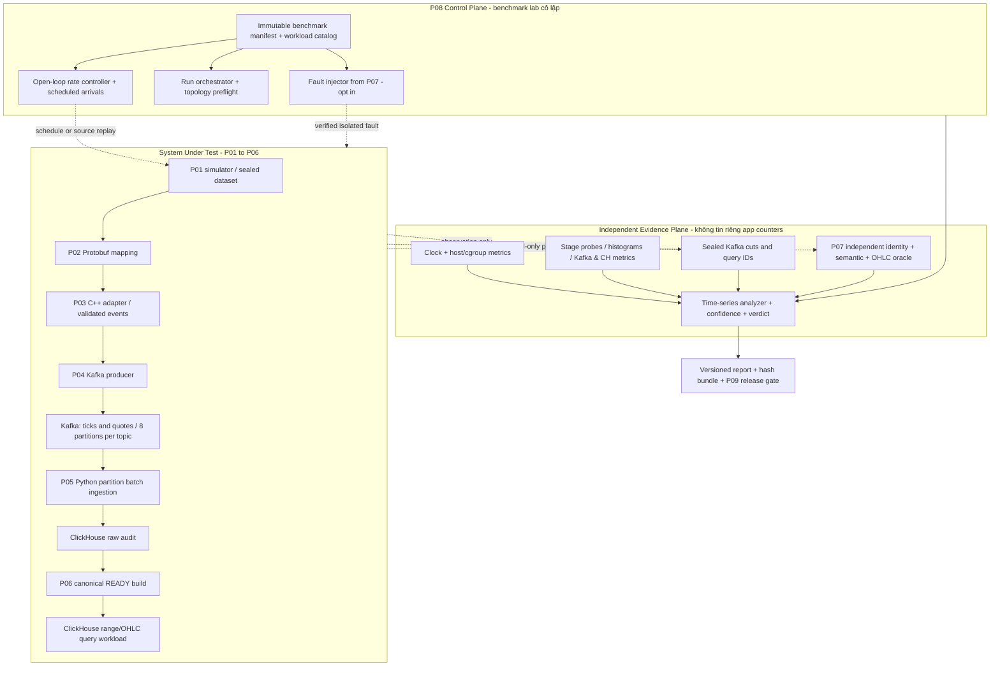

# PROJECT 08 — High-Throughput Benchmark & Optimization

> **System Design + Experimental Protocol + Capacity Model + Fault Matrix + Independent Proof**  
> **Dự án 08/09** trong *Market Data Streaming and Analytics Platform* · C++20 · Python 3.12 · Kafka · Protobuf · ClickHouse · Linux  
> Phiên bản tài liệu: **1.0 — 2026-10-30** · Ngôn ngữ: **Tiếng Việt**  
> **Trạng thái: `DESIGN_ONLY / NOT_IMPLEMENTED / NOT_TESTED / NO_MEASURED_CAPACITY`.** Tất cả thông số mặc định, SLO, thời gian chạy và lệnh CLI là **đề xuất**; tài liệu này **không** chứng minh phần mềm đạt 120.000 ticks/s hay p95 280 ms.

## 0. Nguồn gốc, phạm vi và nguyên tắc chứng minh

**Từ CV gốc:** Market Data Streaming and Analytics Platform dùng C++20, Python 3.12, Kafka, Protobuf, ClickHouse, PostgreSQL; throughput được ghi **120k ticks/s trên 8 partitions**, và p95 range query **từ 2,4 s xuống 280 ms trên 200M rows**. CV không mô tả phần cứng, loại workload, số broker, số lượng query, tỷ lệ tick/quote, phương pháp tính latency hay điều kiện cold/warm cache. Đây là **mốc cần cố gắng tái hiện có điều kiện**, không phải bảo đảm phổ quát. CV cũng không xác nhận đã tồn tại benchmark harness, dashboard, chaos lab hay số test case trong tài liệu này; chúng là **thiết kế mới phục vụ xây lại**.

**Câu hỏi của P08:** Trên một cấu hình phần cứng, bộ dữ liệu, giao thức, topology và workload được khóa trước, mức tải cao nhất mà pipeline **vừa xử lý đủ dữ liệu đúng nghĩa, vừa giữ backlog ổn định, vừa nằm trong resource budget, vừa đáp ứng query SLO** là bao nhiêu? Khi vượt ngưỡng, có **degrade/fail safely** thay vì mất dữ liệu âm thầm, treo hoặc báo thành tích giả không?

**Thứ tự ưu tiên:** correctness và provenance → đo lường có giá trị → không mất dữ liệu âm thầm → bounded resources → recovery → tốc độ/chi phí. Không có danh sách hữu hạn nào bao trùm *mọi* tình huống what-if; ma trận 512 ca trong phần 17 là inventory có thể vận hành, được bổ sung bằng property-based, fuzz, mutation, pairwise và random fault campaigns.

### 0.1. Ranh giới và hợp đồng của các dự án đã có

| Nguồn | Hợp đồng P08 phải giữ nguyên | Điều được đo / không được suy diễn |
|---|---|---|
| [P01 Simulator](./PROJECT_01_FX_CFD_Market_Data_Simulator_System_Design.md) | Dataset được seal, seed, fixed-point, `event_time_ns`, identity `(dataset_id,symbol,sequence)` **theo từng symbol xuyên tick/quote**; source faults theo manifest | `requested_rate` khác `generated_rate`; TCP send không bằng consumer receipt; dataset `.part` không đủ chứng minh. |
| [P02 Protobuf](./PROJECT_02_Market_Data_Protobuf_Schema_System_Design.md) | `marketdata.v1.MarketDataEvent`, oneof tick/quote, field presence; TCP `MDP1` khác Kafka raw protobuf | So identity+semantic digest/field presence, **không so binary Protobuf hash** làm chuẩn logical equality. |
| [P03 C++ Adapter](./PROJECT_03_CPP_FX_CFD_Market_Data_Adapter_System_Design.md) | Per-symbol sequence, gap, duplicate, stale-quote, accepted/rejected, bounded buffers | Counters có phạm vi riêng; intentional reject không tự động là loss; tránh đếm đôi anomalies. |
| [P04 Kafka](./PROJECT_04_Kafka_Market_Data_Streaming_System_Design.md) | `md.ticks.v1`, `md.quotes.v1`, key=`symbol`, 8 partitions **mỗi topic ở benchmark**; idempotent producer | Thứ tự chỉ trong một partition, không có total order xuyên hai topic; producer ACK không đồng nghĩa canonical READY. |
| [P05 Python Ingestion](./PROJECT_05_Python_Kafka_Batch_Ingestion_System_Design.md) | At-least-once; offsets là *next offset*; insert ACK trước manual commit; raw `md_ingest.market_events_raw` có thể duplicate | Distinguish fetched, inserted, committed, reconciled; không chứng minh exactly-once end-to-end. |
| [P06 ClickHouse Analytics](./PROJECT_06_ClickHouse_Time_Series_Analytics_System_Design.md) | Raw audit → canonical build → OHLC aggregates đã verify → READY snapshot | Query performance đo trên **specified ready build**; không trộn physical raw row count với 200M unique ticks. |
| [P07 Replay/Recovery](./PROJECT_07_Deterministic_Replay_and_Failure_Recovery_System_Design.md) | Independent oracle, fault receipt, dataset cuts, `PASS/FAIL/INCONCLUSIVE/INVALID/NOT_RUN`, RPO/RTO | Load test chỉ PASS nếu đủ evidence; recovery dưới tải phải giữ logical correctness. |

**In scope:** benchmark end-to-end và từng thành phần; workload design; metrology; hardware/OS instrumentation; profiling; bottleneck localization; optimization A/B; controlled chaos under load; capacity/frontier; query optimization; comparison/CI; documentation/handoff P09. **Out of scope:** sửa ngầm schema/trading semantics, benchmark broker thật, hứa 120k/s trên laptop, tự nâng replication thành HA, giả định Grafana chart = exact oracle, production tuning không có change control, chạy lệnh gây hư hại trên máy ngoài lab.

---

## 1. Functional requirements và acceptance contract

| ID | Yêu cầu | Bằng chứng bắt buộc |
|---|---|---|
| FR-01 | Khóa workload manifest trước khi đo và chứng minh generator phát đúng tải | Dataset hash, issued schedule, source sealed count và achieved arrival timeline. |
| FR-02 | Tách 4 tốc độ: intended/generated, Kafka append, ClickHouse raw insert, **unique canonical reconciled** | Per-stage counters theo window, Kafka offsets, verified cuts và oracle identity set. |
| FR-03 | Đo p50/p95/p99/max latency theo **định nghĩa và vị trí mốc thời gian** | Raw latency samples hoặc histogram có độ phân giải và count; clock assumptions. |
| FR-04 | Có open-loop load generator độc lập với phản hồi SUT; có closed-loop *comparison* nhưng không dùng thay thế | Arrival schedule và dropped/late issue contabilized. |
| FR-05 | Chạy lane microbench, component, end-to-end, write/read mixed và recovery | Phân biệt scope, config và result mỗi lane. |
| FR-06 | Hỗ trợ 8 partitions **mỗi topic**, ký hiệu dữ liệu đủ symbol / skew | Capture topic generations, partition counts và key distribution. |
| FR-07 | Benchmark query 200M **verified unique ticks** với query family pinned | Fixed SQL/binds, distribution, warm/cold cache, sampled query IDs, result oracle. |
| FR-08 | Xác định throughput bền bằng steady-state, không chỉ burst 30 giây | Queue/lag slope ≈0, không có deferred drains, xác minh after-drain. |
| FR-09 | Giám sát resource OS/cgroup, C++/Python, Kafka, ClickHouse | Per-service RSS/CPU/PSI/IO/network, ClickHouse parts/merges/query_log, lag. |
| FR-10 | Controlled optimization: one-variable experiments, baseline, reversal, rollback | PR/commit/config diff, repeated paired runs, correctness unchanged. |
| FR-11 | Stress vượt tải phải bounded + fault receipt + state phân loại rõ | OOM/kill/cap, producer pressure, Kafka lag, loss/unknown report. |
| FR-12 | Chạy test độc lập trên immutable dataset, đánh giá kết quả oracle chứ không chỉ dashboard | Complete identity diff + payload semantic equality + OHLC and READY correctness. |
| FR-13 | Phát hiện invalid benchmark: injector không kích hoạt, host throttled, missing samples | Test validity gate; không báo PASS khi dữ liệu đo sai. |
| FR-14 | Soak, burn-in, fault-under-load; đo catch-up và tail latency sau phục hồi | Time-series per window, resource slope, RPO/RTO-CORRECT của P07. |
| FR-15 | Artifact đủ để rerun: versions, binaries, kernel, perf privileges, machine topology | SHA-256 manifest, source commit, OCI image digest, complete environment snapshot. |
| FR-16 | Release gate cho P09 deployment: performance **và** correctness **và** capacity evidence | Machine-readable verdict, benchmark report, rollback and resource envelope. |

### 1.1. Non-functional objectives — đều là **mục tiêu đề xuất**

| ID | Đề xuất cần thử | Quy tắc đo và hạn chế |
|---|---|---|
| NFR-01 | Explore 1k → 10k → 25k → 50k → 75k → 100k → **120k ticks/s** | Chỉ ghi PASS stage nào đạt thật; không chuyển `events/s` thành `ticks/s` nếu có quotes. |
| NFR-02 | 8 partitions **mỗi topic** cho lane target CV | Một run topology khác cần label và đánh giá riêng. |
| NFR-03 | Query p95 **≤ 280 ms** trên query family được khóa, 200M verified unique ticks | Không khẳng định khớp CV nếu khác phần cứng, SQL, concurrency, cache. |
| NFR-04 | 0 unexplained missing/extra/conflict/semantic mismatch trong verified canonical cut | Full oracle compare và published READY build; physical retries có thể tạo raw duplicate. |
| NFR-05 | Steady 30 phút tối thiểu ở target candidate; 5 repetitions độc lập | Thời lượng và số lần là protocol đề xuất, cần điều chỉnh theo budget; chưa thực thi. |
| NFR-06 | `backlog_slope` không tăng có ý nghĩa, `p95/p99` không mất kiểm soát | Phân tích từng topic/partition và rolling windows; không đánh giá chỉ end snapshot. |
| NFR-07 | Không OOM, không bỏ record lặng lẽ, không vượt cgroup/disk/FD budget | `memory.events`, PSI, per-process metrics; giới hạn phải chọn theo host. |
| NFR-08 | Latency samples: đo ít nhất 10k completed requests cho p95 discovery; ghi count/error/missing | Min-count chỉ là guardrail không chứng minh CI; mẫu truy vấn cần đủ strata theo workload. |
| NFR-09 | Khi vượt capacity: degrade có cảnh báo rõ, giữ correctness; không tự gọi stage failed là success | Backpressure/drop policy explicit, load generator still accounts attempted. |
| NFR-10 | Không tăng P06 READY khi verifier chưa hoàn tất dù throughput ghi cao | Audit catalog+build identity và comparison. |
| NFR-11 | Median cải thiện ≥5% ở paired A/B **và** không thoái hóa tail/correctness | Ngưỡng phát triển tùy chỉnh, không phải tiêu chuẩn khoa học phổ quát; xem CI. |
| NFR-12 | Run nào thiếu provenance, clock-validity, source cut hoặc oracle → `INCONCLUSIVE/INVALID` | Không lấp bằng estimated values hoặc interpolated PASS. |

### 1.2. Quy định về 120k, 200M và 280 ms

- **120k ticks/s** trong CV: đơn vị **market ticks**, không phải `all events/s`; nếu tick:quote = 4:1 thì 120k ticks/s tương đương 150k events/s tổng, *chỉ khi* định nghĩa loại event và mô hình phát thống nhất. Ví dụ này minh họa tính đơn vị, **không phải tỷ lệ ghi trong CV**.
- **8 partitions** ở thiết kế P04: 8 cho `md.ticks.v1` và 8 cho `md.quotes.v1`; không nói Kafka chỉ có 8 partitions tổng. Khi đối chiếu CV phải nêu rõ khác biệt này vì CV không nói số partitions của từng topic.
- **200M rows** trong CV không nói raw/unique. P08 **đặt chủ đích** benchmark 200M unique ticks trong canonical READY snapshot; ghi rõ khác biệt với nguồn gốc CV.
- **280ms p95** chỉ là một mốc của *range query* tại một workload không được CV mô tả; P08 định nghĩa query family và concurrence riêng. Không đánh tráo query-service latency với client-observed roundtrip.

---

## 2. Kiến trúc: SUT, Control Plane và Independent Evidence Plane



### 2.1. Module responsibilities và isolation

| Module | Sở hữu | Cần tránh |
|---|---|---|
| `run-orchestrator` | Khóa env, cấu hình, dataset, query plan; start/stop có deadline; bảo vệ host | Tự thay version giữa run; restart SUT ngoài profile. |
| `load-calibrator` | Chứng minh schedule và generator capacity trên null sink/loopback test | Tự làm bottleneck rồi vẫn dùng requested rate để tính throughput. |
| `event-load-driver` | Open-loop scheduled arrivals, rate ladder, spikes và distributions | Closed-loop pacing phụ thuộc phản hồi tạo coordinated omission. |
| `query-load-driver` | Issued query schedule, bind params, end-to-end client timer, verify result | Chỉ đo queries thành công hoặc warm-cache hit. |
| `metrics-collector` | Timestamp, OS/cgroup, Kafka JMX/librdkafka, ClickHouse system tables | Scrape quá nặng hoặc high-cardinality labels làm đổi SUT. |
| `proof-collector` | Source sealed manifest, per-TP Kafka cut, raw/canonical/READY snapshots | Dùng Kafka offset như logical event identity, tin COUNT(*) đơn thuần. |
| `performance-analyzer` | p95/p99/CI, queue slope, capacity frontier, energy/cost khi có dữ liệu | Tổng hợp các phân phối không tương đồng, bỏ lỗi và timeout. |
| `fault-campaign` | Gây lỗi có receipt theo P07, cleanup cả pre/post | Kill nhầm host, gây lỗi không đến target nhưng vẫn tính PASS. |
| `optimization-experiment` | Tuning matrix một biến, ABBA/rollback, regression | Trộn nhiều tối ưu nên không xác định nguyên nhân. |

**Profiles:** `LOCAL_SMALL` (1 broker, 1 CH node; học kiến trúc, không HA), `LAB_CAPACITY` (broker+CH resources pin và topology ghi rõ), `LAB_RECOVERY` (fault under load, isolated volumes), `QUERY_ONLY` (snapshot SEALED, không ghi), `MIXED` (ingest+queries). Không so sánh cross-profile như cùng một experiment.

---

## 3. Workload & dataset contract — đo đúng công việc, không chỉ volume

### 3.1. Manifest cố định trước chạy

Phải lưu: `dataset_id`, `run_id`, `test_id`, `seed`, `schema_version`, `topic_generation`, `symbol_distribution`, `symbol_count`, `tick_to_quote_ratio`, fixed-point scales, `input_size_distribution_bytes`, exact `input_schedule`, input fault manifest, expected acceptance policy, `query_family`, `time_window`, `query_concurrency`, `warmup/steady/drain` window, OS/binary versions và config digests. Load generator vẫn đếm *all scheduled attempts* dù SUT không chấp nhận.

**Bốn chế độ arrival:**

1. **Open-loop constant rate:** phát theo schedule dù SUT chậm, giới hạn driver queue và giữ count `attempted/issued/failed_to_issue`.
2. **Open-loop burst/step/ramp:** test overload và catch-up; ví dụ 4× burst 10 giây nhưng **không coi burst làm sustainable capacity**.
3. **Closed-loop concurrency sweep:** đo service throughput vs concurrency như thí nghiệm bổ sung, không thay open-loop latency.
4. **Finite deterministic replay:** fixed manifest/payload/seed để oracle full compare; tránh dùng dữ liệu thay đổi ngẫu nhiên giữa A/B.

**Dữ liệu phải có nhiều phân phối:** uniform symbol, skew 80/20, hot-symbol 95%, nhỏ/lớn payload, liên tục/ngắt quãng quote, late timestamps, boundary nanoseconds, duplicate/retry có chủ ý. **Normal performance** và **fault/quality tests** là hai lane khác nhau; không dùng fault injection làm excuse cho loss hoặc denominator bị thay.

### 3.2. Cấu hình workload tham chiếu — chưa chạy

| Lane | Input target | Dữ liệu/query | Mục đích |
|---|---|---|---|
| L00 | generator only | null sink / pre-sealed | Khẳng định driver không nghẽn. |
| L01 | 1k ticks/s | 3 symbols, uniform | Baseline và correctness. |
| L02 | 10k ticks/s | 10 symbols, 8 partitions/topic | Component profiling. |
| L03 | 25k ticks/s | 50 symbols | Latency inflection. |
| L04 | 50k ticks/s | 100 symbols, uniform | Kafka/Python bottleneck. |
| L05 | 75k ticks/s | 100 symbols, 80/20 skew | Per-partition fairness. |
| L06 | 100k ticks/s | 100 symbols, uniform | Tail latency và queue slopes. |
| L07 | 120k ticks/s | 100 symbols, normal ticks-only **for rate identity** | Mốc challenge CV; quotes đo trong separate mixed lane. |
| L08 | staged rate | tick:quote **4:1 do lab chọn** | Prove `ticks/s` ≠ `events/s`. |
| L09 | replay 200M unique ticks | pinned P06 READY build | Query-only p95 range; cold/warm separately. |
| L10 | rate levels + reads | concurrent 1/4/16/32 readers | Mixed write+read, CH merge pressure. |
| L11 | prior stable rate + fault | broker/CH/consumer/CPU issues | Graceful degradation, RPO/RTO-CORRECT. |
| L12 | prior stable rate over 1/6/24 h | soak with budget and controls | Drift/leak/thermal/retention/parts. |

Mỗi lane phải có `offered`, `issued`, `accepted`, `Kafka_appended`, `raw_inserted`, `canonical_verified`, `READY_published` theo thời điểm/cut. Đếm record retries vật lý tách logical identity; ghi `actual measured ticks/s`, `all events/s`, `bytes/s` riêng biệt.

### 3.3. Query benchmark chuẩn hóa (ví dụ; phải chốt chính xác SQL trên P06 trước run)

| QID | Query family | Bind/scope | Kết quả độc lập |
|---|---|---|---|
| Q01 | Symbol+time tick range | Một symbol, `[t0,t1)` 1 phút, `LIMIT` khóa | Expected ordered logical identities, exact fixed-point values. |
| Q02 | Symbol+time tick range | Một symbol, `[t0,t1)` 1 giờ | Expected result count+digest; read_rows/granules. |
| Q03 | Multi-symbol range | 10 symbols, 15 phút | Deterministic per-symbol result, không yêu cầu order xuyên topics. |
| Q04 | OHLC 1m | READY build và 1 ngày | Python independent OHLC oracle; no duplicate inflation. |
| Q05 | Range aggregate | MIN/MAX/COUNT theo symbol và bucket | Aggregate values exact; query profile. |
| Q06 | Large time sweep | 1 symbol, 1 tháng theo fixture | Stress scan, memory, spill/timeout behavior; không dùng Q06 thay cho Q02 p95. |

**Query p95 280ms** nên gắn một **named workload** (ví dụ `Q02`, concurrency 4, 200M unique ticks, warm cache, query result verify), không công bố giá trị p95 chung nếu trộn `Q01` và `Q06`. Mọi SQL phiên bản, bind parameters, client timeout, `max_threads`, `max_memory_usage`, `max_execution_time`, `query_id`, snapshot ID phải được lưu.

---

## 4. Metrology: các công thức bắt buộc và những điều không được đánh tráo

### 4.1. Counters và conservation

- `offered_count`: số slot do schedule yêu cầu; `issued_count`: nguồn thực sự emit; `source_sealed_count`: bytes/events có manifest bền; `adapter_accepted_count`: business-admissible theo P03; `producer_ack_count`: producer nhận ACK; `kafka_physical_count`: log offsets (physical, gồm retry duplicates); `raw_physical_count`: raw rows; `canonical_unique_count`: distinct valid identities trong READY build; `oracle_expected_count`: expected accepted unique set do P07 oracle tính độc lập.
- Không áp dụng một phương trình đơn giản `offered = raw_rows = canonical_rows`: rejects/duplicates/partial reads làm sai. Đúng hơn với finite verified cut: `expected_accepted_IDs = canonical_READY_IDs` **và** payload semantics/field presence match, plus `unexpected_extra/conflict=0`.
- `unexplained_missing = expected_accepted_set - canonical_set`; `unexpected_extra = canonical_set - expected_set`. `duplicates` là physical phenomenon riêng. Một `COUNT(DISTINCT)` không chứng minh duplicate conflict.
- `Kafka lag` theo partition `(log_end_offset - committed_next_offset)` là **đếm offset**, không nhất thiết là thời gian trễ hoặc số unique logical events; phải lưu log start, end, committed và topic generation.

### 4.2. Throughput và queue stability

```text
issue_rate_ticks_s       = ticks_issued_in_window / measured_seconds
kafka_append_rate_s      = physical_records_appended / seconds
canonical_verified_rate  = newly_verified_logical_IDs / seconds
query_completed_qps      = successful_correct_queries / seconds
query_attempted_qps      = scheduled_queries / seconds
error_rate               = (failures + timeouts) / scheduled_attempts
backlog_growth_s         = delta(backlog_records) / seconds
latency_observed_p95     = percentile(valid_completed_latency_samples, 0.95)
```

**Đừng lấy `source_rate` thay cho throughput hữu dụng.** Định nghĩa candidate sustainable capacity: workload **đã chốt**, 30 phút steady, không có logical mismatch, `backlog_growth` gần 0 trong từng TP trên ít nhất 5 phút cuối **và** không tăng hệ thống trong toàn steady, latency/error/resource budgets đều đạt. Sai số gần 0 phải công bố theo confidence/measurement noise, không tự coi một queue snapshot cuối = ổn định. Cần `drain` và reconcile sau steady để chứng minh không còn nợ xử lý.

Queue capacity khi `λ > μ` (cùng đơn vị) là `time_to_full_s ≈ free_buffer_records/(λ-μ)`; nếu chỉ có `bytes`, dùng cả numerator lẫn rate bằng bytes. Ví dụ **chỉ minh họa:** 120k ticks/s × 160 B/payload ≈ 19,2 MB/s payload, chưa có Kafka overhead, replication, compression, quotes, ACK, SQL index/parts hay on-disk data compression. Không dùng 19,2 MB/s để sizing mạng/đĩa production.

### 4.3. Latency histogram, clock và coordinated omission

| Metric | Bắt đầu → kết thúc | Đồng hồ | Quy tắc |
|---|---|---|---|
| `adapter_receive_to_emit` | complete frame → accepted output enqueue/ACK theo định nghĩa | monotonic trong **cùng process** | Không so với `event_time_ns` để suy network latency. |
| `kafka_enqueue_to_ack` | producer enqueue → callback broker ACK | monotonic cùng host | ACK không bảo đảm P05/P06 xong. |
| `batch_wait` | oldest record batch enqueue → flush start | monotonic trong consumer | Phản ánh max-wait vs hot partitions. |
| `ingest_to_clickhouse_ack` | consumed validated record → sync ClickHouse ACK | monotonic cùng process | Tách CPU decode và insert. |
| `range_query_client_rtt` | client send → full response verified | monotonic cùng query driver | Chứa network, queue, transfer, decode. |
| `range_query_server_ms` | server execution theo `system.query_log` | server ClickHouse | Không bằng client RTT; cần đối chiếu query ID. |
| `end_to_end_event_latency` | source emitted → verified READY | **cross-host clocks** | Chỉ kết luận bounded khi có đồng bộ + đo clock uncertainty; nếu không chỉ đo upper bound/relative stage timers. |

- Dùng `CLOCK_MONOTONIC`/`perf_counter_ns()` cho durations cùng host; UTC wall clock dùng correlation metadata, không đo duration trực tiếp khi có NTP step. Clock sync PTP/NTP phải log offset/jitter/uncertainty; nếu sai số clock lớn so với latency mục tiêu → end-to-end one-way latency **INCONCLUSIVE**.
- Open-loop schedule phải giữ timestamps của **lần định phát**; late-issued, dropped và timeout vẫn có record riêng; không tính p95 chỉ từ requests hoàn tất vì đó là **survivorship bias/coordinated omission**. Báo cả `completion latency` **và** `schedule-to-completion` (khi có timestamps hợp lệ), cùng timeout fraction và percentiles conditional.
- Thống kê `p95` phải có `N`, buckets/resolution, error bars; không trung bình hóa p95 từng giây thành p95 cả run. Histogram quantile (Prometheus) là **ước lượng phụ thuộc bucket**; baseline exact quantile có thể tính offline trên sample/summary phù hợp.
- Query timeouts không được gán latency 0, bỏ khỏi denominator hay suy completed; định nghĩa rõ censored observations. `max` không thể suy chính xác từ bucket cuối mở.

### 4.4. Statistical decision protocol

1. **Pre-register** query family, rate, feature flag, expected effect, minimum effect, sample size/stop rule trước benchmark.
2. Chạy warmup 5 phút (không dùng warmup làm steady result), steady 30 phút, controlled drain; **5 repeat pairs** là mặc định để khám phá, không tự hứa CI hẹp.
3. A/B với cùng workload+hardware, randomized **ABBA/BAAB** hoặc paired alternating run order; snapshot/dataset và cache policy giống nhau; không đổi 2 knobs cùng lúc.
4. Báo per-run p50/p95/p99, corrected/uncorrected latency definitions, bootstrap *run-level* CI (đừng coi hàng triệu request trong một run là độc lập khi cùng host/time).
5. “OPTIMIZED” khi throughput có ích cao hơn hoặc p95 đúng family giảm, **và** correctness, p99/error, resource/cost budgets không regress; nếu khoảng tin cậy quá rộng → `INCONCLUSIVE`, không cherry-pick fastest run.

---

## 5. Environment pinning, observability và kiểm soát nhiễu

### 5.1. Snapshot môi trường bắt buộc

Ghi CPU model/cores/threads, SMT, NUMA nodes, RAM và swap, storage model/filesystem/mount options, kernel + perf/cgroup version, CPU governor/turbo/thermal telemetry, container image digest, CPU shares/quota/throttling, memory limits, IRQ/RSS queues, MTU, NIC speed, network path, SSD free space/IOPS, page cache policy, host neighbor noise, Kafka/ClickHouse version và configs, C++ compiler flags, Python packages/venv hash. **Quy trình benchmark** không chạy đồng thời với unrelated backups/update jobs.

**Isolation:** riêng Kafka topics, ClickHouse database/table/build/catalog, volumes và network; không root host nếu không cần. Chaos không tác động cluster/cụm ngoài danh sách allowlist. `perf` có thể bị hạn chế bởi `perf_event_paranoid`, namespaces, PMU multiplexing; ghi thành limitations và dùng alternatives như `pidstat`, cgroup `cpu.stat`/PSI. Không tự hạ bảo mật host để lấy một metric.

### 5.2. Metrics catalog và cardinality control

| Layer | Metrics tối thiểu | Alert / interpretation |
|---|---|---|
| Generator | `scheduled/issued/late_issue/dropped_issue`, send error, process CPU | Generator không phát đủ → **INVALID** cho target-rate claim. |
| P03 C++ | parse/decode rate, validation rejection by reason, queue byte depth, frame latency | Burst `p99` và backlog trước Kafka. |
| P04 producer | record send rate, errors, retries, batch size, bufferpool wait, ack latency | `enqueue` khác `broker append`; C++ librdkafka stats không phải Java JMX path. |
| Kafka broker | bytes in/out, `RequestQueueTimeMs`, `LocalTimeMs`, ISR changes, throttling | Broker resource/batching/replication saturation. |
| P05 consumer | `records-lag-max`, poll gap, rebalance, fetch rate, per-TP in-flight and commit frontier | Consumer lag increasing dù producer ACK bình thường. |
| ClickHouse write | insert duration, parts count, merge backlog, `system.merges`, disk free | Too many parts, write amplification, slow merges. |
| ClickHouse read | `query_duration_ms`, `read_rows`, `read_bytes`, `memory_usage`, `ProfileEvents`, index granules | p95 dưới 280ms nhưng query sai/result incomplete → FAIL. |
| OS/cgroup | per-process RSS, CPU user/system, `cpu.stat`, `memory.events`, PSI, iowait, `io.stat`, network drops | cgroup throttling, reclaim, OOM, noisy neighbor, disk saturation. |
| Evidence | missing/conflicts/extras, snapshot cut, proof collector lag, evidence artifact integrity | Thiếu proof → không xác nhận đạt capacity. |

Kafka broker/JVM metrics dùng JMX khi triển khai Java broker; **librdkafka C++ và Python clients** có stats/metrics API riêng; map metric names theo đúng client/runtime thay vì giả định đều xuất JMX giống nhau.

**Ví dụ PromQL chỉ là pattern:**

```promql
# Classic histogram: p95 query client RTT (seconds).
histogram_quantile(0.95, sum by (le, query_family) (rate(md_query_client_seconds_bucket[5m])))

# Delta backlog rate: data emitter vs canonicalized data (monitoring only, not oracle).
sum(rate(md_input_ticks_issued_total[5m])) - sum(rate(md_canonical_verified_ticks_total[5m]))

# All error/timeout/scheduled attempts must be counted separately.
sum(rate(md_query_failures_total[5m])) / clamp_min(sum(rate(md_query_scheduled_total[5m])), 1)
```

**Cảnh báo:** Nhãn `dataset_id`, `event_id`, `query_id`, `symbol` cardinality lớn **không** gắn trực tiếp vào Prometheus counters; chi tiết ID lưu ở evidence store với sampling/cap. Mẫu PromQL trên chỉ có nghĩa sau khi đúng metric names, scope và counter reset đã được thực hiện, **không được coi là công thức proof full reconciliation**.

### 5.3. ClickHouse SQL đọc observability (phải kiểm tra version/quyền trước chạy)

```sql
-- Chạy sau khi query load, với quyền read-only trên system.*.
SELECT query_id, query_duration_ms, read_rows, read_bytes, memory_usage,
       normalized_query_hash
FROM system.query_log
WHERE type = 'QueryFinish'
  AND event_time >= now() - INTERVAL 1 HOUR
  AND query_id LIKE 'P08-%'
ORDER BY event_time DESC
LIMIT 100;

-- Explain dùng đúng QID/query bindings cụ thể; syntax hợp với ClickHouse recent.
EXPLAIN indexes = 1
SELECT symbol, event_time_ns, sequence, price_ticks
FROM md_analytics.canonical_ticks
WHERE build_id = {build_id:String}
  AND dataset_id = {dataset_id:String}
  AND symbol = {symbol:String}
  AND event_time_ns >= {start_ns:Int64}
  AND event_time_ns < {end_ns:Int64}
ORDER BY symbol, event_time_ns, sequence
LIMIT 10000;
```

**Lưu ý:** Query này là *template* cho P06; driver phải bind các tham số typed `{...}` bằng giá trị thuộc READY dataset thật, kiểm tra result expected nonempty và so `SHOW CREATE TABLE` trên ClickHouse được pin. `EXPLAIN indexes=1` giúp nhìn số granules/parts được chọn; đo thêm query results, cold/warm cache, concurrent loads và scans; không giả định ít read_rows luôn là đúng query.

---

## 6. Bottleneck localization và optimization playbook

### 6.1. Quy trình chẩn đoán theo dấu vết

1. `issued < scheduled` → **generator bound**: null-sink calibration, clock scheduler lag, CPU/RSS.
2. `P03 accepted << issued` → validation/reject/TCP framing: đối chiếu expected rejection theo manifest, perf hotpath; không gọi mọi gap là loss.
3. `producer enqueue >> broker acknowledged` → batching/buffer pressure, request queue, retries, ISR, quota, network.
4. `Kafka append >> P05 consumed or committed` → consumer lag per partition, poll/rebalance, Python CPU/GIL/native I/O, batch throughput.
5. `ClickHouse acknowledged >> canonical READY` → audit/reconciliation/MV build cost, snapshot propagation; không tối ưu bằng cách bỏ oracle.
6. `READY stable, queries slow` → `system.query_log`, `EXPLAIN indexes=1`, read_rows/read_bytes, parts, CPU/cache/disk, SQL shape; verify query correctness.
7. `service healthy nhưng metrics missing` → **instrumentation invalid**, không suy OK.

### 6.2. Controlled hypotheses — thay đổi một biến/lần

| Hypothesis (cần đo) | Knob / biện pháp ứng viên | Risk regression & oracle |
|---|---|---|
| P03 allocations cao | pooling, smaller copy, cache-aware hot path | Data lifetime, buffer reuse corruption, replay identity; ASan/TSan trên lane riêng. |
| C++ scheduling jitter | thread affinity, IRQ placement, CPU isolation | Starvation/fairness, SMT migration, throttling; must pin host. |
| Kafka producer request overhead | `linger.ms`, `batch.size`, compression level | Batching delay, CPU, byte savings, ordering, retries/timeout. |
| Partition hot spot | tăng symbol cardinality hoặc reconsider mapping **chỉ thí nghiệm** | Per-symbol ordering; migration/tp_generation; correctness before acceptance. |
| P05 small inserts | `max_rows`, `max_bytes`, `max_wait_ms`, bounded inflight | Crash/ACK ambiguity, memory, cross-TP commit, ClickHouse part explosion. |
| P05 deserialize cost | Protobuf decode path and columnar batch conversion | Field presence, fixed-point, identity/oracle parity. |
| ClickHouse `read_rows` lớn | sort/partition/index design, narrower projections | DDL migration & rebuild; EXPLAIN pruning, exact SQL results. |
| ClickHouse merge pressure | batch sizing, parts rate, TTL/merge scheduling | Higher ingest latency, disk pressure, incorrect snapshot freshness. |
| MV OHLC slow | verified canonical-only incremental state, targeted rebuild | Raw retry duplicates must never inflate OHLC. |
| Query tail p99 cao | `max_threads`, admission, concurrency limit, cache policy | Throughput/fairness vs tail latency; no silent query drops. |

### 6.3. Capacity modeling và saturation frontier

Đối với mỗi lane, lưu `rate_offered`, `useful_verified_rate`, `stable_window_min`, `backlog_slope`, `p95/p99`, `error_fraction`, `CPU%`, `cgroup throttling`, `memory_peak`, `disk headroom`, `query QPS` và `reconciliation verdict`. Capacity là **tốc độ cao nhất qua tất cả gates**, không phải maximum throughput trong một burst ngắn. Nếu ở 100k ticks/s ổn nhưng 120k ticks/s queue tăng, chỉ được ghi *verified bound* `≥100k` **nếu** 100k đạt đúng gate; tuyệt đối không công bố 120k.

Có thể dùng Little's Law `L≈λW` khi hệ thống ổn định, cùng population/định nghĩa arrival và không có loss không đo được; không dùng nó trong overload non-stationary. Nếu `λ>μ`, backlog sẽ tăng nếu chưa áp admission/loss; trước khi cạn ngân sách, hệ thống phải phát hiện và fail/degrade có kiểm soát.

---

## 7. Validity gate và verdict semantics

Kết quả mỗi test phải gồm 3 chiều **`validity`, `correctness`, `performance`**; sau đó mới aggregate:

| Trạng thái | Ý nghĩa | Ví dụ |
|---|---|---|
| `PASS` | Fault stimulus thực sự diễn ra, proof đầy đủ, correctness và performance/safety gates đúng theo case | 100k steady, no mismatch, no positive lag slope, p95 dưới pinned budget. |
| `FAIL` | Một điều kiện nghiệm thu vi phạm có bằng chứng | Missing logical identity; query wrong; OOM; SLA fail; wait queue tăng mãi. |
| `INCONCLUSIVE` | Data không đủ để suy PASS/FAIL | Thiếu query samples; cross-host clocks chưa sync; dataset/cut chưa seal. |
| `INVALID` | Test setup/injection/generator/sensor không đúng điều kiện pre-registered | Requested 120k nhưng issue 70k; fault injector không gây lỗi; cold-cache claim nhưng cache vẫn warm. |
| `NOT_RUN` | Chưa chạy case | Mọi case trong tài liệu này hiện là `NOT_RUN`. |

**Special cases:** run vượt capacity mà giữ bounded queue và ngừng an toàn có thể **PASS safety/overload-behavior test** nhưng **FAIL 120k capacity claim**. Truy vấn không kết thúc tính vào error/timeout, không được loại khỏi `scheduled` denominator. Nếu P07 oracle chưa có, P08 **không** tự chứng nhận `canonical correctness` bằng app metrics.

**GO:** tất cả P0 chạy và PASS theo scope mục tiêu; correctness/verifier good; capacity tại rate đã công bố đạt steady/repeat; no false READY; evidence complete; không có regression ngược chiều và budget còn dự phòng. **NO-GO:** bất kỳ P0 FAIL; unexplained loss/conflict; latency regression ngoài budget; capacity rate không đạt; OOM/unbounded queues; query wrong. **INCONCLUSIVE:** số đo, nguồn hoặc timestamp không đáng tin. **INVALID:** bản thân thí nghiệm sai. **P2 NOT_RUN** được ghi rõ và có thể chấp nhận trong dev pilot có giới hạn, không được gọi là toàn diện.

---

---

## 8. Threat model, các failure boundaries và safety envelope

**Tài sản quan trọng:** (i) source sealed truth; (ii) Kafka log generations/cuts; (iii) P05 commit frontier; (iv) ClickHouse raw/canonical/READY builds; (v) latency samples và immutable evidence; (vi) CPU/RAM/disk của lab. **Failure boundaries**: P01→TCP, TCP→P03, P03→P04, P04 producer ACK→Kafka durable log, Kafka→P05 poll/commit, P05 CH INSERT→ACK (không atomic với offset commit), raw→canonical verified, READY→query response, SUT→observer/report.

**Giới hạn mặc định đề xuất trước khi chạy:** all chaos commands chỉ tới allowlisted Docker Compose project/networks và test volumes; `--dry-run` + exact target IDs; disk-fill không chạm root filesystem; CPU/memory stress có cgroup limit; latency/loss netem chỉ test bridge; có watchdog tự dọn dẹp; capture pre/post topology & qdisc; fault injected must have receipt. Tất cả giới hạn cấu hình theo máy thực; không dùng số mặc định như một yêu cầu universal.

**Người gây lỗi được tin một phần:** orchestration có thể sai; proof collector có thể ngừng; input generator có thể không đủ tải; A/B analyzer có thể làm tròn hoặc bỏ mẫu; CI có thể chạy chỉ subset. Vì vậy, P08 dành hẳn fault class **metrology failures**: test của công cụ đo được chạy bằng golden simulated latency/offset/provenance trước khi thử SUT thật.

## 9. Test pyramid, invariants và independent oracle

### 9.1. Test pyramid

| Layer | Điều kiểm tra | Hình thức |
|---|---|---|
| Static/config | Manifest, topology, units, metric schemas, SQL digest, paths/allowlist | Strict schema validation, lint, config hash. |
| Unit | Histogram, percentile, queue slope, lag frontier, result digest, verdict state | Fake clock, recorded sample fixtures, property-based. |
| Component perf | P01 source, P03 C++ parser, P04 producer, Kafka broker, P05 batcher, CH query | Calibrated isolated lane, measure one stage. |
| Integration | P01→P05 and P06 canonical READY; Kafka/ClickHouse under reads | Golden fixture + independent exact sets. |
| Fault & chaos | ACK lost, rebalance, disk full, kill, network split, sustained overload | Verified fault receipt + P07 reconciliation. |
| Statistical validation | Simulated distributions, missing samples, censoring, ABBA/CI | Synthetic benchmark analyzer self-tests. |
| Soak/release | 1h/6h/24h with budget; reproducible 5-run capacity frontier | Trends, report, rollback, P09 handoff. |

### 9.2. Hai mươi bất biến không được phá khi tối ưu

| ID | Invariant (oracle độc lập) |
|---|---|
| INV-01 | `source_sealed == true` trước khi đặt mục tiêu finite replay completeness. |
| INV-02 | Business identity là `(dataset_id,symbol,sequence)`; không dùng Kafka offset làm logical identity. |
| INV-03 | Giá/timestamp/scale giữ nguyên integer/fixed-point và field presence, không round float. |
| INV-04 | `expected_accepted_IDs == READY_canonical_IDs` trong agreed sealed cut. |
| INV-05 | `unexpected_extra_IDs = 0` và `conflicting_payload_IDs = 0`. |
| INV-06 | Raw physical duplicates có thể tồn tại; không làm thay đổi canonical unique set/OHLC. |
| INV-07 | Không có Kafka commit vượt contiguous sink-acknowledged terminal frontier. |
| INV-08 | Topic/partition Kafka có generation và scope; no silent reset to latest. |
| INV-09 | Per-topic-partition queue/lag không được bị che bởi global average. |
| INV-10 | Queue memory budget tính cả broker/client prefetch, Python objects và inflight buffers. |
| INV-11 | Under overload, every scheduled attempt accounted, no invisible source pacing. |
| INV-12 | `rate_ticks_s`, `rate_events_s`, `rate_bytes_s` là ba đơn vị khác nhau. |
| INV-13 | `query_success` đòi SQL đúng, correct result và full response; không chỉ HTTP success. |
| INV-14 | `client_RTT` không được ghép với `server_query_duration` làm cùng phân phối. |
| INV-15 | Latency clock monotonic trong cùng host; cross-host one-way có sync uncertainty hoặc INCONCLUSIVE. |
| INV-16 | Timeouts và failures giữ trong attempted denominator, không biến mất khỏi biểu đồ. |
| INV-17 | P95 phải gắn query family/concurrency/snapshot/cache profile và N. |
| INV-18 | P06 READY chỉ công bố sau full independent verification và snapshot pinning. |
| INV-19 | Benchmark PASS requires validity + correctness + performance/safety gate; không auto-PASS từ liveness. |
| INV-20 | Artifact/run ID, binary/config/dataset hash, hardware profile và fault receipt phải tái truy xuất được. |

**Proof logic (finite run):** tạo `expected_accepted` từ P01 immutable manifest + P03 validation policy *được diễn giải độc lập*, thu per-topic per-partition Kafka cut, so ClickHouse raw logical set rồi canonical READY. So sánh **identity + semantic fields**, không chỉ count/sum/hash một trường. Oracle độc lập có thể triển khai Python standard/SQL ở repository riêng, chạy với golden fixtures có intentional faults và poison records. Full compare 200M IDs có thể tốn disk/RAM; dùng external sort/chunk-verified partitions hoặc streaming merge compare với hash đối chứng, lưu count+diff và phương pháp chứng minh; không nạp toàn bộ 200M rows vào RAM.

### 9.3. Metamorphic/property tests cho benchmark

- Nhân `target_rate` lên nhưng **giữ finite dataset**: logical expected set phải không đổi, chỉ thời gian và queue behavior đổi.
- Đổi số batch hoặc `linger.ms` nhưng giữ schema/cut: canonical logical set và OHLC không được đổi.
- Thêm physical duplicate hữu hạn: raw rows tăng nhưng canonical count/price digest không đổi.
- Đảo thứ tự message giữa tick/quote topics: canonical *set* không đổi, không áp global-order giả.
- Thêm 1 slow query vào tail: global p99 không thể cải thiện nếu các sample cũ giữ nguyên và hợp lệ (với định nghĩa order statistic thống nhất).
- Nhân `time_unit` sai ×1000: synthetic known-latency self-test phải FAIL.
- Loại một latency sample/offset/cut: analyzer không tự động báo PASS.
- Đổi CPU governor mà không đổi source commit: identity set không được thay nhưng performance run fingerprint phải thay.

---

## 10. Benchmark fixture/golden protocol thực thi được sau khi viết code

### FIX-001: 10 events, 3 symbols, 2 topics, một intentional duplicate

Source seal có 10 logical valid events; phát thêm 1 physical duplicate của logical ID thứ 4 trên Kafka và CH. **Expected:** `source_unique=10`, `kafka_physical=11` (nếu duplicate thực sự tới Kafka), `raw_physical` phụ thuộc retry/sink path nhưng ít nhất 10 theo trường hợp lab, `canonical_unique=10`, `conflicts=0`, `READY` cho verified cut đạt 10, mọi expected payload/scale chính xác. Các con số Kafka/raw phụ thuộc stimulus trong fixture; **không hardcode `raw=11` nếu insert dedup loại bản vật lý**.

### FIX-002: Query latency unit/self-test

Synthetic client latencies (ms) `[100, 110, 120, 130, 140, 150, 160, 170, 180, 1000]` và không timeout. Exact nearest-rank p95 với N=10 = phần tử thứ `ceil(0.95×10)=10` = **1000ms**; không được báo `mean=226ms` hoặc average p95 buckets. Khi thêm 10 timeouts cần báo `scheduled=20, completed=10, timeout=10` và conditional p95=1000ms, **không** biến thành 50% latency 0.

### FIX-003: Queue stability không thể kiểm bằng snapshot cuối

Ở 120k offered/s, sink xử lý 100k/s trong 600 giây: backlog tăng khoảng `20k/s × 600s = 12,000,000` records nếu không drop/limit và không có thay đổi động khác. Nếu một queue chỉ có 1M records free thì sẽ đầy trong khoảng 50 giây (cùng đơn vị, ví dụ lý tưởng); test phải đo throttle/drop policy, không đợi kernel OOM. Một `backlog=0` sau khi retention xóa segment không chứng minh recovery.

### FIX-004: Benchmark 200M unique ticks

- Chỉ chạy sau khi kiểm tra available disk, thời gian tạo dữ liệu, memory/merge budgets và nguồn replay. Có thể chia thành nhiều immutable fixture chunks với `dataset_id`, seed, ranges và checksums.
- Trước query: P06 verified snapshot `build_id` có **200,000,000 unique ticks**, đúng event-time distribution; không đồng nhất với 200M physical raw rows.
- Thực hiện Q01..Q06 trên warm/cold profiles riêng, precompute expected result digest/reference SQL và pin một **named** `Q02-280ms` query family.
- Primary p95 lấy từ **client full-response verified RTT**. Secondary CH `system.query_log` server duration dùng phân tích bottleneck, không đổi định nghĩa primary sau khi có kết quả.

---

## 11. Workload protocol theo phase, repeat và tiêu chí timeouts

| Phase | Thời lượng đề xuất | Bắt đầu/kết thúc | Kết quả dùng ở đâu |
|---|---:|---|---|
| Preflight | đến khi pass | Check env, generator cal, DB build, topic generation, metrics, clock | Gate validity, chưa phải performance. |
| Warmup | 5 phút | Data path warmed according to profile; monitor stability | Báo riêng, không tính vào steady p95. |
| Ramp | 2 phút/level | Gradual 1k→...→candidate rate | Tìm knee point; không gọi sustainable capacity. |
| Steady | 30 phút/target | Fixed workload manifest and full probes | Primary capacity & p95 assessment. |
| Drain | deadline được ghi | Ngừng issue, cho backlog xử lý/canonicalize | Đo catch-up; no READY nếu incomplete. |
| Reconcile | tới terminal state | P07 independent expected↔READY, results; fault cleanup | Correctness gate, report only after. |
| Repeat | tối thiểu 5 run pairs cho experiment | Isolated reset per manifest, random order | Uncertainty, regressions, comparison. |
| Soak | 1h→6h→24h nếu budget đủ | Stable rate và resource monitoring | Leak, long-term drift; không thay steady baseline. |

**Stop conditions:** chạm hard memory/disk/FD limit, observed OOM/replay loss, invalid clock/test setup, insufficient source provenance, unbounded backlog/trend, runaway metrics cardinality, destructive action outside allowlist, unknown durability where policy requires fail-stop. Stop ≠ PASS; record actual failure/limit and cleanup evidence.

**Timeout handling:** pre-register per query `deadline_ms` và per-component delivery timeout; `timeout` vào attempted denominator. Latency measure của completed requests là conditional; thêm `deadline_miss_fraction`, abandoned-count, issue-lag distribution và possibility censored latency; không tính percentile với `timeout=deadline` như completed đúng nghĩa trừ khi ghi rõ đó là *bounded latency penalty metric* riêng.

---

## 12. A/B optimization experiment sheet (bắt buộc cho mỗi thay đổi)

| Field | Giá trị ví dụ (không phải kết quả) |
|---|---|
| Hypothesis | P05 `max_rows`: 1000 → 5000 giảm số INSERT requests, tăng verified throughput, không gây đột biến p99 latency. |
| Single variable | Chỉ `max_rows`, giữ `max_bytes/max_wait_ms/max_inflight`, source, topics, CH layout, CPU quota. |
| Fixed workload | 50k ticks/s, 8 partitions/topic, 100 symbols uniform, Q02 concurrency 4, READY 200M unique. |
| Pairing | Baseline A / optimized B / B / A; 5 paired repeats, reset/no-carryover policy. |
| Metrics | useful rate, P05 batch sizes, memory peak, CH parts/merges, Kafka lag slope, Q02 p95/p99 and error fraction. |
| Correctness | P07 full identity/payload diff, no false READY, no premature Kafka commit. |
| Win condition | Claimed ≥5% median throughput improvement **with suitable confidence and no tail/resource/correctness regressions**. |
| Fail/stop | Unknown ACK, mismatch, missing signals, unbounded parts, CPU quota drift, ratio mix mismatch. |
| Reversal | Restore A config; ensure results reverse within natural measurement variance. |
| Verdict | `NOT_RUN` cho đến khi có manifest, metrics, oracle và paired evidence. |

Không dùng `perf` kết luận kiểu “CPU 90% nên chắc là CPU-bound” nếu per-core/IRQ/throttling/IO wait không được ghi. Không dùng `EXPLAIN` kết luận kiểu “pruned parts nên query đúng” nếu output chưa so oracle. Mọi đề xuất tối ưu phải có **hậu kiểm security/correctness** vì path nhanh hơn rất có thể đã bớt validation, durability hoặc snapshot verification.

---

## 13. Capacity planning từ tài nguyên (không thay đo thực)

| Resource | Ước lượng ban đầu cần tính | Evidence runtime |
|---|---|---|
| CPU | `cycles/event`, `events/s`, compression/decode, per-partition CPU, CH merge/query CPU | `perf stat`, CPU user/system, scheduler, cgroup throttling. |
| Network | payload B/s + headers/batching + replication + retries + CH queries/response | NIC bytes, TCP retries, Kafka bytes in/out, netem. |
| Memory | `(buffered_events × actual_object_size)` + Kafka client prefetch + Python/CH alloc + page cache | RSS/peak, memory.stat, `memory.events`, PSI. |
| Kafka retention | peak bytes/s × max outage & catch-up + safety margin by TP | log-start/end, per-TP lag age, broker disk capacity, replication. |
| ClickHouse disk | raw physical rows + canonical tables + MV bars + merge amplification + logs/backups | disk/parts/merges, free/IOPS, TTL and restore rehearsal. |
| Query capacity | QPS × service time/CPU memory; concurrency, response bytes, cache | client attempts/success, server query_log, read_rows/bytes. |
| Evidence overhead | sample density × byte/sample × retention, oracle external sort IO | Collector RSS/disk/CPU and dropped-sample counters. |

**Đơn vị bắt buộc**: MiB/GiB (binary) và MB/GB (decimal) ghi tách; bit/s khác byte/s; ticks/s khác events/s; `p95` không là số đo có nghĩa nếu không có query family/N/cache/host context. Ước tính phải ghi khoảng tin cậy và giả định; dừng test nếu dự toán vượt dung lượng máy.

---

## 14. Fault campaigns theo mức từ đơn tới kết hợp

**Campaign C1 — Normal capacity:** generator calibrated; 1k→120k tùy host; no chaos; exact source-to-READY oracle.

**Campaign C2 — Saturation frontier:** rate > measured sustainable capacity có giới hạn; kiểm tra bounded buffers, advertised overload policy, source offered/issued counts và no false READY.

**Campaign C3 — Broker degraded:** throttle/Kafka quota, stop leader/follower trong lab, ACK ambiguous; xác minh producer callback, partitions, lag, source replay, RPO/RTO.

**Campaign C4 — Ingestion degraded:** ClickHouse throttle, consumer rebalance, long batches, SIGKILL giữa ACK/commit; kiểm tra retries/offset frontier/raw duplicates/canonical truth.

**Campaign C5 — Query under write:** 1/4/16/32 concurrent readers với ready build fixed, CH merges/TTL; so cold/warm; gate query correctness và client p95, not server-only.

**Campaign C6 — Correlated issues:** Kafka leader loss + CH write timeout + host CPU contention; queue pressure + retention boundary; incident response + 30min recovery interval.

**Campaign C7 — Monitoring failures:** exporter crash, histogram wrong units, generator under-issue, oracle missing, bogus query result; expected **INVALID/INCONCLUSIVE/FAIL** according to proof, never PASS.

**Campaign C8 — Soak/maintenance:** 6h/24h sustainable rate, scheduled backup/TTL, host thermal and storage pressure; compare performance before/after maintenance and full data proof.

**Rule:** faults must have `target`, `start_condition`, `injected_timestamp`, `verification`, `end_condition`, `cleanup_receipt`, `proof_cut`; không nhận “script exit=0” làm bằng chứng fault đã đánh trúng đối tượng.

---

## 15. Benchmark analyzer: input/output contract và verdict algorithm

**Input:** run manifest+hashes, validated time-series/machine metadata, attempts/issued source registry, Kafka cuts, raw/READY provenance, query ID→SQL/binds/result checks, fault receipts và P07 oracle outcomes.

**Output**: `validity`, `correctness`, `capacity`, `latency`, `recoverability`, `safety`, `overall_verdict`, `confidence`, `blocking_findings`, `metrics+units`, `run_artifacts_SHA256`. Cấm default missing boolean → true; unknown luôn unknown. Cấm tự động xoá rejected/timeout khỏi denominator.

**Pseudocode, không phải executable implementation:**

```python
# Illustrative policy only. All comparisons refer to recorded evidence.
def decide(run):
    if not run.executed:
        return 'NOT_RUN'
    if not run.manifest_valid or not run.workload_calibrated or not run.fault_receipt_valid:
        return 'INVALID'
    if not run.has_sufficient_clocks_or_samples_or_source_oracle:
        return 'INCONCLUSIVE'
    if run.missing_identities or run.conflicting_payloads or run.unexpected_extra or run.false_ready:
        return 'FAIL'
    if run.unbounded_resources or run.unexplained_loss or run.early_offset_commit:
        return 'FAIL'
    if run.is_capacity_claim and not run.has_stable_sustainable_rate_and_latency_budget:
        return 'FAIL'
    if run.is_safety_overload_case and not run.safely_bounded_or_explicitly_failed:
        return 'FAIL'
    return 'PASS'
```

**Lưu ý:** Nếu `run.fault_receipt_valid` không có ý nghĩa với normal non-chaos tests thì preflight ghi `NOT_APPLICABLE` (được chấp nhận) chứ không hard fail. Logic triển khai thật cần 3 chiều verdict và error propagation thay vì booleans đơn giản ở trên.

---

## 16. Quy cách bảng What If và cách biến thành CI tests

- Mỗi **ID** thuộc một nhóm chức năng G01–G32, có 3 phần bắt buộc: `What if`, `stimulus/precondition` và `expected evidence / PASS oracle`. `NOT_RUN` là mặc định.
- **P0:** thiếu/vi phạm gây sai sự thật về correctness/capacity/safety hoặc khả năng phát hành. **P1:** reliability, catch-up, experiment validity và resource behavior quan trọng. **P2:** sensitivity, troubleshooting, tuning và phạm vi bổ trợ; cần đánh dấu rõ nếu chưa kiểm tra.
- Test chạy xong xuất JSON per case: `id, priority, component, precondition, input_manifest_sha256, stimulus, fault_receipt, time_window, observed_values, expected_invariants, oracle_evidence_refs, validity, correctness, performance, verdict, reason, owner, source_commit, host_profile, duration`.
- **Định nghĩa PASS không đổi theo kết quả**: test trước khi chạy phải biết kỳ vọng; không sửa threshold sau khi thấy kết quả. Nếu cố tình tạo tải cao hơn capacity, “PASS” có thể là hoạt động overload an toàn; xem riêng capacity verdict.
- `test evidence artifacts` có thể lớn; các link/digests phải tồn tại và được kiểm tra, không gắn đường dẫn giả. Nếu collector mất dữ liệu trong quá trình chạy, không được thay bằng việc suy từ counters trong app.

---

## 17. WHAT-IF MATRIX — 512 kịch bản trong 32 nhóm

**Trạng thái: Toàn bộ `NOT_RUN` tại thời điểm tạo tài liệu.** Các test kiểm tra cả SUT **và chính bộ đo**. Mỗi case có trigger cụ thể và oracle kiểm chứng. Một case có thể PASS về *safe overload* nhưng run vẫn FAIL về *120k ticks/s capacity*. Các thresholds không ghi trong từng case phải lấy từ immutable manifest của lane và mục tiêu ở phần 1–7; tuyệt đối không tự đổi sau khi đo.

| Inventory | Số case | Ý nghĩa |
|---|---:|---|
| P0 | 242 | Release-critical: correctness, false capacity claims, data-loss/safety. |
| P1 | 206 | Recovery, bottleneck, stability, test validity. |
| P2 | 64 | Diagnostic, sensitivity, tuning. |
| **Tổng** | **512** | **32 nhóm × 16 case**, 512 mã định danh duy nhất. |

**Luồng chấm bài:** `validate setup → verify stimulus/clock/cuts → collect stage metrics → independent oracle → evaluate target-specific budgets → preserve artifacts → verdict`. `fault-injection` chỉ PASS khi đòn đánh thực sự chạm vào target; không có trigger = INVALID. Với run bình thường, fault receipt = NOT_APPLICABLE.

### G01 — Dataset manifest, provenance và run control (16 cases)

| ID | Ưu tiên | What If | Fault stimulus / setup | Kỳ vọng và bằng chứng để PASS |
|---|---|---|---|---|
| `P08-G01-01` | P0 | Manifest `dataset_id` đổi giữa warmup và steady | Mutate manifest sau orchestrator preflight nhưng trước steady | Preflight hash mismatch, run INVALID; không trộn event sets. |
| `P08-G01-02` | P0 | `run_id` dùng lại cho hai lần chạy song song | Launch two workloads with same run_id and separate seeds | Collision bị từ chối; artifact mỗi run cách ly, không ghi chồng. |
| `P08-G01-03` | P0 | Source JSONL chỉ còn `.part` nhưng driver vẫn phát | Force premature generator stop and expose incomplete file | Sealed-count gate từ chối PASS; expected oracle không tin incomplete. |
| `P08-G01-04` | P0 | Dataset SHA-256 bị chỉnh một byte | Mutate immutable source file after seal | Signature/digest violation; INVALID, không tiến hành comparison. |
| `P08-G01-05` | P1 | Manifest khai một symbol chưa nằm trong schema/profile | Inject extra symbol before replay | Strict preflight FAIL/INVALID; không âm thầm loại symbol khỏi denominator. |
| `P08-G01-06` | P0 | Checkpoint offset trỏ topic generation cũ | Recreate Kafka topic with same display name | Generation mismatch được phát hiện, không dùng cut cũ làm proof. |
| `P08-G01-07` | P1 | Clock/schedule manifest thiếu start epoch | Remove schedule anchor from manifest | Không tính offered rate; invalid run with explicit reason. |
| `P08-G01-08` | P1 | Config của producer đổi khi rerun baseline | Change `linger.ms` after preflight | Config digest mismatch; separate run revision, no compare A/B. |
| `P08-G01-09` | P1 | Docker image tag giữ tên nhưng digest đổi | Retag newer image under same tag | Digest check blocks interpretation as identical baseline. |
| `P08-G01-10` | P1 | Simulator seed bằng nhau, binary khác | Compile changed P01 generator and rerun same seed | Chỉ so semantic expected set nếu contract preserved; label new binary, no bitwise assertion. |
| `P08-G01-11` | P0 | Raw file bị truncation đúng boundary một event | Remove last sealed event before run | Full expected-count/digest mismatch detects truncation, not a false clean run. |
| `P08-G01-12` | P0 | P07 oracle dùng cùng parser lỗi với P05 | Monkeypatch same malformed decoder in verifier | Independent fixture cross-check detects correlated error or mark INCONCLUSIVE. |
| `P08-G01-13` | P1 | User chọn SQL Q02 nhưng script chạy Q01 | Inject mismatched query_id→SQL hash | Query catalog digest mismatch, reject claimed 280ms. |
| `P08-G01-14` | P0 | Artifact bị ghi thiếu sau host reboot | Kill control host before fsync of manifest | Report remains INCOMPLETE; no retrospective success reconstruction from dashboard. |
| `P08-G01-15` | P2 | Naming convention quá dài làm invalid paths | Use long but valid dataset filenames | Sanitize, bound path length, trace back to original manifest. |
| `P08-G01-16` | P2 | Benchmark folder chứa nhiều historical runs | Collect unrelated folders with same prefix | Report tool filters exact immutable run ID; aggregate excludes unrelated samples. |

### G02 — Load generator calibration và self-benchmark (16 cases)

| ID | Ưu tiên | What If | Fault stimulus / setup | Kỳ vọng và bằng chứng để PASS |
|---|---|---|---|---|
| `P08-G02-01` | P0 | Generator không phát đủ target 120k ticks/s | Throttle generator CPU to 1/4 core | Issued rate below target → INVALID capacity claim; report actual. |
| `P08-G02-02` | P0 | Generator block vì receiver chậm trong open-loop | Make sink stop ACKing while schedule continues | Counts offered/late_issue/dropped_issue preserved; no silent closed-loop pacing. |
| `P08-G02-03` | P1 | `time.sleep` granularity tạo rate bursty | Set 1ms timer with 100k events/s target | Per-10ms arrival distribution measured vs declared tolerance; fail calibration if too bursty. |
| `P08-G02-04` | P1 | Generator clock drift long-run | Simulate slewing wall clock during 30min | Monotonic schedule unaffected; wall-time metadata separately marked. |
| `P08-G02-05` | P1 | Null sink chậm hơn SUT | Use slow simulated null sink with injected 10ms delay | Calibration flags null-sink bottleneck; avoid trusting invalid baseline. |
| `P08-G02-06` | P1 | Source event generation cost biến thiên với symbol count | Sweep 3/100/10k symbols at same rate | Calibrate each workload profile; disclose maximum achieved. |
| `P08-G02-07` | P1 | C++ vs Python generator output khác payload | Generate identical seeded input in both versions | Semantic oracle verifies payload; do not compare encoded bytes as identity. |
| `P08-G02-08` | P1 | Rate controller burst khi start CPU turbo | Run only first 30s then inspect full minutes | Accept stable rate only over declared steady; warmup excluded. |
| `P08-G02-09` | P0 | Driver queue tăng vô hạn khi sink nghẽn | Configure tiny downstream capacity and high schedule | Driver bounded and records unsent attempts as failures. |
| `P08-G02-10` | P0 | Input data files served from network share | Add network-share jitter on replay reader | Verify source-read latency and delivered arrival; separate replay I/O bottleneck. |
| `P08-G02-11` | P1 | Generator 100% CPU làm nhiễu SUT cùng host | Co-locate generator and SUT under CPU stress | Co-location detected and reported; isolated benchmark lane preferred. |
| `P08-G02-12` | P1 | Generator output buffered đến cuối run | Delay stdout/file flush, watch clock markers | Clocked issued events measured at actual dispatch, not log flush time. |
| `P08-G02-13` | P1 | No independent receive-side counter | Compare only generated counter under induced drop | Invalid throughput proof; read-only receiver verifier needed. |
| `P08-G02-14` | P1 | Generator silently switches retry policy | Inject transient send errors and auto retry | Issued IDs vs physical attempts counted separately; no inflated useful throughput. |
| `P08-G02-15` | P2 | PRNG bị tối ưu khiến mix mất ngẫu nhiên | Run 5 seeds and inspect symbol/bid-ask distribution | Distribution tests verify chosen seed behavior and repeatability. |
| `P08-G02-16` | P2 | Generator CPU affinity vô tình đổi | Move driver across NUMA nodes | Record driver placement as experimental factor; per-run calibration updated. |

### G03 — Rate ladder, open-loop, bursts và overload (16 cases)

| ID | Ưu tiên | What If | Fault stimulus / setup | Kỳ vọng và bằng chứng để PASS |
|---|---|---|---|---|
| `P08-G03-01` | P0 | 120k offered trong 1 giây được gọi steady throughput | Generate a 1s burst then idle 30m | Gate requires sustained per-window rate and backlog stability; capacity FAIL. |
| `P08-G03-02` | P0 | Producer rate đúng nhưng event issue trễ 5s | Delay all scheduled events behind generator queue | Schedule-to-issue lag captured; open-loop SLA FAIL, no omission. |
| `P08-G03-03` | P0 | Đổi tải 10k→120k không reset queue | Keep hidden backlog from previous step | Segment records carry inherited backlog; mark run invalid or quantify precondition. |
| `P08-G03-04` | P0 | Ramp-up quá nhanh bỏ qua 75k threshold | Skip a configured workload step | Manifest-vs-actual phase validation blocks inferred capacity curve. |
| `P08-G03-05` | P1 | Quá tải tạo tail latency rồi hết tải mới đo | Start measurement after burst finishes | Windows pinned before run; burst-induced tail retained in report. |
| `P08-G03-06` | P0 | Quá tải khiến input queue đầy | Fill producer queue above configured cap | Bounded rejection/backpressure with accounting; no OOM or silent loss. |
| `P08-G03-07` | P1 | Burst skew đến từ một symbol | Send 95% events of one symbol for 60s | Per-partition queue slope and useful throughput tracked; fair degradation disclosed. |
| `P08-G03-08` | P0 | Gradual ramp che event loss tại 80k | Suppress 1% source emission during one stage | Issued/expected mismatch detected; not a throughput PASS. |
| `P08-G03-09` | P0 | Closed-loop clients tự giảm gửi khi DB chậm | Use fixed concurrency and slow query service | Label closed-loop result; don't use as open-loop tail latency. |
| `P08-G03-10` | P0 | Offered schedule vượt generator process capacity | Demand 2× calibrated max issue rate | Test INVALID for SUT capacity; generator saturation called out. |
| `P08-G03-11` | P1 | Sawtooth demand 30s on/30s off | Run same average as constant rate | Compare peak queue, p99 and drain; not average-only PASS. |
| `P08-G03-12` | P1 | Thêm 10x spike ở cuối run | Send abrupt short spike at 29:50 | Include final spike, drain and reconciliation; no cutoff exclusion. |
| `P08-G03-13` | P0 | Overload vẫn trả HTTP 200 với kết quả rỗng | Inject query empty responses during saturation | Independent result check fails correctness despite low latency. |
| `P08-G03-14` | P0 | Backlog giảm nhờ Kafka retention xóa dữ liệu | Shorten retention while lagging | `log_start` increase caught; loss/NO-GO, not recovery. |
| `P08-G03-15` | P2 | Rate controller phase jitter ±100µs | Introduce bounded schedule jitter | Report actual arrival CV & percentiles; compare with tolerance. |
| `P08-G03-16` | P2 | Việc đổi target giây 25 gây nhầm unit | Use per-minute vs per-second config typo | Unit schema validation rejects implausible target without explicit override. |

### G04 — Symbol mix, payload shape, data cardinality (16 cases)

| ID | Ưu tiên | What If | Fault stimulus / setup | Kỳ vọng và bằng chứng để PASS |
|---|---|---|---|---|
| `P08-G04-01` | P0 | 120k tổng events bị ghi thành 120k ticks | Mix 80k ticks/s +40k quotes/s | Report 80k ticks/s and 120k events/s; CV target not achieved. |
| `P08-G04-02` | P0 | Tất cả symbol map cùng partition | Set same key for 100 symbols | Key audit detects mismatch and partition hotspot; no false 8-way capacity. |
| `P08-G04-03` | P1 | Một symbol cực nóng làm bất công các symbol khác | Make EURUSD 95% of traffic | Per-symbol/per-partition lag and completeness show starvation or safe backpressure. |
| `P08-G04-04` | P1 | Payload bỗng lớn 4KB thay vì 160B | Switch to max-sized valid records | Rate and MB/s, CPU, queue, network impact separately reported. |
| `P08-G04-05` | P1 | Bộ dữ liệu chỉ có 3 symbols nhưng mở 8 partitions | Use low cardinality with uniform 3 symbols | Idle partitions highlighted, no claim of 8-way parallelism. |
| `P08-G04-06` | P0 | Tick/quote tỷ lệ đổi giữa baseline và optimized | Change ratio 4:1→9:1 in B | Workload digest mismatch; reject paired performance comparison. |
| `P08-G04-07` | P1 | Symbols có ký tự unicode invalid | Inject forbidden non-ASCII symbol among load | P03 expected reject logged; no arbitrary recoding or silent drop. |
| `P08-G04-08` | P1 | Bid/Ask nhiều decimal scale khác | Mix scales across configured FX pairs | Lossless fixed-point mapping; exact semantic parity and CPU cost. |
| `P08-G04-09` | P1 | Late timestamps concentrated in one partition | Replay late data for one hot symbol | Canonical build freshness and reprocessing cost measured separately. |
| `P08-G04-10` | P0 | Duplicated physical sends làm rate nhìn cao | Retry same logical IDs 20% | Report physical byte/record rate apart from useful unique throughput. |
| `P08-G04-11` | P2 | Mix point updates with very sparse quotes | 99% tick one event type | Validate topic distribution and quote inactivity effects. |
| `P08-G04-12` | P1 | Empty symbol population causes idle producer | Set symbols=[] with nonzero target | Preflight rejects impossible workload, not a zero-latency PASS. |
| `P08-G04-13` | P1 | High entropy compressed events khác low entropy | Compare random payload vs repeated payload same size | Compression ratio CPU/byte tradeoff captured; no apples-to-oranges improvement. |
| `P08-G04-14` | P1 | Historical timestamps outside benchmark query range | Generate data all before Q02 bounds | Query golden result non-empty floor; prevent fast zero-row p95 claim. |
| `P08-G04-15` | P2 | Vary event type order at equal logical set | Shuffle tick/quote cross-topic input | Logical completeness unchanged; note no cross-topic total ordering. |
| `P08-G04-16` | P1 | Change source count by 1 event at dataset end | Plus/minus final sequence | Exact finite set reconciliation catches off-by-one before throughput declaration. |

### G05 — Logical identity, correctness, unexpected loss (16 cases)

| ID | Ưu tiên | What If | Fault stimulus / setup | Kỳ vọng và bằng chứng để PASS |
|---|---|---|---|---|
| `P08-G05-01` | P0 | Raw duplicate counted as 2 successful ticks | Retry same event into CH twice | Canonical verified count still 1; physical duplicate counted separately. |
| `P08-G05-02` | P0 | Same identity has changed `price_ticks` | Inject event_id collision with conflicting price | Conflict flag + NO-GO READY; throughput claim not accepted. |
| `P08-G05-03` | P0 | Process rejects invalid event but KPI calls it loss | Feed one intentional invalid quote with fault ID | Independent policy classifies reject, conserves expected accepted count. |
| `P08-G05-04` | P0 | P03 accepted event absent in Kafka log | Drop one valid event after P03 before Kafka | Full identity diff pinpoints missing handoff; FAIL. |
| `P08-G05-05` | P1 | Kafka log contains event but raw CH missing | Discard one TP record after consumer fetch | TP offset/canonical compare detects missing; FAIL. |
| `P08-G05-06` | P0 | Raw has all IDs nhưng READY build thiếu một | Remove a canonical ID in build | Set diff and snapshot gate reject READY; FAIL. |
| `P08-G05-07` | P0 | Query trả correct count nhưng wrong price | Corrupt one price in query projection | Digest/full tuple oracle fails; counts-only not enough. |
| `P08-G05-08` | P0 | Q04 OHLC HIGH lấy sai do duplicate | Double-count physically duplicated tick | OHLC independent reference fails, even if throughput high. |
| `P08-G05-09` | P0 | Change `price_scale` with same integer price | Flip price scale on one symbol | Semantic digest detects mismatch; no float approximation. |
| `P08-G05-10` | P0 | Timestamp ns truncated to ms on ingest | Round timestamps to milliseconds | Exact timestamp comparison fails on affected IDs. |
| `P08-G05-11` | P1 | Same sequence across two symbols | Insert sequence 42 for EURUSD & GBPUSD | Identity includes symbol; no false duplicate suppression. |
| `P08-G05-12` | P0 | Record headers lost but payload survives | Strip optional trace/provenance headers | Declare evidence degradation separately; do not invent header data. |
| `P08-G05-13` | P2 | Out-of-order across tick and quote topics | Reverse physically observed cross-topic order | Do not require order that contract doesn't promise; compare per-symbol logical set/explicit source seq. |
| `P08-G05-14` | P0 | Source manifest loss expected but test still reports all present | Remove source expected set from oracle | INCONCLUSIVE, no automatic zero-loss claim. |
| `P08-G05-15` | P2 | Physical duplicates balloon 10x under retry storm | Cause producer/consumer replay with stable IDs | Canonical correctness PASS possible, efficiency FAIL if resources exceed budget. |
| `P08-G05-16` | P1 | Symbol removed from allowed universe late in run | Hot-reload allowlist without manifest update | Experiment invalid or strict new version; preserve provenance. |

### G06 — Stage counters, probe consistency và reconciliation (16 cases)

| ID | Ưu tiên | What If | Fault stimulus / setup | Kỳ vọng và bằng chứng để PASS |
|---|---|---|---|---|
| `P08-G06-01` | P0 | Producer ACK counter exceeds actual Kafka append | Simulate ACK callback double increment | Independent offset count detects discrepancy; do not claim Kafka output rate. |
| `P08-G06-02` | P0 | Kafka offset count includes tombstone/control records | Add non-domain log entries to topic | Classify physical log records vs validated market events separately. |
| `P08-G06-03` | P0 | CH raw row count exceeds expected due retries | Trigger repeated ambiguous INSERT | Physical/logical counters reconciled, not interpreted as extra useful throughput. |
| `P08-G06-04` | P0 | Canonicalization runs after measurement cutoff | Delay P06 build 20m | Report pipeline drain and READY latency; no premature success. |
| `P08-G06-05` | P1 | P03 anomaly counters overlap accepted counters | Mark one accepted event stale and gap detected | Avoid summing disjoint/overlapping categories incorrectly. |
| `P08-G06-06` | P1 | Broker metrics lag 60s behind event time | Delay JMX scraping on broker | Metric freshness checks; interval unknown cannot establish stage bottleneck. |
| `P08-G06-07` | P0 | ClickHouse `query_log` missing some query IDs | Disable logging for one client | Missing server trace called out; client RTT still available but cross-layer study INCONCLUSIVE. |
| `P08-G06-08` | P0 | Overflow int32 stage counter at high count | Use many finite replay events with 32-bit counter | Monotonic 64-bit count expected; wrap triggers test FAIL/INVALID. |
| `P08-G06-09` | P1 | Scraper restart resets cumulative metrics | Reset metrics process halfway | Counter reset detected/handled, no negative throughput. |
| `P08-G06-10` | P1 | Two brokers expose same metric label | Merge broker metrics without instance label | Duplicate/inflated rates detected by cluster inventory. |
| `P08-G06-11` | P0 | Offset committed before CH sync ACK | Force early commit with fake sink timeout | P07 oracle rejects correctness even if P05 throughput rises. |
| `P08-G06-12` | P0 | Dataset cut captured at mismatched times | Capture Kafka end before source ends and DB after | Cut alignment validation prevents inconsistent reconciliation. |
| `P08-G06-13` | P0 | One partition lags while average looks flat | Make TP-3 60s behind | Per-TP max-age/backlog gate fails even if global avg passes. |
| `P08-G06-14` | P2 | Instrumented accepted rate excludes poison events | Inject invalid record into stream | Expected policy explains difference; no hidden denominator change. |
| `P08-G06-15` | P1 | Different metric units `ms` and `s` in collector | Invert units for one stage histogram | Unit schema/preflight catches and prevents bogus p95. |
| `P08-G06-16` | P2 | Metric exporter emits duplicate samples with same timestamp | Replay scrape batches twice | Dedup or reject; audit records correct count of observations. |

### G07 — Clock, timestamp, latency endpoints (16 cases)

| ID | Ưu tiên | What If | Fault stimulus / setup | Kỳ vọng và bằng chứng để PASS |
|---|---|---|---|---|
| `P08-G07-01` | P0 | NTP step moves wall clock backward | Simulate UTC clock jump during run | Monotonic intra-process timers remain nonnegative; cross-host metrics labeled uncertain. |
| `P08-G07-02` | P0 | Timestamp source and sink clocks differ 300ms | Deliberately skew consumer clock | One-way latency invalid without bounded sync uncertainty. |
| `P08-G07-03` | P0 | Clock adjusted during request RTT | Step CLOCK_REALTIME while query inflight | Monotonic RTT valid; do not use wall-clock subtraction. |
| `P08-G07-04` | P0 | Source `event_time_ns` days old from replay | Replay historical events at current time | No reinterpretation as network delay; separate event age and processing delay. |
| `P08-G07-05` | P1 | Two hosts use different monotonic epochs | Compare raw CLOCK_MONOTONIC values across machines | Never subtract cross-host; require explicit time sync/latency instrumentation. |
| `P08-G07-06` | P1 | System suspend/resume mid benchmark | Freeze host 20s then resume | Mark interruption, exclude only per predetermined policy; validity review. |
| `P08-G07-07` | P1 | CPU TSC instability affects sub-microsecond samples | Simulate clock read anomalies / CPU migration | Detect negative/inconsistent duration; fail metrics validity and use known-safe clock. |
| `P08-G07-08` | P0 | Generator records timestamp after blocked send | Delay send and timestamp at completion | Planned-vs-actual issue times expose coordinated omission. |
| `P08-G07-09` | P0 | Kafka callback timestamp recorded in wrong thread clock domain | Shift timestamp source in callback | Ordering and time-source version validation flags bad measurement. |
| `P08-G07-10` | P0 | Resolution coarse vs p95 threshold 280ms | Round latency to 100ms buckets | Histogram resolution too coarse to assert ≤280; INCONCLUSIVE. |
| `P08-G07-11` | P0 | Batch oldest timestamp overwritten by newest | Insert 1000 rows and overwrite batch start | Independent oldest-inflight check catches underreported waiting latency. |
| `P08-G07-12` | P0 | Clock sync valid before run but drifts after warmup | Inject increasing 1ms/min offset | Continuous offset evidence required; bound uncertain measurements. |
| `P08-G07-13` | P1 | Timestamp overflow in nanoseconds in helper language | Use near int64 limit timestamp | Arithmetic bounded/validated; no negative durations from overflow. |
| `P08-G07-14` | P2 | Cross-zone DST change affects log timestamps | Replay across zone offset change | Use UTC/monotonic normalized data; no discontinuity in computed durations. |
| `P08-G07-15` | P2 | NTP jitter within declared uncertainty budget | Add ±0.5ms clock noise | Report uncertainty and avoid precision stronger than budget. |
| `P08-G07-16` | P1 | Multi-node `query_start_time` rounded to seconds | Reconcile query log by only rounded wall time | Join by `query_id`, not wall-clock proximity. |

### G08 — Histogram, percentiles, censoring và statistical validity (16 cases)

| ID | Ưu tiên | What If | Fault stimulus / setup | Kỳ vọng và bằng chứng để PASS |
|---|---|---|---|---|
| `P08-G08-01` | P0 | p95 tính trên requests thành công, bỏ timeout | Induce 10% query timeout | Show timeout fraction separately; cannot label completed-only p95 as unconditional SLA. |
| `P08-G08-02` | P0 | Mean của 30 per-minute p95 gọi là total-run p95 | Create uneven window counts with spikes | Merge observations/histograms correctly or compute offline exact global percentile. |
| `P08-G08-03` | P0 | Histogram bucket 200–500ms cho mục tiêu 280ms | Use coarse classic buckets | Quantile error too large → INCONCLUSIVE vs 280 target. |
| `P08-G08-04` | P0 | Một request rất chậm bị ghi thành 0 do parser lỗi | Insert malformed duration sample | Validation rejects negative/zero implausible cases and records loss. |
| `P08-G08-05` | P1 | N chỉ 20 nhưng tuyên bố p99 ổn định | Run 20 query samples | Report sample insufficiency/CI; do not assert reliable p99. |
| `P08-G08-06` | P0 | Top 5% queries tất cả từ symbol hot | Over-sample hot symbol in B only | Stratified workload checks invalidate A/B fairness. |
| `P08-G08-07` | P1 | Corrected latency histogram được cộng chung uncorrected | Combine schedule-based and completion-only samples | Separate metric names and scope; no aggregate p95. |
| `P08-G08-08` | P0 | Seconds vs milliseconds trong summary exporter | Export 280ms as 280 seconds | Unit metadata and known fixture detect regression. |
| `P08-G08-09` | P0 | Query result empty nhưng `latency=1ms` | Return only empty results for 1000 queries | Semantic query oracle fails; fast wrong results not PASS. |
| `P08-G08-10` | P1 | Prometheus scrape interval 30s bỏ microbursts | Inject 2s CPU spike / p99 event | Request-level histogram and high-frequency probes capture tail; disclose scrape limits. |
| `P08-G08-11` | P0 | Error request được counted completed OK | Set success flag true on HTTP 500 | Status/result verifier rejects; error rate corrected. |
| `P08-G08-12` | P0 | Traffic mix B 2× smaller payload than A | Modify payload length distribution | Workload hash mismatch; invalid A/B metric delta. |
| `P08-G08-13` | P0 | Capacity selected by maximum single 5m window | Choose cherry-picked low-load window | Precommitted steady interval/repeat gate blocks selection. |
| `P08-G08-14` | P2 | Uncertainty CI includes no improvement | Tune 3% faster but noisy hardware | INCONCLUSIVE optimization benefit, no production claim. |
| `P08-G08-15` | P2 | Confidence interval calculation assumes every request i.i.d. | Bootstrap all million requests within one run | Require run-level/blocked bootstrap; record autocorrelation. |
| `P08-G08-16` | P1 | Report rounded p95 to 280 when actual 280.49ms | Hide decimals before comparison | Raw threshold comparison exact; formatting happens after decision. |

### G09 — Reproducibility, host isolation và configuration drift (16 cases)

| ID | Ưu tiên | What If | Fault stimulus / setup | Kỳ vọng và bằng chứng để PASS |
|---|---|---|---|---|
| `P08-G09-01` | P0 | SMT bật ở B nhưng tắt ở A | Toggle SMT policy between paired runs | Environment mismatch flagged; re-run on pinned topology. |
| `P08-G09-02` | P0 | CPU governor từ performance sang powersave | Change governor during steady run | Record frequency policy and mark comparison invalid or as new scenario. |
| `P08-G09-03` | P1 | Host background backup chiếm IO | Start unrelated backup during query p95 | Detect noisy neighbor disk IO; invalid controlled A/B unless expressly scenario. |
| `P08-G09-04` | P1 | BIOS thermal throttling xuất hiện sau 20 phút | Heat host until throttling begins | Log temperature/frequency and steady-window tail change; capacity claims bounded to thermal envelope. |
| `P08-G09-05` | P1 | Container CPU quota khác giữa P05 baseline/optimized | Set `cpu.max` lower only in B | Env drift caught before paired result. |
| `P08-G09-06` | P0 | Page cache warm ở A, cold ở B | Clear only one run's cache by controlled lab policy | Separate cold/warm profile, not direct comparison. |
| `P08-G09-07` | P1 | SSD còn 2% free khiến throughput giảm | Fill isolated lab volume near cap | Disk pressure observed; performance report labeled low-space fault lane. |
| `P08-G09-08` | P1 | Kafka version nâng giữa repeats | Restart broker with newer version | Repeats segmented; no silent cross-version aggregation. |
| `P08-G09-09` | P1 | Clock source đổi từ VM host clock sang guest clock | Move workload to VM with different clock config | Manifest exposes virtualized timing uncertainty; invalid comparison. |
| `P08-G09-10` | P1 | Kernel page size/THP đổi | Toggle THP only for optimized run | Confounder captured; remeasure with matched config. |
| `P08-G09-11` | P1 | NUMA CPU assignment đổi | Pin producer and P05 to other NUMA node in B | Record placement; no misattributed C++ optimization. |
| `P08-G09-12` | P1 | NIC MTU khác giữa baseline và B | Set jumbo frame only for B | Network path metadata invalidates unpaired claim. |
| `P08-G09-13` | P0 | Image registry tag points to new digest | Pull same tag but different image digest | Digest pin check rejects silent replacement. |
| `P08-G09-14` | P1 | Compiler C++ switched from `-O2` to `-O3` in unrelated module | Change compiler flags only in B | Binary build manifest shows factor; do not attribute to Kafka tuning alone. |
| `P08-G09-15` | P2 | Timezone string differs but event times UTC | Change `TZ` across otherwise equal run | Compare canonical ns values; if unchanged label nuisance factor, no false latency inference. |
| `P08-G09-16` | P2 | Number of background observation workers changes | Double collector instances without configuration revision | Isolation guard flags instrumentation drift. |

### G10 — CPU scheduling, perf, affinity, frequency, IRQ (16 cases)

| ID | Ưu tiên | What If | Fault stimulus / setup | Kỳ vọng và bằng chứng để PASS |
|---|---|---|---|---|
| `P08-G10-01` | P0 | P03 event thread bị context-switch liên tục | Run competing CPU workers in same cgroup | `perf stat`/context switches and p99 recorded; safe overload no data loss. |
| `P08-G10-02` | P0 | Cgroup CPU throttling giấu dưới host CPU 50% | Set low `cpu.max` with idle host cores | `cpu.stat nr_throttled` detected; effective quota not host-wide CPU%. |
| `P08-G10-03` | P1 | CPU pin critical thread vào core chạy IRQ | Move NIC IRQ to same core as adapter | IRQ and p99 spike correlated; per-core placement in report. |
| `P08-G10-04` | P1 | SMT sibling chạy competing hyperthread | Pin stressor on sibling of producer core | Measure tail vs isolation; not declare same physical-core budget. |
| `P08-G10-05` | P1 | Perf PMU counter bị multiplex làm scaled counts khó hiểu | Collect too many HW events concurrently | Perf scaling and `time_running/time_enabled` disclosed; invalid raw cross-run IPC claim. |
| `P08-G10-06` | P0 | Perf permission denied inside container | Run perf under restricted `perf_event_paranoid` | Fallback metrics or explicit INCONCLUSIVE CPU microanalysis; no permission bypass. |
| `P08-G10-07` | P1 | Turbo boost chỉ giữ 30s | Run 40min sustained and monitor frequency | Thermal/frequency trend captured; reject burst-only capacity. |
| `P08-G10-08` | P0 | Python batch workers CPU-bound cạnh poll thread | Saturate decoding workers with GIL contention | Poll gap/rebalance/lag measured; safe stall policy verified. |
| `P08-G10-09` | P1 | Thread migrates across NUMA node and caches | Force CPU migration without changed workload | `perf sched` or scheduler observation correlates latency; not blame Kafka. |
| `P08-G10-10` | P1 | C++ spin-loop chiếm 100% CPU khi idle | Pause source for 10m | CPU idle budget enforced; spin hotspot identified. |
| `P08-G10-11` | P1 | Clock interrupts cause jitter 1ms every second | Inject periodic background CPU duty cycles | Tail latency histogram retains spikes; no mean-only pass. |
| `P08-G10-12` | P1 | C++ lock-free queue false sharing | Place counters on same cache line deliberately | Compare cache misses/latency and correctness; contention identified. |
| `P08-G10-13` | P1 | `perf record` profiling changes throughput | Run profile on/off A/B | Measurement overhead quantified; primary capacity runs without heavy profiling. |
| `P08-G10-14` | P1 | CPU scheduler fails to run health thread | Saturate all cores and delay health watchdog | Watchdog degraded with false-positive rate observed; fail safety if unobserved stall. |
| `P08-G10-15` | P2 | SMT disable reduces throughput but improves p99 | Compare matched pinned placement with SMT toggle | Report both metrics and tradeoff; no single magic recommendation. |
| `P08-G10-16` | P2 | Switch perf sampling frequency 99→999 Hz | Increase sampling in diagnostic runs | Data overhead/time variance measured; use targeted sampling windows. |

### G11 — Memory, cache, GC, NUMA và allocator pressure (16 cases)

| ID | Ưu tiên | What If | Fault stimulus / setup | Kỳ vọng và bằng chứng để PASS |
|---|---|---|---|---|
| `P08-G11-01` | P0 | C++ queue tạo allocation unbounded dưới Kafka pause | Pause broker ACK under full source rate | RSS/queue cap bounded, pressure/reject recorded; never OOM silently. |
| `P08-G11-02` | P0 | Python batch objects inflate >payload byte budget | Queue millions of small Python objects | RSS/cgroup cap and per-row footprint measured; byte budget enforced. |
| `P08-G11-03` | P1 | ClickHouse query memory spikes above limit | Run large Q06 with tight `max_memory_usage` | Controlled query failure counted; no service-wide OOM or incorrect result. |
| `P08-G11-04` | P1 | Cgroup OOM kill producer mid-run | Constrain producer memory below working set | OOM event plus P07 recovery proof; capacity at that envelope FAIL. |
| `P08-G11-05` | P1 | Swap thrashing masks memory pressure | Set swap-enabled tight memory and high ingest | PSI/reclaim and p99 captured; capacity gate fails if tail outside budget. |
| `P08-G11-06` | P1 | NUMA remote memory accesses surge after migration | Allocate on node0, schedule thread on node1 | Report NUMA placement/perf counters when available; no unsupported cache claim. |
| `P08-G11-07` | P1 | Allocator fragmentation grows for 6h | Replay variable-sized quote payloads for soak | RSS vs live queue slope measured; leak/fragmentation diagnosed. |
| `P08-G11-08` | P0 | Huge page setting differs between A/B | Toggle THP in one run | Versioned env + allocator stats; confounded comparison INVALID. |
| `P08-G11-09` | P0 | Kafka client internal queue exceeds app queue cap | Block broker while app queue remains bounded | Broker-client buffer bytes also monitored; no hidden unbounded memory. |
| `P08-G11-10` | P1 | ClickHouse filesystem page cache evicts hot query pages | Stream 200M inserts during read workload | Cache eviction/cold-warm distinction and query p95 recorded. |
| `P08-G11-11` | P1 | Python GC pause spikes p99 | Trigger full GC under peak batch creation | GC timings correlated; no pause hidden by window average. |
| `P08-G11-12` | P1 | C++ memory pool recycle corrupts repeated event | Rapidly reuse buffers before Kafka delivery callback | ASan/semantic oracle catches value corruption; performance FAIL even if fast. |
| `P08-G11-13` | P1 | Partial Protobuf decode retains memory after invalid frame | Fuzz large valid/invalid payload alternations | Peak RSS bounded and returns to baseline on idle per policy. |
| `P08-G11-14` | P1 | Adaptive batching overshoots 64MiB budget | Burst 16 partitions with max-sized batches | Global and per-TP buffer caps asserted, no double-count bypass. |
| `P08-G11-15` | P2 | Page cache changes between repeated Query Q02 runs | Mix query hot/cold accesses across repeats | Cache-policy stratification; reject claims without cache stats. |
| `P08-G11-16` | P2 | Allocator switch system malloc→jemalloc only for B | Change allocator for B in controlled experiment | Treat as explicit factor with correctness/soak checks. |

### G12 — TCP, kernel networking, NIC, packetization (16 cases)

| ID | Ưu tiên | What If | Fault stimulus / setup | Kỳ vọng và bằng chứng để PASS |
|---|---|---|---|---|
| `P08-G12-01` | P0 | TCP read split each message into single bytes | Inject fragmented frames during 120k offered | P03 framer exact match, CPU/throughput & safety measured. |
| `P08-G12-02` | P0 | TCP combines many frames per read | Send 100 frames in one read batch | No frame boundary assumptions; accepted IDs exact. |
| `P08-G12-03` | P1 | Socket receive buffer tiny and producer fast | Reduce `SO_RCVBUF` in isolated host | Backpressure/retransmits visible; no silent data drop. |
| `P08-G12-04` | P1 | NIC packet loss 1% | Inject `tc netem loss` only on lab interface | TCP retry affects latency; application catches disconnect; source↔READY proof intact if replayable. |
| `P08-G12-05` | P1 | RTT increase 1ms→50ms | Apply controlled `netem delay` | End-to-end and window timings report network contribution; no conflation with CH server time. |
| `P08-G12-06` | P1 | TCP connection resets during framing header | Send 2-byte prefix then RST | Partial frame not counted accepted; reconnect/replay proof required. |
| `P08-G12-07` | P0 | Sender closes with unsent buffered bytes | Kill source before flush completion | Issued vs delivered divergence captured; no ACK equals no durable claim. |
| `P08-G12-08` | P0 | NIC bandwidth capped below required bytes/s | Apply lab egress shaping | Capacity boundary and queue growth predicted; no false CPU bottleneck. |
| `P08-G12-09` | P1 | TCP retransmission storm alongside high CPU | Combine loss with competing CPU load | Probe TCP retransmits, CPU and RPO; no attribution without factors. |
| `P08-G12-10` | P1 | Ingress and egress share NIC causing asymmetric RTT | Saturate CH responses while TCP ingest continues | Bidirectional network utilization tracked; client RTT separately. |
| `P08-G12-11` | P1 | Socket ephemeral ports exhausted by reconnect storm | Reconnect thousands of times within lab | Controlled rate cap/backoff; FD/socket count bounded. |
| `P08-G12-12` | P1 | DNS resolves Kafka wrong broker interface | Change advertised listeners in isolated cluster | Preflight topology mismatch; test fails fast, not zero-throughput PASS. |
| `P08-G12-13` | P2 | MTU mismatch causes intermittent stalls | Fragment/drop large frames with smaller MTU | Failure documented; packet size distribution compared to baseline. |
| `P08-G12-14` | P1 | RSS queue imbalance pins all packets one core | Use single receive queue and multi-core host | Per-CPU softirq load captured; scope of tuning validated. |
| `P08-G12-15` | P2 | Loopback benchmark falsely called NIC test | Run on 127.0.0.1 then compare remote LAN | Label transport profile; don't infer remote-network capacity. |
| `P08-G12-16` | P1 | NIC offload toggled (TSO/GRO) during profiling | Toggle NIC offload in isolated test | New factor and packet counters logged; not a Kafka batching win. |

### G13 — P03 C++ adapter hotpath and validation cost (16 cases)

| ID | Ưu tiên | What If | Fault stimulus / setup | Kỳ vọng và bằng chứng để PASS |
|---|---|---|---|---|
| `P08-G13-01` | P0 | Malformed frames bypass validation under peak input | Send malformed Protobuf amid 100k valid/s | Exact reject classification; no invalid event reaches Kafka/READY. |
| `P08-G13-02` | P0 | Per-symbol sequence tracker contention at 1000 symbols | Increase cardinality and thread count | Correct gap/duplicate counts, lock/CPU profile and throughput. |
| `P08-G13-03` | P1 | Cache-aware layout optimization mutates price fields | Swap struct layout with wrong offset deliberately | Semantic golden corpus catches regression independent of speed. |
| `P08-G13-04` | P1 | Lock-free SPSC queue used accidentally as MPSC | Launch two producers to single-owner queue | Test rejects topology or correctness oracle detects corruption. |
| `P08-G13-05` | P1 | Stale detection timer starved under load | Delay timer thread by CPU stress | Feed inactivity alarms correctly classified; schedule jitter measured. |
| `P08-G13-06` | P0 | P03 decrypt/deserialize path optimized with unsafe buffer view | Reuse socket ring while producer hasn't copied payload | Lifetime guard/ASan/semantic oracle detects use-after-free/mutation. |
| `P08-G13-07` | P1 | Sequence gap detector allocates for each event | 10k symbols × 120k/s and capture allocation rate | Hot path allocation metrics measured; state bounded to symbol budget. |
| `P08-G13-08` | P0 | Log every tick at 120k/s | Enable debug logging for all records | Controlled log volume & throughput impact; no default high-cardinality logging in capacity lane. |
| `P08-G13-09` | P1 | Time spent in `recv` mistaken as processing latency | Delay network arrival while decode is fast | Separate complete-frame→accepted from source→frame arrival. |
| `P08-G13-10` | P1 | CPU pinned thread spins while downstream blocked | Backpressure sink and observe thread | Bounded CPU/busy-wait, no live-lock. |
| `P08-G13-11` | P1 | Invalid quote accepted under unsafe fast-path feature flag | Enable no-validation build in optimized branch | Correctness fails; optimization disallowed. |
| `P08-G13-12` | P1 | Adapter output rate observed > input because retry | Simulate reconnect/replay duplicates | Distinguish physical emits vs unique accepted IDs. |
| `P08-G13-13` | P2 | `perf` shows branch misses hotspot for one symbol only | Mix high/low symbol cardinality and compare flamegraphs | Scope bottleneck to hot-path distribution, no generalized claim. |
| `P08-G13-14` | P1 | Sanitizers enabled only in A, disabled in B | Compare ASan build to release build | Build profile mismatch invalidates performance attribution. |
| `P08-G13-15` | P1 | Payload serialization moves into producer thread | Add shared mutable intermediate buffer to optimize | Independent semantic oracle catches concurrency defects. |
| `P08-G13-16` | P2 | Change thread pinning while claiming memory pool speedup | Alter both in one commit | Two-variable experiment rejected; split into independent runs. |

### G14 — Kafka producer batching, ACK, compression, retry (16 cases)

| ID | Ưu tiên | What If | Fault stimulus / setup | Kỳ vọng và bằng chứng để PASS |
|---|---|---|---|---|
| `P08-G14-01` | P0 | Producer `acks=0` makes latency lower | Switch from `acks=all` to `0` in B | Durability guarantee changed; invalid improvement vs baseline. |
| `P08-G14-02` | P0 | `linger.ms` tăng cho throughput nhưng p99 tệ | Sweep linger 0/5/20ms | Measure send rate/latency/errors and safe failure; p99 gate applies. |
| `P08-G14-03` | P0 | Producer `batch.size` too small causing many requests | Sweep 1KB→64KB with same input | Requests/s, bytes, CPU and ack latency tracked. |
| `P08-G14-04` | P0 | Compression reduces traffic but CPU bottleneck | Compare none/lz4/zstd under fixed entropy mix | Net useful throughput and host CPU/latency considered jointly. |
| `P08-G14-05` | P1 | Producer ACK lost after Kafka durable write | Drop response after successful broker append | No double-count logical, ACK-ambiguity reconciled via Kafka cut. |
| `P08-G14-06` | P0 | Retries exceed delivery timeout | Simulate network failures >delivery timeout | Record error/uncertain outcome; no silent event loss or fake ACK. |
| `P08-G14-07` | P0 | Idempotence misconfigured when tuning inflight | Change inflight/retry settings incompatibly | Kafka client config validation blocks unsafe setting or proves semantics via test. |
| `P08-G14-08` | P1 | Callback thread blocked by heavy logging | Sleep/log in delivery callback | Producer queue and ack throughput impact measured; no unbounded callbacks. |
| `P08-G14-09` | P0 | Key changed to random to spread partitions | Randomize key in B | Per-symbol ordering contract violation; optimization rejected. |
| `P08-G14-10` | P2 | Compression payload entropy changes between A/B | Run repeated low-entropy only in optimized branch | Workload mismatch; invalid compression claim. |
| `P08-G14-11` | P1 | Producer flush called every message | Inject synchronous flush in hotpath | Throughput regression quantified; no hidden loss. |
| `P08-G14-12` | P0 | Producer delivery callback never invoked under crash | Kill producer immediately after enqueue | Enqueue≠ACK; recovery/reconcile mandatory. |
| `P08-G14-13` | P1 | Message headers bloat up to quota | Add large trace headers to all records | Throughput bytes/s measured; reject oversized preflight. |
| `P08-G14-14` | P1 | Producer single instance vs 8 producers parallel | Change producer count alone | Per-instance metrics, ordering and broker load compared; no mixed tuning factors. |
| `P08-G14-15` | P0 | Kafka Java JMX metric name used for C++ librdkafka | Export absent producer JMX series | Adapter uses librdkafka statistics; missing metrics → INCONCLUSIVE profiler view. |
| `P08-G14-16` | P2 | Producer tuned with sample of only warm broker | Compare warm-only and cold-start separately | Startup/rebalance/deployment transient labeled; no general capacity claim. |

### G15 — Kafka partition count, key mapping, skew, ordering (16 cases)

| ID | Ưu tiên | What If | Fault stimulus / setup | Kỳ vọng và bằng chứng để PASS |
|---|---|---|---|---|
| `P08-G15-01` | P0 | 8 partitions mỗi topic bị báo thành 8 partitions tổng | Create two topics with 8 each and report incorrectly | Topology inventory states 16 partition IDs; comparisons use exact topic schema. |
| `P08-G15-02` | P0 | Hot EURUSD consumes one full TP while others idle | Drive 95% EURUSD under 8 partitions | Per-TP useful throughput/lag reveals hotspot; no aggregate-only PASS. |
| `P08-G15-03` | P1 | Change Kafka partition count mid-run | Increase `md.ticks.v1` 8→16 while streaming | Invalid for fixed-topology benchmark; source/order generation re-evaluated. |
| `P08-G15-04` | P1 | Key serializer changes uppercase/lowercase | Publish `eurusd` vs `EURUSD` | Key↔symbol mismatch and mapping drift detected. |
| `P08-G15-05` | P1 | Null keys distribute events randomly | Send null keys with valid symbols | Violates symbol partition contract; P04 preflight/reject. |
| `P08-G15-06` | P0 | Custom partitioner differs between producer instances | Start C++ clients with different hash configs | Map sampler catches per-symbol divergence; no ordering guarantee. |
| `P08-G15-07` | P0 | Two event types in separate topics arrive reversed | Delay quote consumer but not tick consumer | No false cross-topic-order assertion; compare logical sequence with source truth. |
| `P08-G15-08` | P2 | Overprovisioned 64 partitions but only 3 symbols | Change topology to 64 partitions on 3 symbols | Utilization reported; throughput effect not assumed linear. |
| `P08-G15-09` | P1 | One TP leader on slow broker | Throttle broker owning hottest partition | TP-specific lag/latency and broker placement profile captured. |
| `P08-G15-10` | P1 | Consumer group has fewer workers than partitions | Start one worker for 16 TPs | Report practical parallelism and per-worker bottleneck. |
| `P08-G15-11` | P1 | Consumer group has more workers than partitions | Start 32 consumers for 16 TPs | Idle members not counted as added throughput capacity. |
| `P08-G15-12` | P1 | Topic deleted and recreated same name | Recreate one topic after crash | Generation/cut invalidated; missing data not hidden by fresh offsets. |
| `P08-G15-13` | P1 | Message size varies per TP and biases bytes/s | Make EURUSD 4KB, others 200B | Report partition records/s AND bytes/s; no record-only skew conclusion. |
| `P08-G15-14` | P1 | Partition assignments shift after broker recovery | Restart leaders under load | Per-TP identity and offset coordinates conserved; recovery proof. |
| `P08-G15-15` | P1 | Partition skew corrected by symbol rebalancing proposal | Move symbol to new partition with new partitioner | New topic generation/migration safety proof needed; no in-place silent change. |
| `P08-G15-16` | P2 | Scale tests compare partition counts without load normalization | 8 TP at 120k vs 16 TP at 80k | Match offered data/rate and publish factor effects explicitly. |

### G16 — Kafka broker replication, storage, requests và quotas (16 cases)

| ID | Ưu tiên | What If | Fault stimulus / setup | Kỳ vọng và bằng chứng để PASS |
|---|---|---|---|---|
| `P08-G16-01` | P0 | Single broker survives restart được gọi HA | Restart sole broker during load | Outage/recovery observed; do not claim fault-tolerant quorum/HA. |
| `P08-G16-02` | P0 | `min.insync.replicas` too high with ISR shrink | Kill follower during produce acks=all | Producer error/backpressure, no false successful append. |
| `P08-G16-03` | P1 | Broker leader dies just before producer ACK | Kill leader after append before response | Duplicate uncertainty resolved via replay+oracle; no data loss claim from timeout. |
| `P08-G16-04` | P1 | Replicas disk fills while leader still receives | Fill replica's lab volume | ISR/replication lag and durability downgrade exposed; bounded stop. |
| `P08-G16-05` | P1 | Network queue saturates despite low Kafka CPU | Throttle broker NIC and drive 120k | RequestQueue/bytes/latency and network cap identify bottleneck. |
| `P08-G16-06` | P1 | Broker request quota throttles producer | Set producer user/client quota | Throttle time observed; capacity result bound by quota. |
| `P08-G16-07` | P1 | Broker page cache pressure raises p99 fetch | Compete with large read load on same volume | Fetch latency and OS cache/IO metrics captured. |
| `P08-G16-08` | P1 | Too many small produce requests create queue | Force tiny batches under 120k events/s | Broker request rate/queue time explains latency; A/B tune one variable. |
| `P08-G16-09` | P0 | Kafka retention expires while ingestion lag grows | Configure tiny retention during CH outage | Log-start offset proof catches irrecoverable gap; NO-GO data recovery. |
| `P08-G16-10` | P0 | Broker disk throughput limited to 10 MB/s | Throttle disk on isolated volumes | Queue slope predicts overflow; no data corruption or silent success. |
| `P08-G16-11` | P1 | Controller quorum loss during run | Stop required KRaft controllers in lab | Cluster availability incident flagged; not treated as normal capacity. |
| `P08-G16-12` | P1 | Replica fetch lag increasing but producer rate stable | Slow one follower network | ISR/MaxLag and durability headroom reported. |
| `P08-G16-13` | P2 | Broker metrics exporter fails mid-run | Stop broker metrics endpoint | Independent proof still checked, but broker bottleneck localization INCONCLUSIVE. |
| `P08-G16-14` | P1 | Client metadata stale after leadership change | Force repeated leader elections | Backoff/retries bounded; true append frontier checked. |
| `P08-G16-15` | P1 | Network partition isolates half brokers | Use lab-only netem split brain-like scenario | Quorum semantics and no false leadership/durability claim; cleanup receipt. |
| `P08-G16-16` | P2 | Kafka log segment rolling during 200M events | Force segment size small under load | Disk/IO and per-TP progress monitored; effect classified as tuning factor. |

### G17 — Kafka consumer lag, offsets, retention và catch-up (16 cases)

| ID | Ưu tiên | What If | Fault stimulus / setup | Kỳ vọng và bằng chứng để PASS |
|---|---|---|---|---|
| `P08-G17-01` | P0 | Consumer reports zero lag because offsets auto-commit early | Enable auto.commit=true against P05 contract | Independent committed-next-vs-insert frontier fails; false zero lag rejected. |
| `P08-G17-02` | P0 | One partition 1M records behind, average lag small | Throttle only partition 7 worker | Max per-TP lag/headroom used; aggregate trend not enough. |
| `P08-G17-03` | P0 | Lag drains because broker deletes old records | Expire offsets during CH outage | Log-start jump detects loss; catch-up FAIL despite zero visible lag. |
| `P08-G17-04` | P0 | `records-lag-max` absent from exporter | Stop consumer metric collection | Query broker end and committed offsets independently; mark metric missing. |
| `P08-G17-05` | P1 | Consumer rebalance occurs every 30s under load | Force repeated group member restarts | Commit stalls, duplicate/recovery cost and RTO measured. |
| `P08-G17-06` | P0 | One consumer reaches `max.poll.interval.ms` during batch | Stall worker and poll thread above interval | Ownership lost, stale worker fenced, no premature commit. |
| `P08-G17-07` | P0 | Consumer sleeps during long CH outage | Pause consumption for >retention window | `available_source` and Kafka offset range determine if recovery possible; NO-GO when not. |
| `P08-G17-08` | P0 | Offsets reset to latest after out-of-range | Force retention then restart with permissive reset | Preflight rejects silent skip; missing ID proof fails. |
| `P08-G17-09` | P0 | Offsets committed but CH ACK ambiguous | Drop CH response and force commit attempt | Commit not allowed unless sink decision valid; fault test verifies. |
| `P08-G17-10` | P0 | Multiple consumers commit same partition after handoff | Race stale vs current owner | Assignment epoch fencing; no offset regression/skip. |
| `P08-G17-11` | P1 | Topic partitions have different wall-time lag age | Produce high-rate one TP, low-rate another | Lag count and oldest-unprocessed-age both reported; no count-only SLA. |
| `P08-G17-12` | P0 | Consumer fetch max.bytes too small for one valid record | Insert near-limit Protobuf record and low fetch cap | Config preflight or controlled error; no infinite wait on unconsumable record. |
| `P08-G17-13` | P1 | Backlog catch-up consumes all available CPU, starving queries | Resume after 15m outage under query load | Verify catch-up and query p95 separately; reject normal SLO if broken. |
| `P08-G17-14` | P2 | Retention budget calculated from avg throughput only | Use burst + 10m downtime with high per-TP rate | Headroom planning accounts peak per-TP bytes/age and fail-safe. |
| `P08-G17-15` | P0 | Offset lag negative after topic recreation | Reset topic and reused cached committed offsets | Topic-generation check marks old samples invalid, not negative lag hidden. |
| `P08-G17-16` | P2 | Consumer expands worker count without actual partition handoff | Launch new workers but retain old assignments | Report assignment utilization and no fictitious scalability. |

### G18 — Python polling, concurrency, GIL, workers and rebalances (16 cases)

| ID | Ưu tiên | What If | Fault stimulus / setup | Kỳ vọng và bằng chứng để PASS |
|---|---|---|---|---|
| `P08-G18-01` | P0 | Python poll thread blocked by synchronous ClickHouse insert | Inject 10s DB response inside poll thread | Poll gap/rebalance detected; architecture gate fails if poll ownership violated. |
| `P08-G18-02` | P0 | Max in-flight workers grows without cap | Delay all CH responses with 100k/s source | Global byte/worker cap triggers pause and safe stop; memory bounded. |
| `P08-G18-03` | P1 | One worker handles hot TP while others idle | Give one TP 90% events | Report per-worker utilization and fair scheduling; no aggregate-only PASS. |
| `P08-G18-04` | P1 | Python decoder CPU-bound under max payload | Feed 4KB Protobuf values at steady rate | CPU profile and throughput ratio diagnosed; logical equality preserved. |
| `P08-G18-05` | P1 | `asyncio` scheduled task leaks after timeout | Repeatedly timeout CH write tasks | Worker/task count and RSS steady after drain; no resource growth. |
| `P08-G18-06` | P0 | Stale consumer handles completion after rebalance | Revoke TP during in-flight insert | Epoch guard prevents stale offset commit; duplicates accounted. |
| `P08-G18-07` | P0 | Batch worker exception swallowed | Raise parse/DB exception mid-batch | Explicit FAIL/retry/quarantine state; no ack/commit of unprocessed records. |
| `P08-G18-08` | P1 | Consumer `pause` without `poll` causes eviction | Block all TPs but stop polling too long | Poll heartbeats/progress preserved as required, assignment invariant checked. |
| `P08-G18-09` | P2 | Threadpool configured at 32 against 4 CPUs | Oversubscribe workers under 120k offered | Context switches/CPU/latency and queue compared; no assumption more threads faster. |
| `P08-G18-10` | P1 | Event loop debug logging overload | Enable verbose tracing for all records | CPU/scheduler overhead quantified; baseline differs. |
| `P08-G18-11` | P1 | GC pause during Kafka heartbeat deadline | Trigger long GC while consuming hot feed | Rebalance/duplicates/liveness metrics; no silent stalled frontiers. |
| `P08-G18-12` | P1 | Blocking DNS lookup inside worker under load | Introduce slow DNS for ClickHouse endpoint | Timeout/backoff and worker budget bounded; no global poll stall. |
| `P08-G18-13` | P1 | One partition's poison record blocks all TPs | Inject poison event only into hot TP | Explicit per-TP fail closed; fairness policy for unaffected TPs verified. |
| `P08-G18-14` | P2 | Python package upgrade changes C-extension behavior | Swap Kafka client version mid-experiment | Version pin detects confounder; smoke cross-version separately. |
| `P08-G18-15` | P1 | Different bytearray vs bytes memory copy | Optimize decode path with mutable buffers | Field-by-field oracle catches aliasing corruption under concurrency. |
| `P08-G18-16` | P1 | Batch owner shutdown while queue not drained | SIGTERM at 120k with bounded deadline | Remaining work INCOMPLETE/replayable; no false commit or PASS. |

### G19 — P05 batching, ACK ambiguity, idempotency under load (16 cases)

| ID | Ưu tiên | What If | Fault stimulus / setup | Kỳ vọng và bằng chứng để PASS |
|---|---|---|---|---|
| `P08-G19-01` | P0 | Commit Kafka offset before CH ACK improves displayed rate | Force commit coordinator to advance early | P07 processed-contiguous frontier invariant fails; optimization rejected. |
| `P08-G19-02` | P0 | Batch too tiny creates excessive ClickHouse parts | Set max_rows=1 at 100k/s | Parts rate/merge backlog measured, backpressure instead of OOM. |
| `P08-G19-03` | P0 | Batch too large breaches memory cap | Set max_rows=1M with 512MiB cgroup | Preflight caps/fail-safe, no uncontrolled memory growth. |
| `P08-G19-04` | P0 | Batch oldest record waits beyond max_wait due hot TP | Run sparse TP alongside hot TP with shared scheduler | Per-TP oldest-wait age measured; flush fairness enforced. |
| `P08-G19-05` | P1 | ClickHouse ack lost after successful insert | Drop response after server accepts batch | Immutable batch retry + physical dedup policy and canonical identity proof; no early commit. |
| `P08-G19-06` | P0 | Same batch retried with different order/token | Perturb retry payload after ambiguous ack | Retry digest mismatch blocks unsafe auto-retry; audit records UNKNOWN. |
| `P08-G19-07` | P0 | Batch contains good and poison events | Corrupt one Protobuf message inside 5000 valid rows | Quarantine/fail policy honored; no commit across poison until durable disposition. |
| `P08-G19-08` | P0 | Backpressure pause leaves already fetched rows in memory | Pull 1M rows then pause TPs | Internal prefetch memory measured; global budget accounts hidden records. |
| `P08-G19-09` | P0 | Worker completes 2nd TP offset before 1st | Delay earlier batch with later completion | Commit frontier cannot skip first unacknowledged record. |
| `P08-G19-10` | P2 | ClickHouse latency doubles under 32 concurrent inserts | Increase batch worker concurrency to 32 | Throughput, parts, memory, p99 evaluated; capacity not only QPS. |
| `P08-G19-11` | P0 | `async_insert` no wait acknowledged early | Enable `wait_for_async_insert=0` | P05 preflight rejects mode; no false durable ACK. |
| `P08-G19-12` | P0 | Idempotency dedup window expired during long outage | Retry exact insert after dedup window | Canonical idempotency still correct or no READY; physical duplicates reported. |
| `P08-G19-13` | P0 | ClickHouse returns partial network response | Truncate HTTP body after insert | Ambiguous outcome handling; no classifying timeout as failed/absent. |
| `P08-G19-14` | P1 | Sink health probe green but inserts blocked | Fake fast SELECT 1 with throttled INSERT | Measure real insert frontier; health not proof of capacity. |
| `P08-G19-15` | P0 | Store Kafka offset metadata omitted from rows | Strip `(topic,partition,offset)` fields in B | Reconciliation/provenance gate fails even if row rate rises. |
| `P08-G19-16` | P2 | Batching parameters changed with workload rate | Dynamic max_wait based on load without config record | Adaptive tuning trace logged, separate experiment; reject hidden drift. |

### G20 — ClickHouse MergeTree parts, merges, write saturation (16 cases)

| ID | Ưu tiên | What If | Fault stimulus / setup | Kỳ vọng và bằng chứng để PASS |
|---|---|---|---|---|
| `P08-G20-01` | P0 | Too many small parts under constant 50k inserts/s | Emit row-at-a-time inserts for 20m | Monitor active parts/merge and insert failure; bounded no endless backlog. |
| `P08-G20-02` | P0 | Disk free falls below configured safety threshold | Fill ClickHouse lab volume while ingesting | Controlled write stop and fault receipt; no snapshot declared READY. |
| `P08-G20-03` | P1 | Background merges saturate CPU during query workload | Generate many parts while issuing Q02 | Query p95 and merge debt measured; mixed-lane gate. |
| `P08-G20-04` | P1 | TTL delete starts while query runs | Trigger TTL merge over affected partitions | Query correctness/version pin and latency variation reported. |
| `P08-G20-05` | P1 | Mutation backlog grows after schema change | Apply test `ALTER UPDATE` on big table | Migrations isolated; background work and p95 separately measured. |
| `P08-G20-06` | P1 | CH `async_insert` backlog accepted but not persisted | Use async mode with wait disabled | Disallow false durable write outcome; backlog/ACK distinction maintained. |
| `P08-G20-07` | P0 | MergeTree partitioning very granular produces 100k partitions | Partition by second in test DDL | Preflight rejects unsuitable partition cardinality for target. |
| `P08-G20-08` | P0 | Write query hits too many parts error | Exhaust parts thresholds in lab | Alert/error counted, P05 backpressure, no false append throughput. |
| `P08-G20-09` | P1 | Protobuf fixed-point conversion to Float64 | Cast price_ticks through double on write | Exact int64 value check fails, no valid canonical READY. |
| `P08-G20-10` | P1 | CH process crashes in background merge | Kill CH during merge of inserted parts | P07 restore/consistency proof; report downtime & end-state. |
| `P08-G20-11` | P1 | Disk space consumed by repeated benchmark datasets | Run 10 repetitions without cleanup | Disk growth budget alarm; archive/remove only lab-owned volumes after retention evidence. |
| `P08-G20-12` | P2 | CH compression codec changes between A/B | Toggle codec only for optimized lane | Disk bytes, CPU and query latency compared with matched data and correctness. |
| `P08-G20-13` | P1 | Merge queue empty but writes still slow | Throttle network or inserts while no merges | Bottleneck localization doesn't falsely blame merges. |
| `P08-G20-14` | P2 | `system.parts` read overloaded by aggressive metrics | Poll system parts 100×/sec during ingest | Observer overhead measured; production instrumentation capped. |
| `P08-G20-15` | P1 | Replica fetch delays affect visibility in cluster | Query remote replica just after insert | Read consistency/snapshot policy explicit, no wrong result interpreted as fast query. |
| `P08-G20-16` | P1 | Disk IO max IOPS reached before CPU saturation | Apply cgroup io.max to ClickHouse | IO latency and PSI identify storage ceiling; no CPU-only diagnosis. |

### G21 — ClickHouse query latency, indexes, cache, result correctness (16 cases)

| ID | Ưu tiên | What If | Fault stimulus / setup | Kỳ vọng và bằng chứng để PASS |
|---|---|---|---|---|
| `P08-G21-01` | P0 | Q02 returns zero rows and p95 5ms | Use time window outside READY dataset | Query oracle expected nonempty/count match; query fast result FAIL. |
| `P08-G21-02` | P0 | Q02 SELECT LIMIT 1 instead of benchmark LIMIT 10000 | Change query SQL only in B | SQL hash mismatch; invalid comparison to 280ms target. |
| `P08-G21-03` | P0 | Index granules scanned nearly 100% | Filter on non-leading ORDER BY field only | `EXPLAIN indexes=1` and read_rows identify scan; report latency accurately. |
| `P08-G21-04` | P0 | SELECT * increases bytes but baseline selects 3 columns | Change projection in B | Query family invalid; preserve columns and types. |
| `P08-G21-05` | P1 | Cold cache query called warm benchmark | Drop filesystem caches just before only one run | Cache hit/eviction state recorded; compare within same cache profile. |
| `P08-G21-06` | P0 | `max_threads` changed without query family revision | Sweep concurrency threads within query test | Experimental factor tracked; results labeled per max_threads. |
| `P08-G21-07` | P0 | Large Q06 consumes memory and starves Q02 | Run 1-month scan alongside 1h Q02 | Per-family latency & error admission; Q02 p95 gate under mixed workload. |
| `P08-G21-08` | P0 | Client measures only until first response byte | End timer at headers, not full payload decode | Client RTT invalid, check full read and verification timestamps. |
| `P08-G21-09` | P0 | Query cancelled but server continues consuming CPU | Timeout client mid large scan | Observe server query lifecycle/system.processes; no ghost workload excluded. |
| `P08-G21-10` | P0 | Q02 results differ after late canonical correction | Publish new build between repeated queries | Query pin build_id/READY catalog generation; no mixed snapshot latency result. |
| `P08-G21-11` | P0 | Query_log delayed flush hides last-minute slow queries | Kill CH soon after workload | Client log remains primary RTT evidence; query_log missing reported. |
| `P08-G21-12` | P0 | Granule pruning improves but count incorrect due index misuse | Create wrong projection/table alias | Independent exact tuple oracle blocks false optimization. |
| `P08-G21-13` | P2 | HOT and COLD symbol workload uneven between A/B | Query EURUSD vs rarely used symbol in B | Bind distribution pinned; per-symbol strata reported. |
| `P08-G21-14` | P0 | Percentile p95 computed from server duration only | Omit network/client queue contribution | Label `server_ms` separately; never call it client RTT. |
| `P08-G21-15` | P2 | Distinct qps 100 queries/s nhưng all query ids repeated erroneously | Reuse same query_id for multiple attempts | Unique attempt ID enforcement; logs/latency join corrected. |
| `P08-G21-16` | P1 | Materialized OHLC query wins only because READY snapshot smaller | Compare different snapshot build contents | Counts/build hash mismatch; reject faster query as optimization. |

### G22 — P06 canonical, OHLC, TTL, publish correctness at speed (16 cases)

| ID | Ưu tiên | What If | Fault stimulus / setup | Kỳ vọng và bằng chứng để PASS |
|---|---|---|---|---|
| `P08-G22-01` | P0 | Raw physical duplicate inflates OHLC COUNT under load | Retry one event 20 times and build bars | Independent OHLC countState oracle catches inflation; READY FAIL. |
| `P08-G22-02` | P0 | Canonical set loses event due sampled verifier | Remove 1/1M event outside sample | Full identity diff or cryptographic partition proof required; sampled-only result INCONCLUSIVE. |
| `P08-G22-03` | P0 | Late tick changes bar HIGH after publication | Inject late high within sealed window | New version/build and verification; old READY remains immutable. |
| `P08-G22-04` | P0 | `argMin` OPEN tie-break inconsistent on same timestamp | Two ticks equal event time different sequences | Golden deterministic tie-break policy verified; no nondeterministic OHLC. |
| `P08-G22-05` | P1 | OHLC timestamps rounded across minute boundary | Inject event at 59.999999999s then 60s | Correct `[start,end)` bucketing, exact oracle parity. |
| `P08-G22-06` | P0 | Bars built from raw prior to duplicate removal | Enable raw-table MV for throughput benefit | Gate rejects wrong logical OHLC, no optimization by dropping correctness. |
| `P08-G22-07` | P0 | Build READY pointer updated before all partitions complete | Delay canonicalization for one TP then publish | P06 publish barrier prevents premature READY. |
| `P08-G22-08` | P0 | TTL deletes raw audit before verification finishes | Accelerate TTL with 30min pressure | Reject unsafe TTL schedule; no false completeness proof. |
| `P08-G22-09` | P0 | Two conflicting rows share logical ID | Send same ID with different `bid_ticks` under retry | Conflict quarantined and no READY publication. |
| `P08-G22-10` | P0 | One bar appears twice due MV retry | Trigger insert retry into aggregate states | Merge results checked against unique golden set, no double count. |
| `P08-G22-11` | P0 | Query concurrently reads old and new READY builds | Flip catalog pointer during workload | Each query pins one build ID; no partial mixed result. |
| `P08-G22-12` | P1 | Materialized bar rebuild 2× CPU of ingest | Rebuild full day under 120k offered | Mixed-lane impact measured; no hidden background workload. |
| `P08-G22-13` | P0 | 200M raw rows including duplicates called 200M unique | Construct 180M unique +20M retries | Canonical unique count recognized 180M, dataset not eligible for stated 200M target. |
| `P08-G22-14` | P0 | Backfilled historical ticks cross TTL horizon | Insert old events after old TTL expires | Document policy & build viability; not silently remove expected data. |
| `P08-G22-15` | P2 | Query result hash matches despite missing rows due hash collision assumption | Use weak XOR aggregate digest | Full sorted identity+payload comparisons or robust digest w/collision caveat; proof-strength reported. |
| `P08-G22-16` | P2 | Snapshot version retention removes build during query | Expire old build while slow query running | Version-pinning/refcount retention or controlled query failure, not silent mix. |

### G23 — Mixed read/write workload, fairness, admission (16 cases)

| ID | Ưu tiên | What If | Fault stimulus / setup | Kỳ vọng và bằng chứng để PASS |
|---|---|---|---|---|
| `P08-G23-01` | P0 | Read-only p95 280ms nhưng ingest bật thì 2s | Load 120k ticks/s and 32 query clients | Evaluate mixed query gate separately; no read-only SLO substitution. |
| `P08-G23-02` | P0 | Write throughput stable nhưng Q02 timeout fraction 25% | Drive Q02 concurrently and induce query admission backlog | Failure fraction retained; completed-only p95 not enough. |
| `P08-G23-03` | P1 | Queries starve background merges causing parts explosion | Run high query concurrency during writes | Parts/backlog and workload stability fail if unbounded. |
| `P08-G23-04` | P1 | Heavy Q06 query starves lightweight Q01 | Mix long and short queries in same queue | Per-family latency/fairness metrics; bounded admission control. |
| `P08-G23-05` | P1 | Ingest batches starve Kafka poll heartbeat due CH CPU competition | Co-locate CH and P05 with tight CPU budget | Lag, rebalance, cgroup throttle and RPO measured. |
| `P08-G23-06` | P0 | Hot-symbol query hits frequently written partition | Query today EURUSD during full ingest | Cache/merge contention quantified by symbol/time strata. |
| `P08-G23-07` | P0 | Read consistency sees only partial new rows | Query raw and ready mid publication | Enforce READY build query scope; no false analytics completeness. |
| `P08-G23-08` | P1 | Query p95 passes by dropping 50% offered reads | Query driver discards when semaphore full | Scheduled vs issued/failed admission recorded; performance FAIL. |
| `P08-G23-09` | P1 | Data compaction spikes only at final 5 minutes | Time merges to 25–30min window | Precommitted window includes tail; no early stop. |
| `P08-G23-10` | P2 | Concurrent readers vary from 1 to 32 without resetting state | Sweep clients but keep lingering queries alive | Verify no carryover before next lane or label mixed transition. |
| `P08-G23-11` | P1 | Query response size doubles at same QPS | Expand result range while reporting equal concurrency | Bytes/sec and SQL profile mismatch recorded. |
| `P08-G23-12` | P1 | Write and read cgroups share memory limit unexpectedly | Put CH, producer, client in one small cgroup | Shared pressure documented; cannot attribute to single component. |
| `P08-G23-13` | P1 | Load generator scheduled queries without waiting but client pool bounded | Keep request queue with explicit cap under 32 readers | Attempts/backlog/rejections accounted; no closed-loop camouflage. |
| `P08-G23-14` | P1 | Read client and CH share same host CPU | Saturate query client while CH idle | Calibrate client response parsing; driver bottleneck not CH latency. |
| `P08-G23-15` | P1 | Query privilege/timeout settings changed to hide slow reads | Raise max_execution_time for B only | Config diff invalidates unpaired A/B; timeouts still denominator. |
| `P08-G23-16` | P2 | Mixed workload changes canonical snapshot during benchmarking | Rebuild READY every minute | Tag each query with build ID; aggregate only comparable snapshot profile. |

### G24 — Disk, filesystem, storage network và IO safety (16 cases)

| ID | Ưu tiên | What If | Fault stimulus / setup | Kỳ vọng và bằng chứng để PASS |
|---|---|---|---|---|
| `P08-G24-01` | P0 | ClickHouse disk 100% full | Fill test-owned CH volume to limit | Error surfaced, backpressure and stop safe; no partial READY. |
| `P08-G24-02` | P0 | Kafka disk 100% full | Fill test-owned Kafka volume | Append failures, retention/replay feasibility and alerts recorded. |
| `P08-G24-03` | P1 | Source recording file full before dataset seal | Constrain P01 filesystem below expected size | `.part` stays incomplete, benchmark invalid, no claimed complete source. |
| `P08-G24-04` | P1 | Disk free reported host-wide not container volume | Place CH on small quota filesystem | Collect per-volume free/inodes, not just host `df /`. |
| `P08-G24-05` | P1 | IOPS capped causes long tail latency | Throttle CH `io.max` or loopback test disk | IO PSI / latency identify disk-bound phase; correctness preserved. |
| `P08-G24-06` | P1 | SSD write cache exhaustion after 10min | Sustain ingest beyond device cache capacity | Long steady and per-minute throughput show genuine sustained limit. |
| `P08-G24-07` | P0 | Filesystem `fsync` semantics differ on mount types | Compare ext4 and network mount cases | Profile tagged per filesystem; no universal durability claim. |
| `P08-G24-08` | P0 | Power-loss-like SIGKILL in middle of write | Kill isolated CH container during write batch | P07 recovery and audit proof; no durable ACK assumptions. |
| `P08-G24-09` | P1 | Log file grows until disk competes with CH data | Enable per-record debug logs during soak | Log cap/rotation and disk budget protect SUT; include logging overhead. |
| `P08-G24-10` | P1 | Network filesystem intermittently stalls source replay | Inject 5s stall in dataset read | Offered schedule vs issued tracked; invalid open-loop run if generator starved. |
| `P08-G24-11` | P1 | IO metrics collect bytes from cache not disk | Use process read_bytes only while page cache serves queries | Distinguish logical read_rows/bytes vs physical storage I/O. |
| `P08-G24-12` | P1 | Kafka segment delete creates disk churn | Force retention cleanup during peak ingest | Query/output latency and Kafka append rates report interference. |
| `P08-G24-13` | P1 | CH checkpoint/backup competes with query | Run P07 backup while querying Q02 | Separate backup-under-load scenario; query p95 and restore integrity tested. |
| `P08-G24-14` | P1 | Inodes exhausted before free bytes run out | Create many tiny files on test volume | Controlled filesystem error; no false source seal or CH READY. |
| `P08-G24-15` | P2 | Disk SMART temperature throttles drive | Long mixed workload under sustained IO | Capture thermal/storage evidence or mark unknown bottleneck. |
| `P08-G24-16` | P2 | Filesystem corruption simulated only in lab replica | Corrupt cloned non-production volume | Restore/reconcile attempts safe; no out-of-scope destructive operation. |

### G25 — Bounded backpressure, queue budgets và overload safety (16 cases)

| ID | Ưu tiên | What If | Fault stimulus / setup | Kỳ vọng và bằng chứng để PASS |
|---|---|---|---|---|
| `P08-G25-01` | P0 | Kafka slow consumer làm queue P03 tăng vô hạn | Freeze P04 producer delivery for 10m under load | Bounded P03 queue and explicit drop/stop policy; no OOM or silent loss. |
| `P08-G25-02` | P0 | ClickHouse outage làm Python buffer không giới hạn | Stop CH 15m with Kafka still producing | P05 bounded pause/fail-closed; memory cap respected, lag reported. |
| `P08-G25-03` | P0 | Load shedding silently deletes every 10th valid event | Enable undocumented random drop mode | Expected/canonical identity diff fails; no SUCCESS under hidden loss. |
| `P08-G25-04` | P0 | Queue reaches cap but metric stays 0 due reset | Force queue saturation and reset metric exporter | Independent heap/cgroup/probe detect inconsistency; verdict INCONCLUSIVE/FAIL. |
| `P08-G25-05` | P1 | Publisher continues ACKs after durable source unavailable | Remove sealed source and block Kafka | Stage guarantees not conflated; RPO uncertainty explicit. |
| `P08-G25-06` | P0 | One hot partition blocks all others with global lock | Saturate TP-0 while others at low rate | Fairness and queue age per TP; document intentional fail-closed policy. |
| `P08-G25-07` | P0 | Queue `max_rows` bounded but bytes unbounded | Inject max payloads all at once | Enforce global bytes and row caps; observed RSS under budget. |
| `P08-G25-08` | P0 | Retry with zero backoff creates storm | Fail Kafka/CH and configure immediate retries | Retry rate bounded and jitter, resource and network safe. |
| `P08-G25-09` | P0 | `pause` called but already prefetched records unbounded | Set Kafka fetch size high then CH outage | Full consumer prefetch accounted in memory budget. |
| `P08-G25-10` | P0 | Upstream simulator rate controller automatically slows | Block adapter for 30s | Scheduled-vs-issued divergence captured; target rate invalid, not hidden stability. |
| `P08-G25-11` | P2 | Kafka broker quota triggers producer throttle | Impose 5MB/s quota at high offered load | Observable backpressure, stable fail-safe; cannot claim 120k useful capacity. |
| `P08-G25-12` | P0 | ClickHouse admission rejects queries only from rare symbols | Drive hot and cold strata under saturation | Per-stratum fairness/expected errors measured, no aggregate masking. |
| `P08-G25-13` | P0 | Backpressure clears instantly after outage but lost data | Drop Kafka records then observe empty queue | Reconciliation detects loss; empty backlog not success. |
| `P08-G25-14` | P0 | P05 commits offset when sink queue accepted (not inserted) | Make sink enqueue ACK but DB unavailable | Commit-before-durable-ACK invariant fails; no performance shortcut. |
| `P08-G25-15` | P2 | Overflow timer uses 32-bit milliseconds at long soak | Advance fake clock near wrap boundary | Timeout/backoff monotonic semantics correct; no sudden unbounded retry. |
| `P08-G25-16` | P0 | Autotuner increases batch forever under pressure | Ramp target to unattainable rate with adaptive batch | Hard maxima enforced; tuning trajectory recorded and bounded. |

### G26 — Multi-fault chaos, crash, restore và recovery performance (16 cases)

| ID | Ưu tiên | What If | Fault stimulus / setup | Kỳ vọng và bằng chứng để PASS |
|---|---|---|---|---|
| `P08-G26-01` | P0 | Kafka leader fails while producer ACK in-flight | Kill leader after append under 100k ticks/s | ACK ambiguity reconciled; correct source-to-READY set after restore. |
| `P08-G26-02` | P0 | P05 process crashes after CH INSERT before offset commit | SIGKILL after CH ack at target rate | Replay duplicate physical acceptable; canonical unique correct, RTO-CORRECT measured. |
| `P08-G26-03` | P0 | CH crashes during Kafka rebalance | Kill CH and reassign TPs simultaneously | Stale workers fenced, no skipped frontier; error/backlog bounded. |
| `P08-G26-04` | P0 | Source restarts while Kafka retention near expiry | Restart P01 with source replay after outage | Source cuts & topic generations preserve identity; headroom proof. |
| `P08-G26-05` | P1 | Kafka and CH are both offline while generator keeps issuing | Stop both services 10m | Source spool capacity and safe policy enforced; no false append success. |
| `P08-G26-06` | P0 | Fault injector fails to block target broker | Misconfigure netem interface while sending traffic | Fault receipt/metric verifies not triggered → INVALID, not PASS. |
| `P08-G26-07` | P0 | Broker recovers but one partition remains stalled | Bring cluster back with one TP throttled | RTO-SERVICE vs RTO-CORRECT separated; no full recovery PASS. |
| `P08-G26-08` | P0 | Repeated network flaps cause retry storms | Drop connections every 2s for 5m | Max retries/backoff bounded; source-to-canonical reconciles after settle. |
| `P08-G26-09` | P1 | Disk full plus CPU throttle prevents cleanup | Fill CH volume and restrict CPU simultaneously | Safe stop and incident evidence; no secondary host damage. |
| `P08-G26-10` | P1 | Query under load interrupted by READY rebuild | Restart P06 publish coordinator during 32 readers | Each query pinned build; no mixed data/read wrongness. |
| `P08-G26-11` | P0 | Producer replays earlier source while new data still arrives | Combine historical replay and live source in isolated lab | Duplicate/ordering policy and logical oracle consistent; no false 120k unique count. |
| `P08-G26-12` | P0 | Consumer retention expires after backup restore starts | Delay recovery until log-start advances | Missing recovery source recognized; NO-GO and quantified lost range. |
| `P08-G26-13` | P2 | Fault recovery tail spike occurs after 'steady' ends | Inject failure at steady end then drain | Report separate recovery window and cross-window resources; cannot exclude consequence. |
| `P08-G26-14` | P0 | Chaos cleanup fails leaving latency injection active | Kill injector before `tc qdisc` cleanup | Cleanup receipt absent; next benchmark INVALID until environment restored. |
| `P08-G26-15` | P2 | Repeated crash loops saturate log storage | Restart P05 100× under load | Bounded logs/backoff & disk budget; no silent test abort. |
| `P08-G26-16` | P1 | Failover has `RPO=0` but RTO 30min | Replay all data correctly after long outage | Correctness can PASS; performance/availability gate may FAIL, report separately. |

### G27 — Schema/version/config drift and migrations under load (16 cases)

| ID | Ưu tiên | What If | Fault stimulus / setup | Kỳ vọng và bằng chứng để PASS |
|---|---|---|---|---|
| `P08-G27-01` | P0 | Schema v1.1 adds optional field mid-run | Publish mixed versioned events with compatible readers | Field presence and semantic parity by schema version; throughput tagged by mix. |
| `P08-G27-02` | P0 | Old C++ decoder silently drops new required business concept | Introduce schema change not backward-compatible | Compatibility test fails; no combined throughput result. |
| `P08-G27-03` | P1 | Producer changes Protobuf codec library version | Swap runtime only for optimized branch | ABI/schema digest and golden interop gate before benchmark comparison. |
| `P08-G27-04` | P1 | Change Kafka topic config `compression.type` mid-run | Update broker topic setting while load active | Config drift logged, segment or invalidate steady run. |
| `P08-G27-05` | P1 | ClickHouse ORDER BY rewritten without rebuild | Change DDL metadata in only one copy | Query result/index comparison and migration correctness gate; not treat as simple tuning. |
| `P08-G27-06` | P0 | P05 changes batch policy via hot-reload between repetitions | Modify TOML during run with same run_id | Immutable config watch detects update; separate experiment required. |
| `P08-G27-07` | P0 | Deployment rolls new consumer while old one still writes | Run rolling update with stale assignment epoch | No offset skip or conflicting writes; recovery overhead recorded. |
| `P08-G27-08` | P1 | Protobuf `.proto` source differs from generated code artifact | Use stale generated C++ binding with new schema | Codegen digest check fails build/preflight. |
| `P08-G27-09` | P2 | ClickHouse analyzer/query optimization version changes plan | Upgrade CH version before B | EXPLAIN/read_rows/p95 tagged by version; comparison not attributed to data layout alone. |
| `P08-G27-10` | P1 | Kafka broker 3.x vs 4.x metric names differ | Use old JMX exporter regex after upgrade | Missing metric detected; no false zero error/lag. |
| `P08-G27-11` | P1 | Python package lock hash changes after pip install | Upgrade confluent-kafka client underneath benchmark | Dependency fingerprint invalidates cross-run inference. |
| `P08-G27-12` | P1 | Broker partitioner changes with client-version update | Recompile producer with altered default partitioner | Key-to-partition mapping samples and per-symbol order checks. |
| `P08-G27-13` | P1 | CH snapshot catalog pointer switched to new build format | Deploy P06 v2 during queries | Read shape/version pin and oracle equality per build; no wrong results. |
| `P08-G27-14` | P1 | Compiler optimization flag changes floating/integer behavior | Enable unsafe fast-math in P03 | Integer fixed-point and cross-language parity preserved or reject. |
| `P08-G27-15` | P1 | Change effective cgroup memory limit without restart | Adjust memory.max during steady phase | Environment trace captures change; benchmark classified as fault profile. |
| `P08-G27-16` | P2 | Enable new feature flag only for 5% traffic | Canary adapter optimization with sample cohort | Report cohort distribution/confidence; do not treat partial deploy as full performance. |

### G28 — Instrumentation overhead, observer failure và cardinality (16 cases)

| ID | Ưu tiên | What If | Fault stimulus / setup | Kỳ vọng và bằng chứng để PASS |
|---|---|---|---|---|
| `P08-G28-01` | P0 | Debug logs on every event reduce throughput 40% | Enable per-record structured logging at 120k/s | Instrumentation impact quantified; default lane logging capped. |
| `P08-G28-02` | P0 | Collector scrape CPU saturates Kafka broker | Scrape heavy JMX at 1ms intervals | Observe overhead A/B, use safe scrape interval, no unqualified broker bottleneck. |
| `P08-G28-03` | P1 | Prometheus metric `symbol` cardinality 1M | Add random symbol label to every event | Cardinality budget check rejects high-cardinality label; metrics service stays bounded. |
| `P08-G28-04` | P1 | Query driver clock sampling takes 1ms per request | Add synchronous file writes around timing | Calibration/overhead measured; latency interpretation excludes probe overhead or accounts it. |
| `P08-G28-05` | P1 | Histogram bucket underflows fast requests | Use buckets all >1s for 10ms latency | Resolution preflight fails; p95 INCONCLUSIVE. |
| `P08-G28-06` | P0 | Trace collector remote endpoint down | Block exporter network while SUT continues | Bounded telemetry queue/drop counters; no SUT OOM or hidden trace loss. |
| `P08-G28-07` | P0 | Instrumentation records sample rate 1:100 but claims full count | Subsample 1% without estimator flag | Report sample fraction; no full-distribution p99 claim. |
| `P08-G28-08` | P1 | Kafka client metrics JMX expected for librdkafka | Configure Java-JMX-only exporter for C++ producer | Missing producer stats flagged; fallback correct client adapter. |
| `P08-G28-09` | P1 | Query log sampling excludes slow queries | Configure sampling biased toward fast Q01 | Client-level independent complete attempt registry catches bias. |
| `P08-G28-10` | P1 | Metrics data from prior run mixed due stale labels | Reuse same `run_id` in dashboard queries | Join exact run token and time cut; reject cross-run contamination. |
| `P08-G28-11` | P1 | Observer duplicates Kafka consumption to derive rate | Start verifier consumer in same P05 group | Test flags verifier as harmful (changes assignments); use independent group or read-only audit. |
| `P08-G28-12` | P2 | `system.query_log` flush changes CH CPU profile | Force frequent SYSTEM FLUSH LOGS during benchmark | Observer effect measured and isolated from primary steady lane. |
| `P08-G28-13` | P1 | Metrics dropped during CPU throttle but zeros plotted | Stop exporter process under saturation | Missing timeseries marked gap, not `0`; verdict evidence-limited. |
| `P08-G28-14` | P1 | Fault injector and metrics share one process that crashes | Kill combined control process | Fault and observation receipts absent; test INVALID until revalidated. |
| `P08-G28-15` | P2 | Sampling frequency changed between A and B | Set profiler 1% vs 20% events | Experimental factor and measurement overhead recorded. |
| `P08-G28-16` | P1 | High-resolution tracing storage fills lab disk | Trace every event for 24h soak | Trace byte cap/sampling/rotation; run safety gate and explicit evidence limits. |

### G29 — Experimental design, statistics, comparisons, reporting bias (16 cases)

| ID | Ưu tiên | What If | Fault stimulus / setup | Kỳ vọng và bằng chứng để PASS |
|---|---|---|---|---|
| `P08-G29-01` | P0 | Fastest of 10 runs reported as best stable capacity | Run 10 times with high variance, cherry-pick best | Pre-registered aggregate + distribution and worst-run gate; no cherry-picking. |
| `P08-G29-02` | P0 | Baseline tested midday and optimization tested quiet night | Run A and B under differing neighbor load | Paired alternating order/time noise recorded; inference INCONCLUSIVE. |
| `P08-G29-03` | P1 | A/B comparison includes different query result size | Change Q02 bind range to half in B | SQL+bind manifest mismatch invalidates comparison. |
| `P08-G29-04` | P1 | Only 100 queries counted for p95 280ms | Stop query load early at N=100 | Sample-size/CI gate flags insufficient evidence for robust claim. |
| `P08-G29-05` | P1 | Per-query p95 averages across Q01/Q06 produce 280ms | Mix heterogeneous query families in one histogram | Report per-family percentiles; aggregated p95 not compared to pinned target. |
| `P08-G29-06` | P0 | 5 repeats have strong run-order thermal trend | Run AAAAA BBBBB with rising temperature | ABBA/BAAB protocol and thermal correction; invalid naive claim. |
| `P08-G29-07` | P0 | CI for optimization crosses zero effect | Estimate 3% improvement with 95% CI [-4%,+10%] | INCONCLUSIVE effect; no 'optimized' release label. |
| `P08-G29-08` | P1 | Late-issued requests omitted from latency sample | Drop scheduler-lag events from telemetry | Independent schedule register exposes bias and missing rate. |
| `P08-G29-09` | P1 | 99th percentile hides 1% permanent hang | Set 1% timeouts above observation interval | Timeouts/error fraction and censored data reported; no p99-only success. |
| `P08-G29-10` | P2 | Independent samples assumption violated by 1m autocorrelation | Bootstrap each event instead of blocks | Use run-level/block bootstrap and report effective sample counts. |
| `P08-G29-11` | P1 | Unknown CPU model in report | Strip hardware metadata from report | Cross-host comparison insufficient; refuse reproducibility claim. |
| `P08-G29-12` | P1 | Energy cost/power unknown but efficiency claimed | Claim 2× events/joule without power sensor | Not measured → omit efficiency conclusion. |
| `P08-G29-13` | P1 | Regression threshold changed after viewing B results | Edit 5% criterion to 2% post hoc | Manifest expectation hash flags post-selection; INVALID decision. |
| `P08-G29-14` | P1 | A/B test optimizing one symbol's latency harms 99 others | Optimize for EURUSD only under mixed symbols | Report per-stratum and fairness regressions; no overall WIN unless gates hold. |
| `P08-G29-15` | P1 | Look-elsewhere from sweeping 100 settings without held-out confirm | Select best hyperparameter on same noise data | Confirmation runs on held-out schedule/seed required. |
| `P08-G29-16` | P2 | System throughput measured after readiness but excludes recovery cost | Drop first 20m warm recovery from normal 30m window | Phase labels and separate recovery performance; no hidden end-to-end win. |

### G30 — Security, safe chaos boundaries và machine protection (16 cases)

| ID | Ưu tiên | What If | Fault stimulus / setup | Kỳ vọng và bằng chứng để PASS |
|---|---|---|---|---|
| `P08-G30-01` | P0 | Chaos script targets production broker address by typo | Change target DNS outside lab allowlist | Dry-run/namespace allowlist blocks operation; test INVALID without damage. |
| `P08-G30-02` | P0 | `tc qdisc` applied on host default interface | Attempt netem on non-test NIC | Privilege/iface allowlist blocks; cleanup receipts ensure restoration. |
| `P08-G30-03` | P0 | Disk fill writes to `/` instead of test volume | Configure disk-fault path outside lab root | Guard rejects path and resolves symlinks before writing. |
| `P08-G30-04` | P0 | Benchmark metrics expose Kafka credentials | Inject secrets into TOML and run reporting | Redaction and secret scan fails if leaked into artifacts. |
| `P08-G30-05` | P2 | Untrusted Protobuf payload attempts memory bomb | Send malformed huge length through P03 under load | Pre-allocation length cap, bounded memory and structural reject. |
| `P08-G30-06` | P0 | ClickHouse query user has destructive ALTER permission | Run query driver with broad CH credentials | Least-privilege preflight fails; use read-only credentials for query lane. |
| `P08-G30-07` | P0 | Kafka topic ACL accidentally allows test to write foreign topics | Misconfigure client producer with wildcard permissions | Allowlist topic target enforced and ACL validated. |
| `P08-G30-08` | P0 | Prometheus JMX remote port unauthenticated | Enable remote JMX binding all interfaces | Security review blocks deployment unless isolated/authenticated, no open exposure. |
| `P08-G30-09` | P0 | Untrusted query parameters permit SQL injection | Include adversarial symbol string in query workload | Parameterized query/type whitelist and no mutation of schema. |
| `P08-G30-10` | P0 | Zip-bomb-like highly compressible records expand at sink | Send compressed extreme ratio within quotas | Decompression/message byte caps and CPU budget, no OOM. |
| `P08-G30-11` | P2 | Log storm leaks personal machine metadata | Capture full env without redaction | Hash/redact identifiable host paths/tokens before shareable report. |
| `P08-G30-12` | P0 | Benchmark process runs as root without need | Launch all services privileged by default | Least-privilege check fails for release baseline. |
| `P08-G30-13` | P0 | Failure injector leaves iptables rules after stop | Kill injector with active firewall rule | Cleanup idempotent and verified before next run. |
| `P08-G30-14` | P0 | Benchmark overwhelms shared staging cluster | Run target 120k against shared cluster | Isolation/capacity authorization gate blocks run, not merely warning. |
| `P08-G30-15` | P0 | Artifact checksum written from path traversal | Craft dataset ID `../../other` | Path normalization rejects traversal, no overwrite outside run root. |
| `P08-G30-16` | P0 | Dependency supply-chain hash mismatch | Replace perf plugin/container image unexpectedly | Build provenance validation rejects executable before benchmark. |

### G31 — Evidence store, audit, verdict automation và CI (16 cases)

| ID | Ưu tiên | What If | Fault stimulus / setup | Kỳ vọng và bằng chứng để PASS |
|---|---|---|---|---|
| `P08-G31-01` | P0 | One P0 case has NOT_RUN but summary says 100% passed | Leave P08-Gxx P0 unexecuted | Coverage report computes executed/required; release gate NO-GO. |
| `P08-G31-02` | P0 | Fault didn't occur but test marks PASS from green service | Return success from injector without target receipt | Validity=INVALID; no PASS from liveness alone. |
| `P08-G31-03` | P0 | Query samples missing but averaged p95 filled from dashboard | Delete 10% latency log files | Evidence gap identified; INCONCLUSIVE not imputed success. |
| `P08-G31-04` | P0 | Report accidentally uses previous READY build ID | Point oracle to stale snapshot | Dataset/build/token cross-check detects wrong provenance. |
| `P08-G31-05` | P2 | Hash manifest excludes changed config section | Change Kafka producer tuning after artifact hash | Canonical manifest hashing detects changed serialized config. |
| `P08-G31-06` | P0 | Two scenario IDs collide after matrix generation | Duplicate `P08-G01-01` in catalog | Static QA rejects duplicate IDs before publish. |
| `P08-G31-07` | P0 | CSV export escapes fields incorrectly and shifts columns | Include comma/newline in condition text | Machine-readable parser roundtrip and schema validation pass or abort. |
| `P08-G31-08` | P0 | `PASS` assigned when only throughput gate passes | Patch analyzer to ignore correctness result | Tri-axis gate prevents success, mutation test catches bypass. |
| `P08-G31-09` | P0 | Evidence store disk fills during high-rate run | Limit collector volume while SUT operates | Bounded observer, missing evidence → INCONCLUSIVE and no fake partial proof. |
| `P08-G31-10` | P0 | Query verifier itself overloaded and falls behind | Cap oracle CPU while query driver high QPS | Proof lag tracked; after-run reconciliation required before PASS. |
| `P08-G31-11` | P2 | Dashboard mistakenly sums per-TP max latency | Aggregate nonadditive metric with `sum` | Metric schema test flags invalid query, no downstream release. |
| `P08-G31-12` | P0 | Test report missing source commit and kernel version | Remove machine metadata file | Reproducibility gate INCONCLUSIVE, no matching CV claim. |
| `P08-G31-13` | P0 | Artifact signed but wrong files covered | Omit raw samples from digest manifest | Hash inventory completeness check fails; report UNTRUSTED. |
| `P08-G31-14` | P0 | CI runs only unit tests but posts 'stress passed' badge | Configure PR workflow without E2E lane | Pipeline declares scope accurately; stress status NOT_RUN. |
| `P08-G31-15` | P0 | Performance regression caused by small dataset only | Test with 1M then claim 200M milestone | Dataset scale check blocks target label; developmental lane clearly named. |
| `P08-G31-16` | P0 | Report generated before slow after-drain reconciliation | Export report while P06 still building READY | State INCOMPLETE until oracle and publish proof finalize. |

### G32 — P09 integration, deployment profiles và release regressions (16 cases)

| ID | Ưu tiên | What If | Fault stimulus / setup | Kỳ vọng và bằng chứng để PASS |
|---|---|---|---|---|
| `P08-G32-01` | P0 | Local 1-broker result labeled production HA throughput | Benchmark laptop Docker then export to prod planning | Profile and HA scope gating prevents misleading claim. |
| `P08-G32-02` | P0 | Docker Compose default memory limit tighter than benchmark | Deploy P09 with different cgroup caps | P09 preflight compares effective limits; require new capacity proof. |
| `P08-G32-03` | P0 | Release image contains different C++ compiler flags | Build P09 image with different optimization/sanitizer flags | Digest/flags comparison blocks reuse of P08 numbers without rerun. |
| `P08-G32-04` | P0 | Kafka advertised listeners changed after deployment | Use container-internal endpoint outside Docker network | Connectivity and integration validity test; no success if zero input. |
| `P08-G32-05` | P2 | ClickHouse volume uses slower filesystem than lab | Switch NVMe to network HDD during deployment | New IOPS/cache profile requires re-benchmark; cannot port 280ms. |
| `P08-G32-06` | P0 | Consumer group count changed during rollout | Scale P05 from 2→20 workers for 16 TPs | Assignment efficiency, poll rebalance, duplicate checks required. |
| `P08-G32-07` | P0 | New CH cluster replica topology different | Switch from single node to replica cluster | Read consistency/latency change; compare per profile not extrapolate. |
| `P08-G32-08` | P0 | Rolling deploy causes query p99 spike | Roll P03/P05 version under mixed workload | Deployment transient measured; rollback if SLO/correctness violated. |
| `P08-G32-09` | P0 | Health check reports green before Kafka/CH READY | Start services fast but topics or DB not initialized | Readiness includes dependencies and query/insert proof scope. |
| `P08-G32-10` | P2 | P09 auto-scaling creates more producers but data cardinality unchanged | Scale producer instances at same input | Logical throughput and per-symbol partition load remain measured; no assumption of linear gains. |
| `P08-G32-11` | P0 | Kubernetes HPA if later adopted scales on CPU only while lag grows | Simulate autoscaling by CPU and hide Kafka lag | Multi-metric criterion needed; deployment recommendation conditional. |
| `P08-G32-12` | P0 | Secret rotation forces client reconnect spikes | Rotate broker auth credentials under load | Reconnect time, missed offsets and RTO correctness reported. |
| `P08-G32-13` | P0 | DNS failover redirects queries to stale READY replica | Change ClickHouse query endpoint under load | Snapshot catalog version/correctness checked per target. |
| `P08-G32-14` | P0 | Cluster restore rebuilds all canonical bars during live queries | Restore P06 build while 32 readers active | Protected READY pointer; independent bar oracle under restore. |
| `P08-G32-15` | P0 | Release rollbacks only application image not Kafka/CH schema | Revert P05 binary after P06 incompatible migration | Compatibility/rollback matrix preflight; NO-GO without data safety. |
| `P08-G32-16` | P0 | Capacity report published without hardware/cold-cache caveats | Export benchmark summary as generic '120k and 280ms' | Release document requires exact platform, lane, workload, verdict, confidence and limitations. |

---

## 18. Forty-eight End-to-End benchmark tests — ưu tiên thực thi (chưa chạy)

Mỗi bài đều cần: immutable manifest, isolated sandbox, exact query/dataset/version, fault receipt nếu cần, *scheduled/issued/completed/error* counts, resource metrics, source→READY proof, result correctness, report verdict. Trạng thái ban đầu **`NOT_RUN`**. **Các target 120k, 280ms là challenge/gate theo lane chứ không phải kết quả có sẵn.**

### 18.1. E2E-A — Measurement foundation và normal pipeline (12 tests)

| ID | Setup / stimulus | PASS oracle |
|---|---|---|
| E2E-01 | P01 null-sink 1k→120k ticks/s, 10min calibration | Actual issue rate + per-window schedule jitter recorded, without silently pacing on receiver. |
| E2E-02 | Finite 10k golden ticks/quotes, P01→P06 full pipeline | Exact accepted logical IDs+payload equal READY; 0 unexpected extra/conflict. |
| E2E-03 | 50 symbols uniform, 8 partitions per topic | Topic/partition/key inventory accurate, per-symbol mapping stable. |
| E2E-04 | 95% single-symbol skew at same total offered rate | Hot partition saturation and fairness diagnosed; no silent loss. |
| E2E-05 | 100k ticks + 25k quotes per second (lab-mix example) | Tick/event rate labels distinct; 100k != 125k. |
| E2E-06 | TCP 1-byte partial reads then large coalesced reads | Same logical outcome, timing difference accurately attributed. |
| E2E-07 | 4KB max payload mix vs 160B average illustration | Report bytes/s/CPU/memory, workload profiles separated. |
| E2E-08 | P05 batch sizes 1k vs 5k, same finite dataset | Exact logical set and OHLC unchanged; throughput differences repeatably measured. |
| E2E-09 | Q02 fixed 200M canonical build, concurrency 1, warm cache | Client RTT distribution + exact query results + server query IDs. |
| E2E-10 | Q02 same READY, 1/4/16/32 concurrent readers | Per-concurrency error/p95/p99/resource curve; no empty-result cheating. |
| E2E-11 | P06 Q04 OHLC 1m for 1-day fixture | Independent OPEN/HIGH/LOW/CLOSE/count reference matches. |
| E2E-12 | Full steady 30m at highest known stable rate + drain | Each TP backlog stable, exact READY oracle after drain, resource budget PASS. |

### 18.2. E2E-B — Saturation và performance bottleneck (12 tests)

| ID | Setup / stimulus | PASS oracle |
|---|---|---|
| E2E-13 | 1k→10k→25k→50k→75k→100k→120k rate ladder | Highest stable verified bound computed; no extrapolation above it. |
| E2E-14 | 4× sustained rate for 10s then recovery | Bounded queue and recovery measured; no 10s burst used as steady capacity. |
| E2E-15 | Kafka broker network shaping at 50% required bytes/s | Producer throttle/backlog and safe overload, no false Kafka append count. |
| E2E-16 | Reduce CPU quota P03 while target rate fixed | `cpu.stat` throttling and tail degradation linked; correct overflow handling. |
| E2E-17 | P05 CPU-bound decode + hot TP | Poll latency/assignment and unique throughput measured; no offset skip. |
| E2E-18 | P05 max_rows=1 to increase tiny inserts | CH parts pressure and sustainable sink rate quantified, stop safely if limit reached. |
| E2E-19 | P05 max_rows=5000 with same data and caps | A/B vs E2E-18 with correctness and no new tail regression. |
| E2E-20 | Warm vs cold Q02 same SQL/binds/READY | Two labelled distributions with exact results; no cross-label comparison. |
| E2E-21 | 120k attempted + 32 Q02 clients mixed lane | Real issued/verified rate, query errors/p95/p99, parts/merges and cgroups. |
| E2E-22 | 100k offered to 70k sink for 10m | Predicted backlog vs observed; bounded fail-safe; capacity FAIL but safety may PASS. |
| E2E-23 | High-entropy vs low-entropy Kafka payload compression | Compression ratio and CPU/bytes cost tracked under matched size; no fabricated speedup. |
| E2E-24 | 6h soak near verified sustainable boundary | Memory/parts/lag slope, thermal, observer overhead; complete after-drain proof. |

### 18.3. E2E-C — Failure injection under load (12 tests)

| ID | Setup / stimulus | PASS oracle |
|---|---|---|
| E2E-25 | Kill Kafka leader after record append before ACK | Uncertain ACK classified, logical set reconciled, no silent drops. |
| E2E-26 | Kill P05 after CH INSERT before offset commit | Replay physical duplicates allowed, canonical exact, no skipped frontier. |
| E2E-27 | Rebalance P05 while in-flight CH batch still processing | Epoch fence, no stale commit, RTO-CORRECT measured. |
| E2E-28 | Stop ClickHouse for 15m while source continues | Resource bounded, Kafka lag/retention headroom reported, later exact recovery if possible. |
| E2E-29 | Fill ClickHouse test volume near free-space cap | Correct error/backpressure/stop; no host-root damage or false READY. |
| E2E-30 | Forced Kafka retention expiry with no replay source | NO-GO data recovery with missing offset interval; no reset-latest fake PASS. |
| E2E-31 | Kafka leader loss + CH latency fault + CPU contention | Each stimulus independently proven, data/queue/latency/recovery verdicts. |
| E2E-32 | Late event changes 1m bar HIGH after READY | New verified READY build, old immutable; Q04 oracle matches. |
| E2E-33 | Repeat P04/P05 retry storm 30m at known stable offered load | Bounded retries/logs, no conflicts; physical vs logical throughput separated. |
| E2E-34 | SIGKILL P01 before dataset seal | Manifest incomplete, benchmark INVALID; no claimed source completeness. |
| E2E-35 | Drive 120k ticks/s while P06 canonicalization behind | Raw insert rate vs READY useful verified rate reported; cannot claim fully processed 120k. |
| E2E-36 | Start restore then hit Kafka log-start expiry | Source availability controls RPO; explicit incomplete recovery/NO-GO. |

### 18.4. E2E-D — False measurement, adversarial benchmarker, release gates (12 tests)

| ID | Setup / stimulus | PASS oracle |
|---|---|---|
| E2E-37 | Driver configured 120k but emits 70k | Capacity claim INVALID, actual issue series retained. |
| E2E-38 | Query driver returns all empty results with latency 1ms | Result oracle FAIL regardless of low latency. |
| E2E-39 | Mixed Q01+Q06 p95 wrongly compared with Q02-280ms | Analyzer refuses heterogenous percentile claim. |
| E2E-40 | Prometheus histogram with 200–500ms bucket | Precision insufficient for 280ms threshold → INCONCLUSIVE. |
| E2E-41 | Omit timeout/failed query attempts from input samples | Attempt registry detects omissions, cannot mark SLO PASS. |
| E2E-42 | Clock skew 300ms between source and CH | One-way cross-host latency INCONCLUSIVE; monotonic RTT valid. |
| E2E-43 | Run only 1m steady but label 30m | Window manifest mismatch → INVALID. |
| E2E-44 | Metrics exporter disappears during busiest 5m | Evidence interval gap and missing observed value; no interpolated green. |
| E2E-45 | Swap CPU governor/SMT only for B | Confounded A/B rejected; clean pair rerun required. |
| E2E-46 | Self-test exact percentile fixture 10 samples incl 1000ms outlier | nearest-rank p95=1000ms; histogram approximation disclaimed. |
| E2E-47 | Change `acks=all` to `acks=0` and claim Kafka speedup | Durability contract violation blocks optimization release. |
| E2E-48 | Remove one critical P0 test from CI plan | Coverage/release gate NO-GO; must not print all-checked status. |

---

## 19. Stress strategy, load-ladder acceptance và confidence rules

### 19.1. Tìm điểm gãy capacity an toàn

1. Chạy theo thứ tự **P01 source generator calibration**, P03 C++ microbench, P04 producer→Kafka, P05 Kafka→CH, P06 query-only, sau đó full pipeline.
2. Lanes 1k/10k/25k/50k/75k/100k/120k ticks/s là *planned rate levels*, chỉ thực thi mức máy chịu được trong budget. Target rate được gửi vào schedule trước khi đo, không “uốn” theo backpressure.
3. Nếu lane FAIL do RPO, incorrect READY, OOM hoặc runaway backlog, **không** tiếp tục mức cao hơn trên cùng môi trường; dừng, thu evidence và khắc phục.
4. Một lane đạt tốc độ cao nhưng query p95 sai budget trong mixed test: chỉ có write-only bound, không có combined bound. Báo cả hai.
5. Sau mỗi steady window, ngừng issue, wait/drain có deadline, reconcile source↔Kafka↔raw↔READY; không tự xóa Kafka/ClickHouse state trước proof.
6. Báo point estimate cộng uncertainty/variance theo run-level, chọn conservative proven capacity nếu 5 repeats có variability; chưa đủ repeat hoặc metrics → `INCONCLUSIVE`.

### 19.2. Chi tiết thống kê và dữ liệu không quan sát được

- p50/p95/p99 exact offline tính trên complete-duration completed requests, kèm denominator attempted và timeout ratio. **Không cộng p95 bằng cách lấy trung bình p95 các partitions**: hai distributions có volumes khác nhau.
- 32 client queries không tự nhiên tạo ra 32 independent CPUs; measure client saturation. Độ trễ CH `system.query_log` mang nghĩa server-side, query driver là user-observed.
- Khi `max_execution_time` bị vượt, deadline-missed requests được đếm, nhưng latency completion của request chưa kết thúc là censored; không gán 0 hay xử lý như thành công.
- Open-loop workload có thể vượt khả năng driver; khi issued khác scheduled, test SUT capacity ở target đó **INVALID**, ngay cả khi SUT không hề chậm.
- Statistical significance không thay thế operational significance: +3% median nhưng p99 regress 50%/OOM → không thể nhận optimization.

### 19.3. Retry/correctness under throughput

- Physically duplicated Kafka/CH records có thể là điều kỳ vọng dưới at-least-once. **Effective throughput** chỉ tính accepted unique logical market IDs đã được READY oracle xác minh theo correct cut; cần tách time-to-READY với raw ingest rate.
- ACK là sự kiện nội bộ ở từng stage, không phải end-to-end durability. Tốc độ Kafka producer 120k/s chỉ chứng minh producer layer dưới scope và metric đó; không suy pipeline full 120k/s.
- Replay thành công phải giữ price integer, type, timestamp, symbol/sequence, oneof presence và toàn bộ canonical OHLC; benchmark không được tắt validation hoặc snapshot verification để tăng tốc.

---

## 20. Implementation roadmap: M0–M11, Definition of Done và dependencies

| Milestone | Nội dung build chính | Definition of Done (chưa đạt) |
|---|---|---|
| **M0 — Contracts** | Import P01–P07 manifests, schemas, identity, topics and ClickHouse builds; traceability | Config & fixture pin, CI schema validation, cross-project expected set documented. |
| **M1 — Metric kernel** | Counters, histogram, monotonic timer, percentiles, units, censoring | Synthetic FIX-002 percentile/timeouts unit tests PASS; no mixed units. |
| **M2 — Load calibrator** | Independent P01 driver null-sink / schedule publisher, mixed-symbol workload catalog | Calibrate target vs issue, detect generator-bound/late issue; FIX-003 stability test. |
| **M3 — Host & stage probes** | OS/cgroup/perf, P03/P04, Kafka metrics, P05, CH metrics adapters | Per-stage timestamps, missing series flagged; observer overhead measured. |
| **M4 — Kafka component lanes** | C++ Producer→Kafka benchmark with topic partition audits | `acks=all` contract, per-TP physical append/lag counters vs independent cuts. |
| **M5 — Ingestion component lanes** | Kafka→P05→CH raw, batch/capacity harness | Offset frontier, ACK ambiguity, retries, bounded queues verified. |
| **M6 — Query-only 200M** | Dataset generator + P06 canonical/READY oracle, Q01–Q06 harness | 200M unique verified count, client RTT + server metrics matched per query ID. |
| **M7 — Full pipeline** | P01→P06 verified full path and 1k→rate ladder | Finite source→READY exact diff, rate labels correct, stable backlog criteria. |
| **M8 — Mixed load** | Concurrent 1/4/16/32 query clients under ingest, merges, TTL | Per-family p95/error + throughput/lag/memory/parts criteria recorded. |
| **M9 — Fault under load** | P07 verified injectors with P08 telemetry | Fault receipt, safe degradation, RPO/RTO-CORRECT, after-run oracle. |
| **M10 — Optimization A/B** | One-variable hypotheses, perf/EXPLAIN, paired repeated runs | Workload digest matched, confidence reported, no correctness/tail regression. |
| **M11 — Release & P09 handoff** | Evidence bundle, reports, CI gate, readiness runbooks | P0 pass (within declared profile), active P1 results, rollback & reproducibility. |

**Dependency:** M0→M1→M2→M3; M4/M5/M6 can proceed partly in parallel only after common contract; M7 requires M4/M5/M6 and P07 oracle; M8/M9 depend on full correctness; M10 follows valid baseline; M11 needs verified evidence and environment profile. Nếu P01–P07 mới có tài liệu mà chưa có code, các mốc integration/stress vẫn `BLOCKED_BY_UPSTREAM_IMPLEMENTATION`/`NOT_RUN`.

---

## 21. Repository design và cấu hình đề xuất

```text
market-data-platform/
├── 01-market-data-simulator/
├── 02-protobuf-contracts/
├── 03-cpp-market-data-adapter/
├── 04-kafka-streaming/
├── 05-python-batch-ingestion/
├── 06-clickhouse-analytics/
├── 07-replay-and-recovery/
└── 08-performance-benchmark/
    ├── README.md
    ├── specs/
    │   ├── workload.schema.json
    │   ├── metric.schema.json
    │   ├── report.schema.json
    │   └── test-catalog.csv
    ├── bench/
    │   ├── orchestrator.py
    │   ├── load_calibrator.py
    │   ├── event_driver.py
    │   ├── query_driver.py
    │   ├── rate_scheduler.py
    │   └── workload_profiles.py
    ├── collectors/
    │   ├── host_cgroup.py
    │   ├── cpp_adapter.py
    │   ├── kafka_broker.py
    │   ├── kafka_clients.py
    │   ├── clickhouse_query_log.py
    │   └── evidence_cut.py
    ├── analysis/
    │   ├── percentiles.py
    │   ├── capacity_frontier.py
    │   ├── reconciliation.py
    │   ├── experiment_ab.py
    │   └── verdict.py
    ├── chaos/
    │   ├── allowlist.py
    │   └── p07_fault_bridge.py
    ├── configs/
    │   ├── local_small.toml
    │   ├── lab_capacity.toml
    │   ├── workload_120k.toml
    │   └── query_200m.toml
    ├── tests/
    │   ├── unit/
    │   ├── fixtures/
    │   ├── integration/
    │   ├── chaos/
    │   └── statistical/
    ├── reports/
    │   ├── templates/
    │   └── runs/  # generated output, ignore in git except small fixtures
    ├── Makefile
    └── pyproject.toml
```

### 21.1. Workload TOML **minh họa**, không dùng trực tiếp nếu chưa code

```toml
[run]
id = "P08-L07-EXAMPLE"
mode = "design_only"
seed = 20261030
manifest_version = "p08.v1"
profile = "LAB_CAPACITY"
expected_oracle = "P07-independent"

[dataset]
dataset_id = "BENCH_SYNTHETIC_001"
schema = "marketdata.v1.MarketDataEvent"
symbol_count = 100
symbol_distribution = "uniform"
source_seal_required = true

[kafka]
tick_topic = "md.ticks.v1"
quote_topic = "md.quotes.v1"
partitions_per_topic = 8
producer_acks = "all"
producer_idempotent = true

[load]
model = "open_loop"
market_tick_target_per_s = 120000
quote_target_per_s = 0
ramp_up_seconds = 120
warmup_seconds = 300
steady_seconds = 1800
max_late_issue_ms = 10   # exploratory driver guardrail; tune based on calibration

[query]
enabled = false
family = "Q02"
concurrency = 4
min_complete_samples = 10000
client_p95_budget_ms = 280
cache_profile = "warm"

[evidence]
require_ready_snapshot = true
require_identity_diff = true
require_semantic_match = true
require_fault_receipt_if_chaos = true
fail_on_missing_metrics = true

[safety]
lab_only = true
dry_run_destructive_actions = true
max_test_volume_fill_percent = 90
allow_host_root_path = false
```

**Các values trên chỉ mang tính triển khai thử nghiệm**, phải pin đúng runtime/driver trước khi có thể chạy. `target=120k` không bảo đảm generator issue nổi. `query.enabled=false` nghĩa lane này không được dùng để chứng minh 280ms p95. Tiêu chí `max_late_issue_ms=10` là guardrail của driver, không phải điều kiện trong CV.

### 21.2. CLI mong muốn sau khi viết công cụ — **chưa có executable**

```bash
# Expected future commands (will NOT run until implementation exists):
make p08-preflight PROFILE=lab_capacity
make p08-calibrate RATE=120000
make p08-bench-workload PROFILE=lab_capacity LANE=L07
make p08-bench-query BUILD_ID=BENCHMARK_BUILD_ID QID=Q02
make p08-chaos SCENARIO=E2E-25 DRY_RUN=1
make p08-verify RUN_ID=P08-L07-EXAMPLE
make p08-report RUN_ID=P08-L07-EXAMPLE
```

### 21.3. Phạm vi tích hợp với PostgreSQL

PostgreSQL nằm trong **technology list** của project lớn trong CV, nhưng các tài liệu P01–P07 không chốt vai trò trong đường dữ liệu P08. Vì vậy P08 **không thêm PostgreSQL vào đường ingest/query benchmark** chỉ để đủ công nghệ; có thể dùng làm metadata/run catalog ở milestone sau nếu thật sự triển khai, lúc đó thêm baseline overhead và fault scenarios riêng.

---

## 22. Runbooks: từ bottleneck đến recovery, có bằng chứng

### RB-01 — Generator không đạt target rate

**Symptom:** issued-rate dưới offered-rate; CPU generator cao hoặc schedule lag tăng. **Action:** dừng claim capacity; chạy null-sink calibration, kiểm tra CPU quota, I/O, timer, drivers. **Release:** load generator đạt target trong profile, measured issue distribution đạt pre-registered tolerance, không có hidden pacing.

### RB-02 — Kafka producer ACK tail tăng / buffer full

**Symptom:** delivery callback latency tăng, bufferpool wait, retries. **Action:** xem `acks`, retry/timeouts, broker request queue, partitions/keys, ISR/quotas, network; cấm đổi durability để che lỗi. **Release:** Kafka cuts/producer ACK reconciled, no loss, backpressure bounded.

### RB-03 — P05 consumer lag tăng dù Kafka healthy

**Symptom:** per-TP lag growth; poll time or CH sink slow. **Action:** check worker queue/global bytes, CH ACKs, rebalance epochs, batch size, commit frontier. **Release:** lag decreases **vì xử lý thực**, not retention deletion; raw/canonical identity exact.

### RB-04 — ClickHouse too many parts / merges backlog

**Symptom:** inserts throttle, active parts tăng, CPU/IO cao, query p95 xấu. **Action:** dừng tiny inserts, review P05 batch sizes, CH merge capacity, partitions, TTL, disk. **Release:** parts/merge trends stable, no lost ACK/READY, query/result proof intact.

### RB-05 — p95 query Q02 >280ms

**Symptom:** Q02 specified client RTT exceeds target. **Action:** verify Q02 SQL+bind, snapshot 200M, cache mode, query client CPU, CH `query_log`, `EXPLAIN indexes=1`, read_rows/bytes, threads/memory; A/B only one change. **Release:** stable repeated p95 within pinned test budget with correct results; if machine differs from CV, disclose scope.

### RB-06 — Ambiguous ACK under load

**Symptom:** producer/CH timeout after possible durable write. **Action:** stop unsafe offset progression; use P07 cut/replay/digest, distinguish physical retries and canonical logical IDs. **Release:** full verified expected set, no conflicts/false READY, recovery evidence linked.

### RB-07 — OOM/throttling/backpressure

**Symptom:** cgroup memory.events/OOM or `cpu.stat` throttling, unbounded queues. **Action:** fail-stop if needed; capture budget and memory profile, reduce rate; do not auto-tune by deleting data. **Release:** rerun at safe rate and prove bounded memory, no missing logical IDs.

### RB-08 — Invalid clock or false percentile

**Symptom:** cross-host negative latency, histogram coarse, missing samples, timeout drops. **Action:** mark INCONCLUSIVE/INVALID; calibrate monotonic clocks, join query IDs, validate histogram quantiles on known fixtures. **Release:** independent samples/percentile self-tests pass, uncertainty documented.

### RB-09 — A/B improvement not reproducible

**Symptom:** +10% single-run advantage disappears in repeats. **Action:** check hardware/env drift, query cache, input distribution and warmup, paired ABBA, report confidence. **Release:** matched workload/config, plausible effect repeated, no tail/correctness regression.

### RB-10 — P09 deployment slower than P08 lab

**Symptom:** same tag slower in P09 containers. **Action:** verify image digest, CPU quota, NUMA, volume filesystem, topic topology, CH settings and query concurrency. **Release:** P09-specific benchmark with new profile; don't reuse lab claim as universal.

---

## 23. Architecture decisions (ADR) và tradeoffs

| ID | Decision | Trade-off / khi nào xem lại |
|---|---|---|
| ADR-01 | Open-loop cho capacity/latency primary, closed-loop chỉ complementary | Phải có schedule registry và late-issue accounting. |
| ADR-02 | Independent P07 oracle cho correctness, không tin app counters | Tốn CPU/disk/proof time; có thể chạy after-drain, không bỏ qua. |
| ADR-03 | 8 partitions/topic cho CV-reference lane, label exact topology | Skew/high-cardinality/lab scaling cần profile mới, không tự đổi. |
| ADR-04 | P95 query pinned family+200M READY unique dataset | Khó so với CV nếu CV thiếu workload; báo khác biệt công khai. |
| ADR-05 | Correctness/availability/performance là 3 chiều quyết định riêng | Một FAIL có thể khiến target release NO-GO dù một chiều PASS. |
| ADR-06 | One-variable tuning + paired repeats | Tốn thời gian/nguồn lực hơn one-shot benchmark nhưng ít nhầm nguyên nhân. |
| ADR-07 | Workload artifacts & version digests immutable | Tốn storage; áp dụng retention với signed manifest/evidence. |
| ADR-08 | Safety-first overload với bounded queues/fail-stop | Có thể giảm apparent throughput nhưng giữ khả năng chẩn đoán và recover. |
| ADR-09 | Low-overhead default metrics; heavy perf/tracing trong diagnostic lane | Performance measurement không bị observer bias quá lớn; cần self-calibrate. |
| ADR-10 | Local vs lab vs mixed vs chaos capacity không gộp số | Báo cáo nhiều dòng kết quả hơn nhưng tránh false generalization. |

---

## 24. Release GO / NO-GO / INCONCLUSIVE / INVALID

**GO (trong profile, workload và hardware được chứng minh):**

- Code thực thi của dependencies P01–P07 đã chạy, source sealed và *independent oracle* hoàn chỉnh; tất cả **P0 áp dụng cho profile** đã chạy `PASS`, P1 có phạm vi/waiver cụ thể có owner, P2 status công khai.
- `useful verified ticks/s` đạt rate **đã công bố**, không chỉ offered/ACK rate; steady+repeat, per-TP lag stable và after-drain exact correctness; full resource budget và fault cleanup.
- Với claim 280ms: QID, SQL/binds, 200M unique READY, client RTT sampling/confidence/warm-cold/concurrency exact, completed/attempted/errors recorded; p95 trong budget ở mỗi điều kiện yêu cầu.
- Tất cả UNKNOWN/INCONCLUSIVE evidence gaps giải quyết hoặc downgrade claim; không có correctness loss, false READY, offset-skip, uncontrolled OOM.
- Report JSON/Markdown chứa SHA-256 artifacts, host/cgroup/software versions, OS/kernel, dataset, query SQL hash, raw samples, oracle result and confidence.

**NO-GO:** bất kỳ P0 FAIL; source-to-canonical thiếu/trùng conflict; queries wrong; early Kafka commit; lost retention data không replay được nhưng vẫn báo READY; unbounded resource; p95/throughput gates không đạt ở target; A/B đổi durability hoặc validation để cải thiện tốc độ.

**INCONCLUSIVE:** thiếu min samples, clock invalid for latency claim, incomplete source/READY cut, missing oracle/metrics, ambiguity chưa reconcile, confidence interval quá rộng. **INVALID:** incorrect generator issue schedule, fault didn't trigger, host/SQL/cache/input drift không đúng workload, test tools hỏng. **NOT_RUN:** thiết kế mới, chưa triển khai hoặc chưa thực thi case.

**Không có yêu cầu tuyệt đối phải đạt 120k trên mọi máy**. GO cho một laptop 10k/s có thể hợp lệ nếu *claim ghi là 10k/s trên laptop đó*, còn claim 120k vẫn `NOT_MET/NOT_PROVEN`.

---

## 25. Report template và evidence bundle (copy cho từng lần chạy)

```yaml
report_version: p08.v1
status: NOT_RUN
run_id: P08-<unique-id>
scenario_id: P08-Gxx-yy
status_dimensions:
  validity: NOT_RUN
  correctness: NOT_RUN
  capacity: NOT_RUN
  latency: NOT_RUN
  recoverability: NOT_RUN
  safety: NOT_RUN
  overall: NOT_RUN
provenance:
  dataset_id: null
  source_manifest_sha256: null
  schema_version: marketdata.v1
  source_commit: null
  docker_image_digests: []
  kafka_topic_generations: {}
  clickhouse_ready_build_id: null
  hardware_profile_sha256: null
  config_sha256: null
  query_catalog_sha256: null
workload:
  mode: open_loop
  target_market_ticks_per_s: null
  target_quotes_per_s: null
  scheduled_ticks: null
  issued_ticks: null
  kafka_physical_records: null
  raw_physical_rows: null
  canonical_verified_unique_ticks: null
  symbols: null
  partitions_per_topic: null
  query_family: null
  query_concurrency: null
  query_cache_profile: null
  warmup_seconds: null
  steady_seconds: null
  drain_seconds: null
results:
  steady_verified_ticks_per_s: null
  per_tp_backlog_slopes: {}
  query_scheduled_attempts: null
  query_correct_completed: null
  query_errors: null
  query_timeouts: null
  query_client_p50_ms: null
  query_client_p95_ms: null
  query_client_p99_ms: null
  query_server_p95_ms: null
  clock_sync_uncertainty_ms: null
  memory_peak_bytes: null
  cgroup_oom_kill_count: null
  cpu_throttled_usec: null
  clickhouse_active_parts_peak: null
  kafka_lag_max_records: null
proof:
  expected_accepted_ID_count: null
  ready_canonical_ID_count: null
  missing_ID_count: null
  unexpected_extra_ID_count: null
  conflict_ID_count: null
  semantic_mismatch_count: null
  ready_publish_receipt: null
  fault_receipt: null
  oracle_diff_path: null
  raw_samples_path: null
  metrics_snapshot_path: null
  sha256_artifact_manifest: null
statistics:
  repeat_count: null
  run_level_confidence_interval: null
  p95_method: null
  histogram_resolution: null
  exclusion_policy_pre_registered: false
blockers: []
limitations: []
summary: "Chưa có thực nghiệm. Không được thay null bằng giả số đo."
```

**Ví dụ nội dung README báo cáo (format):**

```text
Profile: LAB_CAPACITY / exact host and cgroup limits
Dataset: SEALED (sha256=...); schema/commit pinned
Offered: 120000 ticks/s; Issued: [measured] ticks/s
Useful verified: [measured] unique ticks/s; 8 partitions per topic
Kafka: per-TP lag slope / replication / retries
ClickHouse: 200M unique READY ticks; query Q02, cache=warm, concurrency=4
Query: scheduled, completed, errors, timeouts, p50/p95/p99, confidence
Correctness: exact source-to-READY identity+semantic equality / OHLC
Verdict: NOT_RUN until evidence attached
```

---

## 26. Official references và chú ý về phiên bản (tra cứu 2026-10-30)

Các liên kết sau dùng để **xác nhận ý nghĩa metric/API**, không thể thay thế kết quả benchmark trên máy thật. Chú ý Kafka/ClickHouse thay đổi API theo version; pin exact deployed version.

1. **Apache Kafka — Monitoring (4.4 docs):** [kafka.apache.org/44/operations/monitoring/](https://kafka.apache.org/44/operations/monitoring/) — broker request queue/latency, producer/consumer counters, consumer lag, JMX and security. Java JMX naming không được áp dụng nguyên xi cho C++ librdkafka.
2. **ClickHouse — Query optimization guide (2026):** [clickhouse.com/resources/engineering/clickhouse-query-optimisation-definitive-guide](https://clickhouse.com/resources/engineering/clickhouse-query-optimisation-definitive-guide) — `EXPLAIN indexes=1`, filter granules, `system.query_log`, cache state và one-variable tuning.
3. **ClickHouse — Monitoring via system tables:** [clickhouse.com/blog/clickhouse-debugging-issues-with-system-tables](https://clickhouse.com/blog/clickhouse-debugging-issues-with-system-tables) — metrics/events, logs, parts, queues và internal profiling.
4. **Prometheus — Histograms and summaries:** [prometheus.io/docs/practices/histograms/](https://prometheus.io/docs/practices/histograms/) — quantile interpretation, bucket error và aggregation; histogram p95 là estimated nếu dùng buckets.
5. **Linux kernel — perf stat documentation:** [github.com/torvalds/linux/blob/master/tools/perf/Documentation/perf-stat.txt](https://github.com/torvalds/linux/blob/master/tools/perf/Documentation/perf-stat.txt) — PMU counters, recording conditions and restrictions.
6. **Linux kernel — Control Group v2:** [cdn.kernel.org/doc/html/latest/admin-guide/cgroup-v2.html](https://cdn.kernel.org/doc/html/latest/admin-guide/cgroup-v2.html) — `cpu.stat`, `memory.events`, IO metrics, PSI and cgroup throttling.
7. **Local design/contracts:** P01–P07 linked in section 0.1; các tài liệu là thiết kế mới, không phải phần triển khai hoặc proof.

**Không dựa vào tài liệu này để kết luận: (a)** 120k ticks/s đạt trên hardware bất kỳ, **(b)** p95 280ms đạt với 200M unique rows trên SQL bất kỳ, **(c)** Kafka/ClickHouse exactly-once end-to-end, **(d)** không có thêm what-if ngoài 512 ca này, hoặc **(e)** P09 production-ready trước khi chứng minh có đầy đủ source, fault, oracle và environment evidence.

---

## 27. Work order đầu tiên và tình trạng bàn giao

**Ưu tiên hiện thực hóa:** M0 chốt contract P01–P07 → M1 tạo analyzer tự kiểm với fixture quantiles/timeouts/offsets → M2 load generator calibration → M3 instrumentation/overhead self-test → M4/M5 Kafka/Python → M6 verified 200M ClickHouse query profile → M7 full source-to-READY → M8 mixed → M9 chaos → M10 A/B → M11 P09 handoff.

**Bộ nghiệm thu tối thiểu để bắt đầu lập trình:** (i) sealed 10k-event golden dataset; (ii) sample run manifest; (iii) fixture latencies with exact p95; (iv) one query Q02 pinned definition; (v) lab safety allowlist; (vi) P07 oracle identity comparator; (vii) metric dictionary with units and stage endpoints.

**Trạng thái cuối:** `DESIGN_COMPLETE / IMPLEMENTATION_NOT_STARTED / ALL_512_WHAT_IF_CASES_NOT_RUN`. Chưa có code P08 chạy, chưa chạy E2E, chưa làm A/B profiling, chưa đo performance thực tế; mọi GO/NO-GO trong tài liệu là **quy định đánh giá**, không phải kết quả.
