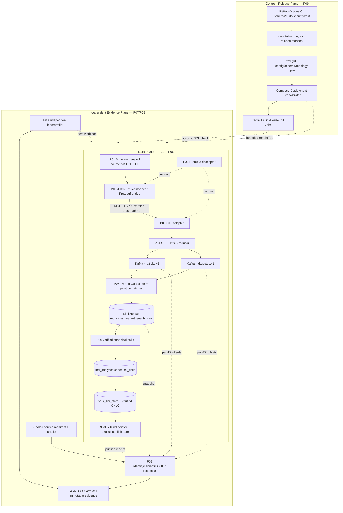
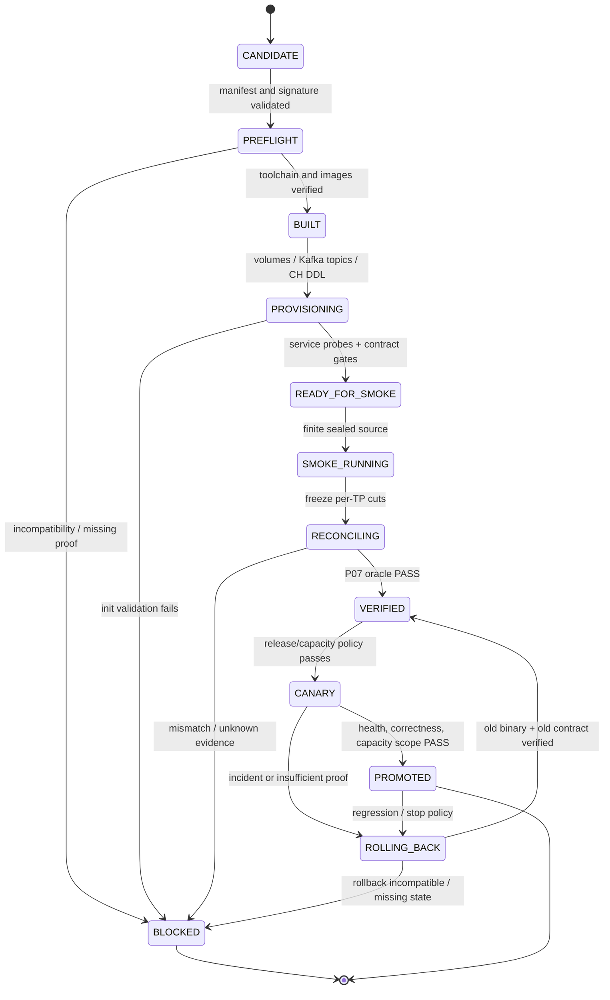

# PROJECT 09 — Full System Integration, Deployment & Release Engineering

> **System Design + Deployment Protocol + CI/CD + Operability + End-to-End Proof + Chaos/What-If Matrix**  
> Dự án **09/09** của *Market Data Streaming and Analytics Platform* · **C++20 · Python 3.12 · Kafka · Protobuf · ClickHouse · Linux · Docker Compose · GitHub Actions**  
> Phiên bản thiết kế: **1.0 — 2026-10-30** · Tiếng Việt  
> **Trạng thái: `DESIGN_ONLY / NOT_IMPLEMENTED / NOT_DEPLOYED / TESTS_NOT_RUN / NO_MEASURED_CAPACITY`.** Mọi ví dụ cấu hình, SLO, lệnh và test plan dưới đây là **đề xuất để triển khai**, không phải bằng chứng hệ thống đã chịu tải, có HA hoặc đạt p95 280 ms.

---

## 0. Nguồn gốc, giới hạn và mục đích

**Theo CV gốc:** dự án *Market Data Streaming and Analytics Platform* sử dụng C++20, Python 3.12, Kafka, Protobuf, ClickHouse, PostgreSQL; CV ghi nhận **120.000 ticks/s trên 8 partitions** và giảm p95 range query từ **2,4 s còn 280 ms trên 200 triệu rows**. CV không nêu topology, thiết bị, cách release, Docker Compose cụ thể, GitHub Actions pipeline, number of HA replicas hoặc cách đo. **Project 09 là kế hoạch xây dựng mới**, không phải mô tả đã triển khai ở Larion. *PostgreSQL* được CV nhắc trong công nghệ nhưng chưa có vai trò bắt buộc được xác nhận trong P01–P08; có thể thêm metadata service sau, không tự gán nó làm nơi lưu checkpoint hay readiness proof.

**Mục tiêu:** một người có thể checkout repository → build artifacts có provenance → dựng local lab → chạy dataset được seal qua P01/P02/P03/P04/P05/P06 → kích hoạt P07 độc lập kiểm tra → chạy P08 benchmark tách khỏi workload → thu bằng chứng tính đúng đắn, phục hồi, hiệu năng và an toàn → release/rollback có kiểm soát. Trạng thái `RUNNING`/`healthy` của container, Kafka ACK, ClickHouse INSERT ACK hoặc CI màu xanh **không đủ** để khẳng định pipeline đúng dữ liệu.

**Lời hứa có giới hạn:** Không danh sách hữu hạn nào xét hết mọi tổ hợp lỗi, kể cả lỗi mới chưa biết. Ma trận What If trong tài liệu là *risk inventory* có thể chạy bằng các fixture/fault injector, kết hợp property-based, fuzz, mutation, pairwise, combinatorial, chaos và test ngẫu nhiên có seed; khi thiếu bằng chứng phải ghi `INCONCLUSIVE`, không tự suy ra `PASS`.

### 0.1. Hợp đồng không được sửa ngầm từ P01–P08

| Nguồn | Contract bắt buộc giữ | Anti-claim tại P09 |
|---|---|---|
| [P01 Simulator](./PROJECT_01_FX_CFD_Market_Data_Simulator_System_Design.md) | `sim.v1` JSONL, seed, dataset manifest seal; **TCP gốc JSONL có delimiter newline**, không phải `MDP1`; `dataset_id`, `symbol`, `sequence` theo **từng symbol xuyên tick và quote**, `event_time_ns`, fixed-point; file `.part` chưa hoàn tất | Chỉ `send()` TCP không chứng minh client nhận; khi file chưa seal không chứng minh completeness. |
| [P02 Protobuf](./PROJECT_02_Market_Data_Protobuf_Schema_System_Design.md) | **P01 JSONL → strict P02 mapper/encoder → framed `.pbstream` hoặc `MDP1` TCP bridge → P03**; `marketdata.v1.MarketDataEvent`; `oneof` tick/quote và presence; TCP `MDP1` khác Kafka raw Protobuf | Không nối trực tiếp P01 native JSONL TCP vào P03 MDP1 framer; không hash serialized protobuf để kết luận semantic equality xuyên runtime. |
| [P03 C++ Adapter](./PROJECT_03_CPP_FX_CFD_Market_Data_Adapter_System_Design.md) | TCP framing, per-symbol sequence/gap/dup/stale, strict mode, bounded queue, reject reason | Không biến intentional business reject thành unexplained loss hoặc accepted message. |
| [P04 Kafka Streaming](./PROJECT_04_Kafka_Market_Data_Streaming_System_Design.md) | `md.ticks.v1` và `md.quotes.v1`, key=`symbol`; target lab benchmark **8 partitions mỗi topic**; idempotent C++ producer, `acks`/ISR đúng profile | Không có total order xuyên hai topic; producer ACK không bằng consumer commit/ClickHouse READY. |
| [P05 Batch Ingestion](./PROJECT_05_Python_Kafka_Batch_Ingestion_System_Design.md) | Kafka value là **raw Protobuf bytes**, no `MDP1`; manual **next-offset** commit sau CH write acknowledged; at-least-once; raw `md_ingest.market_events_raw` | Không gọi at-least-once là exactly-once; ClickHouse retry có thể tạo physical duplicates. |
| [P06 ClickHouse Analytics](./PROJECT_06_ClickHouse_Time_Series_Analytics_System_Design.md) | Raw audit → canonical snapshot checked → `md_analytics.canonical_ticks` → `bars_1m_state` → build `READY` sau oracle check | Không tính OHLC trực tiếp trên raw chứa duplicate, không query trộn hai `build_id`. |
| [P07 Replay/Recovery](./PROJECT_07_Deterministic_Replay_and_Failure_Recovery_System_Design.md) | Independent oracle, bounded finite cut, fault receipt, RPO/RTO-SERVICE/RTO-CORRECT; `PASS/FAIL/INCONCLUSIVE/INVALID/NOT_RUN` | Container sống lại không đồng nghĩa RPO=0 hay dữ liệu hoàn chỉnh. |
| [P08 Benchmark](./PROJECT_08_High_Throughput_Benchmark_and_Optimization_System_Design.md) | Offered vs issued vs Kafka append vs unique canonical; 200M **verified unique ticks**, benchmark query pinned, no invalid measurement | 120k ticks/s và p95 280ms là **mốc tham chiếu**, không tự đạt trên mọi máy/topology. |

**Trong phạm vi:** Docker images, dependency/contract locking, one-host Compose local, isolated reliability lab, 3-broker KRaft topology proposal, optional ClickHouse replicated test topology, configuration/secrets policy, init jobs, health/readiness, volumes, release manifests, CI/CD gates, security, observability, deploy/rollback, backup/restore, chaos/E2E, performance-profile handoff và runbooks.  
**Ngoài phạm vi:** live broker credentials, giao dịch thật, vận hành public production 24/7 với một Docker host, giả định mọi lỗi được khắc phục tự động, triển khai Kubernetes không yêu cầu, hứa HA với một Kafka broker hoặc một ClickHouse replica, tự chạy destructive chaos trên host không phải lab.

---

## 1. Requirements, acceptance contract và SLO đề xuất

### 1.1. Functional requirements

| ID | Yêu cầu | Bằng chứng / gate |
|---|---|---|
| FR-01 | `docker compose config --quiet` parse được profile hợp lệ và config không rò secrets | CI config lint; secrets redaction; profile matrix. |
| FR-02 | Có source-to-image build provenance (commit, proto descriptor digest, dependency lock, toolchain) | release manifest gắn OCI image digest, CMake/Python lock và SBOM. |
| FR-03 | Không tạo topic hoặc bảng sai một cách âm thầm khi đã tồn tại | idempotent init job + post-init metadata/DDL contract validator. |
| FR-04 | Dependencies phân biệt ready và started; app tự retry dependency transient | health/readiness probes + fail-closed hoặc bounded retry. |
| FR-05 | Simulator/P03/P04/P05/P06 khớp schema/kafka key/topic/table/dataset identity | contract tests dùng golden fixtures 01–06. |
| FR-06 | Kafka/ClickHouse state trên named persistent volumes ở local, không xóa khi service restart | restart tests + volume identity + before/after hash/offset diff. |
| FR-07 | Deployment có profile DEV, RELIABILITY-LAB, CAPACITY-LAB, mỗi profile tuyên bố rõ giới hạn | profile manifest, topology snapshot, failover tests đúng domain. |
| FR-08 | Cơ chế release có preflight, canary/smoke, promote, rollback và post-deploy oracle | signed/hashed run release record, stages, approvals/receipts. |
| FR-09 | Phân loại data completeness riêng với health và deployment success | P07 oracle: accepted tick+quote → Kafka/raw; accepted tick → canonical/READY/OHLC. |
| FR-10 | Shutdown/restart không commit Kafka offset sớm, không coi unknown CH outcome là failure chắc chắn | crash-point/rebalance E2E P05 + offsets verified. |
| FR-11 | Migration DB/schema và backfill giữ read/write compatibility hoặc chặn phát hành | version matrix + reversible/forward-fix plan + data migration proofs. |
| FR-12 | Pipeline và CI hỗ trợ matrix C++20, Python 3.12, pinned Kafka/CH/Protobuf | build/test artifacts + per-version logs. |
| FR-13 | CI phải test âm tính, đảm bảo test thật sự có thể FAIL | mutation/sentinel failing fixture + test completeness manifest. |
| FR-14 | Có metrics/logs/traces có kiểm soát cardinality, không leak secrets | dashboards, log-sampling, alerts với owner/runbook. |
| FR-15 | Có safe failure injection và independent evidence lưu ngoài failure domain | allowlist, receipts, oracle diff, artifacts. |
| FR-16 | P08 capacity gate đo throughput hữu dụng + lag stability + query correctness | per-stage measured counters & pinned workload. |
| FR-17 | Backup/restore ở môi trường cô lập và reconciliation sau restore | restore drill test chứng minh logical dataset và READY pointer. |
| FR-18 | Quản lý destructive operations: reset/clean không phá production volume ngoài ý muốn | explicit lab marker, whitelist, confirmation flag, dry-run+audit. |
| FR-19 | Sự cố dẫn đến incomplete hoặc unknown phải báo `NO-GO`, không auto publish READY | negative E2E + timeout verifier. |
| FR-20 | Artifact đủ để dựng lại run với cùng data/config/versions/hardware class | archive release manifest + provenance + fixture+oracle digest. |

### 1.2. SLO/NFR được đề xuất, chưa được đo

| ID | Mục tiêu khám phá | Điều kiện đánh giá |
|---|---|---|
| NFR-01 | Local smoke với finite 10.000 valid logical events | Full tick+quote Kafka/raw identity diff = 0; tick-only canonical/READY/OHLC proof hoặc report lý do không READY. |
| NFR-02 | Lab integration 1 triệu events ở 10k/s trước 120k/s | Đo offered/issued/useful separately, không biến ticks thành total events. |
| NFR-03 | Capacity: khám phá 1k→10k→50k→100k→120k **ticks/s** | Achieved verified unique tick throughput + stable queue/lag; topology pinned, không giả định sẽ đạt. |
| NFR-04 | Query baseline 200M verified unique tick rows; p95 mục tiêu **≤280 ms** | Workload SQL, concurrency, cache, host/power profile được cố định trước; no missing/incorrect queries. |
| NFR-05 | Start/readiness toàn stack local mục tiêu ≤180s trên host tham chiếu | Giới hạn chỉ sau khi chọn hardware; timeout không đồng nghĩa DB corrupted. |
| NFR-06 | Graceful stop thử ≥30s/drain budget, configurable | P05 stop polling, drain/write/commit proven frontier; timeout → state incomplete, no silent drop. |
| NFR-07 | Không data loss unexplained trên sealed finite dataset | Source/P03 policy/Topic cuts/Raw/Canonical/OHLC reconciled. |
| NFR-08 | No unexpected volume deletion on `stop`/`restart`/normal `down` | Compare named volume labels & data; `down -v` disabled in non-disposable env. |
| NFR-09 | 0 credentials trong logs/artifacts/images, no critical untriaged findings | Redaction/scan/test secret injection + scoped exception policy. |
| NFR-10 | Resource bounds không tăng vô hạn qua 12/24h soak | memory/FD/disk/parts/lag slopes and cgroup counters; run conditions pinned. |
| NFR-11 | Reproducible release manifest có SHA/digest cho mọi image/config/data/SQL | Immutable manifest + verification from independent CI job. |
| NFR-12 | Gate P0: 100% executed+PASS cho profile release; P1 theo policy; không thiếu evidence | `INCONCLUSIVE`, `INVALID`, `NOT_RUN` trên required P0 → NO-GO. |

**Phân biệt ba loại PASS:** `SAFETY_PASS` (quá tải nhưng dừng có kiểm soát), `CAPACITY_PASS` (throughput hữu dụng đạt mức test với dữ liệu đúng), `DEPLOY_PASS` (release tạo đúng topology, health và evidence). `SAFETY_PASS` không kéo theo `CAPACITY_PASS`; `DEPLOY_PASS` không kéo theo canonical correctness nếu oracle chưa chạy.

---

## 2. Kiến trúc: Data Plane, Release/Control Plane và Independent Evidence Plane



**Readiness không đồng nghĩa correctness:** Docker Compose `depends_on: condition: service_healthy` chỉ chờ healthcheck được xác nhận; pipeline cần **application preflight, schema checks và independent data oracle**. Compose không thay thế cluster orchestrator tự động dịch chuyển workload giữa nhiều máy. `depends_on.restart: true` liên quan tới Compose-controlled restart/update của dependency, không phải tự restart app sau mọi container crash của dependency. Cần có retry/reconnect trong app.

### 2.1. Ranh giới network và ownership

| Component | Owner | Giao diện | Ranh giới |
|---|---|---|---|
| P01 Simulator | Một producer process | **JSONL + `\n` native TCP** hoặc file replay; localhost/lab-only | `.part` không được coi dữ liệu sealed; generator tốc độ thực đo riêng. |
| P02 Bridge/codec | Python/C++ codec build theo shared descriptor | Strict JSONL→Protobuf và **MDP1 framed TCP / `.pbstream`** | Không đổi identity/field presence, không coi JSONL raw TCP là MDP1. |
| P03 Adapter | C++ process | TCP reader, Protobuf validation | buffer bounded; source strict/fault injection policy. |
| P04 Producer | C++ process hoặc module; deployment quyết định rõ | Kafka raw protobuf + key symbol | không tự commit consumer offsets. |
| Kafka | dedicated volumes/nodes | broker advertised listener, topics, metadata | RF=1 local ≠ HA; RF=3 reliability lab vẫn cần failure-domain test. |
| P05 Consumer | Python process per group member | Kafka consumer + CH INSERT | one poll-owner/thread; commit next-offset sau acknowledgement. |
| ClickHouse | local node hoặc separate replicated test cluster | SQL/HTTP/TCP | raw physical duplicates allowed; canonical and READY are separate invariants. |
| P06 Canonical Builder | batch/offline job | cut manifest + SQL + verified build | immutable READY, no silently mixed build_id; sync publish pointer. |
| P07 Oracle | independent jobs/host storage | sealed source, Kafka, CH read-only | không lấy app counters làm expected source truth. |
| P08 Benchmark | isolated runner | workload, traces, OS metrics | không đo performance khi oracle/chaos process làm nhiễu mà không ghi nhận. |
| P09 Orchestrator | operator/CI | Compose/config/registry/manifest | KHÔNG tự thay business data/price schema hay tự reassign kafka offsets. |

### 2.2. Topology profiles và lời hứa tương ứng

| Profile | Topology **đề xuất** | Dùng để | Không chứng minh |
|---|---|---|---|
| `DEV` | 1 Kafka KRaft broker RF=1, 1 ClickHouse, 1 Simulator, 1 P02 bridge, 1 Adapter/Producer, 1 P05 consumer, P06 batch job; Compose trên 1 host | schema, e2e, restart, learning | HA, node-failure durability, 120k ticks/s, p95 280ms. |
| `RELIABILITY-LAB` | Kafka 3 brokers RF=3/minISR=2, controller quorum cấu hình tách rõ, CH replication test topology + Keeper khi cần, isolated fault plane | broker failover/ISR/CH replica/recovery | multi-region disaster-proof, full HA nếu vẫn có shared host/storage. |
| `CAPACITY-LAB` | Kafka topics **8 partitions mỗi topic**; configurable N P05 group members; storage/compute riêng; P08 on isolated runner | throughput, p95, mixed read/write, soak, bottleneck | bản chất production-ready hay RPO=0 không cần điều kiện. |
| `CI-EPHEMERAL` | fresh isolated Kafka/CH volumes, finite dataset, deterministic test IDs | PR/integration/regression | persistence across real host loss hay capacity production. |

**Failure domain:** nếu 3 Kafka containers cùng host, cùng disk, cùng network, thì chết host có thể làm mất cả cụm; “3 brokers” không tự tạo host-level HA. CH replication cần được xác nhận cùng với Keeper/coordination phù hợp version. P09 không tự giả định từ 3 brokers thành 3 controllers hoặc cấu hình quorum nếu chưa chứng minh.

---

## 3. Contract artifact, image, schema và dataset

### 3.1. Release manifest là source-of-truth của deployment

```yaml
# releases/release-manifest.example.yaml — thiết kế, giá trị PLACEHOLDER
manifest_version: p09.release.v1
release_id: "r20261030-example"
git_commit: "<40-hex-reviewed-commit>"
source_tree_dirty: false
images:
  market_simulator: "registry.example.invalid/md/simulator@sha256:<digest>"
  protobuf_bridge: "registry.example.invalid/md/protobuf-bridge@sha256:<digest>"
  cpp_adapter: "registry.example.invalid/md/adapter@sha256:<digest>"
  cpp_producer: "registry.example.invalid/md/producer@sha256:<digest>"
  python_ingestion: "registry.example.invalid/md/ingestion@sha256:<digest>"
  canonical_builder: "registry.example.invalid/md/canonical@sha256:<digest>"
  verifier: "registry.example.invalid/md/verifier@sha256:<digest>"
contracts:
  protobuf_descriptor_sha256: "<sha256>"
  schema_package: "marketdata.v1"
  kafka_value_encoding: "raw-protobuf-no-mdp1"
  kafka_topics: ["md.ticks.v1", "md.quotes.v1"]
  key_encoding: "ascii-symbol-exact"
  dataset_identity: "dataset_id+symbol+sequence"
  clickhouse_raw: "md_ingest.market_events_raw"
  clickhouse_canonical: "md_analytics.canonical_ticks"
  bar_table: "md_analytics.bars_1m_state"
topology:
  profile: "DEV"  # DEV | RELIABILITY-LAB | CAPACITY-LAB
  kafka_brokers: 1
  kafka_rf: 1
  kafka_min_isr: 1
  tick_partitions: 1
  quote_partitions: 1
  clickhouse_replication: false
  compose_project_name: "md-dev-<run-id>"
policy:
  allow_destructive_reset: false
  source_manifest_required: true
  ignore_incomplete_dataset: false
  require_p07_oracle_for_ready: true
  require_p08_capacity_proof: false  # true in capacity release lane
  immutable_ready_build: true
  offset_reset_default: "none"  # auto-reset fallback is forbidden on missing known commit
artifacts:
  source_dataset_manifest_sha256: "<sha256>"
  compose_rendered_sha256: "<sha256>"
  kafka_topic_contract_sha256: "<sha256>"
  clickhouse_ddl_contract_sha256: "<sha256>"
  evidence_root: "isolated-evidence-store/<run-id>"
status: "EXAMPLE_ONLY_NOT_RELEASED"
```

**SHA không phải toàn bộ trust:** phải xác minh provenance, commit và workflow identity, integrity image/certificate/signature theo security policy. Không tin image tag mutable (`latest`), lockfile chưa pin hoặc JSON manifest tự thay được trong cùng pipeline. Attach SHA cho effective config **sau khi loại/redact secrets**; hash không được chứa secret value ở artifact công khai.

### 3.2. Build contract & compatibility matrix

| Cặp thành phần | Điều phải test trên binary/image thật | Release blocking |
|---|---|---|
| P01 JSONL v1 ↔ P02 mapper / framing bridge | fixed-point, `event_time_ns`, optional presence, golden projection | Mapper thay đổi implicit scale hoặc sequence → NO-GO. |
| P02 Protobuf old↔new C++/Python | forward/backward matrix, unknown fields, oneof/version | Bỏ nghĩa field number/tag, required-by-business presence bất hợp lệ → NO-GO. |
| P03 ↔ P04 | publish policy, key, headers, raw value bytes, reject path | drop/duplicate không khai báo hoặc sai topic → NO-GO. |
| P04 ↔ P05 | topic/partition/offset semantics, symbols, Kafka value encoding | `MDP1` prefix trong Kafka, wrong key, wrong kind/topic → NO-GO. |
| P05 ↔ P06 | raw DDL/columns/types and semantic digest, canonical freshness | mất `event_time_ns` precision hoặc logic ID mismatch → NO-GO. |
| P06 ↔ readers | READY build pointer, query requires `build_id`, old/new aggregates | mixed READY/unready data, materialized OHLC duplicated → NO-GO. |
| P07/P08 ↔ release | sources+SQL+topology+evidence manifest pinned | không có independent proof → NO-GO nếu scope yêu cầu. |

**Lưu ý loại event:** P05 raw có cả `tick` lẫn `quote`, nhưng P06 `md_analytics.canonical_ticks` và OHLC chỉ chứa **tick**. P09 phải chứng minh *mọi expected accepted tick/quote* tới Kafka và raw trong cut; **chỉ expected ticks** đối chiếu với `canonical_ticks` và OHLC. Không được so toàn bộ tick+quote với số tick rows trong canonical. Nếu muốn canonical quote riêng, đó là một mở rộng có schema/verification riêng, chưa được P06 thiết kế.

**Version matrix:** old producer/new consumer; new producer/old consumer; old application/new DDL; new application/old DDL; old P06 reader/new build; rollback image after additive schema; rebalance group with mixed versions. Test both data-plane compatibility **và** rollback metadata/time effects. Nếu incompatibility không thể rollback, phải dùng forward-fix/blue-green trên isolated namespaces, không tuyên bố rollback an toàn.

---

## 4. Docker images, Compose orchestration và startup protocol

### 4.1. Repository layout đề xuất

```text
market-data-platform/
├── 01-market-data-simulator/
├── 02-protobuf-contracts/
├── 03-cpp-market-data-adapter/
├── 04-kafka-streaming/
├── 05-python-batch-ingestion/
├── 06-clickhouse-analytics/
├── 07-replay-and-recovery/
├── 08-performance-benchmark/
├── 09-system-integration/
│   ├── compose.yaml
│   ├── compose.reliability.yaml
│   ├── compose.capacity.yaml
│   ├── env/dev.example.env
│   ├── images/{cpp.Dockerfile,python.Dockerfile}
│   ├── config/{topic-contract.yaml,clickhouse-ddl.sha256}
│   ├── ops/{preflight.sh,validate-contracts.py,health/}
│   ├── init/{kafka-topics,clickhouse-ddl}/
│   ├── deploy/{deploy.sh,promote.sh,rollback.sh}
│   ├── ci/{contract-test.sh,negative-test.sh,scan.sh}
│   ├── tests/{e2e,chaos,soak,compatibility}/
│   ├── manifests/{release.example.yaml,run.example.yaml}
│   ├── runbooks/
│   └── docs/{architecture,adr,operations,capacity,threat-model}/
├── .github/workflows/{ci.yaml,release.yaml,scheduled-chaos.yaml}
├── docs/decisions/
└── README.md
```

P01–P08 có thể giữ cấu trúc hiện tại; P09 dùng shared protocol/schema artifact từ P02 thay vì copy một `.proto` khác vào từng image. CI phải kiểm tra generated code tương ứng descriptor digest đã pin.

### 4.2. Compose fragment minh họa (chưa phải file runnable)

```yaml
# compose.yaml — deliberately illustrative, not runnable without real
# image digests, health probe binaries, Kafka/KRaft config and init jobs.
name: md-dev-example
services:
  kafka:
    image: ${KAFKA_IMAGE_DIGEST:?required}
    volumes:
      - kafka-data:/var/lib/kafka/data
    healthcheck:
      test: ["CMD", "/opt/md/probes/kafka-ready"]
      interval: 5s
      timeout: 3s
      retries: 24
      start_period: 20s
    restart: unless-stopped
    networks: [md-data]
  clickhouse:
    image: ${CLICKHOUSE_IMAGE_DIGEST:?required}
    volumes:
      - clickhouse-data:/var/lib/clickhouse
    healthcheck:
      test: ["CMD", "/opt/md/probes/clickhouse-ready"]
      interval: 5s
      timeout: 3s
      retries: 24
      start_period: 20s
    restart: unless-stopped
    networks: [md-data]
  ingestion:
    image: ${INGESTION_IMAGE_DIGEST:?required}
    depends_on:
      kafka: {condition: service_healthy}
      clickhouse: {condition: service_healthy}
    environment:
      KAFKA_BOOTSTRAP_SERVERS: "kafka:9092"
      CLICKHOUSE_HOST: "clickhouse"
    stop_grace_period: 45s
    restart: unless-stopped
    networks: [md-data]
    read_only: true
    tmpfs: [/tmp]
volumes:
  kafka-data: {}
  clickhouse-data: {}
networks:
  md-data: {internal: true}
```

**Kết nối thực tế:** P01 native TCP phát JSONL dòng, còn P03 yêu cầu `MDP1`; **cần P02 bridge** hoặc đọc `.pbstream` do P02 tạo, không nối hai cổng TCP trực tiếp. Các image Kafka/CH không đảm bảo có `/opt/md/probes/...`; cần build probe executable hoặc thay bằng healthcheck đã được thử **trên đúng pinned image**. Docker volume path thay đổi theo image. Kafka KRaft cần config `node.id`, roles, listeners, controller quorum, storage ID/format, `advertised.listeners` phù hợp nội/ngoại mạng: chưa thể chạy snippet bằng cách thay image alone. CLI là đường để kiểm tra, không thay app-owned retry.

**Compose safety:**

- `docker compose config --quiet` chỉ kiểm tra parsing/model, **không** đảm bảo runtime Kafka metadata, SQL DDL hoặc message semantics.
- `depends_on: service_started` không chờ readiness; `service_healthy` phụ thuộc healthcheck; `service_completed_successfully` thích hợp init one-shot nhưng init job phải verify postconditions, không chỉ exit 0.
- `docker compose up --wait --wait-timeout ...` đợi running/healthy theo Compose, **không** đợi P07 data correctness.
- `docker compose down` bình thường không xóa named volumes, nhưng `down --volumes` xóa volumes khai báo trong Compose: chặn trên non-disposable environment; anonymous volume persistence cũng cần review.
- Không bật `ports:` public cho Kafka, ClickHouse hay Prometheus ở demo nếu không cần. Nếu host cần query, bind `127.0.0.1`/firewall và tránh lộ raw data.

### 4.3. State machine của một deployment



**Các gate bất khả bỏ qua:** preflight phải khóa source/config/image hashes; provisioning khớp expected DDL/topic/cluster identity; smoke theo sealed 10k dataset có oracle độc lập; không tự gọi canary/trial là production promotion; không rollback schema đã phá dữ liệu khi không có migration restore/forward fix.

---

## 5. Bootstrap, dependencies, topic/DDL init và failure envelope

### 5.1. Thứ tự bootstrap đề xuất

1. **Host preflight:** Docker Engine/Compose version, kernel/cgroup, free bytes/inodes, ports, time sync, directory permissions, UID/GID, isolation marker, backup readiness, executable image digests.
2. **Verify artifacts:** image digest/signature/policy, descriptors, Python/C++ dependency lock, config checksums (redacted), migration SQL hash.
3. **Provision backing services:** Kafka KRaft cluster (storage metadata/quorum) và ClickHouse server; app không start dựa vào `sleep 20`.
4. **Broker readiness:** admin round trip + cluster ID + quorum/expected broker count + ISR topic policy. `tcp:9092` open không đủ.
5. **Topic init job:** idempotent create/describe for two topics, partitions, RF, `min.insync.replicas`, retention/cleanup/security. Existing mismatch phải BLOCK, không silently recreate. Topic partition expansion có thể remap key-to-partition; chỉ theo controlled migration.
6. **ClickHouse init job:** DB/table schema từ P05/P06; `SHOW CREATE`, column types, TTL, `ORDER BY`, materialized view dependencies và query compatibility; `IF NOT EXISTS` không thay DDL diff.
7. **Application starts:** adapter/producer/P05 tự reconnect với bounded exponential backoff; readiness = internal contract okay, liveness chỉ check process loop.
8. **Smoke dataset:** sealed finite P01 JSONL → P02 strict mapper/encoder→ P03 MDP1, inspect P03 accept/reject, P04 Kafka end offsets, P05 durable frontiers, P06 canonical READY, P07 full diff.
9. **Enable load/benchmark:** chỉ sau smoke có PASS; P08 không chạy trên cùng host khi benchmark muốn đo pure SUT mà không ghi nhận nhiễu.

### 5.2. Readiness, liveness, startup + error taxonomy

| Probe / gate | Positive nghĩa là gì | Không có nghĩa là gì |
|---|---|---|
| Container `running` | PID1 hoạt động | Dependency ready, stream không bị nghẽn, completeness. |
| Liveness | Main loop không deadlock theo probe thiết kế | Kafka/CH khỏe hoặc data correct. |
| Kafka `ready` | Admin thao tác thành công, đúng cluster ID/quorum theo profile | Không bảo đảm mỗi record ACK được lưu nếu ISR xuống; kiểm tra riêng. |
| CH `ready` | DB trả query sentinel, schema contract hợp lệ sau init | Không bảo đảm OHLC đúng, active build READY. |
| App `ready` | dependencies cần thiết reachable + descriptor/schema/topic/table verify | Không khẳng định latency/capacity 120k. |
| Data correctness `PASS` | full finite oracle identity/semantic/OHLC/cut proof phù hợp | Không tự thay thế stress/soak/DR evidence. |
| Capacity `PASS` | tải mục tiêu với backlog không tăng và dữ liệu đúng trong workload pin | Không đảm bảo mọi hardware/workload khác. |

**Error classes:** `TRANSIENT` (broker restart, CH short outage) → bounded retry/backpressure; `CONFIG_FATAL` (wrong topic/DDL/proto) → fail fast; `DATA_POISON` (malformed record without accepted injection manifest) → stop/quarantine protocol, no offset skip; `AMBIGUOUS_WRITE` (ClickHouse accepted but ACK lost) → retry stable batch, reconcile; `RETENTION_GAP`/`SOURCE_MISSING` → `INCONCLUSIVE/NO-GO`; `FAULT_INVALID` (injector không trigger) → `INVALID`.

---

## 6. Resource budgets, network, volumes và performance isolation

### 6.1. Guardrail budgets (MVP đề xuất, chưa đo)

| Resource | Policy khởi đầu / gate | Cách xác minh |
|---|---|---|
| P03 queue | bounded bytes + item count; timeout/drop policy documented | throttle downstream, measure peak/rss, compare accepted/published ledger. |
| P04 local producer buffers | bounded `queue.buffering.max.kbytes/messages`; pressure returned to P03 | broker outage, ensure no unbounded heap/false ACK. |
| P05 Python memory | default ref ≤512 MiB RSS at dev profile **only as target**; 64 MiB application batches + Kafka prefetch separate | slow ClickHouse, read cgroup memory.events, no OOM silent. |
| P05 batch | per-TP FIFO, one in-flight per partition, global 4 inflight target | delay/partial insert/rebalance; contiguous commit frontier. |
| Kafka disk | retention headroom ≥ projected outage + catch-up + backup safety, measured by bytes/age | no automatic Kafka offset reset to `latest` when known commit expired. |
| CH storage | persistent named volume, max parts alert, merges, disk reserve and restore headroom | injection of small inserts, TTL+backup interaction. |
| Metrics | bounded cardinality; avoid per-event labels | high symbol cardinality/long soak metrics memory. |
| Host | no overcommit silently: CPU/mem/I/O limits, sufficient disk/inodes and process FD | cgroup pressure, OOM, network loss, fsync/SMART when lab supports. |
| P08 | isolate generator load/evidence from SUT or measure overhead explicitly | A/B profiler off/on, fixture clock consistency. |

**Storage accounting:** source sealed files, Kafka broker logs, ClickHouse raw, canonical builds, materialized bars, metrics logs, backups và evidence stores đều tiêu thụ disk. Không chỉ dựa vào `docker system df`; theo dõi filesystem thực, inode, volume path, backup scratch, merge free space và retention hành vi thực đo.

### 6.2. Security và secrets

- Mỗi image build multi-stage, runtime user non-root khi image/config cho phép; read-only rootfs, writable tmpfs và named data volumes với UID/GID đúng; minimum Linux capabilities, no privileged/docker.sock mounts trong app.
- Pin base images by digest và lock dependencies, generate SBOM/provenance; scan secret, dependency, container image, license; không tự phát hành khi critical untriaged.
- Runtime secret qua Compose secrets file hoặc external secret manager; kiểm tra mount `/run/secrets/...`; **Compose secrets dựa file mount không tự tạo network secret vault, không nên coi là full secret manager**. Không log env/secrets, che masked logs; test leak qua process args, error trace, artifact.
- Scope network `md-data` internal; chặn public listeners, bind host port 127.0.0.1 nếu cần; separate management/observability, broker ACL/TLS trong lab mở rộng nếu cần; tránh hard-code broker password trong `.env` committed.
- GitHub Actions job chỉ có `contents: read` theo mặc định; release job mới được cấp thêm quyền tối thiểu, pinned action to reviewed full SHA hoặc lockfile, approval protected environments, không cấp secrets cho untrusted PR. OIDC nếu dùng cloud, không nhét long-lived key trong YAML.
- Đưa destructive commands vào wrapper chỉ chạy khi profile=disposable lab, run-id/volume labels khớp, snapshot evidence được seal; `docker compose down -v`, `rm -rf`, Kafka topic delete, CH `DROP`, reset offsets đều yêu cầu separate explicit authorization trong lab.

---

## 7. CI/CD và release strategy: chất lượng, supply chain, rollback

### 7.1. GitHub Actions pipeline (logical jobs, không giả là workflows đã tồn tại)

```mermaid
flowchart LR
  L["lint + compose config"] --> SC["P02 schema API compatibility"]
  SC --> B["C++20 + Python3.12 builds"]
  B --> U["unit/property/fuzz/sanitizers"]
  U --> S["SAST/SBOM/secrets/image scan"]
  S --> I["ephemeral P01-P06 integration"]
  I --> N["negative canary: prove tests can fail"]
  N --> R["P07 crash/consistency E2E"]
  R --> P["P08 smoke/profile capacity (CI-scope)"]
  P --> A["image digest + signed release manifest"]
  A --> E["manual protected environment promote"]
  E --> O["postdeploy oracle / rollback gate"]
```



**PR policy:** untrusted PR không được truy cập registry write creds hoặc deploy secrets; no direct release job. Matrix tests chạy trên pinned images/reusable actions và short deterministic fixtures. Nightly/weekly E2E chaos/soak chạy trên isolated runner, không đưa long 24h tests vào mỗi PR nếu quá chi phí — nhưng release gate phải có expiry/currency của proof. Fuzz crashes produce repro seed, not silently skip. Cache được khóa vào lockfile, cache corruption must invalidate/rebuild, không dùng cache để chứng minh provenance.

**Image gate:** build once, test same image digests, promote **the same digest** (no rebuild after tests). Quét artifact + verify provenance before deploying; workload names/run-id/cluster identity logged. Canary trên finite isolated dataset và cut; nếu deployment target có live data phải có staged rollout tương thích dữ liệu, không chuyển topic/schema một cách tùy tiện.

### 7.2. Migration rules

1. **Expand** backwards-compatible DDL/schema; old reader/writer hoạt động với new DDL; pin descriptor.
2. **Validate** old/new producers/consumers, topics, CH aggregation state, `SHOW CREATE`, golden oracle.
3. **Backfill** immutable `build_id` mới theo sealed cut; worker còn chạy không được xuất READY sớm.
4. **Switch** READY pointer qua single-writer atomic replace hoặc external CAS. File atomic rename local chỉ đảm bảo trong cùng filesystem/phạm vi lock; **không giả định multi-node HA**.
5. **Contract** legacy fields/tables sau rollback window và restore proof; không tự `DROP` khi chưa kiểm tra consumers cũ.

**Rollback types:** image rollback (old binary); config rollback; metadata/READY pointer revert (nếu old READY còn valid); **data migration rollback** (chỉ nếu reversible và đã thử); forward-fix với irreversible migration. Một rollback không tự phục hồi Kafka offsets, xóa historical physical duplicate hoặc “undo” ClickHouse INSERT đã ack. Chạy lại independent oracle sau rollback.

### 7.3. Deploy protocol không trả PASS sớm

```text
PREFLIGHT
  -> verify signed image digests, configuration, dataset seal, profiles, contracts
  -> lock release_id + run_id + Kafka cluster_id + CH deployment_id
PROVISION / REUSE
  -> only idempotent admin changes; fail if topic/DDL differs
DRAIN / QUIESCE if required by migration
  -> stop new input; P05 partition-frontier clean; preserve source replay
ROLLOUT
  -> start services with readiness checks, app retry; no automatic offset reset
FINITE SMOKE
  -> freeze P01 source and per-topic-partition Kafka cut
  -> wait for proven P05 next-offset frontiers and CH raw audit
  -> build P06 canonical candidate and verify OHLC
ORACLE GATE
  -> P07 full tick+quote Kafka/raw checks + tick-only canonical/OHLC; zero unexpected mismatch
PERF GATE (only capacity profile)
  -> P08 measured useful throughput, steady lag, query result and p95 scope
PROMOTE or NO-GO
  -> seal evidence; never promote from health alone
POSTDEPLOY
  -> fixed-window health + correctness + regression triggers
```

---

## 8. Invariants và proof boundaries xuyên toàn hệ thống

### 8.1. Hai tập dữ liệu cần phân biệt

```text
SOURCE_DEFINED    = semantic source slots from P01 sealed dataset + deliberate fault manifest
EXPECTED_ACCEPTED_ALL = SOURCE_DEFINED after precisely declared P03 validation policy
EXPECTED_TICKS    = subset(EXPECTED_ACCEPTED_ALL, kind == tick)
EXPECTED_QUOTES   = subset(EXPECTED_ACCEPTED_ALL, kind == quote)
KAFKA_CUT          = bounded per-(cluster_id, topic_generation,topic,partition) [start,end)
RAW_ALL            = physical records P05 wrote (tick + quote, may duplicate)
CANONICAL_TICKS    = unique verified TICK logical identities at build_id
READY              = published snapshot with verified TICK canonical + OHLC + receipt

logical_event_id   = (dataset_id, symbol, sequence)
semantic_record    = exact fixed-point fields, event kind, source version, explicit field presence
transport_position = (cluster_id, topic_generation, topic, partition, offset)
```

Do not compare physical Kafka/CH row counts to logical IDs without accounting for duplicates/accepted rejects/manifest cut. Application ledger from P03/P04 **is evidence**, not an independent oracle. Compare source seal/expected acceptance → Kafka records in cut → P05 physical raw → canonical identity+semantic projection → OHLC bars and READY pointer; require source manifest and DDL/template hashes. P03 sequence is across tick+quote; Kafka ordering is only per topic-partition; P09 cannot reconstruct a cross-topic total order merely from offsets.

### 8.2. 26 invariants bắt buộc (INV-09-01…26)

| ID | Invariant | Bằng chứng độc lập |
|---|---|---|
| INV-09-01 | Không nhận `.part` làm complete source | P01 manifest hash + completed marker. |
| INV-09-02 | Cùng dataset/seed/config/version cho replay logical equivalent | Source golden semantic comparator. |
| INV-09-03 | Không đổi `price_ticks`, `price_scale`, `event_time_ns` qua serializer | Decode C++ & Python + exact field/presence compare. |
| INV-09-04 | `dataset_id,symbol,sequence` unique trong expected accepted set | Source manifest oracle identity map. |
| INV-09-05 | Tick/quote content tương ứng topic P04 | Kafka scan per topic and oneof. |
| INV-09-06 | Kafka key exact ASCII symbol | Kafka header/key/payload cross-check. |
| INV-09-07 | Không có MDP1 TCP framing trong Kafka value | Raw Kafka record binary validator. |
| INV-09-08 | Không infer total order xuyên hai Kafka topics | Known interleave fixture + sequence oracle. |
| INV-09-09 | P04 ACK/timeout không được coi canonical completed | Delivery ledger vs CH+READY proof. |
| INV-09-10 | P05 không auto-commit offsets trước CH accepted | Crash injection and committed frontier. |
| INV-09-11 | P05 chỉ commit contiguous next-offset frontier for owned generation | Rebalance and offset audit. |
| INV-09-12 | UNKNOWN CH write outcome không được đánh là certain failed | ACK loss fixture, raw scan, stable retry. |
| INV-09-13 | Backpressure bounded; no infinite queue growth | cgroup/queue/lag/overflow evidence. |
| INV-09-14 | Physical duplicates không làm tăng canonical **tick** logical count | Duplicate injection, independent set count. |
| INV-09-15 | Conflicting same ID/different semantic payload blocks publication | Conflict fixture, P06 READY gate. |
| INV-09-16 | Materialized OHLC derived from verified canonical, not unverified raw | Independent reference bars. |
| INV-09-17 | Every query selects exactly one verified `build_id` | Query whitelist/SQL logs with scope. |
| INV-09-18 | READY snapshot immutable; late input creates new build | Old/new snapshot digests. |
| INV-09-19 | Released code/config/proto/SQL digest matches tested manifest | CI provenance + live inventory. |
| INV-09-20 | Restart never silently resets Kafka group to latest | offset readback / recoverability verdict. |
| INV-09-21 | `down`/restart preserve named volumes unless explicit disposable lab reset | Volume ID + pre/post state audit. |
| INV-09-22 | Failed readiness/migration/oracle cannot promote release | Release state machine receipt. |
| INV-09-23 | Fault injector evidence proves fault happened | Fault receipts + target IDs/times. |
| INV-09-24 | P08 capacity report counts **useful verified ticks**, not attempted-only | Source-to-canonical rate with same windows. |
| INV-09-25 | Security secrets are absent from released artifacts and logs | CI secret scan + logs image inspect. |
| INV-09-26 | Missing/incomplete proof never converts to PASS | Verdict parser negative fixtures. |

### 8.3. End-to-end conservation, không đếm trùng

```text
Expected accepted identities after P03 policy = E_all = E_tick ∪ E_quote
Kafka scanned within per-TP sealed cuts = K_all (tick + quote; may duplicate)
P05 raw physical rows = R_all (tick + quote; may duplicate)
P06 canonical tick logical set at build_id = C_tick  # quotes NOT in this table

PASS for the end-to-end finite cut requires:
  IDs(unique_logic(K_all)) == IDs(E_all) after accounting permitted retries
  IDs(unique_logic(R_all within sealed cut)) == IDs(E_all)
  for each accepted tick AND quote: exact semantic fields match E_all[id]
  no identity with conflicting logical payload across K_all/R_all
  IDs(C_tick) == IDs(E_tick)                 # no quote rows in canonical_ticks
  for each tick id: semantic(C_tick[id]) == semantic(E_tick[id])
  OHLC(C_tick) exactly equals oracle(E_tick) for selected READY build_id
  snapshot cut/versions/manifest verified; intended rejects accounted separately
  raw physical duplicates categorized; no false exactly-once guarantee

NON-PROOFS:
  abs(count(K) - count(R)) == 0; consumer lag == 0;
  Kafka producer acks == source count; ClickHouse COUNT(*) == source count;
  Prometheus dashboard healthy; Compose exits 0.
```

A Kafka failure/replay can create additional physical rows while still yielding correct logical C; conversely matching total counts can hide swapped IDs. Retention may make evidence unrecoverable; if source is sealed, a new Kafka **topic generation**/namespace can rebuild cut; do not claim old offsets are intact.

---

## 9. Observability, release signals và evidence quality

| Signal | Owner / source | Alert / hành động |
|---|---|---|
| release_manifest_mismatch, unexpected image digest | P09 preflight/verifier | P0 stop deploy, security/operational review. |
| Kafka cluster_id change, under-min ISR, topic config drift | Kafka admin/audit | P0 block writes/promote, investigate retention/quorum. |
| Producer queue/backpressure and delivery failures | P04 | throttle/gate; distinguish timeout/unknown from not appended. |
| P05 consumer lag by topic-partition; committed next-offset | Kafka + P05 | alert growing lag/retention risk, no auto offset reset. |
| P05 UNKNOWN writes, retry count and batch frontier | P05 + raw audit | freeze promotion; reconcile by batch/identity. |
| CH parts/merge pressure, disk free, query log, TTL age | CH system tables + host | pause/reduce ingestion, restore capacity, avoid false query pass. |
| canonical mismatch, OHLC mismatch, READY without proof | P07/P06 verifier | P0, block queries/promote, sealed incident artifact. |
| offered/issued/verified throughput, p95 + error distribution | P08 independent runner | distinguish capacity FAIL vs safe overload handling. |
| container exits/healthcheck, cgroup `memory.events`, CPU throttling | Docker/host | diagnose resource; do not equate restart with recovery. |
| CI job skipped, expired test evidence, new critical scanner finding | CI auditor | release NO-GO until rerun or approved documented exception. |

**Log schema** đề xuất: timestamp UTC + monotonic elapsed if applicable, release_id/run_id/dataset_id, service/image digest, stage, reason, Kafka topic-partition-offset *nếu liên quan*, build_id/snapshot cut, error code; redact secret. Metrics label cardinality bounded; không gắn event ID mỗi tick vào Prometheus labels. Forensics lưu raw evidence bằng quyền riêng trên artifact store, không log millions of events ở full load. Metric scrape failures phải báo measurement invalid.

**Evidence receipt sample** (not actual result):

```yaml
schema_version: "p09.evidence.v1"
run_id: "<uuid>"
release_id: "<id>"
profile: "RELIABILITY-LAB"
start_utc: null
end_utc: null
images_digest_manifest_sha256: null
compose_rendered_sha256: null
tool_versions: {}
host_cgroup_snapshot_sha256: null
source_seal_sha256: null
source_fault_manifest_sha256: null
protobuf_descriptor_sha256: null
kafka_cluster_id: null
topic_generation_ids: {}
topic_config_snapshot_sha256: null
per_tp_cut: []
clickhouse_version_and_ddl_sha256: null
p05_next_offset_frontiers: []
p06_ready_build_id: null
oracle:
  identity_missing: null
  identity_extra: null
  identity_conflict: null
  semantic_mismatch: null
  ohlc_mismatch: null
fault_receipts: []
metrics_artifact_sha256: null
logs_artifact_sha256: null
verdict: "NOT_RUN"
reason: "Design example. No test executed."
```

---

## 10. Threat model và tổ hợp lỗi nguy hiểm

**Threat actors:** sai thao tác operator, PR độc hại, image/registry bị compromise, credentials lộ, public port, compromised runner; **natural failures:** host chết, disk full/inode full, clock drift, DNS stale, broker failover, Kafka retention, CH merge/TTL/backup conflict, resource contention; **logic failures:** schema drift, wrong key, conflated offsets/source sequence, publish READY from raw count, wrong rollback or test masking, consumer commit ahead of sink.

**Sự cố liên hợp phải thử chủ đích:**

1. Broker leader mất khi producer ACK timeout **và** P05 rebalance; verify no false loss or premature commit.
2. CH ACK timeout sau physical INSERT **và** P05 crash; retry + canonical dedup + no conflict.
3. Release new Protobuf schema khi 50% consumers còn old image **và** topic retention gần hết; fail compatibility gate before promotion.
4. `docker compose up --force-recreate` khi P01 source unsealed **và** host disk <10% free; no false READY, no accidental volumes deletion.
5. TTL/merge đang chạy **và** backup/snapshot build; restore/canonical proof must remain intact.
6. 120k attempted ticks/s **và** metrics collector dies; capacity status `INCONCLUSIVE`, not PASS.
7. 3 Kafka brokers same host **và** host power loss; explicitly admit shared failure domain, RPO requires sealed source/off-host backup.
8. Canary reader moves READY pointer **và** old reader reconnects; no mixed build_id queries, rollback cut coherent.
9. CI uses cached generated Proto but descriptor changed **và** test skipped; contract mismatch blocks artifact promotion.
10. Secret rotated **và** one app process caches old credential while retrying; bounded failures, redact and refresh safely.
11. Consumer lag crosses retention head **và** app auto reset misconfig; block restart, restore from sealed source with new cut only.
12. Partial chaos faults not triggered **và** dashboard looks normal; mark `INVALID`, require receipt.

**An toàn lab:** mọi chaos/destructive test phải verify container/project labels, `run_id`, disposable volumes, backup manifest trước test; fault injector nằm ngoài target process; journal+evidence store tách failure domain. Không tự động xóa Kafka topic/CH data từ test runner mà không có allowlist và xác nhận phạm vi.

---
## 11. What-If Matrix — inventory có thể tự động hóa, không phải test đã chạy

> **576 ca thử, 36 nhóm, mỗi nhóm 16 ca.** Test cases `P09-A-01…P09-AJ-16` định nghĩa fault/stimulus và kết quả kỳ vọng. Ghi `NOT_RUN` cho toàn bộ cho tới khi fixture + injector thực sự kích hoạt + independent oracle có bằng chứng. Mọi NFR là **đề xuất**, không có kết quả benchmark thực tế. Không thể liệt kê đúng nghĩa “tất cả tình huống có thể xảy ra”; xem thêm property-based/fuzz/mutation/chaos combinations.

### 11.1. Cách chấm verdict và kiểm chứng

| Verdict | Chỉ được dùng khi | Release gate |
|---|---|---|
| `PASS` | Đúng fixture, fault thực sự xảy ra, thu được independent evidence và expected invariant đúng | Có thể đạt gate của case |
| `FAIL` | Có counterexample xác nhận / invariant vi phạm dù evidence đầy đủ | NO-GO nếu required |
| `INCONCLUSIVE` | Fault xảy ra nhưng thiếu/không tin được evidence, offset expired, source seal thất lạc hoặc outcome unknown | NO-GO đối với P0 |
| `INVALID` | Fault không kích hoạt, sai target/profile, fixture sai, không đo đúng biến, chạy nhầm network | NO-GO đối với P0 |
| `NOT_RUN` | Chưa thực thi | NO-GO đối với P0 |

**Ghi nhớ:** `PASS` một test overload có thể chỉ chứng minh **fail safely**; không có nghĩa system đạt throughput mục tiêu. `FAIL` về capacity không nhất thiết đồng nghĩa mất dữ liệu. Test runner phải ghi mã test, release id, run id, environment, fault receipt, profile, source/descriptor/image hash, cut IDs, independent oracle diff, confidence/threshold và trạng thái thực thi.

### 11.2. Coverage summary

| Nhóm | Chủ đề | Priority density | Fixture + verification |
|---|---|---|---|
| A | Release manifest, identity và source-of-truth | high | Compare independently regenerated manifest digest, image/descriptor identities, source seal and live deployment inventory. |
| B | Protobuf schema/version và cross-language compatibility | high | Decode with separately built binaries; compare exact semantic projections and schema/version policy, not protobuf wire SHA. |
| C | Container images, provenance, dependency locks | medium | Inspect OCI image digest, metadata, SBOM, installed runtime toolchain, vulnerability/secret scanner and CI provenance. |
| D | Compose config, profiles, overlays và environment drift | medium | Compare `docker compose config` normalized result with profile manifest, service network/volume refs and security checks. |
| E | Service readiness, health probes và init order | medium | Probe receipts with timestamps, init DDL/topic after-state, application attempts and independent smoke test verdict. |
| F | DNS, listeners, ports và service identity | medium | Check reachability from inside actual app containers, Kafka metadata/cluster identity, TLS/ACL and network traces. |
| G | Kafka KRaft bootstrap, quorum và broker durability | high | Kafka admin describe cluster/topic/ISR/cluster-id, produced/consumed per-TP scans and P07 source reconciliation. |
| H | Kafka topics, partitioning, keys, retention contract | high | Describe topic configs, verify exact Kafka key/value, per-TP ordered offsets and source identity cut. |
| I | Kafka producer ACK, idempotence, retries và backpressure | high | Producer delivery callbacks + Kafka independent read + source/accepted identities + queue byte bounds. |
| J | Consumer groups, rebalance, offsets và fencing | high | Kafka committed **next offsets**, assignment epochs, CH write receipt and independent raw/canonical cut. |
| K | ClickHouse bootstrap, raw DDL, schema migration | high | SHOW CREATE, system.columns/parts, independent SQL checks and source-to-build semantic oracle. |
| L | Simulator/Adapter startup, replay và validation | medium | Compare P01 manifest slots, P03 acceptance/rejection ledger, raw Kafka records and exact semantic projections. |
| M | P05 batch ingestion, ClickHouse write outcome và offset order | high | Exact expected accepted set, CH physical rows, P05 batch-frontier+ACK receipt and Kafka committed next-offset. |
| N | P06 canonical snapshots, materialized OHLC và READY publication | high | Independent full logical semantic comparator + reference OHLC + sealed per-TP cut and READY pointer receipt. |
| O | Docker volumes, persistence và container lifecycle | high | Volume ID labels, persisted broker cluster ID, ClickHouse data tables, manifest hash and service readiness after restart. |
| P | Rollout, canary, mixed versions và rollback | high | Full release state machine receipt, per-version audit and P07 verified cut; blocked promotion when uncertain. |
| Q | Backup, restore, recovery point và disaster readiness | high | Restore accepted tick+quote Kafka/raw set and tick-only canonical/READY/OHLC, metadata, topic cuts, checkpoints and measured RPO/RTO. |
| R | Independent oracle, snapshot cuts và proof of correctness | high | Independent recomputation of identity/semantic/field-presence, Kafka source cut, exact OHLC, immutable report status. |
| S | CI pipeline, skipped tests và release gate semantics | medium | Verify each required job exists, ran, consumed pinned inputs and attached non-empty evidence before green gate. |
| T | Secrets, access control và supply-chain attack surface | medium | Verify least privilege, secret redaction, scanned artifacts, runtime permissions, TLS identity and audit logs. |
| U | Clock, event-time, timezone và timestamp interpretation | medium | Compare 64-bit ns event fields and partition date via independent UTC integer reference; latency uses monotonic clock. |
| V | Logging, metrics, tracing và alert quality | medium | Independent event counters/histogram samples, metric scrape receipts, log artifact redaction and alert/runbook route. |
| W | CPU limits, scheduler contention và throughput saturation | medium | Per-service CPU throttling/PSI, issuer vs useful tick throughput, latency histogram and full data oracle. |
| X | RAM, OOM, file descriptors và process lifecycle | medium | RSS/cgroup memory.events, queue bytes, fd count, offsets; verify both kinds through raw, ticks through READY. |
| Y | Disk, filesystem, inode, TTL và IO saturation | medium | Host filesystem/free inode/IO metrics, Kafka log status, CH parts/merges, P01 seal and full oracle after recovery. |
| Z | Network partitions, packet loss, latency và TLS renewal | medium | Packet/connection trace, acknowledgements, per-TP offset audit, P05 batch states and independent canonical proof. |
| AA | Kafka retention, group checkpoints và source replay feasibility | high | Log-start/end per TP, committed next offsets, source seal, topic generation, replay reconciliation report. |
| AB | ClickHouse parts, materialized views, SQL và query concurrency | medium | SHOW CREATE/EXPLAIN/system.parts/system.merges, independent row/ OHLC oracle, full query response status + p95. |
| AC | Horizontal scaling, partition skew và capacity frontiers | medium | Effective useful verified throughput, per-TP lag slopes, CPU/memory/IO, error/timeout counts and query latency. |
| AD | HA topology, shared failure domains và quorum semantics | medium | Failure-domain inventory, quorum/ISR probes, restored source/canonical proof and explicit HA claim matrix. |
| AE | Chaos injector, test validity và lab-safety enforcement | medium | Fault target ID, injection timestamp, observed effect/telemetry, cleanup receipt, per-test verdict and evidence checksums. |
| AF | Soak tests, periodic restarts và memory/disk lifecycle | low | Window-by-window resource slopes, Kafka lag, CH parts, service restart count, semantic cut/oracle at end. |
| AG | Release races, concurrent operators và migration locking | high | Compare CAS/lock fencing, manifest authority, DB DDL history, Kafka config changes and READY pointer audit. |
| AH | Human operations, runbooks và destructive mistakes | low | Guardrail decisions, audit trail, restored data oracle, runbook correctness and on-call handoff receipt. |
| AI | Compound multi-fault campaigns và nonlinear cascades | high | Trigger receipts for all intended faults, scoped per-TP cuts, post-recovery semantic equality and resource budgets. |
| AJ | Benchmark methodology, statistical validity và reporting | low | Verify offered/issued/accepted/unique rates, per-window backlogs, query response correctness, histograms and repeatability. |

### 11.3. Chi tiết 576 What-If cases

#### A. Release manifest, identity và source-of-truth (16 cases)

**Fixture / fault setup:** Manifest signed/hashed, two distinct release IDs, known-good source fixture và modified candidate.

**Independent evidence / oracle:** Compare independently regenerated manifest digest, image/descriptor identities, source seal and live deployment inventory.

| Test ID | Ưu tiên | What if / cách gây lỗi | Expected invariant / PASS condition | Bằng chứng tối thiểu |
|---|---|---|---|---|
| `P09-A-01` | **P0** | Thay git commit SHA nhưng giữ nguyên image digest trong manifest | Preflight nhận diện mismatch provenance; không deploy. | Fault receipt + scoped source/offset/CH proof; no premature READY |
| `P09-A-02` | **P0** | Thay image tag `latest` thay cho digest immutable | Policy gate từ chối artifact không xác định, không chạy smoke. | Fault receipt + scoped source/offset/CH proof; no premature READY |
| `P09-A-03` | **P0** | Sửa `protobuf_descriptor_sha256` nhưng không rebuild C++ | Cross-language contract gate FAIL trước publish. | Fault receipt + scoped source/offset/CH proof; no premature READY |
| `P09-A-04` | **P0** | Manifest ghi Kafka topic `md.ticks.v2` trong khi P04 phát v1 | Provisioning từ chối sai topic, không tự tạo silently. | Fault receipt + scoped source/offset/CH proof; no premature READY |
| `P09-A-05` | **P0** | Thay `dataset_id` ở manifest nhưng source JSONL seal giữ cũ | Oracle xác nhận seal/identity mismatch và NO-GO. | Fault receipt + scoped source/offset/CH proof; no premature READY |
| `P09-A-06` | **P0** | Thay `compose_project_name` trùng run đang phục vụ | Isolation guard chặn deploy trước khi stop/recreate service cũ. | Fault receipt + scoped source/offset/CH proof; no premature READY |
| `P09-A-07` | **P0** | Hai release đồng thời ghi chung READY pointer | Single-writer/CAS phải chặn writer stale; không có double promotion. | Fault receipt + scoped source/offset/CH proof; no premature READY |
| `P09-A-08` | **P0** | Hạ `clickhouse_ddl_contract_sha256` sang bản cũ với image mới | Migration compatibility preflight FAIL hoặc yêu cầu planned backward-compatible path. | Fault receipt + scoped source/offset/CH proof; no premature READY |
| `P09-A-09` | **P1** | Bỏ Kafka `cluster_id` trong run inventory khi reuse cluster | Verdict INCONCLUSIVE cho continuity of offsets, không giả định cùng cluster. | Fault receipt + scoped source/offset/CH proof; no premature READY |
| `P09-A-10` | **P1** | Ký manifest bằng key không có trong trust policy | Verify signature FAIL, không promote dù checksum đúng. | Fault receipt + scoped source/offset/CH proof; no premature READY |
| `P09-A-11` | **P1** | Source tree dirty trong build release | Build policy fail hoặc ghi reproducible exception approved, không label clean. | Fault receipt + scoped source/offset/CH proof; no premature READY |
| `P09-A-12` | **P1** | Tạo release ID trùng với artifact khác bytes | Immutable manifest registry reject overwrite, log tamper evidence. | Fault receipt + scoped source/offset/CH proof; no premature READY |
| `P09-A-13` | **P1** | Manifest thiếu `tick_partitions` và `quote_partitions` | Required-field validator FAIL; không dự đoán partition default. | Fault receipt + scoped source/offset/CH proof; no premature READY |
| `P09-A-14` | **P1** | Trộn evidence của hai `run_id` khác nhau | Proof gate FAIL vì scope mismatch; không cộng counters chéo run. | Fault receipt + scoped source/offset/CH proof; no premature READY |
| `P09-A-15` | **P2** | Sửa newline/order của JSON manifest sau khi ký | Verify canonical representation/signature theo định nghĩa, mismatch chặn. | Fault receipt + scoped source/offset/CH proof; no premature READY |
| `P09-A-16` | **P2** | Replay từ old run nhưng release metadata chỉ gắn new run | Trace/run isolation check từ chối READY, chỉ báo reusable old source nếu explicit. | Fault receipt + scoped source/offset/CH proof; no premature READY |

#### B. Protobuf schema/version và cross-language compatibility (16 cases)

**Fixture / fault setup:** Golden events with presence bits, compiled old/new C++ and Python codecs, two schema descriptors.

**Independent evidence / oracle:** Decode with separately built binaries; compare exact semantic projections and schema/version policy, not protobuf wire SHA.

| Test ID | Ưu tiên | What if / cách gây lỗi | Expected invariant / PASS condition | Bằng chứng tối thiểu |
|---|---|---|---|---|
| `P09-B-01` | **P0** | Producer v2 thêm optional field, consumer v1 chưa biết field | Consumer v1 chịu được hoặc release matrix FAIL trước mixed rollout; retain logical meaning. | Fault receipt + scoped source/offset/CH proof; no premature READY |
| `P09-B-02` | **P0** | Reuse field number cho `event_time_ns` thành string | Descriptor breaking-change gate từ chối deployment. | Fault receipt + scoped source/offset/CH proof; no premature READY |
| `P09-B-03` | **P0** | Đổi `price_scale` value 100000 thành 10000 mà giữ schema version | Cross-app semantic golden test phát hiện price meaning drift và BLOCK. | Fault receipt + scoped source/offset/CH proof; no premature READY |
| `P09-B-04` | **P0** | Chuyển `oneof` tick thành quote trong topic ticks | P05 strict validator reject; no offset skip/READY. | Fault receipt + scoped source/offset/CH proof; no premature READY |
| `P09-B-05` | **P0** | P04 thêm `MDP1` prefix vào Kafka record | P05 raw-protobuf decoder reject; contract test FAIL. | Fault receipt + scoped source/offset/CH proof; no premature READY |
| `P09-B-06` | **P0** | P03 decode record thiếu proto3 optional `sequence` presence | Reject thiếu required-by-business field dù getter trả 0. | Fault receipt + scoped source/offset/CH proof; no premature READY |
| `P09-B-07` | **P0** | C++ encoder tạo payload mà Python decoder đọc `int64` boundary sai | Exact integer comparator FAIL, không sửa bằng float. | Fault receipt + scoped source/offset/CH proof; no premature READY |
| `P09-B-08` | **P0** | Python decoder silently drops unknown field trước reserialize | Version test phân biệt tolerated unknown và loss of semantic fields; promote only if policy permits. | Fault receipt + scoped source/offset/CH proof; no premature READY |
| `P09-B-09` | **P1** | Rebuild Python generated code nhưng C++ vẫn dùng descriptor cũ | Mixed digest compatibility test FAIL nếu interpretation lệch. | Fault receipt + scoped source/offset/CH proof; no premature READY |
| `P09-B-10` | **P1** | Thêm symbol có Unicode ngoài ASCII key policy | P04/P05 reject by explicit policy, không casefold/sanitize silently. | Fault receipt + scoped source/offset/CH proof; no premature READY |
| `P09-B-11` | **P1** | P02 sample được parse nhưng missing both tick/quote payload | Structural gate rejects, no Kafka publish as valid. | Fault receipt + scoped source/offset/CH proof; no premature READY |
| `P09-B-12` | **P1** | Schema file thay nhưng committed generated artifacts không đổi | Generated-code drift gate FAIL và rebuild pinned code. | Fault receipt + scoped source/offset/CH proof; no premature READY |
| `P09-B-13` | **P1** | Old reader đọc READY canonical mới với removed column | Compatibility matrix FAIL, switch blocked until reader upgraded. | Fault receipt + scoped source/offset/CH proof; no premature READY |
| `P09-B-14` | **P1** | Proto `event_time_ns` chuyển thành milliseconds trong app adapter | Semantic test ns exact FAIL; no READY. | Fault receipt + scoped source/offset/CH proof; no premature READY |
| `P09-B-15` | **P2** | Cùng logical ID nhưng different schema projection yields conflict | Canonical conflict oracle blocks publication. | Fault receipt + scoped source/offset/CH proof; no premature READY |
| `P09-B-16` | **P2** | Descriptor digest headers không khớp value schema although parsing succeeds | Strict contract/header check rejects or quarantines with manifest receipt. | Fault receipt + scoped source/offset/CH proof; no premature READY |

#### C. Container images, provenance, dependency locks (16 cases)

**Fixture / fault setup:** Image allowlist + SBOM fixtures + pinned base images + registry mock with mutable tags.

**Independent evidence / oracle:** Inspect OCI image digest, metadata, SBOM, installed runtime toolchain, vulnerability/secret scanner and CI provenance.

| Test ID | Ưu tiên | What if / cách gây lỗi | Expected invariant / PASS condition | Bằng chứng tối thiểu |
|---|---|---|---|---|
| `P09-C-01` | **P0** | Registry tag được move sang image khác sau CI | Deploy resolves pinned digest, never repulls by tag. | Before/after config+telemetry, failure receipt and component oracle |
| `P09-C-02` | **P0** | Base image tag mutable giữa C++ build và Python build | Image lock check phát hiện drift; build same approved digest. | Before/after config+telemetry, failure receipt and component oracle |
| `P09-C-03` | **P0** | Runtime image thiếu libstdc++ version cần cho C++ binary | Smoke linkage/loader fail and reject release. | Before/after config+telemetry, failure receipt and component oracle |
| `P09-C-04` | **P0** | Python requirements có package transitive không lock | Reproducibility gate rejects unpinned dependency graph. | Before/after config+telemetry, failure receipt and component oracle |
| `P09-C-05` | **P0** | Multi-stage build để lộ build-time credential trong layer | Image/secret scan FAIL; rebuild without embedded secret. | Before/after config+telemetry, failure receipt and component oracle |
| `P09-C-06` | **P0** | Image chạy `root` dù non-root được yêu cầu | Image policy gate fail or scoped approved exception; explicit audit. | Before/after config+telemetry, failure receipt and component oracle |
| `P09-C-07` | **P1** | Image architecture amd64 được deploy sang arm64 không hỗ trợ | Platform preflight fail before data migration. | Before/after config+telemetry, failure receipt and component oracle |
| `P09-C-08` | **P1** | CMake build Release khác sanitizer-tested build mà không có test artifact link | CI refuses to claim sanitizer evidence applies to deployed digest. | Before/after config+telemetry, failure receipt and component oracle |
| `P09-C-09` | **P1** | Image entrypoint bỏ signal forwarding làm SIGTERM không tới child | Graceful shutdown test FAIL, no release. | Before/after config+telemetry, failure receipt and component oracle |
| `P09-C-10` | **P1** | Registry rate limit làm image pull timeout | Retry bounded and abort preflight, not half promote. | Before/after config+telemetry, failure receipt and component oracle |
| `P09-C-11` | **P1** | Image có package CVE critical nhưng marked ignored không có expiry | Scanner exception policy NO-GO. | Before/after config+telemetry, failure receipt and component oracle |
| `P09-C-12` | **P1** | Container digest đúng nhưng Dockerfile tự download binary unverified | Supply-chain audit fails hermetic/reproducible build requirement. | Before/after config+telemetry, failure receipt and component oracle |
| `P09-C-13` | **P1** | SBOM thiếu protoc/runtime dependency | Completeness/attestation check reports missing and blocks provenance claim. | Before/after config+telemetry, failure receipt and component oracle |
| `P09-C-14` | **P1** | Artifact signature valid nhưng signer workflow unauthorized | Identity trust policy rejects despite cryptographic validity. | Before/after config+telemetry, failure receipt and component oracle |
| `P09-C-15` | **P2** | Release artifact được build lại sau khi test trước deploy | Digest equality gate rejects new untested digest. | Before/after config+telemetry, failure receipt and component oracle |
| `P09-C-16` | **P2** | Untrusted fork PR modifies build script to upload secrets | Fork job has no privileged secret token; security test detects unsafe env scope. | Before/after config+telemetry, failure receipt and component oracle |

#### D. Compose config, profiles, overlays và environment drift (16 cases)

**Fixture / fault setup:** Render Compose with DEV, RELIABILITY-LAB, CAPACITY-LAB overlays under distinct environment variables.

**Independent evidence / oracle:** Compare `docker compose config` normalized result with profile manifest, service network/volume refs and security checks.

| Test ID | Ưu tiên | What if / cách gây lỗi | Expected invariant / PASS condition | Bằng chứng tối thiểu |
|---|---|---|---|---|
| `P09-D-01` | **P0** | Sai indent YAML làm `depends_on` rỗng | Compose parse/config lint FAIL before any deployment. | Before/after config+telemetry, failure receipt and component oracle |
| `P09-D-02` | **P0** | Overlay dev vô tình override Kafka RF=3 trong reliability lab | Effective topology mismatch blocks fault test validity. | Before/after config+telemetry, failure receipt and component oracle |
| `P09-D-03` | **P0** | Compose profile enable P08 benchmark nhưng không enable P07 verifier | Release guard requires verifier for READY, not a green Compose exit. | Before/after config+telemetry, failure receipt and component oracle |
| `P09-D-04` | **P0** | Biến `${KAFKA_IMAGE_DIGEST}` rỗng | Compose required variable expansion FAIL, no `latest` fallback. | Before/after config+telemetry, failure receipt and component oracle |
| `P09-D-05` | **P0** | Two .env files set conflicting `KAFKA_BOOTSTRAP_SERVERS` | Effective config hash + runtime inspection detects mismatch; abort. | Before/after config+telemetry, failure receipt and component oracle |
| `P09-D-06` | **P0** | `COMPOSE_PROJECT_NAME` bị bỏ làm trùng default project | Name/isolation guard refuses colliding existing resources. | Before/after config+telemetry, failure receipt and component oracle |
| `P09-D-07` | **P1** | Service advertised network thiếu `md-data` | Graph lint detects unreachable dependency, readiness fails safely. | Before/after config+telemetry, failure receipt and component oracle |
| `P09-D-08` | **P1** | `depends_on` trỏ service chỉ có ở inactive profile | Compose model invalid; profile test catches and prevents release. | Before/after config+telemetry, failure receipt and component oracle |
| `P09-D-09` | **P1** | Compose root has implicit published port `0.0.0.0:8123` | Security lint fails public exposure for ClickHouse. | Before/after config+telemetry, failure receipt and component oracle |
| `P09-D-10` | **P1** | `restart: always` che tiến trình exit code 1 lặp | Restart-storm watchdog alarms and rollout NO-GO. | Before/after config+telemetry, failure receipt and component oracle |
| `P09-D-11` | **P1** | Local overlay dùng bind mount source code vào runtime image release | Policy rejects mutable code path in release profile. | Before/after config+telemetry, failure receipt and component oracle |
| `P09-D-12` | **P1** | Docker Compose tool version thấp không hiểu selected feature | Version/preflight gate rejects, no silent downgrade. | Before/after config+telemetry, failure receipt and component oracle |
| `P09-D-13` | **P1** | YAML boolean kiểu cũ xử lý khác expected | Rendered config semantic diff catches changed flag. | Before/after config+telemetry, failure receipt and component oracle |
| `P09-D-14` | **P1** | Two project profiles share one named `kafka-data` volume accidentally | Volume/project label audit blocks cross-run overlap. | Before/after config+telemetry, failure receipt and component oracle |
| `P09-D-15` | **P2** | CLI chọn profile `capacity` nhưng report ghi `reliability` | Run evidence profile identity mismatch => INVALID. | Before/after config+telemetry, failure receipt and component oracle |
| `P09-D-16` | **P2** | Compose file được chỉnh sau preflight nhưng trước `up` | Check rendered SHA immediately before deploy; abort on TOCTOU change. | Before/after config+telemetry, failure receipt and component oracle |

#### E. Service readiness, health probes và init order (16 cases)

**Fixture / fault setup:** Delay/degrade Kafka/CH init, insert one-shot init job, capture healthcheck and application state transitions.

**Independent evidence / oracle:** Probe receipts with timestamps, init DDL/topic after-state, application attempts and independent smoke test verdict.

| Test ID | Ưu tiên | What if / cách gây lỗi | Expected invariant / PASS condition | Bằng chứng tối thiểu |
|---|---|---|---|---|
| `P09-E-01` | **P0** | Kafka TCP 9092 open nhưng controller chưa elected | Admin-readiness fails; producer bounded retry, no premature smoke. | Before/after config+telemetry, failure receipt and component oracle |
| `P09-E-02` | **P0** | ClickHouse trả SELECT 1 nhưng raw table chưa tạo | Schema init gate fails; ingestion readiness stays false. | Before/after config+telemetry, failure receipt and component oracle |
| `P09-E-03` | **P0** | `depends_on: service_started` thay `service_healthy` | Test startup race; app reconnect/no loss; policy flags missing readiness gate. | Before/after config+telemetry, failure receipt and component oracle |
| `P09-E-04` | **P0** | Healthcheck executable bị thiếu trong pinned image | Mark service unhealthy and block, not report app correct. | Before/after config+telemetry, failure receipt and component oracle |
| `P09-E-05` | **P0** | Kafka init job exits 0 nhưng topic retention sai | Post-init describe compare FAIL, no release. | Before/after config+telemetry, failure receipt and component oracle |
| `P09-E-06` | **P0** | ClickHouse init job exits 0 nhưng `IF NOT EXISTS` che wrong ORDER BY | DDL fingerprint mismatch FAIL before write. | Before/after config+telemetry, failure receipt and component oracle |
| `P09-E-07` | **P1** | P05 bắt đầu trước khi Kafka topic được provision | Bounded retry/wait for topics, no silent auto-topic with wrong config. | Before/after config+telemetry, failure receipt and component oracle |
| `P09-E-08` | **P1** | P06 canonical job chạy khi P05 still has uncommitted batch in cut | Wait until per-TP proven frontier; do not publish READY. | Before/after config+telemetry, failure receipt and component oracle |
| `P09-E-09` | **P1** | Liveness probe đi qua dependency, CH outage làm app liveness fail | Diagnose bad liveness coupling; do not restart storm indefinitely. | Before/after config+telemetry, failure receipt and component oracle |
| `P09-E-10` | **P1** | Readiness probe luôn true khi Python worker deadlocked | Process-level smoke/traffic fails; deployment gate NO-GO. | Before/after config+telemetry, failure receipt and component oracle |
| `P09-E-11` | **P1** | Compose `up --wait` báo healthy nhưng P01 manifest chưa seal | Smoke/proof gate blocks READY until dataset completed. | Before/after config+telemetry, failure receipt and component oracle |
| `P09-E-12` | **P1** | Healthcheck timeout 1s trên slow CI host | Distinguish probe timeout from service proof; invalid/adjust profile, not claim corrupt data. | Before/after config+telemetry, failure receipt and component oracle |
| `P09-E-13` | **P1** | Service healthy nhưng P04 cannot produce due ACL reject | End-to-end smoke fails; no promotion. | Before/after config+telemetry, failure receipt and component oracle |
| `P09-E-14` | **P1** | Two init jobs race to create same tables | Serialize with lock/verify convergence; no conflicting DDL. | Before/after config+telemetry, failure receipt and component oracle |
| `P09-E-15` | **P2** | P05 CH retry succeeding after readiness checker previously failed | Readiness recovers with observed contract; no offset leap or data double-count. | Before/after config+telemetry, failure receipt and component oracle |
| `P09-E-16` | **P2** | Kafka/CH reconnect after long outage while health state remains stale | Enforce freshness TTL for readiness result and independent transaction probe. | Before/after config+telemetry, failure receipt and component oracle |

#### F. DNS, listeners, ports và service identity (16 cases)

**Fixture / fault setup:** Internal Docker network with DNS aliases, host access, Kafka metadata listeners and firewall fault injection.

**Independent evidence / oracle:** Check reachability from inside actual app containers, Kafka metadata/cluster identity, TLS/ACL and network traces.

| Test ID | Ưu tiên | What if / cách gây lỗi | Expected invariant / PASS condition | Bằng chứng tối thiểu |
|---|---|---|---|---|
| `P09-F-01` | **P0** | P04 kết nối bootstrap broker nhưng advertised listener trỏ localhost của container | Client metadata route fails safely; config guard flags unusable listener. | Before/after config+telemetry, failure receipt and component oracle |
| `P09-F-02` | **P0** | P05 nhìn DNS `kafka` thành địa chỉ host cũ sau recreation | Client reconnect/resolution and bounded retry; no auto offset reset. | Before/after config+telemetry, failure receipt and component oracle |
| `P09-F-03` | **P0** | ClickHouse DNS đổi lúc batch đang gửi | UNKNOWN write outcome handled idempotently; no early commit. | Before/after config+telemetry, failure receipt and component oracle |
| `P09-F-04` | **P0** | Port 9092 của Kafka trùng service hệ thống trên host | Preflight port collision refuses public mapping or switches internal-only. | Before/after config+telemetry, failure receipt and component oracle |
| `P09-F-05` | **P0** | Host 127.0.0.1 port bind nhưng app khác host cố kết nối | Distinguish documented isolation from availability failure. | Before/after config+telemetry, failure receipt and component oracle |
| `P09-F-06` | **P0** | P03 TCP client dùng `0.0.0.0` làm remote address | Config validation rejects invalid destination before starting. | Before/after config+telemetry, failure receipt and component oracle |
| `P09-F-07` | **P1** | Container network alias collision among two Kafka clusters | Cluster ID check catches wrong cluster; stop. | Before/after config+telemetry, failure receipt and component oracle |
| `P09-F-08` | **P1** | DNS resolution trả IPv6 đầu tiên nhưng service chỉ IPv4 | Fallback/test supported stack; no infinite busy retry. | Before/after config+telemetry, failure receipt and component oracle |
| `P09-F-09` | **P1** | P05 broker metadata returns external listener unreachable in CI network | Smoke metadata connectivity FAIL rather than assume broker ready. | Before/after config+telemetry, failure receipt and component oracle |
| `P09-F-10` | **P1** | Internal network inadvertently exposes ClickHouse 8123 to internet | Security egress/ingress scan detects and blocks. | Before/after config+telemetry, failure receipt and component oracle |
| `P09-F-11` | **P1** | Packet fragmentation/MTU mismatch causes intermittent large protobuf failures | Network test catches framing timeouts; no partial event accepted. | Before/after config+telemetry, failure receipt and component oracle |
| `P09-F-12` | **P1** | Kafka broker TLS endpoint configured but client plaintext | Auth/connect fails closed with explicit error, no silent downgrade. | Before/after config+telemetry, failure receipt and component oracle |
| `P09-F-13` | **P1** | Expired CA certificate on Kafka broker | TLS certificate verification rejects; rotation runbook restores. | Before/after config+telemetry, failure receipt and component oracle |
| `P09-F-14` | **P1** | DNS query latency spikes 5s during reconnection | Retry budget and lag monitoring; no loss claim without source cut. | Before/after config+telemetry, failure receipt and component oracle |
| `P09-F-15` | **P2** | Two Compose projects join same external network unexpectedly | Network policy checks project/service identity and cross-namespace isolation. | Before/after config+telemetry, failure receipt and component oracle |
| `P09-F-16` | **P2** | Docker bridge network deleted/recreated during test | Client reconnect with new identity check and correctness after recovery. | Before/after config+telemetry, failure receipt and component oracle |

#### G. Kafka KRaft bootstrap, quorum và broker durability (16 cases)

**Fixture / fault setup:** DEV RF1 and 3-broker reliability lab with explicit controllers/quorum; fault inject leader/controller process or disk.

**Independent evidence / oracle:** Kafka admin describe cluster/topic/ISR/cluster-id, produced/consumed per-TP scans and P07 source reconciliation.

| Test ID | Ưu tiên | What if / cách gây lỗi | Expected invariant / PASS condition | Bằng chứng tối thiểu |
|---|---|---|---|---|
| `P09-G-01` | **P0** | Kafka data volume chưa formatted và broker được start | Controlled storage-format init only new lab; never erase existing cluster ID. | Fault receipt + scoped source/offset/CH proof; no premature READY |
| `P09-G-02` | **P0** | Reuse old volume với KRaft cluster ID khác | Startup blocked; do not reformat metadata automatically. | Fault receipt + scoped source/offset/CH proof; no premature READY |
| `P09-G-03` | **P0** | Kill active partition leader giữa `acks=all` request | New leader election may recover; ambiguous ACK recorded, no false missing claim. | Fault receipt + scoped source/offset/CH proof; no premature READY |
| `P09-G-04` | **P0** | Broker leader dies right after append before ACK reaches producer | Producer retry and independent Kafka scan handle maybe-appended record. | Fault receipt + scoped source/offset/CH proof; no premature READY |
| `P09-G-05` | **P0** | Reliability lab ISR drops below configured minISR | `acks=all` requests fail; safe backpressure, no success label. | Fault receipt + scoped source/offset/CH proof; no premature READY |
| `P09-G-06` | **P0** | 3 brokers configured but two on same host/disk | HA validation warns shared failure domain; do not claim host-survival. | Fault receipt + scoped source/offset/CH proof; no premature READY |
| `P09-G-07` | **P0** | Controller quorum unavailable due majority loss | Writes/admin impacted as appropriate, gate blocked; no unsafe quorum reset. | Fault receipt + scoped source/offset/CH proof; no premature READY |
| `P09-G-08` | **P0** | Broker storage filesystem becomes read-only | Broker errors surfaced, producer pressure bounded; reconciliation after restore. | Fault receipt + scoped source/offset/CH proof; no premature READY |
| `P09-G-09` | **P1** | Kafka broker gets OOMKilled under 120k offered rate | Failover capacity degraded; no unbounded retry memory, no silent loss proof. | Fault receipt + scoped source/offset/CH proof; no premature READY |
| `P09-G-10` | **P1** | Kafka restart triggered by `compose up --force-recreate` | Persistent cluster ID and log retention verified; consumer group stable after recovery. | Fault receipt + scoped source/offset/CH proof; no premature READY |
| `P09-G-11` | **P1** | One broker advertises duplicate `node.id` | KRaft config preflight FAIL and no deploy. | Fault receipt + scoped source/offset/CH proof; no premature READY |
| `P09-G-12` | **P1** | Kafka controller/broker version incompatible upgrade step | Version matrix/rolling policy blocks until tested. | Fault receipt + scoped source/offset/CH proof; no premature READY |
| `P09-G-13` | **P1** | Unclean leader election accidentally enabled in lab | Policy flags durability risk; no RPO=0 claim. | Fault receipt + scoped source/offset/CH proof; no premature READY |
| `P09-G-14` | **P1** | Storage format on existing Kafka log directory is re-run | Non-destructive idempotent guard refuses formatting without new-volume marker. | Fault receipt + scoped source/offset/CH proof; no premature READY |
| `P09-G-15` | **P2** | Broker lagging replicas survive restart but not catch up | Monitor ISR/catch-up; do not promote capacity state while under-replicated. | Fault receipt + scoped source/offset/CH proof; no premature READY |
| `P09-G-16` | **P2** | Kill host containing all 3 broker containers | Full cluster unavailable; sealed source/off-host evidence needed; HA claim explicitly FAIL. | Fault receipt + scoped source/offset/CH proof; no premature READY |

#### H. Kafka topics, partitioning, keys, retention contract (16 cases)

**Fixture / fault setup:** Topic provisioner + Kafka verifier; two topics and per-symbol event fixture incl skewed symbols.

**Independent evidence / oracle:** Describe topic configs, verify exact Kafka key/value, per-TP ordered offsets and source identity cut.

| Test ID | Ưu tiên | What if / cách gây lỗi | Expected invariant / PASS condition | Bằng chứng tối thiểu |
|---|---|---|---|---|
| `P09-H-01` | **P0** | Provision `md.ticks.v1` with 6 partitions while manifest asks 8 | Preflight config mismatch => block; no silent auto expansion. | Fault receipt + scoped source/offset/CH proof; no premature READY |
| `P09-H-02` | **P0** | Create `md.quotes.v1` with RF=1 in reliability lab RF=3 | Topic contract mismatch => NO-GO. | Fault receipt + scoped source/offset/CH proof; no premature READY |
| `P09-H-03` | **P0** | Producer sends key `eurusd` while event symbol `EURUSD` | P05 strict validator rejects and reports, no canonical READY. | Fault receipt + scoped source/offset/CH proof; no premature READY |
| `P09-H-04` | **P0** | Topic `md.ticks.v1` receives quote oneof | Kind/topic check fails with precise coordinate, no silent conversion. | Fault receipt + scoped source/offset/CH proof; no premature READY |
| `P09-H-05` | **P0** | Topic `md.quotes.v1` uses `cleanup.policy=compact` unintentionally | Provisioning detects divergent cleanup policy; NO-GO. | Fault receipt + scoped source/offset/CH proof; no premature READY |
| `P09-H-06` | **P0** | Kafka retention set shorter than projected outage catch-up | Capacity/retention preflight warns/block for required recovery window. | Fault receipt + scoped source/offset/CH proof; no premature READY |
| `P09-H-07` | **P0** | Expand partitions from 8 to 16 while same symbols keep publishing | Repartition migration must account ordering/ownership; gate blocks naive expansion. | Fault receipt + scoped source/offset/CH proof; no premature READY |
| `P09-H-08` | **P0** | P04 serializes `MDP1`-prefixed Kafka value | Decode contract FAIL with raw protobuf check. | Fault receipt + scoped source/offset/CH proof; no premature READY |
| `P09-H-09` | **P1** | Use random key instead of symbol on one producer instance | Partition/key distribution and same-symbol ordering test FAIL. | Fault receipt + scoped source/offset/CH proof; no premature READY |
| `P09-H-10` | **P1** | Topic auto-creation enabled and init job skipped | Topic created with wrong defaults detected by post-init describe, block. | Fault receipt + scoped source/offset/CH proof; no premature READY |
| `P09-H-11` | **P1** | Kafka offset jump due leader truncation after unsafe election | P07 cut/oracle detects missing transport data; no success claim. | Fault receipt + scoped source/offset/CH proof; no premature READY |
| `P09-H-12` | **P1** | Cross-topic tick/quote arrival reorder but same source sequence | Do not rely on global Kafka order; application validates per-symbol semantic sequence as contracted. | Fault receipt + scoped source/offset/CH proof; no premature READY |
| `P09-H-13` | **P1** | Producer sends null key for valid event | Record rejected by contract, diagnostic retained. | Fault receipt + scoped source/offset/CH proof; no premature READY |
| `P09-H-14` | **P1** | Topic name reused after deletion with same offsets but new generation | Topic-generation identity differs; no ledger from old generation reused. | Fault receipt + scoped source/offset/CH proof; no premature READY |
| `P09-H-15` | **P2** | Hot symbol maps 99% of records to one partition | Metrics/benchmark accurately expose skew; do not claim even partition capacity. | Fault receipt + scoped source/offset/CH proof; no premature READY |
| `P09-H-16` | **P2** | Header schema hash changed without payload schema matching | Validate header vs pinned descriptor and reject mismatched record. | Fault receipt + scoped source/offset/CH proof; no premature READY |

#### I. Kafka producer ACK, idempotence, retries và backpressure (16 cases)

**Fixture / fault setup:** P04 async producer, broker fault proxy and exact source ledger with replayable finite dataset.

**Independent evidence / oracle:** Producer delivery callbacks + Kafka independent read + source/accepted identities + queue byte bounds.

| Test ID | Ưu tiên | What if / cách gây lỗi | Expected invariant / PASS condition | Bằng chứng tối thiểu |
|---|---|---|---|---|
| `P09-I-01` | **P0** | Broker append thành công nhưng network drops ACK | Mark delivery ambiguous, retry according to producer semantics; reconcile Kafka exact records. | Fault receipt + scoped source/offset/CH proof; no premature READY |
| `P09-I-02` | **P0** | Producer `acks=1` deployed where manifest requires `acks=all` | Config gate rejects unsafe durability downgrade. | Fault receipt + scoped source/offset/CH proof; no premature READY |
| `P09-I-03` | **P0** | `enable.idempotence=false` mistakenly set while retries active | Producer config validation fails release policy. | Fault receipt + scoped source/offset/CH proof; no premature READY |
| `P09-I-04` | **P0** | Producer instance crashes after enqueue before broker send | Unpublished accepted IDs remain recoverable via source replay, do not label delivered. | Fault receipt + scoped source/offset/CH proof; no premature READY |
| `P09-I-05` | **P0** | Producer flush timeout on shutdown | Incomplete delivery ledger and NO-GO until reconciliation or replay. | Fault receipt + scoped source/offset/CH proof; no premature READY |
| `P09-I-06` | **P0** | Producer memory queue fills while P03 still accepts events | Backpressure bounded; do not silently discard accepted events. | Fault receipt + scoped source/offset/CH proof; no premature READY |
| `P09-I-07` | **P0** | Retry `max.in.flight` settings break producer sequencing guarantees in pinned client version | Config/test matrix catches wrong combination, no release. | Fault receipt + scoped source/offset/CH proof; no premature READY |
| `P09-I-08` | **P0** | Two P04 producers share same symbol with no global ordering coordination | Enforce ownership/replay policy; detect out-of-order semantic IDs. | Fault receipt + scoped source/offset/CH proof; no premature READY |
| `P09-I-09` | **P1** | Broker connection restored after 20-minute outage beyond retention headroom | Distinguish recoverable source replay vs uncertain Kafka proof. | Fault receipt + scoped source/offset/CH proof; no premature READY |
| `P09-I-10` | **P1** | One event gets duplicated at application-level republish after restart | Duplicate logical ID recognized, canonical remains correct, count attempts separately. | Fault receipt + scoped source/offset/CH proof; no premature READY |
| `P09-I-11` | **P1** | Delivery callback reports non-retriable authorization error | Stop/reject and alert; no loss hidden under retry loop. | Fault receipt + scoped source/offset/CH proof; no premature READY |
| `P09-I-12` | **P1** | P04 queue statistic reads zero while callbacks still pending | Use independent Kafka cut, not queue-zero, to claim completion. | Fault receipt + scoped source/offset/CH proof; no premature READY |
| `P09-I-13` | **P1** | Producer metrics disabled under high load | Capacity verdict INCONCLUSIVE if missing required evidence, no PASS. | Fault receipt + scoped source/offset/CH proof; no premature READY |
| `P09-I-14` | **P1** | Producer reboot changes clock, send timestamps not monotonic | Do not use wall-clock delta as latency proof; source timestamps remain intact. | Fault receipt + scoped source/offset/CH proof; no premature READY |
| `P09-I-15` | **P2** | Source replay produces same ID but changed payload due bad version/seed | Identity conflict detected before READY, not treat as benign duplicate. | Fault receipt + scoped source/offset/CH proof; no premature READY |
| `P09-I-16` | **P2** | ClickHouse ingestion lags while producer throughput meets offered rate | Source-to-canonical useful throughput FAIL capacity despite Kafka ACK success. | Fault receipt + scoped source/offset/CH proof; no premature READY |

#### J. Consumer groups, rebalance, offsets và fencing (16 cases)

**Fixture / fault setup:** At-least-once P05 consumer with 2–N members; bounded batches; revoke/lost hooks instrumented.

**Independent evidence / oracle:** Kafka committed **next offsets**, assignment epochs, CH write receipt and independent raw/canonical cut.

| Test ID | Ưu tiên | What if / cách gây lỗi | Expected invariant / PASS condition | Bằng chứng tối thiểu |
|---|---|---|---|---|
| `P09-J-01` | **P0** | Consumer crash after CH INSERT ACK but before offset commit | Re-read allowed, canonical idempotent; no lost logical ID. | Fault receipt + scoped source/offset/CH proof; no premature READY |
| `P09-J-02` | **P0** | Consumer commit offset before CH INSERT completes | Test must detect invalid frontier and FAIL release. | Fault receipt + scoped source/offset/CH proof; no premature READY |
| `P09-J-03` | **P0** | Rebalance revokes partition while sink worker still busy | Old owner cannot commit revoked TP; external insert may still complete, reconcile. | Fault receipt + scoped source/offset/CH proof; no premature READY |
| `P09-J-04` | **P0** | Second consumer joins group mid-batch | Correct assignment and contiguous commit, no holes. | Fault receipt + scoped source/offset/CH proof; no premature READY |
| `P09-J-05` | **P0** | Max poll interval exceeded due blocking ClickHouse write | Rebalance handled without premature commits; owner poll loop requirement enforced. | Fault receipt + scoped source/offset/CH proof; no premature READY |
| `P09-J-06` | **P0** | Duplicate Kafka record observed at two consumer epochs | Physical duplicates possible; reconcile logical identity and no conflict. | Fault receipt + scoped source/offset/CH proof; no premature READY |
| `P09-J-07` | **P0** | Consumer offset reset policy `latest` on missing commit | Startup must refuse known-source discontinuity, no silent skip. | Fault receipt + scoped source/offset/CH proof; no premature READY |
| `P09-J-08` | **P0** | Commit of offset N while offset N-1 outstanding | Contiguous frontier invariant catches premature commit. | Fault receipt + scoped source/offset/CH proof; no premature READY |
| `P09-J-09` | **P1** | Cross-topic sequence gap mistaken for Kafka offset gap | Correctly distinguish source sequence and Kafka offsets. | Fault receipt + scoped source/offset/CH proof; no premature READY |
| `P09-J-10` | **P1** | Lag reaches old retention boundary during outage | Detect gap, mark `INCONCLUSIVE/NO-GO`, recover from sealed source only with new cut. | Fault receipt + scoped source/offset/CH proof; no premature READY |
| `P09-J-11` | **P1** | One partition continuously hot, others idle | Batch timers/partition fairness bounded; idle partitions not starved. | Fault receipt + scoped source/offset/CH proof; no premature READY |
| `P09-J-12` | **P1** | Worker completes insert after lost-assignment callback | Old worker result cannot advance commit; reconciliation handles side effect. | Fault receipt + scoped source/offset/CH proof; no premature READY |
| `P09-J-13` | **P1** | Consumer group IDs collide across test projects | Namespace isolation check prevents stealing partitions. | Fault receipt + scoped source/offset/CH proof; no premature READY |
| `P09-J-14` | **P1** | Offset commit ACK lost while broker actually stored it | Read back next-offset/frontier; do not assume not committed. | Fault receipt + scoped source/offset/CH proof; no premature READY |
| `P09-J-15` | **P2** | P05 SIGTERM while 4 sink batches inflight | Drain within budget or emit incomplete receipt; no offset leap. | Fault receipt + scoped source/offset/CH proof; no premature READY |
| `P09-J-16` | **P2** | Consumer group rebalance while Kafka broker ISR degraded | Rebalance and write durability status separated; release cannot overclaim zero data loss. | Fault receipt + scoped source/offset/CH proof; no premature READY |

#### K. ClickHouse bootstrap, raw DDL, schema migration (16 cases)

**Fixture / fault setup:** Pinned CH image with P05 raw DDL and P06 canonical state tables; typed schema fixture.

**Independent evidence / oracle:** SHOW CREATE, system.columns/parts, independent SQL checks and source-to-build semantic oracle.

| Test ID | Ưu tiên | What if / cách gây lỗi | Expected invariant / PASS condition | Bằng chứng tối thiểu |
|---|---|---|---|---|
| `P09-K-01` | **P0** | Raw table exists but `sequence` column UInt32 instead of Int64 | DDL fingerprint rejects, no ingestion. | Fault receipt + scoped source/offset/CH proof; no premature READY |
| `P09-K-02` | **P0** | Change `ORDER BY` to ingest timestamp without migration plan | DDL compatibility/performance gate fails before release. | Fault receipt + scoped source/offset/CH proof; no premature READY |
| `P09-K-03` | **P0** | Raw `MergeTree` replaced with memory engine in dev and reused in reliability lab | Storage policy rejects nonpersistent engine. | Fault receipt + scoped source/offset/CH proof; no premature READY |
| `P09-K-04` | **P0** | Materialized view points to different target table name | Dependency graph validator fails; no READY. | Fault receipt + scoped source/offset/CH proof; no premature READY |
| `P09-K-05` | **P0** | ClickHouse `CREATE TABLE IF NOT EXISTS` returns success on wrong schema | Verify SHOW CREATE and block, not treat CREATE success as compatibility. | Fault receipt + scoped source/offset/CH proof; no premature READY |
| `P09-K-06` | **P0** | Update `price_ticks` to Float64 through migration | Semantic type contract rejects precision loss. | Fault receipt + scoped source/offset/CH proof; no premature READY |
| `P09-K-07` | **P0** | New ingestion image inserts source field that old raw table lacks | Old/new compatibility test FAIL before mixed rollout. | Fault receipt + scoped source/offset/CH proof; no premature READY |
| `P09-K-08` | **P0** | DDL uses local timezone causing date partition shift | Reference event_time UTC/ns conversion test catches wrong day. | Fault receipt + scoped source/offset/CH proof; no premature READY |
| `P09-K-09` | **P1** | Migration partially creates canonical table then exits nonzero | No READY; migration journal marks partial and safe retry/repair. | Fault receipt + scoped source/offset/CH proof; no premature READY |
| `P09-K-10` | **P1** | Backup restore target has different ClickHouse version unsupported by SQL | Restore compatibility smoke catches and blocks promotion. | Fault receipt + scoped source/offset/CH proof; no premature READY |
| `P09-K-11` | **P1** | Volume owner UID changed after image upgrade | CH cannot write; readiness fails safely, no volume reformat. | Fault receipt + scoped source/offset/CH proof; no premature READY |
| `P09-K-12` | **P1** | CH HTTP query succeeds while storage disk read-only | Insert probe and disk guard fail, not ready for write workload. | Fault receipt + scoped source/offset/CH proof; no premature READY |
| `P09-K-13` | **P1** | Schema migration in progress while P05 continues writing incompatible rows | Deployment gates coordinate quiesce/expand path; no silent loss. | Fault receipt + scoped source/offset/CH proof; no premature READY |
| `P09-K-14` | **P1** | `DROP TABLE` included in init script accidentally | Destructive policy blocks outside disposable namespace. | Fault receipt + scoped source/offset/CH proof; no premature READY |
| `P09-K-15` | **P2** | New MV computes OHLC directly from raw duplicates | QA oracle identifies double count and blocks READY. | Fault receipt + scoped source/offset/CH proof; no premature READY |
| `P09-K-16` | **P2** | Parallel init jobs create same MV with different DDL | Init lock or mismatch detector flags error, no mixed artifacts. | Fault receipt + scoped source/offset/CH proof; no premature READY |

#### L. Simulator/Adapter startup, replay và validation (16 cases)

**Fixture / fault setup:** P01 sealed 10k golden dataset + fault manifest; P03 strict/diagnostic modes, controlled TCP fault proxy.

**Independent evidence / oracle:** Compare P01 manifest slots, P03 acceptance/rejection ledger, raw Kafka records and exact semantic projections.

| Test ID | Ưu tiên | What if / cách gây lỗi | Expected invariant / PASS condition | Bằng chứng tối thiểu |
|---|---|---|---|---|
| `P09-L-01` | **P0** | Simulator emits `.part` without final seal after SIGKILL | Integration refuses complete-source claim and no READY. | Before/after config+telemetry, failure receipt and component oracle |
| `P09-L-02` | **P0** | TCP split header one byte at time before P03 | Framer reconstructs complete frame or safe timeout, no partial event accepted. | Before/after config+telemetry, failure receipt and component oracle |
| `P09-L-03` | **P0** | P03 starts before Simulator TCP server | Bounded reconnect, no infinite busy loop, source remains replayable. | Before/after config+telemetry, failure receipt and component oracle |
| `P09-L-04` | **P0** | Simulator restarts from seed without preserving dataset identity contract | Replay manifest mismatch blocks duplicate/conflict ambiguity. | Before/after config+telemetry, failure receipt and component oracle |
| `P09-L-05` | **P0** | P03 sees sequence 1,2,4 for one symbol | Gap reported with exact ID; accepted policy/proof reflects missing slot. | Before/after config+telemetry, failure receipt and component oracle |
| `P09-L-06` | **P0** | Quote bid > ask in strict mode | Business reject with reason; accounted in expected accepted set. | Before/after config+telemetry, failure receipt and component oracle |
| `P09-L-07` | **P1** | Fault injection produces stale event_time earlier than received wall clock | Stale classification follows pinned policy; no silent timestamp repair. | Before/after config+telemetry, failure receipt and component oracle |
| `P09-L-08` | **P1** | P01 requested 120k but generated 80k ticks/s | Report achieved rate 80k, not target capacity PASS. | Before/after config+telemetry, failure receipt and component oracle |
| `P09-L-09` | **P1** | P03 validation rejects intended fault message but release expected all generated events | Independent oracle applies declared fault manifest; no false unexplained loss. | Before/after config+telemetry, failure receipt and component oracle |
| `P09-L-10` | **P1** | Source has both ticks and quotes with interleaved same-symbol sequence | Cross-topic application sequence uses source order, not Kafka offset. | Before/after config+telemetry, failure receipt and component oracle |
| `P09-L-11` | **P1** | Adapter receives oversized `MDP1` frame length | Reject before unbounded allocation, preserve evidence. | Before/after config+telemetry, failure receipt and component oracle |
| `P09-L-12` | **P1** | Simulator file recorder disk full while TCP path still sends | Recorder incomplete; no source completeness claim. | Before/after config+telemetry, failure receipt and component oracle |
| `P09-L-13` | **P1** | P03 output sink blocks and queue reaches cap | Bounded backpressure/fail-safe with accepted ledger; no silent drops. | Before/after config+telemetry, failure receipt and component oracle |
| `P09-L-14` | **P1** | P01 logical PRNG repeats with different Python version | Semantic replay equivalence bounded to pinned version; drift detected. | Before/after config+telemetry, failure receipt and component oracle |
| `P09-L-15` | **P2** | P03 reconnect after 5s network partition creates sequence gap | Gap or replay recovery recorded; no automatic full-delivery claim. | Before/after config+telemetry, failure receipt and component oracle |
| `P09-L-16` | **P2** | P01 generate and P03 consume different `price_scale` symbol policy | Contract gate rejects mismatch, no READY. | Before/after config+telemetry, failure receipt and component oracle |

#### M. P05 batch ingestion, ClickHouse write outcome và offset order (16 cases)

**Fixture / fault setup:** P05 per-TP batching with fault proxy around CH INSERT, P05 control of ACK and Kafka commit.

**Independent evidence / oracle:** Exact expected accepted set, CH physical rows, P05 batch-frontier+ACK receipt and Kafka committed next-offset.

| Test ID | Ưu tiên | What if / cách gây lỗi | Expected invariant / PASS condition | Bằng chứng tối thiểu |
|---|---|---|---|---|
| `P09-M-01` | **P0** | ClickHouse writes batch then proxy discards HTTP success response | UNKNOWN outcome; retry stable batch; no Kafka commit before proven success. | Fault receipt + scoped source/offset/CH proof; no premature READY |
| `P09-M-02` | **P0** | ClickHouse returns explicit reject with zero inserted rows | Classify permanent/transient, stop or retry by policy; no offset commit. | Fault receipt + scoped source/offset/CH proof; no premature READY |
| `P09-M-03` | **P0** | CH async insert enabled with `wait_for_async_insert=0` | Startup policy reject because ACK does not prove insert completion. | Fault receipt + scoped source/offset/CH proof; no premature READY |
| `P09-M-04` | **P0** | CH batch only partially materialized due server crash | Read-back/reconciliation must find missing IDs and not commit past holes. | Fault receipt + scoped source/offset/CH proof; no premature READY |
| `P09-M-05` | **P0** | P05 retries same batch with different row order/identity token | Dedup assumptions fail; gate detects unstable batch identity. | Fault receipt + scoped source/offset/CH proof; no premature READY |
| `P09-M-06` | **P0** | P05 builds one batch spanning two TPs and commits max offset blindly | Per-partition frontier test FAIL and release blocked. | Fault receipt + scoped source/offset/CH proof; no premature READY |
| `P09-M-07` | **P0** | P05 batch grows beyond memory cap due one huge event | Input cap rejects before allocation, container stays within budget. | Fault receipt + scoped source/offset/CH proof; no premature READY |
| `P09-M-08` | **P0** | P05 sink worker holds borrowed bytes after owner freed buffer | Sanitizer/soak catches use-after-free/corruption; no deploy. | Fault receipt + scoped source/offset/CH proof; no premature READY |
| `P09-M-09` | **P1** | CH quorum write delayed beyond client timeout | UNKNOWN state handled without certainty, stable retries/verification. | Fault receipt + scoped source/offset/CH proof; no premature READY |
| `P09-M-10` | **P1** | Consumer poll continues while workers queue grows indefinitely | Pause/resume + global byte budget enforced; no OOM. | Fault receipt + scoped source/offset/CH proof; no premature READY |
| `P09-M-11` | **P1** | P05 crashes after advancing internal frontier before durable CH ACK | Restart reads back committed frontier and dataset; safety invariant FAIL if skip. | Fault receipt + scoped source/offset/CH proof; no premature READY |
| `P09-M-12` | **P1** | Chunk A succeeds while chunk B of same TP fails | Commit only proven contiguous next-offset after A, never jump B. | Fault receipt + scoped source/offset/CH proof; no premature READY |
| `P09-M-13` | **P1** | P05 dead-letter quarantine configured without durable ACK | Failed message cannot be treated processed or committed. | Fault receipt + scoped source/offset/CH proof; no premature READY |
| `P09-M-14` | **P1** | Kafka record has topic/key mismatch but protobuf parses | Validate and stop/quarantine per policy, no silent normalize. | Fault receipt + scoped source/offset/CH proof; no premature READY |
| `P09-M-15` | **P2** | P05 processes source fault manifest `expected reject` in production mode unintentionally | Test-only policy restricted namespace; production strict gate blocks. | Fault receipt + scoped source/offset/CH proof; no premature READY |
| `P09-M-16` | **P2** | P05 restart uses different ClickHouse endpoint with empty database | Deployment DB identity check fails; no false success with empty raw. | Fault receipt + scoped source/offset/CH proof; no premature READY |

#### N. P06 canonical snapshots, materialized OHLC và READY publication (16 cases)

**Fixture / fault setup:** ClickHouse raw with intentional duplicates/conflicts/late ticks and two candidate build IDs.

**Independent evidence / oracle:** Independent full logical semantic comparator + reference OHLC + sealed per-TP cut and READY pointer receipt.

| Test ID | Ưu tiên | What if / cách gây lỗi | Expected invariant / PASS condition | Bằng chứng tối thiểu |
|---|---|---|---|---|
| `P09-N-01` | **P0** | Kafka replay yields two physical raw rows for same semantic ID | Canonical contains one logical event; OHLC count not doubled. | Fault receipt + scoped source/offset/CH proof; no premature READY |
| `P09-N-02` | **P0** | Same logical ID has different price after retry | Identity conflict blocks snapshot; no READY publish. | Fault receipt + scoped source/offset/CH proof; no premature READY |
| `P09-N-03` | **P0** | One tick arrives after old snapshot marked READY | Old build immutable; new build reflects repair with explicit version. | Fault receipt + scoped source/offset/CH proof; no premature READY |
| `P09-N-04` | **P0** | One minute has two ticks same event_time but distinct sequence | Deterministic open/close tie-break rule matches independent oracle. | Fault receipt + scoped source/offset/CH proof; no premature READY |
| `P09-N-05` | **P0** | P06 build reads raw while P05 still commits partial cut | Freeze per-TP cut; do not publish until frontier covers it. | Fault receipt + scoped source/offset/CH proof; no premature READY |
| `P09-N-06` | **P0** | MV receives rows from raw instead of canonical verified table | Contract audit FAIL; never publish bar count from duplicate-prone raw. | Fault receipt + scoped source/offset/CH proof; no premature READY |
| `P09-N-07` | **P0** | OHLC query omits build_id predicate | Reject query or require exact version, no mixed snapshots. | Fault receipt + scoped source/offset/CH proof; no premature READY |
| `P09-N-08` | **P0** | `argMinState` tuple changed type after migration | Reader compatibility gate catches invalid old aggregate state. | Fault receipt + scoped source/offset/CH proof; no premature READY |
| `P09-N-09` | **P1** | MV creation succeeds after missed historic canonical inserts | Backfill/rebuild needed; oracle detects missing bars. | Fault receipt + scoped source/offset/CH proof; no premature READY |
| `P09-N-10` | **P1** | Source late tick has event_time older than TTL cleanup | Report irrecoverable risk or replay from source; no false READY. | Fault receipt + scoped source/offset/CH proof; no premature READY |
| `P09-N-11` | **P1** | Canonical builder fails halfway through immutable build_id | Mark candidate failed; never publish partial build. | Fault receipt + scoped source/offset/CH proof; no premature READY |
| `P09-N-12` | **P1** | READY pointer update happens before bar verification | Publication gate FAIL, rollback pointer only if safe. | Fault receipt + scoped source/offset/CH proof; no premature READY |
| `P09-N-13` | **P1** | Two P06 builders race publishing same dataset | Single-writer/CAS fencing selects one valid READY build; no partial mix. | Fault receipt + scoped source/offset/CH proof; no premature READY |
| `P09-N-14` | **P1** | Kafka cut contains quotes but report claims 200M tick rows | Count unique tick logical IDs only; capacity report invalid if mixed. | Fault receipt + scoped source/offset/CH proof; no premature READY |
| `P09-N-15` | **P2** | Query p95 280ms but returns wrong OHLC values | Correctness FAIL despite latency PASS. | Fault receipt + scoped source/offset/CH proof; no premature READY |
| `P09-N-16` | **P2** | Backup restore returns canonical table but not READY manifest | Restore policy INCONCLUSIVE until metadata/catalog verified. | Fault receipt + scoped source/offset/CH proof; no premature READY |

#### O. Docker volumes, persistence và container lifecycle (16 cases)

**Fixture / fault setup:** Disposable Compose namespace with named Kafka/CH volumes, snapshot before/after hash/offset captures.

**Independent evidence / oracle:** Volume ID labels, persisted broker cluster ID, ClickHouse data tables, manifest hash and service readiness after restart.

| Test ID | Ưu tiên | What if / cách gây lỗi | Expected invariant / PASS condition | Bằng chứng tối thiểu |
|---|---|---|---|---|
| `P09-O-01` | **P0** | `docker compose restart kafka` with named volume | Cluster ID/data retained; no topic re-create causing generation change. | Fault receipt + scoped source/offset/CH proof; no premature READY |
| `P09-O-02` | **P0** | `docker compose down` normal then `up` | Named data volume persists, source-to-READY proof remains valid for same run. | Fault receipt + scoped source/offset/CH proof; no premature READY |
| `P09-O-03` | **P0** | `docker compose down -v` attempted in non-disposable profile | Wrapper rejects operation and leaves volumes untouched. | Fault receipt + scoped source/offset/CH proof; no premature READY |
| `P09-O-04` | **P0** | Anonymous volume used for Kafka data accidentally | Volume audit flags inability to rely on reattachment; block reliability claim. | Fault receipt + scoped source/offset/CH proof; no premature READY |
| `P09-O-05` | **P0** | Compose project name changes while old volumes still exist | New namespace must not silently read/change old data; identity guard checks. | Fault receipt + scoped source/offset/CH proof; no premature READY |
| `P09-O-06` | **P0** | Volume bind path points to `/tmp` that is purged on reboot | Persistence preflight detects unsupported path policy. | Fault receipt + scoped source/offset/CH proof; no premature READY |
| `P09-O-07` | **P0** | CH volume mounted read-only after host remount | Fails write readiness; no table recreation or data deletion. | Fault receipt + scoped source/offset/CH proof; no premature READY |
| `P09-O-08` | **P0** | Kafka log directory permissions change after UID/GID upgrade | Broker startup fails safely, repair runbook without chmod -R on wrong volume. | Fault receipt + scoped source/offset/CH proof; no premature READY |
| `P09-O-09` | **P1** | Tmpfs mounted accidentally on ClickHouse data directory | Storage durability gate rejects and tests restart loss. | Fault receipt + scoped source/offset/CH proof; no premature READY |
| `P09-O-10` | **P1** | Two Kafka containers mount same writable data directory | Isolation/config validator blocks unsafe shared log dir. | Fault receipt + scoped source/offset/CH proof; no premature READY |
| `P09-O-11` | **P1** | Stop Docker daemon while services running | After restart reconcile persistent state before resuming, record downtime. | Fault receipt + scoped source/offset/CH proof; no premature READY |
| `P09-O-12` | **P1** | `up --force-recreate` reuses existing volumes | No data reset; verify IDs/offset continuity before smoke. | Fault receipt + scoped source/offset/CH proof; no premature READY |
| `P09-O-13` | **P1** | Disk encryption key unavailable when mounting persistent volume | Block deploy; do not auto-initialize empty replacement. | Fault receipt + scoped source/offset/CH proof; no premature READY |
| `P09-O-14` | **P1** | Restore cloned volume into same service name but different dataset | Dataset/cluster identity mismatch blocks serving. | Fault receipt + scoped source/offset/CH proof; no premature READY |
| `P09-O-15` | **P2** | Docker volume prune invoked with broad label filter | Guard requires exact disposable run labels; non-disposable data safe. | Fault receipt + scoped source/offset/CH proof; no premature READY |
| `P09-O-16` | **P2** | Operator bind mounts evidence directory inside failing CH volume | Evidence-plane separation test flags shared fate and INVALID proof. | Fault receipt + scoped source/offset/CH proof; no premature READY |

#### P. Rollout, canary, mixed versions và rollback (16 cases)

**Fixture / fault setup:** Old/new images and protobuf/DDL matrix; finite canary dataset plus controlled ongoing producer traffic.

**Independent evidence / oracle:** Full release state machine receipt, per-version audit and P07 verified cut; blocked promotion when uncertain.

| Test ID | Ưu tiên | What if / cách gây lỗi | Expected invariant / PASS condition | Bằng chứng tối thiểu |
|---|---|---|---|---|
| `P09-P-01` | **P0** | Start new P04 before validating old P05 reads new fields | Compatibility preflight blocks mixed rollout. | Fault receipt + scoped source/offset/CH proof; no premature READY |
| `P09-P-02` | **P0** | Roll new P05 with old CH DDL and extra column requirement | Canary fails before migration, rollback worker only. | Fault receipt + scoped source/offset/CH proof; no premature READY |
| `P09-P-03` | **P0** | Old P06 reader queries new aggregation states | Reader compatibility gate stops switch, no wrong OHLC published. | Fault receipt + scoped source/offset/CH proof; no premature READY |
| `P09-P-04` | **P0** | New producer sends data while old adapter rejects unknown event version | Strict contract catches and no silent drop claim. | Fault receipt + scoped source/offset/CH proof; no premature READY |
| `P09-P-05` | **P0** | Canary tests only health while Kafka topic remains empty | Evidence requirements not met; deployment not promoted. | Fault receipt + scoped source/offset/CH proof; no premature READY |
| `P09-P-06` | **P0** | Deployment stops P05 before draining CH writes | Commit frontier/recovery proof after restart required, no false success. | Fault receipt + scoped source/offset/CH proof; no premature READY |
| `P09-P-07` | **P0** | Rollback image without reverting new non-backward-compatible schema | Rollback preflight FAIL; require forward fix or verified restore. | Fault receipt + scoped source/offset/CH proof; no premature READY |
| `P09-P-08` | **P0** | Rollback READY pointer to build whose source data was TTL-deleted | Cannot claim re-queryable old build; verify old dataset/metadata first. | Fault receipt + scoped source/offset/CH proof; no premature READY |
| `P09-P-09` | **P1** | Tag mutates while promoting canary → full | Promote same tested image digest, abort on digest mismatch. | Fault receipt + scoped source/offset/CH proof; no premature READY |
| `P09-P-10` | **P1** | Release process races second operator deploy to same environment | Environment lock/CAS refuses concurrent rollout. | Fault receipt + scoped source/offset/CH proof; no premature READY |
| `P09-P-11` | **P1** | Deploy fails halfway after Kafka topics created but before CH tables | Mark provisioning incomplete; rerun idempotently verifying actual state. | Fault receipt + scoped source/offset/CH proof; no premature READY |
| `P09-P-12` | **P1** | Config rollback changes Kafka group ID to old shared test group | Offset/group identity guard blocks accidental group reuse. | Fault receipt + scoped source/offset/CH proof; no premature READY |
| `P09-P-13` | **P1** | Promote after P07 oracle reports INCONCLUSIVE due evidence missing | Release gate NO-GO, no exception masquerading as PASS. | Fault receipt + scoped source/offset/CH proof; no premature READY |
| `P09-P-14` | **P1** | New release slows queries 3x though data correct | Performance regression gate blocks capacity release; rollback if safe. | Fault receipt + scoped source/offset/CH proof; no premature READY |
| `P09-P-15` | **P2** | Rollback occurs while raw ingestion has already written new semantic version | Check reader/migration compatibility; do not pretend data rolled back. | Fault receipt + scoped source/offset/CH proof; no premature READY |
| `P09-P-16` | **P2** | Canary produces duplicate IDs on shared topic when old producer still active | Unique symbol/source ownership + oracle detects conflicts, no promotion. | Fault receipt + scoped source/offset/CH proof; no premature READY |

#### Q. Backup, restore, recovery point và disaster readiness (16 cases)

**Fixture / fault setup:** Sealed source and Kafka/CH backup sets in independent storage, restore into isolated namespace with pinned version.

**Independent evidence / oracle:** Restore accepted tick+quote Kafka/raw set and tick-only canonical/READY/OHLC, metadata, topic cuts, checkpoints and measured RPO/RTO.

| Test ID | Ưu tiên | What if / cách gây lỗi | Expected invariant / PASS condition | Bằng chứng tối thiểu |
|---|---|---|---|---|
| `P09-Q-01` | **P0** | Kafka retention expires while P05 offline for 3 days | Detect missing offsets; restore via sealed source/new generation if available, not automatic latest reset. | Fault receipt + scoped source/offset/CH proof; no premature READY |
| `P09-Q-02` | **P0** | ClickHouse volume corrupted but backup valid | Restore isolated, verify all identities and OHLC before switching. | Fault receipt + scoped source/offset/CH proof; no premature READY |
| `P09-Q-03` | **P0** | Backup captures raw but omits `active_build.json`/READY metadata | Restore INCONCLUSIVE until manifest/pointer reconstructed with proof. | Fault receipt + scoped source/offset/CH proof; no premature READY |
| `P09-Q-04` | **P0** | Source manifest copied but underlying JSONL only `.part` | Backup is not sealed completeness evidence; DR gate fails. | Fault receipt + scoped source/offset/CH proof; no premature READY |
| `P09-Q-05` | **P0** | Backup file checksum changed in storage | Restore reject tampered bytes; retain incident evidence. | Fault receipt + scoped source/offset/CH proof; no premature READY |
| `P09-Q-06` | **P0** | Kafka 3 brokers fail due shared host loss | Kafka recovery cannot be assumed; independent source/backups define actual RPO. | Fault receipt + scoped source/offset/CH proof; no premature READY |
| `P09-Q-07` | **P0** | Backup and CH TTL deletion run simultaneously | Verify consistent cut/hold policy; restore must match oracle, else FAIL. | Fault receipt + scoped source/offset/CH proof; no premature READY |
| `P09-Q-08` | **P0** | Restored DB uses wrong `DateTime64` timezone/precision | Semantic fixture detects event_time corruption, no serving. | Fault receipt + scoped source/offset/CH proof; no premature READY |
| `P09-Q-09` | **P1** | Backup encryption key rotation invalidates old backup | Key escrow/restore drill must prove decryptability before rotation. | Fault receipt + scoped source/offset/CH proof; no premature READY |
| `P09-Q-10` | **P1** | Restore Kafka offsets against newly created topic generation | Refuse reuse old coordinate identities; record new cut. | Fault receipt + scoped source/offset/CH proof; no premature READY |
| `P09-Q-11` | **P1** | CH replica restored while Keeper coordination metadata stale | Replication health + identity/DDL consistency gate before promotion. | Fault receipt + scoped source/offset/CH proof; no premature READY |
| `P09-Q-12` | **P1** | Backup job returns exit 0 but archive missing last chunk | Full checksum and source set restore test FAIL. | Fault receipt + scoped source/offset/CH proof; no premature READY |
| `P09-Q-13` | **P1** | Off-host evidence store unavailable during disaster test | DR verdict INCONCLUSIVE if independent receipts cannot be recovered. | Fault receipt + scoped source/offset/CH proof; no premature READY |
| `P09-Q-14` | **P1** | RTO-SERVICE <2 min nhưng oracle/RTO-CORRECT không hoàn tất | Report both separately; no full recovery PASS. | Fault receipt + scoped source/offset/CH proof; no premature READY |
| `P09-Q-15` | **P2** | Restore consumes all free disk during canonical rebuild | Capacity preflight calculates scratch+merge reserve; fail safely. | Fault receipt + scoped source/offset/CH proof; no premature READY |
| `P09-Q-16` | **P2** | Runbook mistakenly restores into live environment rather than isolated | Namespace allowlist guard blocks unsafe target operation. | Fault receipt + scoped source/offset/CH proof; no premature READY |

#### R. Independent oracle, snapshot cuts và proof of correctness (16 cases)

**Fixture / fault setup:** P07 reference verifier, sealed source expected sets, live-like Kafka cuts and verified P06 READY build.

**Independent evidence / oracle:** Independent recomputation of identity/semantic/field-presence, Kafka source cut, exact OHLC, immutable report status.

| Test ID | Ưu tiên | What if / cách gây lỗi | Expected invariant / PASS condition | Bằng chứng tối thiểu |
|---|---|---|---|---|
| `P09-R-01` | **P0** | Kafka raw count equals source count but one ID missing and another duplicated | Set equality FAIL despite matching counts. | Fault receipt + scoped source/offset/CH proof; no premature READY |
| `P09-R-02` | **P0** | Kafka records from two topic generations concatenated | Scope validator rejects mixed cut or separates them explicitly. | Fault receipt + scoped source/offset/CH proof; no premature READY |
| `P09-R-03` | **P0** | Oracle accidentally reads P05 output as expected source truth | Independence test flags circular source and invalid verdict. | Fault receipt + scoped source/offset/CH proof; no premature READY |
| `P09-R-04` | **P0** | Sim data intentionally omits sequence 42 with signed fault manifest | Expected accepted set accounts omission; no false unexpected loss. | Fault receipt + scoped source/offset/CH proof; no premature READY |
| `P09-R-05` | **P0** | Cut high-water offsets captured at different times for tick/quote | Record per-TP cuts; no invented global ordering. | Fault receipt + scoped source/offset/CH proof; no premature READY |
| `P09-R-06` | **P0** | P03 rejects stale quote but oracle expected all generated | Expected set applies signed strict policy; reject accounted separately. | Fault receipt + scoped source/offset/CH proof; no premature READY |
| `P09-R-07` | **P0** | CH duplicate rows all same payload but OHLC source raw counts them twice | P06 bar oracle FAIL, even if canonical count correct. | Fault receipt + scoped source/offset/CH proof; no premature READY |
| `P09-R-08` | **P0** | Two values share ID but unknown-field difference only | Semantic projection compare with pinned policy; don't depend on wire SHA. | Fault receipt + scoped source/offset/CH proof; no premature READY |
| `P09-R-09` | **P1** | Evidence recorder crashes before writing final manifest | `INCONCLUSIVE` or `INVALID`, never PASS from partial logs. | Fault receipt + scoped source/offset/CH proof; no premature READY |
| `P09-R-10` | **P1** | Timestamp comparison uses Python float and loses 1ns | Golden integer fixtures catch error and invalidate oracle version. | Fault receipt + scoped source/offset/CH proof; no premature READY |
| `P09-R-11` | **P1** | Independent verifier scans Kafka after retention removed first offsets | Incomplete proof => INCONCLUSIVE, not apparent no missing. | Fault receipt + scoped source/offset/CH proof; no premature READY |
| `P09-R-12` | **P1** | Oracle compares only random 1% of IDs in release gate requiring full diff | Full-gate policy FAIL/inconclusive; sampled checks cannot substitute. | Fault receipt + scoped source/offset/CH proof; no premature READY |
| `P09-R-13` | **P1** | READY pointer changes during query/verification | Snapshot pinned build_id and recorded CAS/readback; no mixed versions. | Fault receipt + scoped source/offset/CH proof; no premature READY |
| `P09-R-14` | **P1** | Source manifest signature invalid even though data parses | Expected set not trusted; NO-GO. | Fault receipt + scoped source/offset/CH proof; no premature READY |
| `P09-R-15` | **P2** | One E2E test omitted because environment flaky but CI marks skipped green | Coverage gate blocks release until executed with valid proof. | Fault receipt + scoped source/offset/CH proof; no premature READY |
| `P09-R-16` | **P2** | Witness record from earlier run accidentally included in new Kafka cut | Run/source namespace check rejects extra ID and records contamination. | Fault receipt + scoped source/offset/CH proof; no premature READY |

#### S. CI pipeline, skipped tests và release gate semantics (16 cases)

**Fixture / fault setup:** GitHub Actions staged pipeline on isolated runners, deliberately failing fixtures and CI output manifest.

**Independent evidence / oracle:** Verify each required job exists, ran, consumed pinned inputs and attached non-empty evidence before green gate.

| Test ID | Ưu tiên | What if / cách gây lỗi | Expected invariant / PASS condition | Bằng chứng tối thiểu |
|---|---|---|---|---|
| `P09-S-01` | **P0** | Unit test binary exits nonzero but shell script uses `\|\| true` | Negative CI sentinel detects swallowed failure; release blocked. | Before/after config+telemetry, failure receipt and component oracle |
| `P09-S-02` | **P0** | Protobuf compatibility job skipped due incorrect `if:` condition | Required-job matrix reports NOT_RUN and NO-GO. | Before/after config+telemetry, failure receipt and component oracle |
| `P09-S-03` | **P0** | Integration job passes against old cached C++ binary | Build provenance/digest gate rejects stale artifact. | Before/after config+telemetry, failure receipt and component oracle |
| `P09-S-04` | **P0** | GitHub Actions job times out during P07 oracle but uses default success output | Verdict becomes INCONCLUSIVE/NO-GO, not PASS. | Before/after config+telemetry, failure receipt and component oracle |
| `P09-S-05` | **P0** | PR from fork attempts to use deployment secret | Untrusted workflow has no environment secrets; audit no exfil. | Before/after config+telemetry, failure receipt and component oracle |
| `P09-S-06` | **P0** | A test runner has Docker privileges but container from PR mounts host socket | CI isolation policy forbids direct untrusted container access. | Before/after config+telemetry, failure receipt and component oracle |
| `P09-S-07` | **P1** | CI runner disk fills halfway through artifact upload | Artifact verification fails; release missing evidence => NO-GO. | Before/after config+telemetry, failure receipt and component oracle |
| `P09-S-08` | **P1** | Release uses `actions/checkout@main` mutable instead of locked action | Security lint flags unpinned workflow actions. | Before/after config+telemetry, failure receipt and component oracle |
| `P09-S-09` | **P1** | Image scan returns critical vulnerability and stage uses warning-only mode | Policy marks FAIL unless recorded scoped exception approved. | Before/after config+telemetry, failure receipt and component oracle |
| `P09-S-10` | **P1** | Python 3.12 tests pass but C++20 sanitizer build skipped | Required matrix incomplete => NO-GO. | Before/after config+telemetry, failure receipt and component oracle |
| `P09-S-11` | **P1** | CI dataset generated anew without saving seed/manifest | Nonreproducible evidence invalid for release. | Before/after config+telemetry, failure receipt and component oracle |
| `P09-S-12` | **P1** | GitHub job output tampered by untrusted step before promotion | Attestation/trust identity verification blocks promotion. | Before/after config+telemetry, failure receipt and component oracle |
| `P09-S-13` | **P1** | Test that should fail on identity conflict unexpectedly passes | Negative control/mutation kills green pipeline; investigate oracle. | Before/after config+telemetry, failure receipt and component oracle |
| `P09-S-14` | **P1** | Nightly chaos proof older than policy expiry when release starts | Required freshness gate blocks until renewed run. | Before/after config+telemetry, failure receipt and component oracle |
| `P09-S-15` | **P2** | CI canary tests Kafka but not ClickHouse READY | E2E completeness matrix reports NOT_RUN, no deploy claim. | Before/after config+telemetry, failure receipt and component oracle |
| `P09-S-16` | **P2** | Run `docker compose down -v` in shared runner with wrong project name | Namespaced disposable guard blocks deletion, marks CI job failure. | Before/after config+telemetry, failure receipt and component oracle |

#### T. Secrets, access control và supply-chain attack surface (16 cases)

**Fixture / fault setup:** Lab credentials/certificates with secret-scanning canaries; untrusted PR and compromised image examples.

**Independent evidence / oracle:** Verify least privilege, secret redaction, scanned artifacts, runtime permissions, TLS identity and audit logs.

| Test ID | Ưu tiên | What if / cách gây lỗi | Expected invariant / PASS condition | Bằng chứng tối thiểu |
|---|---|---|---|---|
| `P09-T-01` | **P0** | Kafka password accidentally committed into `compose.yaml` | Secret scanner blocks commit/release, rotate test credential. | Before/after config+telemetry, failure receipt and component oracle |
| `P09-T-02` | **P0** | CH token appears in `docker inspect` environment for service | Secrets-by-file policy flags exposure; move to scoped mount. | Before/after config+telemetry, failure receipt and component oracle |
| `P09-T-03` | **P0** | CI prints `/run/secrets/...` path contents in debug logs | Redaction test detects and fails; revoke/rotate fixture credential. | Before/after config+telemetry, failure receipt and component oracle |
| `P09-T-04` | **P0** | P05 has broad `DROP DATABASE` privilege though only INSERT/SELECT needed | RBAC audit fails; enforce least privilege. | Before/after config+telemetry, failure receipt and component oracle |
| `P09-T-05` | **P0** | P06 reader has write access to READY pointer | Catalog permissions enforce separation; no unapproved promotion. | Before/after config+telemetry, failure receipt and component oracle |
| `P09-T-06` | **P0** | Container runs privileged with host `/var/run/docker.sock` mounted | Security policy rejects data-plane image deployment. | Before/after config+telemetry, failure receipt and component oracle |
| `P09-T-07` | **P1** | Kafka SASL client fallback from TLS to PLAINTEXT on cert error | Fail closed; no plaintext downgrade. | Before/after config+telemetry, failure receipt and component oracle |
| `P09-T-08` | **P1** | Expired CA breaks producer authentication during rotation | Controlled error and retry; no bypass certificate verification. | Before/after config+telemetry, failure receipt and component oracle |
| `P09-T-09` | **P1** | Untrusted PR updates GitHub workflow to grant `contents: write` | Workflow permission policy blocks review/deploy. | Before/after config+telemetry, failure receipt and component oracle |
| `P09-T-10` | **P1** | Registry image signed by wrong repository identity | Provenance policy rejects even if signature validates cryptographically. | Before/after config+telemetry, failure receipt and component oracle |
| `P09-T-11` | **P1** | Docker image includes private fixture data / production credentials | Image content scan FAIL; no artifact published. | Before/after config+telemetry, failure receipt and component oracle |
| `P09-T-12` | **P1** | ClickHouse management port exposed publicly | Network policy/reachability scan blocks release. | Before/after config+telemetry, failure receipt and component oracle |
| `P09-T-13` | **P1** | Log labels include full raw FX feed payload per event under high rate | PII/data-volume policy rejects and cardinality guard alerts. | Before/after config+telemetry, failure receipt and component oracle |
| `P09-T-14` | **P1** | Host file mounted world-writable for ClickHouse password | OS permissions audit refuses deployment. | Before/after config+telemetry, failure receipt and component oracle |
| `P09-T-15` | **P2** | Secrets rotation while consumer holds old DB session | Bounded credential-refresh/reconnect and correctness audit; no log leaks. | Before/after config+telemetry, failure receipt and component oracle |
| `P09-T-16` | **P2** | Replay job allowed to delete production Kafka topics via mistaken credentials | Role/environment allowlist blocks dangerous admin command. | Before/after config+telemetry, failure receipt and component oracle |

#### U. Clock, event-time, timezone và timestamp interpretation (16 cases)

**Fixture / fault setup:** Fixed timestamp fixture spanning UTC day/month boundaries, monotonic clock control and simulated skew.

**Independent evidence / oracle:** Compare 64-bit ns event fields and partition date via independent UTC integer reference; latency uses monotonic clock.

| Test ID | Ưu tiên | What if / cách gây lỗi | Expected invariant / PASS condition | Bằng chứng tối thiểu |
|---|---|---|---|---|
| `P09-U-01` | **P0** | Simulator host wall clock jumps 2h due NTP while pacing | Use monotonic scheduler; fixed source semantic timestamps follow explicit policy. | Before/after config+telemetry, failure receipt and component oracle |
| `P09-U-02` | **P0** | CH server uses Asia/Ho_Chi_Minh timezone for UTC event-date partition | UTC date fixture detects shifted partition and blocks READY. | Before/after config+telemetry, failure receipt and component oracle |
| `P09-U-03` | **P0** | Python converts `event_time_ns` via float seconds and loses nanoseconds | Exact integer fixture FAIL on 1ns difference. | Before/after config+telemetry, failure receipt and component oracle |
| `P09-U-04` | **P0** | P03 stale detector confuses wall-clock with source logical event-time | Stale quote policy tests identify incorrect rejection. | Before/after config+telemetry, failure receipt and component oracle |
| `P09-U-05` | **P0** | 2028 leap day UTC tick mapped to wrong date | Partition/date golden test catches wrong row/day. | Before/after config+telemetry, failure receipt and component oracle |
| `P09-U-06` | **P0** | Tick at `23:59:59.999999999` placed into next-minute bar | Exact [start,end) OHLC bucket boundary check FAIL. | Before/after config+telemetry, failure receipt and component oracle |
| `P09-U-07` | **P1** | System clock changes during P08 query latency measurement | Use monotonic deltas and clock validity; no negative/fictional p95. | Before/after config+telemetry, failure receipt and component oracle |
| `P09-U-08` | **P1** | Kafka record timestamps differ from source `event_time_ns` | Contract treats Kafka timestamp as transport metadata, not source truth. | Before/after config+telemetry, failure receipt and component oracle |
| `P09-U-09` | **P1** | CH receives DateTime64 lower precision than source ns | Retain int64 original ns and test exact identity; refuse lossy primary view. | Before/after config+telemetry, failure receipt and component oracle |
| `P09-U-10` | **P1** | Replica host clock 30s ahead affects monitoring timestamps | Report skew; never use unsynchronized wall clock for cross-stage latency without correction. | Before/after config+telemetry, failure receipt and component oracle |
| `P09-U-11` | **P1** | Docker container timezone configured local when code expects UTC | Startup contract/fixtures detect wrong setting. | Before/after config+telemetry, failure receipt and component oracle |
| `P09-U-12` | **P1** | Two equal event_time_ns for same symbol require deterministic open/close tie-break | Oracle matches sequence policy; no random bar output. | Before/after config+telemetry, failure receipt and component oracle |
| `P09-U-13` | **P1** | Timestamp overflow near int64 boundary | Validate bounds and reject without wrapping/undefined behavior. | Before/after config+telemetry, failure receipt and component oracle |
| `P09-U-14` | **P1** | P01 seed repeated on different host timezone | Semantic data stable by pinned UTC policy; no hidden TZ dependence. | Before/after config+telemetry, failure receipt and component oracle |
| `P09-U-15` | **P2** | Source event_time goes backward while Kafka offsets increase | Track source-time anomaly separately from transport order; no silent reorder. | Before/after config+telemetry, failure receipt and component oracle |
| `P09-U-16` | **P2** | Metric collector timezone differs from query client for result slices | Align UTC window and run-id; reject inconsistent time window compare. | Before/after config+telemetry, failure receipt and component oracle |

#### V. Logging, metrics, tracing và alert quality (16 cases)

**Fixture / fault setup:** Metrics proxy and log collector with drop/timeout/cardinality fault injection.

**Independent evidence / oracle:** Independent event counters/histogram samples, metric scrape receipts, log artifact redaction and alert/runbook route.

| Test ID | Ưu tiên | What if / cách gây lỗi | Expected invariant / PASS condition | Bằng chứng tối thiểu |
|---|---|---|---|---|
| `P09-V-01` | **P0** | Prometheus scrape misses last 5m of capacity run | Capacity proof INCONCLUSIVE unless independent complete samples exist. | Before/after config+telemetry, failure receipt and component oracle |
| `P09-V-02` | **P0** | Metrics report 120k attempts but only 75k verified canonical ticks | Capacity target FAIL; report both rates. | Before/after config+telemetry, failure receipt and component oracle |
| `P09-V-03` | **P0** | Histogram omits failed/time-out requests in p95 | Percentile validity gate FAIL; count scheduled/attempted/completed/errors. | Before/after config+telemetry, failure receipt and component oracle |
| `P09-V-04` | **P0** | Kafka consumer lag metrics absent for one topic | No total capacity PASS; collect per-topic-partition lag evidence. | Before/after config+telemetry, failure receipt and component oracle |
| `P09-V-05` | **P0** | Logger buffers critical fault receipt but process crashes before flush | Independent injector receipt required; invalid otherwise. | Before/after config+telemetry, failure receipt and component oracle |
| `P09-V-06` | **P0** | High cardinality `event_id` label causes metrics OOM | Cardinality bound/metric policy FAIL; no overload hidden. | Before/after config+telemetry, failure receipt and component oracle |
| `P09-V-07` | **P1** | Alert rule for ClickHouse disk full has inverted comparison | Negative alert test catches missing firing and blocks operations release. | Before/after config+telemetry, failure receipt and component oracle |
| `P09-V-08` | **P1** | CPU saturation occurs but dashboard only shows host average | Per-cgroup/process metrics identify hot service; benchmark proof conditioned. | Before/after config+telemetry, failure receipt and component oracle |
| `P09-V-09` | **P1** | P05 retry metrics count every attempt as unique ingestion success | Counter scope audit fails; distinguish physical/logical. | Before/after config+telemetry, failure receipt and component oracle |
| `P09-V-10` | **P1** | P06 READY pointer changes but no audit event logged | Publication receipt/inventory diff catches missing control-plane trace. | Before/after config+telemetry, failure receipt and component oracle |
| `P09-V-11` | **P1** | Kafka topic deleted then recreated, dashboard uses stale labels | Identity dimensions include topic generation; old metric series not merged. | Before/after config+telemetry, failure receipt and component oracle |
| `P09-V-12` | **P1** | Network collector drops packets before building trace | Trace coverage insufficient => INCONCLUSIVE for timing claims. | Before/after config+telemetry, failure receipt and component oracle |
| `P09-V-13` | **P1** | Alerts flood operator at every individual tick | Bounded label and aggregated alert design required, rate-limit test. | Before/after config+telemetry, failure receipt and component oracle |
| `P09-V-14` | **P1** | Log retention expires before recovery postmortem | Incident evidence missing -> INCONCLUSIVE for that proof gate. | Before/after config+telemetry, failure receipt and component oracle |
| `P09-V-15` | **P2** | Logs contain raw Kafka headers with credential material | Redaction and secret scanning FAIL. | Before/after config+telemetry, failure receipt and component oracle |
| `P09-V-16` | **P2** | Monitoring stack restart changes host clock baseline | Use UTC+monotonic semantics per process and annotate gaps; no fabricated trend. | Before/after config+telemetry, failure receipt and component oracle |

#### W. CPU limits, scheduler contention và throughput saturation (16 cases)

**Fixture / fault setup:** Rate ladder with cgroup CPU quotas, process affinity, P08 isolated generator/calibration.

**Independent evidence / oracle:** Per-service CPU throttling/PSI, issuer vs useful tick throughput, latency histogram and full data oracle.

| Test ID | Ưu tiên | What if / cách gây lỗi | Expected invariant / PASS condition | Bằng chứng tối thiểu |
|---|---|---|---|---|
| `P09-W-01` | **P0** | P04 container CPU quota dropped from 4 cores to 0.5 mid-run | Capture throttling; degrade with bounded queue, no target capacity PASS. | Before/after config+telemetry, failure receipt and component oracle |
| `P09-W-02` | **P0** | P05 poll thread scheduled behind CPU-heavy ClickHouse process | Detect rebalance risk; commit correctness preserved under timeouts. | Before/after config+telemetry, failure receipt and component oracle |
| `P09-W-03` | **P0** | P03 core pinning points to offline CPU | Config validation or runtime fallback logged; benchmark invalid until pinned. | Before/after config+telemetry, failure receipt and component oracle |
| `P09-W-04` | **P0** | Open-loop generator itself reaches CPU limit before 120k | Offered/issued proof shows shortfall; target benchmark INVALID/FAIL per protocol. | Before/after config+telemetry, failure receipt and component oracle |
| `P09-W-05` | **P0** | On-host P07 oracle competes for CPU during P08 baseline measurement | No clean baseline claim; isolate or report measured overhead. | Before/after config+telemetry, failure receipt and component oracle |
| `P09-W-06` | **P0** | Processor frequency scales down due thermal throttling | Environment monitor marks confounding variable, repeat standardized run. | Before/after config+telemetry, failure receipt and component oracle |
| `P09-W-07` | **P1** | Two release jobs launch benchmarks concurrently on shared host | Lock capacity runner; contaminated run invalid. | Before/after config+telemetry, failure receipt and component oracle |
| `P09-W-08` | **P1** | Kafka broker saturates request threads but producer queues still small | Observe latency/ISR/append; resource attribution not guessed. | Before/after config+telemetry, failure receipt and component oracle |
| `P09-W-09` | **P1** | CH query CPUs steal cycles from inserts under mixed load | Report both query p95 and useful write throughput; pass both gates only if met. | Before/after config+telemetry, failure receipt and component oracle |
| `P09-W-10` | **P1** | Cgroup CPU quota is set but Docker reports host 100% free | Use cgroup metrics; capacity proof anchored to allocated quota. | Before/after config+telemetry, failure receipt and component oracle |
| `P09-W-11` | **P1** | Service restarts on SIGKILL during load causing burst recovery | Track downtime/catch-up, no smooth averaged chart hiding incident. | Before/after config+telemetry, failure receipt and component oracle |
| `P09-W-12` | **P1** | Host steal time >10% on VM capacity test | Mark environment degraded and add caveat/invalidity threshold. | Before/after config+telemetry, failure receipt and component oracle |
| `P09-W-13` | **P1** | Benchmark optimization claims speedup but changes CPU allocation | A/B comparison invalid unless resource profile held constant. | Before/after config+telemetry, failure receipt and component oracle |
| `P09-W-14` | **P1** | P05 Python GIL bottleneck while adding threads | Measure actual per-stage throughput; do not infer linear scaling. | Before/after config+telemetry, failure receipt and component oracle |
| `P09-W-15` | **P2** | C++ perf probe overhead increases p99 by 2x | Quantify instrumentation overhead and compare bare/probed runs. | Before/after config+telemetry, failure receipt and component oracle |
| `P09-W-16` | **P2** | Target 120k ticks/s achieved for 10s then lag grows for 30m | Steady-state capacity FAIL; distinguish burst from sustainable rate. | Before/after config+telemetry, failure receipt and component oracle |

#### X. RAM, OOM, file descriptors và process lifecycle (16 cases)

**Fixture / fault setup:** cgroup memory.max, fd ulimit and leak injection with 24h soak fixture; staged failures.

**Independent evidence / oracle:** RSS/cgroup memory.events, queue bytes, fd count, offsets; verify both kinds through raw, ticks through READY.

| Test ID | Ưu tiên | What if / cách gây lỗi | Expected invariant / PASS condition | Bằng chứng tối thiểu |
|---|---|---|---|---|
| `P09-X-01` | **P0** | P05 receives slow CH and queues unbounded Kafka records | Pause/budget enforcement; no OOM or silent offset advance. | Before/after config+telemetry, failure receipt and component oracle |
| `P09-X-02` | **P0** | Kafka broker OOMKilled with dirty page cache | Broker recovery and source/Kafka scan; no false zero-loss assumption. | Before/after config+telemetry, failure receipt and component oracle |
| `P09-X-03` | **P0** | P03 allocates payload length from untrusted 4GB framing header | Reject over-cap before allocation; process remains stable. | Before/after config+telemetry, failure receipt and component oracle |
| `P09-X-04` | **P0** | P06 canonical builder doubles RAM when 200M rows staged | Bound batch/build memory and fail safely; no partial READY. | Before/after config+telemetry, failure receipt and component oracle |
| `P09-X-05` | **P0** | CH merges exceed configured memory cap | Query/merge failures surfaced; ingestion pressure controlled and no READY from incomplete build. | Before/after config+telemetry, failure receipt and component oracle |
| `P09-X-06` | **P0** | FD limit set to 128 with 100 concurrent Kafka/CH connections | Detect EMFILE, bounded failure and recovery after raising limit. | Before/after config+telemetry, failure receipt and component oracle |
| `P09-X-07` | **P1** | Socket leak across 500 reconnect loops | Soak fd count stable; release FAIL if growing unbounded. | Before/after config+telemetry, failure receipt and component oracle |
| `P09-X-08` | **P1** | Zombie child from broken shell entrypoint retains bind port | Shutdown test detects child remains; process supervision fixed. | Before/after config+telemetry, failure receipt and component oracle |
| `P09-X-09` | **P1** | Swap unexpectedly enabled on capacity machine | Environment hash/cgroup data flags confounding memory latency. | Before/after config+telemetry, failure receipt and component oracle |
| `P09-X-10` | **P1** | OOM kills P07 oracle but P08 performance chart remains green | Release proof missing => INCONCLUSIVE, not capacity PASS. | Before/after config+telemetry, failure receipt and component oracle |
| `P09-X-11` | **P1** | Container restart loop continuously creates temporary files | Temp/disk lifecycle guard prevents unbounded growth. | Before/after config+telemetry, failure receipt and component oracle |
| `P09-X-12` | **P1** | Python `max_inflight_batches` accidentally raised 4→1000 | Config bound validation rejects unsafe value or test proves memory budget. | Before/after config+telemetry, failure receipt and component oracle |
| `P09-X-13` | **P1** | C++ producer callback holds raw event buffers past free | ASAN/long-run fixture catches UAF; no deploy. | Before/after config+telemetry, failure receipt and component oracle |
| `P09-X-14` | **P1** | Kernel returns `ENOMEM` during Kafka send under stress | Preserve error/pressure classification, no ACK fake success. | Before/after config+telemetry, failure receipt and component oracle |
| `P09-X-15` | **P2** | Memory pressure slows CH ACK beyond timeout with batch retry | UNKNOWN outcome handled correctly; no commit ahead. | Before/after config+telemetry, failure receipt and component oracle |
| `P09-X-16` | **P2** | System-wide OOM kills both Kafka and ClickHouse single host | Mark full host failure, require restore/cut proof; one-host DEV not HA. | Before/after config+telemetry, failure receipt and component oracle |

#### Y. Disk, filesystem, inode, TTL và IO saturation (16 cases)

**Fixture / fault setup:** Disk quota/inode cap, read-only remount and I/O throttling in disposable volumes.

**Independent evidence / oracle:** Host filesystem/free inode/IO metrics, Kafka log status, CH parts/merges, P01 seal and full oracle after recovery.

| Test ID | Ưu tiên | What if / cách gây lỗi | Expected invariant / PASS condition | Bằng chứng tối thiểu |
|---|---|---|---|---|
| `P09-Y-01` | **P0** | Host disk full while P01 writes JSONL `.part` | No final seal/READY, ENOSPC explicit, replay from last proven source only. | Before/after config+telemetry, failure receipt and component oracle |
| `P09-Y-02` | **P0** | Kafka log filesystem fills during producer burst | Broker errors, bounded P04 backpressure and no false appended ACK. | Before/after config+telemetry, failure receipt and component oracle |
| `P09-Y-03` | **P0** | ClickHouse disk <merge scratch reserve while writing raw | Reject/throttle and alert, no partial READY. | Before/after config+telemetry, failure receipt and component oracle |
| `P09-Y-04` | **P0** | Filesystem has free GB but zero inodes | Write fails safely; disk alert includes inode exhaustion. | Before/after config+telemetry, failure receipt and component oracle |
| `P09-Y-05` | **P0** | Host I/O latency rises 100x under compaction + backup | P05 lag/retry bounded; capacity gate fails if backlog unbounded. | Before/after config+telemetry, failure receipt and component oracle |
| `P09-Y-06` | **P0** | CH TTL removes old raw before backup cut is sealed | Restore/reconciliation identifies missing historical events; NO-GO. | Before/after config+telemetry, failure receipt and component oracle |
| `P09-Y-07` | **P1** | Kafka retention deletes earliest unprocessed offset while consumer lag grows | Retention-gap detection and source replay/new cut, not latest reset. | Before/after config+telemetry, failure receipt and component oracle |
| `P09-Y-08` | **P1** | IO error corrupts Kafka log segment header | Broker recovery policy/snapshot proof, no auto wipe data dir. | Before/after config+telemetry, failure receipt and component oracle |
| `P09-Y-09` | **P1** | ClickHouse part corruption after forced disk fault | Read/restore with checksum validation, no query READY from corrupt part. | Before/after config+telemetry, failure receipt and component oracle |
| `P09-Y-10` | **P1** | Named volume mounted on network filesystem with unsupported fsync guarantees | Persistence preflight flags unsupported durability assumptions. | Before/after config+telemetry, failure receipt and component oracle |
| `P09-Y-11` | **P1** | Backup consumes disk and makes Kafka broker read-only | Admission/capacity guard blocks backup or throttles; no silent ingestion loss. | Before/after config+telemetry, failure receipt and component oracle |
| `P09-Y-12` | **P1** | System clock/timezone change shifts TTL cutoff calculation | Verify TTL event-time semantics on pinned CH version with golden fixture. | Before/after config+telemetry, failure receipt and component oracle |
| `P09-Y-13` | **P1** | Log rotation disabled at 120k events/s so logs fill disk | Bounded logging/truncation policy prevents cascade, alert event loss separately. | Before/after config+telemetry, failure receipt and component oracle |
| `P09-Y-14` | **P1** | Disk mount disappears and Docker creates empty host bind directory | Mount/volume identity guard prevents empty fallback mistaken as fresh cluster. | Before/after config+telemetry, failure receipt and component oracle |
| `P09-Y-15` | **P2** | `docker system prune --volumes` called by CI cleanup on shared runner | Isolation/label guard prevents data removal and raises incident. | Before/after config+telemetry, failure receipt and component oracle |
| `P09-Y-16` | **P2** | Recovery after ENOSPC completes but free disk still at 1% | Capacity/readiness gate remains blocked until safe reserve restored. | Before/after config+telemetry, failure receipt and component oracle |

#### Z. Network partitions, packet loss, latency và TLS renewal (16 cases)

**Fixture / fault setup:** Linux tc/netem or proxy fault injection on isolated bridge network, 2-topic Kafka clients and CH sink.

**Independent evidence / oracle:** Packet/connection trace, acknowledgements, per-TP offset audit, P05 batch states and independent canonical proof.

| Test ID | Ưu tiên | What if / cách gây lỗi | Expected invariant / PASS condition | Bằng chứng tối thiểu |
|---|---|---|---|---|
| `P09-Z-01` | **P0** | Drop 100% packets between P04 and Kafka for 30s | Producer bounded retries/queue; recovered publish or explicit incomplete ledger. | Before/after config+telemetry, failure receipt and component oracle |
| `P09-Z-02` | **P0** | Drop only broker ACK packets while request reaches leader | Ambiguous producer state handled by retry+Kafka scan. | Before/after config+telemetry, failure receipt and component oracle |
| `P09-Z-03` | **P0** | Packet loss between P05 and CH after INSERT accepted | UNKNOWN outcome, stable retry, no offset commit before proof. | Before/after config+telemetry, failure receipt and component oracle |
| `P09-Z-04` | **P0** | Increase CH RTT to 5s above P05 timeout | Retry budget + recovery, no unbounded buffered batches. | Before/after config+telemetry, failure receipt and component oracle |
| `P09-Z-05` | **P0** | Break DNS only for P06 canonical builder | No READY, existing READY unchanged; explicit operational alert. | Before/after config+telemetry, failure receipt and component oracle |
| `P09-Z-06` | **P0** | Force TCP half-close during P03 MDP1 body | Framer rejects partial frame, source incomplete/replay policy. | Before/after config+telemetry, failure receipt and component oracle |
| `P09-Z-07` | **P1** | Network partition isolates one Kafka broker but leaves controller quorum | ISR/availability behavior matches profile; durability policy enforced. | Before/after config+telemetry, failure receipt and component oracle |
| `P09-Z-08` | **P1** | Partition 2 of 3 Kafka broker/controller nodes | Quorum loss stops unsafe promotion; no split-brain claim. | Before/after config+telemetry, failure receipt and component oracle |
| `P09-Z-09` | **P1** | CH replica appears healthy on TCP but replication coordination unavailable | Replicated write/read health gate not just port-up. | Before/after config+telemetry, failure receipt and component oracle |
| `P09-Z-10` | **P1** | TLS certificate expires mid-stream while P05 has open connection | Reconnect must revalidate cert; bounded stop, no downgrade. | Before/after config+telemetry, failure receipt and component oracle |
| `P09-Z-11` | **P1** | Rotate Kafka CA, one service still trusts old CA only | Mixed cert test catches and coordinates rollout, avoids silent permission bypass. | Before/after config+telemetry, failure receipt and component oracle |
| `P09-Z-12` | **P1** | Network jitter reorders packets internally but TCP delivers ordered bytes | Framer should not fabricate sequence anomaly from packet timing. | Before/after config+telemetry, failure receipt and component oracle |
| `P09-Z-13` | **P1** | Drop Kafka metadata responses but allow direct broker socket traffic | Client admin/readiness fails; no false healthy cluster claim. | Before/after config+telemetry, failure receipt and component oracle |
| `P09-Z-14` | **P1** | Induce MTU blackhole for large protobuf messages | Timeouts/error budgets and packet capture isolate size-dependent failures. | Before/after config+telemetry, failure receipt and component oracle |
| `P09-Z-15` | **P2** | IP address reused by different Kafka cluster after failover | Cluster ID gate rejects wrong endpoint/offset confusion. | Before/after config+telemetry, failure receipt and component oracle |
| `P09-Z-16` | **P2** | Host network restored after 20m but Kafka retention has expired cut | Reachability recovery not data recovery; INCONCLUSIVE until source replay/new cut. | Before/after config+telemetry, failure receipt and component oracle |

#### AA. Kafka retention, group checkpoints và source replay feasibility (16 cases)

**Fixture / fault setup:** Finite sealed dataset with controlled offset ranges; alter retention and consumer shutdown windows.

**Independent evidence / oracle:** Log-start/end per TP, committed next offsets, source seal, topic generation, replay reconciliation report.

| Test ID | Ưu tiên | What if / cách gây lỗi | Expected invariant / PASS condition | Bằng chứng tối thiểu |
|---|---|---|---|---|
| `P09-AA-01` | **P0** | Consumer outage extends beyond retention head for one TP | Detect committed next-offset < log-start, no automatic `latest`. | Fault receipt + scoped source/offset/CH proof; no premature READY |
| `P09-AA-02` | **P0** | Retention policy changed from 7d to 1h during deploy | Config drift/retention budget gate warns/blocks for release scope. | Fault receipt + scoped source/offset/CH proof; no premature READY |
| `P09-AA-03` | **P0** | One topic retains all data while the other expires oldest quote offsets | End-to-end quote completeness not provable under old cut; mark INCONCLUSIVE/NO-GO. | Fault receipt + scoped source/offset/CH proof; no premature READY |
| `P09-AA-04` | **P0** | Source `.part` missing during Kafka retention gap | Recovery cannot promise RPO=0; evidence explicitly incomplete. | Fault receipt + scoped source/offset/CH proof; no premature READY |
| `P09-AA-05` | **P0** | Source JSONL sealed but manifest digest invalid | Reject replay as untrusted and do not create new generation silently. | Fault receipt + scoped source/offset/CH proof; no premature READY |
| `P09-AA-06` | **P0** | Replay into old existing topic generation with old producer still active | Namespace/owner gate prevents conflicts; create controlled new generation. | Fault receipt + scoped source/offset/CH proof; no premature READY |
| `P09-AA-07` | **P0** | Kafka offsets reset by operator to zero while log-start >0 | Startup refuses invalid range; no false full replay. | Fault receipt + scoped source/offset/CH proof; no premature READY |
| `P09-AA-08` | **P0** | Consumer `auto.offset.reset=earliest` masks missing known commit | Strict known-checkpoint policy catches and blocks. | Fault receipt + scoped source/offset/CH proof; no premature READY |
| `P09-AA-09` | **P1** | Producer ACK ambiguous then retention deletes event before verifier scans | Proof INCONCLUSIVE; do not mark missing without source cut and transport history. | Fault receipt + scoped source/offset/CH proof; no premature READY |
| `P09-AA-10` | **P1** | Kafka topic deleted/recreated with identical name & offset numbers | Topic-generation marker prevents conflating coordinate identities. | Fault receipt + scoped source/offset/CH proof; no premature READY |
| `P09-AA-11` | **P1** | Consumer reads old run event with new dataset same symbol/sequence | ID includes dataset_id and run scope; extra/contamination accounted. | Fault receipt + scoped source/offset/CH proof; no premature READY |
| `P09-AA-12` | **P1** | Two datasets share group ID and consumer commits cross-run offsets | Namespace guard isolates group checkpoints per test/run. | Fault receipt + scoped source/offset/CH proof; no premature READY |
| `P09-AA-13` | **P1** | Replay rate exceeds Kafka catch-up capacity | Backpressure and stable lag analysis; bounded, not guaranteed instantaneous catch-up. | Fault receipt + scoped source/offset/CH proof; no premature READY |
| `P09-AA-14` | **P1** | Restore source from backup without the fault manifest | Expected accepted set undefined => INCONCLUSIVE, no READY. | Fault receipt + scoped source/offset/CH proof; no premature READY |
| `P09-AA-15` | **P2** | Operator manually commits `latest` to avoid lag alert | Destructive offset policy requires explicit authorization and marks historical loss. | Fault receipt + scoped source/offset/CH proof; no premature READY |
| `P09-AA-16` | **P2** | Kafka storage restore moves log-start backwards but cluster ID differs | Coordinate/cluster identity validation; don't trust continuity from offset values alone. | Fault receipt + scoped source/offset/CH proof; no premature READY |

#### AB. ClickHouse parts, materialized views, SQL và query concurrency (16 cases)

**Fixture / fault setup:** P06 sample dataset + long-running CH ingestion, 1m aggregation and pinned query family for 200M unique tick target.

**Independent evidence / oracle:** SHOW CREATE/EXPLAIN/system.parts/system.merges, independent row/ OHLC oracle, full query response status + p95.

| Test ID | Ưu tiên | What if / cách gây lỗi | Expected invariant / PASS condition | Bằng chứng tối thiểu |
|---|---|---|---|---|
| `P09-AB-01` | **P0** | P05 inserts very small batches causing tens of thousands of parts | Parts threshold alarm/throughput regression; tune without losing data. | Before/after config+telemetry, failure receipt and component oracle |
| `P09-AB-02` | **P0** | ClickHouse merges cannot keep up with ingestion rate | Monitor active parts/merge backlog; fail sustained capacity if unbounded. | Before/after config+telemetry, failure receipt and component oracle |
| `P09-AB-03` | **P0** | TTL fires on historical raw while canonical build running | Cut/backup retention hold ensures proof or NO-GO. | Before/after config+telemetry, failure receipt and component oracle |
| `P09-AB-04` | **P0** | MV mistakenly receives raw duplicate event twice | Exact OHLC count oracle detects and blocks READY. | Before/after config+telemetry, failure receipt and component oracle |
| `P09-AB-05` | **P0** | Query range crosses UTC day partition boundary | Query returns correct unique IDs and p95 recorded per bound. | Before/after config+telemetry, failure receipt and component oracle |
| `P09-AB-06` | **P0** | Query uses `LIMIT` masking missing data near end of range | Completeness oracle compares full result, no false query PASS. | Before/after config+telemetry, failure receipt and component oracle |
| `P09-AB-07` | **P1** | `ORDER BY` change degrades query p95 280ms→2s | Performance regression gate FAIL on pinned workload. | Before/after config+telemetry, failure receipt and component oracle |
| `P09-AB-08` | **P1** | ClickHouse async insert ACK before durable materialization | Policy rejects `wait_for_async_insert=0` for P05 proof. | Before/after config+telemetry, failure receipt and component oracle |
| `P09-AB-09` | **P1** | A query times out but histogram excludes it | Metrology gate FAIL; count failures/timeouts separately. | Before/after config+telemetry, failure receipt and component oracle |
| `P09-AB-10` | **P1** | 32 readers concurrently issue range queries while P05 writes 120k ticks/s offered | Report useful writes and query p95; no PASS if either gate fails. | Before/after config+telemetry, failure receipt and component oracle |
| `P09-AB-11` | **P1** | CH query returns correct rows using old READY build but report claims new build | Build ID/result scope mismatch FAIL. | Before/after config+telemetry, failure receipt and component oracle |
| `P09-AB-12` | **P1** | One CH replica returns stale MV aggregate state | Read route restricted to verified build/replica health; no silent stale READY. | Before/after config+telemetry, failure receipt and component oracle |
| `P09-AB-13` | **P1** | CH uses wrong compression codec/TTL after migration | DDL equality gate catches before performance comparison. | Before/after config+telemetry, failure receipt and component oracle |
| `P09-AB-14` | **P1** | A source tick arrives late and changes HIGH after publication | Rebuild new build ID, old READY immutable. | Before/after config+telemetry, failure receipt and component oracle |
| `P09-AB-15` | **P2** | CH disk cache warm in only new A/B trial | Benchmark validity FAIL; cold/warm stratification required. | Before/after config+telemetry, failure receipt and component oracle |
| `P09-AB-16` | **P2** | ClickHouse changes SQL parser/aggregate serialization in upgrade | Pinned-version golden SQL test fails release until migration validated. | Before/after config+telemetry, failure receipt and component oracle |

#### AC. Horizontal scaling, partition skew và capacity frontiers (16 cases)

**Fixture / fault setup:** P08 rate ladder and skew fixture, variable P05 consumer group sizes, fixed host/cgroup capacities.

**Independent evidence / oracle:** Effective useful verified throughput, per-TP lag slopes, CPU/memory/IO, error/timeout counts and query latency.

| Test ID | Ưu tiên | What if / cách gây lỗi | Expected invariant / PASS condition | Bằng chứng tối thiểu |
|---|---|---|---|---|
| `P09-AC-01` | **P0** | Scale P05 consumers from 2 to 16 with only 8 tick/8 quote partitions | Extra consumers may idle; report actual assignment, not linear scaling. | Before/after config+telemetry, failure receipt and component oracle |
| `P09-AC-02` | **P0** | Scale Kafka partitions from 8 to 12 while producer uses symbol key | Migration policy detects remap/order semantics; no naive switch. | Before/after config+telemetry, failure receipt and component oracle |
| `P09-AC-03` | **P0** | 99% events use one hot symbol and one partition | Hot-partition bottleneck reported; cluster-wide average not acceptable. | Before/after config+telemetry, failure receipt and component oracle |
| `P09-AC-04` | **P0** | Double Kafka broker count on same single host | Do not claim improved host-failure tolerance or independent capacity without measurement. | Before/after config+telemetry, failure receipt and component oracle |
| `P09-AC-05` | **P0** | Increase P05 batch size 10x to improve throughput but p99 worsens | Multi-objective performance gate catches tail regression. | Before/after config+telemetry, failure receipt and component oracle |
| `P09-AC-06` | **P0** | Increase CH writer count until parts pressure explodes | Capacity frontier identifies saturation/latency; stop unsafe scaling. | Before/after config+telemetry, failure receipt and component oracle |
| `P09-AC-07` | **P1** | Increase CPU cores while comparing efficiency with old baseline | A/B resource-normalized report, no unjustified code speedup claim. | Before/after config+telemetry, failure receipt and component oracle |
| `P09-AC-08` | **P1** | Scale P04 producers but both publish same-symbol records concurrently | Ownership/source sequence policy enforces order or detects ambiguity. | Before/after config+telemetry, failure receipt and component oracle |
| `P09-AC-09` | **P1** | Enable Kafka producer compression changing CPU/bandwidth trade-off | Measure compressed throughput and CPU while keeping semantics unchanged. | Before/after config+telemetry, failure receipt and component oracle |
| `P09-AC-10` | **P1** | Scale CH replicas without checking Keeper availability | Reliability topology gate rejects incomplete HA configuration. | Before/after config+telemetry, failure receipt and component oracle |
| `P09-AC-11` | **P1** | Benchmark at 120k mixed events/s but report 120k ticks/s | Unit check FAIL; count tick oneof only. | Before/after config+telemetry, failure receipt and component oracle |
| `P09-AC-12` | **P1** | Increase P08 generator processes causing generator clock skew | Calibrate issuer and source manifest per worker; timing proof invalid if unsynced. | Before/after config+telemetry, failure receipt and component oracle |
| `P09-AC-13` | **P1** | Run 120k ticks/s for 30s but backlog continues to rise | Sustained capacity FAIL; no chart smoothing to hide growth. | Before/after config+telemetry, failure receipt and component oracle |
| `P09-AC-14` | **P1** | Reduce retention to save disk while scaling traffic 5x | Retention headroom must cover outage+catch-up; policy can block. | Before/after config+telemetry, failure receipt and component oracle |
| `P09-AC-15` | **P2** | Consumer catch-up rate lower than live ingest after outage | RTO-CORRECT cannot converge; report unrecoverable steady-state load. | Before/after config+telemetry, failure receipt and component oracle |
| `P09-AC-16` | **P2** | ClickHouse query p95 improves by filtering fewer rows but workload manifest differs | Benchmark comparison invalid, not a legitimate optimization result. | Before/after config+telemetry, failure receipt and component oracle |

#### AD. HA topology, shared failure domains và quorum semantics (16 cases)

**Fixture / fault setup:** Single host 3-broker topology versus separate hosts/network/volumes; optional ClickHouse replicated lab.

**Independent evidence / oracle:** Failure-domain inventory, quorum/ISR probes, restored source/canonical proof and explicit HA claim matrix.

| Test ID | Ưu tiên | What if / cách gây lỗi | Expected invariant / PASS condition | Bằng chứng tối thiểu |
|---|---|---|---|---|
| `P09-AD-01` | **P0** | Three Kafka brokers all share one Docker host | Host power-off fails availability; HA claim for host loss explicitly denied. | Before/after config+telemetry, failure receipt and component oracle |
| `P09-AD-02` | **P0** | Three brokers use same host physical disk | Disk loss takes all replicas; report shared fate in topology manifest. | Before/after config+telemetry, failure receipt and component oracle |
| `P09-AD-03` | **P0** | Broker containers on separate hosts but same network switch | Single network outage test reveals shared failure domain. | Before/after config+telemetry, failure receipt and component oracle |
| `P09-AD-04` | **P0** | Broker RF3 minISR2 but only one replica actually ISR | Producer `acks=all` fails safely; no durability claim on writes. | Before/after config+telemetry, failure receipt and component oracle |
| `P09-AD-05` | **P0** | Controller quorum has no majority after one failed node in 2-controller lab | Topology design invalid for required tolerances; block. | Before/after config+telemetry, failure receipt and component oracle |
| `P09-AD-06` | **P0** | ClickHouse single node but Kafka RF3 passes failover | End-to-end HA cannot be claimed; P05/CH still single point of failure. | Before/after config+telemetry, failure receipt and component oracle |
| `P09-AD-07` | **P1** | CH replicas share same Keeper single node | Keeper failure impacts replicated operations; HA claim must reflect coordinator SPOF. | Before/after config+telemetry, failure receipt and component oracle |
| `P09-AD-08` | **P1** | CH replication healthy but active READY pointer stored only on lost host | Metadata availability fails; require backed-up/external pointer with proof. | Before/after config+telemetry, failure receipt and component oracle |
| `P09-AD-09` | **P1** | Evidence store colocated with all data services | Whole-host failure destroys oracle receipt; DR evidence invalid. | Before/after config+telemetry, failure receipt and component oracle |
| `P09-AD-10` | **P1** | Load balancer routes P05 DB traffic to stale CH replica | Read/write semantics and verified replica gating; no stale READY. | Before/after config+telemetry, failure receipt and component oracle |
| `P09-AD-11` | **P1** | One host loses power mid Kafka append and CH INSERT | Restore/prove RPO/RTO separately, do not infer exactly-once. | Before/after config+telemetry, failure receipt and component oracle |
| `P09-AD-12` | **P1** | Rolling broker upgrade temporarily reduces ISR below minISR | Writes may block safely; rollout policy accounts availability impact. | Before/after config+telemetry, failure receipt and component oracle |
| `P09-AD-13` | **P1** | Network partition split into two groups both believing writable | Quorum/consistency mechanism must prevent conflicting writes; fault receipt checks. | Before/after config+telemetry, failure receipt and component oracle |
| `P09-AD-14` | **P1** | Multi-host clocks diverge 20s during latency benchmark | Timing/clock assumptions invalid; data event time remains distinct. | Before/after config+telemetry, failure receipt and component oracle |
| `P09-AD-15` | **P2** | Backups all stored on same storage array as primary volumes | Disaster resilience claim requires independent storage failure domain. | Before/after config+telemetry, failure receipt and component oracle |
| `P09-AD-16` | **P2** | Capacity passes with 3 nodes but failover to 2 nodes cannot sustain 120k | Declare degraded capacity; no all-failure capacity SLO. | Before/after config+telemetry, failure receipt and component oracle |

#### AE. Chaos injector, test validity và lab-safety enforcement (16 cases)

**Fixture / fault setup:** Isolated fault proxy, read-only oracle runner, targeted service labels and signed fault receipts.

**Independent evidence / oracle:** Fault target ID, injection timestamp, observed effect/telemetry, cleanup receipt, per-test verdict and evidence checksums.

| Test ID | Ưu tiên | What if / cách gây lỗi | Expected invariant / PASS condition | Bằng chứng tối thiểu |
|---|---|---|---|---|
| `P09-AE-01` | **P0** | Fault command intended to kill P05 but selector matches zero containers | Mark INVALID, never PASS. | Before/after config+telemetry, failure receipt and component oracle |
| `P09-AE-02` | **P0** | Fault selector matches production-labeled Kafka instead of lab | Hard safety guard refuses injection before execution. | Before/after config+telemetry, failure receipt and component oracle |
| `P09-AE-03` | **P0** | Network fault setup exits 0 but tc rule not actually applied | Measured packet loss must confirm; otherwise INVALID. | Before/after config+telemetry, failure receipt and component oracle |
| `P09-AE-04` | **P0** | SIGKILL injector kills its own test runner, not target P04 | Target-state receipt missing => INVALID. | Before/after config+telemetry, failure receipt and component oracle |
| `P09-AE-05` | **P0** | Chaos test mutates source fixture after oracle seal | Seal verification catches tamper; new manifest required. | Before/after config+telemetry, failure receipt and component oracle |
| `P09-AE-06` | **P0** | Time-triggered fault fires after workload already completed | Missing valid overlap => INVALID, not resilience PASS. | Before/after config+telemetry, failure receipt and component oracle |
| `P09-AE-07` | **P1** | Fault-cleanup command fails, leaving network throttled for next test | Isolation cleanup gate blocks next run until restored. | Before/after config+telemetry, failure receipt and component oracle |
| `P09-AE-08` | **P1** | Chaos harness clock jumps during timeline correlation | Receipt uses monotonic+UTC bounds, report uncertainty; no fabricated order. | Before/after config+telemetry, failure receipt and component oracle |
| `P09-AE-09` | **P1** | Two injections overlap unintentionally in single-fault case | Case contaminated; INVALID or explicitly reclassify as multi-fault run. | Before/after config+telemetry, failure receipt and component oracle |
| `P09-AE-10` | **P1** | P07 oracle reads fault injector’s expected-status metadata as source truth | Independence audit fails, no circular proof. | Before/after config+telemetry, failure receipt and component oracle |
| `P09-AE-11` | **P1** | Chaos suite uses shared Kafka topic from another developer | Namespace isolation guard fails before injection. | Before/after config+telemetry, failure receipt and component oracle |
| `P09-AE-12` | **P1** | Fault injection at overload stage exceeds host safety quota | Abort within lab guard budget, log SAFETY_PASS/INVALID as appropriate. | Before/after config+telemetry, failure receipt and component oracle |
| `P09-AE-13` | **P1** | Expected target broker PID changes due restart before kill | Re-resolve identity/epoch; do not accidentally kill different process. | Before/after config+telemetry, failure receipt and component oracle |
| `P09-AE-14` | **P1** | Tool reports packet loss but client reconnects by alternate NIC unaffected | Verify intended fault boundary activated before judging recovery. | Before/after config+telemetry, failure receipt and component oracle |
| `P09-AE-15` | **P2** | Evidence artifact upload unavailable after successful chaos test | Fault/correctness proof incomplete => INCONCLUSIVE for required gate. | Before/after config+telemetry, failure receipt and component oracle |
| `P09-AE-16` | **P2** | `docker compose down -v` appears in chaos teardown outside disposable lab | Destructive command allowlist blocks execution and marks test FAIL. | Before/after config+telemetry, failure receipt and component oracle |

#### AF. Soak tests, periodic restarts và memory/disk lifecycle (16 cases)

**Fixture / fault setup:** 12–48h controlled synthetic runs with periodic fault windows, sealed source phases, metrics snapshots.

**Independent evidence / oracle:** Window-by-window resource slopes, Kafka lag, CH parts, service restart count, semantic cut/oracle at end.

| Test ID | Ưu tiên | What if / cách gây lỗi | Expected invariant / PASS condition | Bằng chứng tối thiểu |
|---|---|---|---|---|
| `P09-AF-01` | **P0** | Run 24h at 10k ticks/s and Python RSS rises 20MiB/hour | Leak gate FAIL despite no immediate OOM. | Fixture+measured metric+completeness report and immutable receipt |
| `P09-AF-02` | **P0** | Run 12h CH ingestion with part count increasing monotonically | Storage/merge stability fail until data layout tuned. | Fixture+measured metric+completeness report and immutable receipt |
| `P09-AF-03` | **P0** | Kafka disk usage rises beyond retention capacity projection | Alert and bounded workload; no silent retention gap. | Fixture+measured metric+completeness report and immutable receipt |
| `P09-AF-04` | **P0** | Restart P05 every hour while P04 continuously produces | No premature commit; full cut oracle after catch-up. | Fixture+measured metric+completeness report and immutable receipt |
| `P09-AF-05` | **P1** | Restart CH every 6h with INSERT retries | Unknown outcomes remain reconciled, READY only after verification. | Fixture+measured metric+completeness report and immutable receipt |
| `P09-AF-06` | **P1** | Restart Kafka during P08 30m capacity trial | Recovery interval separated; capacity vs resilience results not conflated. | Fixture+measured metric+completeness report and immutable receipt |
| `P09-AF-07` | **P1** | Log files grow 50GB under tick-level debug logging | Log policy/rotation guard catches unbounded growth. | Fixture+measured metric+completeness report and immutable receipt |
| `P09-AF-08` | **P1** | Host clock drifts slowly during 48h run | Observe drift, avoid cross-host latency false claims. | Fixture+measured metric+completeness report and immutable receipt |
| `P09-AF-09` | **P1** | Metrics collector memory rises with symbol cardinality | Cardinality and RSS limits required for operational PASS. | Fixture+measured metric+completeness report and immutable receipt |
| `P09-AF-10` | **P1** | Consumer lag never returns to baseline after each restart | RTO-CORRECT/catch-up SLO fails; not resilient at current load. | Fixture+measured metric+completeness report and immutable receipt |
| `P09-AF-11` | **P1** | Docker restart policy loops 500 times due bad config | Restart-storm detection triggers quarantine/block, no endless churn. | Fixture+measured metric+completeness report and immutable receipt |
| `P09-AF-12` | **P1** | Old canonical builds accumulate without documented TTL/backup policy | Storage lifecycle alerts; no deleting still referenced READY. | Fixture+measured metric+completeness report and immutable receipt |
| `P09-AF-13` | **P1** | Named volumes accumulate orphaned test datasets | Safe garbage-collection by run label after evidence retention, no live volume deletion. | Fixture+measured metric+completeness report and immutable receipt |
| `P09-AF-14` | **P1** | Host reboot mid-soak while evidence store is external | Run interruption recorded; post-reboot semantic proof or INCONCLUSIVE. | Fixture+measured metric+completeness report and immutable receipt |
| `P09-AF-15` | **P2** | P07 fault test results from previous release reused after code change | Freshness/provenance check rejects stale proof. | Fixture+measured metric+completeness report and immutable receipt |
| `P09-AF-16` | **P2** | Service errors increase linearly but average throughput unchanged | Error budget test FAIL, no green outcome from averaged throughput. | Fixture+measured metric+completeness report and immutable receipt |

#### AG. Release races, concurrent operators và migration locking (16 cases)

**Fixture / fault setup:** Two orchestration processes with same target, lock store and tagged release/dataset IDs.

**Independent evidence / oracle:** Compare CAS/lock fencing, manifest authority, DB DDL history, Kafka config changes and READY pointer audit.

| Test ID | Ưu tiên | What if / cách gây lỗi | Expected invariant / PASS condition | Bằng chứng tối thiểu |
|---|---|---|---|---|
| `P09-AG-01` | **P0** | Two deploy jobs run `up` against same Compose project simultaneously | Environment lock allows one active owner; second aborts. | Fault receipt + scoped source/offset/CH proof; no premature READY |
| `P09-AG-02` | **P0** | Operator starts rollback while canary still upgrading P05 | Rollout state fence prevents inconsistent mixed ownership. | Fault receipt + scoped source/offset/CH proof; no premature READY |
| `P09-AG-03` | **P0** | One job migrates raw table while another validates old DDL | Versioned DDL lock and re-check before publish. | Fault receipt + scoped source/offset/CH proof; no premature READY |
| `P09-AG-04` | **P0** | Two topic provisioners request different partition counts concurrently | Strict config diff rejects conflicting operation, no silent expansion. | Fault receipt + scoped source/offset/CH proof; no premature READY |
| `P09-AG-05` | **P0** | P06 builders both publish different READY versions for same dataset | Atomic CAS/single-writer locks ensure one pointer; losing builder does not overwrite. | Fault receipt + scoped source/offset/CH proof; no premature READY |
| `P09-AG-06` | **P0** | Old release job resumes after timeout with stale promotion token | Epoch/fencing rejects late commit. | Fault receipt + scoped source/offset/CH proof; no premature READY |
| `P09-AG-07` | **P0** | Manually edited `.env` between preflight and Compose render | Effective config SHA revalidated immediately before rollout. | Fault receipt + scoped source/offset/CH proof; no premature READY |
| `P09-AG-08` | **P0** | CI release and developer local script concurrently mutate same Kafka topics | Environment namespacing/RBAC blocks unauthorized admin. | Fault receipt + scoped source/offset/CH proof; no premature READY |
| `P09-AG-09` | **P1** | Two P05 consumer groups use identical group.id and same dataset by mistake | Group identity guard prevents unwanted rebalances/offset theft. | Fault receipt + scoped source/offset/CH proof; no premature READY |
| `P09-AG-10` | **P1** | Canary and baseline P08 use same Kafka topic without run isolation | Evidence scope invalid; block performance comparison. | Fault receipt + scoped source/offset/CH proof; no premature READY |
| `P09-AG-11` | **P1** | Worker writes CH rows after rollback begins | At-least-once side effects accounted; rollback gate waits/reconciles. | Fault receipt + scoped source/offset/CH proof; no premature READY |
| `P09-AG-12` | **P1** | Operator switches `active_build.json` while P07 proof still calculating | Publication fence waits for verified receipt and CAS expected version. | Fault receipt + scoped source/offset/CH proof; no premature READY |
| `P09-AG-13` | **P1** | Backup starts during destructive schema migration without cut lock | Snapshot/migration coordination creates consistent recovery point or aborts. | Fault receipt + scoped source/offset/CH proof; no premature READY |
| `P09-AG-14` | **P1** | Service discovery points some apps to new Kafka cluster and others to old | Cluster ID/run identity consistency gate fails; no split dataset. | Fault receipt + scoped source/offset/CH proof; no premature READY |
| `P09-AG-15` | **P2** | One rollback rewrites metadata after new release marked PROMOTED | Release state transition guard rejects stale write, alert tamper. | Fault receipt + scoped source/offset/CH proof; no premature READY |
| `P09-AG-16` | **P2** | Two incident runbooks both initiate source replay for same ID into active topic | Replay lock/namespace policy prevents conflicting duplicate semantics. | Fault receipt + scoped source/offset/CH proof; no premature READY |

#### AH. Human operations, runbooks và destructive mistakes (16 cases)

**Fixture / fault setup:** Operator tabletop and intentionally incorrect CLI inputs in disposable lab; permissions/approval simulated.

**Independent evidence / oracle:** Guardrail decisions, audit trail, restored data oracle, runbook correctness and on-call handoff receipt.

| Test ID | Ưu tiên | What if / cách gây lỗi | Expected invariant / PASS condition | Bằng chứng tối thiểu |
|---|---|---|---|---|
| `P09-AH-01` | **P0** | Operator runs `docker compose down -v` in wrong directory | Environment label+dry-run guard refuses destructive command. | Fixture+measured metric+completeness report and immutable receipt |
| `P09-AH-02` | **P0** | Operator deletes Kafka topic believing it is dev but cluster ID is prod-like | Cluster allowlist/approval prevents topic deletion. | Fixture+measured metric+completeness report and immutable receipt |
| `P09-AH-03` | **P0** | Operator resets consumer offsets to latest to stop lag alert | Runbook says NO-GO and source recoverability assessment first. | Fixture+measured metric+completeness report and immutable receipt |
| `P09-AH-04` | **P0** | Operator truncates ClickHouse raw to reclaim disk before READY backup | Deletion guard refuses until backup+dependent-build audit. | Fixture+measured metric+completeness report and immutable receipt |
| `P09-AH-05` | **P1** | Operator changes topic partitions via UI without change ticket | Config drift detection alerts and blocks next release. | Fixture+measured metric+completeness report and immutable receipt |
| `P09-AH-06` | **P1** | Operator runs restore against active namespace instead of isolated restore target | Target identity check refuses overwrite. | Fixture+measured metric+completeness report and immutable receipt |
| `P09-AH-07` | **P1** | Operator rotates secrets without restarting consumer clients safely | Credential rotation runbook preserves bounded retry, verifies acceptance after refresh. | Fixture+measured metric+completeness report and immutable receipt |
| `P09-AH-08` | **P1** | Operator marks incident resolved when containers healthy but data proof missing | Closure checklist requires independent oracle/RTO-CORRECT. | Fixture+measured metric+completeness report and immutable receipt |
| `P09-AH-09` | **P1** | Operator uses wrong dataset_id in benchmark report filename | Report manifest scope check fails. | Fixture+measured metric+completeness report and immutable receipt |
| `P09-AH-10` | **P1** | Operator mixes UTC and local timezone in Kafka retention deadline | Runbook uses UTC absolute timestamps and data retention headroom. | Fixture+measured metric+completeness report and immutable receipt |
| `P09-AH-11` | **P1** | Operator suppresses alert during chaos but forgets to re-enable | Alert mute TTL and post-run audit catch stale silence. | Fixture+measured metric+completeness report and immutable receipt |
| `P09-AH-12` | **P1** | Operator copies production-like secret into GitHub issue artifact | DLP/secret scan and incident response process trigger. | Fixture+measured metric+completeness report and immutable receipt |
| `P09-AH-13` | **P1** | Operator force-removes stuck CH container without preserving INSERT evidence | Runbook requires snapshot/UNKNOWN classification before forced cleanup when possible. | Fixture+measured metric+completeness report and immutable receipt |
| `P09-AH-14` | **P1** | Operator rebuilds image with same tag during rollback | Digest/pin policy refuses opaque rollback result. | Fixture+measured metric+completeness report and immutable receipt |
| `P09-AH-15` | **P2** | Operator declares 120k events/s equal to 120k ticks/s | Metrics unit glossary/review blocks misleading capacity claim. | Fixture+measured metric+completeness report and immutable receipt |
| `P09-AH-16` | **P2** | Operator runs clean-up script with wildcard run label | Exact allowlist and dry-run protect unrelated volumes and tests. | Fixture+measured metric+completeness report and immutable receipt |

#### AI. Compound multi-fault campaigns và nonlinear cascades (16 cases)

**Fixture / fault setup:** Pairwise/triple-fault schedule across P01–P06, with independent sealed oracle and environment safeguard.

**Independent evidence / oracle:** Trigger receipts for all intended faults, scoped per-TP cuts, post-recovery semantic equality and resource budgets.

| Test ID | Ưu tiên | What if / cách gây lỗi | Expected invariant / PASS condition | Bằng chứng tối thiểu |
|---|---|---|---|---|
| `P09-AI-01` | **P0** | Kafka leader dies after append + ACK dropped + P04 restarts | No false missing; replay/dup classified; canonical unique set correct or INCONCLUSIVE. | Fault receipt + scoped source/offset/CH proof; no premature READY |
| `P09-AI-02` | **P0** | CH INSERT ACK lost + P05 crashes before commit + duplicate retry | Canonical/READY correct; physical duplicates explicitly accounted. | Fault receipt + scoped source/offset/CH proof; no premature READY |
| `P09-AI-03` | **P0** | P05 rebalance + CH write still in flight + Kafka retention near expiration | Old commit fenced; unrecoverable gap reported, not skipped. | Fault receipt + scoped source/offset/CH proof; no premature READY |
| `P09-AI-04` | **P0** | P03 TCP reconnect + simulator recorder ENOSPC + producer queue full | Source incomplete; bounded queues; no success from TCP send count. | Fault receipt + scoped source/offset/CH proof; no premature READY |
| `P09-AI-05` | **P0** | Kafka broker partition + CH disk full + load 120k attempted ticks/s | Fail safely within budgets; capacity FAIL unless actual verified steady target met. | Fault receipt + scoped source/offset/CH proof; no premature READY |
| `P09-AI-06` | **P0** | Release new protobuf + old consumer + partial schema migration | Preflight compatibility/migration gate must block before accepting incompatible data. | Fault receipt + scoped source/offset/CH proof; no premature READY |
| `P09-AI-07` | **P0** | CH backup + TTL deletion + merge pressure + new canonical build | Snapshot cut and restore/oracle proof required; no corrupted READY. | Fault receipt + scoped source/offset/CH proof; no premature READY |
| `P09-AI-08` | **P0** | Three brokers same host + host reboot + external evidence store missing | DR proof INCONCLUSIVE; shared-domain HA claim not allowed. | Fault receipt + scoped source/offset/CH proof; no premature READY |
| `P09-AI-09` | **P1** | Canary rollback + old reader + READY pointer switched concurrently | CAS/lock ensures readers scoped to valid build; rollback correctness verified. | Fault receipt + scoped source/offset/CH proof; no premature READY |
| `P09-AI-10` | **P1** | Secret rotation + DNS cache stale + consumer rebalance | Bounded auth retries; no offset skip/unknown write lost. | Fault receipt + scoped source/offset/CH proof; no premature READY |
| `P09-AI-11` | **P1** | Metric collector crash + generator throttle + query cache warm | Benchmark validity INCONCLUSIVE/INVALID, not 120k/280ms PASS. | Fault receipt + scoped source/offset/CH proof; no premature READY |
| `P09-AI-12` | **P1** | Kafka partition expansion + symbol hot key + consumer scale-out | Ordering/partition migration proof and useful throughput required; naive scaling NO-GO. | Fault receipt + scoped source/offset/CH proof; no premature READY |
| `P09-AI-13` | **P1** | CH replica stale + query p95 low + identity mismatch | Data correctness FAIL despite acceptable latency. | Fault receipt + scoped source/offset/CH proof; no premature READY |
| `P09-AI-14` | **P1** | CI skipped oracle + image mutable tag changed + successful health checks | Release cannot promote without provenance and P07 PASS. | Fault receipt + scoped source/offset/CH proof; no premature READY |
| `P09-AI-15` | **P2** | Kafka retention deletion + source manifest tamper + P06 READY build missing | Recovery feasibility lost => INCONCLUSIVE/NO-GO, never reconstruct by guessing. | Fault receipt + scoped source/offset/CH proof; no premature READY |
| `P09-AI-16` | **P2** | Operator wrong-volume cleanup + ongoing soak + audit store outage | Safety guard blocks; if receipt missing test INVALID/INCONCLUSIVE, no unverified recovery claim. | Fault receipt + scoped source/offset/CH proof; no premature READY |

#### AJ. Benchmark methodology, statistical validity và reporting (16 cases)

**Fixture / fault setup:** P08 controlled workload, cold/warm SQL, 200M unique tick fixture and independent throughput oracle.

**Independent evidence / oracle:** Verify offered/issued/accepted/unique rates, per-window backlogs, query response correctness, histograms and repeatability.

| Test ID | Ưu tiên | What if / cách gây lỗi | Expected invariant / PASS condition | Bằng chứng tối thiểu |
|---|---|---|---|---|
| `P09-AJ-01` | **P0** | Load generator targets 120k ticks/s but issues 85k | Report shortfall, no target CAPACITY_PASS. | Fixture+measured metric+completeness report and immutable receipt |
| `P09-AJ-02` | **P0** | Kafka append achieves 120k/s but canonical reaches 60k/s | Useful throughput target FAIL and lag growth explained. | Fixture+measured metric+completeness report and immutable receipt |
| `P09-AJ-03` | **P0** | Query p95 280ms measured only on warm cache while contract says cold cache | Invalid comparison, rerun controlled cache profile. | Fixture+measured metric+completeness report and immutable receipt |
| `P09-AJ-04` | **P0** | Missing timeout query requests excluded from p95 distribution | Metric validity FAIL; include timeouts in completion accounting. | Fixture+measured metric+completeness report and immutable receipt |
| `P09-AJ-05` | **P1** | Benchmark p95 computed from 15 samples only | Statistical validity gate marks insufficient samples/no claim. | Fixture+measured metric+completeness report and immutable receipt |
| `P09-AJ-06` | **P1** | One run of new optimization is 8% faster but others slower | Require paired repeated A/B and uncertainty; no unqualified speedup. | Fixture+measured metric+completeness report and immutable receipt |
| `P09-AJ-07` | **P1** | Benchmark A and B use different Kafka partition counts | Comparability invalid until profile aligned. | Fixture+measured metric+completeness report and immutable receipt |
| `P09-AJ-08` | **P1** | Only `COUNT(*)` compared on 200M physical rows including duplicates | Benchmark dataset criterion fails: need verified unique ticks. | Fixture+measured metric+completeness report and immutable receipt |
| `P09-AJ-09` | **P1** | Profiler increases CPU utilization and query latency significantly | Quantify overhead; isolate baseline and profiled observations. | Fixture+measured metric+completeness report and immutable receipt |
| `P09-AJ-10` | **P1** | Rate window starts while Kafka backlog from previous run still draining | Invalid run isolation; reset/reconcile before benchmark. | Fixture+measured metric+completeness report and immutable receipt |
| `P09-AJ-11` | **P1** | Query workload chooses easiest single symbol/time range after optimization | SQL parameter manifest mismatch invalidates A/B. | Fixture+measured metric+completeness report and immutable receipt |
| `P09-AJ-12` | **P1** | Query returns 0 rows quickly after incorrect build_id filter | Result oracle fails despite excellent p95. | Fixture+measured metric+completeness report and immutable receipt |
| `P09-AJ-13` | **P1** | Perf report averages steady periods and hides 30s broker outage | Report window-by-window recovery, not only overall mean. | Fixture+measured metric+completeness report and immutable receipt |
| `P09-AJ-14` | **P1** | A 120k ticks/s 30s burst passes but 30m lag slope positive | Sustained capacity FAIL. | Fixture+measured metric+completeness report and immutable receipt |
| `P09-AJ-15` | **P2** | Capacity trial performed with P07 oracle on same 8-core host whereas baseline off-host | Instrumentation/environment drift requires controlled repeat. | Fixture+measured metric+completeness report and immutable receipt |
| `P09-AJ-16` | **P2** | Release note claims "production-grade HA" based on 1-host Compose smoke | Evidence/claim review blocks unsupported status statement. | Fixture+measured metric+completeness report and immutable receipt |

### 11.4. Priority summary (derived from authored 576 IDs)

| Severity | Số ca | Gate policy |
|---|---:|---|
| P0 — Data integrity / unauthorized loss / release safety | 242 | Required for claimed release scope; FAIL/INCONCLUSIVE/INVALID/NOT_RUN => NO-GO |
| P1 — Recovery / availability / compatibility | 262 | Must follow profile and documented policy; no silent waivers |
| P2 — Diagnostics / performance / operations | 72 | Can defer only with tracked risk+owner+expiration; cannot override P0 |
| **Total** | **576** | **Not executed: 576/576** |

## 12. End-to-end test plan: 56 bài E2E có thể triển khai

**Điều kiện chung:** fixture sealed, image digests pinned, isolated environment, Kafka cluster ID / topic generation, CH DDL snapshot và fault receipt theo scope; mỗi bài lưu independent accepted tick+quote→Kafka/raw diff **và** accepted tick→canonical/READY/OHLC diff. E2E latency/throughput test phải lưu source count/issued count/failed requests; các bài HA chỉ chạy ở topology có thật (không dùng RF1 làm giả chứng cứ RF3).

| E2E ID | Profile | Scenario / fault | Gate + test IDs liên hệ |
|---|---|---|---|
| E2E-001 | DEV | Cold Compose boot, sealed 10k tick/quote events → P02 bridge → P03, build tick READY | Both kinds to raw, ticks to canonical/OHLC; `P09-E-01`, `P09-N-12` |
| E2E-002 | DEV | Re-run exact seed/config while old READY untouched | Stable source projection, no duplicate logical data; `P09-A-16` |
| E2E-003 | DEV | P01 source `.part` after SIGKILL | No completion/READY; `P09-L-01` |
| E2E-004 | DEV | P02 bridge emits MDP1; P03 receives header/body 1 byte at a time | Correct framing or safe failure; `P09-L-02` |
| E2E-005 | DEV | Tick/quote interleave crossing two Kafka topics | Exact source identities, no fictitious total order; `P09-H-12` |
| E2E-006 | DEV | Inject known stale quote, missing sequence, duplicated message | Strict reject and fault-manifest accounting; `P09-L-05`, `P09-L-07` |
| E2E-007 | DEV | C++ encode → Python decode optional int64 boundaries | Semantic/presence equality; `P09-B-06`, `P09-B-07` |
| E2E-008 | CI | Delayed Kafka initialization + CH ready before DDL | No startup race false success; `P09-E-01`, `P09-E-02` |
| E2E-009 | CI | Kafka wrong partitions/retention while init exits 0 | Block on describe; `P09-H-01`, `P09-E-05` |
| E2E-010 | CI | ClickHouse preexisting wrong raw DDL with `IF NOT EXISTS` | Block on SHOW CREATE; `P09-K-05` |
| E2E-011 | CI | Wrong Kafka advertised listener / DNS caching | Bounded reconnect/NO-GO; `P09-F-01`, `P09-F-02` |
| E2E-012 | CI | Compose overlay collides project namespace/volume | Isolation guard prevents mutation; `P09-D-06`, `P09-D-14` |
| E2E-013 | CI | Exit 0 stub test but no required oracle evidence | Required gate NO-GO; `P09-S-04`, `P09-S-15` |
| E2E-014 | CI | Negative fixture includes intentional identity conflict | Negative control must FAIL release; `P09-S-13` |
| E2E-015 | DEV | Broker ACK dropped after append | Ambiguous status, Kafka proof; `P09-I-01` |
| E2E-016 | DEV | P04 crash after enqueue before delivered ACK | Source recovery/unknown explicit; `P09-I-04` |
| E2E-017 | DEV | Producer queue full under CH/Kafka throttling | Bounded and no false Kafka completion; `P09-I-06` |
| E2E-018 | DEV | P05 crash after CH INSERT ACK before commit | Reread+canonical unique; `P09-J-01` |
| E2E-019 | DEV | CH INSERT success but response dropped | UNKNOWN outcome and duplicate-safe semantic; `P09-M-01` |
| E2E-020 | DEV | Consumer rebalance during in-flight CH write | Epoch fencing; `P09-J-03` |
| E2E-021 | DEV | One TP batch A done, B fails, commit frontier | Commit only contiguous next offset; `P09-M-12` |
| E2E-022 | DEV | Raw physical duplicate leads to canonical build | One unique logical event, right bars; `P09-N-01` |
| E2E-023 | DEV | Same source ID different price payload | Identity conflict blocks READY; `P09-N-02` |
| E2E-024 | DEV | Late tick changes minute high/close | Immutable old READY + explicit new build; `P09-N-03` |
| E2E-025 | DEV | Canonical MV created after historic inserts | Rebuild/backfill, independent OHLC; `P09-N-09` |
| E2E-026 | DEV | Query without single `build_id` | Fail closed; `P09-N-07` |
| E2E-027 | DEV | Simultaneous P06 builder attempts to promote | Single-writer CAS, no mixed build; `P09-AG-05` |
| E2E-028 | DEV | Exact 1ns timestamp, UTC day and 1m boundaries | Integer-preserving semantics; `P09-U-02`, `P09-U-06` |
| E2E-029 | DEV | Compose restart Kafka + ClickHouse with named volumes | Persist cluster identity and dataset; `P09-O-01` |
| E2E-030 | DEV | Normal Compose down/up, CH READY remains intact | Persistence, no volume deletion; `P09-O-02` |
| E2E-031 | DEV | Attempt `down --volumes` on protected profile | Policy refuses destructive operation; `P09-O-03` |
| E2E-032 | RELIABILITY-LAB | Kill Kafka partition leader during `acks=all` | Failover/ACK uncertainty scoped; `P09-G-03` |
| E2E-033 | RELIABILITY-LAB | ISR shrinks below minISR | Refuse unsafe ACK, bounded pressure; `P09-G-05` |
| E2E-034 | RELIABILITY-LAB | Kill controller quorum majority | Fail-safe/quorum proof and explicit availability impact; `P09-G-07` |
| E2E-035 | RELIABILITY-LAB | Full host loss despite 3 broker containers same host | HA claim FAIL; recovery proof as possible; `P09-AD-01` |
| E2E-036 | DEV | Restore CH from verified backup in isolated namespace | Full logical/READY comparison; `P09-Q-02` |
| E2E-037 | RELIABILITY-LAB | ClickHouse volume damaged after in-flight INSERT | Restore + RPO/RTO-CORRECT, no false recovered; `P09-Q-02` |
| E2E-038 | RELIABILITY-LAB | Retention gap with sealed source available | New topic generation, full replay, no old offset claim; `P09-AA-01` |
| E2E-039 | RELIABILITY-LAB | Retention gap with source unsealed or missing | INCONCLUSIVE/NO-GO, not green; `P09-AA-04` |
| E2E-040 | RELIABILITY-LAB | Network ACK loss + CH timeout + consumer restart | Exact logical set postrecovery; `P09-AI-02` |
| E2E-041 | RELIABILITY-LAB | Secret rotation + DNS stale + group rebalance | Safe auth retries + no offset hole; `P09-AI-10` |
| E2E-042 | RELIABILITY-LAB | Snapshot cut while TTL + backup + merges operate | Verified old/new build/cut; `P09-AI-07` |
| E2E-043 | CI | Test old/new P02 schema with mixed C++ and Python binaries | Compatibility matrix PASS per policy; `P09-B-01` |
| E2E-044 | CI | Test old reader/new CH DDL | No unreadable READY; `P09-P-03` |
| E2E-045 | CI | Irreversible migration then image rollback request | Rollback blocked/forward-fix path; `P09-P-07` |
| E2E-046 | CI | Concurrent deploys + stale promotion receipt | Exactly one release owner; `P09-AG-01`, `P09-AG-07` |
| E2E-047 | CI | Image digest changed after artifact tests | No promotion of untested bytes; `P09-C-15` |
| E2E-048 | CI | Untrusted PR attempts privileged secret access | No secret access, scanner guard; `P09-T-09` |
| E2E-049 | CAPACITY-LAB | Rate ramp 1k→10k→50k→120k ticks/s attempt | Actual useful throughput, stable lag, no invented capacity; `P09-AJ-01` |
| E2E-050 | CAPACITY-LAB | 30m sustained target candidate + 2 topics 8 partitions each | Steady-state lag; tick+quote raw and tick-only READY proof; `P09-AC-14` |
| E2E-051 | CAPACITY-LAB | 200M unique ticks, pinned query cold/warm p95 | Correct SQL/result, p95 stratified; `P09-AB-15` |
| E2E-052 | CAPACITY-LAB | 32 readers + 120k ticks/s offered writes | Both write and read SLO/correctness; `P09-AB-10` |
| E2E-053 | CAPACITY-LAB | 99% single-symbol partition skew + consumer scale | Hot partition bottleneck captured; `P09-AC-03` |
| E2E-054 | CAPACITY-LAB | 24h mixed soak + CH/P05 periodic restarts | Stable resources, bounded lag, full oracle; `P09-AF-04` |
| E2E-055 | CAPACITY-LAB | Generator overload plus metrics collector crash | Invalid/INCONCLUSIVE capacity verdict, not PASS; `P09-AI-11` |
| E2E-056 | CAPACITY-LAB | Query appears 280ms only when returning empty dataset | Result oracle FAIL and release gate blocks; `P09-AJ-12` |

### 12.1. E2E harness test contract

```yaml
# tests/e2e/e2e-018.yaml — declarative proposal, no runner implemented yet
id: E2E-018
source_fixture: fixtures/sealed-10k-valid/manifest.json
profile: DEV
fault:
  target: python-ingestion
  trigger: "after clickhouse INSERT ACK, before Kafka offset commit"
  action: "SIGKILL process in disposable container"
  must_observe:
    - "CH batch insert receipt was emitted before kill"
    - "Kafka next-offset still < batch completed frontier before restart"
expect:
  critical_invariants: [INV-09-10, INV-09-11, INV-09-14]
  canonical_missing: 0
  canonical_extra: 0
  canonical_conflicts: 0
  semantic_mismatches: 0
  p06_ready_only_after_oracle: true
  verdict_if_fault_not_triggered: INVALID
  verdict_if_proof_missing: INCONCLUSIVE
evidence:
  - source_manifest_sha256
  - fault_receipt
  - kafka_offsets_before_after
  - clickhouse_raw_canonical_diff
  - ready_build_receipt
```

**Test validity protocol:** preflight fixture/env → snapshot before → inject fault → *prove fault reached intended boundary* → snapshot after → eventual recovery within bounded timeout → full independent data comparison → verify resource/rate policy → commit immutable evidence report. Nếu test vốn phải FAIL nhưng thực tế PASS, kiểm tra harness/mutation before trusting the implementation.

---

## 13. Chaos và stress campaign protocol

### 13.1. Fault library cần xây

| Library | Triggers hỗ trợ | Chống làm hỏng nhầm |
|---|---|---|
| `process_faults` | SIGSTOP, SIGTERM, SIGKILL at specific ACK/commit phase | label/run-id exact, never host service process ngoài lab. |
| `network_faults` | delay/loss/disconnect, DNS stale, broker ACK drop, CH HTTP reply drop | container network allowlist, cleanup receipts, measured effect. |
| `storage_faults` | ENOSPC, inode, I/O throttle, read-only, backup failures | disposable volumes, never underlying production path. |
| `kafka_faults` | broker leader restart, ISR below minimum, group rebalance, retention gap | cluster ID allowlist, scoped topic generations, admin audit. |
| `clickhouse_faults` | CH process crash, INSERT timeout, merge throttle, DDL mismatch, TTL | disposable schema/database, restore snapshots. |
| `release_faults` | wrong env, image digest drift, missing CI job, concurrent deploy | dry-run/preflight only, no mutation of live release. |
| `metrology_faults` | metrics dropout, clock skew, generator throttle, invalid histogram | self-validating analyzer fixtures, no false performance claims. |

### 13.2. Phối hợp fault: risk-driven, không chỉ đếm combinations

- **Single-fault:** xác minh đường phản ứng của từng thành phần (P0 đầu tiên), capture observability.
- **Pairwise:** leader loss + ACK loss; CH timeout + P05 crash; rebalance + retention; TTL + backup; scale-out + hot key; secret rotation + DNS cache.
- **Triple/compound:** deployment mixed versions + migration partial + backlog; Kafka outage + CH disk full + high offered workload; evidence store outage + host reboot + incomplete source seal.
- **Randomized seeded campaigns:** fault seed, normalized timeline, resource budget, replayable fixture; prioritize tests that expose unexpected states beyond authored 576 cases.
- **Chaos termination criteria:** source/completeness/metadata evidence missing, unbounded memory, host non-disposable label, fault-target mismatch, restore safety guarantee broken → abort and mark appropriate verdict; preserve receipts.

**Sustainable capacity rule:** successful `docker compose up` + high Kafka produce rate ≠ capacity. Use fixed minimum steady window (proposal ≥30min) and test *useful unique verified ticks/s*, per-TP lag slope, service cgroup budgets, p95/p99 SQL, errors/timeouts. During failure tests allow explicit safe degradation, but maintain a separate metric for whether load target was met.

---

## 14. Roadmap triển khai M0–M14 (15 milestones)

| Milestone | Phần cần code/cấu hình | Deliverable | Exit gate |
|---|---|---|---|
| **M0** | Audit P01–P08 contract, document ADR/security boundaries | `contracts.lock.yaml`, golden fixture, complete dependency map | P01–P08 identity/schema/DDL/topic mismatches resolved. |
| **M1** | Monorepo/project conventions, build graph, Dockerfile C++/Python | Reproducible local build, image digest artifacts | CMake C++20/Python3.12, reproducibility and SBOM checks. |
| **M2** | Minimal Compose DEV with broker and CH persistent volumes | `compose.yaml`, network names, health probes | Cold boot and restart without data loss or leaked ports. |
| **M3** | Idempotent Kafka topic + CH DDL provisioning | init jobs + contract validator | Wrong topic/DDL negative tests fail as expected. |
| **M4** | P01/P02/P03 service integration | Simulator JSONL (newline) → P02 codec bridge → MDP1 TCP/`.pbstream` → P03 adapter | 10k sealed source golden acceptance exact; wrong-protocol negative fixture fails. |
| **M5** | P04 Kafka delivery | Producer, topics, key, ACK handling, verifier | Broker ACK ambiguity and two topics proven. |
| **M6** | P05 ingestion and failure boundary | P05 service, CH raw table, offset-frontier | Crash-after-insert-before-commit E2E PASS. |
| **M7** | P06 immutable canonical/OHLC publish | Candidate/reconciler/build/READY metadata | Duplicate/conflict/late tick E2E PASS. |
| **M8** | P07 independent evidence runtime | Oracle/receipt/cuts and report archive | Completeness proof, invalid fixture/receipt checks. |
| **M9** | CI/CD (PR and release), security/pinning | Actions workflow, test matrix, image attestations | Negative-control CI, provenance, no untrusted deploy. |
| **M10** | Controlled release/rollback scripts, migration plan | Release manifest, environment lock and runbooks | Mixed-version + failed rollback tests block correctly. |
| **M11** | Reliability lab Kafka3/CH replication optional | Dedicated lab Compose profile, fault injector | Broker/CH failure behavior proven within documented topology. |
| **M12** | P08 capacity lab & metrology isolation | 8+8 topics, load ladder, pinned SQL, report | Honest rates/validity; 120k/280ms only if observed. |
| **M13** | Soak/DR/backup/restore/security hardening | Operational dashboards/alerts, restore evidence | RPO/RTO-CORRECT measured, no missing P0 test. |
| **M14** | Docs, release rehearsal, final GO/NO-GO | README, ADRs, SLO report, evidence index | All required gates PASS, limitations written, artifact sealed. |

**Suggested development sequence:** M0–M3 phải kết thúc trước E2E; M4–M7 tạo luồng dữ liệu; M8–M10 chứng minh đúng và release an toàn; M11–M13 chứng minh failure/capacity trong lab; M14 chốt báo cáo. Khi host nhỏ, chia lab thành các phiên khác nhau thay vì chạy Kafka3, 200M rows, chaos và generator cùng máy gây nhiễu không kiểm soát.

---

## 15. Runbooks: 15 kịch bản điều hành cần diễn tập

| Runbook | Trigger | Quy trình tối thiểu | Kết luận chỉ khi |
|---|---|---|---|
| RB-01 Cold start | New disposable environment | Verify manifest/volumes → Compose → init checks → sealed smoke | P07 oracle+DDL/topic contracts PASS. |
| RB-02 Kafka not ready | metadata/admin fails | Inspect quorum/listeners/ID, no destructive reformat | Correct cluster ID and safe producer recovery. |
| RB-03 Kafka under-min ISR | Write rejects | Stop capacity claims, reduce pressure, restore quorum | Replication healthy and data cut checked. |
| RB-04 Consumer lag nearing retention | log-start approaches committed offset | Halt unsafe auto-reset; verify source replay feasibility | All needed offsets available or new-generation recovery proven. |
| RB-05 CH outage/unknown write | P05 timeout after INSERT | Capture batch ID/outcome; no early commit; read-back/retry | Canonical equals expected and frontier valid. |
| RB-06 Disk full / inode exhaustion | ENOSPC | Stop ingest safely; preserve data; free capacity via approved path | Volumes and source/cut verified, retries safe. |
| RB-07 Source file incomplete | `.part` / bad manifest | Reject full completion; reconstruct from trusted source | Dataset sealed and identity validated. |
| RB-08 Schema mismatch | descriptor/DDL incompatible | Freeze rollout; compatibility matrix; expand/forward fix | Old/new P02/P05/P06 semantic tests PASS. |
| RB-09 Bad READY build | OHLC or ID mismatch | Freeze pointer; quarantine candidate; old READY scoped | Rebuild and oracle verify; no mixed pointer. |
| RB-10 Release rollback | Canary regressions | Lock; preserve receipts; rollback images/config (not pretend data rolled back) | Post-rollback full smoke+oracle PASS. |
| RB-11 Kafka topic deletion | Missing generation | Preserve evidence, source/backup inventory, re-create with new generation | New verified cut and no fabricated old offset continuity. |
| RB-12 CH restore | Volume corrupt | Restore isolated pinned version; full schema+data+READY proof | RTO-CORRECT and RPO measured, no missing. |
| RB-13 Suspected secret leak | secret in log/artifact | Revoke/rotate, restrict logs, CI rollback, incident trace | Security verified + pipeline correctness. |
| RB-14 Capacity collapse | P95/lag/resource overload | Separate safe operation vs capacity, throttle, isolate bottleneck | New controlled benchmark reproducibly meets chosen target. |
| RB-15 Evidence incomplete | Oracle/metrics missing or fault not triggered | Mark INCONCLUSIVE/INVALID; rerun controlled test | Missing artifact/fault receipt restored; no manual PASS override. |

**Runbook format cần đưa thành file riêng khi triển khai:** owner, applicable profiles, severity, preconditions, backup/evidence location, exact non-destructive diagnostics, safe controls, escalation, roll-forward/rollback decision, RPO/RTO-CORRECT, post-condition, audit receipt. Lệnh nào có thể xóa dữ liệu phải bị khóa cho lab và không nằm trong auto-remediation chung.

---

## 16. Capacity & correctness release gate — GO/NO-GO

### 16.1. Gates tách rời

| Gate | Điều kiện GO cho profile | Nếu không đạt |
|---|---|---|
| G0 Build/provenance | Verified immutable digests, commit, proto+DDL+topic contracts | NO-GO. |
| G1 Safety/security | No unauthorized secrets/ports/root/privileged CI; dangerous ops denied | NO-GO. |
| G2 Startup/persistence | Ready checks and restart persistence on exact profile; no wrong volume | NO-GO. |
| G3 Finite semantic correctness | All accepted tick+quote identities match Kafka/raw; accepted ticks match canonical; conflicts=0, OHLC match | NO-GO, even if all containers healthy. |
| G4 Fault recovery | Selected required chaos tests actually fired and full after-fault proof exists | P0 INCONCLUSIVE/INVALID/NOT_RUN → NO-GO. |
| G5 Rollback/migration | Tested old/new compatibility, safe rollback or documented forward-fix | NO-GO for upgrade if not proven. |
| G6 Durability/DR claim | Backup/restore drill and RPO/RTO-CORRECT measured per topology | Cannot claim DR/HA without evidence. |
| G7 Capacity claim | Achieved **verified unique tick throughput** at target, stable lag, valid query p95 | Capacity NO-GO only; may still pass safety/functionality. |
| G8 Observability | Complete enough monitoring/evidence to support G0–G7 | Missing required evidence => INCONCLUSIVE/NO-GO. |

### 16.2. Decision pseudocode

```python
# Reference decision logic, NOT a tested production implementation.
def release_decision(result, profile):
    if result['target_env'] not in result['approved_env_allowlist']:
        return 'NO_GO_UNSAFE_TARGET'
    if result['artifact_provenance'] != 'VERIFIED':
        return 'NO_GO_PROVENANCE'
    if result['contract_compatibility'] != 'PASS':
        return 'NO_GO_CONTRACT'
    if any(t['required_p0'] and t['verdict'] != 'PASS' for t in result['tests']):
        return 'NO_GO_REQUIRED_TESTS'
    if result['multi_stage_oracle_all_raw_and_tick_ready'] != 'PASS':
        return 'NO_GO_CORRECTNESS'
    if result['deployment_health'] != 'PASS':
        return 'NO_GO_DEPLOY'
    if profile == 'CAPACITY-LAB' and result['capacity_gate'] != 'PASS':
        return 'NO_GO_CAPACITY'
    if profile == 'RELIABILITY-LAB' and result['recovery_gate'] != 'PASS':
        return 'NO_GO_RECOVERY'
    return 'GO_WITH_PROFILE_SCOPE'  # Never means production or universal HA.
```

**Đánh giá quan trọng:** Một bài `INVALID` vì fault chưa bắn trúng không được chuyển thành `PASS` khi system “không sao cả”. `INCONCLUSIVE` vì evidence không đủ cũng không được báo `FAIL` tính đúng đắn nếu không có counterexample; trong release gate P0 cả hai đều **NO-GO**. Record `NOT_RUN` phải tồn tại trong coverage manifest, không bị bỏ qua khỏi mẫu số.

### 16.3. Mẫu báo cáo sau khi thực thi (để trống bằng `null`)

```yaml
report_schema: "p09.release-report.v1"
release_id: null
run_id: null
environment:
  profile: null
  host_count: null
  kafka_brokers: null
  clickhouse_nodes: null
  declared_failure_domains: []
provenance:
  git_commit: null
  images_and_digests: {}
  schema_descriptor_sha256: null
  compose_rendered_sha256: null
  ddl_fingerprint: null
source:
  manifest_sha256: null
  sealed: null
  logical_generated: null
  expected_accepted_total: null
  expected_accepted_ticks: null
  expected_accepted_quotes: null
kafka:
  cluster_id: null
  topic_generations: {}
  per_tp_cuts: []
ingestion:
  kafka_committed_next_offsets: []
  physical_raw_rows: null
  unique_raw_ticks: null
  unique_raw_quotes: null
analytics:
  build_id: null
  ready_verified: null
  unique_canonical_events: null
  unique_tick_rows: null
  exact_ohlc_oracle: null
oracle:
  tick_and_quote_raw_missing: null
  tick_and_quote_raw_extra: null
  canonical_tick_missing: null
  canonical_tick_extra: null
  conflicts: null
  semantic_mismatches: null
performance:
  offered_ticks_per_s: null
  issued_ticks_per_s: null
  verified_unique_ticks_per_s: null
  sustained_lag_slope: null
  query_profile: null
  query_count: null
  query_errors: null
  query_timeouts: null
  query_p95_ms: null
  reached_120k_ticks_per_s: null
  reached_280ms_p95_on_200m_unique_rows: null
testing:
  authored_what_if_count: 576
  executed: 0
  pass: 0
  fail: 0
  inconclusive: 0
  invalid: 0
  not_run: 576
  required_p0_executed_pass: false
recovery:
  rpo_missing_logical_events: null
  rto_service_seconds: null
  rto_correct_seconds: null
  backup_restore_drill: null
final_verdict: "NOT_RUN"
claimed_scope: "NONE_DESIGN_ONLY"
limitations: []
```

---

## 17. Starter CLI và workflow outline (chỉ dùng sau khi code tồn tại)

```bash
# Skeleton commands — NOT RUN, intended after implementing files/scripts.
# Work in isolated disposable lab, never pass unknown -v/volume reset flags.
cd 09-system-integration

# 1. Static config validation with required image digests in shell/env file:
docker compose --env-file env/dev.env -f compose.yaml config --quiet

# 2. Preflight must validate cluster IDs, volume names, image digests, schema
#    and data manifest before issuing any state mutation:
./ops/preflight.sh --profile DEV --run-id "<isolated-run-id>"

# 3. Start only the verified, pinned DEV configuration:
docker compose --env-file env/dev.env -f compose.yaml up -d --wait --wait-timeout 180

# 4. Inspect, but do not treat these results as proof of data correctness:
docker compose --env-file env/dev.env -f compose.yaml ps

# 5. After implementation, E2E harness with sealed manifest:
./tests/e2e/run.sh --case E2E-001 --profile DEV --run-id "<isolated-run-id>"

# 6. Explicitly invoke independent oracle/report, do not trust `ps` status:
./ops/verify-end-to-end.sh --run-id "<isolated-run-id>" --require-ready
```

**Implementation detail cần quyết định:** câu lệnh `--env-file` chỉ cấp biến để Compose interpolate, không tự làm secret vault. Kafka KRaft image initialization và CH authentication phụ thuộc exact image pin. GitHub Actions YAML ở đây chỉ có logical job graph: khi code workflow thật, pin từng action theo reviewed full SHA/lockfile, set least-privilege `permissions`, add PR security rules và artifact attestations. **Không đưa SHA giả như giá trị hợp lệ**.

---

## 18. Risk register ban đầu (risk-based selection, không phải exhaustive)

| Risk ID | Rủi ro | Severity | Detection | Mitigation / owner |
|---|---|---|---|---|
| RK-01 | Releases use differing Protobuf descriptor | P0 | Contract SHA and mixed-language fixtures | M0/M1, Platform+C++ owners. |
| RK-02 | Compose healthy while CH raw DDL wrong | P0 | SHOW CREATE + E2E-010 | M3, DB owner. |
| RK-03 | Unknown CH write falsely committed Kafka | P0 | E2E-018/019, batch states | M6, P05 owner. |
| RK-04 | Kafka retention deletes unprocessed offsets | P0 | log-start vs committed next-offset | M5/M11, Kafka owner. |
| RK-05 | Raw physical duplicate corrupts OHLC | P0 | independent canonical/OHLC oracle | M7/M8, analytics owner. |
| RK-06 | Release rollback cannot undo data migration | P0 | compatibility migration preflight | M10, release+DB owners. |
| RK-07 | Wrong profile/Compose project destroys volumes | P0 | label allowlist, CLI wrapper and approval | M2/M10, platform owner. |
| RK-08 | CI green while P0 tests skipped or invalid | P0 | coverage manifest + negative canary | M9, CI owner. |
| RK-09 | Service readyness mistaken for full correctness | P0 | P07 full oracle gate | M8, QA owner. |
| RK-10 | HA falsely claimed by colocated replicas | P1 | failure domain map + host shutdown test | M11, infrastructure owner. |
| RK-11 | Throughput inflated by generator attempts | P0 | P08 independent useful rate | M12, performance owner. |
| RK-12 | CH query 280ms returns incorrect/empty data | P0 | pinned query-result oracle | M12, analytics/perf owners. |
| RK-13 | Secrets exposed via CI/layers/logs | P0 | scans, protected env, least privilege | M9/M13, security owner. |
| RK-14 | Recovery verdict lost with local evidence store | P0 | off-target artifact store+receipt | M8/M13, QA owner. |
| RK-15 | Backup cannot restore READY metadata | P0 | isolated restore drill | M13, operations owner. |

---

## 19. Official references and review notes (retrieved 2026-10-30)

**Tài liệu chính thức để kiểm tra hành vi theo phiên bản:**

1. [Docker Compose — services / depends_on / healthcheck](https://docs.docker.com/reference/compose-file/services/) — `service_started`, `service_healthy`, `service_completed_successfully`, Compose-managed `depends_on.restart` semantics.
2. [Docker Compose — startup order](https://docs.docker.com/compose/how-tos/startup-order/) — health/readiness race; `depends_on` không chứng minh data correctness.
3. [Docker Compose — up](https://docs.docker.com/reference/cli/docker/compose/up/) và [down](https://docs.docker.com/reference/cli/docker/compose/down/) — `--wait` và persistence/deletion behavior của named volumes/`--volumes`.
4. [Docker Compose — secrets](https://docs.docker.com/compose/how-tos/use-secrets/) — controlled file mounts `/run/secrets`, không dựa vào plaintext env.
5. [Docker Compose — profiles](https://docs.docker.com/compose/how-tos/profiles/) — dependency/profile selection đúng.
6. [Apache Kafka — Topic configurations](https://kafka.apache.org/44/configuration/topic-configs/) — replication, `acks=all`, ISR and retention, subject to pinned Kafka version.
7. [Apache Kafka — Design](https://github.com/apache/kafka/blob/trunk/docs/design/design.md) — committed records/replication semantics; code docs tại trunk có thể thay đổi, kiểm tra version deployed.
8. [ClickHouse — Getting-started pitfalls](https://clickhouse.com/blog/common-getting-started-issues-with-clickhouse) — incremental MV operates on INSERT blocks and merge/parts pressure; không tự sửa MV khi nguồn mutation/TTL.
9. [ClickHouse — 26.3 release notes](https://clickhouse.com/blog/clickhouse-release-26-03) — **đặc biệt quan trọng:** async inserts có thay đổi default theo version. P05 phải pin explicit `async_insert`/`wait_for_async_insert` và test ACK semantics, không dựa vào default.
10. [GitHub Actions — Secure use](https://docs.github.com/en/actions/reference/security/secure-use) — action lockfile / reviewed SHA, least privileges và untrusted PR policies.
11. [GitHub Actions — Artifact attestations](https://docs.github.com/en/actions/concepts/security/artifact-attestations) — provenance proof; attestation không đảm bảo ứng dụng không có vulnerability.
12. [Local P01–P08 design documents](./PROJECT_08_High_Throughput_Benchmark_and_Optimization_System_Design.md) và bảng link mục 0.1 — inherited *design contracts*, chưa phải code/binary đã đo.

**Warning về thay đổi defaults:** ứng dụng Kafka/ClickHouse/Protobuf/Docker Compose thay đổi qua version. Source policy cần pinned image digest + schema descriptor + SQL fingerprint + test framework. Nếu cấu hình from prior P05 yêu cầu `async_insert=0`, hãy đặt *explicit* trong client/session và verify trên CH image thật; không dựa vào release default. ClickHouse server ACK không tự là Kafka atomic transaction.

---

## 20. First implementation work order và trạng thái bàn giao

**Bước đầu tiên:** hoàn thành M0 `contracts.lock.yaml` và M1 pinned image build, sau đó M2 Compose local chỉ gồm Kafka+ClickHouse với volumes thực, M3 init verifier. Khi chưa có contract/volume identity đúng, việc chạy source→Kafka→CH sẽ khiến những lỗi ở hạ tầng bị nhầm là lỗi ở C++/Python.

**Tiêu chí để bắt đầu code có kiểm soát:**

- Verified sealed P01 10k fixture, fault manifest và decoder reference; schema P02 starter exact field names, Protobuf descriptor locked.
- P02 JSONL→MDP1 bridge handoff và P04 topic names/key/value contract và profile Kafka topic config; P05 raw DDL/fencing, P06 canonical/READY contract.
- Run manifest & source oracle stored separately; `DEV` namespace explicitly disposable but persistent named volumes.
- Mock failure receipts/negative sentinel to ensure test runner cannot output PASS without fault/independent oracle.
- Basic CI build and `docker compose config` expected fail/success fixtures; no real broker credentials.

**Tình trạng cuối:** `DESIGN_COMPLETE / 576_WHAT_IF_AUTHORED / 56_E2E_PLANNED / 26_INVARIANTS_DEFINED / 15_MILESTONES_PLANNED / NOT_IMPLEMENTED / NOT_TESTED / NO_GO_EVIDENCE_NOT_AVAILABLE`. Tài liệu này là bộ thiết kế và kế hoạch xác minh; chưa có image chạy, chưa có CI/CD triển khai, chưa chạy 576 What If và chưa chứng minh đạt 120.000 ticks/s hay p95 280 ms.
